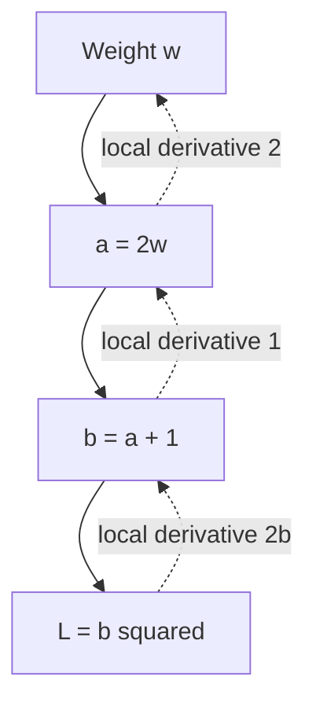

# 2. How a neural network learns: derivatives, autograd, and optimization

[Previous](01-foundations-and-tensors.md) · [Course index](../README.md) · [Next: reliable training](03-data-training-and-evaluation.md)

## The problem we are solving

Chapter 1 calculated predictions using coefficients we chose. That is a numerical program, but it has not learned. We now need a systematic way to improve those coefficients using examples. Trying every possible combination is impossible for a large model. Moving parameters in random directions wastes information. A derivative supplies something more useful: a local description of how the objective responds when a parameter changes.

We will move slowly from the slope of one scalar function to the training of a small multilayer network. Along the way, we will derive the learning rule, inspect exactly what PyTorch records, distinguish differentiation from optimization, and connect common losses to probability. The important result is being able to read a training loop as a mathematical process rather than as a memorized sequence of five method calls.

## 2.1 A derivative measures local sensitivity

Take the function `f(w) = (w - 3)^2`. Its value is small near three and larger farther away. The derivative is `f'(w) = 2(w - 3)`. At zero, the derivative is negative six. For a sufficiently small positive change in `w`, the function therefore decreases. At five, the derivative is positive four, so a sufficiently small negative change decreases it.

Formally, the derivative is the limit of a difference quotient:

\[
f'(w)=\lim_{h\to0}\frac{f(w+h)-f(w)}{h}.
\]

The quotient measures average slope over a short interval. Taking the limit isolates local slope. This definition explains why a derivative is local information. It does not promise that a large step in the suggested direction will improve the function. Curvature can make a step overshoot, and a complicated objective can have many different regions.

```python
def objective(weight):
    return (weight - 3.0) ** 2

weight = 0.0
step = 1e-5
finite_difference = (objective(weight + step) - objective(weight - step)) / (2 * step)
exact_derivative = 2 * (weight - 3.0)
print(finite_difference)
print(exact_derivative)
```

Both results are approximately negative six. This program uses a central difference: evaluate on both sides and divide their difference by the total interval. Finite differences are useful for checking derivatives but expensive for millions of parameters and vulnerable to numerical cancellation if the interval is too small. Automatic differentiation uses the actual sequence of operations instead.

## 2.2 Gradient descent follows the local downhill direction

For a scalar parameter, gradient descent updates

\[
w_{t+1}=w_t-\eta f'(w_t),
\]

where eta is a positive learning rate. The minus sign chooses the locally decreasing direction. At zero with learning rate `0.1`, the new value is `0 - 0.1 × (-6) = 0.6`. This moves toward three without jumping all the way there. Repeating the rule approaches the minimum for this simple function with an appropriate rate.

```python
weight = 0.0
learning_rate = 0.1
for iteration in range(8):
    loss = (weight - 3.0) ** 2
    gradient = 2 * (weight - 3.0)
    print(iteration, round(weight, 4), round(loss, 4))
    weight -= learning_rate * gradient
```

The printed objective decreases. The update happens after reporting the current value, so each row describes a consistent pre-update state. Training logs often mix values measured at different points in an iteration; keeping this timing clear helps interpret them.

For several parameters, collect their partial derivatives into a gradient vector. A partial derivative changes one coordinate while holding the others fixed. If a model has weight and bias, the gradient contains one derivative for each. For a weight matrix, the gradient has that matrix's shape. The same update rule acts on every coordinate.

Why does the negative gradient make sense? A first-order approximation gives `f(w + delta) ≈ f(w) + gradient · delta`. Choosing `delta = -eta × gradient` makes the change approximately `-eta × ||gradient||²`, which is nonpositive. The approximation becomes less accurate for larger moves. This is the mathematical reason learning rate matters rather than merely being a tuning convention.

## 2.3 Deriving linear regression gradients

Let predictions be `prediction_i = x_i × w + b`, and use mean squared error across `B` observations. The objective is

\[
L(w,b)=\frac1B\sum_i(wx_i+b-y_i)^2.
\]

Define the residual `r_i = wx_i + b - y_i`. Differentiating a square gives twice its argument, and differentiating the residual with respect to weight gives `x_i`. The chain rule therefore yields

\[
\frac{\partial L}{\partial w}=\frac2B\sum_i r_i x_i,
\qquad
\frac{\partial L}{\partial b}=\frac2B\sum_i r_i.
\]

This calculation is worth understanding. The weight derivative combines errors with their corresponding inputs. The bias derivative combines errors directly because a unit change in bias shifts every prediction by one. The average comes from the objective's reduction; changing the reduction changes gradient magnitude.

```python
import torch

inputs = torch.tensor([1.0, 2.0, 3.0])
targets = torch.tensor([3.0, 5.0, 7.0])
weight = torch.tensor(0.0)
bias = torch.tensor(0.0)

for _ in range(200):
    residual = inputs * weight + bias - targets
    gradient_weight = 2 * (residual * inputs).mean()
    gradient_bias = 2 * residual.mean()
    weight -= 0.05 * gradient_weight
    bias -= 0.05 * gradient_bias

print(weight.item(), bias.item())
```

The parameters approach two and one. Exact final decimals depend on the finite iteration count. This is still learning even though no autograd or neural network module appears. A framework is not what defines learning; the data-dependent parameter update does. Autograd will replace our derivative bookkeeping while preserving the same mathematical objective.

## 2.4 The chain rule explains backpropagation

Suppose `a = 2w`, `b = a + 1`, and `L = b²`. The derivative of `L` with respect to `b` is `2b`. The derivative of `b` with respect to `a` is one. The derivative of `a` with respect to `w` is two. Multiply along the path to obtain `dL/dw = 4b`.

If a quantity contributes to the loss through multiple paths, add the contributions. For example, `L = w² + 3w` has two paths from weight to loss. Their derivatives are `2w` and three, giving `2w + 3`. Multiplying along a path and adding across paths is the core bookkeeping of reverse-mode automatic differentiation.

A neural network is a large composition of operations. Backpropagation traverses those operations backward, applying local derivative rules and accumulating contributions. It does not use symbolic algebra to produce a human-readable expression for the entire network. It also does not estimate gradients by perturbing every weight. It reuses intermediate numerical values from the executed forward computation.



The diagram shows one dependency chain, with forward calculation and backward sensitivity on the same nodes. Actual networks branch and merge. The chain rule still applies, and shared parameters receive the sum of all applicable path contributions.

## 2.5 Autograd records the executed calculation

PyTorch tensors can request gradient tracking through `requires_grad=True`. Operations on them can create a computation graph. Calling `backward()` on a scalar result computes derivatives with respect to participating leaf tensors and accumulates them in their `.grad` attributes.

```python
import torch

weight = torch.tensor(2.0, requires_grad=True)
intermediate = 2 * weight + 1
loss = intermediate.square()
loss.backward()

print(loss.item())
print(weight.grad.item())
print(weight.is_leaf, intermediate.is_leaf)
```

The loss is twenty-five. The gradient is twenty because `4 × (2 × 2 + 1) = 20`. Weight is a leaf: it was created directly as a gradient-requiring input. Intermediate is not a leaf because an operation produced it. Nonleaf tensors do not ordinarily retain `.grad` for inspection; call `retain_grad()` before backward if inspecting one is necessary.

The graph represents what actually ran. Python conditionals and loops can therefore influence its structure on each forward pass. This flexibility is one reason eager PyTorch is convenient for experimentation. It does not make every Python operation differentiable. Converting values to ordinary numbers, constructing a new tensor from detached values, or entering NumPy can sever the graph.

A fresh forward pass usually creates a fresh graph. Backward normally releases saved intermediates it no longer needs. Calling backward twice on the same graph can therefore fail unless the graph was retained. For ordinary training, compute a new forward pass each iteration. Adding `retain_graph=True` everywhere hides lifetime mistakes and can consume substantial memory.

## 2.6 Gradients accumulate; parameters do not update themselves

There are three distinct actions: compute a forward result, calculate derivatives, and update parameters. `backward()` performs the second. It does not perform the third. Repeated backward calls add to existing gradients, which is useful for some accumulation strategies and wrong when accidental.

```python
import torch

weight = torch.tensor(2.0, requires_grad=True)
(weight ** 2).backward()
print(weight.grad.item())
(weight ** 2).backward()
print(weight.grad.item())
weight.grad = None
(weight ** 2).backward()
print(weight.grad.item())
```

The values are four, eight, and four. Each square in this program creates its own graph, so it is not the repeated-backward-on-one-graph problem. The accumulation happens in the leaf's gradient storage. Setting the gradient to `None` clears it for the next independent calculation.

The simplest autograd training loop can update values manually under a no-gradient context:

```python
import torch

inputs = torch.tensor([1.0, 2.0, 3.0])
targets = torch.tensor([3.0, 5.0, 7.0])
weight = torch.tensor(0.0, requires_grad=True)
bias = torch.tensor(0.0, requires_grad=True)

for _ in range(200):
    prediction = inputs * weight + bias
    loss = (prediction - targets).square().mean()
    loss.backward()
    with torch.no_grad():
        weight -= 0.05 * weight.grad
        bias -= 0.05 * bias.grad
    weight.grad = None
    bias.grad = None

print(weight.item(), bias.item())
```

The update itself is not part of the ordinary next objective's computation graph. `torch.no_grad()` expresses that boundary. Without such a boundary, an in-place update on a leaf requiring gradients can be illegal, and recording optimization history can create an unintended differentiable optimization procedure. Higher-order optimization is a valid advanced topic, but it must be intentional.

## 2.7 A neuron is an affine transformation followed by a nonlinearity

A linear layer computes an affine function: a weighted sum plus bias. Calling it linear is common library terminology, although adding a nonzero bias makes it affine in strict mathematics. A neuron usually applies a nonlinear activation to that result. Multiple neurons form a vector-valued layer.

Why add a nonlinearity? Compose two affine transformations without one:

\[
W_2(W_1x+b_1)+b_2=(W_2W_1)x+(W_2b_1+b_2).
\]

The result is another affine transformation. Increasing the number of such layers does not increase the function family in the desired way. A nonlinearity breaks this collapse, allowing networks to represent more complicated relationships.

ReLU computes `max(0, value)`. It leaves positive values unchanged and sets negative values to zero. Its derivative is one on positive inputs and zero on negative inputs; the value at exactly zero requires a convention. ReLU is simple and often effective, but units receiving negative preactivations on all training examples can stop receiving useful gradients.

Sigmoid maps a real value to `(0, 1)`. Tanh maps it to `(-1, 1)`. Both saturate for large magnitudes, where derivatives become small. GELU is a smooth activation commonly used in transformers. There is no universal activation choice; architecture, optimization, initialization, and task interact.

## 2.8 Modules organize parameters and computation

Subclass `nn.Module` to describe a model with named components. Initialize the base class, assign submodules as attributes, and implement `forward`. Calling the model executes its forward path through the module's call machinery, which also supports hooks and other framework behavior.

```python
import torch
from torch import nn

class Regressor(nn.Module):
    def __init__(self, feature_count):
        super().__init__()
        self.hidden = nn.Linear(feature_count, 8)
        self.activation = nn.ReLU()
        self.output = nn.Linear(8, 1)

    def forward(self, features):
        hidden = self.activation(self.hidden(features))
        return self.output(hidden).squeeze(-1)

model = Regressor(feature_count=2)
features = torch.tensor([[1.0, 2.0], [3.0, 4.0]])
print(model(features).shape)
for name, parameter in model.named_parameters():
    print(name, tuple(parameter.shape))
```

The output shape is `[2]`. The first layer receives two features and creates eight hidden features for each example. The second maps those eight to one output. The final `squeeze(-1)` removes only that singleton output dimension. The parameter names reveal the weights and biases of both registered layers.

A plain Python list of modules is not a substitute for `nn.ModuleList` when those components must be registered. Registration makes parameters discoverable, includes them in state dictionaries, and moves them with the parent module. Similarly, assign trainable raw tensors as `nn.Parameter` rather than hoping any tensor attribute will be optimized automatically. Persistent nonparameter tensor state belongs in a registered buffer.

`nn.Sequential` is convenient for a straight composition. A custom class is clearer when there are multiple inputs, residual paths, masks, or intermediate outputs. Neither approach changes the mathematics. Choose the representation that makes the computation and state understandable.

## 2.9 Regression and classification are different output contracts

A regression output estimates a continuous value under an objective such as squared error. A binary classification output commonly starts as one real-valued logit. A logit is an unconstrained score interpreted through the sigmoid function to obtain a probability. Multiclass classification commonly uses one logit per mutually exclusive class and interprets them through softmax.

For binary classification, if `z` is the logit, then

\[
p=\sigma(z)=\frac1{1+e^{-z}}.
\]

The log-odds `log(p / (1-p))` equals `z`. This gives a meaningful interpretation of the unconstrained score. A logit of zero corresponds to probability one half. A positive logit favors the positive class; a negative one favors the negative class.

Binary cross entropy is the negative log-likelihood of the observed Bernoulli outcome:

\[
\ell=-y\log p-(1-y)\log(1-p).
\]

If the true label is one, this penalizes assigning it a small probability. If the label is zero, it penalizes assigning a large probability to one. Use `BCEWithLogitsLoss` with raw logits for numerical stability rather than computing sigmoid and logarithms manually in routine training.

For multiclass classification, softmax produces

\[
p_k=\frac{e^{z_k}}{\sum_j e^{z_j}}.
\]

The classes share a denominator, so their probabilities sum to one. Cross entropy for a class-index target is negative log probability of that target. `CrossEntropyLoss` expects raw logits; do not apply softmax first. With the simple class-index contract, targets are integer class IDs, and logits have shape `[B, C]`.

```python
import torch
from torch import nn

binary_logits = torch.tensor([0.0, 2.0, -2.0])
binary_targets = torch.tensor([0.0, 1.0, 0.0])
print(nn.BCEWithLogitsLoss()(binary_logits, binary_targets).item())

class_logits = torch.tensor([[2.0, 0.0, -1.0], [0.0, 1.0, 3.0]])
class_targets = torch.tensor([0, 2], dtype=torch.long)
print(nn.CrossEntropyLoss()(class_logits, class_targets).item())
print(class_logits.softmax(dim=-1).sum(dim=-1))
```

Both losses are finite. The softmax row sums are approximately one. This demonstration computes probabilities only for interpretation. The loss consumes the original logits. Multilabel classification is different: several labels may be true simultaneously, so independent binary logits and a binary objective are often appropriate instead of one shared softmax.

## 2.10 Numerical stability is part of the formula

The mathematical expression for softmax includes exponentials, which can overflow for large positive logits. Subtracting the largest logit from every entry does not change softmax because the common factor cancels. The stable log-sum-exp identity uses this cancellation to avoid unnecessarily extreme intermediate values.

For logits one thousand and one thousand one, directly exponentiating both is unnecessary. Subtract one thousand one and exponentiate negative one and zero instead. The resulting normalized probabilities are the same in exact arithmetic and much safer in finite precision. Framework loss functions package this reasoning into stable kernels.

Stability is not equivalent to clamping every result until the program stops complaining. Clamping probabilities can change the objective and gradients. Begin with a mathematically stable expression, correct dtypes, and valid inputs. If losses become nonfinite, inspect input scale, learning rate, activation magnitude, and the earliest nonfinite intermediate rather than merely hiding the final symptom.

## 2.11 Optimizers maintain update rules and sometimes state

An optimizer receives model parameters and implements an update algorithm. Stochastic gradient descent uses the current gradient, possibly with momentum and regularization. Adam maintains running estimates of first and second moments of gradients, adapting coordinatewise step sizes. AdamW separates weight decay from the adaptive gradient transformation.

A basic sequence is:

```python
import torch
from torch import nn

torch.manual_seed(11)
model = nn.Linear(2, 1)
optimizer = torch.optim.SGD(model.parameters(), lr=0.01)
features = torch.tensor([[1.0, 0.0], [0.0, 1.0], [1.0, 1.0]])
targets = torch.tensor([2.0, -1.0, 1.0])

for _ in range(100):
    optimizer.zero_grad(set_to_none=True)
    prediction = model(features).squeeze(-1)
    loss = nn.functional.mse_loss(prediction, targets)
    loss.backward()
    optimizer.step()

print(float(loss.detach()))
```

Clearing gradients begins an independent update. Forward computes predictions. Loss reduces disagreement. Backward computes derivatives. Step uses those derivatives to modify parameters. This order is the central training loop. It is useful precisely because each action has one distinct responsibility.

Momentum approximately smooths successive gradients into a velocity. In a narrow curved valley, gradients may alternate strongly across the steep direction while consistently pointing along the valley. Momentum can help maintain useful movement and reduce some oscillation. It also introduces state that must be checkpointed for faithful resumption.

Adam's moment estimates make it convenient for many problems, but they do not remove the need to choose a learning rate or inspect generalization. Weight decay discourages large parameter values, but applying it identically to every parameter type is a modeling choice. Biases and normalization parameters are often assigned separate parameter groups. Start simply and introduce such distinctions for a concrete reason.

## 2.12 Initialization breaks symmetry and controls signal scale

If every hidden neuron starts with identical weights and receives the same gradients, those neurons can remain identical. Random initialization breaks that symmetry. But arbitrary random scale is not harmless: excessively large values can saturate activations or amplify signals, while very small values can shrink signals and gradients through depth.

A rough variance argument explains common initialization schemes. Suppose a neuron sums `F` independent, zero-mean terms. The variance of the sum is the sum of their variances. If each weight has variance proportional to `1/F`, the output variance can remain comparable as feature count changes. Activation behavior modifies the appropriate constant. ReLU discards roughly half of a symmetric input distribution, motivating the familiar Kaiming scaling for suitable assumptions.

```python
import torch
from torch import nn

layer = nn.Linear(32, 16)
nn.init.kaiming_normal_(layer.weight, nonlinearity='relu')
nn.init.zeros_(layer.bias)
features = torch.randn(8, 32)
print(torch.relu(layer(features)).shape)
```

This is a demonstration of explicit initialization, not a requirement to overwrite every library default. Match initialization to how the layer is used. Initializing an output layer as though it were followed by ReLU when it actually supplies logits is not automatically justified. Defaults are a reasonable baseline; a principled change should explain the desired signal behavior.

## 2.13 A complete nonlinear classification example

Exclusive-or is a useful tiny task because a single affine decision boundary cannot separate it correctly. The positive examples are the two off-diagonal corners of a square. The negative examples are the other two corners. A hidden nonlinear layer can create a representation that supports the required separation.

```python
import torch
from torch import nn

torch.manual_seed(19)
features = torch.tensor([[0.0, 0.0], [0.0, 1.0],
                         [1.0, 0.0], [1.0, 1.0]])
targets = torch.tensor([0.0, 1.0, 1.0, 0.0])
model = nn.Sequential(nn.Linear(2, 16), nn.Tanh(), nn.Linear(16, 1))
optimizer = torch.optim.Adam(model.parameters(), lr=0.03)
criterion = nn.BCEWithLogitsLoss()

for iteration in range(1500):
    optimizer.zero_grad(set_to_none=True)
    logits = model(features).squeeze(-1)
    loss = criterion(logits, targets)
    loss.backward()
    optimizer.step()

model.eval()
with torch.no_grad():
    probabilities = model(features).squeeze(-1).sigmoid()
    print(probabilities)
    print((probabilities >= 0.5).long())
```

The intended outcome is low probability at the diagonal corners and high probability at the other two, yielding predicted labels `[0, 1, 1, 0]`. This is a learning demonstration, not a claim about generalization from four points. The chosen width and iterations are generous for visibility; they are not a recommended architecture for real-world tabular data.

The first layer maps two coordinates into sixteen learned hidden features. Tanh changes their geometry nonlinearly. The final affine layer combines those features into a logit. The loss compares logits with floating-point binary labels. During evaluation, sigmoid converts scores to interpretable probabilities and a threshold converts probabilities to decisions. Thresholding happens after learning, not inside the differentiable loss.

## 2.14 Training mode and gradient mode solve different problems

`model.train()` and `model.eval()` change the behavior of modules that depend on training mode, notably dropout and batch normalization. They do not globally enable or disable autograd. Conversely, `no_grad()` disables gradient recording in its block but does not switch dropout or batch normalization into evaluation behavior.

Dropout randomly zeroes some activations during training, with scaling that preserves their expected magnitude under its convention. At evaluation it does not apply that training-time randomness. Batch normalization uses batch statistics during ordinary training and running statistics during ordinary evaluation. The detailed effects matter later; the immediate lesson is that mode and gradient recording are separate axes of control.

For standard validation, use both evaluation mode and a no-gradient or inference context. For special tasks such as input-gradient explanations, you may deliberately use evaluation mode while keeping autograd enabled. Avoid treating one boilerplate pattern as universal. Choose each switch according to what computation you actually need.

## 2.15 Gradient failures and systematic diagnosis

A gradient of `None` and a gradient containing zeros have different meanings. `None` often means no gradient was accumulated for that leaf in the current calculation. Zeros can mean it participated but had zero derivative at the evaluated point. Before concluding that learning is impossible, check graph connectivity, parameter registration, loss construction, and whether gradients were cleared before inspection.

Constructing `torch.tensor(existing_tensor)` is a common accidental graph break. Using `.item()` while calculating a custom loss is another. An `argmax` between model output and loss removes the ordinary continuous path needed for useful supervised gradients. Detaching features is appropriate when freezing an upstream computation but wrong if that upstream component is supposed to learn.

For exploding gradients, inspect loss scale and inputs before adding clipping. Gradient clipping limits an update-related quantity, often the global gradient norm. It is useful for some sequence models but does not correct mislabeled data, a wrong denominator, or an unstable objective. If using mixed precision later, unscale gradients before clipping them.

For vanishing gradients, inspect activation saturation, depth, initialization, and normalization. A smaller learning rate cannot restore a derivative that the model's local computation makes effectively zero. Residual connections and appropriate architecture can improve signal flow, but understanding the specific failure should guide changes.

## 2.16 Optional application: verify one gradient numerically

Before trusting a complicated custom objective, reduce it to a small double-precision calculation and compare autograd against a finite difference. This program checks one parameter in a tiny regression problem:

```python
import torch

inputs = torch.tensor([1.0, 2.0], dtype=torch.float64)
targets = torch.tensor([3.0, 4.0], dtype=torch.float64)
weight = torch.tensor(0.7, dtype=torch.float64, requires_grad=True)

def objective(candidate):
    return (inputs * candidate - targets).square().mean()

loss = objective(weight)
loss.backward()
interval = 1e-6
with torch.no_grad():
    numerical = (objective(weight + interval) - objective(weight - interval)) / (2 * interval)
print(weight.grad.item(), numerical.item())
assert torch.allclose(weight.grad, numerical, atol=1e-5, rtol=1e-5)
```

The assertion expresses the actual property being checked: local derivative agreement within numerical tolerance. It does not prove the objective is the right one for the task. A perfectly differentiated wrong loss is still a wrong loss. In later chapters, we will combine mathematical checks with data contracts and evaluation design to address both kinds of correctness.

## 2.17 What the network has and has not learned

A fitted network stores a numerical relationship in its parameters. Hidden features need not correspond to neat human concepts, and several different parameter settings can implement similar predictions. The training objective selects behavior through examples and inductive biases rather than writing explicit symbolic rules.

Optimization quality and generalization quality can diverge. A large network can lower training loss while becoming less reliable on new observations. Conversely, a useful model may retain nonzero training loss because observations contain noise or the task is ambiguous. Zero loss is not the definition of success. Choose evaluation metrics and a data split that reflect the intended use.

The next chapter preserves this exact learning mechanism but places it inside a dependable experiment. Data loading, validation, metrics, reproducibility, and checkpointing are part of understanding PyTorch, because they determine whether the derivatives you just learned to calculate lead to a useful result.

## 2.18 A matrix derivative you can reconstruct

For a batch of linear predictions, write `P = XW + b`, with input shape `[B, F]`, weight shape `[F, O]`, bias shape `[O]`, and prediction shape `[B, O]`. Suppose the objective averages squared error over all `B × O` output entries. Let `R = P - Y`. The derivative with respect to each prediction entry is `2R / (B × O)`. Call this tensor `G`.

Now inspect one weight entry `W[j, k]`. It influences prediction column `k`, and the sensitivity of prediction `P[i, k]` to that entry is input `X[i, j]`. Sum over examples to get the derivative. In matrix notation the result is `X.T @ G`, with shape `[F, O]`. The bias derivative is `G.sum(dim=0)`, because each bias entry shifts the corresponding output column for every example.

This derivation also explains why transpose appears in backward formulas. The transpose is arranging matching example indices so their contributions can be summed. It is not an arbitrary convention inserted by the framework. Shape reasoning provides a useful consistency check: a derivative with respect to a parameter must have that parameter's shape.

```python
import torch

torch.manual_seed(3)
features = torch.randn(4, 2, dtype=torch.float64)
weights = torch.randn(2, 3, dtype=torch.float64, requires_grad=True)
bias = torch.randn(3, dtype=torch.float64, requires_grad=True)
targets = torch.randn(4, 3, dtype=torch.float64)
predictions = features @ weights + bias
loss = (predictions - targets).square().mean()
loss.backward()
with torch.no_grad():
    gradient_output = 2 * (predictions - targets) / predictions.numel()
    expected_weight = features.T @ gradient_output
    expected_bias = gradient_output.sum(dim=0)
assert torch.allclose(weights.grad, expected_weight)
assert torch.allclose(bias.grad, expected_bias)
```

Changing the loss to a sum would remove the denominator. Averaging only over examples while summing output dimensions would give another scale. All are differentiable, but they imply different update magnitudes. When reproducing a paper or comparing implementations, read reduction definitions as part of the mathematical specification.

## 2.19 Why cross entropy gives a useful learning signal

Consider one multiclass observation with logits `z` and true class `c`. Its loss is `log(sum(exp(z))) - z[c]`. The derivative of the first term with respect to logit `k` is softmax probability `p[k]`. The derivative of the second term is one if `k` is the true class and zero otherwise. Therefore the logit gradient is `p[k] - indicator(k == c)`.

This is a compact interpretation of learning from classification. If the true class currently receives probability one tenth, its logit derivative is negative nine tenths. A downhill update tends to increase that logit. For an incorrect class receiving probability six tenths, its derivative is positive six tenths, so the update tends to decrease it. The strength of the correction reflects the model's current allocation of probability.

This explanation also reveals why applying a second softmax before cross entropy is a mistake in the ordinary contract. The loss would treat already normalized numbers as new logits and normalize again. That changes both predictions and derivatives. A program can remain numerically finite while training a different, less useful objective.

Probabilities also do not imply calibration automatically. A classifier may assign probability nine tenths to a collection of decisions that are correct far less frequently. Cross entropy encourages sensible probabilities under modeling assumptions and sufficient data, but neural networks can still become overconfident. Chapter 3 treats probability quality separately from classification accuracy.

## 2.20 A minibatch gradient is an estimate

Until now our examples have used every observation in every update. For a large dataset, this is expensive and sometimes unnecessary. A minibatch computes an average objective over a subset. If observations are sampled appropriately, its gradient estimates the gradient of the full empirical average. Individual estimates fluctuate because different examples contribute different errors.

The fluctuation is not merely a defect. It changes the optimization trajectory and can interact with generalization, but it also makes loss curves noisy. A single batch with larger loss does not prove that learning has reversed. Compare aggregated training statistics and held-out metrics over a meaningful interval.

Batch size controls several quantities at once: the amount of data processed per update, the variance of the estimate, memory use, and accelerator utilization. It also changes the number of updates per epoch. Doubling batch size while keeping the number of epochs fixed halves the approximate number of optimizer steps. Consequently, batch size experiments should report both examples processed and updates performed.

A learning rate suitable for one batch size may not suit another. Rules such as scaling learning rate with batch size are heuristics tied to particular regimes, not algebraic identities. Begin with a stable baseline and change one factor at a time so observed differences have a plausible explanation.

## 2.21 Interpreting a stuck training run

Suppose binary cross entropy stays near the value associated with uncertain predictions. That observation has several possible explanations. The model might be receiving no informative features, labels might be randomized, parameters might not be registered, the optimizer might reference an old model instance, or gradients might be cleared after backward and before the update. The scalar alone cannot distinguish these cases.

A useful diagnostic sequence starts with one fixed batch. Print its actual values and labels. Run forward once and inspect the logits. Backpropagate and inspect a representative gradient. Copy a parameter before an optimizer step, then confirm that its values changed afterward. Finally, train repeatedly on only that batch. A sufficiently expressive model should usually fit a tiny consistent dataset; failure to do so points toward an optimization or implementation issue before a generalization issue.

The converse diagnostic is equally valuable. If the tiny batch is memorized but validation is poor, the gradient mechanism is probably functioning. Attention should shift toward splitting, label quality, distribution shift, regularization, and model suitability. Debugging becomes faster when each experiment is designed to eliminate a class of explanations instead of merely generating another training curve.

### Parameters belong to a particular model instance

An optimizer retains references to the parameters supplied when it was constructed. If a notebook cell creates a new model but continues using an optimizer from an older cell, backward can populate gradients on the new model while the optimizer still owns the old parameters. Nothing about the variable name `model` reconnects those references. Construct the optimizer after constructing the intended model and after making any changes that replace parameter objects.

This is also a reason to favor a clean script when a notebook becomes difficult to reason about. Restarting and running cells in order can reveal hidden state dependencies. Reproducible code should describe how the objects are created, rather than relying on an accidental history of interactive execution. The mathematical learning rule and the Python object graph must refer to the same parameters.

## Sources

Original derivations and examples support the teaching above. API contracts were checked against [autograd mechanics](https://docs.pytorch.org/docs/2.15/notes/autograd.html), [CrossEntropyLoss](https://docs.pytorch.org/docs/2.15/generated/torch.nn.CrossEntropyLoss.html), and the official [basics course](https://docs.pytorch.org/tutorials/beginner/basics/intro.html), accessed November 12, 2026. The [source register](../SOURCES.md) documents version limitations.
