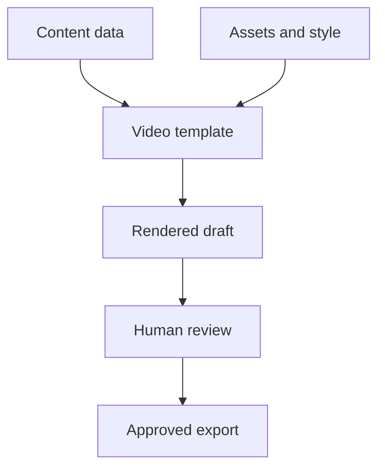

# Lesson 13: Templates, Data, and Video Automation

A short promotional video might exist in three versions: one for each product feature. If every version is edited separately, a correction to the logo, a font change, or a change in duration has to be repeated three times. The problem becomes more serious when there are hundreds of videos. However, automation does not mean surrendering creative control. It means deciding which properties can safely vary, expressing those properties as data, and keeping the visual and editorial rules in one place.

In this lesson you will build the mental model for a reusable video system, design a data format, validate it, compute timing, and run a controlled batch. We will use small dependency-free JavaScript examples first, because the underlying principles apply whether the renderer is Remotion, HyperFrames, or another engine. Later we will connect the data to Remotion and discuss HyperFrames without pretending their parameter APIs are interchangeable. The examples assume Node.js is installed; use a recent supported version and follow the documentation for your chosen renderer.

## 1. Begin with the production problem

Imagine that you make developer education videos. Each one has the same basic structure: a hook, an explanation, and a closing card. The copy, colors, and optional illustration change. You want three versions:

- “What is a database index?”
- “What does a cache do?”
- “Why use a message queue?”

A tempting plan is to duplicate a project directory three times. Initially, this appears simple. Each copy is independently editable, and no data modeling is needed. But after a few changes, the versions drift: one contains an older logo, another uses different margins, and one renders at the wrong frame rate. The problem is not duplication by itself; sometimes a unique video should be a unique project. The problem is duplication of rules that you intend to keep consistent.

A template is a set of shared rules for generating a class of outputs. The data specifies which instance you want. A renderer evaluates the rules and data over time to generate frames. A review process checks that the resulting instance actually communicates well.



The arrows also indicate ownership. A factual correction belongs in content data; a universal font adjustment belongs in the template; a replacement screenshot belongs in the asset set. Keeping those responsibilities separate makes changes easier to reason about.

## 2. Identify what should vary

Before writing code, list repeated elements and candidate variables. An example:

| Property | Shared rule or per-video data? | Reason |
| --- | --- | --- |
| Output width, height, and FPS | Shared configuration, with explicit overrides | Most videos target the same format; a new platform may need a variant. |
| Main headline and supporting text | Per-video content | The lesson changes each time. |
| Maximum headline length and layout | Shared validation and design | A layout that looks good for three words may fail with thirty. |
| Narration recording | Per-video asset | The narration contains different words and durations. |
| Font choice and brand palette | Shared style | A consistent series should feel related. |
| Emphasis color | Shared default or validated override | A variation may be intentional, but arbitrary contrast can make text unreadable. |
| Scene timings | Computed defaults with explicit input | Narration may require a longer hold. |
| Opening hook's visual idea | Sometimes unique | A rigid template can force an inappropriate story. |

Notice that “shared” does not mean “never changes.” It means there is a default authority. A template might have a default palette and allow an explicit override from an approved list. In contrast, if every video needs a totally different narrative and composition, it may be better to reuse smaller components than force the work into one large template.

A useful test is to ask: “Would two people reasonably expect this change to affect every video?” If yes, centralize it. If no, it is a good candidate for per-video data. This is a design judgment, not a law. Keep the number of options small enough that you can validate and maintain them.

## 3. Model a video as data

Create a directory and a file called `video.json`:

```json
{
  "id": "database-index-01",
  "title": "Find data faster",
  "subtitle": "An index helps locate matching rows",
  "accent": "teal",
  "fps": 30,
  "scenes": [
    { "id": "hook", "seconds": 3 },
    { "id": "explain", "seconds": 5 },
    { "id": "outro", "seconds": 2 }
  ]
}
```

The `id` is a stable identifier used for naming and tracking; it should not be arbitrary file path text. The title and subtitle are visible content. `accent` selects an approved style rather than a free-form CSS string. `fps` defines how time is converted to frames. The scenes provide a proposed structure and their durations. A real system may include narration file references, captions, a source list, review state, and different layout variants. Start small: every field creates a responsibility to validate, document and maintain it.

Data should express intent, not the renderer's every internal decision. For example, “make the explanation last five seconds” is a reasonable production input. Storing the exact pixel coordinates of every word in JSON might be appropriate for a graphical editor, but for a simple reusable series it would shift design responsibility out of the template and into each content record. That can make global improvements difficult.

### Data, configuration, assets, and secrets

These categories are related but have different lifecycles. Content data is the text or values that vary per video. Configuration describes render behavior such as a destination directory or concurrency. Assets are files such as images and sound. Secrets are credentials used to contact services. Keep credentials out of the content file and out of Git history. Use your environment's supported secret manager or environment variables, and never print secrets in logs. A local JSON file containing a public title is not a suitable place for an API key.

## 4. Validate before rendering

A renderer can fail after spending minutes loading assets or generating frames. Worse, it can succeed while creating an incorrect or unreadable video. Validation shifts cheap, objective checks earlier. It does not replace visual review: a program can check that a string is 70 characters long, but cannot reliably decide whether the phrase is compelling or whether it wraps well in the selected font.

Save the following as `validate-video.mjs` next to `video.json`:

```js
import { readFile } from 'node:fs/promises';

const allowedAccents = new Set(['teal', 'violet', 'orange']);
const requiredSceneIds = ['hook', 'explain', 'outro'];

function validateVideo(value) {
  const errors = [];
  if (!value || typeof value !== 'object' || Array.isArray(value)) {
    return ['The video must be a JSON object.'];
  }
  if (typeof value.id !== 'string' || !/^[a-z0-9-]+$/.test(value.id)) {
    errors.push('id must contain only lowercase letters, digits, and hyphens.');
  }
  for (const field of ['title', 'subtitle']) {
    if (typeof value[field] !== 'string' || !value[field].trim()) {
      errors.push(`${field} must be non-empty text.`);
    }
  }
  if (typeof value.title === 'string' && value.title.length > 70) {
    errors.push('title exceeds the editorial limit of 70 characters.');
  }
  if (!allowedAccents.has(value.accent)) {
    errors.push('accent must be teal, violet, or orange.');
  }
  if (!Number.isInteger(value.fps) || value.fps < 1 || value.fps > 60) {
    errors.push('fps must be an integer between 1 and 60.');
  }
  if (!Array.isArray(value.scenes)) {
    errors.push('scenes must be an array.');
  } else {
    const ids = value.scenes.map((scene) => scene?.id);
    if (JSON.stringify(ids) !== JSON.stringify(requiredSceneIds)) {
      errors.push('scene order must be hook, explain, outro.');
    }
    for (const scene of value.scenes) {
      if (!Number.isFinite(scene?.seconds) || scene.seconds <= 0) {
        errors.push('each scene needs a positive, finite seconds value.');
      }
    }
  }
  return errors;
}

try {
  const source = await readFile(process.argv[2] ?? 'video.json', 'utf8');
  const video = JSON.parse(source);
  const errors = validateVideo(video);
  if (errors.length) {
    for (const error of errors) console.error(`- ${error}`);
    process.exitCode = 1;
  } else {
    console.log(`Validated ${video.id}`);
  }
} catch (error) {
  console.error(`Could not read or parse video: ${error.message}`);
  process.exitCode = 1;
}
```

Run `node validate-video.mjs video.json`. For the sample, the output is `Validated database-index-01`. Change `fps` to `0`, run it again, and it exits with a nonzero status and an explanation. This exit status matters when the script becomes part of a larger batch: the next step can stop before rendering.

Walk through the structure. `readFile` loads text; `JSON.parse` turns the text into JavaScript values. `validateVideo` accumulates multiple useful errors rather than stopping on the first invalid field. The regular expression restricts the identifier, reducing the risk of accidentally generating unexpected output paths. `Number.isFinite` rejects values that cannot represent a useful finite duration. The `try` block catches a missing file or malformed JSON, while validation reports data that is syntactically valid JSON but violates our rules.

The maximum title length is a production choice, not a universal design rule. You might choose a different threshold after testing your typography, language and screen size. Character count is only a rough signal: “WWW” takes more horizontal space than “iii” in many fonts. Render the real text and inspect it. Production systems often use a schema validation library, but the important concept comes first: reject unexpected inputs with actionable errors before work begins.

A subtle issue is unknown properties. Our example tolerates them. A strict schema could reject misspellings like `subtitel` rather than silently ignoring them. It can also validate Unicode length, locale-specific copy and asset references. Document the decision so content authors know what to expect.

## 5. Convert time into a frame budget

At 30 frames per second, a scene of three seconds occupies 90 frames. The first frame of that scene is local frame 0 and the last is local frame 89. Its endpoint is 90, but frame 90 belongs to the next scene. This is a half-open interval: `[0, 90)`. It avoids assigning the same frame to two scenes unintentionally.

```js
function buildTimeline(scenes, fps) {
  let cursor = 0;
  return scenes.map(({ id, seconds }) => {
    const durationInFrames = Math.round(seconds * fps);
    if (durationInFrames < 1) {
      throw new Error(`Scene ${id} rounds to fewer than one frame.`);
    }
    const scene = { id, from: cursor, durationInFrames };
    cursor += durationInFrames;
    return scene;
  });
}

console.log(buildTimeline([
  { id: 'hook', seconds: 3 },
  { id: 'explain', seconds: 5 },
  { id: 'outro', seconds: 2 },
], 30));
```

The output has starts at frames 0, 90 and 240, and durations of 90, 150 and 60 frames. The total is 300 frames, or 10 seconds. The function uses a cursor, so the next scene starts where the previous one ends. It intentionally performs no crossfade. If a transition overlaps scenes, the timeline must explicitly account for overlap rather than summing every duration as if scenes were disjoint.

Rounding is important. A duration of 0.333 seconds at 30 fps becomes about 9.99 frames, rounded to 10. Repeating rounding for many short segments can accumulate drift from the intended total. One remedy is to calculate absolute boundaries in seconds, convert those boundaries to frames, and compute each duration by subtraction. For narration or music, align to the actual audio and check the last frame, rather than trusting a hand-written script estimate.

When the source audio is 29.97 fps video or uses a variable frame rate, practical conversion can be more subtle. Store a common authoritative time base, inspect the source, and choose a deliberate output FPS. Do not claim that changing a number in metadata alone produces correctly timed media.

## 6. Connect validated data to a Remotion composition

A Remotion composition is a React component evaluated at a particular frame. The conceptual flow is: read approved props, calculate visual state from frame and settings, and return markup for that frame. Here is a deliberately small component to add to an existing Remotion project. It is a component fragment: it assumes the project has a registered composition and receives the specified props; the preceding lessons cover project setup.

```tsx
import React from 'react';
import { AbsoluteFill, interpolate, useCurrentFrame, useVideoConfig } from 'remotion';

type HookProps = { title: string; accent: string };

export const Hook: React.FC<HookProps> = ({ title, accent }) => {
  const frame = useCurrentFrame();
  const { fps } = useVideoConfig();
  const opacity = interpolate(frame, [0, fps], [0, 1], {
    extrapolateLeft: 'clamp', extrapolateRight: 'clamp',
  });
  return (
    <AbsoluteFill style={{
      background: '#101827', color: 'white', justifyContent: 'center',
      alignItems: 'center', padding: 80, fontFamily: 'sans-serif',
    }}>
      <div style={{ opacity, borderLeft: `12px solid ${accent}`, paddingLeft: 32 }}>
        {title}
      </div>
    </AbsoluteFill>
  );
};
```

The `title` is data, while the shared layout is code. `frame` is the time input; `fps` lets the fade last approximately one second for any configured frame rate. `interpolate` maps frame 0 to opacity 0 and frame `fps` to opacity 1, and clamping prevents values outside that range. The border uses `accent`, but a production system should map a validated token such as `teal` to a known CSS color in the template; do not pass arbitrary untrusted CSS straight through. Use a visibly readable font size in the full project, and inspect long and non-English strings.

The component can be placed inside a sequence. A sequence changes the child's local time: if the hook starts at parent frame 90, its local frame is normally 0 at that point. This makes the component reusable without rewriting timing arithmetic. Remember that passing a duration into an input JSON file does not automatically update a registered composition's duration. Configure metadata according to the installed Remotion version and verify the output duration. Remotion's APIs and licensing evolve: consult [Remotion documentation](https://www.remotion.dev/docs/) and its [license](https://www.remotion.dev/docs/license/pricing).

### Data in HyperFrames

The same input design can serve an HTML-based composition, but HyperFrames uses its own composition schema and time-seeking rules. Do not mechanically paste the React component into a HyperFrames file or assume Remotion's prop APIs are supported. Instead, consult the current [HyperFrames quickstart](https://hyperframes.app/docs/1-startup/2-quickstart), schema, and variable documentation, then map validated content into the composition using the supported interface. A render of the template's frames should remain reproducible when the same time and inputs are supplied. Lint and inspect the result, including changes to text length and media duration.

One portable alternative is to generate a set of static, escaped HTML data fragments at build time and load them into a project, provided the actual composition follows the framework's current rules. Be careful: untrusted HTML is code, not plain text. Prefer APIs that set text content, and never insert arbitrary data as executable scripts. A text string containing `<script>` should appear as text, not run as JavaScript.

## 7. Design the batch process

A batch is not just a loop that starts renders. It is a controlled process with a manifest, validation, a work queue, output names, logs, failure handling and review. A sensible first batch has three videos, a single renderer process, and inexpensive placeholder assets. Only increase volume after the results are predictable.

A manifest might look like this:

```json
{
  "batchId": "developer-tips-2026-01",
  "items": [
    { "input": "inputs/index.json", "output": "drafts/index.mp4" },
    { "input": "inputs/cache.json", "output": "drafts/cache.mp4" },
    { "input": "inputs/queue.json", "output": "drafts/queue.mp4" }
  ]
}
```

The batch ID lets you correlate logs and artifacts. Each item maps a content file to an output. This example is conceptual: do not run paths from untrusted manifests without validating that they resolve inside approved input and output directories. Normalize paths, disallow traversal, and do not overwrite important files. On shared systems, isolate jobs and validate media content as well as names.

A simple shell loop illustrates orchestration after a renderer-specific command is available:

```bash
for input in inputs/*.json; do
  node validate-video.mjs "$input" || exit 1
  printf 'Ready for renderer: %s\n' "$input"
done
```

This loop validates each file and prints readiness; it intentionally does not claim to render anything. Quoting `"$input"` preserves spaces. `|| exit 1` stops at the first failure, which may be appropriate for an all-or-nothing production. An alternative is to collect failures and continue with valid inputs, provided the final report clearly identifies missing output. Choose the policy before a large batch, not after silently losing work.

To actually render, connect a version-appropriate CLI command or server API described in your renderer's documentation. Provide input props with the supported mechanism; never construct shell commands by concatenating untrusted titles into a string. Use process APIs with argument arrays. In the logs, capture job ID, template version, validated input identifier, timestamps, exit status and output location. Do not log credentials or personal information unnecessarily.

### Concurrency, throughput and resource limits

One render can use multiple CPU cores or significant memory. Starting ten renders simultaneously may slow all of them, exhaust RAM, or crash the machine. Concurrency is the number of jobs allowed to run at once, while throughput is completed jobs per unit time. More concurrency can improve throughput until resources saturate; beyond that, it may make throughput worse.

Measure one representative render: duration, peak memory, file size, quality and CPU load. Then compare a small number of simultaneous jobs. Reserve capacity for the operating system and other work. If using a hosted renderer or model provider, include queueing, request limits, storage, retries and billing. Never assume that cloud is automatically faster or cheaper.

A retry policy should distinguish transient and permanent failures. A temporary network timeout may justify a bounded retry with a delay. Invalid content or a missing local file will fail repeatedly until corrected, so report it rather than retry forever. If a render writes a partial output, write to a temporary filename and promote it only on successful completion. That prevents a failed job from being mistaken for an approved file.

## 8. Cache carefully and make renders reproducible

Caching means reusing a previous result when the inputs that determine it have not changed. It can avoid re-generating an expensive image or rebuilding an unchanged intro. But a cache key that ignores the template version, font file, renderer version, timing settings or input data can return an outdated video. Conversely, a key that includes the current timestamp guarantees a miss even when nothing meaningful changed.

For a simplified system, a cache key might include hashes of the normalized input JSON, template source, relevant assets and render configuration. In practice, dependency versions and nondeterministic generation may also matter. Record enough information to explain how the output was produced. Do not claim that caching automatically guarantees bit-identical output: browser, encoder, hardware, font and environment differences can affect pixels or binary files.

A reproducible pipeline avoids animation driven by current wall-clock time, unpredictable random values and network responses that change between frames. Generate random values from a fixed seed, or store them as inputs. Download and verify approved assets before rendering. Ensure fonts are available and loaded before capturing frames. Record versions of Node, renderer, fonts and dependencies. A lockfile and a small test render help another machine recreate the project, but they do not by themselves freeze every external dependency.

An AI-generated clip is often best treated as a versioned input asset. A prompt and model name may not be enough to reproduce identical pixels later. Keep the selected output, permissions and provenance, along with any permitted generation settings. Avoid assuming an exact seed or model revision is available across providers.

## 9. Human review and quality gates

Automation is valuable because it makes routine steps repeatable, not because it makes all judgments automatic. Separate checks into three layers:

1. **Input validation:** schema, required fields, allowed colors, references, and expected durations.
2. **Technical checks:** successful process exit, output exists, dimensions, duration, audio presence where required, and no obvious missing assets.
3. **Editorial and visual review:** claims, wording, readability, timing, captions, music, transitions and representation of the product.

For a three-video batch, open all three outputs, not only the first. An unusually long title may overlap only in the second; a missing voiceover may occur only in the third. Extracting representative frames is useful, but a still image cannot reveal a jarring transition or a silent audio track. Watch the whole video at least once with sound, then check it on a phone and with sound off.

A review record can be simple:

```json
{
  "videoId": "database-index-01",
  "templateVersion": "1.2.0",
  "status": "needs-revision",
  "issues": [
    "Subtitle overlaps diagram at 00:05",
    "Narration ends before the final line finishes appearing"
  ]
}
```

This record should reference the exact draft being reviewed. Otherwise, someone may approve a previous version while a newer file is published. A production system can use artifact hashes or immutable IDs to tie approval to a specific output. Review does not require an elaborate dashboard; it requires a reliable relationship between an identified file, the decision and the person responsible.

## 10. Budget and licensing

Compute a rough budget before you run a batch. Suppose a generated background costs a hypothetical $0.20 per attempt and you expect four attempts per video. For 50 videos, the estimated background cost is 50 × 4 × $0.20 = $40, before rendering, voice, storage, taxes, and failed jobs. Those numbers illustrate arithmetic only; they are not a current provider quote. If you reuse a single approved background for a series, your cost and visual consistency may improve, but reuse is appropriate only when the content and rights permit it.

Create a manifest for each asset: source, creator/provider, date, license or permission, allowed uses, and any attribution requirements. Confirm whether the license covers commercial distribution, editing, generated derivatives and repeated automated use. Obtain permission for real people's voices and likenesses. Check the current Remotion licensing terms for your specific organization and use case; open-source components and hosted services can have separate terms. If using company recordings or source code, follow applicable authorization and confidentiality rules before uploading them to an AI service.

## 11. An end-to-end example

Let's follow a three-video developer series from idea to deliverable.

First, write a one-sentence promise for each video. “An index helps a database locate matching rows without necessarily inspecting every row” is a qualified teaching statement. It does not claim that every database query always uses an index. The cache video should explain that a cache can avoid repeated expensive work, while acknowledging invalidation and consistency tradeoffs when relevant. The queue video should say that a queue can decouple work, without implying it guarantees exactly-once processing in all systems.

Second, write each input file using the same schema. Give each one a unique ID and an approved accent. Write concise titles and narration. Record source links and have a knowledgeable person review claims. Copy the first record as a starting point, but change the ID and all relevant copy; duplicated IDs are a batch-level validation error that the earlier single-file validator does not detect.

Third, run validation. Confirm no files are missing and collect expected output names. Review the resulting scene durations. If a narration recording takes seven seconds but its scene lasts five, the answer is not to speed up the voice automatically; edit the script, extend the scene, or choose an intentional audio treatment.

Fourth, render low-resolution drafts with placeholder or approved media. Inspect the start, middle and end of every scene. Read captions while listening. If the cache title wraps poorly, change the wording or the layout rule and rerender all affected variants. A template-level change can have unintended consequences, so review more than the item that prompted the change.

Fifth, produce final exports with explicit dimensions, FPS and codec settings, then probe and view the files. Record the exact source version and output path. Archive the input data, relevant source, lockfile and asset manifest. The result is not only three videos; it is a repeatable process that explains how each video was made.

## 12. Ask Claude Code to build the pipeline

Give the agent a bounded task. An agent should not decide to install paid services or upload files unless you intend that action. For example:

```text
In this repository, inspect the existing Remotion project. Design a small
JSON input format for a three-scene developer explainer. Add validation for
IDs, required copy, duration, and approved color tokens. Add a local batch
script that renders only when validation succeeds, using the installed
Remotion CLI's documented input mechanism. Do not introduce paid services or
upload source files. Explain each file, run a small test using local placeholder
assets, render one draft, and inspect representative frames. Report any tests
or rendering you could not perform. Do not claim visual review without images.
```

This prompt gives the agent authority to inspect and edit the repository, defines the workflow, and specifies evidence. It avoids naming an API that may not exist in the installed version. The request to inspect frames means the agent must use a suitable visual inspection tool; a successful command is not itself proof of readability.

A useful follow-up is:

```text
The long title in the second video wraps into the diagram. Explain whether
this should be solved with copy, layout, or a template constraint. Implement
one reversible fix and rerender all affected variants. Show the before/after
frames and the actual duration of each output.
```

The follow-up identifies a concrete observation, requests a design decision and asks for evidence across variants. It also limits the change to the reported problem.

## 13. Ask Codex to build and inspect the same workflow

Codex can use the same specification. If the Remotion skill or plugin is installed in the environment, explicitly ask it to consult the skill and current project conventions; invocation varies by environment.

```text
Use the installed Remotion guidance and inspect this repository first.
Create a reusable, validated three-scene video template with content stored
in JSON. Keep the visual template separate from per-video inputs. Add a
single-worker batch runner that reports each successful or failed render and
never overwrites an existing final export. Use only local assets. Add a README
with exact setup and commands for this project's installed versions. Execute
the validation and one representative render; inspect the resulting frames
and report limitations, costs, and anything not verified.
```

The differences between the two prompts are illustrative, not a claim that one agent is better. What matters is that you provide the same acceptance criteria and compare the actual artifacts. Ask either agent to describe why it chose a data structure, which input drives a particular visual, and how it would diagnose a bad render. Review command changes and dependencies like any other code change.

## 14. Common failure modes

**The template accepts a title that does not fit.** A character limit reduces risk, but real glyph widths and language rules matter. Use responsive layout with sensible bounds, inspect worst cases, and provide an editorial fallback. Never shrink text so far that it becomes unreadable.

**All videos have identical pacing even when narration differs.** Give scene duration a validated input or derive it from approved audio metadata, then add an appropriate buffer. A mechanically computed duration still needs a human listening pass.

**A successful render contains an old asset.** Check cache invalidation, asset paths, input IDs and build logs. Associate outputs with source and template versions. Render to a fresh draft directory if unsure.

**A batch generates many bad outputs before anyone notices.** Render and review one representative item first, then a small sample containing edge cases. Only scale when the sample is acceptable. The agent should not equate “job completed” with “video approved.”

**A team stores secrets in a manifest.** Remove the secret from the working file and follow the organization's credential rotation and incident procedures if it has been exposed. Use a secret manager and restrict access; editing a file later does not erase existing Git history or other copies.

**A formula computes the wrong duration.** Write down whether endpoints are inclusive, whether transitions overlap, and which timeline owns each duration. Check actual output metadata and watch the ending. Frames, seconds and samples are different units.

**One requested variant requires a totally different visual story.** A template is a tool, not a rule that every video must obey. Reuse lower-level components or create a separate template if the narrative cannot fit without awkward compromises.

## 15. Takeaways and next step

A scalable video system has explicit inputs, shared visual rules, validated content, predictable timing, controlled rendering, provenance and review. The key abstraction is a separation of responsibilities: the content describes the particular video; the template describes how this class of video is presented; the pipeline decides how to validate, render, record and inspect it.

The next lesson expands the visual vocabulary with vector, 3D, compositing and advanced rendering techniques. You can use the same separation there: a complex effect is still an input and a reproducible visual rule, and a beautiful result still needs an editorial purpose.

### References

- [Remotion documentation](https://www.remotion.dev/docs/) and [current license](https://www.remotion.dev/docs/license/pricing).
- [HyperFrames documentation](https://hyperframes.app/docs/1-startup/1-introduction) and [CLI reference](https://hyperframes.app/docs/5-packages/cli).
- [Node.js documentation](https://nodejs.org/docs/latest/api/) for file and process APIs.

## Further example: plan a safe change to an established series

Suppose you have already rendered a dozen videos and decide that the closing card should hold for three seconds instead of two. First determine where the duration comes from. If each input file explicitly declares a two-second outro, changing a template default may not affect any existing item. If the outro duration is a template constant, the change may affect all videos. Trace the actual input-to-timeline relationship before editing.

Next decide whether the narration and music also need to change. Extending only the picture could create an unexpected silent second; extending the whole sequence might shift a call to action out of sync. Render one representative short title and one unusually long title. Inspect the complete transition into the outro as well as the last frame, and listen to the fade. If the results look good, run the remaining batch. A small preview sample is a decision aid, while the complete batch review is still needed to catch item-specific errors.

Store the revised template under a new version and retain the original inputs. If a video must be reproduced exactly later, identify whether it used the old or new template. This is an example of treating a creative adjustment like an engineering change: understand its scope, evaluate its effects, and keep enough context to explain the result. It does not require a complex infrastructure. A Git commit, locked dependencies, clearly named input files, and a short render log can already make a substantial difference.
