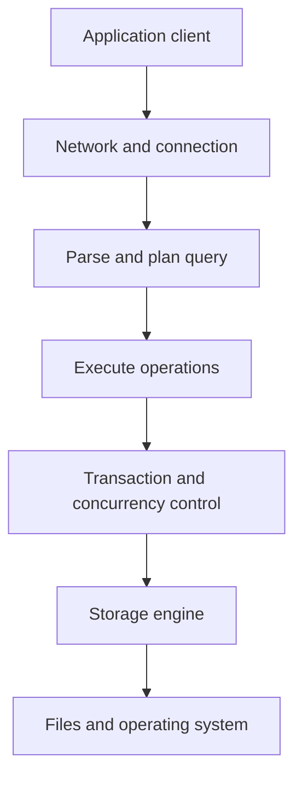
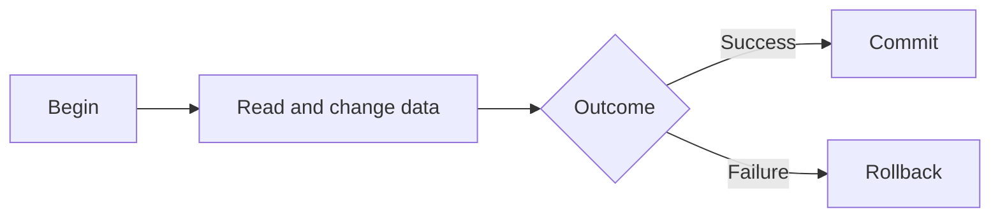
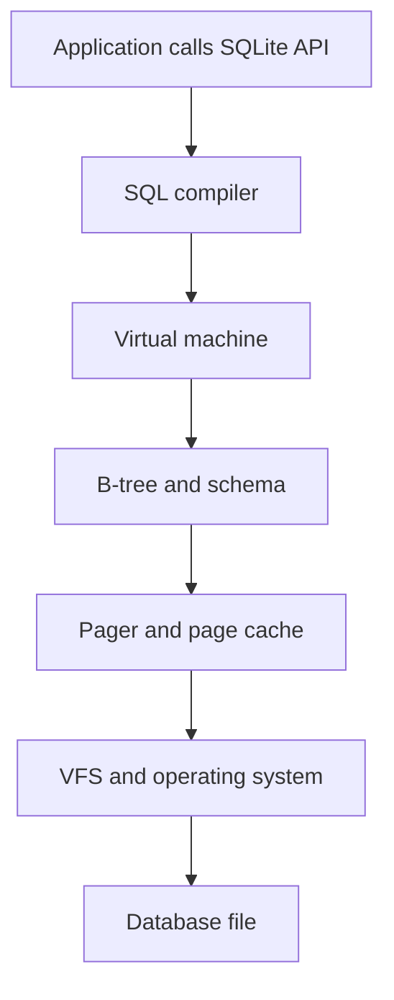

# Database Fundamentals Curriculum

> From: https://chatgpt.com/c/6aecc15b-2540-832a-834d-e1c067f1741d


## You

*2026-11-05 12:48*

📎 pPqazMTzNOM.txt

@First Principles Coding Coach Based on the contents of this video as a curriculum outline and for concepts, teach me database fundamentals from beginner to advanced. I want to learn the internals of databases, the theory behind their performance and computing, etc. I have attached the transcript for your reference


## ChatGPT · gpt-6-luna-wm

*2026-11-05 12:49*

I can use the transcript as the outline, but I couldn’t load the selected Coding Coach’s instructions in this session. I’ve reviewed the transcript itself and will teach from its topics.

## Course path

We’ll build from the job a database has to do, then follow a query through the system and study each part:

1. **What a database is:** data, queries, state, and guarantees  
2. **Database architecture:** client, network, query processing, execution  
3. **Relational data and SQL:** tables, keys, constraints, joins  
4. **Transactions:** ACID, isolation, locks, MVCC, and recovery  
5. **Storage internals:** pages, files, buffer pools, caches, and logs  
6. **Indexes:** B-trees and B+ trees, then LSM trees and their tradeoffs  
7. **Query performance:** plans, selectivity, joins, sorting, and cost  
8. **SQLite internals:** trace statements through its parser, virtual machine, B-tree, pager, and OS layer  
9. **Beyond one machine:** replication, sharding, clusters, and availability  
10. **Putting it together:** diagnose slow queries and reason about database design

The transcript moves quickly into architecture and SQLite debugging. We’ll keep those topics, while adding the groundwork needed to understand why the pieces exist.

# Lesson 1: What is a database?

A database is a system for managing **persistent, shared state**.

- **State** is the information the application needs to remember: users, orders, balances, messages.
- **Persistent** means it should survive a process exit or machine restart.
- **Shared** means multiple parts of a program, or multiple programs, may read and change it.

A plain in-memory variable can hold state, but it disappears when the process ends. A file can preserve data, but once many callers need to find, update, and safely share pieces of that data, the application must solve a growing list of problems itself.

A database packages those problems into a system with a query interface and rules for storing and changing data.

## Why a database is more than a file

Imagine a bank transfer: move $20 from account A to account B. That operation has two changes:

```text
A.balance = A.balance - 20
B.balance = B.balance + 20
```

If the application stops after the first change, money has disappeared. If two transfers update the same balance at once, one update might overwrite the other. If the machine loses power, the application needs to know which changes had actually reached durable storage.

So a useful database needs to answer questions like:

- How do I find the requested records?
- What happens when two operations touch the same data?
- What if a process or machine fails mid-update?
- When does a successful write become durable?
- How can I add more data without rewriting every application feature?

Those questions lead to the database internals we’ll study.

## A first-pass architecture

The transcript describes a common server database flow:



This is a teaching model, not a universal blueprint. Real databases combine or rename components, and some databases—SQLite, for example—are embedded in the application process and don’t need a database server or network layer.

Still, it gives us a useful question to ask at every stage: **what work must happen before the database can safely return a result?**

## Query example: find one customer

Suppose the application asks:

```sql
SELECT name
FROM customers
WHERE customer_id = 42;
```

At a high level:

1. The database checks that the statement is meaningful SQL.
2. It determines a way to find customer 42.
3. It runs that plan, perhaps using an index.
4. It asks the storage layer for the required data.
5. It returns the result to the client.

The key idea is that SQL describes **what result you want**. The database chooses **how to obtain it**. Later, we’ll see how an optimizer compares options such as scanning every row or looking up a key in an index.

## Three ideas to keep separate

The transcript mentions both caching and the buffer manager. They solve related but different problems:

- **Persistent storage** keeps the database’s durable data, usually in files on disk or another durable medium.
- A **buffer pool** holds database pages in memory so the storage engine can work with them without fetching each page from storage every time.
- A **cache** is a broader term for keeping useful data or results in a faster place. A database may have several kinds of caches.

A page is a fixed-size unit that a storage engine reads or writes. The engine typically brings a page into memory before working with its contents. This is why the amount and pattern of storage I/O can strongly affect performance.

One correction to the video’s simplified explanation: modern storage is not always a spinning disk with circular tracks. SSDs and cloud storage work differently at the hardware level. But the central idea still applies: accessing durable storage has different costs from accessing memory, and databases organize data to manage those costs.

## Your mental model for today

When you see a database operation, ask:

1. What is the client asking for?
2. How does the database decide what work to do?
3. Where is the data while it is being processed?
4. What guarantees are needed if several operations overlap or something fails?

Those questions will guide the rest of the course.

**Next lesson:** follow a SQL statement through tokenization, parsing, planning, and execution—and see why two queries that ask for the same result can have very different performance.


## You

*2026-11-12 21:16*

continue


## ChatGPT · gpt-6-luna-wm

*2026-11-12 21:16*

# Lesson 2: From SQL text to executed work

A database doesn’t run a SQL sentence directly. It turns the sentence into a representation it can validate, reason about, and execute.

Let’s follow this query through the process:

```sql
SELECT name
FROM customers
WHERE customer_id = 42;
```

## 1. Tokenization: split the text into pieces

The tokenizer breaks the query into tokens: keywords, names, operators, and values.

```text
SELECT | name | FROM | customers | WHERE | customer_id | = | 42 | ;
```

Tokenization helps the database recognize meaningful pieces. It doesn’t yet tell the database whether they form a valid query.

## 2. Parsing: check the structure

The parser checks whether those tokens follow SQL’s grammar. For example, `SELECT name FROM customers` has a valid structure, but `FROM customers SELECT name` does not.

The parser typically builds a tree-like representation of the query. A simplified version could look like this:

```text
SELECT
├── columns: name
├── table: customers
└── filter: customer_id = 42
```

This tree describes the request, but it still doesn’t specify exactly how to fetch the data.

Parsing also isn’t the same as checking every database object. A statement can be grammatically valid but refer to a table or column that doesn’t exist. The database has to resolve names and types as part of preparing the query.

## 3. Planning: decide how to get the result

The database considers possible execution plans. Suppose `customers` contains a million rows. It might:

- Read every row and check whether `customer_id = 42`.
- Use an index on `customer_id` to find the matching row.

If there’s a suitable index, the second plan will often do much less work. But “often” matters: for some queries or data distributions, an index isn’t the best choice. The optimizer estimates the work and picks a plan based on information such as available indexes and table statistics.

A plan might be pictured as:

```text
Find customer_id = 42 using index
    → fetch matching customer row
        → return name
```

The optimizer chooses a strategy. The execution engine carries it out.

## 4. Execution: perform the plan

The executor follows the plan’s steps. It may request pages from the storage engine, compare values, follow index entries, and produce rows for the client.

The executor doesn’t necessarily handle everything in one big operation. It may produce rows incrementally, so a client can begin receiving results before the entire query finishes.

## Equivalent SQL can mean different work

These queries ask for the same result:

```sql
SELECT name FROM customers WHERE customer_id = 42;
```

```sql
SELECT name
FROM customers
WHERE 42 = customer_id;
```

A database can usually recognize that they are equivalent. But the same request can still be expensive or inexpensive depending on the available plan. If there is no useful index, the database might examine every row. If there is one, it may find the row with far fewer reads.

The important performance question is not just “How short is my SQL?” It is “What work does the database plan to do?”

## A useful distinction: plan versus result

The **query plan** describes the operations the database intends to perform. The **query result** is the data those operations produce.

That distinction helps when investigating performance:

- A correct result tells you the query worked.
- A good plan helps explain whether it worked efficiently.
- An actual execution plan can show what happened, which may differ from the optimizer’s estimates.

We’ll study plans in more depth later. For now, keep an eye out for operations like full table scans, index lookups, joins, and sorts.

## Where SQLite fits

The transcript later traces SQLite’s path through its internals. SQLite is embedded in the application process, so it usually doesn’t have a separate database server or network layer. It still has to interpret SQL and execute it.

In simplified terms, SQLite prepares a statement into bytecode for its virtual machine. The virtual machine executes that program and calls lower-level components, including its B-tree and pager layers. Those layers ultimately interact with the database file through SQLite’s operating-system interface.

So the architecture from Lesson 1 is a model for organizing the ideas. A real database may combine the pieces or give them different names.

## Recap

A SQL query moves through several kinds of work:

1. The **tokenizer** identifies pieces of text.
2. The **parser** checks their structure.
3. The database resolves names and prepares a representation of the request.
4. The **optimizer** chooses a plan.
5. The **executor** runs that plan and produces results.

Next we’ll study the data model underneath these queries: tables, rows, columns, keys, and constraints—and how those choices affect what a database can guarantee.


## You

*2026-11-12 21:28*

continue


## ChatGPT · gpt-6-luna-wm

*2026-11-12 21:29*

# Lesson 3: Tables, rows, keys, and constraints

In the last lesson, we followed a query through parsing, planning, and execution. Now let’s look at the data that query operates on.

A **data model** is a way to describe information and the relationships between pieces of information. Relational databases use tables, rows, and columns. Before exploring other database styles, we’ll learn why this model is useful and what rules it can enforce.

## Tables describe a kind of thing

Suppose an application needs to store customers and orders. We might start with two tables:

```text
customers
+-------------+-------+----------------------+
| customer_id | name  | email                |
+-------------+-------+----------------------+

orders
+----------+-------------+--------+
| order_id | customer_id | total  |
+----------+-------------+--------+
```

Each table represents a kind of entity. Each row represents one instance of it. Each column describes an attribute.

For example:

```text
customer_id = 42
name        = "Aadil"
email       = "aadil@example.com"
```

The table structure is sometimes called a **schema**. It defines which columns exist and what kinds of values they can contain.

## Columns have types

A column’s type defines what kind of value it holds: integers, text, dates, decimals, and so on.

```sql
CREATE TABLE customers (
    customer_id INTEGER,
    name TEXT,
    email TEXT
);
```

Types help the database interpret values and reject some invalid operations. A date can be compared to another date; adding a date to an email address makes no sense.

Exact type behavior differs across databases. Some enforce types strictly. Others, including SQLite in many common configurations, allow more flexibility. We’ll cover those differences when we study specific engines.

## Keys identify and connect rows

A **primary key** identifies one row in a table. It should be unique and not missing.

```sql
CREATE TABLE customers (
    customer_id INTEGER PRIMARY KEY,
    name TEXT NOT NULL,
    email TEXT
);
```

A **foreign key** refers to a row in another table. In the orders example, `orders.customer_id` can refer to `customers.customer_id`.

```sql
CREATE TABLE orders (
    order_id INTEGER PRIMARY KEY,
    customer_id INTEGER NOT NULL REFERENCES customers(customer_id),
    total DECIMAL NOT NULL
);
```

This expresses a relationship: each order belongs to a customer. When foreign key enforcement is enabled, the database can reject an order whose `customer_id` does not exist.

Keys help maintain reliable relationships. They can also affect performance: a database commonly uses an index to enforce uniqueness or efficiently look up referenced rows. We’ll examine how indexes work later.

## Constraints encode rules

A **constraint** is a rule that values or rows must satisfy. For example:

```sql
CREATE TABLE orders (
    order_id INTEGER PRIMARY KEY,
    customer_id INTEGER NOT NULL REFERENCES customers(customer_id),
    total DECIMAL NOT NULL CHECK (total >= 0)
);
```

Here the database enforces three rules:

- `order_id` identifies each order.
- `customer_id` must be present and refer to a customer.
- `total` cannot be negative.

Constraints matter because they put rules close to the data. If several application services write to the same database, relying only on each service to follow the rules can lead to inconsistent records.

## Why split customers and orders into separate tables?

A first attempt might put all the information into one table:

```text
order_id | customer_name | customer_email | total
```

If a customer places ten orders, their name and email appear ten times. That repetition creates risks:

- Updating the email in nine rows but missing the tenth leaves conflicting values.
- Deleting the last order might accidentally delete the only copy of customer details.
- Adding a customer before they place an order becomes awkward.

Putting customers and orders in separate tables reduces this duplication. A customer is stored once; orders refer to that customer by key.

This process of structuring data to reduce unwanted duplication is called **normalization**. It involves tradeoffs: normalized data can require joins to assemble a result, while intentionally duplicated data can sometimes make reads faster. We’ll study when those choices make sense later.

## Relationships and joins

To show each order beside the customer’s name, the database joins the tables using their related keys:

```sql
SELECT customers.name, orders.order_id, orders.total
FROM customers
JOIN orders
  ON orders.customer_id = customers.customer_id;
```

The join condition tells the database which customer belongs with each order. Conceptually, it matches rows where the key values agree. The database may use different physical strategies to perform the join; the optimizer chooses a plan based on the query and available data.

## A key lesson for database design

The schema is more than a place to put values. It states what the data means and which relationships must remain valid.

When designing tables, ask:

1. What real-world things are being represented?
2. Which attributes belong to each thing?
3. How can each row be uniquely identified?
4. Which relationships need to be enforced?
5. Which rules should the database guarantee?

Next we’ll study transactions. We’ll return to the two-account transfer and see how atomicity, consistency, isolation, and durability address failures and concurrent updates.


## You

*2026-11-12 21:29*

continue


## ChatGPT · gpt-6-luna-wm

*2026-11-12 21:29*

# Lesson 4: Transactions and ACID

A database statement can change data, but real tasks often need several changes to succeed or fail together. A **transaction** groups operations into one logical unit.

Consider transferring $20 from account A to account B:

```sql
BEGIN;

UPDATE accounts
SET balance = balance - 20
WHERE account_id = 'A';

UPDATE accounts
SET balance = balance + 20
WHERE account_id = 'B';

COMMIT;
```

Both updates belong to one transfer. If only the first update succeeds, the system has lost $20. A transaction lets the database treat the pair as a unit.

## Atomicity: all or nothing

**Atomicity** means the transaction’s changes are treated as one unit: either all take effect, or none do.

If something goes wrong before `COMMIT`, the application can ask the database to undo the transaction:

```sql
ROLLBACK;
```

From the application’s point of view, the transfer should not appear half completed.

## Consistency: preserve the rules

**Consistency** means a transaction that starts with valid data should leave the database satisfying its defined rules.

Those rules may include constraints such as:

```sql
CHECK (balance >= 0)
```

A database cannot automatically know every business rule. It can enforce rules declared as constraints or implemented in application logic, triggers, or stored procedures. Consistency depends on the whole system correctly enforcing the rules it relies on.

## Isolation: concurrent work should behave predictably

Suppose two customers try to withdraw from the same account at nearly the same time. Each operation reads a balance of $100 and tries to withdraw $80. If both proceed based on that same value, the final balance could be wrong or negative.

**Isolation** describes how concurrent transactions interact. Stronger isolation generally makes transactions behave more like they ran one at a time, but can reduce concurrency or require retries.

Isolation is not one single behavior. Databases offer different isolation levels and mechanisms. Some use locks; many also use **MVCC**, or multiversion concurrency control, which lets readers and writers work with different versions of data. We’ll explore both in a dedicated lesson.

## Durability: committed changes survive failure

**Durability** means that after the database confirms a commit, the change should survive the failures covered by its design.

To provide durability, databases use persistent storage and recovery mechanisms. A commit often involves writing enough information to durable storage so the database can restore a consistent state after a crash.

The exact guarantee depends on the database configuration and storage system. For example, settings that delay or batch writes can change how quickly a commit is made durable.

## How transactions handle a crash

Suppose the database crashes while transferring money. On restart, it must determine whether the transfer committed.

A common technique is a **write-ahead log (WAL)**:

1. The database records change information in a log.
2. It makes the relevant log records durable before relying on the changed data pages being written.
3. After a crash, it uses the log to redo committed changes or undo incomplete work, depending on its design.

The core idea is to keep a recoverable record of the intended changes. We’ll return to logs, pages, and recovery when we study storage internals.

## A transaction’s lifecycle

A simplified transaction flow is:



`COMMIT` and `ROLLBACK` are decisions about the whole transaction. They give the database a boundary around the work it must either make permanent or abandon.

## A practical caution

Keep transactions focused on a coherent unit of work. A transaction held open for a long time may keep locks or old data versions around, interfere with other work, or increase recovery costs. The exact effects vary by database and isolation mode.

## Recap

ACID is a shorthand for four transaction properties:

- **Atomicity:** changes succeed or fail as a unit.
- **Consistency:** declared and implemented rules remain satisfied.
- **Isolation:** concurrent transactions interact according to defined guarantees.
- **Durability:** committed changes survive covered failures.

Next we’ll focus on **isolation and concurrency**: how simultaneous transactions can interfere, how locks prevent some conflicts, and how MVCC lets readers and writers make progress.


## You

*2026-11-12 21:30*

continue


## ChatGPT · gpt-6-luna-wm

*2026-11-12 21:30*

# Lesson 5: Concurrency, locks, and MVCC

A database is often serving many requests at once. **Concurrency** means multiple operations make progress during overlapping periods. They may come from different users, application threads, or services.

Concurrency helps a database use its hardware efficiently. It also creates a correctness problem: if operations overlap, they can observe or overwrite each other’s work.

## A lost update

Suppose an account has a balance of $100. Two transactions each read it, then withdraw $30.

| Step | Transaction 1 | Transaction 2 |
|---|---|---|
| 1 | Reads $100 | |
| 2 | | Reads $100 |
| 3 | Calculates $70 | |
| 4 | | Calculates $70 |
| 5 | Writes $70 | |
| 6 | | Writes $70 |

The final balance is $70, even though $60 was withdrawn. One update was lost.

A database must coordinate access so concurrent work produces results consistent with its isolation guarantees.

## Locks: coordinate access

A **lock** is a mechanism for restricting access to data while an operation is in progress.

A simplified model uses:

- A **shared lock** for reading. Multiple readers may hold shared locks at once.
- An **exclusive lock** for writing. It generally prevents other conflicting reads or writes while held.

For the lost update, a database can prevent both transactions from independently changing the same value without coordination.

Real systems are more complex. Locks may protect rows, index entries, pages, tables, or other resources. Some databases use multiple lock modes and can upgrade a read lock to a write lock. A lock manager tracks these requests and resolves conflicts.

### Deadlocks

Locks can lead to a **deadlock**:

1. Transaction 1 holds a lock on row A and waits for row B.
2. Transaction 2 holds a lock on row B and waits for row A.
3. Neither can proceed.

Databases detect or prevent deadlocks using different strategies. A common response is to abort one transaction, allowing the other to continue. Applications should be prepared to retry transactions that fail for this reason.

## MVCC: keep multiple versions

**Multi-version concurrency control (MVCC)** is another way to coordinate concurrent access. Instead of making every reader wait for a writer, the database can keep multiple versions of a row.

A reader can see a consistent snapshot of the data from a particular point in time. Meanwhile, a writer can create a newer version. Depending on the database and isolation level, readers and writers can often proceed without blocking each other.

Conceptually:

```text
Version 1: balance = 100
Version 2: balance = 70
```

A transaction that began before Version 2 was committed may continue to see Version 1, while a later transaction sees Version 2.

The database must eventually clean up versions that no active transaction can still need. Long-running transactions may keep old versions alive longer, which can increase storage and cleanup work.

## Locks and MVCC are not opposites

It’s easy to think a database either uses locks or MVCC. Many databases use both:

- MVCC can provide snapshots for reads.
- Locks can still coordinate writes or protect particular operations.
- The database’s isolation level determines which changes a transaction can observe and which conflicts it must handle.

The details vary by engine. The same isolation-level name can have differences across products, so when precision matters, consult that database’s documentation.

## Isolation anomalies

Isolation levels describe which surprising outcomes a transaction may observe. Three common examples are:

- **Dirty read:** a transaction reads data another transaction changed but has not committed. If that change rolls back, the reader acted on data that never became permanent.
- **Non-repeatable read:** a transaction reads a row twice and sees different committed values.
- **Phantom read:** repeating a query returns a different set of rows because another transaction inserted or removed matching rows.

A database’s isolation modes permit or prevent different anomalies. Stronger guarantees can require more coordination, which may reduce throughput or cause transactions to wait or retry.

## A practical transaction pattern

For a balance change, prefer a database operation that applies the change as one operation, with constraints protecting valid values:

```sql
UPDATE accounts
SET balance = balance - 30
WHERE account_id = 'A'
  AND balance >= 30;
```

The application should check how many rows were updated. If zero rows changed, the account may not exist or may lack sufficient funds. This avoids relying on a separate read followed later by an update, which can create a race unless both are coordinated in a transaction.

## Recap

- Concurrent transactions can conflict, as in a lost update.
- Locks coordinate access by making some operations wait.
- MVCC keeps versions so transactions can read consistent snapshots while changes occur.
- Databases commonly combine these techniques.
- Isolation level determines the guarantees and tradeoffs.

Next we’ll go down a layer and look at how databases organize persistent data: files, pages, the buffer pool, and why the database usually works on data in memory even when that data is stored on disk.


## You

*2026-11-12 21:30*

continue


## ChatGPT · gpt-6-luna-wm

*2026-11-12 21:31*

# Lesson 6: From database files to pages in memory

SQL operates on tables and rows, but storage devices don’t understand SQL. A database must translate rows into bytes, organize those bytes in files, and move the relevant data into memory when a query needs it.

This lesson follows that path.

## A table is not usually one big text file

A database file contains structured binary data. The storage engine decides how to arrange it so it can find rows, update them, and recover from failures.

A common unit of organization is the **page**: a fixed-size block of data, often several kilobytes. The exact size and layout depend on the database.

A page may hold:

- A header with page-level metadata
- A directory describing where records are stored
- Row data, index entries, or pointers to other pages
- Free space for future inserts or updates

Think of a page as a folder containing several records plus a small index describing where each record sits. The database reads and writes pages as units, even when a query wants only one row.

## Why work in pages?

Suppose a record is 100 bytes and the page size is 8 KiB. One page can hold many records. Reading a whole page can bring nearby records into memory together, which is useful when a query needs several of them.

Page organization also lets the database manage space, track changes, and build structures such as B-trees. We’ll examine those structures in the next lessons.

## The buffer pool

A database generally doesn’t edit data directly on the storage device for every operation. It loads pages into memory first.

The **buffer pool**—also called a buffer cache in some systems—is the area of memory used to hold database pages.

A simplified read works like this:

1. The executor asks for a row or index entry.
2. The storage engine identifies the page containing it.
3. The buffer manager checks whether the page is already in memory.
4. If it is, the database can use that copy.
5. If not, the database reads the page from storage into a buffer frame.
6. The executor accesses the needed bytes in that frame.

A buffer frame is a slot in memory that can hold a page. The database tracks which page occupies each frame and whether the in-memory copy has changed.

## Cache versus buffer pool

In the transcript, the presenter distinguishes a general cache from the buffer manager. That distinction is useful:

- A **buffer pool** holds database pages so the storage engine can read and modify them.
- Other **caches** may hold query results, metadata, plans, or application-level data.

The word *cache* is broad. A database may have several caches with different contents and rules. A buffer pool is specifically about managing pages in memory.

## Dirty pages and eviction

If a transaction changes a page in memory, that page is called **dirty** because its contents no longer match the persisted copy.

The database does not necessarily write every changed page to storage immediately. It can keep dirty pages in memory and write them later. If memory fills up, the buffer manager may need to reuse a frame. Before replacing a dirty page, it must make sure the change is safely recorded and the page can be recovered.

A buffer manager therefore has two related jobs:

- Find a page already in memory or load it.
- Decide which pages can remain and which can be removed from memory.

A page can be evicted only when doing so is safe. Recovery protocols, which we’ll cover later, help ensure that delaying the page write doesn’t lose committed data.

## Why memory and storage both matter for speed

If the needed page is already in the buffer pool, the database avoids a storage read. If it isn’t, the database may need to wait for storage.

That means a query’s speed depends on more than the number of rows it returns. It also depends on:

- How many pages the plan needs
- Whether those pages are already in memory
- Whether the access pattern is sequential or scattered
- Whether pages need to be written
- How much contention exists for memory, storage, or locks

This is one reason indexes matter: a suitable index can reduce the number of data pages that must be read. But an index also takes space and must be updated when data changes.

## A note about disks and SSDs

It’s useful to picture storage as slower than RAM, but specific device details vary. Spinning hard drives have moving heads and rotational delay. SSDs have no spinning platters, but storage access still differs from accessing RAM in latency, throughput, and the way data is managed.

The durable principle is: **memory and persistent storage have different performance and durability characteristics, and a database has to manage the boundary between them.**

## Recap

- Database files contain structured binary data.
- Storage engines organize data into pages.
- The buffer pool keeps pages in memory for processing.
- Modified pages become dirty and must eventually be persisted safely.
- Queries that touch fewer pages often have less storage work.

Next we’ll examine how a database finds the right page efficiently: **indexes**, starting with the B-tree family and the B+ tree design common in database storage engines.


## You

*2026-11-12 21:32*

continue


## ChatGPT · gpt-6-luna-wm

*2026-11-12 21:32*

# Lesson 7: Indexes and the B+ tree

Without an index, finding one row in a table may require checking every row. An **index** is an additional data structure that helps the database locate rows more directly.

An index speeds up some reads by doing extra work when data changes and by using extra storage. We’ll begin with the B+ tree, a common index structure in relational databases.

## The basic problem: find a key

Suppose a table has one million customers, and we need the row whose `customer_id` is 42.

Without an index, the database may scan the table:

```text
check row 1
check row 2
check row 3
...
```

If the matching row is near the end—or absent—the database may inspect most or all of the table.

An index arranges keys so it can narrow down the search. A simplified sorted index might look like:

```text
10, 18, 24, 42, 59, 71, ...
```

But a database index must work with far more data than fits in memory. It needs a structure that can be searched while minimizing storage-page reads.

## Why not use a sorted array?

A sorted array allows binary search, which takes about `log₂(N)` comparisons. For a million values, that’s roughly 20 comparisons.

But if the array is stored on disk, those comparisons may touch different pages. Each page fetch can be much more expensive than a comparison in memory. Also, inserting into a sorted array may require shifting many entries.

Database indexes are designed around pages. They try to make each page access useful by storing many keys and pointers together.

## Tree search

A tree stores keys in nodes and uses comparisons to guide a search down a path.

```text
          [40]
         /    \
   keys < 40  keys >= 40
```

The tree divides the search space. Instead of checking every key, the database compares the search key against values in a node and follows the appropriate child pointer.

A binary tree has at most two children per node. Database trees usually have many children per node so each node can correspond to a storage page and the tree can remain shallow.

## B-tree and B+ tree

B-trees and B+ trees are related, balanced tree structures. Their exact definitions and variants differ across systems. A useful high-level distinction is:

- In many **B-tree** designs, records or record pointers may appear in internal nodes as well as leaves.
- In a **B+ tree**, internal nodes guide the search, while the actual indexed entries are stored in leaf nodes. Leaf nodes are commonly linked in key order.

A simplified B+ tree:

```text
                [30 | 60]
              /     |      \
       [5 ... 29] [30 ... 59] [60 ...]
           ↔           ↔          ↔
             linked leaf pages
```

To find key 42, the database:

1. Reads the root page.
2. Follows the child pointer for the range containing 42.
3. Repeats until it reaches a leaf page.
4. Finds 42 in that leaf.
5. Uses the associated row reference—or the row itself, depending on the database and table organization.

Because each page can contain many keys and pointers, a B+ tree can hold a large number of entries with only a few levels.

## Why linked leaves matter

The leaf pages are connected in key order. That makes range queries efficient.

For example:

```sql
SELECT *
FROM customers
WHERE customer_id BETWEEN 100 AND 200;
```

The database can find the leaf containing 100, then scan forward through adjacent leaf pages until it passes 200. It doesn’t have to restart a tree search for every key.

B+ trees are therefore useful for both:

- Point lookups, such as `customer_id = 42`
- Range scans, such as `customer_id BETWEEN 100 AND 200`

## Inserting and splitting pages

Suppose a leaf page is full and a new key belongs there. The tree must make room. A common strategy is to split the page:

1. Divide the keys between two leaf pages.
2. Add a separator key and new child pointer to the parent.
3. If the parent is full, split it too.
4. If the root splits, create a new root.

This work keeps the tree balanced, so searches don’t degrade into a long chain of pages.

It also shows the cost of an index: inserts and updates may require changes to the tree, and occasionally those changes propagate upward.

## What an index entry points to

The contents of index entries depend on the database. An entry may contain:

- The indexed key and a row identifier
- The indexed key and a primary key
- The indexed key plus enough columns to satisfy some queries directly

Some database table organizations store table data itself in primary-key order. In those designs, a primary-key lookup can lead directly to the row’s leaf page. Other indexes may require a second lookup to fetch the full row.

So an index lookup doesn’t always mean “one page read.” It can involve several index pages and then one or more table pages.

## Indexes are tradeoffs

An index can reduce the work needed to find rows, but it has costs:

- It uses storage.
- Inserts, deletes, and updates may need to maintain it.
- Extra indexes can slow writes.
- The optimizer must decide whether using it helps this query.

An index on a column is not automatically useful for every query involving that column. Selectivity, query shape, table size, and the index’s column order all matter. We’ll cover those when we study query plans.

## Recap

- An index is a data structure that helps locate rows.
- A B+ tree narrows a search through pages of keys and pointers.
- Linked leaves make ordered range scans efficient.
- Indexes trade storage and write work for faster access patterns.

Next we’ll compare B+ trees with **LSM trees**, another design that favors write-heavy workloads by collecting changes efficiently and organizing them in the background.


## You

*2026-11-12 21:34*

continue


## ChatGPT · gpt-6-luna-wm

*2026-11-12 21:34*

# Lesson 8: LSM trees and write-optimized storage

A B+ tree keeps its keys in an ordered structure that supports quick lookups and range scans. But frequent writes can require the database to update that structure in place. For some workloads, it’s cheaper to accept writes quickly and organize them afterward.

That idea leads to **LSM trees**: Log-Structured Merge trees.

LSM trees are common in systems designed for heavy write workloads. They trade some read complexity and background work for efficient writes.

## Start with a log

Imagine a stream of changes:

```text
put("customer:42", "Aadil")
put("customer:17", "Sam")
delete("customer:17")
```

Rather than immediately rearranging a large on-disk tree for every change, the database can record updates sequentially. Sequential writes are often efficient.

A simplified LSM design uses:

- A **write-ahead log (WAL)** for durability
- An in-memory sorted structure, often called a **memtable**
- Immutable, sorted files on disk, commonly called **SSTables**
- A background process called **compaction** that merges those files

Names and details vary by database, but the overall pattern is widely used.

## The write path

A simplified write proceeds like this:

1. Record the change in the WAL so it can be recovered.
2. Apply the change to the in-memory memtable.
3. When the memtable fills, write it to disk as a sorted immutable file.
4. Continue accepting writes into a new memtable.
5. Merge files in the background through compaction.

The WAL lets the system recover recent changes if it crashes before they have been written into the on-disk sorted files.

## Why sorted immutable files?

A memtable is kept sorted by key. When it fills, the database can write it as a sorted file. The file doesn’t need to be modified in place for every later update; new changes go into newer files.

For example:

```text
Newer data: SSTable 3
             SSTable 2
Older data:  SSTable 1
```

If the same key appears in multiple files, the newer version generally takes precedence. A deletion may be represented by a **tombstone**, a marker saying that an older value should be considered deleted.

This makes writes efficient, but a read may need to check several places: the memtable and multiple SSTables.

## Compaction

As files accumulate, the database merges them into larger, more organized files. This is **compaction**.

Compaction can:

- Combine sorted files
- Keep the latest version of each key
- Remove obsolete versions
- Discard tombstones once older copies are no longer needed

Compaction improves some reads and controls file growth, but it consumes CPU, memory, and storage bandwidth. If compaction can’t keep up with incoming writes, the system can accumulate too many files or build up background work. That can hurt read latency and write performance.

## Read path and Bloom filters

To find a key, an LSM database may check:

1. The memtable
2. Recent immutable files
3. Older files

The exact search depends on the database’s file layout and indexes. A **Bloom filter** can help by quickly saying that a file definitely does *not* contain a key. It may say that a file *might* contain it, so the database still needs to check.

Bloom filters can reduce unnecessary file reads, especially for point lookups. They use memory and have a tunable false-positive rate.

## B+ tree versus LSM tree

| Design | Typical strength | Typical cost |
|---|---|---|
| B+ tree | Point lookups and ordered range scans with predictable tree traversal | Writes may update pages in place and cause page splits |
| LSM tree | High write throughput through sequential writes and deferred merging | Reads may check multiple structures; compaction creates background I/O |

These are tendencies, not guarantees. Actual performance depends on the database’s implementation, configuration, hardware, and workload.

An LSM-based database can be excellent for write-heavy workloads, but it isn’t “always faster.” A workload with many reads, broad range scans, or tight tail-latency goals may expose the costs of checking multiple files or running compaction.

## Write amplification and space amplification

Two useful terms describe LSM tradeoffs:

- **Write amplification:** the database may write data multiple times as files are merged and compacted.
- **Space amplification:** multiple versions or temporary merge files may occupy storage at the same time.

Compaction strategy influences these costs. Some strategies reduce write amplification at the expense of space or read work; others make different tradeoffs.

## Choosing between the designs

Start with the workload:

- Are there many writes or many reads?
- Are reads mostly by exact key or by range?
- How large is the dataset?
- How sensitive is the application to occasional background I/O?
- What do measurements show under expected load?

Don’t choose a storage design based only on a label such as “write optimized.” Test the queries and workload patterns that matter to the application.

## Recap

An LSM tree accepts changes in memory and through a log, flushes sorted data to disk, and merges files in the background. This can make writes efficient, while adding read and compaction costs.

Next we’ll connect storage structures to query performance: how the optimizer estimates work, when an index helps, and what database query plans can tell us about a slow query.


## You

*2026-11-12 21:37*

continue


## ChatGPT · gpt-6-luna-wm

*2026-11-12 21:38*

# Lesson 9: Query plans and performance

We’ve looked at how databases represent queries and organize data. Now let’s connect those ideas: **how does a database choose how to run a query, and how can we tell whether that choice is efficient?**

Consider:

```sql
SELECT name
FROM customers
WHERE city = 'Boston';
```

The database could scan every customer row, checking the city. Or it could use an index on `city` to find likely matches. Which is faster depends on the data and the cost of each plan.

## A plan is a sequence of operations

A query plan describes the operations a database will perform. A simplified plan might be:

```text
Scan customers table
Filter rows where city = 'Boston'
Return name
```

Or, if an index is available:

```text
Search city index for 'Boston'
Fetch matching customer rows
Return name
```

Plans can contain many operations: table scans, index lookups, filters, joins, sorts, and aggregations.

The optimizer chooses a plan based on estimates. Those estimates may include the number of rows in a table, how many rows satisfy a condition, and the expected cost of reading data.

## Why an index can help—or not

Suppose there are one million customers, but only 30 live in Boston. An index on `city` may help the database locate those few rows without scanning everything.

Now suppose 700,000 customers live in Boston. An index lookup could find many matching entries, then require many scattered reads to fetch rows. A table scan may be cheaper because it reads the table sequentially.

This is **selectivity**: roughly, how much a condition narrows the data.

- A condition matching very few rows is highly selective.
- A condition matching most rows is not very selective.

The optimizer may prefer an index for a selective condition and a scan for a broad one. Having an index doesn’t mean it will always be used.

## Costs the optimizer considers

The optimizer’s cost model may estimate:

- Pages read from storage or memory
- CPU work, such as comparisons and expression evaluation
- Rows produced by each operation
- Sorting or hashing work
- Memory required by joins or aggregations

These are estimates. They depend on **statistics** about the data, such as table sizes and value distributions. If statistics are missing or stale, the optimizer may make poor choices.

## Read the plan before guessing

Most databases provide a way to inspect a plan. In SQLite, for example:

```sql
EXPLAIN QUERY PLAN
SELECT name
FROM customers
WHERE city = 'Boston';
```

The exact output varies by database. When reading a plan, look for:

- A full table scan on a large table
- An index scan or lookup that matches the filter
- A sort that might be avoidable
- A join operation and its input sizes
- A large difference between estimated and actual row counts, if the database reports both

A scan isn’t automatically bad. Scanning a tiny table, or scanning most rows anyway, may be the right choice.

## Joins can change the amount of work

Suppose we want customer names and their orders:

```sql
SELECT customers.name, orders.total
FROM customers
JOIN orders
  ON orders.customer_id = customers.customer_id
WHERE customers.city = 'Boston';
```

A database might first find Boston customers, then look up their orders. It could also scan orders and match customers. Which order is better depends on table sizes, indexes, and how many rows pass the filter.

This is one reason SQL describes the desired result while the optimizer decides the execution strategy. We’ll study join algorithms and their costs in a later lesson.

## A practical tuning loop

When a query is slow:

1. **Measure** the query under realistic conditions.
2. **Inspect** its plan.
3. **Find the expensive work**: too many rows, page reads, sorts, or repeated lookups.
4. **Check assumptions**: indexes, data distribution, statistics, and query shape.
5. **Change one thing** and measure again.

Avoid adding indexes blindly. Every index takes space and adds work to inserts, updates, and deletes. A change that improves one query can make writes slower or affect other queries.

## Recap

- A query plan is the database’s chosen set of operations.
- The optimizer uses estimates to compare possible plans.
- Indexes help when they reduce work, but scans can be better in some cases.
- Statistics and selectivity influence those decisions.
- Inspect and measure plans instead of guessing.

Next we’ll zoom in on **joins**: how databases combine tables using nested-loop, hash, and merge strategies, and how indexes and data size affect the choice.


## You

*2026-11-12 21:39*

continue


## ChatGPT · gpt-6-luna-wm

*2026-11-12 21:39*

# Lesson 10: How databases join tables

A **join** combines rows from two or more tables based on a relationship between them.

Suppose we have:

```text
customers
customer_id | name
------------+-------
1           | Maya
2           | Luis

orders
order_id | customer_id | total
---------+-------------+------
101      | 1           | 25.00
102      | 1           | 40.00
103      | 2           | 15.00
```

This query pairs each order with its customer:

```sql
SELECT customers.name, orders.order_id, orders.total
FROM customers
JOIN orders
  ON orders.customer_id = customers.customer_id;
```

The result is:

```text
name | order_id | total
-----+----------+-------
Maya | 101      | 25.00
Maya | 102      | 40.00
Luis | 103      | 15.00
```

The SQL describes which rows match. The database chooses how to find those matches.

## A join is a matching problem

At its simplest, joining tables means comparing rows according to a condition:

```sql
orders.customer_id = customers.customer_id
```

A naive approach would compare every order with every customer. With 10,000 orders and 1,000 customers, that could mean up to 10 million comparisons. Query engines use algorithms that avoid doing unnecessary comparisons.

Three common join strategies are nested-loop, hash, and merge joins. A database may support only some of them, or use different names and variations.

## Nested-loop join

The simplest strategy is:

1. Take one row from the first input.
2. Search the second input for matching rows.
3. Repeat for every row in the first input.

Conceptually:

```text
for each customer:
    for each order:
        if customer.id == order.customer_id:
            output pair
```

If both inputs are large and there is no index to help, this can be expensive.

But nested loops can be excellent when one side is small and the database can quickly search the other side with an index.

For example, if the query filters to one customer and `orders.customer_id` is indexed, the database can find that customer’s orders with a small number of lookups.

## Hash join

A hash join usually works well for equality conditions:

```sql
customers.customer_id = orders.customer_id
```

A simplified process:

1. Read one input and build a hash table keyed by the join column.
2. Read the other input and look up each row’s key in the hash table.
3. Output matching pairs.

For example, the database might build a hash table from the smaller `customers` result, then scan `orders` and look up each order’s customer.

Hash joins can be fast because they avoid comparing every row against every other row. They need memory for the hash table. If it doesn’t fit, the database may spill work to storage, which can slow the join.

## Merge join

A merge join works on inputs sorted by the join key:

1. Start at the beginning of each sorted input.
2. Compare the current keys.
3. Advance through the input with the smaller key.
4. Output matches when the keys agree.

This can be efficient if the inputs are already sorted, perhaps because they come from suitable indexes. If they aren’t sorted, the database may need to sort them first, adding work.

## How the optimizer chooses

The choice depends on factors such as:

- How many rows each input is expected to produce
- Whether an index is available
- Whether data is already ordered
- How much memory is available
- How many rows match the join condition

A nested-loop join is often attractive when one side is small and the other can be probed efficiently. A hash join is often useful for larger unsorted inputs with equality joins. A merge join can be attractive when both inputs are ordered.

These are rules of thumb, not guarantees. Database implementations and workloads differ, so inspect the query plan and measure when performance matters.

## Filter early when it helps

Consider:

```sql
SELECT customers.name, orders.total
FROM customers
JOIN orders
  ON orders.customer_id = customers.customer_id
WHERE customers.city = 'Boston';
```

If only a few customers live in Boston, filtering customers before joining may reduce the number of rows that need to participate in the join. The optimizer often tries to push filters closer to the data source, but its success depends on the query, database, and available statistics.

## Row counts can multiply

A join can return more rows than either input. If one customer has five orders, joining that customer to orders produces five rows for that customer.

This is expected: each matching pair contributes a result row. When a query returns unexpectedly many rows, check whether the join condition matches the intended relationship and whether one-to-many relationships are involved.

## Recap

- A join matches rows based on a condition.
- Nested-loop joins repeat lookups; indexes can make them efficient.
- Hash joins build a lookup structure for equality matches.
- Merge joins walk sorted inputs together.
- The optimizer selects a strategy based on estimated data sizes and access paths.
- Joins can multiply rows when relationships are one-to-many.

Next we’ll return to durability and recovery: how write-ahead logging works, why databases log changes, and how a database can recover from a crash without losing committed transactions.


## You

*2026-11-12 21:39*

continue


## ChatGPT · gpt-6-luna-wm

*2026-11-12 21:40*

# Lesson 11: Write-ahead logging and crash recovery

In Lesson 4, we saw that durability means committed changes should survive failures. We also introduced the **write-ahead log (WAL)**. Now let’s see why a database needs a log and how it helps recovery.

## The problem: data pages aren’t always written immediately

A database may change a page in memory and write it to storage later. This is efficient because the database can group writes and avoid constantly rewriting pages.

But consider this sequence:

1. The database changes a page in memory.
2. It tells the application the transaction committed.
3. The machine loses power before the changed page reaches storage.

Without another durable record, the committed change may be lost.

The WAL solves this by recording enough information about changes in a separate log before the database relies on the changed data pages being written.

## “Write ahead” means log first

A simplified rule is:

> Before a changed data page is written to storage, the log records describing that change must be made durable first.

The log is usually written sequentially, which can be more efficient than writing many scattered database pages. The database can later write those dirty pages in batches.

A transaction might generate log records like:

```text
Transaction 17 begins
Transaction 17 changes account A
Transaction 17 changes account B
Transaction 17 commits
```

Real log records are more detailed. They may include page identifiers, offsets, old and new values, or logical operations, depending on the engine.

## Commit and the log

A simplified commit sequence:

1. The transaction modifies pages in memory.
2. The database writes the transaction’s log records.
3. It makes the commit record durable.
4. It acknowledges the commit to the client.
5. Data pages may be flushed later.

The exact sequence and durability guarantees depend on database configuration and the storage hardware. But the essential relationship is that the database must preserve enough durable log information before claiming a transaction is safely committed.

## What happens after a crash?

On restart, the database examines its log and determines which work was committed and which was incomplete.

Broadly, recovery can involve:

- **Redo:** reapply changes that belong to committed transactions but whose data pages weren’t yet persisted.
- **Undo:** reverse changes from transactions that did not commit, if their changes might have reached data pages.

Some engines use a design that reduces or avoids certain kinds of undo by controlling when uncommitted changes reach disk. The specific recovery algorithm varies.

The desired outcome is the same: restore a valid database state that reflects committed work and excludes incomplete work.

## Checkpoints

If recovery had to replay the entire log from the beginning of time, startup could become very slow. A **checkpoint** records that the database has made a known set of changes safe in its data files, or otherwise establishes a recovery starting point.

After a checkpoint, recovery generally needs to inspect a smaller portion of the log. Checkpoints also help the database manage log space.

A checkpoint is not necessarily the same as “all data is fully written and no log remains.” Details vary by engine.

## WAL and readers

Some databases use WAL modes that allow readers to keep reading an older consistent view while a writer appends changes to the log. Readers and writers can often make progress at the same time, though there may still be limits—for example, many systems allow only one active writer for a database file at a time.

This is another place where recovery and concurrency connect: logs help preserve changes, while snapshots or versions help readers see a consistent state.

## WAL is not a backup

A transaction log supports crash recovery and sometimes point-in-time recovery when combined with backups and retained logs. But a live WAL should not be treated as a substitute for a tested backup strategy.

A backup protects against broader failures, such as deletion, corruption, or loss of the machine. Recovery logs primarily help the database reconstruct a consistent state from recorded changes.

## Recap

- Databases often modify pages in memory and persist them later.
- WAL records changes durably before the database relies on writing changed pages.
- Recovery uses the log to preserve committed work and discard incomplete work.
- Checkpoints limit how much log recovery must process.
- Logs support recovery, but they don’t replace backups.

Next we’ll examine **SQLite’s architecture**, following the transcript’s path from SQL preparation through its virtual machine, B-tree, pager, and operating-system interface.


## You

*2026-11-12 21:40*

continue


## ChatGPT · gpt-6-luna-wm

*2026-11-12 21:41*

# Lesson 12: SQLite’s architecture

The transcript spends time tracing SQLite’s code while creating a table and inserting data. Before following individual functions, let’s build a reliable map of SQLite’s layers.

SQLite is an **embedded database**. Your application links to the SQLite library and calls it directly. In the common setup, there is no separate database server process and no network connection between an application and SQLite.

That changes the outer architecture, but SQLite still has to parse queries, execute them, manage transactions, organize data, and interact with durable storage.

## The main layers

A simplified view of SQLite is:



These names are a learning map. Internal implementation details can change between SQLite versions, and some work crosses layer boundaries.

### 1. Application API

An application calls SQLite functions to open a database, prepare a statement, bind values, step through results, and finalize the statement.

In C, a query commonly follows a lifecycle like:

```c
sqlite3_stmt *stmt = NULL;

sqlite3_prepare_v2(db,
    "SELECT name FROM customers WHERE customer_id = ?",
    -1, &stmt, NULL);

sqlite3_bind_int(stmt, 1, 42);

while (sqlite3_step(stmt) == SQLITE_ROW) {
    const unsigned char *name = sqlite3_column_text(stmt, 0);
    /* Use name while this row is available. */
}

sqlite3_finalize(stmt);
```

The specific API language may differ, but the phases are helpful:

- **Prepare** the SQL statement.
- **Bind** parameter values.
- **Step** through rows or completion.
- **Finalize** the prepared statement.

### 2. SQL compiler

SQLite tokenizes and parses SQL, resolves names, checks the statement, and compiles it into instructions for its virtual machine.

For example, a `SELECT` can become a sequence of bytecode instructions that describe opening a table or index, seeking to a key, and returning columns.

This is similar to the general database pipeline from Lesson 2, but SQLite’s concrete output is a virtual-machine program.

### 3. Virtual machine

SQLite’s virtual database engine executes the compiled instructions. Conceptually, it is a program interpreter: it reads an instruction and performs the corresponding operation, then moves to the next instruction.

It may request table and index operations from the B-tree layer. A statement can involve multiple internal steps; creating a table, for example, requires changing schema metadata as well as creating storage structures.

### 4. B-tree and schema

SQLite stores tables and indexes using B-trees in the database file. Its schema records information about database objects such as tables and indexes.

When a table is created, SQLite must update this metadata. If the table has a primary key or indexes, it also needs the relevant index structures.

This explains why a single SQL statement can lead to several internal operations. The engine is maintaining the table’s data structures and the metadata needed to find them later.

### 5. Pager and page cache

SQLite’s pager manages pages for the database file. It coordinates reading and writing pages, tracks changes, and participates in transactions and recovery.

The pager also manages a cache of database pages in memory. This is related to the buffer-pool concept from Lesson 6.

When a write changes a page, SQLite’s transaction mechanism must ensure that the change can be committed safely or rolled back. Depending on the journal mode, SQLite uses different mechanisms, including rollback journals or WAL.

### 6. VFS and the operating system

The **Virtual File System (VFS)** is SQLite’s interface to operating-system services. It provides file operations, locking, timing, and other platform-specific behavior behind a consistent interface.

The VFS eventually calls the operating system to read and write the database and journal files. That is the bridge between SQLite’s logical pages and the machine’s file system.

## The journey of `CREATE TABLE`

Consider:

```sql
CREATE TABLE courses (
    course_id INTEGER PRIMARY KEY,
    title TEXT NOT NULL
);
```

At a high level:

1. The API receives the SQL text.
2. SQLite parses and validates the statement.
3. The compiler creates virtual-machine instructions.
4. The virtual machine executes those instructions.
5. SQLite updates schema metadata and creates the table’s storage structure.
6. The B-tree and pager layers manage the affected pages.
7. The transaction mechanism records enough information to commit or roll back.
8. The VFS and operating system perform file operations.

SQLite may run additional internal statements or checks as part of this process. The transcript’s debugger trace illustrates this: one user statement can involve schema reads and writes, B-tree work, and journal activity.

## Why debugging can feel like a maze

When stepping through database source code, you may see functions called more than once, internal SQL, callbacks, or work that appears unrelated to the user’s statement.

A good way to stay oriented is to ask at each step:

1. **Which layer am I in?** Compiler, virtual machine, B-tree, pager, or VFS?
2. **What state is being changed?** Schema, table data, index data, page cache, or journal?
3. **Is this preparation, execution, or commit/recovery work?**
4. **What page or file operation is this layer arranging?**

Don’t assume every function call corresponds directly to a clause in the SQL. A database statement can trigger internal bookkeeping and transaction steps.

## Recap

SQLite is embedded in the application, but it still has a layered database engine:

- The API accepts requests.
- The SQL compiler prepares statements.
- The virtual machine executes instructions.
- B-trees manage tables and indexes.
- The pager manages pages and transactions.
- The VFS connects SQLite to operating-system file operations.

Next we’ll trace the lifecycle of a SQLite write in more detail: how a page becomes dirty, how journaling protects the change, and what commit means in rollback-journal and WAL modes.


## You

*2026-11-12 21:42*

continue


## ChatGPT · gpt-6-luna-wm

*2026-11-12 21:43*

# Lesson 13: A SQLite write—from dirty page to commit

In Lesson 12, we mapped SQLite’s layers. Now we’ll follow a write and clarify what happens between “the statement changed a value” and “the transaction committed.”

We’ll use this update:

```sql
UPDATE accounts
SET balance = balance - 20
WHERE account_id = 42;
```

The exact internal calls depend on SQLite’s version, configuration, and journal mode. The sequence below is a conceptual model for understanding the work.

## 1. The statement is prepared and executed

SQLite parses the SQL and compiles it into instructions for its virtual machine. When the application steps the prepared statement, SQLite executes those instructions.

The virtual machine asks the B-tree layer to locate the relevant row. The B-tree may need pages that are already in memory; otherwise the pager arranges to read them from the database file.

## 2. Pages are changed in memory

Once SQLite has the relevant page, it can modify the page in its page cache. A modified page is called **dirty** because its in-memory contents differ from the database file’s contents.

The change is not necessarily written to the database file immediately. SQLite’s transaction mechanism must first preserve enough information to recover the prior state or redo the committed change, depending on the journal mode.

## 3. Rollback-journal mode: preserve old content

In the traditional rollback-journal approach, SQLite writes information needed to restore original page contents into a journal file before overwriting the database pages.

Conceptually:

```text
Before:
Database file has page P with old balance

During:
Journal records old page P
Page cache holds updated page P

Commit:
Updated page is written to database
Journal is finalized or removed
```

If SQLite crashes before the transaction commits, it can use the journal to restore the prior page contents.

The journal’s presence alone does not always mean a transaction is incomplete; the exact journal state and commit protocol matter. The important point is that the journal lets SQLite recover from interrupted writes.

## 4. WAL mode: append new page versions

In **Write-Ahead Logging (WAL)** mode, SQLite generally appends changed page versions to a separate WAL file instead of immediately replacing the corresponding pages in the main database file.

Conceptually:

```text
Main database: page P at earlier version
WAL file:      newer version of page P
```

A reader can use the main database plus the appropriate WAL content to see a consistent snapshot. Later, a **checkpoint** copies eligible changes from the WAL back into the main database file.

WAL mode can let readers and a writer make progress concurrently, but it does not mean every operation can write at once. SQLite still has write-concurrency limits, and checkpoints need coordination.

## 5. Commit makes the transaction complete

A commit is more than “write a page.” SQLite needs a clear point at which the transaction is considered complete and recoverable.

In rollback-journal mode, the commit protocol coordinates database-file writes with making the journal harmless or removing it. In WAL mode, the commit is represented in the WAL so recovery can identify committed work.

The exact durability timing can depend on synchronization settings and the behavior of the underlying file system and storage device. The API’s commit result is meaningful according to SQLite’s configured guarantees.

## 6. Checkpointing in WAL mode

The WAL can grow as transactions append changes. A checkpoint copies changes from the WAL into the main database file, subject to active readers and other coordination.

Checkpointing helps control WAL size, but it is separate from the logical act of committing a transaction. A transaction can be committed in the WAL before its changes are copied back to the main database file.

That distinction is useful:

- **Commit:** the transaction is recorded as committed.
- **Checkpoint:** eligible WAL content is propagated into the main database file.

## Page cache versus query-result cache

SQLite’s page cache holds database pages used by the storage engine. It is not the same as caching an application’s query results.

For example, after executing:

```sql
SELECT name FROM customers WHERE customer_id = 42;
```

SQLite may retain the relevant database page in its page cache. A later query may benefit if it needs that page again. But the page cache does not mean SQLite has saved the final answer “Aadil” as a reusable result for every equivalent query.

## A practical way to observe the layers

If you’re studying SQLite’s source or tracing execution, classify each observation by what it concerns:

| Observation | Likely concept |
|---|---|
| A row is located in a table or index | B-tree operation |
| A page is fetched or marked changed | Pager and page cache |
| A journal or WAL file is touched | Transaction and recovery |
| A file is opened, read, synced, or locked | VFS and operating system |
| SQL becomes virtual-machine instructions | Prepare/compile stage |

This keeps the trace understandable even when the call stack is deep.

## Recap

A SQLite write changes pages through its storage layers, but commit and recovery depend on the configured journal mode:

- In rollback-journal mode, original page information supports rollback.
- In WAL mode, changed pages are appended to the WAL and checkpointed later.
- The page cache, journal, WAL, and main database file have distinct roles.
- Commit and checkpoint are different events.

Next we’ll step back from SQLite and study **replication and distributed databases**: why teams run multiple database nodes, how replicas stay updated, and what tradeoffs appear when machines communicate over a network.


## You

*2026-11-12 21:51*

continue


## ChatGPT · gpt-6-luna-wm

*2026-11-12 21:52*

# Lesson 14: Replication and distributed databases

So far, we’ve mostly treated one database as one system. In practice, databases often run across multiple machines to improve availability, handle more work, or serve users closer to where they are.

When data is spread across machines, the database must coordinate over a network. Networks introduce delays and failures that don’t exist when everything happens inside one process.

## Replication: keep copies of data

**Replication** means maintaining copies of data on multiple database nodes.

A common design has:

- A **leader** (sometimes called primary) that accepts writes.
- One or more **followers** (sometimes called replicas) that receive and apply those writes.

Conceptually:

```text
Application → Leader → Followers
                 write   copy changes
```

Replication can help with:

- **Availability:** a follower may take over if the leader fails.
- **Read capacity:** some reads can be served by followers.
- **Geographic access:** a nearby replica may reduce read latency.

But replicas must receive updates. That takes time, so a follower may temporarily have older data.

## Synchronous and asynchronous replication

With **synchronous replication**, the leader waits for one or more replicas to confirm that they have received or persisted a write before acknowledging it. This can strengthen durability or consistency guarantees, depending on the exact protocol, but adds network delay. If a replica is unreachable, writes may stall or fail.

With **asynchronous replication**, the leader acknowledges a write before all replicas have applied it. This can keep writes available and fast, but a follower may return stale data. If the leader fails before changes reach a durable or recoverable replica, some acknowledged writes could be at risk, depending on the system’s design.

These labels cover several possible protocols. Always check what a particular database means by “synchronous,” “committed,” and “replicated.”

## Replication lag and stale reads

Suppose a user updates their profile through the leader, then immediately reads from a follower. If the follower has not applied the update yet, it may return the old profile.

This is **replication lag**.

Applications can handle this in different ways:

- Send reads that need the newest value to the leader.
- Use a session or consistency feature that ensures read-after-write behavior.
- Accept temporarily stale reads where that is safe.
- Wait until a replica has applied a particular position in the log.

The right choice depends on what the application promises users.

## Failover and leader selection

If the leader becomes unavailable, the system may promote a follower. This is **failover**.

The hard part is deciding which node can safely become leader. A network partition can make nodes disagree about who is reachable. If two nodes both accept writes as leaders, the system may produce conflicting histories. This is called **split brain**.

Distributed databases use protocols, leases, quorum rules, or external coordination systems to manage leadership. Each design has failure modes and tradeoffs.

## Sharding: divide the data

Replication copies data. **Sharding** divides data into partitions, with different nodes responsible for different subsets.

For example, customers might be assigned by customer ID range:

```text
Shard A: customer IDs 1–1,000,000
Shard B: customer IDs 1,000,001–2,000,000
Shard C: customer IDs 2,000,001–3,000,000
```

A shard key determines where a record belongs. A good shard key distributes load and makes common queries easy to route. A poor key can overload one shard or force queries to contact many shards.

Sharding can increase capacity, but it makes some operations harder:

- Queries spanning shards require coordination.
- Rebalancing data can be expensive.
- Transactions across shards need extra coordination.
- A hot shard can remain a bottleneck.

## Replication and sharding can be combined

A distributed system may shard data and replicate each shard:

```text
Shard A → leader A + replicas
Shard B → leader B + replicas
```

Sharding spreads data and workload. Replication creates copies for availability or read capacity. They solve different problems, though a production system may use both.

## Latency and the cost of coordination

A local operation may take microseconds or milliseconds. A cross-region network round trip can take much longer. Distributed transactions and synchronous replication may require several messages between machines.

That means distributed database design is partly a question of where coordination is necessary:

- Which operations must see the latest committed value?
- Which writes must be replicated before acknowledgment?
- Can a query tolerate stale data?
- Can a transaction be confined to one shard?

Reducing unnecessary coordination often improves responsiveness, but may weaken guarantees.

## A useful distinction: availability is not durability

A database may remain available during one machine failure because replicas exist. That does not by itself prove every acknowledged write is safe from loss. The answer depends on where the data was persisted, how many replicas confirmed it, and the system’s recovery protocol.

Similarly, a durable single-node database may preserve data well but become unavailable if its machine fails.

## Recap

- Replication keeps copies of data on multiple nodes.
- Synchronous replication trades latency or availability for stronger acknowledgment conditions.
- Asynchronous replication can have lag and stale reads.
- Sharding partitions data across nodes and introduces routing and coordination costs.
- Distributed systems must account for network delays, partitions, and leadership failures.

Next we’ll look at a closely related topic: **consistency models and distributed tradeoffs**—what “consistent” means across replicas, and why network partitions force hard choices for some systems.


## You

*2026-11-12 21:54*

continue


## ChatGPT · gpt-6-luna-wm

*2026-11-12 21:54*

# Lesson 15: Consistency when data is distributed

In a single database process, isolation is about concurrent transactions interacting. In a distributed database, there’s another question:

> When several nodes hold copies of data, what should a read be allowed to see?

The word **consistency** is used for several related ideas. In ACID, it means transactions preserve database rules. In distributed systems, it often describes how reads and writes behave across replicas. Keeping these meanings separate prevents confusion.

## A replica may be behind

Suppose a leader and a follower both store a customer’s address.

1. The application changes the address on the leader.
2. The leader acknowledges the write.
3. The follower has not applied the change yet.
4. A read goes to the follower.

The follower returns the old address. That result is **stale** relative to the acknowledged write.

An application may tolerate that for a product catalog, where a brief delay is harmless. It may not tolerate it when showing a just-updated account balance.

## Stronger and weaker read guarantees

Distributed databases can offer different guarantees:

- **Eventual consistency:** if updates stop and communication recovers, replicas are expected to converge. A read may temporarily see an older value.
- **Read-your-writes:** after a client successfully updates data, that same client’s later reads see its update.
- **Monotonic reads:** a client does not move backward to an older version after it has already seen a newer one.
- **Linearizability:** each operation appears to take effect at one instant between its start and completion, while respecting real-time ordering.
- **Serializability:** concurrent transactions behave as if they ran in some serial order. This concerns transaction outcomes and is distinct from linearizability’s real-time requirement.

These are simplified descriptions. Real products may expose guarantees under different names, offer them only for certain operations, or require specific settings.

## A network partition

A **network partition** occurs when some nodes cannot communicate with other nodes. Both groups may still be running, but they cannot reliably exchange updates.

Now the system must decide what to do with a write that reaches only one side:

- Accept the write and risk the other side temporarily having a conflicting or outdated state.
- Reject or delay the write until coordination is possible.

The tradeoff depends on the system’s design and the operation’s required guarantees. The important point is that a networked system cannot assume every node can always communicate.

## Quorums as a coordination technique

Some replicated systems use **quorums**. A read or write contacts a selected number of replicas, and the counts are chosen so operations overlap in ways that help find a sufficiently recent value.

For example, a system with five replicas might require three acknowledgments for a write. But the numbers alone don’t guarantee a particular consistency level: versioning, conflict handling, failure assumptions, and read rules also matter.

A quorum is one tool for coordinating replicas, not a universal solution.

## Conflict handling

If different nodes accept changes to the same value while disconnected, the system needs a way to reconcile them. Options include:

- Choosing one update according to a rule, such as a timestamp or version.
- Rejecting conflicting writes.
- Merging changes when the data type allows it.
- Requiring application logic to resolve the conflict.

“Last write wins” sounds simple, but clocks on different machines can disagree. Systems need a well-defined ordering mechanism if they rely on timestamps.

## Choose guarantees from the application’s needs

For each operation, ask:

1. Must a read immediately reflect a previous write?
2. Is temporary staleness acceptable?
3. Can two clients edit the same record concurrently?
4. What should happen if nodes can’t communicate?
5. Is rejecting a write safer than accepting a potentially conflicting one?

This makes consistency a product requirement, not just a database setting.

## Recap

- Distributed replicas can temporarily disagree because updates take time to propagate.
- Different consistency guarantees define what reads may observe.
- Network partitions prevent nodes from coordinating normally.
- Quorums and conflict-resolution rules help, but each system has specific assumptions.
- Choose guarantees based on the behavior the application needs.

Next we’ll return to the transcript’s storage themes and study **database pages and file formats in more detail**, including page headers, record layout, free space, and overflow data.


## You

*2026-11-12 21:55*

continue


## ChatGPT · gpt-6-luna-wm

*2026-11-12 21:55*

# Lesson 16: What’s inside a database page?

In Lesson 6, we treated a page as a fixed-size block that a database reads or writes. Now let’s look inside one.

A page is a storage unit, not a row. One page may hold many rows, part of a large row, or index entries. Its exact format depends on the database and page type.

## A slotted-page design

A common page layout is called a **slotted page**. Imagine a page with a header, a directory of record locations, and record data packed into the remaining space:

```text
+----------------------------+
| Page header                |
+----------------------------+
| Slot directory             |
| slot 1 → record location   |
| slot 2 → record location   |
| slot 3 → record location   |
+----------------------------+
| Free space                 |
+----------------------------+
| Record data                |
| Record data                |
| Record data                |
+----------------------------+
```

The slot directory lets records move within a page without changing their logical slot numbers. That can help the database reorganize free space or accommodate a record-size change.

This layout is a useful general model. Specific engines use their own formats.

## Page headers and record metadata

A page header may track information such as:

- The page type
- The number of records or slots
- Where free space begins and ends
- Page links or pointers
- Version or checksum information

A record may also have metadata describing its length, field types, or null values. The database needs this information to decode the bytes back into columns.

For example, the SQL value:

```text
customer_id = 42
name = "Maya"
```

is stored as bytes. The engine must know where one value ends, where the next begins, and how to interpret each value.

## Why records sometimes move

An update can change a row’s size. If a row grows and its current page lacks space, the database may need to:

- Move it to another location on the same page.
- Move it to a different page and leave a forwarding reference.
- Store some content elsewhere and keep a pointer.
- Rewrite a larger structure.

Different engines make different choices. This is one reason “update a row” can involve more physical work than changing a few bytes.

## Overflow pages

Large values may not fit conveniently in the page that contains the row or index entry. A database can store the value across **overflow pages** and keep a pointer to them.

A read of a large text or binary value may therefore need several page reads. Small queries that return only metadata can sometimes avoid reading the full value, depending on the engine and query plan.

## Free space and page splits

Pages need room for future inserts and updates. When a page fills, the database may split it or move some records. In a B+ tree, a full leaf page can split into two pages, and the parent may need updating too.

Page splits are normal maintenance work. They can add writes and affect locality, but balanced structures use them to keep searches efficient.

## Why file formats matter

A database file format defines how pages are encoded and connected. It may include:

- A file header
- Page-size information
- Schema metadata
- Root-page identifiers
- Freelist information for reusable pages
- Transaction or recovery-related structures, depending on the engine

The file format lets the engine reopen the database later and locate its tables and indexes. It also means database files are not generally interchangeable just because they share a file extension.

SQLite, for example, has a documented file format with a header and B-tree pages. Other engines have different formats and may not expose the same details as a stable public interface.

## Logical rows versus physical records

SQL gives us a logical view:

```text
customers(customer_id, name, email)
```

The storage engine may use a different physical layout:

- Rows may be arranged by a primary key.
- Indexes may store keys plus row identifiers.
- Some columns may be stored separately from large values.
- Pages may contain free space and bookkeeping metadata.

This distinction is central to database internals:

- The **logical model** describes the data users query.
- The **physical model** describes how the engine stores and accesses it.

The optimizer and storage engine connect these models while trying to satisfy queries efficiently.

## Recap

- Pages contain headers, records or index entries, and free space.
- A slot directory can help locate records even if their byte positions change.
- Large values may use overflow pages.
- Updates and inserts can require page movement or splits.
- SQL rows are a logical abstraction; page formats are physical implementation details.

Next we’ll study how databases decide which pages to keep in memory: **buffer-pool replacement policies, pinning, flushing, and how memory pressure affects query performance**.


## You

*2026-11-12 22:00*

continue


## ChatGPT · gpt-6-luna-wm

*2026-11-12 22:01*

# Lesson 17: The buffer pool under memory pressure

A database reads pages into memory so it can work with them. But memory is limited. If a query needs a page that isn’t in memory and the buffer pool is full, the database must make room.

This is the buffer manager’s replacement problem: **which page can leave memory safely, and which page is most useful to keep?**

## Buffer frames and page states

The buffer pool is divided into **frames**, each able to hold a database page. The database tracks which page is in each frame and whether that page is being used or has changed.

A frame might be:

- **Free:** available for a page.
- **Pinned:** currently in use and not eligible for replacement.
- **Clean:** matches the durable copy.
- **Dirty:** changed in memory and needs safe handling before reuse.

When an operation needs a page, the buffer manager looks for it in memory. If it is absent, the manager needs a free frame or must select a page to replace.

## Pinning

A page is **pinned** while an operation is actively using it. The buffer manager must not evict a pinned page, because the operation may still be reading or changing its contents.

When the operation is finished, it unpins the page. If the page was changed, the buffer manager also needs to know that it is dirty.

This lifecycle matters in database implementation: failing to unpin pages can leave the buffer pool with too few replaceable frames.

## Replacement policies

If the buffer pool is full, a replacement policy chooses a page to evict.

A simple policy is **least recently used (LRU)**: evict the page that hasn’t been accessed for the longest time. The intuition is that recently used pages are more likely to be used again.

A related policy, **least frequently used (LFU)**, favors pages used often. Real systems may use approximations, aging, or workload-aware policies because exact tracking has overhead and simple policies can behave poorly for some access patterns.

For example, a one-time scan of a very large table could push out pages that a small, frequently used workload needs. Some systems use scan-resistant or multiple-queue strategies to reduce this effect.

## What happens to a dirty page?

A dirty page cannot simply disappear: its changes would be lost. Before reusing its frame, the database must ensure the page can be recovered and eventually persisted.

The engine might write the page to the database file, or rely on its recovery protocol to preserve the change first. With write-ahead logging, the relevant log records must be safely written before the changed data page is written.

This is called **flushing** a page. Flushing can happen in the background or as part of making room, checkpointing, or shutting down. The exact policy varies.

## Cache hit rate and performance

A **buffer-pool hit** occurs when the requested page is already in memory. A **miss** means the database must fetch it from storage.

A higher hit rate often reduces storage reads, but it isn’t the only performance measure. A workload can still be slow due to:

- CPU-intensive processing
- Lock waits or transaction conflicts
- Random access across many pages
- Sorting or hashing that spills to storage
- Writes and checkpoint work
- Network latency

The database’s own hit-rate metrics also need context. A high hit rate can coexist with slow queries if the hot set is too large or the query does lots of CPU work.

## Memory pressure and query behavior

Suppose a query scans a large table that is bigger than the buffer pool. It may continually bring in new pages and push out useful pages. This can increase I/O for other queries.

Large sorts or joins may also exceed their memory allowance and spill intermediate data to temporary storage. So memory affects both page caching and query execution operators.

Database systems often divide memory among these needs. Allocating more memory to one purpose can leave less for another.

## Recap

- The buffer pool holds pages in frames.
- Pages in active use are pinned; changed pages are dirty.
- Replacement policies choose which unpinned page to evict.
- Dirty pages require safe flushing or recovery handling.
- Memory pressure can cause extra reads and temporary-storage work.

Next we’ll look at **composite and covering indexes**: why column order matters in a multi-column index, and how an index can sometimes answer a query without fetching the table row.


## You

*2026-11-12 22:03*

continue


## ChatGPT · gpt-6-luna-wm

*2026-11-12 22:03*

# Lesson 18: Composite and covering indexes

So far, we’ve used indexes on one column, such as `customer_id` or `city`. Many queries filter or sort using multiple columns. A **composite index** stores entries based on more than one column.

Suppose orders include a customer, status, and creation time:

```sql
CREATE INDEX idx_orders_customer_status
ON orders (customer_id, status);
```

This index is ordered first by `customer_id`, then by `status` within each customer.

## Column order matters

Consider these queries:

```sql
SELECT *
FROM orders
WHERE customer_id = 42;
```

```sql
SELECT *
FROM orders
WHERE customer_id = 42
  AND status = 'shipped';
```

The index can often help with both because its first column is `customer_id`.

But this query filters only by `status`:

```sql
SELECT *
FROM orders
WHERE status = 'shipped';
```

The index may be less useful: entries are primarily grouped by customer, so the database cannot jump directly to all shipped orders as easily.

A useful mental model is a phone book sorted by **last name, then first name**. Looking up a last name is straightforward. Looking up a first name alone is not, because the book is not globally sorted by first name.

Exact behavior depends on the database’s index implementation and optimizer.

## Equality columns and range columns

For an index on `(customer_id, created_at)`, a query like this can often use both columns:

```sql
SELECT *
FROM orders
WHERE customer_id = 42
  AND created_at >= '2026-01-01';
```

The database can find the range of entries for customer 42, then scan the portion whose `created_at` meets the condition.

A common design guideline is to put columns used in equality conditions before columns used for range conditions. But index design depends on the actual query workload, sort requirements, selectivity, and database behavior. Treat this as a starting hypothesis, then verify with the query plan.

## Covering indexes

Suppose a query asks only for an order’s status and date:

```sql
SELECT status, created_at
FROM orders
WHERE customer_id = 42;
```

An index containing `customer_id`, `status`, and `created_at` may have all the values needed to answer the query. The engine may be able to read the index without fetching the full table row. This is called a **covering index** in some databases.

For example:

```sql
CREATE INDEX idx_orders_customer_status_date
ON orders (customer_id, status, created_at);
```

Whether this index covers the query—and whether the optimizer uses it—depends on the database and table organization.

A covering index can reduce page reads, but it is larger and must be maintained on writes. Adding every selected column to every index is usually a poor tradeoff.

## Indexes and sorting

An index can sometimes help avoid a sort if its ordering matches the query:

```sql
SELECT order_id, created_at
FROM orders
WHERE customer_id = 42
ORDER BY created_at;
```

An index on `(customer_id, created_at)` may provide rows in the needed order for one customer, avoiding a separate sort. Again, confirm with the plan.

Direction and null-ordering rules can matter, as can whether the query’s requested order matches the index’s ordering.

## A practical index-design process

For a slow query:

1. Identify its filter, join, and sort columns.
2. Check existing indexes.
3. Inspect the query plan to see which indexes are used.
4. Consider a composite index that matches the query’s access pattern.
5. Check whether it covers the selected columns, if that would reduce costly lookups.
6. Measure read performance and write cost after adding it.

Indexes are workload tools. A good index supports important query patterns while keeping storage and write overhead reasonable.

## Recap

- A composite index orders entries by multiple columns.
- Its leftmost columns usually matter most for lookup.
- Column order influences filtering, range scans, and sorting.
- A covering index may satisfy a query from the index alone.
- Wider indexes use more space and add write work.

Next we’ll examine **normalization and denormalization**: how to reduce duplicated data, when joining normalized tables is useful, and why some systems intentionally duplicate values for read performance.


## You

*2026-11-12 22:04*

continue


## ChatGPT · gpt-6-luna-wm

*2026-11-12 22:05*

# Lesson 19: Normalization and denormalization

In Lesson 3, we split customers and orders into separate tables to avoid repeating customer details on every order. That is an example of **normalization**.

Normalization helps keep data consistent. **Denormalization** intentionally duplicates or precomputes data to make some reads simpler or faster. Good database design understands both, then chooses based on the rules and workload.

## The problem with duplicated facts

Suppose every order stores the customer’s name and email:

```text
order_id | customer_name | customer_email | total
---------+---------------+----------------+------
101      | Maya          | maya@ex.com    | 25.00
102      | Maya          | maya@ex.com    | 40.00
```

The customer’s email is one fact, but it appears in multiple rows. If Maya changes her email, every copy must be updated. If one update is missed, the database has conflicting values.

This is an **update anomaly**: duplication makes a fact harder to change consistently.

There are related problems:

- **Insert anomaly:** you can’t represent a customer until they have an order, if customer data only lives in the order table.
- **Delete anomaly:** deleting the customer’s last order might erase the only stored copy of their details.

## Normalize by separating entities

A normalized design stores customers and orders separately:

```sql
CREATE TABLE customers (
    customer_id INTEGER PRIMARY KEY,
    name TEXT NOT NULL,
    email TEXT
);

CREATE TABLE orders (
    order_id INTEGER PRIMARY KEY,
    customer_id INTEGER NOT NULL REFERENCES customers(customer_id),
    total DECIMAL NOT NULL
);
```

Now the customer’s email is stored once. Orders refer to the customer by ID.

This reduces accidental inconsistency and gives the database a clear place to enforce relationships.

## Functional dependency: the idea behind normalization

A useful way to reason about schema design is with **functional dependencies**. If one value determines another, we write:

```text
customer_id → name, email
```

Meaning: for a given `customer_id`, there should be one corresponding name and email.

If customer details appear in a table with many rows per customer, the same `customer_id` determines repeated copies of `name` and `email`. Separating those facts into a customers table avoids that repetition.

Normalization has formal levels, such as first, second, and third normal form. They provide ways to identify certain kinds of redundancy and dependency problems. We’ll use the practical intuition here first: **store each fact in the place it belongs, and use keys to relate facts.**

## Normalization adds joins

If a page needs both order and customer information, the application joins the tables:

```sql
SELECT orders.order_id, orders.total, customers.name
FROM orders
JOIN customers
  ON customers.customer_id = orders.customer_id;
```

A join has a cost, but relational databases are designed to execute joins efficiently when the schema, indexes, and query plan support them. Normalization doesn’t automatically make a system slow.

## When denormalization can help

Suppose a dashboard frequently shows the customer’s name beside every order. If the join is a measured bottleneck, the system might store a copy of the customer’s name in the order row.

That makes the read simpler, but introduces a consistency question: if the customer changes their name, should historical orders display the old name or the new one? The answer is a product rule, not just a performance decision.

Other forms of denormalization include:

- **Summary tables** that store totals or counts.
- **Materialized views** that store results of a query for reuse.
- **Cached aggregates** such as total sales per month.
- **Duplicated fields** to avoid a frequent join.
- **Precomputed search or reporting structures.**

Denormalization is useful when it encodes a deliberate read model, not when it duplicates data without a plan for updates.

## The consistency cost

Once a value is stored in more than one place, updates must keep the copies aligned. This may require:

- Updating both copies in one transaction.
- Recomputing summaries in the background.
- Using triggers or change-data-capture pipelines.
- Accepting a defined period of staleness.
- Keeping a source of truth and rebuilding derived data from it.

Every option has costs. The system must decide what happens if one part of the update fails.

## A practical decision process

Before denormalizing:

1. Confirm the query is actually slow with realistic measurements.
2. Inspect its plan and identify the expensive operation.
3. Check whether indexes or query changes solve the problem.
4. Define how duplicated values will be updated.
5. Decide whether temporary inconsistency is acceptable.
6. Measure the read benefit and the added write and maintenance cost.

## Recap

- Normalization reduces duplicated facts and update anomalies.
- Keys connect the normalized tables.
- Joins reconstruct related information.
- Denormalization trades simpler reads for extra storage and consistency work.
- Denormalize deliberately, with clear update rules and measured need.

Next we’ll learn **constraints, isolation, and schema design together** by working through a small inventory system and examining the rules the database can enforce.


## You

*2026-11-12 22:05*

continue


## ChatGPT · gpt-6-luna-wm

*2026-11-12 22:05*

# Lesson 20: Model an inventory system

Let’s apply the ideas from tables, keys, constraints, and transactions to a small inventory system.

We need to store products and their current stock. Orders can reduce stock, but the system must never sell more items than it has.

## 1. Identify the entities

We need at least two kinds of data:

- **Products:** what can be sold and how many are in stock.
- **Orders:** which products were purchased and in what quantity.

An order may contain several products, and each product may appear on many orders. That’s a many-to-many relationship, so we represent it with an order-line table.

```text
products
product_id | name | price | stock_quantity

orders
order_id | created_at | status

order_items
order_id | product_id | quantity | unit_price
```

`order_items` connects orders to products. It also stores the quantity and price charged for that particular order line.

## 2. Define schema rules

A simplified SQL schema:

```sql
CREATE TABLE products (
    product_id INTEGER PRIMARY KEY,
    name TEXT NOT NULL,
    price DECIMAL NOT NULL CHECK (price >= 0),
    stock_quantity INTEGER NOT NULL CHECK (stock_quantity >= 0)
);

CREATE TABLE orders (
    order_id INTEGER PRIMARY KEY,
    created_at TEXT NOT NULL,
    status TEXT NOT NULL
);

CREATE TABLE order_items (
    order_id INTEGER NOT NULL REFERENCES orders(order_id),
    product_id INTEGER NOT NULL REFERENCES products(product_id),
    quantity INTEGER NOT NULL CHECK (quantity > 0),
    unit_price DECIMAL NOT NULL CHECK (unit_price >= 0),
    PRIMARY KEY (order_id, product_id)
);
```

These rules prevent some invalid states:

- A product must have a name.
- Price and stock cannot be negative.
- An order line must have a positive quantity.
- An order line must refer to an existing order and product.
- A product can appear only once per order in this design.

The `unit_price` is stored on the order line even though the product has a current price. That preserves the price charged at the time of purchase. Changing the product’s current price later shouldn’t rewrite the historical order.

## 3. Place an order atomically

Suppose a customer buys three units of product 7. We need to:

1. Create the order.
2. Reduce stock.
3. Add the order line.

Those steps should succeed or fail together. Otherwise, stock could decrease without an order being recorded, or an order could be recorded without reducing stock.

A simplified transaction:

```sql
BEGIN;

INSERT INTO orders (order_id, created_at, status)
VALUES (9001, CURRENT_TIMESTAMP, 'pending');

UPDATE products
SET stock_quantity = stock_quantity - 3
WHERE product_id = 7
  AND stock_quantity >= 3;

/* Application checks that exactly one product row was updated. */

INSERT INTO order_items (order_id, product_id, quantity, unit_price)
SELECT 9001, product_id, 3, price
FROM products
WHERE product_id = 7;

COMMIT;
```

If the product doesn’t exist or has fewer than three units, the `UPDATE` changes zero rows. The application should detect that and roll back the transaction rather than inserting an order line.

The exact application code and transaction behavior depend on the database driver and engine. The principle is that the stock check and decrement must happen as one coordinated update, not as an unprotected “read stock, then later write a new value.”

## 4. Why the conditional update matters

A fragile approach would be:

1. Read stock quantity.
2. If it is at least three, calculate the new quantity.
3. Write the new quantity.

Two requests can both read the same stock value before either writes. If only three units remain, both might decide the order can proceed.

This is a race condition. The conditional update places the check and change in one database operation:

```sql
UPDATE products
SET stock_quantity = stock_quantity - 3
WHERE product_id = 7
  AND stock_quantity >= 3;
```

The affected-row count tells the application whether the reservation succeeded. Transactions then group that reservation with the related order writes.

## 5. Choose useful indexes

Primary keys provide a way to find products and orders. The foreign keys and common access patterns may need indexes too.

For example, to list order items for one order:

```sql
SELECT product_id, quantity, unit_price
FROM order_items
WHERE order_id = 9001;
```

The primary key `(order_id, product_id)` starts with `order_id`, which can support this lookup in many B-tree implementations.

To find all orders containing one product, an index beginning with `product_id` may help:

```sql
CREATE INDEX idx_order_items_product
ON order_items (product_id);
```

Indexes should follow real queries. They consume space and add write work, so add them based on measured access patterns.

## 6. Decide what “stock” means

There are modeling choices:

- `stock_quantity` may mean physical units on hand.
- It may mean units available to sell after reservations.
- It may be derived from inventory movements rather than stored directly.
- It may be split by warehouse or location.

The right model depends on the business. A single count is easy to query, but an audit trail of stock changes can explain how the count was reached. Some systems store both a current balance and immutable inventory movements, updating them transactionally.

## Recap

This example combined several database ideas:

- Tables represent products, orders, and order lines.
- Keys connect related records.
- Constraints reject invalid values.
- A transaction groups order creation and stock changes.
- A conditional update protects against a concurrent oversell.
- Indexes support common lookups.

Next we’ll examine **query execution in more detail**: how rows flow through scans, filters, projections, joins, and sorts, and how this “iterator” view helps explain query plans.


## You

*2026-11-12 22:07*

continue


## ChatGPT · gpt-6-luna-wm

*2026-11-12 22:07*

# Lesson 21: How query execution operators work

A query plan is often easier to understand when you imagine it as a set of operators that process rows.

For example:

```sql
SELECT name
FROM customers
WHERE city = 'Boston';
```

A simplified execution pipeline is:

```text
Read customer rows
    → keep rows where city = 'Boston'
        → return only the name column
```

Each step consumes rows, performs work, and produces rows for the next step.

## Scan: obtain rows

A **scan** reads rows from a table or index.

- A **table scan** visits the table’s rows or pages.
- An **index scan** traverses an index and may then fetch matching table rows.
- An **index-only scan** can return the needed data from the index itself, when the index contains enough information and the database can verify visibility.

The word *scan* doesn’t automatically mean “bad.” Reading a small table fully can be cheaper than navigating an index.

## Filter: discard nonmatching rows

A **filter** applies a condition:

```sql
WHERE city = 'Boston'
```

Conceptually:

```text
for each input row:
    if row.city == "Boston":
        emit row
```

Filtering early can reduce the amount of data passed to later operators. Optimizers often move filters closer to scans when doing so preserves query semantics.

## Projection: keep selected columns

A **projection** selects the columns needed by the query:

```sql
SELECT name
```

The database may avoid carrying unrelated columns through the rest of the plan. This can reduce memory use and data movement, especially for wide rows.

## Pipeline versus blocking operators

Some operators can produce output as soon as they receive input. A filter is often like this: it can inspect each row and emit matching rows immediately.

Other operators need to consume much or all of their input before producing results. These are often called **blocking operators**.

A sort is a common example:

```sql
SELECT name
FROM customers
ORDER BY name;
```

To return rows in sorted order, the database generally needs to collect and order rows, or use an access path that already provides the required order. Large sorts may need temporary storage if they don’t fit in memory.

Hash joins and some aggregations may also need to build an in-memory structure before producing their full output.

## Materialization

An execution engine may store an intermediate result temporarily. This is called **materialization**.

Materialization can be useful when an intermediate result must be revisited or when an operator needs its entire input. It uses memory, and may spill to temporary files if the result is too large.

Some execution engines instead use iterators or pipelines that pass rows directly between operators. Real systems often combine approaches.

## A plan for an aggregate

Consider:

```sql
SELECT city, COUNT(*)
FROM customers
GROUP BY city;
```

A conceptual plan:

```text
Scan customers
    → group rows by city
        → count rows in each group
            → return city and count
```

The grouping operator may use a hash table or sorted input. The optimizer selects among possible strategies based on estimates, indexes, and available memory.

## Why row counts matter

Suppose a plan expects a filter to return 10 rows but it actually returns 500,000. Later joins and sorts may do far more work than estimated.

That’s why query-plan analysis often focuses on:

- Rows entering and leaving each operator
- Estimated versus actual row counts
- Time and I/O attributed to operators
- Whether an operator spills to temporary storage

Poor estimates can lead the optimizer to pick a bad join order or algorithm.

## Think in terms of data flow

When reading a plan, trace the rows from the leaves upward:

1. Where do rows come from?
2. Which conditions reduce them?
3. How are tables combined?
4. Which operations require sorting or grouping?
5. How many rows reach the final result?

This turns a plan from a list of unfamiliar names into a description of the work being performed.

## Recap

- Scans produce rows; filters remove rows; projections keep selected columns.
- Joins and aggregations combine or summarize rows.
- Sorts and some other operators may need to consume substantial input before returning results.
- Intermediate results use memory and sometimes temporary storage.
- Row-count estimates strongly influence plan choices.

Next we’ll study **join order and cardinality estimation**: why the sequence of joins matters, how databases estimate result sizes, and how inaccurate estimates can lead to slow plans.


## You

*2026-11-12 22:08*

continue


## ChatGPT · gpt-6-luna-wm

*2026-11-12 22:08*

# Lesson 22: Join order and cardinality estimates

When a query joins several tables, the database must choose not only *how* to join each pair, but also **which joins to perform first**.

Consider:

```sql
SELECT customers.name, products.name
FROM customers
JOIN orders
  ON orders.customer_id = customers.customer_id
JOIN order_items
  ON order_items.order_id = orders.order_id
JOIN products
  ON products.product_id = order_items.product_id
WHERE customers.city = 'Boston';
```

The query describes the result. The optimizer decides the order of operations.

## Why join order matters

Suppose the database first filters customers to 20 people in Boston, then finds their orders and items. That may produce a manageable number of intermediate rows.

Another order might combine all customers and orders first, producing millions of rows, and only then apply the Boston filter. Both strategies can produce the same final answer, but one may do far more work.

This is why optimizers try to apply selective filters early and keep intermediate results small.

## Cardinality: how many rows?

**Cardinality** means the number of rows in a table or intermediate result.

The optimizer estimates cardinality using statistics such as:

- Total table row counts
- Number of distinct values in a column
- Histograms or value distributions
- Null counts
- Index statistics

For example, if a table has 1,000,000 customers and statistics suggest 1% live in Boston, the optimizer may estimate that the filter returns about 10,000 rows.

That estimate influences join order, join algorithm, memory allocation, and whether to use an index.

## Estimating a join

A simple estimate might use the number of distinct key values. If each order belongs to one customer and the customer key is unique, joining orders to customers should generally produce about one customer match per order.

But real data can be skewed. One customer may have 50,000 orders while most have only one. Averages can hide such hotspots.

Correlations also matter. For example, a particular city may have unusually many orders. If the optimizer assumes city and order count are independent, its estimates may be inaccurate.

## Bad estimates can cascade

Suppose the optimizer estimates that a filter returns 10 rows, but it actually returns 100,000. It may choose a nested-loop plan that performs one lookup per estimated row. The actual query then does far more lookups than planned.

Or it may expect a hash table to fit in memory, but the real input is much larger, causing a spill to temporary storage.

A cardinality error early in the plan can distort decisions in every later step.

## What to do when estimates are wrong

When a query is slow, compare estimated and actual row counts if your database exposes them. Then investigate:

- Are statistics current?
- Is the data heavily skewed?
- Are filter columns correlated?
- Are parameter values unusually common or rare?
- Does the query use expressions that make estimation difficult?
- Are constraints or relationships known to the optimizer?

Updating statistics may help, but not every database gathers the same statistics or supports the same techniques. Also, estimates can be wrong even with current statistics.

## Join ordering becomes difficult

As the number of joined tables grows, the number of possible join orders grows rapidly. An optimizer cannot always exhaustively test every possibility for a large query. It uses search strategies, pruning, heuristics, and sometimes transformations to find a plan within practical time.

That means optimization itself has a cost. For very complex queries, a database may use a reasonable plan rather than prove it found the globally best one.

## Recap

- Join order affects the size of intermediate results and the amount of work.
- Cardinality estimates predict how many rows each operation will produce.
- Statistics help, but skew and correlations can make estimates wrong.
- Errors early in a plan can lead to poor choices later.
- Inspect estimated versus actual rows to find where a plan diverges.

Next we’ll move into **SQL semantics and NULL**: why missing or unknown values behave differently from ordinary values, how three-valued logic works, and how it affects filters and constraints.


## You

*2026-11-12 22:09*

continue


## ChatGPT · gpt-6-luna-wm

*2026-11-12 22:10*

# Lesson 23: NULL and three-valued logic

In SQL, `NULL` represents a value that is missing, unknown, or not applicable. It is not the same as zero, an empty string, or the word `"NULL"`.

That creates a surprise: comparisons involving `NULL` usually don’t evaluate to true or false. They evaluate to **unknown**.

## Why `NULL = NULL` is not true

Suppose a customer’s middle name is unknown. If we ask whether it equals `"Lee"`, the database cannot answer yes or no:

```sql
middle_name = 'Lee'
```

The result is unknown. The same applies here:

```sql
middle_name = NULL
```

The database cannot conclude that the two unknown values represent the same thing. So to check for missing values, use:

```sql
WHERE middle_name IS NULL
```

And for non-missing values:

```sql
WHERE middle_name IS NOT NULL
```

## Three-valued logic

Ordinary logic has two values: true and false. SQL conditions can have three:

- `TRUE`
- `FALSE`
- `UNKNOWN`

In a `WHERE` clause, only rows where the condition is true are kept. Rows where it is false or unknown are filtered out.

For example:

```sql
SELECT *
FROM customers
WHERE middle_name = 'Lee';
```

Rows with a `NULL` middle name do not match. Their comparison is unknown, so they aren’t returned.

## Negation can surprise you

Consider:

```sql
WHERE middle_name <> 'Lee'
```

It may seem like this should include every row whose middle name isn’t `"Lee"`. But for a `NULL` value, the comparison is unknown, and negating unknown is still unknown. So those rows are not returned.

To include missing middle names too, write the condition explicitly:

```sql
WHERE middle_name <> 'Lee'
   OR middle_name IS NULL
```

## NULL in arithmetic and functions

Arithmetic with `NULL` generally produces `NULL`:

```sql
10 + NULL
```

The result is unknown, not 10.

Many aggregate functions ignore `NULL` values. For instance, `COUNT(column)` counts non-NULL values in that column, while `COUNT(*)` counts rows. This distinction is useful:

```sql
SELECT COUNT(*) AS all_rows,
       COUNT(middle_name) AS known_middle_names
FROM customers;
```

Function behavior can vary, so check the database’s documentation for edge cases.

## NOT NULL constraints

If a value must always be present, declare that rule:

```sql
CREATE TABLE customers (
    customer_id INTEGER PRIMARY KEY,
    name TEXT NOT NULL
);
```

A `NOT NULL` constraint prevents missing values in that column. It doesn’t say the text must be non-empty; an empty string is still a value. If empty strings are invalid, add another constraint suited to the database:

```sql
CHECK (length(name) > 0)
```

The exact syntax and treatment of whitespace vary by engine.

## NULL in joins

Suppose two rows both have `NULL` in a join column. A normal equality join does not match them, because:

```sql
NULL = NULL
```

is unknown, not true.

This often matters when joining on optional foreign keys. Rows with no relationship won’t match through that key, which is usually the intended behavior.

## Recap

- `NULL` means missing, unknown, or not applicable; it is not an ordinary value.
- Comparisons with `NULL` usually yield `UNKNOWN`.
- Use `IS NULL` and `IS NOT NULL` to test for missing values.
- `WHERE` keeps only rows where the condition is true.
- `NOT NULL` constraints prevent missing values, while other constraints may be needed to reject empty values.

Next we’ll study **constraints and referential integrity in more depth**: primary keys, foreign keys, uniqueness, checks, and how databases enforce these rules during inserts, updates, and deletes.


## You

*2026-11-12 22:11*

continue


## ChatGPT · gpt-6-luna-wm

*2026-11-12 22:11*

# Lesson 24: Constraints and referential integrity

A database constraint is a rule that data must obey. Constraints are important because the database can enforce them for every writer, not just for one application path.

We’ll look at four common constraints: primary keys, unique constraints, foreign keys, and checks.

## Primary keys identify rows

A **primary key** identifies each row in a table.

```sql
CREATE TABLE customers (
    customer_id INTEGER PRIMARY KEY,
    name TEXT NOT NULL
);
```

A primary key must be unique and non-NULL. Applications and databases use it to refer to a particular row.

A primary key can use one column or multiple columns:

```sql
CREATE TABLE order_items (
    order_id INTEGER NOT NULL,
    product_id INTEGER NOT NULL,
    quantity INTEGER NOT NULL,
    PRIMARY KEY (order_id, product_id)
);
```

Here, the pair `(order_id, product_id)` identifies each row. Neither column alone has to be unique.

## Unique constraints prevent duplicates

A **UNIQUE** constraint requires values to be unique:

```sql
CREATE TABLE users (
    user_id INTEGER PRIMARY KEY,
    email TEXT NOT NULL UNIQUE
);
```

This means two rows cannot have the same email value, subject to the database’s rules about collations and `NULL`. Those rules differ: in many SQL databases, a unique constraint can allow multiple `NULL` values because `NULL` is treated as unknown rather than equal to another `NULL`.

If the value must both exist and be unique, combine `NOT NULL` and `UNIQUE`.

## Foreign keys preserve relationships

A **foreign key** requires a value in one table to refer to an existing key in another:

```sql
CREATE TABLE orders (
    order_id INTEGER PRIMARY KEY,
    customer_id INTEGER NOT NULL
        REFERENCES customers(customer_id)
);
```

If foreign-key enforcement is active, the database rejects an order referring to a nonexistent customer.

This is **referential integrity**: references between tables remain valid.

Some databases enforce foreign keys by default; others may require configuration. For SQLite, applications should explicitly verify foreign-key enforcement is enabled for their connections.

## What happens when a referenced row changes?

Suppose a customer has orders and someone tries to delete that customer. The database needs a policy. Common options include:

- **RESTRICT / NO ACTION:** reject the deletion while references exist.
- **CASCADE:** delete related rows too.
- **SET NULL:** clear the referencing column, if allowed.
- **SET DEFAULT:** replace it with the column’s default value, where supported.

Example:

```sql
CREATE TABLE orders (
    order_id INTEGER PRIMARY KEY,
    customer_id INTEGER REFERENCES customers(customer_id)
        ON DELETE RESTRICT
);
```

`RESTRICT` protects orders from being left with a missing customer. `CASCADE` can be useful for dependent data, but it should be chosen carefully because one delete can affect many rows.

## Check constraints encode value rules

A **CHECK** constraint enforces a condition on a row:

```sql
CREATE TABLE products (
    product_id INTEGER PRIMARY KEY,
    price DECIMAL NOT NULL CHECK (price >= 0),
    stock INTEGER NOT NULL CHECK (stock >= 0)
);
```

This prevents negative prices and stock values, regardless of which application writes them.

A check constraint generally evaluates a condition for each changed row. Because SQL uses three-valued logic, remember that a condition evaluating to `UNKNOWN` may not behave like `FALSE`. Use `NOT NULL` as well when a missing value must be rejected.

## Constraints are part of correctness and concurrency

Suppose two requests try to create the same username. An application-level check like this is unsafe by itself:

1. Query whether the username exists.
2. If not, insert it.

Both requests might check before either inserts. A `UNIQUE` constraint is the final authority: one insert succeeds, and the conflicting one fails.

This illustrates a general rule: **use database constraints for invariants the database can express**, and handle constraint violations in application logic.

## Recap

- Primary keys identify rows.
- Unique constraints prevent duplicate values.
- Foreign keys keep relationships valid.
- Delete and update actions define what happens to referenced data.
- Check constraints enforce row-level rules.
- Constraints protect correctness even when concurrent requests race.

Next we’ll examine **transactions at the SQL level**: how to define transaction boundaries, why autocommit matters, and how errors affect the statements inside a transaction.


## You

*2026-11-12 22:11*

continue


## ChatGPT · gpt-6-luna-wm

*2026-11-12 22:12*

# Lesson 25: Transaction boundaries and autocommit

A transaction is a boundary around work that should be treated as one unit. Knowing where that boundary begins and ends is essential: too short, and related changes can become inconsistent; too long, and the transaction can interfere with other work.

## Autocommit: each statement may be its own transaction

Many database connections operate in **autocommit mode**. In that mode, a statement that changes data is committed automatically when it completes successfully, unless you explicitly begin a transaction.

For example:

```sql
UPDATE accounts
SET balance = balance - 20
WHERE account_id = 1;
```

If this is executed in autocommit mode, it may be one complete transaction by itself.

Exact behavior depends on the database and driver. Some libraries start transactions implicitly, and some statements have special rules.

## Group related work explicitly

If several statements must succeed or fail together, make the transaction boundary explicit:

```sql
BEGIN;

UPDATE accounts
SET balance = balance - 20
WHERE account_id = 1;

UPDATE accounts
SET balance = balance + 20
WHERE account_id = 2;

COMMIT;
```

If a step fails and the application decides the overall operation cannot proceed:

```sql
ROLLBACK;
```

The transaction groups the two balance changes. The database can then preserve the all-or-nothing property.

## A statement error does not always end the transaction

What happens after an error varies by database and error type. Some errors abort only the current statement; others mark the whole transaction as failed until it is rolled back.

Therefore, application code should handle errors according to the database and driver’s behavior. It should not assume that a transaction remains usable after every error.

A robust application transaction pattern is conceptually:

```text
begin transaction
try:
    perform all required database operations
    commit
catch error:
    roll back if the transaction is still active
    report or handle the error
```

In application code, use the transaction APIs provided by the database driver so cleanup happens reliably, including when exceptions occur.

## Keep transactions short and focused

A transaction held open for a long time may:

- Hold locks that block other transactions.
- Keep old row versions needed by MVCC readers.
- Increase the chance of conflicts or deadlocks.
- Make recovery and resource management harder.

Avoid waiting for user input or calling a slow external service while holding a database transaction open, unless the design specifically requires it. A common approach is to do external work before or after the transaction and keep the database portion short.

## Isolation applies to the whole transaction

Isolation guarantees generally apply to the transaction, not merely to each statement in isolation.

For example, in a multi-statement transaction, one query may read a value and a later query may read it again. Whether the second read sees another transaction’s committed change depends on the database’s isolation mode and implementation.

This is why transaction boundaries and isolation level must be considered together.

## Savepoints: partial rollback inside a transaction

A **savepoint** marks a point inside a transaction that you can roll back to without discarding all prior work:

```sql
BEGIN;

INSERT INTO orders (order_id, status)
VALUES (9001, 'pending');

SAVEPOINT add_items;

-- Add order items here

ROLLBACK TO add_items;

-- The order row can still be kept or handled

COMMIT;
```

Savepoints are useful for nested workflows or optional sub-steps, but they do not create independent durable transactions. The outer transaction still determines the final commit or rollback.

## Recap

- Autocommit may make each successful statement its own transaction.
- Use explicit transactions when multiple changes must succeed or fail together.
- Error behavior within a transaction is database-specific.
- Keep transactions short and focused.
- Isolation guarantees apply across the transaction’s work.
- Savepoints allow partial rollback without ending the outer transaction.

Next we’ll study **locking and deadlocks in greater depth**: lock granularity, lock waits, deadlock cycles, and practical ways applications can reduce contention.


## You

*2026-11-12 22:13*

continue


## ChatGPT · gpt-6-luna-wm

*2026-11-12 22:13*

# Lesson 26: Locking, contention, and deadlocks

Locks coordinate transactions that access the same data. They help prevent conflicting operations from producing invalid results, but they can also make transactions wait for each other.

## Lock granularity

A database can lock different sized resources:

- A **row** or record
- An **index key**
- A **page**
- A **table**
- A larger database or file region

Smaller locks allow more unrelated work to proceed concurrently, but require more tracking and memory. Larger locks are simpler to manage, but can block operations that don’t actually conflict at the row level.

Not every database uses the same lock granularity or exposes it directly. Some systems also use **lock escalation**, replacing many smaller locks with a larger one under certain conditions.

## Lock compatibility

A lock manager decides whether a new lock request can be granted while other locks are held.

A simplified model:

| Existing lock | New shared/read lock | New exclusive/write lock |
|---|---:|---:|
| Shared/read | Usually compatible | Usually conflicts |
| Exclusive/write | Usually conflicts | Conflicts |

This is only a basic illustration. Databases may have several lock modes, intention locks, predicate locks, and other rules.

If a transaction requests a conflicting lock, it waits until the lock becomes available or the database decides the transaction should fail.

## Lock waits and contention

**Contention** occurs when many transactions compete for the same resource. For example, if every request updates one popular inventory row, that row can become a hotspot.

A lock wait increases latency even if the database’s CPU and storage are otherwise idle. When diagnosing slowness, look for waits and blocking sessions, not just query execution time.

Contention can often be reduced by:

- Keeping transactions short.
- Updating only the rows that need to change.
- Avoiding unnecessary read-then-write sequences.
- Spreading heavily updated counters across multiple records when the design allows it.
- Using an isolation level and access pattern appropriate to the workload.

These changes must preserve the application’s correctness rules.

## Deadlock: a cycle of waiting

A deadlock occurs when transactions form a cycle of dependencies:

```text
Transaction 1 holds A, waits for B
Transaction 2 holds B, waits for A
```

Neither can proceed. A database detects the cycle and typically chooses a victim transaction to abort so the other can continue.

Applications should generally be prepared to retry transactions that fail due to deadlocks. Retrying should be limited and should repeat the **entire transaction**, because the partial work from the aborted attempt cannot be assumed to remain valid.

## Reduce deadlock risk

A common strategy is to acquire resources in a consistent order.

If every transaction updates account rows in ascending account ID order, then two transfers are less likely to lock the same pair in opposite orders. This doesn’t eliminate every deadlock, but it removes a common cause.

Also avoid holding locks while doing unrelated application work, such as waiting for a user or calling a slow remote service.

## Locks and MVCC together

MVCC lets readers see snapshots without necessarily blocking writers. But it does not remove all locks. Databases may still lock writes, schema changes, or specific operations that need coordination.

So when a database is described as “MVCC-based,” that doesn’t mean “lock-free.” It means multiple versions are part of its concurrency strategy.

## Recap

- Locks protect resources at varying levels of granularity.
- Conflicting requests wait, creating contention.
- Deadlocks are cycles of transactions waiting on one another.
- Databases commonly abort one transaction; applications should handle safe retries.
- Short transactions and consistent lock ordering can reduce problems.
- MVCC and locks often work together.

Next we’ll compare **optimistic and pessimistic concurrency control**: when a database locks early versus when it allows work to proceed and detects conflicts later.


## You

*2026-11-12 22:28*

continue


## ChatGPT · gpt-6-luna-wm

*2026-11-12 22:28*

# Lesson 27: Optimistic and pessimistic concurrency control

Concurrency control coordinates transactions that may access the same data. Two broad approaches are **pessimistic** and **optimistic** control. They differ in when they deal with possible conflicts.

## Pessimistic: coordinate before conflicts happen

A pessimistic approach assumes a conflict is likely enough to prevent in advance. A transaction acquires locks before changing data. Other transactions that need incompatible access must wait.

Conceptually:

```text
Acquire lock
Read and modify data
Commit or roll back
Release lock
```

This can work well when conflicts are common: a transaction that gets the lock can proceed without another transaction simultaneously changing the protected resource. The tradeoff is waiting. A long-running transaction may block other work even if a conflict never would have happened.

## Optimistic: check for conflicts later

An optimistic approach lets transactions proceed without locking every item up front. At commit, the database checks whether the transaction’s assumptions still hold. If another transaction made a conflicting change, one transaction may need to abort and retry.

Conceptually:

```text
Read and calculate
Prepare changes
Check for conflicts at commit
Commit if safe; otherwise abort
```

This can work well when conflicts are uncommon. It avoids making every potential conflict wait in advance, but failed transactions waste work and applications need a retry strategy.

Some databases implement optimistic techniques in particular circumstances, but many mainstream systems combine approaches rather than using one pure model.

## Compare with MVCC

MVCC is related, but it isn’t simply another name for optimistic concurrency control.

- **MVCC** describes keeping multiple versions so transactions can read consistent snapshots.
- **Optimistic or pessimistic control** describes when and how conflicts are prevented or detected.

A database can use MVCC for reads while still taking locks for writes. It may also detect certain conflicts at commit time.

## Example: reserving the last item

Suppose only one concert ticket remains.

Two customers each read `available = 1`. Both attempt to reserve it.

With pessimistic coordination, one transaction obtains the necessary lock first; the other waits and then sees that the ticket is gone.

With optimistic coordination, both may proceed for a while, but the database detects that their writes conflict. One succeeds; the other must abort or retry and then discover no ticket remains.

Either approach can preserve correctness if implemented properly. The user experience and performance differ.

## Retries need care

When a transaction is aborted, application code may retry it. That retry should repeat the logical transaction from a fresh view of the data.

Also make the transaction safe to retry. If it sent an email or charged an external payment before the database commit failed, blindly repeating the whole workflow could duplicate the external action. Systems often use idempotency keys, an outbox pattern, or other coordination techniques for such cases; we’ll cover cross-system workflows later.

## When each approach tends to fit

| Approach | Often useful when | Common cost |
|---|---|---|
| Pessimistic coordination | Conflicts are frequent or the operation must reserve a resource immediately | Lock waits and blocking |
| Optimistic conflict detection | Conflicts are rare and avoiding early coordination is valuable | Aborted work and retries |

These are tendencies. The actual choice is often made by the database engine or its transaction protocol, not by a single application switch.

## Recap

- Pessimistic control coordinates access before changes can conflict.
- Optimistic control allows work to proceed and detects conflicts later.
- MVCC provides versions for snapshot reads; it can coexist with either style.
- Retries must repeat the logical transaction safely, including care around external side effects.

Next we’ll examine **isolation levels in more depth**: read committed, repeatable read, snapshot isolation, and serializable execution—and what kinds of anomalies each is intended to prevent.


## You

*2026-11-12 22:31*

continue


## ChatGPT · gpt-6-luna-wm

*2026-11-12 22:31*

# Lesson 28: Isolation levels and what they promise

Isolation describes what one transaction can observe while other transactions are changing data. Databases offer different isolation modes because stronger guarantees can require more coordination, retries, or resource use.

The names below come from the SQL standard, but engines can implement them differently. Always check your database’s documentation and test the behavior you depend on.

## Read uncommitted

The weakest standard level is **read uncommitted**. In theory, a transaction may see another transaction’s uncommitted changes. That can expose data that later rolls back—a dirty read.

Some databases don’t actually expose dirty reads even when this level is requested. The label alone doesn’t guarantee identical behavior across engines.

## Read committed

At **read committed**, a query sees data committed before that query began. It avoids dirty reads.

But two reads in the same transaction can see different committed values:

1. Transaction A reads an account balance of $100.
2. Transaction B changes it to $80 and commits.
3. Transaction A reads again and sees $80.

That is a **non-repeatable read**. Some read-committed implementations provide a fresh snapshot for each statement.

## Repeatable read and snapshot isolation

**Repeatable read** aims to ensure that rows read earlier in a transaction don’t appear to change on later reads. In MVCC systems, this may be implemented with a transaction-level snapshot.

A transaction using a snapshot sees a consistent view of committed data as of a particular point. Other transactions may commit changes, but those changes may remain invisible to the snapshot transaction.

One subtle anomaly is **write skew**. Imagine two doctors are on call, and the rule is that at least one must remain on call. Two transactions each read that both are on call, then each turns a different doctor off. Because they update different rows, both writes may commit, leaving no doctor on call.

Snapshot isolation can permit this kind of anomaly in some systems. The precise behavior varies.

## Serializable

**Serializable** aims to make concurrent transactions behave as if they had run one at a time in some serial order.

That is a strong guarantee. A database may enforce it using strict locking, conflict detection, predicate tracking, or other techniques. Some systems abort transactions when they detect a possible serialization anomaly, so applications must be prepared to retry.

Serializable does not necessarily mean transactions literally run one at a time. It means their observable outcome is equivalent to some valid serial ordering.

## Anomalies at a glance

| Anomaly | What happens |
|---|---|
| Dirty read | A transaction sees another transaction’s uncommitted change |
| Non-repeatable read | Re-reading a row returns a different committed value |
| Phantom read | Repeating a condition query returns a different set of rows |
| Lost update | One concurrent change overwrites another |
| Write skew | Separate updates jointly violate a rule based on shared reads |

These examples help explain isolation guarantees, but the exact anomaly set and prevention mechanisms depend on the engine.

## Choosing an isolation level

Think about the invariant the application must preserve.

- Is it acceptable for a report to be slightly stale?
- Must a user see their own latest write?
- Can concurrent operations update the same logical resource?
- Does correctness depend on a rule spanning multiple rows?
- Can the application retry an aborted transaction?

Use the weakest level that safely preserves the required behavior, but be precise about what it guarantees. “We use repeatable read” is not enough by itself; know how your particular database defines it.

## Recap

- Isolation levels trade coordination and retries against the freedom transactions have to observe concurrent changes.
- Read committed prevents dirty reads but may allow repeated reads to differ.
- Snapshot-style repeatable reads provide a stable view, but may permit write skew.
- Serializable aims for outcomes equivalent to a serial transaction order.
- Isolation names can differ in behavior across database products.

Next we’ll study **durability mechanisms beyond the WAL**: checkpoints, fsync, group commit, and why a successful commit depends on the operating system and storage device as well as the database.


## You

*2026-11-12 22:32*

continue


## ChatGPT · gpt-6-luna-wm

*2026-11-12 22:32*

# Lesson 29: Checkpoints, `fsync`, and group commit

A database can record changes in a log and delay writing changed data pages. But it still needs to make committed data durable and keep recovery work manageable. Three concepts help explain how: **synchronization**, **checkpoints**, and **group commit**.

## What does “durable” require?

A database may ask the operating system to write data, but a successful write call does not always mean the bytes are safely stored on the physical device. Data may still be in operating-system or hardware caches.

A database can request stronger persistence using operations such as `fsync` or platform-specific equivalents. These ask the operating system to flush file data and, in some cases, related metadata to durable storage.

The exact guarantee depends on the operating system, filesystem, device, and its configuration. A database’s durability promise relies on that whole stack behaving as expected.

## Checkpoints limit recovery work

With write-ahead logging, the log can grow as transactions commit. A **checkpoint** moves eligible changes from the log into the main database files and records progress so recovery doesn’t need to replay the entire history.

Conceptually:

```text
committed changes in log
        ↓ checkpoint
updated database pages
```

A checkpoint is not necessarily the same as a transaction commit. A transaction can be committed in the log before its changed pages are copied into the main database file.

Checkpointing uses storage bandwidth and may interact with readers and writers. Databases choose when and how to checkpoint based on their design and workload.

## Group commit

If every transaction forces a separate durable flush, the flush latency can limit throughput. **Group commit** lets several transactions share a flush:

1. Multiple transactions reach their commit point.
2. Their log records are written together.
3. One durable flush makes the group’s commits persistent.
4. The database acknowledges the transactions whose commit records are covered.

This can improve throughput while preserving durability, because each transaction is acknowledged only after the relevant log data has been made durable according to the configured policy.

There can still be a latency tradeoff: one transaction may wait briefly so it can join a group.

## Synchronous settings are tradeoffs

Some databases allow settings that reduce how often they request durable flushes. This can improve performance, but it may change what happens if the machine loses power or the operating system crashes.

The exact risk depends on the database’s journaling mode and settings. Before changing durability settings, identify the failure scenarios the application must survive and read the database’s documentation for the specific option.

## What to ask when a commit matters

For a system with strict durability needs, ask:

- When does the database acknowledge `COMMIT`?
- Which log records must be flushed before acknowledgment?
- Are writes synchronous or delayed by configuration?
- Does the storage device honor flush requests?
- What recovery guarantees apply after process crash, OS crash, or power loss?

These are different failure cases. A database may recover from an application crash even when a power-loss guarantee requires additional synchronization.

## Recap

- A write request may pass through operating-system and device caches before reaching durable media.
- `fsync`-style operations request stronger persistence, subject to the storage stack’s behavior.
- Checkpoints move logged changes into database files and limit recovery work.
- Group commit shares flush work across transactions.
- Durability settings affect performance and failure guarantees.

Next we’ll examine **database backups and point-in-time recovery**: how backups differ from transaction logs, how full and incremental backups work, and how to verify that a restore will actually succeed.


## You

*2026-11-12 22:51*

continue


## ChatGPT · gpt-6-luna-wm

*2026-11-12 22:51*

# Lesson 30: Backups and point-in-time recovery

A transaction log helps a database recover from a crash. A **backup** helps recover data after a broader failure, such as accidental deletion, corruption, or loss of the machine.

They solve related problems, but a log is not a backup.

## Full backups

A **full backup** captures the database at a particular point. Restoring it gives you that snapshot, but changes made afterward may be missing.

For a large database, a full backup can take time and require substantial storage and network bandwidth.

## Incremental backups

An **incremental backup** captures changes since an earlier backup. Restoring to a recent point may require:

1. Restoring a full backup.
2. Applying the required incremental backups in order.
3. Applying retained transaction logs up to the desired time, if supported.

This can reduce routine backup size, but makes the restore chain more complex. If a required backup segment is missing or damaged, later increments may not be usable.

## Point-in-time recovery

**Point-in-time recovery** (PITR) means restoring a backup and replaying archived transaction logs until a chosen time or log position.

For example, if a table was accidentally deleted at 2:15 PM, PITR may allow recovery to 2:14 PM—provided there is a valid base backup and all required logs are available.

PITR depends on the database’s backup and logging features. A live WAL file by itself is generally not enough: it may be changing, may not contain the full history, and may depend on the matching database files.

## Consistent backups

A database may be changing while a backup runs. The backup process must capture a consistent state, using a database-supported method such as:

- A snapshot coordinated with the database
- A database backup API
- A filesystem or volume snapshot with appropriate consistency guarantees
- A coordinated backup mode, where supported

Copying database files while they are actively being modified can produce an unusable or inconsistent backup unless the database explicitly supports that method.

For SQLite, use its supported backup mechanism or another documented approach that accounts for journal mode and concurrent activity.

## Retention and recovery objectives

Two useful planning measures are:

- **Recovery point objective (RPO):** how much recent data the organization can afford to lose.
- **Recovery time objective (RTO):** how long the system can be unavailable during recovery.

If backups run once per day, the potential data loss window may be much larger than if logs are archived continuously. If a restore requires a lengthy sequence of backups and log replay, recovery time may be longer.

These targets should guide backup frequency, log retention, storage location, and restore procedures.

## A backup is only proven by a restore

A backup job can report success while the backup is incomplete, inaccessible, or impossible to restore. The reliable check is to restore it into a separate environment and verify that:

- The database opens and passes integrity checks.
- Expected tables and records are present.
- Applications can read the restored data.
- The recovery point and duration meet the required objectives.

Regular restore drills catch problems before an actual incident.

## Protect backup copies

Backups can contain all the same sensitive information as the live database. Protect them with suitable access controls, encryption, retention limits, and separate failure domains. A backup stored only on the same machine as the database may be lost in the same incident.

## Recap

- Backups recover from data loss; logs support recovery between backup points.
- PITR combines a base backup with retained logs.
- Backups must be taken using a method that produces a consistent database state.
- RPO and RTO help determine backup and recovery design.
- Test restores regularly; a backup is not proven until it restores successfully.

Next we’ll study **database schema changes**, including migrations, locking and availability risks, and how to evolve a schema while an application remains in use.


## You

*2026-11-12 22:54*

continue


## ChatGPT · gpt-6-luna-wm

*2026-11-12 22:54*

# Lesson 31: Schema migrations while an application is running

A database schema changes as an application evolves. You may add a column, rename a table, split one field into two, or add a constraint. A **migration** is a controlled change to the schema, often paired with data updates.

The challenge: application code and database structure must remain compatible during the rollout.

## The risky one-step change

Suppose the application stores a person’s full name in `name`, and you want separate `first_name` and `last_name` columns.

A direct sequence might be:

1. Add the new columns.
2. Change the application to use them.
3. Drop the old column.

If application instances are deployed gradually, some may still expect `name` while newer ones expect the new columns. Dropping `name` too early can break the older instances.

## Expand and contract

A safer pattern is **expand and contract**:

### Expand

Add the new structure while keeping the old one:

```sql
ALTER TABLE people
ADD COLUMN first_name TEXT;

ALTER TABLE people
ADD COLUMN last_name TEXT;
```

Deploy application code that can work with both representations, or that writes both old and new fields during the transition.

### Backfill

Populate the new columns from existing data. For a large table, do this in batches so the migration doesn’t hold locks or consume resources for too long.

The transformation may not be perfectly reversible. For example, splitting a full name into first and last names can be ambiguous. Data migrations need explicit rules for edge cases.

### Switch reads and writes

Once the new fields are populated and verified, update the application to read from and write to the new columns.

### Contract

After all running application versions no longer depend on `name`, remove the old column in a later migration.

This staged process gives old and new code a period of compatibility.

## DDL can affect availability

Schema changes are often called **data definition language (DDL)** operations. Their locking and runtime behavior vary widely by database and operation.

For example, adding a column might be quick in one engine and require a table rewrite in another, depending on defaults, constraints, and database version. Adding an index may block writes unless the database supports an online or concurrent index build mode.

Before a production migration, check:

- Whether the operation rewrites the table
- Which locks it takes and for how long
- Whether reads or writes are blocked
- How much extra disk space is required
- Whether the operation can be canceled safely
- How the application behaves during partial rollout

## Migration transactions and large changes

Some databases can run many schema changes transactionally; others impose restrictions on certain DDL operations. A huge data backfill inside one transaction can create long-held locks, large logs, or excessive recovery work.

For large datasets, a migration may need to:

- Process rows in bounded batches.
- Track progress and resume safely.
- Avoid locking unrelated rows.
- Rate-limit itself so it doesn’t overload the database.
- Be idempotent, so rerunning it doesn’t corrupt data.

## Rollback plans

A migration’s rollback may be more complicated than reversing a schema statement. Once new application code writes data in a new format, the old format may no longer contain all the information needed to reconstruct the previous state.

For each migration, decide:

- Can it be rolled back mechanically?
- Does application code need to be rolled back too?
- Is restoring a backup the only safe reversal?
- What data could be lost if the rollback is attempted?

“Down migration” scripts are not automatically safe merely because they exist.

## Recap

- Migrations change schema and sometimes transform existing data.
- Expand-and-contract keeps old and new application versions compatible during rollout.
- DDL can lock, rewrite, or require extra resources depending on the database.
- Large backfills should be planned for batching, progress, and safe retries.
- A rollback plan must account for the data already written in the new format.

Next we’ll look at **database security fundamentals**: users and roles, least privilege, parameterized queries, encryption, and the difference between database authentication and application authorization.


## You

*2026-11-12 23:04*

continue


## ChatGPT · gpt-6-luna-wm

*2026-11-12 23:04*

# Lesson 32: Database security fundamentals

A database often contains valuable data, so its security must control who can connect, what they can do, and how data is protected. Security is layered: database permissions help, but they don’t replace application authorization or safe query construction.

## Authentication and authorization

These answer different questions:

- **Authentication:** Who or what is connecting?
- **Authorization:** What is that identity allowed to do?

A database might authenticate an application service account using a password, certificate, or cloud identity. It can then authorize that account to read certain tables and update others.

The application has a separate job: deciding whether a particular user may perform an action. A user’s permission to view an order should not be inferred merely because the application can query the orders table.

## Least privilege

Give each database identity only the permissions it needs.

For example, a service that only reads product catalog data should not connect using an account that can drop tables or modify user records. Separate identities can be used for application runtime, migrations, reporting, and administration.

This limits the impact of mistakes or compromised credentials.

## Parameterized queries

Never build SQL by concatenating untrusted input:

```text
"SELECT * FROM users WHERE email = '" + email + "'"
```

Input containing SQL syntax can alter the meaning of the query. Use parameters instead:

```sql
SELECT *
FROM users
WHERE email = ?;
```

The application binds the email as a value. The database treats it as data rather than executable SQL.

Parameters generally stand in for values, not table or column names. If the application must choose an identifier dynamically, use a strict allowlist of known identifiers rather than accepting arbitrary input.

## Protect credentials

Database credentials should not be hard-coded into source code or committed to a repository. Store them in an appropriate secret-management system, restrict access, rotate them when needed, and avoid logging them.

Also limit network access to the database. A database should generally be reachable only from the systems and networks that need it.

## Encryption

Two common forms are:

- **Encryption in transit:** protects data moving between the application and database, commonly using TLS.
- **Encryption at rest:** protects stored database files or storage volumes, often through database-level or infrastructure-level encryption.

Encryption reduces certain risks, but it does not prevent an authorized application or database user from reading data. Access controls and secure key management are still necessary.

Backups and transaction logs may contain sensitive data too, so they need protection comparable to the live database.

## Auditing and monitoring

Useful security signals include:

- Failed authentication attempts
- Changes to roles and permissions
- Sensitive data access
- Schema modifications
- Unusual query volumes or connection patterns

Collect only the logs needed, protect them from tampering, and avoid recording sensitive values unnecessarily.

## Recap

- Authentication identifies a connection; authorization limits its actions.
- Use least privilege and separate identities for different jobs.
- Use parameterized queries to keep input as data.
- Protect credentials, network access, database files, logs, and backups.
- Database permissions don’t replace application-level authorization.

Next we’ll study **database connection management**: why applications use connection pools, what a connection costs, how transactions interact with pooling, and how overload can create a connection storm.


## You

*2026-11-13 07:51*

continue


## ChatGPT · gpt-6-luna-wm

*2026-11-13 07:51*

# Lesson 33: Connections and connection pools

An application communicates with a database through a **connection**. A connection carries requests and responses, and may hold session state such as transaction settings, temporary objects, or prepared statements.

Opening connections has a cost. A database may need to authenticate the client, allocate resources, and initialize session state. Creating a new connection for every query can waste time and overwhelm the server.

## Connection pooling

A **connection pool** keeps a bounded set of connections available for reuse.

```text
Application request
    → borrow connection from pool
        → run query or transaction
            → return connection to pool
```

The pool avoids repeatedly opening connections while limiting how many sessions the application creates.

A pool is usually configured with:

- A maximum number of connections
- A minimum or idle connection count
- A wait timeout when the pool is full
- A connection lifetime or idle timeout
- Validation or health checks

Exact options vary by driver and pooling library.

## Why not create as many connections as possible?

Each connection consumes resources in both the application and database. Too many concurrent sessions can increase memory usage, context switching, lock contention, and scheduling overhead.

A large connection count does not necessarily produce more throughput. Once the database’s CPU, storage, or other resources are saturated, additional connections may simply wait and add overhead.

Pool size should be measured under realistic load. It depends on database capacity, query duration, application concurrency, and whether a proxy or connection pooler sits between the application and database.

## Pool exhaustion and queueing

If every pooled connection is busy, new requests wait for one to become available. This is **pool saturation**.

A pool wait can make an application look slow even when the database is not spending much time executing the query. Monitor:

- Active and idle connections
- Requests waiting for a connection
- Pool wait duration
- Query execution time
- Connection creation and failure rates

If requests arrive faster than connections can process them, the wait queue grows. Increasing the pool can help only if the database has capacity for the extra work.

## Transactions and connection ownership

A transaction belongs to a database session or connection. The application must keep all statements in that transaction on the same connection until it commits or rolls back.

Returning a connection to the pool while a transaction is still open can leak state to the next borrower or hold locks and resources longer than intended. Drivers and frameworks often manage this lifecycle, but application code should still ensure transactions are completed on every path, including errors.

Connections may also retain session settings. Pooling libraries typically reset or sanitize connections before reuse, but the behavior is implementation-specific.

## Connection storms

A **connection storm** occurs when many application instances start or reconnect at once—for example, after a database restart or deployment. They may all attempt to establish connections simultaneously.

Mitigations can include:

- Limiting pool sizes per application instance
- Staggering startup and retry timing
- Using exponential backoff with jitter
- Setting connection timeouts
- Using an appropriate connection proxy for the database architecture

Retries should not be immediate and unbounded, or they can intensify an outage.

## SQLite is different

SQLite is embedded rather than accessed through a remote database server. There is no network connection pool in the same sense. Applications still manage database handles and concurrent access, but the bottlenecks and pooling considerations differ from client-server databases.

## Recap

- Connections carry requests and session state.
- Pools reuse connections and cap concurrency.
- More connections can increase overhead instead of throughput.
- Transactions must stay on one connection and finish before it is reused.
- Monitor pool waits separately from database query time.

Next we’ll study **database capacity and throughput**: how to reason about latency, concurrency, queueing, and why adding application workers can sometimes make a database slower.


## You

*2026-11-13 08:00*

continue


## ChatGPT · gpt-6-luna-wm

*2026-11-13 08:01*

# Lesson 34: Latency, throughput, and queueing

A database can feel slow for different reasons. To diagnose performance, separate **latency** from **throughput**:

- **Latency** is how long one operation takes.
- **Throughput** is how many operations the system completes over time.

A system might handle many requests per second while individual requests wait a long time. Or it might respond quickly to each request but handle only a small number concurrently.

## Little’s Law: work in progress, throughput, and time

A useful relationship from queueing theory is:

\[
L = \lambda W
\]

Where:

- \(L\) is the average number of requests in the system.
- \(\lambda\) is the average completion rate.
- \(W\) is the average time each request spends in the system.

Suppose a database completes 200 queries per second, and each query spends an average of 0.05 seconds in the system:

\[
L = 200 \times 0.05 = 10
\]

On average, about 10 queries are in progress or waiting.

This relationship doesn’t tell us whether the database is healthy by itself, but it helps explain why rising latency often means more requests are queued or taking longer to complete.

## Utilization and the saturation cliff

As a database approaches the limit of one of its resources—CPU, storage, memory, locks, or network—queues tend to grow.

At low utilization, an occasional slow query may have little effect on others. Near saturation, each extra request can wait behind existing work. Latency may then rise sharply even if throughput increases only slightly.

That’s why “more concurrent requests” does not always mean “more completed work.” If the database is already saturated, more concurrency can increase waiting and contention.

## Why adding workers can make things worse

Suppose an application increases its worker count and opens more database connections. The database may receive more simultaneous queries, but its underlying capacity remains the same.

Extra concurrency can cause:

- More lock contention
- More context switching
- More memory consumed by active queries
- More competition for CPU and storage
- Longer queues and higher tail latency

A connection pool limits how much concurrent database work the application submits. The right limit should be measured: enough to keep the database busy, but not so high that extra sessions mainly wait and compete.

## Tail latency matters

Average latency can hide a poor user experience. If most queries take 10 ms but a small fraction take 2 seconds, the average may look acceptable while some users experience serious delays.

Measure percentiles:

- **p50:** half of requests are faster than this.
- **p95:** 95% are faster; 5% take longer.
- **p99:** 99% are faster; 1% take longer.

High tail latency can come from occasional large scans, lock waits, checkpoint activity, garbage collection, network delays, or resource contention.

## Find the bottleneck

A useful diagnosis asks which resource is limiting progress:

- High CPU use may point to expensive query processing or insufficient CPU capacity.
- High storage latency or I/O may point to page reads, writes, spills, or checkpoints.
- Many lock waits may point to contention or long transactions.
- High connection-pool wait time may indicate application-side queueing.
- Low utilization with high latency may point to network or external dependency delays.

Metrics should be interpreted together. A single number rarely identifies the cause.

## Recap

- Latency measures time per request; throughput measures completed work per time.
- Queueing increases as demand approaches a constrained resource’s capacity.
- More concurrency can increase waiting rather than throughput.
- Tail latency reveals slow requests that averages hide.
- Diagnose the limiting resource before increasing workers or connections.

Next we’ll study **query benchmarking and experimental method**: how to compare plans and indexes without fooling ourselves with warm caches, tiny datasets, or unrealistic workloads.


## You

*2026-11-13 08:01*

continue


## ChatGPT · gpt-6-luna-wm

*2026-11-13 08:01*

# Lesson 35: Benchmarking database queries

A benchmark can help answer questions like “Did this index improve the query?” But poorly designed benchmarks can produce confident, misleading results.

The goal is to measure how a database behaves under a workload that resembles the real one.

## Start with a specific question

Avoid benchmarking “database speed” in the abstract. State the hypothesis:

> “Adding an index on `(customer_id, created_at)` will reduce p95 latency for this order-history query, without lowering write throughput beyond our limit.”

That tells you what to measure and what tradeoffs matter.

## Use representative data

A query that runs instantly on 100 rows may behave very differently on 10 million. Data should resemble production in:

- Row count
- Value distribution and skew
- Null rates
- Row width
- Index sizes
- Relationships between columns
- Recent versus old data patterns

Random data can be misleading if real data is highly skewed—for example, if a small number of customers generate most orders.

## Control cache effects

The first run may read pages from storage; later runs may find them in memory. These are different conditions.

Decide whether you’re measuring:

- **Cold-cache behavior**, where data is not already cached.
- **Warm-cache behavior**, where repeated queries reuse cached pages.
- A realistic mix of both.

Don’t assume you can reliably clear every relevant cache. The database, operating system, and storage device may all cache data. Record the conditions and compare like with like.

## Measure more than elapsed time

Useful measurements include:

- p50, p95, and p99 latency
- Throughput under concurrency
- Rows examined and returned
- Logical and physical page reads
- CPU usage
- Storage I/O
- Lock waits and pool waits
- Memory use and temporary-file spills
- Write throughput if testing an index change

A query can become faster in isolation while making the overall workload worse—for example, if a new index improves reads but slows frequent writes.

## Warm up and repeat

Just-in-time compilation, plan caching, cache warming, and background work can affect early runs.

A disciplined test:

1. Prepare the dataset and database configuration.
2. Warm up if that matches the intended workload.
3. Run enough repetitions to observe variation.
4. Measure a baseline.
5. Change one factor.
6. Repeat under the same conditions.
7. Compare distributions, not just one fastest run.

Avoid making several changes at once. If performance shifts, you want to know why.

## Test realistic concurrency

A single-client benchmark measures a different situation from many users querying at once. Add concurrency gradually and observe when throughput stops scaling and latency rises.

Include realistic read/write proportions and transaction sizes. A workload that runs only point reads will not predict the behavior of a write-heavy application.

## Check the plan too

Timing tells you that performance changed. The query plan helps explain why.

For example, after creating an index, verify whether the database uses it and whether the actual row counts match estimates. An index that the optimizer ignores may not be helping this query.

## Recap

- Benchmark a concrete hypothesis and representative workload.
- Account for data shape, cache state, and concurrency.
- Measure latency percentiles, throughput, resource use, and waits.
- Repeat tests and change one factor at a time.
- Use query plans to explain timing changes.

Next we’ll examine **database observability**: slow-query logs, execution statistics, wait events, and how to connect application symptoms to database causes.


## You

*2026-11-13 08:02*

continue


## ChatGPT · gpt-6-luna-wm

*2026-11-13 08:02*

# Lesson 36: Database observability

A slow application request may involve the database, but “the database is slow” is only a starting hypothesis. Observability helps locate where time is spent: waiting for a connection, executing SQL, waiting for a lock, reading storage, or transferring results.

## Measure the application’s database path

For each request, useful timings include:

```text
request start
  → wait for database connection
  → execute query
  → fetch result rows
  → release connection
request end
```

These durations point to different causes. High pool wait time is different from a slow SQL execution. A query may execute quickly but take a long time to transfer or process many returned rows.

Use consistent identifiers or trace context to connect an application request with its database activity. Avoid logging sensitive query parameters unless there is a clear, protected need.

## Slow-query logs

A slow-query log records statements that exceed a configured duration or meet another threshold. It can help identify expensive or frequent queries.

When reviewing slow-query records, consider:

- How often the query runs
- Total time consumed across all executions
- Rows returned or examined
- Whether the query plan changed
- Whether waits or resource pressure contributed
- Whether parameter values produce very different behavior

The slowest single query is not always the biggest workload problem. A query that takes 20 ms but runs 100,000 times can consume more total database time than a rare query that takes several seconds.

## Query statistics

Database statistics or query monitoring tools may aggregate executions by normalized query shape. They can show:

- Call count
- Total and average duration
- Latency percentiles
- Rows read and returned
- Buffer or page reads
- Temporary work
- Errors and timeouts

Aggregated statistics help prioritize fixes. Check whether the reported duration includes time waiting on locks, fetching results, or only execution; definitions vary.

## Wait events

When a query is slow, the database may report what it is waiting for:

- A lock held by another transaction
- Storage I/O
- A buffer or memory resource
- A network or client action
- Internal coordination

A wait event is evidence about where progress stopped, not automatically the root cause. For example, a lock wait tells you which resource is blocked; you still need to identify the transaction holding the lock and why it stayed open.

## Correlate metrics over time

Look at database metrics alongside application latency and traffic:

- CPU utilization
- Storage throughput and latency
- Memory pressure
- Active connections and pool waits
- Transaction and lock counts
- Cache hit and miss activity
- WAL or log growth and checkpoint behavior
- Replication lag, if applicable

A spike in query latency that coincides with a checkpoint, deployment, traffic surge, or storage slowdown may reveal a cause that query text alone cannot.

## Build a useful incident sequence

During an incident, a simple sequence helps:

1. Identify affected application requests and timestamps.
2. Find the database operations associated with them.
3. Separate pool waiting from query execution and result fetching.
4. Inspect the plan and actual row counts where available.
5. Check locks, resource pressure, and database events at that time.
6. Compare with a known healthy period.

This narrows the diagnosis before making changes such as adding indexes or increasing connection limits.

## Recap

- Measure connection-pool wait, SQL execution, result fetching, and total request time separately.
- Slow-query logs and query statistics help prioritize work.
- Wait events show where work is blocked.
- Correlate query behavior with database and application metrics.
- Use incident timelines to connect symptoms to causes.

Next we’ll study **data types and physical representation**: how integers, text, decimals, timestamps, and variable-length fields affect storage, comparisons, indexes, and correctness.


## You

*2026-11-13 09:23*

congtinue


## ChatGPT · gpt-6-luna-wm

*2026-11-13 09:24*

# Lesson 37: Data types and physical representation

A database column has a logical type—such as integer, text, or timestamp—but the database ultimately stores bytes. The type influences how values are validated, compared, stored, indexed, and returned to the application.

Choosing types carefully helps preserve meaning and can affect performance.

## Integers and numeric values

An integer represents a whole number. The database must decide how many bits or bytes it needs and what range it supports.

For money, a floating-point type can be surprising because many decimal fractions cannot be represented exactly in binary. For example, a value that looks like `0.1` may be stored as a nearby approximation.

A fixed-precision decimal type is often better for exact monetary arithmetic:

```sql
price DECIMAL(10, 2)
```

This describes a decimal value with defined precision and scale in databases that support that behavior. Type semantics differ; SQLite, for instance, uses type affinity and may store values differently from a database with strict fixed-precision decimal storage.

Another option is storing money as an integer number of the smallest currency unit, such as cents, if the application’s currency rules are clear.

## Text and collation

Text is stored using an encoding such as UTF-8 or UTF-16, depending on the database and configuration. Text comparisons also depend on **collation**: rules for sorting and comparing characters.

For example, should `"A"` equal `"a"`? Should accented characters sort beside their unaccented forms? Collation answers these questions.

Collation affects:

- Equality comparisons
- `ORDER BY`
- Unique constraints
- Index ordering

If a query’s comparison rules don’t match an index’s ordering, the database may not be able to use that index as expected.

## Timestamps and time zones

Time values need a clear convention. A common practice is to store instants in UTC and convert to local time for display.

But distinguish:

- **An instant:** one exact point in time.
- **A local date-time:** a wall-clock time without a unique global instant.
- **A time zone:** rules that map local time to instants, including daylight-saving changes.

A timestamp column may or may not store a time-zone identifier. Database types differ, so verify the semantics of the engine you use. If the application needs to reproduce local scheduling rules, it may need to store the relevant time-zone name separately.

## Variable-length values

Text and binary data vary in size. A database may store short values directly in a row and larger values elsewhere, or use other layouts. Large values can require overflow pages or separate storage paths, affecting how many pages a query touches.

Selecting only needed columns can help avoid transferring or processing large values:

```sql
SELECT customer_id, name
FROM customers;
```

This is preferable to retrieving every column if the application doesn’t need them.

## Type choice affects indexes

Indexes compare and order values according to their types and collation. If a query applies a conversion or function to an indexed column, the database may be unable to use a regular index efficiently:

```sql
WHERE CAST(customer_id AS TEXT) = '42'
```

A type mismatch between the column and comparison value can also lead to conversions or unexpected behavior. Use compatible parameter types and avoid unnecessary transformations on indexed columns, unless the database supports an appropriate expression index.

## Recap

- Logical types determine how values are interpreted; physical storage is bytes.
- Floating-point values are approximate, so exact monetary values need deliberate representation.
- Collations define text comparison and ordering.
- Time-zone semantics must be explicit.
- Large values and conversions can affect page access and index use.

Next we’ll study **SQL aggregation and window functions**: how databases compute summaries, how grouping differs from row-by-row calculations, and what execution work those queries require.


## You

*2026-11-13 09:29*

continue


## ChatGPT · gpt-6-luna-wm

*2026-11-13 09:30*

# Lesson 38: Aggregates and window functions

A regular query returns rows. An **aggregate** summarizes a set of rows into a smaller result, such as a count, sum, or average.

A **window function** also calculates across related rows, but keeps each input row in the result. That distinction makes window functions useful for rankings and running totals.

## Aggregation with `GROUP BY`

Suppose an `orders` table has `customer_id` and `total`. To calculate each customer’s total spending:

```sql
SELECT customer_id, SUM(total) AS total_spent
FROM orders
GROUP BY customer_id;
```

The database groups rows with the same `customer_id`, then calculates a sum for each group.

Common aggregate functions include:

- `COUNT`
- `SUM`
- `AVG`
- `MIN`
- `MAX`

Most aggregates ignore `NULL` values in the expression they aggregate. `COUNT(*)` is a notable distinction: it counts rows, while `COUNT(column)` counts non-NULL values in that column.

## Filtering before and after grouping

`WHERE` filters individual rows before grouping:

```sql
SELECT customer_id, SUM(total)
FROM orders
WHERE status = 'completed'
GROUP BY customer_id;
```

`HAVING` filters groups after aggregation:

```sql
SELECT customer_id, SUM(total) AS total_spent
FROM orders
GROUP BY customer_id
HAVING SUM(total) > 1000;
```

Conceptually:

```text
FROM / JOIN → WHERE → GROUP BY → HAVING → SELECT
```

This is a useful logical model, though the optimizer may execute operations in a different physical order when it can preserve the result.

## Aggregation takes work

The engine must collect rows into groups. It can use a hash-based strategy, a sort-based strategy, or exploit existing ordering. The specific algorithm is database-dependent.

If the grouping state fits in memory, aggregation may be straightforward. If it grows too large, the database may spill intermediate data to temporary storage. A query that groups millions of distinct keys can therefore require substantial memory and I/O.

## Window functions retain rows

Suppose we want each order alongside the customer’s running total. A grouped aggregate would collapse orders into one row per customer. A window function can calculate across a customer’s orders while returning every order:

```sql
SELECT
    customer_id,
    order_id,
    created_at,
    total,
    SUM(total) OVER (
        PARTITION BY customer_id
        ORDER BY created_at, order_id
    ) AS running_total
FROM orders;
```

Here:

- `PARTITION BY` divides rows into customer-specific groups.
- `ORDER BY` defines the sequence within each group.
- The window frame determines which rows contribute to each result.

The `order_id` tie-breaker makes the ordering deterministic when multiple orders share the same timestamp.

## Ranking rows

A window function can rank products by sales within each category:

```sql
SELECT
    category_id,
    product_id,
    sales,
    RANK() OVER (
        PARTITION BY category_id
        ORDER BY sales DESC
    ) AS sales_rank
FROM product_sales;
```

`RANK` gives tied values the same rank and leaves gaps after ties. `DENSE_RANK` gives ties the same rank without gaps; `ROW_NUMBER` assigns a unique sequence number. Choose based on the desired meaning.

## Window frames matter

A window’s `ORDER BY` does not always mean “from the start of the partition through this row.” The default frame can vary by database and function.

To clearly express a running total, specify a frame:

```sql
SUM(total) OVER (
    PARTITION BY customer_id
    ORDER BY created_at, order_id
    ROWS BETWEEN UNBOUNDED PRECEDING AND CURRENT ROW
)
```

This includes all preceding rows in the ordered partition and the current row. Consult your database’s documentation when exact frame behavior matters.

## Performance considerations

Window functions may require sorting or maintaining state for each partition. Helpful indexes can sometimes provide rows in a useful order, but the optimizer’s actual plan should be checked. Large partitions or sorts can consume substantial memory and may spill to temporary storage.

## Recap

- `GROUP BY` combines rows into groups and returns summaries.
- `WHERE` filters rows before grouping; `HAVING` filters groups afterward.
- Window functions calculate across related rows while preserving each row.
- Partitioning, ordering, and frame definitions determine a window calculation.
- Aggregations and windows can require memory, sorting, or temporary I/O.

Next we’ll explore **transactions across services**: why a database transaction cannot normally include an email or payment-provider call, and how patterns like the outbox and saga handle multi-system workflows.


## You

*2026-11-13 09:35*

continue


## ChatGPT · gpt-6-luna-wm

*2026-11-13 09:36*

# Lesson 39: Transactions across services

A database transaction can make several changes in one database succeed or fail together. But a real application often needs to update the database **and** call another system—such as a payment provider, email service, or shipping API.

A normal database transaction cannot usually include those external systems. They have separate storage, failure modes, and transaction protocols.

## The dual-write problem

Suppose an application creates an order and charges a card:

```text
1. Save order in database
2. Charge card through payment API
```

If the database commit succeeds but the payment request fails, the order exists without a successful charge.

Reverse the order:

```text
1. Charge card through payment API
2. Save order in database
```

Now if the database write fails, the customer may have been charged without an order.

This is the **dual-write problem**: one operation updates two independent systems, and either side can fail after the other has succeeded.

## Why not hold a database transaction open?

The application could begin a transaction, call the payment service, then commit. But the remote call may take seconds or time out. Keeping a database transaction open that long can hold locks, preserve old row versions, and consume connections.

Also, the payment provider does not automatically participate in the database’s commit or rollback. If the payment succeeds but the database transaction rolls back, the charge remains.

## The transactional outbox

The **outbox pattern** records the intended external action in the same database transaction as the business change.

For example:

```sql
BEGIN;

INSERT INTO orders (order_id, status)
VALUES (9001, 'pending');

INSERT INTO outbox (event_type, payload)
VALUES ('ChargeOrder', '{"order_id":9001}');

COMMIT;
```

A separate worker reads the outbox and calls the payment provider. After successful handling, it marks the message as processed.

The key guarantee is that the order and the intent to charge are stored together. If the transaction commits, the worker can eventually see the outbox record.

This usually provides **at-least-once delivery**: the worker may send the same message more than once, especially if it crashes after the external call but before marking the message complete.

## Idempotency

To handle retries safely, the external operation should be idempotent: repeating the same request should not create a second charge.

Many payment APIs support an **idempotency key**. The application sends a stable unique key for the logical charge. If it retries that request, the provider recognizes it as the same operation.

Consumers can also record processed event IDs to avoid applying the same event twice. This is often called **deduplication**.

## Sagas and compensating actions

For longer workflows involving several services, a **saga** breaks the process into local transactions:

```text
Create order
  → reserve inventory
    → charge payment
      → arrange shipment
```

If a later step fails, the system may run **compensating actions**:

- Cancel the order.
- Release the inventory reservation.
- Refund the payment.

A compensation is a new business action, not a true rollback of history. For example, a refund does not erase the original charge; it records another financial event.

Sagas require explicit state tracking, retry policies, timeouts, and handling for steps that fail permanently.

## Recap

- A database transaction generally cannot make an external API call atomic with a database write.
- The dual-write problem means one system may succeed while the other fails.
- The outbox records business changes and intended messages in one database transaction.
- At-least-once delivery requires idempotency or deduplication.
- Sagas coordinate multi-service workflows with local transactions and compensating actions.

Next we’ll study **database architectures and workload types**: OLTP versus OLAP, row versus column storage, and why databases optimized for transactions differ from those built for analytics.


## You

*2026-11-13 09:38*

continue


## ChatGPT · gpt-6-luna-wm

*2026-11-13 09:39*

# Lesson 40: OLTP, OLAP, row stores, and column stores

Databases are shaped by the work they need to do. A system serving small application requests has different needs from one scanning billions of records to calculate reports.

Two common workload categories are **OLTP** and **OLAP**.

## OLTP: many small transactions

**Online Transaction Processing (OLTP)** systems handle application operations such as:

- Create an order.
- Update an account balance.
- Find a user by ID.
- Reserve an inventory item.

OLTP workloads typically need:

- Low latency for individual requests
- Many concurrent users
- Correct transaction behavior
- Fast point lookups and small updates
- Efficient handling of current data

A relational database with a row-oriented storage layout is commonly used for OLTP, though there are exceptions.

## OLAP: large analytical queries

**Online Analytical Processing (OLAP)** systems answer questions such as:

- How did revenue change by month over five years?
- Which product categories have the highest return rate?
- How do customer behaviors differ across regions?

These queries often scan many rows but only a few columns, then aggregate large amounts of data. They prioritize high throughput for scans and analytical operations.

OLAP systems often use column-oriented storage, distributed execution, or both.

## Row-oriented storage

A row store keeps values from one row together:

```text
customer row:
[customer_id | name | city | signup_date]
```

This is convenient when an application needs a whole record or updates several columns of one row.

For example, a profile lookup may need the customer’s name and email. If those values are physically near each other, reading the row can be efficient.

## Column-oriented storage

A column store groups values from the same column:

```text
customer_id: [1, 2, 3, ...]
city:        [Boston, Miami, Boston, ...]
signup_date: [...]
```

An analytical query that calculates the number of customers per city may need only the `city` column. A column store can avoid reading unrelated columns such as email or address.

Columnar formats also often compress well because nearby values have similar types and patterns. Compression can reduce storage and I/O, though decompression requires CPU work.

## Tradeoffs

| Layout | Often well suited to | Common tradeoff |
|---|---|---|
| Row-oriented | Point lookups and updates to individual records | Scanning a few columns across many rows can read unnecessary data |
| Column-oriented | Scans, aggregates, and analytics over selected columns | Updating one complete row can require work across multiple column structures |

These are tendencies, not strict rules. Some engines support both layouts or use hybrid designs.

## Why separate analytical systems?

Running huge analytical scans on the same system that serves interactive transactions can compete for CPU, memory, and storage bandwidth. The result may be slower user-facing requests.

Organizations sometimes replicate or export operational data into an analytical warehouse. This isolates workloads, but introduces data movement and possible freshness delays. The analytics system may not reflect the latest transaction immediately.

## Recap

- OLTP systems focus on many small, concurrent transactions.
- OLAP systems focus on large scans, aggregations, and analysis.
- Row stores keep a record’s values together.
- Column stores group values by column, which can suit wide scans over a few fields.
- Separating operational and analytical workloads can protect latency, at the cost of data movement and freshness.

Next we’ll explore **distributed query execution**: how an analytical database splits scans and aggregations across machines, combines partial results, and manages network and skew costs.


## You

*2026-11-13 09:39*

continue


## ChatGPT · gpt-6-luna-wm

*2026-11-13 09:39*

# Lesson 41: Distributed query execution

A large analytical query may process too much data for one machine to handle efficiently. A distributed database can split the work across machines, run parts in parallel, and combine the partial results.

This is called **distributed query execution**.

## Split the work into tasks

Suppose we want total sales by region:

```sql
SELECT region, SUM(amount)
FROM sales
GROUP BY region;
```

If the sales data is partitioned across four workers, each worker can scan its own portion and calculate local sums:

```text
Worker 1: East = 100, West = 80
Worker 2: East = 50,  West = 40
Worker 3: East = 70,  West = 60
Worker 4: East = 30,  West = 20
```

A coordinator combines the partial results:

```text
East = 100 + 50 + 70 + 30 = 250
West =  80 + 40 + 60 + 20 = 200
```

This is a **partial aggregation** followed by a final aggregation. It reduces the amount of data that must travel across the network.

## Data locality

Distributed systems try to process data near where it is stored. If a worker can scan its local data, the system avoids sending every raw row to one coordinator.

But some operations require data to move:

- A join may need matching keys from different workers.
- A global sort must order data across partitions.
- A group-by may need rows with the same key brought together.

Moving data across the network is called **shuffling**. It can be expensive in bandwidth, time, and memory.

## Distributed joins

Suppose `orders` and `customers` are stored on different workers. To join them, the system may:

- Broadcast a small table to every worker.
- Shuffle both datasets by their join key.
- Move one side to the location of the other.
- Use colocated partitions if both tables are partitioned compatibly.

Broadcasting is efficient when one side is small. Shuffling can handle larger datasets but moves much more data.

The optimizer must estimate table sizes and choose a strategy. If its estimates are wrong, it might broadcast a table that is actually huge or shuffle far more data than needed.

## Parallelism has limits

Adding workers can reduce elapsed time when the work divides evenly. But speedup is limited by:

- Coordination and scheduling overhead
- Network transfer
- Shared storage bandwidth
- A serial portion of the query
- Uneven partition sizes
- Resource contention

If one worker receives much more data than the others, the whole query may wait for that slowest worker. This is **data skew**.

For example, if most records have `region = 'Unknown'`, a group-by or shuffle on `region` may send a disproportionate amount of work to one partition.

## The coordinator can become a bottleneck

Workers often report progress and partial results to a coordinator. If the coordinator must process every row or manage too many tasks, it can limit throughput.

Systems reduce this by pushing filters and partial aggregations to workers, limiting intermediate data, and managing task sizes. Still, distributed execution introduces coordination work that a single-node query doesn’t have.

## Recap

- Distributed query engines divide work among workers and combine partial results.
- Data locality avoids unnecessary network transfer.
- Joins, sorts, and aggregations may require shuffling.
- Parallelism is limited by coordination, network costs, serial work, and skew.
- A single overloaded partition can determine total query time.

Next we’ll study **partitioning and sharding strategies**: range, hash, and list partitioning; how partition pruning works; and how partition keys affect query routing and load balance.


---

> Exported by SaveAI · https://www.saveai.one
