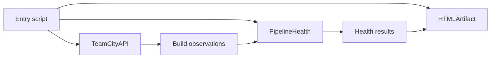

# Stage 8 — Software design: boundaries, dependency injection, and useful restraint

Clean code is code whose behavior and dependencies remain understandable when requirements change. A short function can still hide a dangerous dependency; a longer function can be clear if it expresses one coherent algorithm. This chapter turns the mechanics from stages 1–7 into design decisions for the TeamCity report. Offline examples target PowerShell 7.4+.

## 8.1 Start with reasons to change

The report changes when TeamCity's API changes, when the organization changes its health policy, when readers request different HTML, and when the execution environment changes. If one function contains all four concerns, every change risks disturbing the others. Separate them along those reasons to change.

The API boundary understands authentication, locators, pagination, response shape, and project lookup. The domain boundary understands what observations imply about health and failure streaks. The presentation boundary understands labels, encoding, layout, and chart values. The application boundary chooses exclusions, timestamps, output paths, and partial-scan policy.

These boundaries are more important than whether each implementation is a class or a function. A single class containing four concerns is still coupled. Four modules that all read the same globals are also coupled. The goal is independent reasoning: you should be able to understand the streak algorithm without thinking about HTTP headers or CSS.

## 8.2 Separate observations, interpretation, and presentation

An observation says a build had status `FAILURE` at a particular instant. Interpretation says the pipeline is red and the oldest observed red build is only a bound on the streak. Presentation says “At least since 2026-11-10 14:00 UTC.” These are different kinds of information.

**Offline example 1 — one result, two presentations.**

```powershell
function Get-HealthInterpretation {
    param([string]$RawStatus)
    [pscustomobject]@{
        RawStatus = $RawStatus
        Health = if ($RawStatus -eq 'SUCCESS') { 'GREEN' }
                 elseif ($RawStatus -in @('FAILURE', 'ERROR')) { 'RED' }
                 else { 'OTHER' }
    }
}
$result = Get-HealthInterpretation -RawStatus 'FAILURE'
$result | ConvertTo-Json -Compress
'Pipeline health: {0} (raw status: {1})' -f $result.Health, $result.RawStatus
```

The analyzer does not know which presentation will be used. Its result can support HTML, console text, CSV, or another system. That flexibility is a consequence of the boundary, not a special reporting framework.

Avoid storing only display text in the model. A field such as `BecameRedText` is useful for compatibility with the old report, but it is not a substitute for `OldestObservedRedAt` and `BoundaryObserved`. A CSV consumer should not need to parse English prose to determine uncertainty.

## 8.3 Dependency injection without a container

Dependency injection means providing a dependency from outside. A function accepting `-Builds` already uses it. A client accepting a transport callback uses it. You do not need a dependency-injection framework, registration syntax, or a service locator for this application.

**Offline example 2 — inject the variable part.**

```powershell
function Get-ConfigurationSnapshot {
    [CmdletBinding()]
    param(
        [Parameter(Mandatory)][string[]]$Id,
        [Parameter(Mandatory)][scriptblock]$ReadHistory,
        [Parameter(Mandatory)][DateTimeOffset]$GeneratedAt
    )
    foreach ($configurationId in $Id) {
        $history = @(& $ReadHistory $configurationId)
        [pscustomobject]@{
            Id = $configurationId
            GeneratedAt = $GeneratedAt
            LatestStatus = if ($history.Count) { $history[0].Status } else { 'NO_BUILDS' }
        }
    }
}
$fixture = {
    param($configurationId)
    [pscustomobject]@{ Status = 'SUCCESS'; Id = "$configurationId-101" }
}
Get-ConfigurationSnapshot -Id Backend_Build,Frontend_Build -ReadHistory $fixture -GeneratedAt (
    [DateTimeOffset]::Parse('2026-11-12T14:00:00Z')
)
```

The clock is a value supplied once, so both rows share a consistent timestamp. The source is replaceable, so no server is needed. The function owns orchestration but not transport details. Its dependencies are visible in the parameter list rather than hidden in a global environment.

Do not inject every language primitive. Passing a replacement for integer addition or `Where-Object` would obscure the real design. Inject unstable external effects and policy choices that you genuinely need to vary: clock, HTTP transport, file writer, or build source.

## 8.4 The composition root wires the application

The composition root is the place where concrete choices are assembled. For this report, the entry script creates a client, selects a history source, sets scan options, chooses output destinations, and invokes the workflow. Other components receive what they need.

A dependency graph should point toward stable concepts. The analyzer should not import the HTML module to decide how to format a date. The HTML module should not call TeamCity to fill missing data while rendering. A renderer that fetches data is difficult to test and can produce different sections from different server moments.



The diagram represents data flow and explicit orchestration, not an inheritance tree. The entry script knows the components; the domain logic need not know their concrete implementations. That is enough architecture for a useful small application.

## 8.5 SOLID as practical questions

The single-responsibility principle asks whether a component has one coherent reason to change. A date parser can accept several documented formats and still have one responsibility. A function that parses dates, chooses colors, and writes files does not.

The open/closed principle suggests adding a new presentation or source through a stable boundary rather than editing the streak algorithm. It does not mean code must never change. Good designs make likely variation easy while keeping unlikely variation simple.

The Liskov substitution principle asks whether every implementation honors the same behavior contract. A fixture source that returns oldest-first data violates a newest-first source contract even if its property names match. Interface segregation asks whether callers depend only on capabilities they use. A health reader need not depend on a client interface that can administer projects.

Dependency inversion asks whether high-level rules depend on stable abstractions instead of low-level details. In this application, the practical abstraction may be “an array of normalized observations,” not an elaborate interface hierarchy. The principle is satisfied by the dependency direction, not by a count of interfaces.

Treat these principles as diagnostic questions. Applying every pattern mechanically can make a 900-line script into a 50-file system that is harder to follow. The right design has fewer hidden assumptions, not necessarily more files.

## 8.6 Validate at boundaries and preserve meaning

External data should be normalized once near the API boundary. Required identifiers should fail clearly when missing. Optional URLs can remain absent. Date parsing should return a documented unknown state or a structured failure. Repeated defensive property checks inside every renderer are a sign that normalization may be occurring too late.

**Offline example 3 — normalize a transport object.**

```powershell
function ConvertTo-BuildObservation {
    [CmdletBinding()]
    param([Parameter(Mandatory)][psobject]$Dto)
    $idProperty = $Dto.PSObject.Properties['id']
    $statusProperty = $Dto.PSObject.Properties['status']
    if ($null -eq $idProperty -or [string]::IsNullOrWhiteSpace([string]$idProperty.Value)) {
        throw 'Build response is missing a usable id.'
    }
    if ($null -eq $statusProperty -or [string]::IsNullOrWhiteSpace([string]$statusProperty.Value)) {
        throw 'Build response is missing a usable status.'
    }
    [pscustomobject]@{
        Id = [string]$idProperty.Value
        Status = ([string]$statusProperty.Value).ToUpperInvariant()
    }
}
ConvertTo-BuildObservation -Dto ([pscustomobject]@{ id = 1001; status = 'failure' })
```

The mapper accepts lowercase status and preserves an opaque string ID. It does not decide whether the pipeline is red; that belongs to policy. It also does not HTML-encode the values; encoding belongs to the output context. Encoding data too early can produce double-encoding or corrupt non-HTML consumers.

Required data and optional data deserve different handling. A universal “get property or null” helper is convenient, but using it everywhere can turn malformed responses into apparently valid empty results. Make required-field checks explicit at the point where the response becomes an application observation.

## 8.7 Make uncertainty a first-class result

A bounded history does not necessarily reveal when a failure streak began. If every observed build is red, you know the streak reaches at least as far back as the oldest observed red build. You do not know whether it began there. The result should express both the timestamp and the evidence boundary.

**Offline example 4 — separate fact from wording.**

```powershell
$result = [pscustomobject]@{
    Health = 'RED'
    OldestObservedRedAt = [DateTimeOffset]::Parse('2026-11-10T14:00:00Z')
    BoundaryObserved = $false
    ObservedRedCount = 100
}
$prefix = if ($result.BoundaryObserved) { 'Observed streak begins at ' } else { 'At least since ' }
$prefix + $result.OldestObservedRedAt.ToUniversalTime().ToString('yyyy-MM-dd HH:mm:ss zzz')
```

The label is derived at presentation time. Another consumer can use `BoundaryObserved` directly. The wording also avoids claiming the actual software defect began exactly at a build's finish time: the result is an operational definition based on observed finished builds.

If an unknown status interrupts the streak, decide whether it counts as a non-red boundary or an uncertain gap. The uploaded script treats every status outside `FAILURE` and `ERROR` as a boundary. Preserve that behavior during a compatibility extraction, then consider a separately documented policy change if needed.

## 8.8 State ownership, caches, and policy

A cache belongs to the component that knows when its values are valid. Project lookup caching naturally belongs to a server-specific client. A final report summary belongs to one scan snapshot. A global cache shared across servers and runs mixes lifetimes and identities.

Cache only successful values unless negative caching is deliberate. Caching a transient permission or network error as “project not found” can make later recovery impossible within the session. Define whether missing projects, deleted projects, and failed requests are distinct outcomes.

Keep policy configurable only where the application actually needs variation. Exclusion patterns and scan limits are plausible options. Making every status comparison configurable can create a reporting language that users must debug. A small named policy function is often easier to review than a sprawling configuration schema.

## 8.9 Determinism makes bugs reproducible

A deterministic transformation produces the same result for the same input. Supply the clock, sort with stable tie-breakers, keep culture-sensitive formatting at the boundary, and avoid hidden reads of environment variables inside domain functions. These choices make fixtures meaningful.

**Offline example 5 — deterministic grouping and numeric formatting.**

```powershell
$rows = @(
    [pscustomobject]@{ ProjectId = 'B'; Name = 'Build'; Health = 'RED' }
    [pscustomobject]@{ ProjectId = 'A'; Name = 'Build'; Health = 'GREEN' }
)
$ordered = @($rows | Sort-Object ProjectId, Name)
$red = @($ordered | Where-Object Health -eq RED).Count
$percent = 100.0 * $red / $ordered.Count
$cssValue = $percent.ToString('0.###', [Globalization.CultureInfo]::InvariantCulture)
$ordered | Select-Object ProjectId, Name
"CSS percentage: $cssValue"
```

Stable ordering makes diffs easier to review. Invariant culture keeps machine-readable CSS decimal syntax independent of the host locale. Human-facing percentages can use a chosen display culture, but do not accidentally feed a localized comma decimal into a CSS numeric token.

## 8.10 Refactoring safely through seams

A seam is a place where behavior can be replaced without rewriting the surrounding algorithm. The original script's `Invoke-TeamCityGet` is already a useful seam: one function centralizes HTTP calls. `Get-RecentFinishedBuilds` is another: replacing it with fixture data lets you exercise `Get-PipelineInfo` offline.

First characterize current behavior through those seams. Then extract a pure analyzer that receives the history. Compare results for known fixtures. Next move rendering behind explicit parameters. Finally replace orchestration. This sequence reduces the number of changing assumptions at each step.

Do not combine a compatibility extraction with a silent policy redesign. For example, fixing branch selection and changing unknown-status handling while extracting modules makes a failed comparison difficult to diagnose. Separate structural changes from intentional behavior changes and describe the latter in release notes.

## 8.11 Error policy belongs at the right level

A transport reports a failed request. A source adapter explains which configuration could not be read. The application decides whether to stop or publish a partial scan. The renderer faithfully displays the scan state. Each layer adds the context it owns without pretending to know the whole application.

A catch block that returns null at every layer destroys evidence. A catch block that logs and rethrows at every layer creates repetitive logs. Prefer one useful diagnostic at the boundary that handles or presents the failure, while preserving structured context through intermediate layers.

For report output, render all content before writing files. This prevents a formatting exception from occurring halfway through an individual file. Writing three files is still not a transaction; use a staging directory and a published index or directory switch if readers require a consistent multi-file snapshot. Stage 12 explains the teaching implementation's simpler limits.

## 8.12 Review an interface through a concrete change

Imagine a request to add a CSV export. In a well-separated design, the API retrieval and streak analysis remain useful as they are. A new presenter selects fields from the result model and writes CSV. If adding CSV requires removing HTML tags from `BecameRedText`, the model has allowed presentation details to become its only source of meaning.

Now imagine adding a second TeamCity server. A per-client cache and explicit server parameter make the change local to orchestration. A global cache keyed only by project ID can silently reuse the first server's data. This is why state ownership is a correctness issue rather than a style preference.

Finally imagine a network outage halfway through a scan. A scan envelope can preserve rows plus failure metadata. A bare array of successful rows cannot explain whether missing pipelines were excluded, unavailable, or never discovered. The interface determines which questions downstream readers can answer.

**Offline example 6 — project a result into another format.**

```powershell
$results = @(
    [pscustomobject]@{
        PipelineId = 'Backend_Build'
        Health = 'RED'
        BoundaryObserved = $false
        OldestObservedRedAt = [DateTimeOffset]::Parse('2026-11-10T14:00:00Z')
    }
)
$csvRows = foreach ($result in $results) {
    [pscustomobject]@{
        PipelineId = $result.PipelineId
        Health = $result.Health
        BoundaryObserved = $result.BoundaryObserved
        OldestObservedRedUtc = $result.OldestObservedRedAt.ToUniversalTime().ToString('O')
    }
}
$csvRows | ConvertTo-Csv -NoTypeInformation
```

No HTML parser or server is needed. The projection chooses a durable timestamp format and preserves uncertainty as a Boolean. A more complete schema would define null behavior and a schema version, but the underlying separation is already useful.

Design reviews become more productive when phrased around such changes. Instead of debating whether a class is “clean,” ask what must change for a new output, a new source, or a failed dependency. The answers reveal hidden coupling. An abstraction that makes none of those changes easier may be adding ceremony rather than protecting a meaningful boundary.

## 8.13 The cost of abstraction and the final design choice

Abstraction pays when it removes repeated knowledge, isolates an unstable dependency, or names an important rule. It costs navigation, indirection, and maintenance. A helper that only forwards every argument to another helper without adding a contract may not be useful. A small analyzer that captures failure-streak semantics is useful even if called only once.

The proposed three-module design is modest: one retrieval component, one domain component, and one artifact component. It supports offline examples, focused tests, and dynamic imports. It does not require a framework, a plugin registry, or a deep inheritance hierarchy.

As you improve the original script, judge each change by its effect on reasoning. Can the API be replaced with fixtures? Can a reader locate the failure-streak rule? Can HTML be generated without credentials? Can a partial scan be recognized after the console is gone? Those concrete outcomes are a better measure of engineering quality than the number of classes introduced.

## 8.14 Work through a new reporting requirement

Suppose a manager asks for the number of red pipelines by product, plus a CSV for further analysis. The existing report groups some views by immediate project and another by top-level project. Before coding, identify the meaning of product. If it corresponds to a top-level project ID, the existing normalized identity may be sufficient. If it is an organizational mapping across several projects, that mapping is a separate policy input.

The API client should not learn the manager's product taxonomy unless it is actually part of the external API contract. It should retrieve project identity and ancestry. A grouping function or application-level mapping can assign products. The analyzer still interprets builds. The CSV presenter selects the resulting fields. This change touches the component that owns the new meaning rather than spreading product-specific branches through HTTP code.

Now suppose product names can change. Group by stable product identity and display the current label. If the mapping is versioned, retain the mapping version with the scan so historical reports remain interpretable. You do not need a full database for this; even a small explicit configuration file is better than scattered name comparisons.

The same requirement exposes a denominator decision. Is the red percentage calculated among inspected configurations in that product, or among all eligible configurations including unavailable outcomes? The former is a health proportion with coverage alongside it. The latter mixes known red outcomes with unknown outcomes. Both can be useful when clearly labeled, but they answer different questions.

A result model that retained eligible, inspected, and failed counts supports either presentation. A model containing only a preformatted pie-chart string does not. Good boundaries preserve the facts from which future views can be derived without promising to anticipate every possible report.

## 8.15 Use a small decision record when behavior changes

A decision record can be a short paragraph in a change description. State the concrete problem, the chosen behavior, the alternatives considered, and the evidence used to validate it. For example: group by project ID because two distinct projects can share a label; keep names for display; verify with a duplicate-name fixture.

This is different from maintaining a large architecture document for every helper. Record decisions that affect consumers or important invariants. Branch scope, unknown-status handling, timezone display, and partial-scan policy deserve explicit notes because a reader can otherwise draw the wrong operational conclusion.

When the source and its description disagree, record which you preserve. The original script's prose mentions a green boundary, while its loop stops at any non-red status. A compatibility change should state that implementation behavior is preserved. A later policy change should explain how unknown observations affect confidence. This prevents the team from arguing from different unstated baselines.

Decision records also help keep refactors reviewable. A structural change can be reviewed for moved responsibilities and preserved outputs. A policy change can be reviewed for new semantics and fixtures. Combining both without explanation forces reviewers to reverse-engineer intention from a large diff.

## 8.16 Design for failure without turning every value into a framework

One response to uncertainty is to wrap every value in multiple result and option types. That can be appropriate in some languages and large systems, but it can overwhelm a small PowerShell application. Start by identifying which distinctions callers actually need: no builds, unavailable history, unknown date, and uncertain streak boundary are already meaningful here.

Represent those distinctions plainly. A successful history call can return an empty sequence. A failed call can throw to the orchestration boundary. An optional unknown date can be null. A health result can carry a boundary flag. A scan envelope can carry failures and grouping quality. These choices form a coherent contract without requiring a generic application framework.

Do not make one field carry several meanings. A null `BecameRedDate` could mean the pipeline is green, there are no builds, or a red timestamp is invalid. The surrounding health and evidence fields disambiguate it. Document the combination rather than asking a renderer to infer meaning from one property in isolation.

Equally, do not pass an ever-growing options bag to every component. The writer needs content and destination, not branch selectors or exclusion patterns. The analyzer needs observations, not output filenames. Smaller inputs make each component easier to understand and reduce accidental access to unrelated configuration or credentials.

The final design should let an engineer answer a local question locally. To change link policy, inspect the link helper. To change red classification, inspect the analyzer. To change retry behavior, inspect transport. To change partial-scan acceptance, inspect orchestration. That locality is the practical value of separation of concerns.
