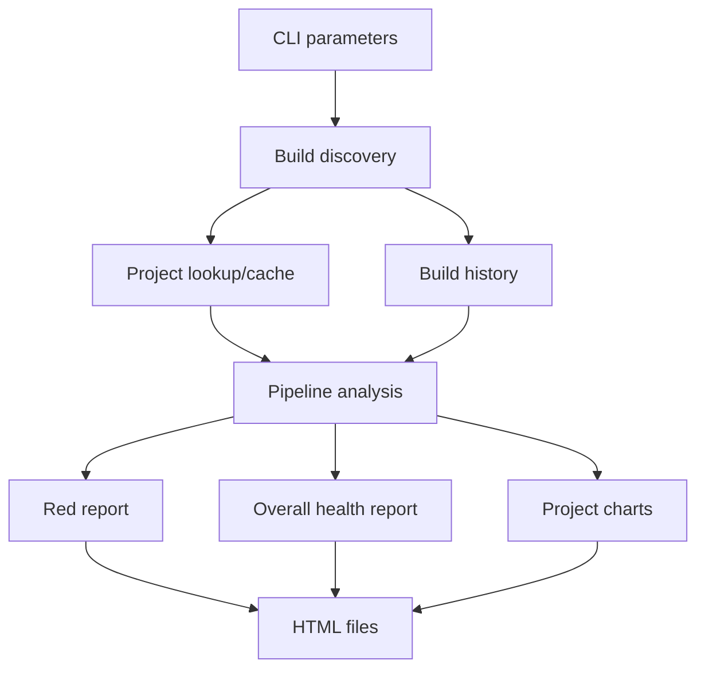

# Stage 11: Case Study: Reading the Existing TeamCity Report

> **Audience:** Intermediate PowerShell developer progressing to maintainable, modular, object-oriented PowerShell/.NET engineering.  
> **Environment:** PowerShell 7.4+ recommended; verify compatibility separately for Windows PowerShell 5.1 and the actual CI agent.  
> **Method:** First-principles explanation, runnable isolated examples, realistic design tradeoffs, and connection to the uploaded TeamCity reporting script. No quizzes or active-recall prompts.  
> **Source note:** TeamCity-specific observations are derived from the supplied `New-RedTeamCityPipelineHtmlReport.txt`; general language/design material is instructional background. No live TeamCity access or runtime validation is claimed.

## Source and scope
This chapter analyzes the uploaded `New-RedTeamCityPipelineHtmlReport.txt` (914 lines including display line labels). The analysis is based on source code, **not** live TeamCity data or execution. Before changing behavior, capture baseline reports in an authorized environment and write characterization tests.

### Entry-point configuration (source lines 44–81)
The script declares `[CmdletBinding()]`, URL, token, exclusions, page size, scan limit, and three output paths. It sets strict mode and `$ErrorActionPreference='Stop'`, prompts for a missing token, normalizes the REST root, and creates authorization headers. These are application concerns; a reusable client should receive a validated server URI and credential, while the CLI decides whether to prompt.

### API helpers (86–118)
`New-TeamCityUri` assembles the REST path and percent-encodes query keys/values. `Invoke-TeamCityGet` calls `Invoke-RestMethod`. Both rely on `$apiRoot`/`$headers` in outer scope. Extract them into a client object or private functions with explicit configuration. Preserve REST-root normalization and query encoding.

### Defensive property access (120–139)
`Get-PropertyValue` reads `PSObject.Properties[$Name]` and returns null when absent. This accommodates variable JSON response shapes and strict mode. Preserve its behavior, but decide which properties are genuinely optional and which missing fields should produce validation errors.

### Filtering and dates (141–215)
`Test-NameExcluded` uses wildcard `-like`, which is case-insensitive by default. `ConvertFrom-TeamCityDate` normalizes offsets such as `-0400`, tries multiple formats, then falls back to `DateTimeOffset.Parse`, returning local `DateTime` or null. `ConvertTo-HtmlText` HTML-encodes strings. Extract date parsing into a pure function and keep a `DateTimeOffset` until formatting; retain clear behavior for unknown dates.

### Project traversal and caching (218–315)
`Test-TeamCityRootProject` recognizes `_Root` and root names. `Get-TeamCityProjectInfo` caches project lookups by ID. `Get-TopLevelProjectName` climbs `parentProject` until the root, warns/falls back on API failure. The algorithm can benefit from cycle detection, explicit missing-parent handling, and caching of the final top-level ancestor. Grouping by name risks collisions; IDs are stronger identity keys.

### Build discovery (317–362)
`Get-TeamCityBuildTypes` paginates build types, excludes templates, and yields each result. `Get-RecentFinishedBuilds` requests a bounded history excluding personal/canceled builds. Confirm the server's ordering and pagination semantics. The current `nextHref` is used as a continuation signal, while offsets are calculated locally; test this against the TeamCity version in use.

### Pipeline analysis (364–464)
`Get-PipelineInfo` constructs a rich object, including a no-build branch. Latest status `FAILURE`/`ERROR` maps to RED, `SUCCESS` to GREEN, others to OTHER. For red pipelines, the code scans newest-to-oldest until a non-red status, counting contiguous failures and tracking the oldest observed red build. When no non-red build appears, it prefixes the date with 'At least since'. **This lower-bound semantics must survive refactoring.** Duplicated object construction suggests a dedicated result model or factory.

### Three HTML renderers (466–851)
`New-ReportHtml` groups red pipelines by project, renders tables, links, and metrics. `New-SummaryReportHtml` computes total green/red/other and a CSS `conic-gradient` pie chart. `New-ProjectChartsReportHtml` groups by top-level project and renders per-project charts. The repeated document shell, CSS, status counts, and markup can become shared HTMLArtifact components. Preserve HTML encoding and add URL-scheme validation for links. Avoid mixing data calculations with HTML templates.

### Orchestration and output (854–913)
The main loop filters excluded names, displays progress, retrieves each pipeline, and continues on per-pipeline exceptions. It then renders and writes three files using `Set-Content -Encoding UTF8`. Replace `+=` accumulation with lists, make partial-scan errors visible in report metadata, use a consistent `GeneratedAt` timestamp across all reports, and consider atomic writes.

### Dependency map

### Prioritized refactoring risks
1. **Behavior:** red-streak ordering, lower-bound wording, no-build classification.
2. **Correctness:** incomplete scans, project-name collisions, pagination, timezone dependence.
3. **Security:** tokens in environment/logs, untrusted URL attributes, external HTML data.
4. **Maintainability:** hidden scope dependencies, duplicated markup, repeated calculations.
5. **Performance:** repeated array append, redundant hierarchy requests.

### What to preserve
Maintain CLI parameter meanings, exclusion wildcard semantics, the three report outputs, and the documented red-streak interpretation unless a deliberate versioned behavior change is approved. This is an analysis of the source, not a claim that the script is defective in a particular production environment.
