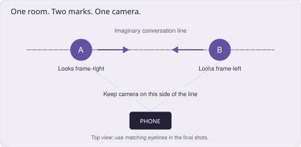

# Aadil's Comedy Sketch Creator Playbook

## Write the premise. Play the characters. Land the ending.

A practical launch system for TikTok and YouTube Shorts, with solo-filming instructions, original scripts, marketing steps, a 30-day calendar, and a 90-day development plan. Research checked November 13, 2026.

This plan assumes you are starting or refining a comedy channel with a phone, a room, basic editing software, and limited production time. It does not assume an existing audience, acting experience, collaborators, or professional equipment. The proposed schedule and metric targets are experiments, not guarantees of distribution or income.

## 1. The comedy channel I would test first

Start with this comic point of view: **ordinary people applying ridiculous rules with complete confidence**. It gives you a repeatable source of conflict, recognizable characters, and sketches you can make alone. A friend treats dinner plans like corporate approval. A roommate turns a dirty plate into a courtroom dispute. An alarm clock makes you prove you are awake before helping you wake up.

Create a dedicated comedy profile with a clear entertainment promise. Suggested display name: **Aadil | Sketch Comedy**. A possible bio is: **Everyday situations. Wildly confident people. New original sketches weekly.** Handle availability has not been checked. Use the same recognizable name and headshot on both platforms, and link the accounts where features allow.

Your professional and software background can supply observations about meetings, customer support, apps, interviews, and overly complicated processes. Translate those experiences into situations a general viewer understands. The first joke should work without knowledge of programming. Personal experience gives you details; the audience still needs a recognizable human problem.

For the first month, use two or three recurring worlds: friendships with absurd procedures, everyday systems that have lost the plot, and people whose grand self-image collapses under an ordinary inconvenience. Keep the acting and production style consistent enough that people recognize your work. Let individual sketches vary inside that promise.

Recommended starting output: **four original sketches per week**, each adapted for TikTok and YouTube Shorts. That is 16 original sketches and 32 platform uploads across four weeks, not 32 separate scripts. Most early pieces can be about 25-60 seconds if the premise supports it. Give a stronger sketch the time it needs; do not stretch a weak idea to reach a monetization threshold.

The first business of the channel is audience enjoyment. Your early next step is another entertaining sketch, a recognizable series, or a follow from someone who likes your characters. Sponsorships and other revenue options can follow once there is a repeatable body of work and evidence about who watches it.

## 2. What to learn from the Tra Rags reference

The most useful transfer is **premise clarity**: a viewer recognizes a situation and immediately understands what might go wrong. Two public uploads verified through YouTube search metadata are *When family get too much in your business on Thanksgiving* and *When you get robbed at the WRONG time*. The titles establish a social situation and an implied pressure or reversal before the viewer has much context. [C1-C2]

The full videos could not be played or transcribed in this research environment. Therefore, this is a study of verified premise framing, not a claimed shot-by-shot analysis of his performance or a reconstruction of either video's jokes. View counts, income estimates, private analytics, and unverified TikTok handles are not used to predict your growth.

For your own viewing sessions, study how a sketch makes the relationship clear, reveals an unusual behavior, changes the pressure, uses reactions, and ends. Record the evidence you actually see. If the character remains calm while events become stranger, note that performance choice. If the scene pauses before a reveal, note the timing. Do not assume those choices from a title alone.

### Transfer a mechanism into a new situation

| Visible framing or craft question | Useful general technique | Original direction for your work |
|---|---|---|
| A familiar social event becomes uncomfortable | Start with a relationship people recognize | A friend requires approval to change the restaurant |
| A situation happens at an inconvenient moment | Reverse who controls the scene | A theatrical villain loses authority to a parking attendant |
| One person follows an unexpected rule | Give the behavior a coherent internal logic | A roommate treats all household chores as legal proceedings |
| The response is as funny as the line | Write the listener's changing belief | A calm expression moves from confusion to disbelief to reluctant compliance |
| The last beat changes the whole situation | Finish with a decisive button | The person resisting the rule accidentally becomes its enforcer |

Build a character identity from your own wants, habits, speech, physical choices, and recurring situations. Your reference is a way to develop taste and analytical questions. The actual scripts, dialogue, costumes, and recurring details in this package are newly written for your practice.

### A 20-minute reference-study method

Watch one sketch for enjoyment. Watch again and write the premise in a sentence. On a third pass, mark the first unusual behavior, each escalation, the biggest reaction, and the ending. Finally, write a completely different premise using one general mechanism. Avoid rewriting the original scene with changed names.

Keep observation separate from explanation. "The cut happens before the second character answers" is observable. "That may make the response feel immediate" is an interpretation. "This cut caused the video's popularity" needs evidence you probably do not have. This distinction keeps your study useful instead of turning it into algorithm folklore.

## 3. How to find premises that can become sketches

A topic is not yet a sketch. "Customer service is annoying" is a topic. "The alarm clock's support agent requires you to be awake before helping you wake up" is a comic situation with a rule, a goal, and a conflict. You can perform it.

Collect small observations from your life: someone avoids admitting a mistake, a simple favor develops conditions, a person wants credit for effort they have not made, or an app treats an ordinary task like a security incident. Write the exact behavior, the expectation it violates, and why it bothers or delights you. Specific details make the material yours.

Use this premise sentence: **A person wants X, but another person insists on Y, so every attempt to fix it makes Z worse.** For example: a roommate wants the dishes washed, but the other roommate treats the plate as protected evidence, so cleaning becomes an alleged crime. The rule explains the later jokes and makes the sketch more than a string of unrelated insults.

### The premise-development pass

1. Name the ordinary situation in plain language.
2. Identify what the central person wants right now.
3. Choose one unusual behavior that blocks it.
4. Explain why the unusual character thinks the behavior is reasonable.
5. Write three different consequences of that rule.
6. Find an ending that changes status, reveals an object, or makes the rule backfire.
7. Check whether two characters and ordinary props can show the idea.

Generate ten observations before polishing one. You are building choices, not proving that every thought is funny. Select two premises that produce several distinct beats. If you can only repeat the opening joke more loudly, the idea may need a different rule or a shorter form.

### Make the conflict concrete

Give the grounded character a visible task: leave the house, recover a plate, book a table, get an answer, or finish a call. Give the unusual character an immediate objective too: preserve authority, avoid guilt, seem sophisticated, sell an upgrade, or keep the system intact. Both people should be trying to accomplish something.

A useful sketch can begin in the middle of the problem. "Why do I need a reference to borrow my own charger?" establishes more than a greeting followed by an explanation of the room. You still need enough visual context to understand the relationship. Compression should remove unnecessary setup while keeping the scene understandable.

Keep a premise bank with four fields: observation, comic rule, possible escalation, possible ending. A title alone is not a script. The workbook included with the package gives you a repeatable way to develop a title into something filmable.

## 4. Write the scene around a comic rule

The comic rule is the pattern the sketch explores. It might be "everything in this friendship is treated as a corporate process." Once the viewer understands it, you can surprise them through its consequences. This is sometimes called the game of a scene. Treat the term as a writing aid, not a requirement to use a particular school's vocabulary.

A compact structure is: establish the situation, reveal the rule, explore it, heighten it, and finish on the strongest turn. Not every sketch needs exactly three escalations or the same duration. The structure is useful because it makes missing work visible. If you cannot identify a turn after the premise, the middle may be repeating information.

### Heightening is a change in consequence

Compare two approaches. In the first, the friend repeatedly demands a form, using increasingly angry language. In the second, the form requires a reference, the reference must come from someone already invited, and declining the process removes your access to birthday notifications. The second extends the rule into new consequences. Volume is a performance choice; it is not the same as escalation.

Keep the unusual person's logic coherent enough to anticipate and surprise. A roommate playing lawyer can object to a question, challenge evidence, and accuse someone washing a plate of tampering. A random jump to talking about an unrelated celebrity breaks the pattern unless the entire sketch has established that kind of disruption.

Let the grounded person adapt. They can resist, bargain, try to exploit the rule, or discover that compliance makes the situation worse. A character who only says "what?" after every line contributes little development. Write the listener's tactics as carefully as the unusual person's explanations.

### Build toward the button

The button is the final line, action, or image that ends the sketch decisively. Write several options before filming. One can be a reversal, another a physical reveal, another a callback with changed meaning. Choose the one that completes the pattern rather than merely repeating the title.

For the household courtroom, possible endings include a plate entering "witness protection," the grounded roommate beginning to wash it and being accused of destroying evidence, or the unusual roommate charging a consultation fee to discuss the dishes. These alternatives imply different final shots. Decide which version you want to test before you record coverage.

End shortly after the payoff has been understood. Do not add a long explanation of why it was funny. If a reaction is the real payoff, give that reaction time. If the funniest event is a prop reveal, the editor should not cut away before the viewer notices it.

### A practical script test

Read the lines aloud without explaining the idea first. Ask a few suitable viewers what they thought each person wanted and where they first recognized the unusual rule. Ask which moment amused them and which felt repetitive. They are giving feedback, not estimating the audience response of an entire platform.

If a reader understands the scene but does not find it amusing, the joke may need a sharper point of view or stronger turn. If they do not understand the scene, solve that first. Fast editing cannot fix an absent comic relationship.

## 5. Create characters you can perform repeatedly

A costume identifies a person; behavior makes them a character. Begin with a want, a fear, a status belief, a speech habit, and a physical tendency. For example, the Plan Manager wants control, fears unstructured decisions, believes they are the most responsible person present, speaks in procedural language, and barely moves when other people panic.

The grounded character needs a point of view too. They may be impatient, excessively polite, eager to please, or convinced that a simple explanation will solve everything. Their reactions become funnier when the unusual character attacks that specific weakness. Someone who hates confrontation may keep completing absurd forms rather than leave.

### A starter character bible

| Character | Immediate want | Performance anchor | Simple visual identifier |
|---|---|---|---|
| The Plan Manager | Preserve control over an ordinary social plan | Measured pace, confident pauses, minimal movement | Plain overshirt and a small notebook |
| The Receipt Lawyer | Avoid responsibility through technicalities | Precise diction, objects treated as evidence | Glasses or a folder |
| The Grounded Friend | Complete one practical task | Direct questions and increasingly deliberate disbelief | Your ordinary clothes |
| The Image Curator | Appear relaxed, generous, or spontaneous | Rehearsed sincerity interrupted by logistical control | Phone always in hand |

These are starting choices, not finished intellectual property with proven audience appeal. Keep only the characters you enjoy performing and viewers can recognize. An accidental expressive habit may become more distinctive than a deliberately invented catchphrase.

Rehearse the same exchange at three energy levels. Try a sincere quiet version, a slightly heightened version, and a larger version. Watch them without sound, then listen without picture. Select the performance that makes the relationship clear and the emotion believable. Performing comedy does not require signaling that you know the line is funny.

Record listening. Make separate takes of disbelief, polite processing, a delayed realization, and a person trying not to admit defeat. These are not generic reaction memes to paste everywhere. They are options for the actual emotional turn in the scene.

For a recurring character, keep the identifier and core behavior stable while changing the situation. Repeating the same dialogue in a new location is weaker than discovering what that person would do under a new pressure. Familiarity should create anticipation, then a fresh consequence should reward it.

## 6. Film two characters by yourself

You can make the first month with one phone, a stable tripod or safe support, a quiet room, available light, and a few ordinary props. Prioritize intelligible dialogue and readable expressions. Buy equipment after a repeated problem appears, such as unstable framing or consistently distant audio.

### Set the room before recording

Choose two character positions and mark them with removable tape. Keep the camera on one side of the imaginary line connecting them. In the edited conversation, Character A generally looks toward frame-right and Character B toward frame-left. The eyelines should suggest that they are looking at one another, at a consistent approximate height. Adobe's shot/reverse-shot guide is a useful visual reference for this continuity principle. [C6]

The diagram in the PDF shows a starter arrangement. You can keep the tripod in one physical position and reframe toward each character. Alternatively, use two camera positions on the same side of the conversation line. You do not need a split-screen effect or to show both characters together for viewers to accept the exchange.

Mark an eyeline target near the other character's intended head position. Avoid looking into the lens unless the script deliberately addresses the audience. If one character is seated and another standing, reflect that height difference in the eyeline. Record a quick two-line test and cut it together before committing to a batch.

Use a consistent camera height and framing for the initial conversation. A closer shot can emphasize a change in power or realization, but it should be motivated. Random zooms after every line can make the scene feel mechanically edited and obscure the performance.

### Keep the image and sound dependable

Record vertically in a 9:16 composition. A practical starting export is 1080 by 1920 at 30 frames per second, matching the footage when appropriate. Higher resolution can give cropping flexibility but does not repair missed focus or poor sound. Check the final image on a phone.

Put the main light in front of or slightly to one side of the face. Keep it consistent while changing roles. Lock focus and exposure where your camera supports it so that a different shirt or prop does not make every reverse shot change brightness. Watch for a window getting darker halfway through a long session.

Place the microphone close enough for clear speech, and keep its position comparable for both roles. A small room with soft furnishings may help reduce echo. Record a few seconds of room sound to smooth edits. An expensive camera cannot compensate for dialogue that is hard to hear.

Leave comfortable framing space for captions and platform controls. Avoid placing a critical prop, eyebrow movement, or final reveal under the right-side buttons or bottom text. Interface overlays vary, so inspect the actual draft preview on both apps instead of trusting a single universal safe-zone rectangle.

### Record by character, not by final timeline order

Number the lines in the script. Record all of A's lines and reactions, then change the simple costume identifier and record B. Keep the script, prop position, eyeline, and emotional stage consistent. A take of the final line should reflect what the character has just experienced, even if you filmed the beginning an hour earlier.

Leave a short handle before and after each line. Do not stop recording the instant the sentence ends. You may need the breath, look, or physical response that follows. Record one restrained and one stronger alternative for important turns, plus the final prop reveal if there is one.

If timing with the absent character is difficult, make a guide read on your computer and listen through one earbud while recording, checking that it does not bleed into the microphone. You can also rehearse the full conversation, then record the lines separately with enough editing room. One phone and a paper script are sufficient; the guide track is optional.

Check continuity before changing the setup. Is the cup in the correct hand? Does the chair face the same direction? Does the eyeline still match? Is the folder open or closed at the corresponding beat? Small mismatches can make the conversation harder to follow even when viewers cannot name the problem.

### Add complexity only when the joke needs it

An overhead prop shot, an offscreen voice, or a third character can create a strong turn. Each also increases recording and editing work. Start with a small number of readable shots. Use split-screen only when simultaneous interaction is essential; lock the camera, preserve lighting, and keep movement away from the compositing seam.

Make fictional screens and messages clearly part of the sketch. Use your own text and invented identities. Your ability to build a simple mock interface can be a useful production advantage, but a paper sign or a clean caption may communicate the same joke more quickly.

## 7. Edit for comic timing

The first edit should be a believable conversation. Put the correct lines in order and listen without effects. Can the audience understand who wants what and why the responses create pressure? If the scene requires a written explanation to work, repair the script or missing shot before adding more transitions.

### Cut on meaning and reaction

A line often becomes funnier because of the listener's response. You can cut to the listener before the speaker finishes, letting the audience see the reaction while hearing the end of the line. You can hold on a speaker whose confidence is itself the joke. You can delay the reverse shot to make a realization land. There is no universal rule to show whoever is currently speaking.

Preserve useful pauses. A pause can show somebody calculating how to respond, refusing to acknowledge the absurdity, or realizing that they have lost. Remove dead setup and accidental hesitation, but do not apply automatic silence removal to every performance. That can erase the contrast that makes a line funny.

Duplicate a key exchange and test several timings. At 30 frames per second, six frames are 0.2 seconds and twelve frames are 0.4 seconds. A few frames can change whether an interruption feels sharp or rushed. Those numbers describe an editing experiment, not a secret ideal comedy interval.

### Make captions support the reveal

Correct automatic captions, especially names and the exact words that carry a joke. Avoid displaying the punchline before it is spoken or before the prop reveal. If a subtitle tells the audience the reversal too early, it can remove the surprise. Keep the text readable and avoid covering expressions.

Use consistent typography and a small number of text styles. A simple premise label can orient the first frame: "Your friend runs dinner like a company." It should establish the situation without giving away the final turn. Do not fill the screen with a title, full transcript, character name, unrelated meme, and follow request simultaneously.

### Use sound intentionally

Start with clear dialogue and natural room tone. A door sound, notification, or abrupt stop can be a joke when it changes the scene. A dramatic music cue can work when it expresses the character's self-image. A sound effect after every line can flatten the rhythm and tell the audience how to react instead of giving them something to react to.

Keep a clean master with your own dialogue and any independently cleared assets. Add platform-specific music only under the relevant permissions. A song available inside one platform is not automatically licensed for a second platform or for a sponsor's advertisement. TikTok's commercial-music guidance matters when a sketch promotes a brand. [C13]

### The final export test

Watch once for the scene, once for sound, once for captions, and once on a phone. Check that the first frame makes sense, the second role is distinguishable, the best reaction is visible, and the ending has enough time to register. Export without another platform's interface or watermark so you retain a clean reusable version. This is workflow control, not a claim that a watermark alone determines distribution.

## 8. Five original scripts you can shoot

These are practice scripts with independent premises and dialogue. They are not adaptations of specific Tra Rags scenes. Read them aloud, revise anything that does not sound natural in your voice, and test alternative endings. The proposed durations are estimates, not measured finished cuts.

### Script 1: the friend who runs dinner like a company

**Premise:** You want a restaurant recommendation; your friend requires a formal approval process.

**Roles:** Grounded Friend and Plan Manager. **Props:** phone, notebook. **Target:** about 35-50 seconds.

| Beat | Dialogue or action | Performance direction |
|---|---|---|
| Open | A: "We can just get fries. Why do I need a reference?" | Already in the problem |
| Rule | B: "You want to change dinner with no stakeholder approval?" | Sincerely professional |
| Resistance | A: "There are two of us." B: "Exactly. Half the team is unhappy." | B treats this as evidence |
| Heighten | A: "Fine. I approve fries." B: "You submitted the request. You can't approve yourself." | Do not rush A's realization |
| Consequence | A: "I'm going by myself." B calmly taps the phone. | A thinks they escaped |
| Button | Phone text: "Group chat: read-only access." B: "You're still part of the family. Just not management." | Hold A's look, then end |

The unusual rule stays coherent: ordinary friendship has corporate permissions. The consequence moves beyond repeating a request for a form. If the phone text is too small, show it in a simple close-up or use a readable overlay at the moment A looks at the screen.

Alternative button: A returns with fries; B silently places an expense-report form on the table. Test the visual ending if your performance is stronger with fewer lines.

### Script 2: the roommate who turns dishes into a legal dispute

**Premise:** A dirty plate becomes a case that the responsible roommate intends to win.

**Props:** plate, folder or glasses. **Target:** about 25-40 seconds.

A: "Can you wash your plate?"

B: "Objection. Assumes ownership."

A: "Your name is written on it."

B: "Then why are you questioning me? Question the plate."

A pauses, then picks it up.

B: "Careful. That is my client's only witness."

A: "I'm putting it in the sink."

B, suddenly urgent: "Evidence tampering."

A looks at B. B gently turns the plate toward the wall.

B: "Witness protection."

End on the protective gesture or A's response, whichever tests better. The delivery should feel like B is trying to avoid responsibility through a procedure, not simply reciting a list of legal words. Do not add a long final argument after the plate gag.

### Script 3: customer support for your alarm clock

**Premise:** An alarm service monetizes the very moment it is supposed to wake you.

**Roles:** sleepy customer and support agent. **Props:** phone, optional headset. **Target:** about 35-50 seconds.

A: "My alarm never went off."

B: "Did you accept cookies?"

A: "It's a clock."

B: "We value your privacy. We can't know what time it is without consent."

A: "Fine. Accept. Wake me up tomorrow."

B: "Absolutely. With ads or without?"

A: "I'm asleep. How would I watch an ad?"

B: "That is why we wake you up first."

A's phone sounds. On-screen card: "Your alarm starts after this message."

A: "That was the alarm?"

B: "That was the preview."

The fictional interface is simple text. Your grounded character wants the task completed, while the agent wants the service's logic to remain unquestioned. Try ending on the preview line versus the readable card and expression. The stronger cut may be shorter than the written script.

### Script 4: the villain versus the parking attendant

**Premise:** A grandiose villain cannot control an ordinary parking transaction.

**Roles:** theatrical villain and unbothered attendant. **Props:** dark jacket or simple cape-like cloth, receipt. **Target:** about 30-45 seconds.

V: "At midnight, this city will know my name."

P: "It needs to be on the ticket before six."

V: "I control this city."

P: "Then you know this garage is privately owned."

V holds the pose, trying to recover.

V: "I will return."

P: "Keep the receipt or we charge again."

V reaches for the receipt, suddenly careful.

P: "You want the early-bird rate tomorrow?"

V, quietly: "What time?"

Finish on the small, practical question or the attendant handing over a loyalty card. The status shift is the joke: the person performing absolute authority becomes a normal customer. A room and a sign can suggest the setting; you do not need a garage or effects.

### Script 5: the friend documenting how offline they are

**Premise:** Someone cannot enjoy being present until everyone has seen the evidence.

**Roles:** ordinary friend and Image Curator. **Props:** phone, cup. **Target:** about 30-45 seconds.

A: "You said we were putting our phones away."

B: "We are. I just need a picture of it."

A places the phone down.

B: "Not like that. It looks like you don't care about being present."

A: "I don't need a picture to enjoy coffee."

B adjusts the cup and takes another picture.

B: "Could you look less aware that we're enjoying this?"

A: "Who is this for?"

B checks the screen: "They think you look tense."

A stares.

B: "Relax again. But naturally this time."

End on the command and reaction. An alternative version may reveal a caption asking people to rate the digital detox. Keep any displayed text fictional and readable. The performance should show B trying to curate sincerity, not announce the moral of the sketch.

## 9. A shot plan for your first sketch

Use Script 2 as the simplest production test. Record A at one mark looking frame-right, and B at the other looking frame-left. Keep the camera on the same side of the imaginary conversation line. The plate provides a concrete final action and makes the first project easier to edit than an abstract argument.

| Shot | Capture | Why it is needed |
|---|---|---|
| A1 | "Can you wash your plate?" plus a listening handle | Establishes the actual task |
| B1 | "Objection. Assumes ownership." | Reveals the comic rule |
| A2 | "Your name is written on it." and a pointed look | Gives A a reasonable tactic |
| B2 | "Question the plate." then calm listening | Extends the rule |
| A3 | Reach for plate; "I'm putting it in the sink." | Turns the scene into action |
| B3 | Urgent "Evidence tampering." | Raises the consequence |
| B4 | Turn plate toward wall; "Witness protection." | Gives the ending a visual form |
| A4 | A short disbelief reaction | Optional final payoff |

Record the plate's initial position and keep it consistent across takes. Capture the final move close enough to read. Make a first edit without captions or effects, then adjust the pauses. Only after the exchange works should you add the text and polish.

For the next version, change the situation or strategy rather than merely replacing the plate with another object. The character could apply the same defensive logic to a missing charger, a borrowed jacket, or the thermostat. Each should produce a different consequence.

## 10. Market the channel on TikTok

Your marketing begins in the first frame: the viewer should understand the situation and feel a reason to watch the next exchange. Use a specific premise label or immediate dialogue. "The friend who needs approval for dinner" is more informative than a generic "wait for it." A title can reveal the situation while preserving the final joke.

Use three pinned posts when available: your most accessible strong sketch, a distinctive recurring character, and another episode showing the channel's range inside the same promise. The profile should answer, "Will I get more of the thing I just enjoyed?" A biography listing every unrelated project does not answer that question efficiently.

### Make sharing a natural response

Write situations that let a viewer recognize a friend, coworker, roommate, or their own behavior. A specific but broadly recognizable conflict gives someone a reason to share. Do not turn every ending into a request to tag five people. The sketch should earn that impulse through recognition.

Use captions that add context or a second small joke. For the household courtroom: "The dishes have retained counsel." For the alarm sketch: "Apparently waking up is now a premium feature." Those captions support the world without explaining the entire punchline. A few relevant topic labels can help description, but a wall of hashtags does not repair a confusing opening.

Reply to meaningful comments and save specific suggestions. If viewers repeatedly identify a character or quote a line, that can suggest recognition. It is not proof that every sequel will work. Create a fresh problem for that character and test whether people still enjoy the behavior.

TikTok describes interactions, including watching, skipping, sharing, and other behavior, as inputs into recommendation. It does not provide a universal guaranteed view threshold or posting trick. Focus on a clear premise, satisfying viewing, and a recognizable reason to return. [C10]

### Use trends as material, not a writing substitute

A trend can supply a shared situation or an expectation to reverse. It should make the joke clearer to your intended audience. If the scene requires knowledge of a very short-lived sound to make sense, accept that it may age quickly. Keep a mixture of current observations and durable social situations.

Do not upload identical material repeatedly because an early post was quiet. A revised scene with a clearer opening or stronger ending is a meaningful new creative experiment. Record the change. A sequence of near-identical reuploads gives you weak learning evidence and little new entertainment.

## 11. Package the sketches for YouTube Shorts

Upload a clean version of the same original sketch and give it a concise, specific title. Try **"My roommate hired himself as the plate's lawyer"** rather than a generic collection of trending keywords. The title should match the actual scene. On channel pages and in search, people need to recognize the premise; in the Shorts feed, the opening frame and action remain crucial.

Select a representative cover frame where that option is available, and avoid covering the face or important prop with too much text. You do not need the ending in the cover. A clear character expression and a short situation label can be enough to invite the appropriate expectation.

YouTube's guidance says Shorts are matched to viewers through performance and personalization, and there is no required minimum posting cadence. The four-post plan is a sustainable practice structure, not an algorithm requirement. [C7]

### Build routes to more of your comedy

Organize recurring characters into useful playlists when you have enough episodes. If advanced feature access is available, a Short can include a related-video link to an appropriate video from your own channel. Use that for another good episode or an extended version that actually rewards the handoff. It is an internal video route, not an external website button. [C16]

A longer version should add comic development, not simply append filler to the same short. A compilation can be useful later if it has a deliberate order, clear transitions, and enough variety. Start by making individual sketches strong enough to stand alone.

Current YouTube guidance allows Shorts up to three minutes under the applicable format rules. A piece over one minute with an active copyright claim can be blocked globally, so music and third-party clips need particular care. Keeping your own dialogue and a clean asset record makes repurposing easier. [C12]

### Compare performance within the same platform

Do not treat raw TikTok views and YouTube public views as identical populations. On YouTube, engaged views, stayed-to-watch, and average percentage viewed answer different questions. On TikTok, the available post metrics may have different definitions or interfaces. Keep separate scorecards and compare similar durations and observation windows.

You may find that a sketch gets more discovery on one platform and more followers or repeat viewing on another. Keep publishing useful original work while investigating the difference. One platform result does not establish that the premise is intrinsically good or bad for every audience.

## 12. The two-platform publishing procedure

1. Finish and review a clean master with the final dialogue and deliberate comic timing.
2. Create any platform-specific caption or music version under the applicable permissions.
3. Upload to TikTok with a clear premise label, suitable caption, and accurate settings.
4. Watch the actual draft preview for cropped faces, covered props, and premature captions.
5. Upload the clean version to Shorts with an accurate title and representative available cover frame.
6. Add an appropriate related video if the feature and a useful destination are available.
7. Record the two post identifiers, duration, series, version, publication time, and what you tested.
8. Inspect the published versions for missing audio, strange crops, or caption mistakes.
9. Respond to useful comments in a bounded session and collect material for the next script.
10. Compare outcomes at fixed ages, such as 24 hours and seven days, without treating those as distribution deadlines.

Start with one export workflow and a small number of editing presets. If you already know an editor, use it. CapCut can suit quick social edits; Resolve offers deeper editing and sound control. The official guides linked in the resources are learning entry points, not proof that one tool makes a sketch funnier. [C17-C18]

Preserve the script, project, raw footage, clean master, captions, and source notes. A useful folder name includes the series, premise, and version. If a sketch later attracts a collaboration or a request for an extended version, you should be able to revise it without reconstructing the whole production.

## 13. The numbers that help you improve comedy

Separate four questions: did people choose the video, did they stay, did they enjoy it enough to share or follow, and did they return? No single number proves a sketch is funny. A confusing moment can produce replays. A controversial line can produce comments without producing an audience that wants your next scene.

### Your TikTok scorecard

| Metric | What to record | How to use it |
|---|---|---|
| Views at the same post age | For example, 24-hour and seven-day displayed views | Compare reach in a consistent window |
| Average watch time | Mean watched seconds if available | Locate a premise or pacing problem |
| Watch-time fraction | Average watched seconds / video length | Compare similar-length sketches, accounting for possible replays |
| Full-watch percentage | Platform's completion metric if shown | Inspect whether people reach the button |
| Shares per 1,000 views | Shares / displayed views x 1,000 | Look for recognizable social situations |
| Attributed follows per 1,000 views | New follows attributed to the post / views x 1,000, if exposed | Look for interest in more of your characters |
| Relevant responses | Quoted lines, character recognition, requests for related situations | Supply ideas, not a substitute for performance data |

### Your YouTube Shorts scorecard

| Metric | What it means | Important distinction |
|---|---|---|
| Shown in feed | Times the Short appeared in the Shorts feed | This is not thumbnail-impression CTR |
| Stayed to watch | The dashboard's watch-versus-swipe measure | An opening signal, not total satisfaction |
| Engaged views | Views that stayed past the initial seconds, excluding loops under the current definition | Different from public starts/replays |
| Average view duration | Mean watched time among those who stayed | Do not divide by the public view count yourself |
| Average percentage viewed | Watched percentage among the engaged population | Not a whole-feed completion rate |
| Subscribers attributed to the Short | Record count; optionally normalize per 1,000 engaged views | Label that denominator consistently |
| Returning-audience evidence | Available return-viewer reports and repeat episode response | More meaningful after a body of work exists |

YouTube's official metric definitions distinguish public views from engaged-view calculations. Its content analytics also distinguish the Shorts feed from other sources. Read the actual field labels rather than applying an old generic "CTR" formula to everything. [C8-C9]

### Provisional working targets

For your first 25-45-second sketches, you can test the following **editorial goals**: TikTok watch-time fraction around 60% or higher; YouTube stayed-to-watch around 65% or higher; YouTube average percentage viewed around 70% or higher; TikTok shares around five per 1,000 views; and attributed follows or subscribers around three per 1,000 using the platform-specific denominator above.

These are proposed operating goals, not official or validated industry benchmarks. The populations differ, so the numbers are not directly comparable between platforms. Replace them with your own same-format median after about 12-16 relevant sketches. Very small counts can move sharply after one response. Use patterns and actual scene review rather than declaring success or failure from a handful of views.

Once you have a baseline, test improvement against yourself. If your typical stayed-to-watch figure is 45%, a 20% relative improvement would be 54%, which is an increase of nine percentage points. That distinction matters when comparing results. A higher percentage is still not proof that the change caused the improvement because distribution and audiences differ.

### A worked example

A 32-second TikTok sketch has 2,000 views, 20 seconds average watch time, 18 shares, and eight attributed follows. Watch-time fraction is 20 / 32 = 62.5%. Shares per 1,000 views are 18 / 2,000 x 1,000 = 9. Follows per 1,000 are 8 / 2,000 x 1,000 = 4. Inspect the scene and repeat the promising mechanism with a new situation; those figures are not a guarantee that a sequel will travel.

A YouTube version shows 4,200 public views, 2,800 engaged views, a displayed stayed-to-watch rate of 68%, 24 seconds average view duration, and 14 attributed subscribers. Its 32-second duration gives 75% average percentage viewed for that engaged population. Subscribers per 1,000 engaged views are 14 / 2,800 x 1,000 = 5. Do not replace the denominator with public views while continuing to call it the same metric.

## 14. Diagnose the scene before chasing a posting trick

| Observation | Possible question | Useful next experiment |
|---|---|---|
| Viewers leave before the premise is clear | Is the first frame generic or the opening overloaded? | Start inside the conflict and remove unnecessary explanation |
| People stay for setup but leave in the middle | Are later beats repeating the same information? | Change the consequence, tactic, or status at each turn |
| The joke seems clear but does not amuse testers | Is the point of view too familiar or the response predictable? | Write three genuinely different endings and test a sharper behavior |
| The conversation feels fake | Do the characters listen, want something, and share a believable eyeline? | Record sincere reactions and repair timing or continuity |
| Viewers miss the reveal | Is it too small, too early in captions, or covered by the interface? | Reframe and control when information becomes visible |
| High views, little following | Is it an isolated premise with no recognizable promise of more? | Develop a recurring character with a new problem |
| Many comments, weak repeat response | Is disagreement doing more work than entertainment? | Compare audience return and interest in the next episode |
| One app performs better | Are definitions, audience, title, sound, or context different? | Keep separate logs and change one relevant packaging variable |

Do not diagnose a quiet post as a shadow ban without evidence of an actual account or content restriction. Check the available account status and notifications when there is a specific reason. Ordinary variation, limited distribution, or a confusing premise can also explain low views.

Review at least a small set of comparable pieces. A new creator can improve the script, performance, and production while still seeing noisy distribution. Your response should be a specific creative decision, not an endless switch of niches after every upload.

## 15. Your ten-hour weekly production system

Four good sketches per week is a substantial practice load. Use a starting budget of roughly ten hours, and expect early projects to take longer. The schedule below allocates the work exactly; it is not a platform requirement.

| Day | Work | Minutes |
|---|---|---:|
| Monday | Edit 45; publish and engage 20; observation notes 10 | 75 |
| Tuesday | Write/rehearse 40; film two sketches 90 | 130 |
| Wednesday | Edit 45; publish and engage 20 | 65 |
| Thursday | Write/rehearse 40; film two sketches 90 | 130 |
| Friday | Edit 45; publish and engage 20 | 65 |
| Saturday | Edit 45; publish and engage 20 | 65 |
| Sunday | Premise development 30; review 40 | 70 |
| Total | Writing 120; filming 180; editing 180; publishing/engagement 80; review 40 | 600 |

Have two simple starter sketches recorded before the first publishing Monday. Batch recording should reduce setup cost, not force you to film every weak idea. Keep one finished backup when possible. If the story or sound is not ready, revise or postpone the post instead of filling a quota.

### A useful daily writing habit

Capture one real observation, write the ordinary expectation, and invent one coherent rule that violates it. Draft a consequence and an ending. On a production day, choose from the bank rather than starting from an empty page while the lights are already on.

Use bounded comment sessions. Answer relevant reactions, collect questions, and enjoy the audience without turning every hour into analytics checking. You do not need to remain online for a supposed secret engagement window after posting. A consistent time can help your own workflow; investigate your own audience before treating a posting hour as a rule.

## 16. The first 30 days after a short prelaunch

Before Day 1, take two or three preparation sessions to set the profile, choose two character identifiers, rehearse the camera setup, and record the first two simple sketches. Day 1 begins the publishing test. The calendar contains 16 originals, each adapted for two platforms.

### Week 1: make the situation and characters readable

| Day | Action | Concrete output |
|---|---|---|
| 1 | Publish the household courtroom, using Script 2 | A complete easy-to-follow two-role sketch |
| 2 | Write and film the alarm and cancellation-policy sketches | A two-sketch batch with matching eyelines |
| 3 | Publish the dinner process, using Script 1 | A recurring confident-rule character |
| 4 | Rehearse reactions; film the offline-image and charger sketches | Options for next week's batch |
| 5 | Publish the alarm service, using Script 3 | A fictional system with a coherent absurd rule |
| 6 | Publish "The friend who requires a cancellation policy for hanging out" | A new consequence inside a familiar world |
| 7 | Review the four scenes and baseline available metrics | One clarity improvement for next week |

### Week 2: test performance and escalation

| Day | Action | Concrete output |
|---|---|---|
| 8 | Publish the offline-image sketch, using Script 5 | A character whose actions contradict their image |
| 9 | Write/film two scenes; record restrained and larger takes | Performance options, not a new costume collection |
| 10 | Publish "The roommate who puts the charger in witness protection" | A fresh extension of a recognizable behavior |
| 11 | Film two new premises and alternate endings | A choice of buttons |
| 12 | Publish the villain/parking sketch, using Script 4 | A status reversal with simple props |
| 13 | Publish "Customer support asks you to locate the missing 'find my keys' device" | A new systems problem |
| 14 | Review where viewers first understood the rule | A precise opening or pacing change |

### Week 3: repeat promising mechanisms

| Day | Action | Concrete output |
|---|---|---|
| 15 | Publish "The friend who needs three references to lend you a pen" | A social favor turned procedural |
| 16 | Write/film two sketches based on specific audience recognition | New situations, not line-for-line repeats |
| 17 | Publish "The apology that needs manager approval" | A person using process to avoid responsibility |
| 18 | Film two sketches and practice listening reactions | Stronger performance continuity |
| 19 | Publish "The person who schedules spontaneous fun" | Image versus actual behavior |
| 20 | Publish "The doorman who asks a superhero for proof of address" | Grand identity meets an ordinary requirement |
| 21 | Compare same-length posts at similar ages | Decide which series deserves another four episodes |

### Week 4: sharpen your identity and production

| Day | Action | Concrete output |
|---|---|---|
| 22 | Publish "The roommate who conducts an exit interview when you leave the room" | A fresh friendship-procedure scene |
| 23 | Write/film two pieces with a planned physical reveal | More than verbal back-and-forth |
| 24 | Publish "The app that makes you wait on hold to unsubscribe from hold music" | A simple fictional interface gag |
| 25 | Film two scenes; prepare clean versions for both apps | A reusable production batch |
| 26 | Publish "The friend who wants credit for almost helping" | A recognizable emotional behavior |
| 27 | Publish "The alarm clock's manager also overslept" | A sequel that changes who is responsible |
| 28 | Review the 16 originals and 32 platform posts | Separate craft findings from distribution guesses |
| 29 | Refresh the profile's strongest representative posts | A clear reason for a new viewer to follow |
| 30 | Write six new premises from the strongest two mechanisms | Next month's focused production queue |

Treat calendar premises as starting material. Each still needs a real rule, several developments, and a button. If a title does not produce a scene that works aloud, replace it. Completing 16 confused sketches is not the acceptance standard.

## 17. Develop the channel over 90 days

During the first month, establish that you can repeatedly write, act, shoot, and edit a complete scene. Your most useful findings may be that a quiet delivery is stronger than a large one, a certain character reads immediately, or the first ten seconds need less explanation. Preserve those discoveries.

During days 31-60, concentrate on two recurring series with enough variation to remain interesting. Test one collaboration with a compatible creator or performer if you have a clear brief and examples to share. You can also experiment with one longer scene whose added time supports genuine development. Keep the rest of the production stable so you can interpret the change.

During days 61-90, improve the strongest characters and consider a deliberate longer compilation or extended episode. Inspect whether viewers seek more of your work, not only whether one premise traveled. Refresh the showreel, profile, and collaboration pitch using the actual material you have made.

### Milestones you can use without promising follower counts

| Stage | Evidence to seek | Decision |
|---|---|---|
| Production foundation | Readable characters, usable dialogue, clear eyelines, complete endings | Make the workflow dependable |
| Comic development | Several scenes amuse suitable viewers without explanation | Repeat the mechanism in new situations |
| Audience recognition | People identify a character, quote lines, and respond to related episodes | Invest in that recurring world |
| Distribution learning | A useful body of comparable post data on each platform | Refine packaging and pacing |
| Commercial readiness | Consistent delivery, clear audience, credible work samples | Explore suitable collaborations or sponsorships |

Follower goals can motivate you, but do not make a target such as ten thousand followers a promised result of thirty days of posting. The plan creates a repeatable way to improve and collect evidence. Distribution remains uncertain.

## 18. Collaborations, marketing outside the feed, and revenue

A collaboration works when the other performer adds a character, audience connection, or skill that improves the scene. Begin with a specific easy-to-produce idea rather than a vague request to help you grow. Agree on script, roles, recording orientation, audio, edit responsibility, credit, usage, and publication timing.

A draft invitation you can adapt: "I make short character sketches about everyday people defending ridiculous rules. I have a two-role scene about a roommate treating the dishes as a legal case. Your deadpan character could play the person who unexpectedly sides with the plate. I can send the short script and examples. Would you be interested in discussing a simple collaboration?" No message has been sent by this playbook.

Maintain a small showreel or playlist of your strongest accessible pieces. Use it when approaching performers, relevant communities, or later commercial partners. Participate in communities as a comedian with something entertaining to contribute, following their rules, rather than repeatedly dropping unrelated links.

Your eventual revenue options can include platform programs where eligible, commissioned comedy, brand integrations that fit your world, fan support, and longer original work. A recurring character can make a sponsor integration feel coherent when the product naturally enters the situation. The sketch still needs a comic reason to exist.

Do not build the first month around uncertain ad-income estimates. TikTok's Creator Rewards guidance has qualifying-length, originality, account, and other requirements; a very short sketch is not automatically a qualified program video. Check the current program in your account and region. The official pages use slightly different boundary wording around one minute, so verify the exact requirement before relying on a duration near the threshold. [C14]

On YouTube, check the current Earn tab and program guidance for your account. Ad suitability is a separate question from whether a sketch is allowed on the platform. Language, subject, and presentation can affect commercial options; do not rely on an old universal rule about the first seven seconds of profanity. Choose your creative tone deliberately and review current guidance when money depends on it. [C15]

For sponsored content, agree separately on the production fee, distribution, editing permissions, ad usage, duration, and payment. Use the appropriate commercial disclosure settings and clear relationship disclosure. TikTok's guidance includes promotion of your own business as well as paid partnerships. [C19]

## 19. How to learn the craft without endlessly collecting tools

Use a repeating cycle: study one example, practice one technique, make a complete sketch, get feedback, and revise the next project. Passive viewing gives you taste, but writing and filming reveal where your own explanation, acting, and timing fail.

The BBC Comedy Classroom material is an accessible introductory resource for developing a clear sketch idea and revising it through feedback. It is designed for school teaching; use the exercises as a foundation, not as a current social-platform growth manual. [C4]

Second City's Writing 1 listing describes scenic writing, point of view, character, improvisational generation, and refinement. It is an optional structured class if you want repeated external feedback. The course page was inspected; the class was not attended or independently rated, and current dates and pricing should be checked before booking. [C5]

### A six-week skill sequence

| Week | Main skill | Practice project |
|---|---|---|
| 1 | Premise and relationship clarity | One room, two people, one understandable task |
| 2 | A coherent comic rule | Three different consequences of the same behavior |
| 3 | Performance contrast | The same exchange at three energy levels |
| 4 | Solo coverage and reactions | Matching eyelines and a visual button |
| 5 | Comic timing in the edit | Several cuts of one key exchange |
| 6 | Recurring character development | A new pressure, not the same dialogue with a new object |

This sequence overlaps the production calendar; it is not six extra weeks of mandatory preparation. Study editing only as needed to finish the current project. Learn splits, trims, audio levels, captions, and export before complex effects. Add a tool when it solves a repeated problem you can name.

### Use AI as a writing-room assistant

Give an assistant your actual premise and ask for structural critique rather than a guarantee of humor. A useful prompt is: "Here is my two-character sketch. Identify what each person wants, the unusual rule, each new consequence, and the final button. Mark repeated beats that do not heighten anything. Suggest three different visual endings that preserve the character's logic. Use new dialogue, preserve my voice, and do not reuse a named creator's lines or recurring character details."

Read the suggestions aloud. Some will sound polished but be less funny, less specific, or harder to perform. Keep the observations that sharpen your judgment and discard the generic phrasing. You remain the writer and performer. The assistant did not test your audience or establish that the scene works.

## 20. Your next production session

Choose Script 2 or another equally simple two-role idea. Prepare one prop and two subtle character identifiers. Set the camera and eyelines, record a two-line test, and cut it together. Rehearse the full scene. Record each character's lines, listening reactions, and the final action.

Make a plain first edit. Show it to a few suitable viewers without a long introduction. Ask what they thought each person wanted, where the unusual rule became clear, and which beat they remembered. Revise a specific problem. Then add captions, inspect the phone preview, and publish the platform versions when ready.

Record the craft decision you tested and the observed response. The next sketch should be a little clearer, more specific, or better performed because of that evidence. The durable advantage is a recognizable comic point of view supported by the ability to finish entertaining original scenes repeatedly.

## Appendix. Sources and research limits

Research checked November 13, 2026. The scripts, character ideas, production schedule, calendar, metric targets, and recommendations are original teaching material created for this request. External sources establish specific documented facts and learning entry points. No full source extraction, third-party footage, or licensed training material is redistributed.

- **C1 - Tra Rags, family/Thanksgiving sketch.** https://www.youtube.com/watch?v=RAo0KdX-mkw . YouTube search metadata verified the uploader, title, and date. Video playback/transcript was unavailable; premise framing only is discussed.
- **C2 - Tra Rags, wrong-time sketch.** https://www.youtube.com/watch?v=JCdcGnrbRBU . Same access limitation as C1. No plot, performance, or income inference is presented as observed fact.
- **C3 - Tra Rags creator profile on KICK.** https://kick.com/trarags1/about . Profile linked to the YouTube handle. Used as a cross-reference, not evidence of a TikTok account or earnings.
- **C4 - BBC Comedy Classroom.** https://downloads.bbc.co.uk/learning/comedyclassroom/Teachers_Resources_A4_PRIMARY.pdf . Selected sketch-writing and revision material inspected. Historical school resource, not a social-media performance study.
- **C5 - The Second City, Writing 1 Online.** https://www.secondcity.com/classes/virtual/online-classes/writing-1-online-vir . Course description and learning scope inspected. No class attendance, full-course review, or current purchase recommendation implied.
- **C6 - Adobe, Shot/Reverse Shot.** https://www.adobe.com/creativecloud/video/production/cinematography/camera-shots-and-angles/reverse-shot.html . Continuity, eyelines, and planning sections inspected. The room diagram is original.
- **C7 - YouTube, Shorts Search and Discovery Tips.** https://support.google.com/youtube/answer/11914225?co=YOUTUBE._YTVideoType%3Dshorts&hl=en . Recommendation factors and no required minimum cadence inspected.
- **C8 - YouTube, Content Tab Analytics Tips for Shorts.** https://support.google.com/youtube/answer/12942217?co=YOUTUBE._YTVideoType%3Dshorts&hl=en . Feed exposure, watch-versus-swipe, sources, and comparisons inspected.
- **C9 - YouTube, Understand Content Performance.** https://support.google.com/youtube/answer/12220281?hl=en . Current metric definitions distinguish engaged-view calculations from public views. Interface and definitions can change.
- **C10 - TikTok, How Content Is Recommended.** https://support.tiktok.com/en/using-tiktok/exploring-videos/how-tiktok-recommends-content/ . Official search-rendered text inspected; direct open returned no readable lines. No proprietary weights or guaranteed targets inferred.
- **C11 - TikTok Newsroom, TikTok Studio.** https://newsroom.tiktok.com/helping-creators-bring-creativity-to-life-with-tiktok-studio?lang=en . Official product overview inspected in preceding research. Current account fields vary.
- **C12 - YouTube, Three-Minute Shorts.** https://support.google.com/youtube/answer/15424877?hl=en . Duration and claimed-content restrictions for pieces over one minute inspected.
- **C13 - TikTok, Commercial Use of Music.** https://support.tiktok.com/en/business-and-creator/creator-and-business-accounts/commercial-use-of-music-on-tiktok?lang=en . Official text inspected. No cross-platform license inferred.
- **C14 - TikTok, Creator Rewards versus Creator Fund.** https://support.tiktok.com/en/business-and-creator/creator-rewards-program/how-is-the-creator-rewards-program-different-from-the-tiktok-creator-fund . Official text describes qualifying original videos and length. Related official pages differ in exact one-minute boundary wording; verify the current operational requirement.
- **C15 - YouTube, Advertiser-Friendly Guidelines.** https://support.google.com/youtube/answer/6162278 . Selected language and suitability sections inspected, alongside the official profanity update: https://support.google.com/youtube/thread/361565353?hl=en&msgid=361652019 . This guide does not reproduce outdated first-seven-second rules.
- **C16 - YouTube, Related Video for Shorts.** https://support.google.com/youtube/answer/14075157?hl=en . Internal video routing and advanced-feature requirement inspected.
- **C17 - CapCut, Desktop Editing Guide.** https://www.capcut.com/resource/how-to-use-capcut-on-pc . Official workflow learning entry point inspected in preceding research. Feature tiers and availability require a current check.
- **C18 - Blackmagic Design, Resolve Training.** https://www.blackmagicdesign.com/products/davinciresolve/training/ . Official course index inspected in preceding research; complete training videos/books not consumed.
- **C19 - TikTok, Promoting a Brand, Product, or Service.** https://support.tiktok.com/en/business-and-creator/creator-and-business-accounts/promoting-a-brand-product-or-service . Official search-rendered commercial disclosure guidance inspected.

Full playback of the Tra Rags videos, creator private analytics, and live platform/editor accounts were not available or operated. No sketches were actually filmed or audience-tested by this report. Suggested metrics, comedic effectiveness, follower outcomes, and earnings are not empirically validated. The PDF's layout, source references, schedule arithmetic, and numerical examples are checked separately in the package verification record.
