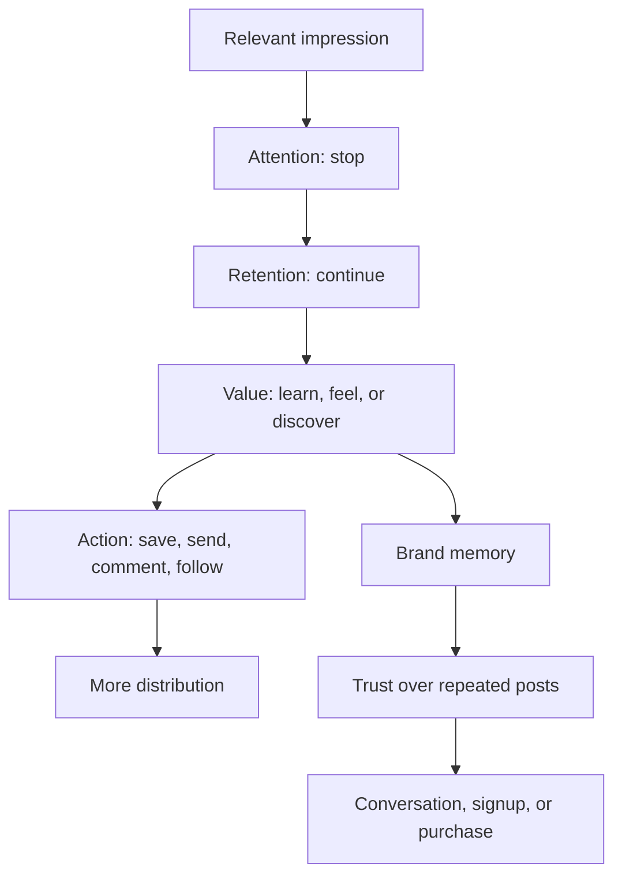

# Lesson 1 — How LinkedIn Growth Actually Works

## The problem with “trying to go viral”

Virality sounds like a goal, but it is an outcome produced by several earlier events. A person must first receive an impression, notice the post, understand it, care enough to continue, and perform an action that tells either another person or the platform that the content was worthwhile. If you focus only on the final view count, you lose control of the parts you can improve.

For a developer building MicroSaaS, a million irrelevant views can be less valuable than 5,000 views from developers, founders, teachers, or prospective users. Your actual objective is **compounding relevant attention**: repeatedly reaching people who can learn from you, trust your judgment, use your products, refer you, hire you, or collaborate with you.

This lesson creates a working model of that process. It is not a claim that we know LinkedIn’s private ranking code. It is a creator-side model based on observable user behavior and the metrics LinkedIn exposes.

## Three systems are operating at once

Every post participates in three systems:

1. **Human attention.** A busy person decides whether your post deserves scarce time.
2. **Platform distribution.** LinkedIn decides where and to whom the post may be relevant.
3. **Brand memory.** A reader gradually associates your name with a topic, quality level, and point of view.

A weak creator strategy confuses these systems. It may optimize a shocking hook for attention while teaching the audience nothing to remember. It may chase reactions that do not lead to profile visits or followers. It may post polished product advertisements that build brand memory among the few people who see them but generate no distribution.

A strong strategy designs for all three:

The arrows are not guaranteed. A reader may learn without reacting. Someone may react without remembering you. A buyer may silently follow for months. This is why single-post engagement rates are incomplete evidence.

## The value equation

People continue when the expected value of your post exceeds the cost of consuming it.

We can express the idea informally:

\[
\text{Continuation likelihood} \propto
\frac{\text{relevance} \times \text{promised value} \times \text{credibility}}
{\text{effort} + \text{ambiguity} + \text{skepticism}}
\]

This is not an algorithmic formula. It is a diagnostic tool.

- **Relevance:** Is this for a problem or identity the reader recognizes?
- **Promised value:** Does the opening suggest a useful lesson, discovery, story, or result?
- **Credibility:** Is there evidence you know what you are talking about?
- **Effort:** How hard is it to read, watch, or understand?
- **Ambiguity:** Does the reader know what the post is about?
- **Skepticism:** Does it look exaggerated, copied, promotional, or generic?

Consider two openings:

> I am excited to share an innovative project I have been working on that leverages powerful technologies to transform education.

and:

> I built a math whiteboard where LaTeX equations turn into graphs without leaving the canvas.

The second opening is not better because short sentences are magically favored. It is better because it names the category, action, differentiator, and outcome. It reduces ambiguity and offers proof that can be demonstrated immediately.

## Attention is a promise; retention is repayment

A hook makes a promise about the value that follows. Retention depends on whether the post begins paying that promise quickly.

Bad clickbait creates a large “curiosity gap” and delays the answer:

> This one thing changed the way I code forever...

The reader cannot determine whether the topic is relevant, and the exaggerated promise increases skepticism. A useful curiosity gap is specific enough to qualify the audience:

> The hardest part of building a browser-only screen recorder was not recording the screen.

A web developer now knows the domain. The sentence opens a question—what was harder?—without hiding the entire subject. The body can repay the promise by explaining memory pressure, permissions, browser compatibility, upload strategy, or another real constraint.

Use the **promise–proof–payoff** test:

- **Promise:** What does the opening imply the reader will get?
- **Proof:** What concrete evidence makes the claim believable?
- **Payoff:** What can the reader understand, use, or feel by the end?

If your hook promises “how I got my first 100 users,” but the body gives motivational slogans, the post breaks its contract. If your video promises a working application but spends ten seconds on a logo animation, it delays repayment.

## Five kinds of value

Developer creators often assume educational value is the only legitimate value. In practice, a strong account uses several forms:

| Value | Reader experience | Developer example |
|---|---|---|
| Utility | “I can use this.” | A reliable React pattern or tool workflow |
| Discovery | “I did not know this existed.” | A new library demonstrated on a real problem |
| Interpretation | “Now I understand why it matters.” | Tradeoffs of local-first storage |
| Identity/emotion | “This describes my experience.” | The gap between prototypes and production software |
| Narrative | “I want to know what happened.” | A failed launch and the change that brought users back |

Ram-style tool discovery leans heavily on discovery and excitement. Fatimah-style audience education and personal milestones blend utility, identity, and narrative. Your opportunity is to combine discovery with interpretation: do not merely reveal a tool; show what you tested, where it works, and what an experienced builder should know before adopting it.

## Relevance before reach

Imagine a post reaches four groups:

- junior developers who want practical examples;
- experienced engineers who value nuanced tradeoffs;
- indie hackers looking for product tactics;
- teachers who might use the math whiteboard.

One post cannot maximize value for all four. “Broad appeal” often becomes shallow appeal. Instead, decide the primary reader for each post while maintaining a consistent overall identity.

A useful hierarchy is:

1. **Account audience:** the broad group your profile serves—developers and technical builders.
2. **Series audience:** a recurring subgroup—developers building browser tools, for example.
3. **Post audience:** one person with one context—someone deciding whether the MediaRecorder API is enough for an MVP.

Write to the post audience. Let the account’s body of work serve the larger audience.

## Why actions have different meanings

LinkedIn exposes impressions, reach, reactions, comments, reposts, saves, sends, profile visits, followers gained, link visits, and video watch metrics. Do not collapse these into “engagement.” Each action indicates a different kind of value:

- **Reaction:** low-friction agreement, support, or emotion.
- **Comment:** conversation, disagreement, experience, or social participation.
- **Save:** expected future utility.
- **Send:** private social utility—“someone else needs this.”
- **Repost:** identity alignment or strong public utility.
- **Profile visit:** curiosity about the author.
- **Follow:** expectation of future value.
- **Link visit:** willingness to leave the feed for a next step.
- **Average watch time:** how long the video held attention, though it does not explain why someone left.

Suppose a 25-second product demo receives fewer reactions than a motivational post but generates ten profile visits, five follows, and three beta signups. For your goal, the demo may be the stronger post. Your metrics must follow your strategy.

## The two loops: discovery and relationship

Growth requires two connected loops.

### The discovery loop

1. Publish something immediately understandable.
2. A relevant person stops and receives value.
3. They save, send, comment, follow, or visit your profile.
4. The post reaches additional people or travels through private sharing.

Visual demos, timely tool discoveries, strong claims, and concise tutorials are especially useful here. They can work without a deep prior relationship.

### The relationship loop

1. A person encounters you repeatedly.
2. Your posts deliver a consistent kind of value.
3. They learn your standards, personality, and point of view.
4. They begin to trust recommendations and care about your projects.
5. Conversation, collaboration, or conversion becomes possible.

Build-in-public updates, honest retrospectives, recurring series, comment replies, and personal stories support this loop.

Creators who only run discovery become interchangeable feeds of interesting links. Creators who only run relationship content may be loved by a small existing circle but struggle to reach new people. Your weekly mix needs both.

## A realistic model of virality

Virality occurs when distribution expands faster than the original audience would predict. That can happen because the post is exceptionally useful, emotionally resonant, timely, visually arresting, socially shareable, or connected to a high-interest conversation. It also depends on conditions you do not control: timing, competition in the feed, which initial viewers see it, and how their networks behave.

Think in probabilities, not recipes:

\[
P(\text{high reach}) = f(\text{topic demand},\text{packaging},\text{retention},\text{audience fit},\text{sharing},\text{timing},\text{luck})
\]

You can improve topic selection, packaging, retention, audience fit, and shareability. You cannot eliminate luck. A professional system therefore produces many high-quality attempts and learns from them.

### The viral coefficient mental model

In product growth, a viral coefficient describes how many new users each user produces. For content, use a looser analogy: how often does one viewer cause another relevant viewer to encounter the post?

A viewer may:

- send it privately;
- repost it;
- comment, making it visible in a network context;
- mention a colleague;
- discuss the idea elsewhere;
- follow you and amplify a later post.

Designing for transmission does not mean asking people to “tag three friends.” It means creating a reason to transmit:

- a checklist a teammate needs;
- a demo that solves a friend’s problem;
- a clear explanation of a debated technology;
- a relatable story that says what others have felt;
- a resource that makes the sender look helpful.

## Topic, packaging, and substance

Performance is often diagnosed at the wrong layer.

| Layer | Question | Common failure |
|---|---|---|
| Topic | Do enough relevant people care now? | Teaching an obscure detail with no stated consequence |
| Packaging | Can they recognize the value immediately? | Generic hook, tiny screenshot, long preamble |
| Substance | Does the content repay attention? | Unsupported claims, obvious tips, no proof |

If a strong lesson receives low views, the packaging or initial audience fit may be weak. If views are high but follows and saves are low, the topic or hook may attract curiosity without delivering distinct value. If comments are high but mostly generic, the post may be emotionally easy to react to without building expertise.

Never conclude “technical posts do not work” from one post. Test different topics and packaging inside the technical category.

## The trust ladder

A stranger rarely moves from one impression to paying for a product. Content helps them climb:

1. **Recognition:** “I have seen Aadil’s name.”
2. **Relevance:** “He posts about tools and problems I care about.”
3. **Competence:** “He builds and explains real things.”
4. **Judgment:** “His recommendations and tradeoffs are thoughtful.”
5. **Affinity:** “I like how he approaches the work.”
6. **Intent:** “I want to try, subscribe, contact, or buy.”

Different posts serve different rungs. A 20-second visual demo creates recognition. A careful technical breakdown establishes competence. A postmortem shows judgment. A founder story creates affinity. A case study with a clear CTA supports intent.

Trying to force every post to sell collapses the ladder. Never offering a next step, however, wastes the trust you have earned. Digital marketing in Lesson 7 will connect these stages deliberately.

## Human voice is an information advantage

“Sound human” is often reduced to contractions and casual language. The deeper issue is **information provenance**. A human-sounding post contains details that reveal a real observer:

- what you expected before the test;
- what broke;
- the constraint that changed your decision;
- a screenshot of the actual result;
- a user’s question;
- a belief you revised;
- an unresolved doubt.

Compare:

> Consistency is key. Keep building and never give up.

with:

> I spent two weeks polishing collaboration before three teachers told me they first needed a faster way to paste equations. I had optimized the impressive feature before the frequent one.

The second statement contains a decision, evidence, tension, and lesson. Even if edited with AI, its source is a real experience. That makes it harder to commoditize and easier to trust.

## A first-principles post audit

Before publishing, score each dimension from 0 to 2:

| Dimension | 0 | 1 | 2 |
|---|---|---|---|
| Audience | Unclear | Broad group | Specific reader and context |
| Promise | No clear benefit | Topic is clear | Benefit/tension is clear |
| Proof | Assertion only | Example | Demonstration, data, or first-hand detail |
| Payoff | Generic | Useful summary | Specific reusable insight |
| Friction | Hard to parse | Acceptable | Effortless to scan/watch |
| Distinctiveness | Anyone could say it | Some personality | Could only come from your work/judgment |
| Next action | None or manipulative | Generic question | Natural discussion or appropriate CTA |

A low score does not mean “do not post.” It tells you what kind of experiment you are running. A simple personal update may not need a technical payoff. But a tutorial that scores zero on proof is not ready.

## Worked example: the math whiteboard

### Version A: feature announcement

> I am excited to announce my Excalidraw clone with LaTeX support. It supports equations, graphs, text, and diagrams. Check it out!

Problems:

- “Excited to announce” centers the author before the reader’s problem.
- “Clone” frames the product as derivative.
- The distinct behavior is not visualized.
- The feature list does not explain who needs it.
- “Check it out” asks for action before delivering value.

### Version B: discovery post

> I built a whiteboard where a LaTeX equation can become a graph without leaving the canvas.
>
> Here is the 20-second workflow: type the equation, render it, graph it, and annotate the result beside your diagram.
>
> I built it because math explainers usually force me to switch between a whiteboard, equation editor, and graphing tool.
>
> The next question is collaboration: would you use a shared canvas for tutoring, study groups, or recorded lessons?

Why it works better:

- The opening describes an observable result.
- The video can prove it immediately.
- The problem gives the feature meaning.
- The question qualifies possible users and produces product research.

### Version C: technical authority post

> Rendering LaTeX was the easy part of my math whiteboard. Keeping equations editable after they became canvas elements was the architectural decision.
>
> I considered storing only rendered SVG, but that would discard the source expression. Instead, each equation element keeps the source, rendered representation, and graph settings as separate state...

This version may reach fewer general viewers, but it climbs the competence and judgment rungs for developers. Both B and C belong in your system.

## Your operating principles

1. **Earn attention with clarity, not concealment.**
2. **Repay the hook quickly.**
3. **Choose one primary reader per post.**
4. **Use proof whenever a claim can be shown.**
5. **Design for a meaningful action, not engagement in the abstract.**
6. **Alternate discovery content with relationship content.**
7. **Evaluate posts by strategic purpose and audience quality.**
8. **Treat virality as a portfolio outcome, not a promise.**
9. **Build trust through first-hand specificity.**
10. **Publish enough quality experiments to learn.**

## Application: build your growth model

Write one sentence for each:

1. **Account audience:** “I serve…”
2. **Repeated value:** “They follow because I repeatedly…”
3. **Discovery format:** “A stranger first notices me through…”
4. **Relationship format:** “They learn to trust me through…”
5. **Commercial destination:** “The appropriate next step is…”

Recommended starting answer:

> I serve developers and technical builders interested in practical AI, web products, and small software businesses. They follow because I show useful software working and explain the engineering and product judgment behind it. Strangers first notice me through concise visual demos and library experiments. They learn to trust me through technical breakdowns, honest build stories, and measured results. When a project matches their problem, the next step is to try it, join a waitlist, or give focused feedback.

Then take your next planned post and label its primary job: discovery, competence, relationship, research, or conversion. If you cannot name the job, the post is probably trying to do too much.

## Deep-dive lab: diagnose growth as a system

The concepts become useful when you can diagnose a post without reducing the answer to “the algorithm did not like it.” Work through the following cases as if you were reviewing your own account.

### Case 1: high impressions, weak author conversion

A 24-second video about a newly released AI interface library reaches 45,000 people. It receives many reactions, a respectable watch time, and several comments saying “cool.” It produces only 28 profile visits and four follows. No one asks how you tested it.

The post succeeded at **object-level discovery**: people cared about the library. It failed to transfer enough interest to the author. Several causes are plausible:

- the library, not your insight, was the entire value;
- the post looked like a repost or advertisement;
- the viewer did not learn what you uniquely evaluate;
- your profile promise did not match the post;
- the audience enjoys novelty but does not expect future value from you.

The wrong reaction is to stop covering tools. Improve author association. In the next test, build one feature with the library, state your criteria, reveal a limitation, and use a recurring “Library to Feature” promise. You are trying to make the audience think, “I want Aadil’s next test,” not merely “that library looks interesting.”

### Case 2: modest reach, strong business signal

A detailed post about keeping browser recordings recoverable reaches only 3,200 members. It earns 18 saves, 12 private sends, six thoughtful engineering questions, 40 profile visits, 17 follows, and two conversations with founders building recording products.

Calling this post a failure because it did not reach 50,000 people would misunderstand its job. It produced high-intent behavior among a specialized audience. The post may be worth repurposing into a diagram, repository example, and follow-up video. It also reveals that “browser media reliability” can become an authority subtopic.

The lesson is to compare the post with its intended rung on the trust ladder. It was a competence and judgment post, not a broad discovery post.

### Case 3: many comments, little useful learning

A post asks, “Will AI replace developers?” It receives hundreds of comments. Most are polarized one-line opinions. Profile conversion is weak, and the audience demographics are broad. The post creates activity but does not reinforce your position around practical software building.

The topic has broad identity stakes, which makes commenting easy. That does not mean all debate is bad. Improve the question by grounding it in an observable change:

> I used an agent to produce a working UI in an hour. Hardening auth, data migration, and error recovery still required engineering judgment. Which part of production software has AI changed most in your work?

Now the debate is constrained by evidence and invites professional experience rather than tribal prediction.

### Case 4: strong content, weak opening

A carousel contains an excellent comparison of local-first and cloud secret storage. Few people open it. The first line is “Some thoughts on a project I have been working on recently.” The content may be strong, but the promise is invisible.

Repackage without rewriting the substance:

> A local-first API-key manager removes one trust dependency and creates a different recovery problem.

The new hook identifies the subject and tradeoff. If reach improves while saves remain strong, packaging was the main bottleneck.

### Case 5: strong hook, broken contract

The opening says, “I cut my SaaS onboarding time by 80%.” The body discusses general simplification but never defines the original time, new time, sample, or changes. Readers feel the missing proof even if they cannot name it.

Repair it:

> In five moderated tests, the median time to the first completed recording fell from 4:10 to 0:52 after I removed account creation from the start. This is an early usability result, not retention evidence.

The narrower claim is more credible. It also distinguishes usability improvement from business success.

## Attention psychology without manipulation

Several human tendencies explain why certain posts attract attention. They are tools for clarity, not licenses to deceive.

### Processing fluency

People prefer information that is easier to perceive and understand. Clear wording, familiar categories, readable visuals, and logical sequence reduce cognitive load. Fluency does not mean oversimplification. You can explain a sophisticated idea through an intuitive model followed by a precise boundary.

Application: replace “a multimodal, integrated ideation environment” with “a whiteboard where equations, graphs, and drawings remain editable together.”

### The information gap

Curiosity appears when a person knows enough to notice a missing answer. Total vagueness creates no useful gap; excessive detail closes it.

Application:

> I thought video encoding would be the bottleneck. A 30-minute recording exposed a different failure.

The reader knows the domain and expectation but not the failure.

### Distinctiveness

Unusual objects or claims receive attention because they differ from surrounding material. On a developer feed, an elegant live interaction can be more distinctive than another list of tools. Distinctiveness must remain relevant; random spectacle attracts the wrong audience.

### Social currency

People share information that helps them appear useful, informed, or thoughtful to others. A production-readiness checklist is sendable because it helps a teammate. Design for usefulness, not vanity: “send this to your team” is unnecessary when the artifact genuinely belongs in a team conversation.

### Identity and self-relevance

People attend to content that describes who they are or want to become. “If you are building your first browser extension…” is powerful because it names a situation. Use identity respectfully and specifically. Avoid inventing enemies or dividing “real developers” from everyone else.

### Peak and ending

Viewers often remember a strong moment and the ending. In a product demo, the peak might be the equation instantly becoming an editable graph. The ending should interpret it: “The real feature is not rendering; it is preserving the source.” Do not let the clip end on your cursor searching for the stop button.

## Build a portfolio, not a sequence of lottery tickets

Treat a quarter of content like an investment portfolio. Each type has a role and risk profile.

### Discovery assets

These have broader potential reach: visually surprising products, timely libraries, simple transformations, and sharp interpretations of current technology. They bring strangers into the system. Their risk is shallow author association.

### Authority assets

These include architecture decisions, debugging lessons, comparisons, and production constraints. They may reach fewer people but deepen trust. Their risk is excessive complexity or insufficient initial relevance.

### Relationship assets

These are honest stories, progress, failures, and beliefs grounded in your work. They build affinity. Their risk is becoming self-centered or motivational without reader value.

### Conversion assets

These include demos for a specific user, case studies, beta calls, and launch posts. They move qualified people toward a product. Their risk is promotion fatigue.

### Research assets

These ask focused questions, show prototypes, or compare workflows to learn from the market. Their risk is treating comments as representative evidence.

A balanced 12-post month might include four discovery, three authority, two relationship, two research, and one conversion post. During a launch, conversion and proof increase. During early audience building, discovery increases. The mix follows the business stage.

## The content–brand feedback loop

Positioning is initially a hypothesis. Posts reveal what audiences recognize in you.

Suppose your browser API content consistently creates saves, engineering comments, and relevant follows, while broad AI tool roundups create impressions but few qualified actions. That evidence suggests narrowing toward “building real products with browser and AI APIs.” You do not let the audience dictate your identity, but you notice where your capability and market interest intersect.

Use this quarterly loop:

1. State the association you want.
2. Publish several proof-bearing posts that express it.
3. Measure who responds and what they expect next.
4. Decide whether to reinforce, clarify, or change the association.
5. Update the profile and series.

Brand is the residue of repeated evidence, not a design exercise completed before posting.

## Failure modes at each stage

### Impression failure

Possible causes: small or inactive network, topic mismatch, inconsistent history, weak timing, or ordinary distribution noise. Response: publish more comparable work, participate in relevant conversations, and choose recognizable problems.

### Stop failure

Possible causes: vague opening, tiny visual, weak first frame, overly familiar claim, or no visible stakes. Response: clarify the subject, result, audience, or tension.

### Retention failure

Possible causes: delayed payoff, dense language, slow video, mismatch between hook and body, unreadable screen, or too many ideas. Response: move proof earlier, cut setup, and make one transformation the spine.

### Value failure

Possible causes: generic advice, untested summary, no decision, no example, or obvious conclusion. Response: add first-hand evidence, a boundary, comparison criteria, or a reusable artifact.

### Action failure

Possible causes: no logical next step, mismatched CTA, weak profile, or content that is entertaining but not future-oriented. Response: make the recurring promise visible and choose an action proportional to value.

### Trust failure

Possible causes: exaggeration, undisclosed incentive, copied style, unsupported number, constant promotion, or refusal to admit limitations. Response: narrow claims, disclose, credit, and show method.

## Establish an evidence ledger

Create a private table while you build:

| Date | Project | Observation | Evidence | Possible lesson | Permission/sensitivity |
|---|---|---|---|---|---|
| Nov 13 | Math canvas | Equation source must survive rendering | state model + demo | preserve meaning, not only pixels | safe synthetic data |
| Nov 14 | Recorder | long sessions pressure memory | test log | prototype vs production | no user data |
| Nov 15 | User call | tutor copies equations from notes | consented notes | workflow problem | anonymize |

This ledger prevents generic posting because raw material is captured near the experience. It also prevents accidental fabrication: you can trace a claim to evidence. Mark whether a metric is measured, estimated, or anecdotal.

## A rigorous pre-publication challenge

Ask a skeptical reviewer to answer:

1. What exactly is the claim?
2. What evidence supports it?
3. What alternative explanation exists?
4. What population and conditions does it apply to?
5. What important limitation is omitted?
6. What value remains if the reader ignores the CTA?
7. What association with the author will remain tomorrow?

For a casual demo, the answers can be short. For a performance, security, or business claim, they should be explicit.

## Field exercise: redesign one week

Take one product and design five posts with different jobs:

### Monday: discovery

Show one surprising transformation. Optimize for comprehension and shareability.

### Tuesday: authority

Explain the technical decision enabling the transformation. Optimize for saves and qualified discussion.

### Wednesday: relationship

Tell the real origin story or mistake. Optimize for affinity and relevant experience sharing.

### Thursday: research

Ask about past workflow behavior. Optimize for insight, not comment volume.

### Friday: conversion

Offer a beta to the audience whose problem has now been established. Optimize for activation, not clicks.

Notice how the same product supports different promises without repeating the same post. This is the foundation of a launch sequence and a sustainable content engine.

## Acceptance exercise: explain the mechanism without folklore

Take three posts—one high-reach, one medium, one low—and write a diagnosis using only observable facts and clearly labeled hypotheses. For each, document the intended reader, promise, proof, payoff, action, post job, and resulting audience. Do not write “LinkedIn suppressed it” unless you possess evidence beyond low reach. Use alternatives: topic demand may have been low; the opening may have hidden relevance; the proof may have arrived late; the audience may not yet associate you with the topic; ordinary variance may be large.

Then redesign only one layer. If topic is the suspected issue, keep the structure and select a more recognizable problem. If packaging is suspected, keep substance and rewrite the first screen/first frame. If substance is suspected, add evidence, a mental model, or boundary. Publish several comparable tests before concluding.

Finally, write a one-paragraph answer to each:

1. Why can a post with fewer impressions be strategically better?
2. What is the difference between attention and trust?
3. Why is a hook a promise rather than a trick?
4. What action indicates future utility?
5. How does first-hand specificity create a moat?
6. Why can discovery content weaken author association?
7. What makes content transmit between professionals?
8. Why can comments be a misleading success metric?
9. How does profile conversion connect post and brand?
10. What part of virality remains outside your control?

You pass this lesson when your answers use causal reasoning and evidence rather than formatting rules. The goal is to make you resistant to confident algorithm folklore while still improving controllable inputs.

## Key distinctions to retain

- **Impression versus reach:** an impression is a display; reach estimates distinct viewers.
- **Attention versus retention:** stopping is not the same as continuing.
- **Engagement versus value:** an action may reflect emotion, utility, identity, or conversation; interpret the type.
- **Reach versus relevance:** broad distribution does not prove audience fit.
- **Virality versus compounding:** a spike is one event; compounding is repeated trust and future expectation.
- **Proof versus claim:** the assertion tells; the demonstration, source, or measurement supports.
- **Brand versus profile design:** design influences perception, but brand is the accumulated expectation from behavior and evidence.
- **Follower versus user:** a follower expects content; a user completes a product job.
- **Correlation versus cause:** a visible pattern in a viral post does not prove it caused distribution.

## Summary

LinkedIn growth is not a bag of formatting tricks. It is a repeated value exchange amplified by distribution and accumulated into brand memory. A strong post makes its relevance clear, promises something worthwhile, proves it, repays attention, and invites an action that fits the reader’s stage. A strong account repeats that process until recognition becomes trust.

The next lesson decides what you should become known for, how niche selection really works, and how your profile converts a successful post into a durable audience.

