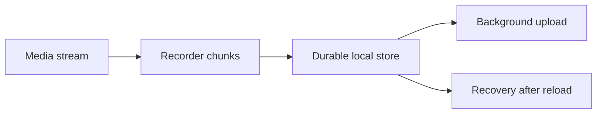
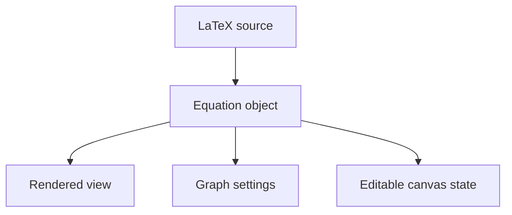
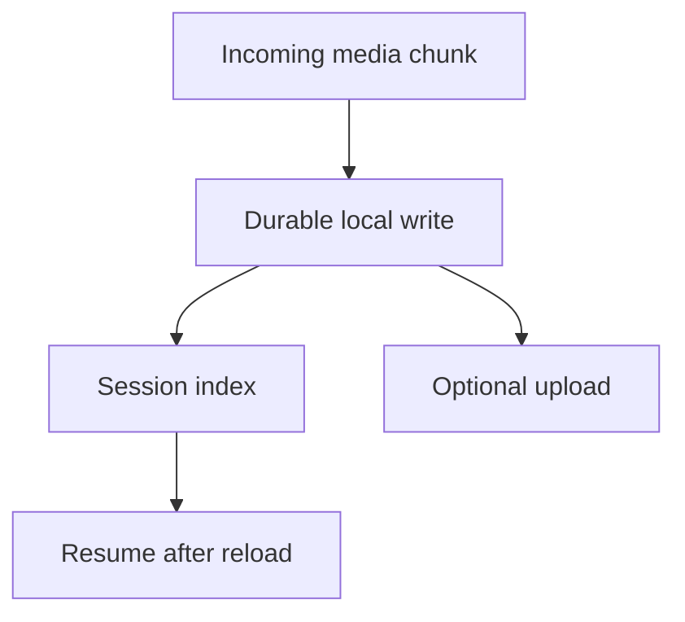

# Lesson 5 — Product Demos and Technical Content That People Can Use

## Why visual proof is your advantage

Developers often describe software when they could show it. A working interface compresses several claims—capability, polish, authorship, and usefulness—into seconds. For a builder, demonstration is not decoration; it is evidence.

Yet many software demos fail on social feeds. They show an entire desktop reduced to phone size, begin with setup instead of payoff, move the cursor too quickly, display sensitive information, or tour every feature without a story. This lesson treats the demo as a designed explanation.

## The unit of a good demo: one transformation

The strongest short demo usually shows one state becoming another:

- raw LaTeX → rendered equation → graph;
- empty canvas → visual explanation;
- unorganized timestamps → searchable study notes;
- browser tab → recorded screen and camera → exported clip;
- exposed configuration → locally managed secret;
- complicated workflow → short workflow.

A feature list is static. A transformation provides motion, causality, and value.

Use this sentence:

> For **[person]**, this turns **[painful starting state]** into **[valuable end state]** by **[mechanism]**.

Example:

> For a math tutor, this turns a typed equation into an annotated graph on the same canvas by preserving the LaTeX source as an editable object.

If you cannot write the transformation, the demo may be a tour rather than a story.

## Demo hierarchy

Plan the clip in this order:

1. **Payoff frame:** show the completed or most interesting state.
2. **Trigger:** show the one action that begins the workflow.
3. **Transformation:** show the system responding.
4. **Control:** demonstrate that the result is editable or useful, not a canned animation.
5. **Meaning:** state who benefits or what tradeoff matters.

This is a “result first, mechanism second” structure. It prevents viewers from leaving before the value appears.

## The first-frame test

Pause the video at zero seconds. A viewer should be able to infer the category and reason to watch while muted.

Strong first frame:

- the finished math canvas;
- a large overlay: “LaTeX → editable graph, on one canvas”;
- cursor near the equation;
- clean crop with no irrelevant browser chrome.

Weak first frame:

- blank new tab;
- IDE with many tiny panels;
- logo animation;
- desktop wallpaper;
- terminal installation command before the result.

You can begin with the finished state, then cut back to the workflow. This is not deceptive if the clip shows the real process.

## Choosing the visual format

### Native video

Best for motion, interactions, before/after, personality, and fast discovery. It demands legibility, retention, and production.

### Static screenshot

Best when one interface state carries the proof. Annotate the important area. A screenshot can outperform video when motion adds nothing.

### Document/carousel

Best for sequential frameworks, architecture, checklists, comparisons, and saved reference. Each page should express one step and remain readable without zooming.

### Text plus code

Best for compact patterns that can be understood in a few lines. Prefer formatted text or a readable image; do not screenshot an entire editor for six lines.

### Diagram

Best for state flow, architecture, ownership, and lifecycle. A diagram should clarify a relationship, not merely make a post look technical.

Format follows the information. Do not turn every idea into a video because video currently receives attention.

## Designing a 30-second product demo

Use five beats:

| Time | Beat | Purpose |
|---:|---|---|
| 0–2s | Finished result | Stop and orient |
| 2–6s | Problem or promise | Explain why it matters |
| 6–20s | Core workflow | Prove the transformation |
| 20–27s | Insight/constraint | Add depth and judgment |
| 27–35s | Takeaway/CTA | Resolve and direct |

The times are starting points, not laws. A silent 12-second loop may be ideal for a simple interaction. A 50-second explanation may be necessary for a tradeoff.

### Storyboard: math whiteboard

**0–2 seconds:** finished canvas with equation, graph, arrows, and annotation. Overlay: “I built a whiteboard for math.”

**2–5:** cursor selects the original equation. Voice: “The difference is that LaTeX is native, not a pasted screenshot.”

**5–14:** type or edit expression, render, graph.

**14–21:** move graph, draw annotation, edit source again.

**21–28:** voice: “Preserving the source keeps the equation editable after it becomes a canvas element.”

**28–33:** final frame: “Would tutors use this for shared lessons?”

This demo contains product value and technical judgment.

## Showing code on a phone

Code is dense. Apply these rules:

- show five to twelve relevant lines, not the entire file;
- enlarge the font before recording;
- hide sidebars, minimap, terminal, tabs, and unrelated code;
- highlight one line at a time;
- narrate the mental model rather than reading syntax;
- use a diagram or pseudocode if exact syntax is not the lesson;
- place the complete code in a repository or comment only when it genuinely helps.

A useful sequence is **behavior → model → code → behavior**:

1. show the screen recorder working;
2. explain that the browser emits chunks;
3. show the `MediaRecorder` creation and `dataavailable` handler;
4. return to the exported file.

This grounds abstraction in observable behavior.

## Mini tutorials: one problem, one concept, one result

A social tutorial is not compressed documentation. Select a narrow outcome:

Weak scope:

> Learn React state management in 45 seconds.

Better:

> Prevent a stale closure from breaking your recording timer.

Use the **P-M-E-B** structure:

1. **Problem:** show the failure.
2. **Model:** explain why it happens.
3. **Example:** show the smallest fix.
4. **Boundary:** state when the pattern does not apply.

The boundary builds credibility. It tells experienced readers you understand that a technique has conditions.

## Tool and library showcases

Tool showcases are ideal for the Ram-inspired discovery mode, but first-hand testing is your differentiation.

### The evaluation card

Before recording, fill in:

- **Claim:** What does the tool promise?
- **Task:** What real feature did you attempt?
- **Setup cost:** How long and what dependencies?
- **Success criterion:** What must work?
- **Strength:** What was surprisingly good?
- **Limit:** What broke or required custom work?
- **Fit:** Who should use it?
- **Source:** Where can the reader verify it?

Example:

> I tested an ASCII loader library in a Next.js dashboard. It took ten minutes to integrate and made the empty wait state more distinctive. But its animation needed a reduced-motion fallback and the default contrast missed my accessibility target. Good for a stylized developer product; unnecessary for a conventional business dashboard.

That post gives discovery, implementation, and judgment.

## Architecture content without overwhelming people

Architecture posts should answer a decision question, not display every component.

Start with:

> How can a browser recorder avoid losing an entire session when the page crashes?

Then show only the relevant flow:



Explain what each arrow guarantees, where failure occurs, and what tradeoff you chose. If the diagram needs 20 boxes, split the lesson.

## Product showcases versus advertisements

An advertisement asks for attention because the seller wants a conversion. Useful product content earns attention by teaching or demonstrating something even if the viewer never buys.

Convert a product announcement into content by adding one of these:

- a user problem explained clearly;
- an implementation decision;
- a surprising before/after;
- a failed approach;
- a workflow viewers can borrow;
- a product principle;
- evidence and limitations.

Bad:

> My new productivity app is live! It has timers, analytics, goals, and dark mode. Sign up now.

Better:

> I removed the dashboard from the first screen of my focus app. New users were analyzing productivity before completing one focus session. The new onboarding starts a timer in one click; analytics appear after the first session. Here is the before/after.

The product is still promoted, but the post delivers a product lesson.

## Privacy and security in recordings

Developer screens leak data easily. Before recording:

- use a dedicated browser profile;
- disable personal notifications;
- close email, chat, password managers, and private tabs;
- replace real API keys and tokens with unmistakable dummy values;
- use synthetic user data;
- inspect terminal history and environment output;
- remove customer names, internal URLs, and proprietary repositories;
- check browser bookmarks and profile avatar;
- crop OS menu bars if they show sensitive status;
- replay the exported file frame by frame before publishing.

Blurring in post-production is a fallback, not the primary plan. Record a clean environment.

## Accessibility is content quality

A useful demo should work for people who cannot hear it, see small details, or tolerate rapid motion.

- include accurate captions;
- ensure overlays have sufficient contrast;
- keep critical text away from interface overlays and edges;
- avoid rapid flashing;
- provide a reduced-motion-friendly pace;
- narrate important visual changes;
- add descriptive post text for the outcome;
- do not use color as the only signal;
- let viewers pause long enough to read code.

Accessibility often improves retention for everyone because it forces clearer hierarchy.

## Creating a visual content bank

Record assets during development rather than reconstructing them later:

- initial broken behavior;
- prototype;
- before/after design;
- feature interaction;
- test result;
- user feedback excerpt with permission and identifying details removed;
- architecture sketch;
- performance comparison;
- launch dashboard snapshot;
- failure and recovery.

Maintain metadata: project, date, what is shown, permission status, sensitive-data check, and possible story. One engineering session can produce several future posts.

## Repurposing one build into multiple posts

The math whiteboard could produce:

1. 20-second result demo;
2. text story about fragmented tools;
3. technical post on editable equation state;
4. carousel comparing SVG-only and source-preserving models;
5. tutorial on rendering LaTeX;
6. product-research question for tutors;
7. build update on collaboration;
8. launch post;
9. postmortem with usage;
10. “prototype vs production” lesson.

Repurposing is not reposting identical content. Each piece changes the reader promise and depth.

## Quality-control checklist

Before publishing a visual asset:

### Story

- Is there one transformation?
- Is the intended viewer clear?
- Does the first frame show value?
- Does the ending resolve the promise?

### Legibility

- Can a phone viewer read every critical element?
- Is the cursor visible and movement deliberate?
- Are overlays concise and inside safe areas?
- Are cuts and zooms helping comprehension?

### Proof

- Is this real behavior rather than a mockup presented as complete?
- Are claims proportionate to evidence?
- Is the original tool/source credited?
- Is one limitation stated when relevant?

### Safety

- Are secrets, personal data, customer data, and notifications absent?
- Have captions been reviewed?
- Is sponsored or affiliate context disclosed?

## Application: produce three storyboards

Create three no-edit storyboards before touching recording software.

### Storyboard A: your product

Use “Small Tool, Real Problem.” Include six shots, one line of narration per shot, and the exact first-frame overlay.

### Storyboard B: a library

Use “Library to Feature.” State the test, success criterion, strength, limitation, and verdict.

### Storyboard C: a technical judgment

Use “Prototype vs Production.” Show the attractive demo, reveal the hidden constraint, and give one adoption rule.

For each, create a silent version on paper. If the viewer cannot understand the transformation without audio, add visual context rather than more narration.

## Deep-dive workshop: direct the viewer’s attention

A software interface contains many possible focal points. The creator’s job is to control what the viewer notices and in what order.

### Visual hierarchy

Use four tools:

1. **Crop:** remove irrelevant interface regions.
2. **Scale:** enlarge the action or code.
3. **Motion:** let the changing element draw attention.
4. **Annotation:** add a short label or highlight only when crop and motion are insufficient.

Do not highlight everything. Competing boxes, arrows, captions, cursor effects, and zooms destroy hierarchy.

### Temporal hierarchy

The viewer also needs time. Pause after a result appears. Let an equation render before moving to graphing. Keep a code line visible long enough to read. Editing out every pause can make a tutorial efficient in duration but inefficient in comprehension.

### Causal visibility

Show the triggering action and response in the same sequence. If you click a button and immediately cut to a result, the viewer may suspect a canned transition. For important proof, preserve enough continuity to demonstrate causality.

## Demo types and their proof burden

### Product tour

Shows breadth. Useful later in the funnel, but weak for discovery because too many features compete. Proof burden: the features must be real and readable.

### Transformation demo

Shows one workflow from before to after. Best discovery default. Proof burden: reveal the trigger and result.

### Benchmark/comparison

Shows differences in time, output, cost, or quality. Proof burden: disclose conditions, versions, hardware, dataset, and measurement method where material.

### Reliability demo

Shows behavior under failure: offline mode, tab crash, retry, recovery. Proof burden: use an honest failure scenario, not a staged result mislabeled as real.

### Tutorial demo

Shows how to reproduce a result. Proof burden: provide sufficient prerequisites and avoid hidden setup.

### Concept animation

Illustrates an invisible mechanism. Proof burden: label simplifications and avoid presenting analogy as literal implementation.

### Case study

Shows use by a real person or team. Proof burden: permission, accurate outcome, context, and no cherry-picked claim beyond evidence.

Choose the proof mode based on the claim.

## Storyboarding with shots

Use a shot list even for screen recordings:

| Shot | Frame | Action | Meaning | Duration |
|---:|---|---|---|---:|
| 1 | close crop, finished canvas | equation and graph visible | payoff | 2s |
| 2 | equation editor | change source | editability | 3s |
| 3 | canvas | graph updates | causal response | 4s |
| 4 | canvas + tools | annotate | integrated workflow | 4s |
| 5 | state diagram | source/view relationship | technical insight | 7s |
| 6 | finished canvas | question/next step | resolution | 3s |

The shot list exposes unnecessary navigation. Prepare the app in the correct state before recording each shot rather than making viewers wait for setup.

## The uncut-proof decision

Edits improve pacing but can weaken trust when the claim is speed or simplicity. Use an uncut segment when demonstrating:

- task completion time;
- one-click behavior;
- real latency;
- recovery after failure;
- a model generating a result;
- a complicated workflow claimed to be easy.

You can surround the uncut proof with edited context. Label accelerated sections when speed changes materially.

## Designing sample data

Demo data should be synthetic, safe, and instantly meaningful. Poor sample data makes a good feature look abstract.

For the math canvas, use a visually recognizable expression and graph. For a timestamp tool, use a public educational video with clear chapter names. For an API-key manager, use dummy keys such as `demo_sk_not_a_real_key` and visually label them as examples. For analytics, use round but plausible synthetic numbers and mark them “sample data.”

Do not use a real key and blur it later. Compression, thumbnails, or earlier frames may expose it.

## Demonstrating AI responsibly

AI demos can overstate reliability because creators select the best output.

Disclose what matters:

- model/service and date/version where relevant;
- prompt or key input;
- whether the output was selected from multiple attempts;
- manual edits;
- latency cuts;
- known failure modes;
- data/privacy implications;
- cost conditions.

A short demo need not include a legal appendix. Put essential context in the post and link to details. Never imply deterministic behavior from one successful run.

### Good AI showcase structure

1. real task;
2. input;
3. representative output;
4. what required human correction;
5. where it fits the workflow;
6. where it fails.

The human-correction step often provides the most valuable professional insight.

## Technical diagram workshop

Use diagrams for relationships invisible in the UI.

### State ownership



Explain that the rendered view is derived. If the diagram instead makes both source and SVG independent authorities, viewers may infer a synchronization problem.

### Recovery path



The diagram clarifies guarantees. It does not claim a particular database/API unless the implementation uses one.

### Diagram rules

- one main relationship;
- short labels;
- direction that matches reading order;
- fewer than necessary nodes, not fewer than truthful;
- supporting detail in prose;
- consistent terms with code and narration.

## Carousel design from first principles

A document post can teach a sequence without video timing. Use each page as one cognitive step.

Example carousel: “A browser recorder is two products.”

1. Cover: claim and visual.
2. Capture: browser APIs make the prototype possible.
3. Failure: memory-only chunks create risk.
4. Durability: persist chunks during recording.
5. Recovery: session metadata reconstructs progress.
6. Upload: cloud sync is a separate concern.
7. Decision table: prototype versus dependable product.
8. Summary: adoption rule and source.

Do not fill pages with paragraphs. The post caption can provide context; the carousel handles the visual model.

## Tutorial content ladder

One topic can support increasing depth:

### Level 1: short demo

“Here is what the API enables.”

### Level 2: mental model post

“Here is how chunks flow.”

### Level 3: code tutorial

“Here is the minimal complete implementation.”

### Level 4: production guide

“Here are recovery, quota, compatibility, and security decisions.”

### Level 5: case study

“Here is what happened with real workloads.”

This ladder turns discovery into authority. Link or reference earlier pieces only when it helps; each should still stand alone.

## Design critique as content

Before/after UI posts can teach product judgment. Avoid declaring the new version “cleaner” without criteria.

Explain:

- user’s next task;
- attention hierarchy;
- removed decision;
- changed copy;
- accessibility improvement;
- evidence or hypothesis;
- remaining uncertainty.

Example:

> I removed analytics from the first screen because new users had not completed a recording yet. The new hierarchy makes “Start recording” the only primary action. This should improve time-to-first-value; I still need to measure whether users can find settings when needed.

The caveat distinguishes design rationale from validated outcome.

## Failure demonstrations

Showing a bug can be more educational than showing success.

Structure:

1. expected behavior;
2. failure shown clearly;
3. cause mental model;
4. fix;
5. regression check;
6. general lesson.

Protect security: do not demonstrate exploitable details in a way that harms a live system. Use a local or synthetic environment. Coordinate disclosure for third-party vulnerabilities.

## Production asset library

Organize raw assets by project and story rather than file type:

```text
math-whiteboard/
  2026-11-editable-equations/
    raw/
    exports/
    screenshots/
    script.md
    source-and-permission.md
```

Use descriptive filenames such as `01-finished-canvas.mp4`, not `Screen Recording 47`. Store only non-sensitive material in shared/cloud locations. Keep a note of product version so old footage is not presented as current behavior.

## Demo critique protocol

Ask three reviewers with different contexts:

### Target user

- What problem did you think it solved?
- At what moment did you understand value?
- What would stop you using it?

### Developer peer

- Which technical claim needs evidence?
- What tradeoff is missing?
- Did the demo imply more reliability than shown?

### Unfamiliar viewer

- What happened in the first five seconds?
- Which text was unreadable?
- Where did attention drift?

Do not ask “Did you like it?” Ask comprehension and behavior questions.

## Field exercise: create a proof suite

For one product, produce:

1. a 12-second silent transformation loop;
2. a 30-second narrated demo;
3. one annotated screenshot;
4. one architecture diagram;
5. a six-page carousel;
6. a readable code fragment;
7. a failure-and-recovery clip;
8. a privacy-reviewed raw asset folder.

Then map each asset to a claim. If two assets prove the same thing, decide which format fits the reader. If an important claim has no asset, capture it before publishing.

## Advanced production cases

### Case 1: the interface is too wide for vertical video

Do not shrink the entire app. Create a narrative crop:

1. establish the full interface for one second;
2. cut to the equation region;
3. show the input and response;
4. cut to the graph region;
5. return to the full result.

Add a small orientation label only if the viewer may lose spatial context. If responsive layout exists, consider a narrow browser viewport, but do not imply the product is mobile-optimized when it is not.

### Case 2: the workflow requires waiting

If a build, model, or upload takes time, choose among:

- show the real wait when latency is the claim;
- cut the wait and label the elapsed time;
- accelerate and label speed;
- use a progress visualization while narrating the model;
- compare two approaches under the same conditions.

Never silently remove a 90-second delay while claiming instant behavior.

### Case 3: the code is visually boring

The goal is understanding, not making code cinematic. Begin with behavior, use a small diagram, show the decisive line, and return to behavior. A viewer does not need to watch you type imports.

### Case 4: the project is unfinished

Label it prototype, mockup, or concept. Demonstrate what is implemented and distinguish planned behavior. An unfinished project can create excellent content when the question is honest:

> The interaction works locally; persistence and collaboration are not built yet. Before I choose the architecture, I want to understand whether tutors need shared editing or shareable exports first.

### Case 5: a third-party tool supplies the impressive visual

Credit it prominently and explain your contribution. If the library supplies the animation and you only integrated it, say so. Your value may be evaluation, integration, accessibility work, or production judgment.

### Case 6: the result is not visually dramatic

Some important work—security, latency, recovery—needs visualization. Show a failure before/after, timeline, metric, or state diagram. Do not invent spectacle. A clear graph of recovery success can be more credible than flashy UI.

## Visual claim audit

Viewers infer more than you explicitly say. Audit what the asset implies:

- Does a fast cut imply lower latency?
- Does a mockup imply a shipped feature?
- Does one successful AI output imply reliability?
- Does a local demo imply cloud collaboration?
- Does a clean dashboard imply real customers?
- Does “secure” imply a threat model you have not established?

Add labels or text when the likely inference exceeds the evidence.

## Content accessibility walkthrough

### Muted viewer

Can they identify the product, transformation, and takeaway from captions and visuals?

### Low-vision viewer

Is text large, high contrast, and stable? Are annotations described in the post?

### Motor/cognitive accessibility perspective

Are interactions shown at a comprehensible pace? Does the product itself rely on tiny targets or rapid actions? A demo can reveal design issues worth fixing.

### Motion-sensitive viewer

Are zooms smooth and restrained? Does the demonstrated UI respect reduced-motion preferences?

Accessibility review can produce a valuable follow-up: what you changed in the product after watching your own demo as a user.

## Create a demo scorecard

Score 0–2:

| Dimension | 0 | 1 | 2 |
|---|---|---|---|
| First frame | blank/confusing | category visible | payoff obvious |
| Transformation | none | implied | trigger and result shown |
| Phone legibility | unreadable | mixed | all critical details clear |
| Proof | claim only | edited proof | credible causal proof |
| Insight | feature tour | basic explanation | non-obvious judgment |
| Pace | waiting/chaos | acceptable | every beat earns time |
| Captions | none/errors | present | reviewed and well placed |
| Privacy | risk | reviewed | synthetic safe environment |
| Credit | absent | link only | source and contribution clear |
| CTA | unrelated | generic | natural and proportional |

A low score identifies the next edit. It does not mandate more visual effects.

## Full worked storyboard: YouTube timestamp tool

### Promise

> Save the exact moment in a long tutorial, attach a note, and return without scrubbing.

### Shot 1: payoff

Show a list of saved moments with descriptive notes and one highlighted timestamp.

### Shot 2: problem

Show a long public tutorial and the imprecision of remembering “somewhere around minute 38.” Keep this brief.

### Shot 3: trigger

At a meaningful moment, click Save and type a short note.

### Shot 4: result

Open the saved list and jump directly back to the moment.

### Shot 5: technical/product insight

Explain where the data lives and whether sync exists. If local-only, name the portability tradeoff.

### Shot 6: payoff

> The feature is not another bookmark. It preserves why that moment mattered.

### Possible post angles

- study workflow;
- extension architecture;
- local versus cloud sync;
- product naming and retrieval;
- tutorial on timestamp URLs;
- user research with learners.

## Full worked storyboard: API-key manager

Security-related content requires careful scope.

### Promise

> Keep development keys organized locally without pasting them into random notes.

### Avoid claiming

- “unhackable”;
- “military-grade” without precise meaning;
- security guarantees not supported by audit/threat model;
- that local storage automatically makes a product safe.

### Demonstration

Use dummy credentials. Show adding, labeling, retrieving, and removing a key. Explain encryption, operating-system storage, export, or recovery only according to actual implementation.

### Insight

> Local-first removes a cloud account from the trust chain, but it makes device loss and backup your responsibility.

That tradeoff is more useful than a feature tour.

## Full worked storyboard: library experiment

### Setup

Choose one library and one real feature. Create a baseline without it.

### First frame

Show the final interaction, not the package installation.

### Proof

Show the library-driven behavior and one important configuration or code line.

### Evaluation

Use explicit criteria: integration time, bundle impact, accessibility, customization, type quality, documentation, maintenance, and production fit.

### Verdict

Do not say only “10/10.” State a condition:

> I would use it for a developer-facing prototype where visual distinction matters. I would not adopt it in an accessibility-sensitive dashboard until adding reduced-motion and keyboard handling.

## Build once, capture continuously

Add a content checkpoint to development:

- before changing behavior, record the old state;
- after a bug appears, capture it safely;
- when the first version works, record the unpolished proof;
- after UI refinement, capture the final path;
- after a user test, write the non-sensitive observation;
- after launch, snapshot metrics with dates and denominators.

This creates authentic before/after material that cannot be reconstructed later. It also reduces the temptation to invent a dramatic origin.

## Final visual QA sequence

1. Watch at normal speed on desktop.
2. Watch on a phone at default size.
3. Watch muted.
4. Listen without looking.
5. Pause on the first frame.
6. Scrub frame by frame for sensitive data.
7. Verify captions and technical names.
8. Compare claim with actual proof.
9. Confirm source permissions/credit.
10. Ask whether one cut, zoom, or label can be removed.

The last step protects restraint. Polished demos feel directed, not decorated.

## Acceptance exercise: prove one project seven ways

Choose one project and create a proof set:

1. a silent loop showing transformation;
2. a narrated 30-second demo;
3. an annotated screenshot;
4. a six-page explanatory carousel;
5. a Mermaid architecture diagram;
6. a readable code example;
7. a failure-and-recovery demonstration.

For each, state the claim it supports and the inference it does **not** support. A local recovery demo may support “session can recover after a reload under these conditions,” but not “no recording can ever be lost.” A selected AI output may support “the model can produce this result,” but not “the model reliably produces it first try.”

Run three reviews: target user comprehension, developer credibility, and mobile accessibility. Record the first moment each reviewer understood the value, which text was unreadable, and which claim needed more evidence. Revise the asset rather than explaining it verbally after the test.

The lesson is accepted when a muted phone viewer can identify the problem and transformation, a technical peer can identify the mechanism and limitation, and the recording contains no sensitive information.

## Visual-content glossary

- **Transformation:** a visible starting state becoming a valuable end state.
- **First-frame payoff:** evidence of value visible before setup.
- **Safe zone:** area unlikely to be obscured by platform controls or cropping.
- **Causal continuity:** enough unbroken action to show that the trigger produced the result.
- **Narrative crop:** focused framing that follows the action instead of shrinking the entire desktop.
- **Proof burden:** evidence required for the specific claim.
- **Synthetic data:** invented non-sensitive data clearly used for demonstration.
- **Derived view:** a visual representation generated from authoritative source data.
- **Semantic state:** meaning preserved beyond rendered pixels.
- **Uncut proof:** continuous footage used when speed, simplicity, or reliability is the claim.
- **Pattern interrupt:** a purposeful visual change when the idea changes.

The visual standard is not “looks expensive.” It is “the intended viewer can see the claim, understand the mechanism, and judge the limitation without being misled.”

## Final reflection

Play the finished demo at half size and without sound. Write exactly what a viewer can prove from the pixels, then list everything they must trust from your narration. Improve the asset until the most important product claim is visible. Next, listen without watching and ask whether the narration teaches a model rather than describing cursor movement.

Finally, identify the limitation you were tempted to omit. Decide whether it belongs in the clip, caption, or linked detail. This three-part review—visual proof, explanatory audio, honest boundary—turns a screen recording into credible technical content.

## Summary

Your most defensible content asset is working software. Design demos around one transformation, show the payoff first, keep every visual readable on a phone, and add the technical or product judgment that a generic curator cannot supply. Record proof as you build, protect sensitive information, and repurpose one project into distinct promises rather than duplicate posts.

The next lesson builds the full LinkedIn short-video workflow: script, recording environment, audio, screen capture, editing, captions, export, and diagnosis using watch-time data.

