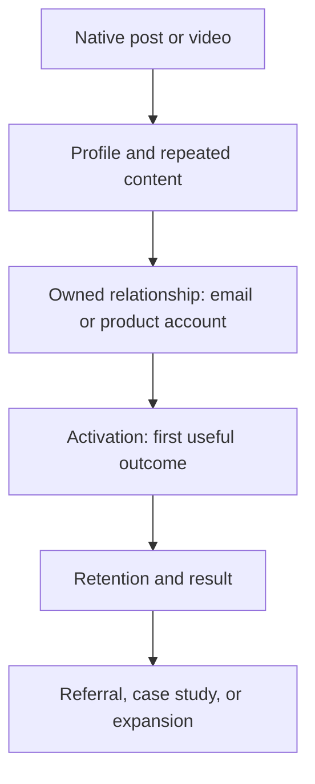

# Lesson 7 — Digital Marketing and MicroSaaS Launches

## Marketing is not the promotional post

Digital marketing is the system for understanding a market, creating a valuable promise, reaching the right people, helping them evaluate it, and learning whether the product delivers. A launch post is one small event in that system.

For a developer, the temptation is to build first and “do marketing” at the end. That creates an information deficit: you do not know which audience recognizes the problem, which language they use, which result matters, or which objections prevent adoption. Content can close that gap before, during, and after development.

## The market-message-channel-offer model

Every campaign aligns four elements:

1. **Market:** a defined group with a meaningful problem or aspiration.
2. **Message:** a promise expressed in that group’s language.
3. **Channel:** where and how the group encounters and evaluates the message.
4. **Offer:** the exchange you propose—attention for insight, email for resource, time for beta feedback, money for product value.

A channel cannot repair a weak offer. A good product can still fail if the message describes features rather than the outcome the market wants.

### Example: math whiteboard

- Market A: math tutors creating live explanations.
- Problem: switching among drawing, equation, and graphing tools interrupts lessons.
- Message: “Teach with editable equations and graphs on one shared canvas.”
- Channel: LinkedIn posts and video demos aimed at educators/edtech builders; direct research conversations.
- Offer: join a focused beta and use the tool in one real session.

Compare a different market:

- Market B: technical YouTube creators.
- Problem: producing clean math visuals for recorded explanations.
- Message: “Create reusable math diagrams without compositing screenshots from several tools.”
- Offer: export-ready canvas and templates.

The same product needs different evidence and language.

## Customer awareness stages

People differ in how much they know about the problem and your solution.

| Stage | Reader thought | Useful content |
|---|---|---|
| Unaware | “I have not named this friction.” | relatable workflow/story |
| Problem-aware | “This is annoying.” | diagnosis, cost, before/after |
| Solution-aware | “There must be a better approach.” | framework, category comparison |
| Product-aware | “I know your tool.” | demo, use case, objection handling |
| Most aware | “I may try or buy.” | proof, offer, urgency with integrity |

Do not ask an unaware reader to start a trial before helping them recognize the problem. Do not give a product-aware follower another vague thought-leadership post when they need pricing, workflow, or proof.

## Content as market research

Before building a feature, publish content that exposes assumptions:

- problem story: does the audience recognize it?
- workflow comparison: what alternatives do they use?
- mockup or prototype: which outcome attracts questions?
- tradeoff: which constraint matters?
- focused question: what would block adoption?

Comments are not representative research by default. Commenters self-select and may optimize for social conversation. Use them to generate hypotheses, then conduct direct conversations or observe behavior.

### Research question quality

Weak:

> Would you use this?

People are generous with hypothetical approval.

Better:

> Tell me about the last time you created a visual math explanation. Which tools did you use, and where did the workflow slow down?

This asks about past behavior. Past behavior is usually stronger evidence than future intention.

## The creator funnel

Your LinkedIn system can be modeled as:

Each transition has a different job:

- Content earns relevant attention.
- Profile establishes a coherent promise.
- Owned channel preserves contact outside the feed.
- Onboarding produces the first result.
- Product quality retains the user.
- Real outcomes generate proof and referrals.

Follower growth is not product growth if the funnel stops at B.

## Owned audience and lead magnets

LinkedIn access is rented; an email list or user account is a direct relationship. But “join my newsletter” is not inherently compelling. Offer a specific continuation of the content promise.

Possible lead magnets for your audience:

- browser API product checklist;
- template for evaluating AI developer tools;
- starter repository for a demonstrated feature;
- production-readiness checklist for browser recording;
- MicroSaaS experiment log;
- beta access to a tool that solves the demonstrated problem.

A lead magnet should qualify the same audience you want for future products. A generic “100 AI tools” PDF might grow email count while attracting novelty seekers with little product intent.

## Conversion without damaging trust

Use the **value–relevance–proportion** test:

- Did the post provide value before the ask?
- Is the offer a natural next step for the exact topic?
- Is the size/frequency of the ask proportionate to the relationship?

Example:

> The complete recovery checklist is in the repository linked below.

This is relevant to a technical tutorial.

> Book a sales call for my unrelated consulting service.

This breaks the content contract.

You do not need to hide commercial intent. Transparency is more human than pretending every post is purely altruistic.

## A five-phase MicroSaaS content launch

### Phase 1: problem discovery

Goal: learn language and identify painful situations.

Posts:

- personal workflow problem;
- “how do you currently…” question;
- alternative comparison;
- observation about a costly workaround.

Metrics: qualified comments, interviews, repeated phrases, direct messages, and evidence of current spending/time.

### Phase 2: build thesis

Goal: establish why you are solving it and invite early participation.

Posts:

- prototype transformation;
- product principle;
- architecture/tradeoff;
- narrow audience call for testers.

Metrics: beta interest, response quality, willingness to test in a real workflow.

### Phase 3: proof and iteration

Goal: show that the product creates the promised outcome.

Posts:

- uncut workflow;
- before/after;
- user-driven feature change;
- case study;
- limitation and fix.

Metrics: activation, repeated usage, time saved, task completion, and testimonials with permission.

### Phase 4: launch

Goal: convert the people for whom the product now fits.

Posts:

- launch narrative centered on the problem;
- demo and clear audience;
- FAQ/objection post;
- founder story;
- partner/user example.

Metrics: relevant visits, signups, activation, paid conversion, and feedback quality—not launch-day impressions alone.

### Phase 5: post-launch learning

Goal: turn real use into improvement and durable trust.

Posts:

- results with honest denominators;
- what surprised you;
- feature removed or reprioritized;
- user workflow;
- what you would do differently.

Metrics: retention, cohort behavior, referrals, support themes, and product-qualified leads.

## The five-post launch sequence

### Post 1: the problem

> Making one math explanation forced me to coordinate a whiteboard, equation editor, and graphing tool. The context switching was the product problem.

Do not mention every feature. Invite workflow stories.

### Post 2: the prototype

Show the transformation in 20–30 seconds. Ask a narrow usability question.

### Post 3: the technical/product decision

Explain why equations remain editable or how collaboration is handled. Build competence and address serious users.

### Post 4: proof

Show a real use case or test. If early, be honest: “Three tutors tested this” rather than “Teachers love it.”

### Post 5: launch

State who it is for, the problem, proof, current limitations, offer, and one CTA. Make pricing/trial expectations clear.

After launch, publish what happened rather than disappearing.

## Landing-page message alignment

If a LinkedIn post promises “editable equations on one canvas,” the landing page should repeat that promise immediately. Message mismatch increases doubt.

Landing-page hierarchy:

1. outcome for a named user;
2. visual proof;
3. problem/alternative;
4. how it works;
5. proof;
6. objections and limitations;
7. CTA;
8. details such as features and FAQ.

Use campaign parameters or another attribution method on external links when appropriate, while respecting privacy and platform policies. Link clicks alone are not success; track whether visitors activate.

## Product metrics for content-led growth

### Acquisition

- landing-page visits from content;
- signups by post/campaign;
- cost in time or money per qualified signup;
- audience segment.

### Activation

Define the first moment the user receives value. For the whiteboard, it may be creating and editing an equation/graph—not merely making an account.

\[
\text{Activation rate} = \frac{\text{users reaching first value}}{\text{new signups}} \times 100
\]

### Retention

Do activated users return for another real workflow? For infrequent tools, “retention” may need a longer window or project-based measure.

### Revenue

- free-to-paid conversion;
- monthly recurring revenue;
- average revenue per account;
- churn;
- payback on promotion or creator labor.

### Referral

- invites;
- shared artifacts;
- organic mentions;
- case-study participation;
- private sends and recommendations.

Content metrics diagnose the top of the system. Product metrics determine whether the business works.

## Pricing and offer experiments

Do not ask LinkedIn to choose a price through a generic poll. Test concrete offers with real behavior:

- free beta with defined qualification;
- paid pilot for a narrow professional use case;
- monthly versus annual plans;
- usage-based boundary;
- creator/educator plan versus team plan;
- founding-user offer with transparent terms.

Document the hypothesis:

> We believe tutors who create at least three visual lessons per week will pay $X per month for editable math canvases because it replaces Y minutes of tool switching. We will test with Z qualified conversations and a real checkout or pilot commitment.

Avoid fake scarcity. Urgency should correspond to a real beta capacity, deadline, or pricing transition.

## Partnerships and sponsorships

As the audience grows, tool companies may offer money, access, discounts, or free products. A material relationship must be disclosed clearly. FTC guidance says disclosures should be hard to miss, in the endorsement itself, and not buried after “see more” or inside vague hashtags. For video, disclose in the video as well as accompanying text when appropriate.

Your trust policy should be stricter than the minimum:

- test the product;
- retain editorial control;
- state the relationship plainly;
- describe real limitations;
- do not make claims you cannot substantiate;
- decline products that do not fit the audience;
- separate affiliate incentive from technical verdict.

A disclosure does not make a poor recommendation trustworthy. Judgment does.

## Ethical persuasion

Persuasion helps a person recognize and act on value. Manipulation hides material information or exploits cognitive pressure against the person’s interest.

Avoid:

- fake testimonials;
- invented usage numbers;
- undisclosed sponsorship;
- manufactured urgency;
- bait-and-switch links;
- engagement gates unrelated to value;
- implying a prototype is production-ready;
- selectively reporting a vanity metric while hiding failure of the promised outcome.

State uncertainty and limitations. For technical buyers, candor is often conversion-positive because it signals mature judgment.

## Worked campaign: browser recorder

### Market

Small teams and creators who need simple browser-based recording without installing heavy software.

### Research content

> When a browser recording fails, what matters more: automatic recovery or immediate cloud upload?

Follow up with people who have experienced the problem.

### Discovery content

20-second native demo: record display + camera, export locally.

### Authority content

Post on MediaRecorder chunks, memory, durable storage, and crash recovery.

### Product content

Before/after workflow and use-case page.

### Offer

Beta for people recording at least twice per week; feedback session required or optional based on capacity.

### Measurement

- post reach among target job roles;
- profile visits and follows;
- beta applications;
- percentage completing a first recording;
- successful export;
- second recording within 14 days;
- failure reasons.

This is marketing as a learning loop, not a promotional blast.

## Application: build your funnel and launch plan

Choose one MicroSaaS candidate and complete:

1. **Market:** one narrow group.
2. **Past behavior:** how they solve the problem today.
3. **Cost:** time, money, risk, or frustration.
4. **Promise:** observable better state.
5. **Proof:** demo, case, or credible test.
6. **Objections:** at least five.
7. **Activation event:** the first realized value.
8. **Retention event:** evidence they returned to the job.
9. **Offer:** exact exchange.
10. **Disclosure:** any relationship or limitation requiring clarity.

Then draft the five-post launch sequence, one landing-page headline, and a measurement plan connecting post → visit → signup → activation → retention. Do not schedule launch until you can identify the activation event.

## Deep-dive marketing workshop

### Build a problem brief before a product brief

Write a one-page problem brief:

- **Person:** Who experiences the problem?
- **Situation:** When and where does it appear?
- **Trigger:** What causes the workflow to begin?
- **Current behavior:** What do they do today?
- **Cost:** What time, money, risk, frustration, or opportunity is lost?
- **Frequency:** How often does it happen?
- **Severity:** How painful is each occurrence?
- **Alternatives:** What competes with a new product, including doing nothing?
- **Evidence:** What have you observed, measured, or heard?
- **Uncertainty:** What remains assumption?

For the math whiteboard:

- Person: online math tutor creating live explanations.
- Situation: preparing or delivering a lesson containing equations, graphs, and annotations.
- Current behavior: switch among a whiteboard, equation renderer, screenshots, and graphing software.
- Cost: interrupted flow and difficulty revising embedded equations.
- Frequency: unknown until interviews.
- Alternative: existing whiteboard plus screenshots or specialized math software.
- Evidence: your own workflow and early conversations.
- Uncertainty: willingness to adopt, collaboration priority, export needs, and payment.

This protects you from writing launch content around a problem you have not established.

## Interviewing prospective users

Content can recruit interviews, but the interview is not a pitch.

Ask about the past:

- “Walk me through the last time you prepared this kind of lesson.”
- “Which tools did you open?”
- “Where did you pause, redo work, or improvise?”
- “What did you do when an equation changed?”
- “How did you share or reuse the result?”
- “Have you paid for or tried to solve this before?”
- “What happens if you do nothing?”

Avoid leading:

- “Wouldn’t an integrated LaTeX whiteboard be easier?”
- “Would you pay $10 for this amazing tool?”

Ask to see artifacts or workflows where appropriate and permitted. Behavior and existing workarounds reveal more than compliments.

After five to ten conversations, cluster patterns without pretending the sample represents the entire market. Record exact phrases; they can improve message-market fit.

## Positioning a MicroSaaS offer

Use this structure:

> For **[specific user]** who **[situation/problem]**, **[product]** is a **[category]** that **[primary outcome]**. Unlike **[current alternative]**, it **[meaningful difference]**.

Example:

> For online math tutors who build explanations across several tools, Math Canvas is a collaborative visual workspace that keeps equations, graphs, and annotations editable together. Unlike pasting rendered equations into a generic whiteboard, it preserves the mathematical source so lessons can be revised and reused.

Test every phrase. If collaboration is not built, omit it. If tutors do not identify with “visual workspace,” use their language.

## Message hierarchy

Many product posts lead with the most technically impressive feature. Customers evaluate a different sequence:

1. Is this for me?
2. Does it solve a real problem?
3. What better outcome occurs?
4. Why should I believe it?
5. How does it work?
6. What will it cost me in money, time, switching, and risk?
7. What should I do?

Technical features become proof after the outcome is clear.

### Feature-to-outcome translation

| Feature | Mechanism | User outcome |
|---|---|---|
| Native LaTeX object | source remains attached | revise equations without rebuilding |
| Graph generation | expression drives graph | explain equation and graph together |
| Local chunk storage | data survives page lifecycle better | recover interrupted recordings |
| Timestamp notes | time + meaning stored | return to the exact learning moment |
| Local-first key storage | no mandatory cloud account | reduce one external trust dependency |

Do not skip the mechanism entirely for a technical audience. It is part of credibility.

## Funnel diagnosis

### Strong reach, weak profile visits

The topic may be interesting without author distinction. Add first-hand testing and align profile promise.

### Strong profile visits, weak follows

The profile may not promise continued value, or content appears inconsistent. Improve headline, Featured, and series clarity.

### Strong follows, weak link visits

Followers may be early in awareness, the offer may be irrelevant, or the CTA is buried. Do not force clicks; increase product-aware proof.

### Strong visits, weak signups

Message mismatch, unclear audience, trust gap, pricing, page friction, or weak offer may be responsible. Observe landing-page behavior and interview abandoners when possible.

### Strong signups, weak activation

This is often a product/onboarding problem, not a content problem. The promise may also attract people the product cannot yet satisfy.

### Strong activation, weak retention

The job may be infrequent, product value incomplete, switching costs high, or the acquisition promise mismatched. Define retention based on actual usage frequency.

## Content-to-product message map

Create one row for each audience pain:

| Pain | Educational post | Discovery asset | Proof | Offer |
|---|---|---|---|---|
| Equation screenshots become stale | why semantic source matters | edit equation on canvas | tutor workflow | math-canvas beta |
| Long recordings can disappear | chunk lifecycle tutorial | crash/recovery demo | successful recovery test | recorder beta |
| Video learning is hard to revisit | knowledge retrieval lesson | timestamp jump demo | repeated study workflow | extension |
| Secrets are scattered | threat-model post | local organizer demo | clear storage model | key tool |

This prevents random content from dominating the pipeline.

## Campaign architecture

### Evergreen foundation

Create content that remains useful:

- problem explanation;
- mental model;
- comparison;
- checklist;
- case study;
- FAQ.

### Timely moments

Connect when relevant:

- new library/release;
- school term for education products;
- platform change;
- industry debate;
- your product milestone.

### Launch concentration

Increase product-aware proof for a defined period without turning every post into the same announcement. Use different objections and use cases.

### Post-launch continuity

Continue teaching the underlying problem. A product becomes more credible when the creator remains useful after the launch day.

## Landing-page copy workshop

### Hero

Weak:

> The ultimate next-generation AI-powered collaborative platform for mathematical creativity.

Strong:

> Create math explanations with editable equations, graphs, and drawings on one canvas.

Subheadline:

> Built for tutors and creators who are tired of pasting equations between separate tools.

CTA:

> Try the beta

Secondary proof:

> Watch a 30-second lesson workflow

### Objection sections

- Does it support my notation?
- Can I export or reuse a canvas?
- Does it work without collaboration?
- What data is stored?
- Can students join without an account?
- What does beta mean?
- What happens to my work if I stop paying?

Answer honestly. Missing features should be visible when they materially affect adoption.

## Lead magnet quality test

A lead magnet is good when it:

- solves a narrow adjacent problem;
- demonstrates your judgment;
- attracts the intended buyer/user;
- is usable without an immediate purchase;
- leads naturally to future content or product;
- can be maintained.

Examples:

**Strong:** “Browser Recorder Production Checklist” for developers who may later use or evaluate your recorder/tooling.

**Weak:** “500 motivational coding quotes” because it attracts a broad audience unrelated to product value.

## Email/newsletter continuation

If you start a newsletter, define a contract:

> Every two weeks: one practical software build, the key technical decision, the production limitation, and the product lesson.

Do not promise daily content unless sustainable. Each email should deliver value before promoting a product. Segment when possible: developers may want code; tutors may want workflows. A single mixed list can confuse expectations.

Respect consent, unsubscribe requirements, and applicable marketing/privacy law. Do not scrape or add people because they commented.

## Pricing content without audience fatigue

Pricing can be educational:

- explain the value metric you considered;
- show why usage-based pricing fits or fails;
- discuss free tier boundaries;
- distinguish individual and team value;
- share an experiment and outcome with context.

Avoid using followers as a focus group for every internal decision. Ask people with the relevant problem and willingness to commit.

### Willingness evidence ladder

From weaker to stronger:

1. like/react;
2. positive comment;
3. email signup;
4. completed beta application;
5. scheduled interview;
6. active use;
7. referral/invite;
8. letter of intent or paid pilot;
9. repeat payment/retention.

Do not treat 500 likes as 500 customers.

## Launch-day operating plan

### Before

- verify product and onboarding;
- prepare support/FAQ;
- test links and attribution;
- confirm pricing/terms;
- prepare native demo and post;
- obtain permission for testimonials;
- create rollback/status communication;
- schedule time to support real users.

### During

- publish and respond to product questions;
- log bugs separately from content comments;
- acknowledge incidents quickly;
- avoid changing strategy based on hourly vanity metrics;
- observe activation;
- contact qualified testers thoughtfully, not with spam.

### After

- measure reach → visit → signup → activation;
- interview activated and non-activated users;
- fix high-severity blockers;
- publish a transparent learning recap;
- continue onboarding and retention work;
- decide whether to repeat, reposition, or stop.

## Example 30-day MicroSaaS campaign

### Week 1: problem

- text story about fragmented workflow;
- short demonstration of current workaround;
- comment/research conversations;
- five interviews.

### Week 2: solution thesis

- prototype transformation video;
- technical post on semantic source;
- beta qualification form;
- observe first sessions.

### Week 3: proof

- before/after workflow;
- user-driven product change;
- FAQ addressing a real objection;
- activation/retention instrumentation.

### Week 4: offer

- launch narrative;
- use-case video;
- limited founding beta only if capacity is real;
- end-of-week results and learning.

Throughout, maintain non-product teaching so followers who are not buyers still receive value.

## Marketing experiments

### Experiment 1: audience framing

Compare tutor-specific versus general math-creator framing across matched assets. Measure qualified comments/signups, not only reach.

### Experiment 2: promise

Compare “all math tools in one canvas” with “editable equations and graphs without screenshots.” The latter may be more concrete.

### Experiment 3: offer

Compare open beta with qualified cohort. Open beta maximizes volume; cohort may improve feedback and activation.

### Experiment 4: proof

Compare founder demo with user workflow/case. User proof may resolve adoption uncertainty.

### Experiment 5: CTA

Compare “try it” with “use it for one lesson and report where it breaks.” The second creates a clearer job for early testers.

Record hypothesis, method, success criterion, duration, and decision before running.

## Retention content

Marketing does not stop at acquisition. Create content that helps users succeed:

- onboarding tutorial;
- advanced workflow;
- template/examples;
- common mistake;
- feature release tied to a job;
- user story;
- migration or export guide;
- transparent reliability update.

Existing-user content can reduce support and produce proof. It may receive fewer feed impressions but greater business value.

## Referral design

The best referral mechanism is often the product artifact itself: a shared canvas, recording, timestamp collection, or template. Make sharing useful to the recipient, not merely rewarded for the sender.

Content can support referrals by giving users a clear explanation they can send. Avoid aggressive referral incentives that attract low-fit signups or obscure material benefits.

## Marketing ethics case studies

### Free access from a tool company

Even without cash, free access is a material connection when you endorse it. Disclose clearly.

### Affiliate link after an honest review

Disclose near the recommendation, not hidden after many hashtags. Preserve the same verdict you would give without commission.

### Early metric

“50% weekly growth” may mean two users became three. Give denominators when material.

### Selected AI output

If the published result was the best of 20, do not imply first-try reliability.

### Testimonial

Obtain permission, preserve meaning, and disclose incentives. Do not invent job titles or outcomes.

## Capstone: go-to-market brief

Create a document containing:

1. problem brief;
2. ten interview summaries;
3. market segment and excluded segments;
4. positioning statement;
5. message hierarchy;
6. product proof and limitations;
7. awareness-stage content map;
8. five-post launch sequence;
9. landing-page copy;
10. offer/pricing hypothesis;
11. activation and retention definitions;
12. attribution plan;
13. ethics/disclosure checklist;
14. stop/continue criteria.

The go-to-market brief should make clear what is known, inferred, and untested. That distinction keeps marketing connected to reality.

## Acceptance exercise: run a small evidence-based launch

Choose one product and complete a launch with a limited, honest scope. Required evidence:

1. at least five relevant problem conversations;
2. a written problem brief;
3. one target segment and explicit exclusions;
4. one observable promise;
5. a working path to first value;
6. a five-post sequence;
7. a landing page or clear offer page;
8. attribution from post to signup where practical;
9. activation and retention definitions;
10. a post-launch review.

Set decision thresholds in advance. Example:

- Continue if at least five qualified tutors complete a real lesson workflow and at least three return for another session within the relevant window.
- Reposition if signups come from creators rather than tutors and their workflow is stronger.
- Pause if people praise the demo but do not complete the first-value action.

Do not choose thresholds to manufacture success. Early samples are learning devices, not market proof.

Publish a recap containing the denominator, what changed, and what remains unknown. If a sponsor, affiliate, gifted access, employment relationship, or testimonial incentive exists, disclose it clearly in the relevant content.

The lesson is complete when you can trace a line from market evidence through message and content to activation, rather than presenting impressions or signups alone as product validation.

## Marketing glossary and calculation notes

- **Market:** defined people and situations, not everyone who could theoretically use a feature.
- **Segment:** subgroup with shared needs/behavior useful for distinct messaging or offer.
- **Positioning:** place the product occupies relative to alternatives in the customer’s mind.
- **Message-market fit:** evidence that the target recognizes and responds to the problem/promise language.
- **Offer:** complete exchange—outcome, price/commitment, terms, risk, and next action.
- **Lead magnet:** useful resource exchanged for permission to continue the relationship.
- **Acquisition:** bringing a prospective user into the funnel.
- **Activation:** first meaningful product outcome, not account creation.
- **Retention:** repeated value according to the product’s natural usage interval.
- **Conversion:** movement from one defined stage to the next.
- **Churn:** customers/users leaving in a defined period; define denominator carefully.
- **Attribution:** method for assigning influence/credit to a channel or touchpoint.
- **Cohort:** group sharing a starting period or behavior, useful for retention comparison.
- **Vanity metric:** impressive number weakly connected to decisions or outcomes.
- **Material connection:** relationship or benefit that could affect how an endorsement is evaluated.

### Calculation cautions

Always define numerator, denominator, and time window. “Activation rose 20%” can mean a 20 percentage-point increase (40% to 60%) or a 20 percent relative increase (40% to 48%). State which.

Small samples are volatile. Report counts alongside percentages: “6 of 10,” not only “60%.”

Retention depends on expected frequency. A tax tool used yearly should not be judged by seven-day retention like a daily communication app.

Attribution is multi-touch. A person may see five posts, visit the profile, subscribe, and later search the product by name. Use link parameters, signup questions, and qualitative interviews together; do not pretend precision you do not have.

Revenue does not prove retention, and signups do not prove activation. Measure the complete promise.

## Final reflection

Write the story of your funnel from the customer’s perspective rather than yours:

> I recognized a frustrating workflow in a post. A demonstration showed a credible alternative. A technical explanation reduced my risk. The profile and prior work made the creator trustworthy. The offer matched my situation. Onboarding produced the promised result quickly. I returned because the job recurred. I shared it because the artifact helped someone else.

Now mark every sentence your current system cannot yet support. Those gaps are the marketing roadmap. If the post does not reveal a real problem, improve research. If proof is weak, improve product/demo. If onboarding fails, stop optimizing reach and fix activation. If people activate but never return, investigate the job and retention.

Marketing is successful when it helps the right person make a well-informed decision and the product fulfills the expectation. It is not successful merely because more people saw the announcement.

Create a one-page “promise ledger” for every campaign. On the left, list what the content and landing page promise. On the right, list the product behavior that fulfills each promise, plus its current limitation. If a marketing sentence has no matching product behavior, remove it or label it as planned. If the product delivers value nobody understands, improve the message or demonstration.

Review the ledger with support requests and churn interviews. The most damaging gap is not always a broken feature; it can be a technically true promise interpreted more broadly than intended. Tight alignment reduces disappointment, improves retention learning, and gives future content more credible proof.

At the end of each campaign, label every marketing asset as evergreen, update-needed, or retired. Update screenshots and claims when the product changes. Retire testimonials or comparisons whose context is no longer accurate. A durable marketing system maintains truth after launch; it does not leave old promises circulating indefinitely because they once converted well. Assign an accountable owner and review date to important evergreen assets.

## Summary

Digital marketing aligns a market, message, channel, and offer. LinkedIn content can reveal problems, earn attention, build trust, and move qualified people into an owned relationship—but only product value creates activation and retention. Launch through a sequence of problem, prototype, judgment, proof, and offer. Measure the whole path, disclose incentives, and let commercial content remain useful even to people who never buy.

The final lesson turns the strategy into an operating system: distribution, comments, analytics, experiments, cadence, and a complete 90-day plan.

