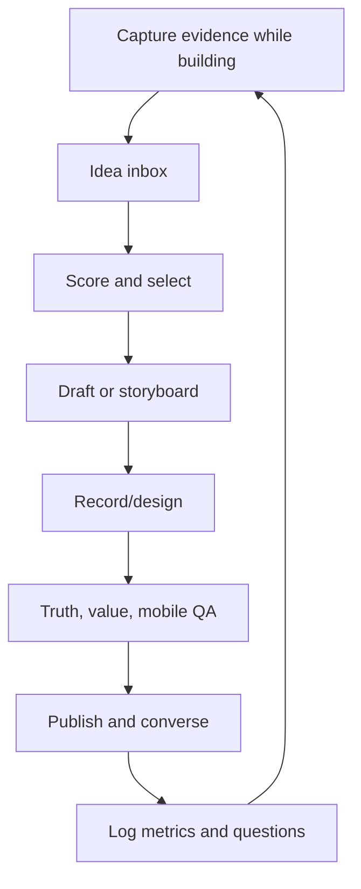

# Lesson 8 — Distribution, Analytics, and the 90-Day System

## Publishing is the start of distribution

Creators sometimes treat distribution as a trick performed after the work: add hashtags, comment quickly, or post at a magic time. Durable distribution begins earlier:

- choose a problem people care about;
- create something worth transmitting;
- package it for fast comprehension;
- build relationships before you need amplification;
- publish consistently enough to learn;
- respond in ways that deepen the conversation;
- convert questions into future content.

This lesson builds the operating system that keeps those activities sustainable.

## Four distribution surfaces

### 1. Feed distribution

Your post appears to connections, followers, and potentially out-of-network viewers. You influence this through relevance, content quality, audience history, and meaningful response, but you do not control ranking.

### 2. Network distribution

People carry content through comments, sends, reposts, mentions, and conversation. This is why useful professional content can travel without public virality.

### 3. Profile distribution

A post creates profile visits; Featured items and previous posts produce further consumption. Your profile is a content index and conversion surface.

### 4. Search and long-tail discovery

Clear, descriptive posts and articles can be found later through LinkedIn, web, or AI-assisted search. Write opening lines that name the subject and answer real questions. Do not sacrifice human clarity for keyword stuffing.

## Comments as an expertise channel

Thoughtful comments can introduce your judgment to an existing conversation. They should add value to the host and readers, not redirect attention.

Five useful comment forms:

1. **Extension:** add a consequence or example.
2. **Tradeoff:** name a condition where the advice changes.
3. **Evidence:** share a concise first-hand result.
4. **Question:** ask something that advances the topic.
5. **Synthesis:** connect two ideas in the post.

Weak:

> Great post! Totally agree.

Better:

> The prototype/production distinction is the key. In a browser recorder, capture took very little code; chunk persistence and crash recovery became the actual product. I would add recoverability as a fourth evaluation criterion.

Do not paste mini-posts under every large creator or manufacture disagreement. Follow people whose work genuinely overlaps with your audience.

## The first-hour myth

Early responses may help a conversation develop, but do not build a life around instantly refreshing metrics. Reply when you can be thoughtful. Set one or two response windows on publishing days. Platform folklore changes faster than the enduring value of real interaction.

Use early comments to:

- clarify ambiguity;
- answer real questions;
- ask a useful follow-up;
- acknowledge corrections;
- add a missing source;
- identify the next post.

Never argue defensively to protect engagement. Correct errors visibly.

## Collaboration and network effects

Healthy collaboration includes:

- crediting the library/tool creator;
- interviewing a user or expert;
- co-building a demo;
- comparing two informed approaches;
- inviting a practitioner to critique a workflow;
- creating a joint tutorial with distinct contributions.

Mention people because they are materially involved. Do not tag a list of famous accounts for reach.

## Cadence: consistency without content debt

Your recommended starting cadence is three posts per week:

- **Tuesday — visual discovery:** product demo, library test, or technical short.
- **Thursday — depth:** tutorial, architecture, tradeoff, or carousel.
- **Saturday — relationship/product:** builder story, experiment, user lesson, or launch update.

Two of the three may be videos during a focused test, but do not permanently force video when text/diagram is better. Maintain a one-week buffer so a busy development week does not end the habit.

## The content pipeline

### Capture

Record bugs, screenshots, decisions, metrics, questions, and before/after states as they occur.

### Score

Use audience pain, visual potential, first-hand evidence, freshness, strategic fit, and commercial adjacency.

### Select

Balance the portfolio: discovery, competence, relationship, research, and conversion.

### Produce

Batch compatible work. Record two demos in one prepared environment; write several hooks in one session.

### Learn

Log what happened after enough time for meaningful comparison. Do not rewrite your strategy from the first hour.

## Metrics LinkedIn provides

Current member post analytics can include:

- impressions and members reached;
- in-network and out-of-network share;
- profile viewers from the post;
- followers gained;
- reactions, comments, reposts, saves, and sends;
- external link visits;
- viewer demographics;
- video views, watch time, and average watch time.

Creator analytics can aggregate posts and follower trends and may be exported. LinkedIn says metrics are estimates. Use them directionally and compare like with like.

## A metric hierarchy

### Level 1: exposure

- impressions;
- unique reach;
- out-of-network percentage.

Question: did the content travel?

### Level 2: consumption

- video average watch time;
- approximate viewed percentage;
- document/page behavior if available;
- qualitative evidence that people understood.

Question: did people stay?

### Level 3: value signals

- saves;
- sends;
- substantive comments;
- reposts.

Question: was it useful or socially meaningful?

### Level 4: author conversion

- profile visits;
- followers gained;
- relevant connection requests;
- qualified DMs.

Question: did the post build your audience/reputation?

### Level 5: business outcome

- link visits;
- waitlist/beta signups;
- activation;
- retained use;
- revenue or qualified opportunities.

Question: did attention contribute to the larger goal?

Never optimize Level 1 while ignoring Levels 4 and 5.

## Derived metrics

Use ratios carefully because small denominators create volatility.

### Follow conversion from reach

\[
\text{Follow conversion} = \frac{\text{followers gained}}{\text{members reached}} \times 100
\]

### Profile-interest rate

\[
\text{Profile-interest rate} = \frac{\text{profile viewers from post}}{\text{members reached}} \times 100
\]

### Save/send utility rate

\[
\text{Private utility rate} = \frac{\text{saves + sends}}{\text{members reached}} \times 100
\]

### Approximate video viewed percentage

\[
\text{Viewed \%} = \frac{\text{average watch time}}{\text{video duration}} \times 100
\]

### Product activation from post

\[
\text{Post-to-activation} = \frac{\text{activated users attributed to post}}{\text{members reached}} \times 100
\]

Attribution is imperfect. A user may see several posts before acting. Use direct attribution plus qualitative “how did you hear about this?” data.

## Build a learning log

For each post, record:

| Field | Example |
|---|---|
| Date/time | 2026-11-17 9:00 ET |
| Pillar | Things I built |
| Format | 31-second native video |
| Audience | Browser-tool developers |
| Job | Discovery + competence |
| Hook family | Contrast |
| Topic | Browser recorder recovery |
| Proof | Working demo + chunk diagram |
| CTA | Follow-up question |
| Reach metrics | impressions, members reached, network split |
| Value metrics | saves, sends, substantive comments |
| Conversion | profile visits, follows, signups |
| Video | duration, average watch, approximate percentage |
| Audience quality | roles/industries, qualitative |
| Learning | one supported conclusion |
| Next test | one variable |

Do not log metrics you never use. The learning and next-test columns are the point.

## Experiment design

Content is noisy. One post cannot establish a universal rule. Use small series of comparable tests.

### Good experiment

Hypothesis:

> Showing the finished UI in the first frame will improve average viewed percentage for product demos.

Method:

- publish four demos over several weeks;
- two start with result, two with a brief problem statement;
- keep topic strength, duration, and format as similar as practical;
- compare viewed percentage, saves, and follows;
- inspect qualitative comments.

### Bad experiment

Compare a Tuesday 20-second AI demo with a Saturday 1,000-word personal story and conclude “video wins.” Too many variables changed.

### Variables worth testing

- hook family;
- result-first versus problem-first video;
- 20 versus 40 seconds;
- screen-only versus brief face intro;
- broad tool discovery versus deep first-hand test;
- focused question versus no CTA;
- vertical versus tall crop for desktop demos;
- post copy length;
- recurring series title.

Change one major variable at a time and use multiple observations.

## Qualitative analytics

Numbers cannot tell you whether the right people understood the right idea. Classify comments and DMs:

- comprehension question;
- implementation question;
- personal experience;
- disagreement;
- product request;
- buying/use intent;
- generic praise;
- irrelevant engagement.

Ten implementation questions from target developers may be more valuable than 100 generic compliments.

## The 90-day plan

### Phase 1 — Foundation and baseline (Weeks 1–2)

Goals:

- finish profile positioning;
- create recording setup;
- build 30-idea bank;
- establish baseline metrics.

Publish:

- one flagship product demo;
- one technical explanation;
- one builder story each week.

Do not optimize prematurely. Record current performance.

### Phase 2 — Format exploration (Weeks 3–6)

Run four weekly themes:

- Week 3: product transformations;
- Week 4: Library to Feature;
- Week 5: Prototype vs Production;
- Week 6: personal/product stories.

Maintain three posts weekly. Test hooks and video forms while preserving your position.

At Week 6, identify:

- topics that attract target roles;
- formats with strong watch/save/send behavior;
- posts that convert to follows/profile visits;
- comments revealing product problems.

### Phase 3 — Double down and serialize (Weeks 7–10)

Choose two series based on evidence. Recommended:

- Library to Feature;
- Small Tool, Real Problem.

Publish each weekly plus one depth/relationship post. Improve production efficiency and build recognizable expectations.

Begin an owned relationship only if you can offer a useful continuation: beta, repository, checklist, or newsletter with a defined promise.

### Phase 4 — Product campaign and review (Weeks 11–12)

Run a focused MicroSaaS sequence:

- problem;
- prototype;
- decision;
- proof;
- launch or beta offer;
- learning recap.

At Day 90, review the portfolio, not only the top post.

## Weekly schedule

### Monday — evidence and selection (45 minutes)

- review build log;
- score ideas;
- select three;
- define audience/job/proof.

### Tuesday — demo post + conversation

- final mobile/privacy check;
- publish native video;
- two thoughtful response windows;
- log early qualitative questions.

### Wednesday — depth production (60–90 minutes)

- write technical post or carousel;
- verify claims and sources;
- prepare readable visuals.

### Thursday — depth post

- publish;
- comment thoughtfully on relevant accounts;
- save questions for future ideas.

### Friday — recording batch (60–120 minutes)

- prepare synthetic data;
- record next week’s demos;
- back up source files.

### Saturday — relationship/product post

- publish story, experiment, or research question;
- avoid forcing a CTA.

### Sunday — 30-minute review

- update mature metrics;
- write one lesson per post;
- choose one variable for next week;
- protect the content buffer.

Adapt the days to your life. The pipeline matters more than exact timing.

## Your first 12 weeks of topics

| Week | Demo/discovery | Depth | Relationship/product |
|---:|---|---|---|
| 1 | Math whiteboard result | Editable LaTeX state | Why fragmented math tools bothered you |
| 2 | Browser recorder | MediaRecorder mental model | Project versus product lesson |
| 3 | YouTube timestamp tool | Extension storage decision | What shipping many repos taught you |
| 4 | API-key manager | Local-first tradeoffs | Why you choose small tools |
| 5 | New library test | Accessibility/production limit | What the test changed |
| 6 | AI feature demo | Useful AI versus demo | Feature you chose not to build |
| 7 | Library to Feature #1 | Architecture diagram | User question |
| 8 | Small Tool, Real Problem #1 | Before/after decision | MicroSaaS experiment |
| 9 | Library to Feature #2 | Performance/failure mode | Revised belief |
| 10 | Prototype vs Production #1 | Production checklist | Product audience story |
| 11 | Campaign prototype | Key product decision | Beta invitation |
| 12 | Proof/launch demo | FAQ/objections | 90-day and launch recap |

Keep dates flexible so timely discoveries can enter without erasing the strategic mix.

## Decision rules after 90 days

### Continue a series when

- target viewers recognize it;
- it produces saves, sends, or substantive questions;
- it strengthens your desired associations;
- production cost is sustainable;
- you still have genuine evidence to add.

### Change a series when

- watch/read behavior is weak across several fair tests;
- the audience is wrong;
- the hook attracts but payoff fails;
- every installment feels interchangeable;
- it creates no profile/follow or business value.

### Stop a series when

- it requires exaggeration;
- it depends on work you cannot verify or credit;
- it attracts an audience incompatible with your products;
- it damages enjoyment or sustainable cadence;
- opportunity cost exceeds strategic value.

## Handling a viral post

If a post travels unusually far:

1. Do not immediately publish a sales pitch to exploit it.
2. Answer useful comments and correct misunderstandings.
3. Make the profile promise consistent with the post.
4. Publish a substantive follow-up that deepens the same topic.
5. Capture recurring questions.
6. Measure follower quality and conversion.
7. Reuse the mechanism, not the exact post.

Virality becomes valuable when newcomers encounter a coherent body of work.

## Handling a weak month

- verify that you actually published enough comparable work;
- inspect audience fit, not just reach;
- separate topic, packaging, and substance failures;
- talk to target readers;
- improve first frames and proof;
- narrow the promise;
- test a more visual or more specific subject;
- keep one reliable series while experimenting with another.

Do not respond by adding empty frequency or copying increasingly exaggerated hooks.

## Final capstone

At the end of 90 days, create a report with:

1. 36 published pieces and links;
2. performance by pillar, format, hook family, and post job;
3. audience demographics and qualitative fit;
4. top three posts by reach, saves/sends, follows, and product outcome;
5. five recurring audience questions;
6. two series to continue;
7. one style habit to remove;
8. product-market insights generated by content;
9. next-quarter hypothesis;
10. a revised positioning statement based on evidence.

The point is not to prove that you succeeded. It is to convert 90 days into a better model of your market, audience, voice, and production system.

## Deep-dive operating workshop

### Build an idea capture system

Use four inboxes:

1. **Build evidence:** bugs, decisions, screenshots, before/after, metrics.
2. **Audience language:** questions, phrases, objections, workflows.
3. **External discoveries:** tools, libraries, research, industry changes.
4. **Beliefs:** opinions, predictions, and changed assumptions.

Each item needs a source and date. Ideas without evidence remain hypotheses. Once per week, convert inbox items into briefs rather than trying to draft from an unfiltered list.

### The 30-idea bank

Maintain roughly:

- ten build/demo ideas;
- eight technical teaching ideas;
- five tool tests;
- four product/growth lessons;
- three personal/relationship stories.

The proportions follow your position. Replace ideas as you publish; do not let the bank become an archive of guilt. If an idea remains unused for two months, rescore or delete it.

## Editorial planning by audience journey

Plan weekly content so a new viewer can move deeper:

### Discovery

> “I built a whiteboard where equations become editable graphs.”

### Understanding

> “Here is why preserving the source matters.”

### Trust

> “Here is the state model and its limitation.”

### Relationship

> “Here is the mistaken feature priority and what users changed.”

### Action

> “The beta is for tutors with this exact workflow.”

You do not need to publish in a rigid order, but a month of only discovery leaves followers shallow; a month of only depth limits acquisition.

## Distribution before publication

### Build topical relationships

Follow developers, tool builders, educators, and founders relevant to your actual work. Read their material and contribute when you have something useful. This creates context and learning, not a transaction ledger.

### Source participation

When you plan to feature a library, inspect its documentation, issues, changelog, and licensing. If appropriate, ask the builder a substantive question. Your eventual post becomes more accurate and may form a real relationship.

### Audience research

Observe how target users describe problems. Use their language without copying private stories or exploiting groups. Distribution improves when the message matches lived vocabulary.

### Asset portability

Design a clean native asset for LinkedIn, then adapt—not blindly duplicate—it for other channels. A short video may become a longer YouTube explanation, newsletter, repository guide, or site case study.

## Distribution after publication

### Comment response tiers

**Tier 1: questions/corrections.** Respond carefully and promptly.

**Tier 2: experiences.** Ask one follow-up that advances learning.

**Tier 3: generic praise.** A brief sincere thanks is enough; do not manufacture a thread.

**Tier 4: hostile/irrelevant.** Clarify once if useful, then disengage or use platform controls when necessary.

### Follow-up content

If several people ask the same question, create a new post that answers it and credit the conversation generally or specifically with permission. This converts distribution into curriculum.

### Private messages

Do not mass-DM commenters. Message when they asked for contact, expressed a qualified need, or a one-to-one answer is genuinely appropriate. Respect professional boundaries.

## Metric interpretation cases

### Post A: 80,000 impressions, 15 follows

Possible interpretation: broad curiosity, weak author fit. Inspect topic, profile visits, audience demographics, and whether the value belonged mostly to a third-party object.

### Post B: 8,000 impressions, 120 follows

Possible interpretation: strong promise of future value. Inspect profile coherence and whether the series should continue.

### Post C: 5,000 impressions, 70 saves, 40 sends

Likely high utility. Turn it into an evergreen guide or carousel. Ask what made it reference-worthy.

### Post D: 20,000 impressions, 150 comments, few saves

Likely conversation/identity value. Read comment quality. It may be successful if relationship or research was the job.

### Post E: 2,000 impressions, 20 beta signups, 12 activated

Strong commercial fit. Learn what language and audience path produced it. Do not trade it for a higher-reach but lower-fit format.

## Cohort your content

Do not compare every post individually. Group by:

- pillar;
- series;
- format;
- audience;
- post job;
- hook family;
- video length;
- product.

After at least several observations, compare medians rather than averages when one viral outlier distorts results. Still read the outlier for mechanism.

Example:

| Cohort | Median reach | Median saves/sends | Median follows | Production time |
|---|---:|---:|---:|---:|
| Tool discovery | high | medium | low | 2h |
| Original demo | medium | high | high | 4h |
| Architecture | low/medium | high | medium | 3h |
| Builder story | medium | low | medium/high | 1.5h |

This can justify a portfolio: discovery acquires, original demos convert, architecture builds trust, stories build affinity.

## Time economics

Track production time. A video with marginally better reach may require five times the labor. Calculate a rough strategic return:

\[
\text{Useful outcome per hour} = \frac{\text{weighted target actions}}{\text{production hours}}
\]

Do not turn creativity into a rigid productivity contest. The measure reveals unsustainable formats and where templates help.

Weight actions based on the post job. A launch post might weight activated users heavily. A teaching post might weight saves and qualified follows.

## Experiment documentation

Use this record:

- **Observation:** result-first videos appear to hold attention.
- **Hypothesis:** showing payoff in two seconds increases viewed percentage.
- **Test:** four matched product demos.
- **Primary metric:** viewed percentage.
- **Guardrails:** profile conversion and comprehension comments.
- **Confounds:** topic, day, audience growth, video length.
- **Result:** numbers and uncertainty.
- **Decision:** adopt, retest, or reject.

Prewriting the primary metric prevents selecting whichever number improved after the fact.

## A/B testing limitations

Organic posts cannot be perfectly randomized. Posting duplicate versions can fatigue the audience and contaminate results. Use sequential matched tests, accept uncertainty, and look for robust patterns across time. Avoid deleting and reposting solely to chase better distribution unless correcting a material issue.

## Analytics review intervals

Use consistent snapshots, for example:

- 24 hours for early behavior;
- 7 days for mature comparison;
- 30 days for profile/business follow-through where available.

The exact interval can change, but comparing one post at two hours with another at two weeks is invalid. Preserve exported analytics periodically because platform retention windows differ by metric.

## Content dashboard design

Your dashboard should answer decisions, not display every number.

### Overview

- posts published versus plan;
- reach trend;
- relevant follower growth;
- top cohorts;
- product activations attributable to content.

### Quality

- saves/sends;
- substantive comment rate;
- average watch/viewed percentage;
- audience demographics;
- corrections or trust issues.

### Efficiency

- production hours;
- buffer size;
- reused assets;
- missed cadence and reason.

### Learning

- supported findings;
- unresolved questions;
- next experiments;
- content-derived product insights.

A spreadsheet is enough. Do not build a dashboard app instead of posting.

## Burnout prevention

Growth systems fail when they ignore energy.

- choose a minimum viable cadence you can maintain;
- keep a buffer;
- batch recording setup;
- repurpose evidence across distinct angles;
- use simple formats during busy weeks;
- take breaks rather than publishing filler;
- do not tie self-worth to volatile reach;
- separate creative review from hourly metric checking;
- maintain projects worth talking about.

The deepest cure for content fatigue is continuing to build and learn. Content becomes a by-product of meaningful work.

## Negative feedback and correction policy

### Technical correction

Verify it. Thank the person, edit the post/caption if possible, and add a visible correction. Do not quietly preserve a misleading claim because the post is performing.

### Legitimate disagreement

Clarify assumptions and conditions. A good tradeoff discussion can strengthen the post.

### Misunderstanding

If several readers misinterpret, the communication failed even if the text is technically defensible. Improve the explanation.

### Harassment

Use platform tools and boundaries. Growth does not require tolerating abuse.

### Product complaint

Move sensitive support details to an appropriate channel but acknowledge publicly. Do not expose customer information.

## Content crisis checklist

If a post contains a security issue, confidential data, false claim, or harmful error:

1. assess severity quickly;
2. remove or correct exposure where appropriate;
3. preserve internal evidence needed for investigation;
4. notify affected parties through proper channels;
5. publish a clear correction if the claim spread;
6. change the production checklist;
7. do not optimize the response for engagement.

## Repurposing map

One strong architecture post can become:

- a 30-second video;
- a carousel;
- a repository guide;
- a newsletter deep dive;
- a documentation section;
- a conference/meetup talk;
- a product FAQ;
- an onboarding tutorial;
- a series of comments answering questions.

Each adaptation should fit channel behavior. Do not paste identical long text everywhere.

## Cross-platform role design

If you expand beyond LinkedIn:

- **LinkedIn:** professional discovery, concise teaching, product/build narrative.
- **YouTube:** deeper demonstrations and searchable tutorials.
- **Newsletter:** owned relationship and coherent analysis.
- **GitHub:** runnable proof and developer trust.
- **Product site:** conversion and use-case evidence.
- **Short-video platforms:** broader discovery with adapted context.

Choose one primary channel until the pipeline is reliable. Cross-posting every platform can destroy consistency on all of them.

## The 90-day review meeting

Conduct it as if you were your own product team.

### Part 1: goals

What did you intend to become known for? What business or learning outcome mattered?

### Part 2: evidence

Present cohort metrics, audience quality, qualitative comments, production effort, and product outcomes.

### Part 3: surprises

Which topics attracted unexpected people? Which posts converted despite low reach? Which “obvious” tactic failed?

### Part 4: diagnosis

Separate topic, packaging, substance, distribution, profile, and offer issues.

### Part 5: decisions

- two series to continue;
- one to stop;
- one new experiment;
- profile adjustment;
- product insight to act on;
- sustainable cadence for next quarter.

### Part 6: updated promise

Write the next-quarter content promise in one sentence. It should be more evidence-based than the original.

## Example quarterly conclusion

> Original product demos produced fewer impressions than broad AI discoveries but three times the follow conversion and most beta activations. Tool tests worked when they included a real integration and limitation. Architecture posts had the highest save/send behavior. Personal milestone posts underperformed unless tied to a specific decision. Next quarter, I will run weekly “Library to Feature” and biweekly “Prototype vs Production,” use broad discoveries only when I can test them, and launch the recorder to the audience already engaging with reliability content.

This is a decision, not a victory story.

## Advanced 12-week calendar

For every week, define:

- one acquisition piece;
- one authority piece;
- one relationship/research/conversion piece;
- one evidence-capture task inside development;
- one relationship activity;
- one metric review;
- one experiment variable.

Example Week 4:

- acquisition: local-first key manager demo;
- authority: threat model and recovery tradeoff;
- relationship: why convenience initially overrode backup design;
- evidence capture: record dummy-data onboarding before redesign;
- relationship: comment on three local-first practitioner posts with real experience;
- review: 7-day metrics for Week 3;
- experiment: focused question versus no CTA.

## Graduation criteria

You have completed the curriculum when you can:

- explain growth without claiming a secret algorithm;
- state your audience and content promise;
- distinguish niche, pillar, format, and post job;
- adapt creator mechanisms without copying identity;
- write multiple truthful hooks from one evidence set;
- design a phone-readable demonstration;
- record/edit/caption a short video safely;
- connect content to a product funnel;
- interpret metrics according to intent;
- run a documented experiment;
- publish consistently for 90 days;
- revise positioning from evidence.

Completion is behavioral. Reading all lessons is preparation; publishing and reviewing the portfolio is the course.

## Acceptance exercise: complete the 90-day evidence portfolio

Your final portfolio must include:

- 36 published pieces or a documented explanation for deliberate cadence changes;
- at least 12 native videos;
- at least two recurring series;
- a complete analytics log;
- production-time estimates;
- audience-demographic review;
- qualitative comment/DM themes;
- one content-to-product campaign;
- one profile revision based on evidence;
- one next-quarter strategy.

Evaluate the portfolio by four questions:

1. **Audience:** Did the desired people increasingly appear?
2. **Association:** Can followers explain what you are known for?
3. **Capability:** Did the content show real building and judgment?
4. **Business:** Did any content contribute to conversations, activation, retention, revenue, collaboration, or career opportunities?

Select three posts to retire from your strategy even if one had high reach. Select three to expand even if reach was modest. Explain the decisions using post job and downstream value.

Present a one-page next-quarter plan with cadence, two series, one product focus, one distribution relationship practice, one video experiment, one writing experiment, and one metric per strategic objective. Remove at least one activity that consumed time without producing learning or value.

The course is complete when the system can continue without constant inspiration and when your conclusions distinguish evidence from intuition.

## Operating glossary

- **Cadence:** sustainable publishing rhythm.
- **Buffer:** completed content ready before the intended date.
- **Cohort analysis:** comparing grouped posts/users with shared traits.
- **Median:** middle value, often more robust to one viral outlier than the average.
- **Guardrail metric:** secondary outcome that prevents optimizing the primary metric at unacceptable cost.
- **Confound:** another variable that may explain the observed result.
- **Qualitative signal:** meaning from comments, interviews, and behavior descriptions.
- **Content debt:** promises, series, or production obligations that exceed capacity.
- **Evergreen:** remains useful beyond a timely event.
- **Repurposing:** adapting one evidence base into different promises/formats, not duplicating blindly.
- **Topical authority:** accumulated credible coverage of a defined subject.
- **Outlier:** result far from the typical range; useful to study but dangerous as a baseline.
- **Stop criterion:** pre-decided evidence that an experiment should pause or end.

### Final operating rule

At any point, you should be able to answer: What are you building? What did you observe? Who needs the lesson? Which format proves it? What action would indicate value? What will you change after the result?

If the system cannot answer, return to the evidence ledger rather than searching for a new hook template.

## Final reflection

At Day 90, write two versions of the story. The public version can share useful lessons and accurate outcomes. The private version must include opportunity cost, posts that failed, audience mismatch, production fatigue, product weaknesses, and uncertainty. Strategy improves from the private version.

Then ask: if the next quarter produced half the reach but twice the relevant conversations, would that be success? If the answer is yes, your dashboard and content mix must reflect it. If the goal is broad creator monetization, reach may carry more weight; if the goal is MicroSaaS adoption, activation and retention must dominate.

The operating system exists to protect long-term work from short-term emotional interpretation. A viral post should not make you abandon standards, and a quiet week should not make you abandon a sound position. Use evidence, keep building, and let content compound around work worth remembering.

Keep a quarterly archive containing exported analytics, the content log, scripts, major assets, and the strategy memo. Platform dashboards and metric availability change; your own dated record makes longitudinal learning possible. Store only data you are permitted to keep, minimize personal information, and use aggregate audience insights rather than trying to identify individual viewers.

## Summary

Distribution is the combined effect of relevant topics, transmissible value, relationships, profile coherence, and consistent learning. Use LinkedIn’s metrics as estimates, distinguish exposure from value and business outcomes, and test one major variable across multiple posts. Your 90-day plan moves from baseline to exploration, serialization, and a focused product campaign.

You now have the complete system: first-principles growth, positioning, creator analysis, writing, visual proof, video production, digital marketing, and measurement. The next action is not more theory. Choose the Week 1 math-whiteboard demo, prepare the first-frame payoff, and publish the first controlled experiment.

