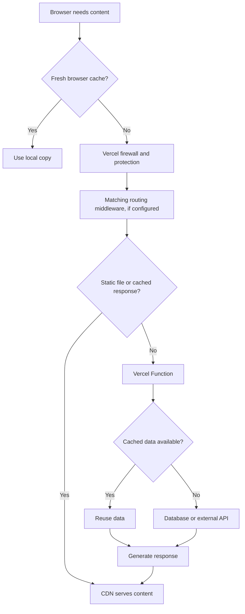

# Build a complete Vercel course

> [@First Principles Coding Coach](plugin://gpt-0dbcc877a99734ed25e7e95afab64010@workspace-shared-with-me) Can you search up the best coding practices for deploying to vercel, like for deploying nextJS apps and react/vite apps to vercel? I want to optimize cost, performance, and make sure I'm not unnecessarily spending on things like bandwidth, middleware execution, or if I'm doing anything wrong or inefficiently like with cloud functions, etc. Also cover general tips and tricks for how to amek the most out of the platform in 2026, like environments, deployment protection, make this a complete vercel course.

<details><summary>6 previous messages</summary>

> I’ll use the First Principles Coding Coach skill and research Vercel’s current docs, pricing, and deployment guidance to build a practical course for Next.js and React/Vite, with particular attention to hidden costs and performance tradeoffs.
>
> <details><summary>Ran a command, called 3 tools</summary>
>
> - Ran `Get-Content -LiteralPath 'C:/Users/amallick.ENGINEERS/.codex/plugins/cache/workspace-shared-with-me/gpt-0dbcc877a99734ed25e7e95afab64010/0.3.1+bundle.053dd2c6e205b232cb2c9fb1f93d9a9b/skills/instructions/SKILL.md'`
>
> MCP tool call
>
> codex_apps.search_service.web_run
>
> ```json
> {
>   "system2_search_query": [
>     {
>       "q": "site:vercel.com/docs pricing fluid compute fast data transfer edge requests middleware pricing"
>     },
>     {
>       "q": "site:vercel.com/docs next.js cache components ISR caching cost optimization"
>     },
>     {
>       "q": "site:vercel.com/docs vite deployment protection environments spend management"
>     }
>   ],
>   "response_length": "long"
> }
> ```
>
> ```text
> {"content":[{"type":"text","text":"Regional Pricing (https://vercel.com/docs/pricing/regional-pricing)\n【turn812186search0】 [wordlim: 200] Published: 9 months ago; Crawled: 7 months ago; When using Managed Infrastructure resources on Vercel, some, but not all, are priced based on region. ... Active CPU and Provisioned Memory are billed at different rates depending on the region your fluid compute is deployed. The rates for each region can be found in the fluid pricing documentation. ... Fast Data Transfer  | First 1 TB  | 1 GB for $0.15 - $0.35 ... Edge Request Additional CPU Duration  | 1 Hour for $0.30 - $0.48\n\n# Regional Pricing\n\nAsk AI about this page\n\nLast updated January 14, 2026\n\nWhen using Managed Infrastructure resources on Vercel, some, but not all, are priced based on region. The following table shows the price range for resources priced by region. Your team will be charged based on the usage of your projects for each resource per region.\n\nThe Included column shows the amount of usage covered in your billing cycle. If you use more than this amount, the Additional column lists the rates for any extra usage as a range.\n\nActive CPU and Provisioned Memory are billed at different rates depending on the region your fluid compute is deployed. The rates for each region can be found in the fluid pricing documentation.\n\nResource  | Included (Billing Cycle)  | On-demand (Billing Cycle)\n--- | --- | ---\nFast Data Transfer  | First 1 TB  | 1 GB for $0.15 - $0.35\nEdge Requests  | First 10,000,000  | 1,000,000 Requests for $2.00 - $3.20\n\nResource  | On-demand (Billing Cycle)\n\n--------------------------------------------------------------------------------\nISR Usage and Pricing (https://vercel.com/docs/incremental-static-regeneration/limits-and-pricing)\n【turn812186search1】 [wordlim: 200] Published: 7 months ago; Crawled: 7 months ago; To decide when ISR is the right cache for your use case, see Caching on Vercel. ... If you have multiple regions set, the region that gives you the best cost optimization is selected.\n# ISR Usage and Pricing\n\nAsk AI about this page\n\nLast updated March 12, 2026\n\nThis page covers ISR costs, usage metrics, and optimization strategies. To decide when ISR is the right cache for your use case, see Caching on Vercel.\n\n## Pricing\n\nIncremental Static Regeneration (ISR) caches your page responses ephemerally in the Vercel CDN in every region and persists them to durable storage in a single region. CDN cache reads and writes are free, but reads and writes from durable storage incur costs.\n\nISR Reads and Writes are priced regionally based on the Vercel function region(s) set at your project level. See the regional pricing documentation and ISR cache region for more information.\n\n## Usage\n\nThe table below shows the metrics for the ISR section of the Usage dashboard.\n\nTo view information on managing each resource, select the resource link in the Metric column. To jump straight to guidance on optimization, select the corresponding resource link in the Optimize column. CDN cache reads are free.\n  * ISR cache (in the Function region): If the CDN cache misses, the request falls back to the durable ISR cache in your Function region. Your Function stores revalidated content here and resolves cache misses by fetching fresh data. This cache guarantees retention for the duration you specify, until it goes unaccessed for 31 days. ISR reads and writes from this cache incur costs.\n\nFor best performance, set your default Function region close to where your data sources are. This reduces latency for cache misses and revalidation. Automatic compression of ISR writes helps keep costs down even when you choose a region further from the lowest-cost option.\n\n## Optimizing ISR reads and writes\n\nYou're charged based on the volume of data read from and written to the ISR cache, and the regions where reads and writes occur. To optimize ISR usage, consider the following strategies:\n\n  * For content that rarely changes, set a longer time-based revalidation interval\n  * If you have events that trigger data updates, use on-demand revalidation instead of short revalidation intervals\n\n--------------------------------------------------------------------------------\nFluid compute pricing (https://vercel.com/docs/functions/usage-and-pricing)\n【turn812186search2】 [wordlim: 200] Published: 9 months ago; Crawled: 7 months ago; The following table shows the regional pricing for fluid compute resources on Vercel. ... When the first request arrives, Vercel starts an instance with your configured memory.\n\n# Fluid compute pricing\n\nAsk AI about this page\n\nLast updated January 14, 2026\n\nVercel Functions on fluid compute are priced based on your plan and resource usage. Each plan includes a set amount of resources per month:\n\nResource  | Hobby  | Pro\n--- | --- | ---\nActive CPU  | 4 hours included  | N/A\nOn-demand Active CPU  | -  | Costs vary by region\nProvisioned Memory  | 360 GB-hrs included  | N/A\nOn-demand Provisioned Memory  | -  | Costs vary by region\nInvocations  | 1 million included  | N/A\nOn-demand Invocations  | -  | N/A\n\nEnterprise plans have custom terms. Speak to your Customer Success Manager (CSM) or Account Executive (AE) for details.\n\n### Resource Details\n\n#### Active CPU\n\n  * This is the CPU time your code actively consumes in milliseconds\n  * You are only billed during actual code execution and not during I/O operations (database queries, like AI model calls, etc.)\n  * Billed per CPU-hour\n  * Pauses billing when your code is waiting for external services\n  * Billed per incoming request\n  * First million requests included in both Hobby and Pro plans\n  * Counts regardless of request success or failure\n\nFor example: If your function receives 1.5 million requests on a Pro plan, you'll be billed for the 500,000 requests beyond your included million at $0.60 per million (approximately $0.30).\n\n## Regional pricing\n\nThe following table shows the regional pricing for fluid compute resources on Vercel. The prices are per hour for CPU and per GB-hr for memory:\n\nFluid compute regional pricing\nRegion  | Active CPU (per hour)  | Provisioned Memory (per GB-hr)\n--- | --- | ---\nCape Town, South Africa (cpt1)  | $0.200  | $0.0166\nCleveland, USA (cle1)  | $0.128  | $0.0106\nDubai, UAE (dxb1)  | $0.185  | $0.0153\nDublin, Ireland (dub1)  | $0.168  | $0.0139\nFrankfurt, Germany (fra1)  | $0.184  | $0.0152\nHong Kong (hkg1)  | $0.176  | $0.0146\nLondon, UK (lhr1)  | $0.177  | $0.0146\nMontreal, Canada (yul1)  | $0.147  | $0.0122\nMumbai, India (bom1)  | $0.140  | $0.0116\nOsaka, Japan (kix1)  | $0.202  | $0.0167\nParis, France (cdg1)  | $0.177  | $0.0146\nPortland, USA (pdx1)  | $0.128  | $0.0106\nSan Francisco, USA (sfo1)  | $0.177  | $0.0147\nSão Paulo, Brazil (gru1)  | $0.221  | $0.0183\nSeoul, South Korea (icn1)  | $0.169  | $0.0140\nSingapore (sin1)  | $0.160  | $0.0133\nStockholm, Sweden (arn1)  | $0.160  | $0.0133\nSydney, Australia (syd1)  | $0.180  | $0.0149\nTokyo, Japan (hnd1)  | $0.202  | $0.0167\nWashington D.C., USA (iad1)  | $0.128  | $0.0106\n\n## How pricing works\n\nA function instance runs in a region, and its pricing is based on the resources it uses in that region. The cost for each invocation is calculated based on the Active CPU and Provisioned memory resources it uses in that region.\n\nWhen the first request arrives, Vercel starts an instance with your configured memory. Provisioned memory is billed continuously until the last in-flight request finishes. Active CPU is billed only while your code is actually running. If the request is waiting on I/O, CPU billing pauses but memory billing continues.\n\nAfter all requests complete, the instance is paused, and no CPU or memory charges apply until the next invocation. This means, you pay for memory whenever work is in progress, never for idle CPU, and nothing at all between requests.\n\n### Example\n\nSuppose you deploy a function with 4 GB of memory in the São Paulo, Brazil region, where the rates are $0.221/hour for CPU and $0.0183/GB-hour for memory. If one request takes 4 seconds of active CPU time and the instance is alive for 10 seconds (including I/O), the cost will be:\n\n  * CPU: (4 seconds / 3600) × $0.221 = $0.0002456\n  * Memory: (4 GB × 10 seconds / 3600) × $0.0183 = $0.0002033\n  * Total: $0.0002456 + $0.0002033 = $0.0004489 for each invocation.\n\n\nOn this page\n\n  * Resource Details\n  * Active CPU\n  * Provisioned Memory\n  * Invocations\n  * Regional pricing\n  * How pricing works\n  * Example\n\n--------------------------------------------------------------------------------\nIncremental Static Regeneration (ISR) (https://vercel.com/docs/incremental-static-regeneration)\n【turn812186search3】 [wordlim: 200] Published: 9 months ago; Crawled: 7 months ago; Vercel's CDN provides fully managed caching and routing when you implement ISR with frameworks like Next.js, SvelteKit, Nuxt, and Astro. ...   * Cache shielding: On a CDN miss, Vercel reads from the ISR cache before invoking your function, reducing load on your origin.\n# Incremental Static Regeneration (ISR)\n\nAsk AI about this page\n\nLast updated January 27, 2026\n\nIncremental Static Regeneration is available on all plans\n\nIncremental Static Regeneration (ISR) is a caching strategy that combines the speed of static content with the flexibility of server-side rendering. It follows the stale-while-revalidate pattern: visitors get a fast cached response, and Vercel regenerates the page in the background based on a time interval or an API call you trigger.\n\nVercel's CDN provides fully managed caching and routing when you implement ISR with frameworks like Next.js, SvelteKit, Nuxt, and Astro.\n\nUse ISR when your content updates on a known schedule (minutes to hours) rather than in real time:\n\n  * E-commerce: Large product catalogs that need current pricing and availability without rebuilding the entire site.\n  * Media and publishing: Content pages that update when authors publish in a headless CMS.\n  * Generative AI platforms: Pages generated from discrete events like git syncs or API updates, not continuous streams.\n## Using ISR\n\nISR works with your framework's existing APIs. Your framework code defines how each route behaves, and Vercel handles the caching automatically.\n\nFramework  | How to enable ISR  | Details\n--- | --- | ---\nNext.js (App Router)  | Export `revalidate` from a route segment  | Getting started\nNext.js (Pages Router)  | Return `revalidate` from `getStaticProps`  | Getting started\nSvelteKit  | Export `config` with `isr` property  | SvelteKit on Vercel\nNuxt  | Add `routeRules` with `isr` option  | Nuxt on Vercel\nAstro  | Configure server output with ISR  | Astro on Vercel\nGatsby  | Use DSG (Deferred Static Generation)  | Gatsby on Vercel\nBuild Output API  | Define Prerender Functions  | Prerender Functions\n\nTo cache data inside your functions separately from the page response, see Runtime Cache.\n\n## How ISR works\n\nISR follows a lifecycle from build through serving and revalidation. The diagram below shows the complete flow. ## Caching on Vercel\n\nVercel provides several caching strategies depending on your architecture. ISR is one of four approaches:\n\n### Frameworks with ISR support\n\nNext.js, SvelteKit, Nuxt, Astro, and Gatsby declare which routes are cacheable at build time. Vercel handles CDN caching, durable ISR storage, request collapsing, and revalidation automatically.\n\nUse ISR when:\n\n  * Your framework supports it\n  * You need cached pages to survive deployments and rollbacks\n  * You need all regions to serve the same content version\n  * You want request collapsing to protect your backend during traffic spikes\n\nYour ISR cache uses your project's default Function region. You can change this region in your project's Settings. See ISR cache region for details on how the region affects pricing and performance.\n\nWith ISR, Vercel knows a path is cacheable before the first request arrives. That's what enables request collapsing, durable storage, 300ms global purges, instant rollbacks, and path grouping. \n--------------------------------------------------------------------------------\nSpend Management (https://vercel.com/docs/spend-management)\n【turn812186search4】 [wordlim: 200] Published: 1.1 years ago; Crawled: 7 months ago; Vercel provides an option to automatically pause the production deployment for all of your projects when your spend amount is reached. ... Vercel displays all spend management activity in the Activity section in your team dashboard sidebar.\n\n# Spend Management\n\nAsk AI about this page\n\nLast updated September 29, 2025\n\nSpend Management is available on Pro plans\n\nThose with the owner and billing roles can access this feature\n\nSpend management is a way for you to notify or to automatically take action on your account when your team hits a set spend amount. The actions you can take are:\n\n  * Receive a notification\n\n  * Trigger a webhook\n\n  * Pause the production deployment of all your projects\n\nSetting a spend amount does not automatically stop usage. If you want to pause all your projects at a certain amount, you must enable the option.\n\nThe spend amount is set per billing cycle.\n\nSetting the amount halfway through a billing cycle considers your current spend. You can increase or decrease your spend amount as needed. If you configure it below the current monthly spend, Spend Management will trigger any configured actions (including pausing all projects).\n\n## What does Spend Management include?\n\n--------------------------------------------------------------------------------\nDeployment Protection on Vercel (https://vercel.com/docs/deployment-protection)\n【turn812186search5】 [wordlim: 200] Published: 9 months ago; Crawled: 7 months ago; # Deployment Protection on Vercel ... This affects `VERCEL_URL` and `VERCEL_BRANCH_URL` from System Environment Variables, making them unsuitable for fetch requests.\n\nDeployment Protection\n\n# Deployment Protection on Vercel\n\nAsk AI about this page\n\nLast updated January 7, 2026\n\nDeployment Protection lets you control who can access your preview and production URLs. You configure it at the project level, choosing both a protection method (how you protect) and a protection scope (what you protect).\n\nOn the Hobby plan, you can use Vercel Authentication with Standard Protection. This protects your preview deployments and deployment URLs, but your production domain remains publicly accessible. To protect production domains, you need a Pro or Enterprise plan. Deployment Protection requires authentication for all requests, including those to Routing Middleware.\n\nYou can start a Pro trial to explore Deployment Protection features using the button below.\n\n### Experience Vercel Pro for free\n\nUnlock the full potential of Vercel Pro during your 14-day trial with $20 in credits. Benefit from 1 TB Fast Data Transfer, 10,000,000 Edge Requests, up to 200 hours of Build Execution, and access to Pro features like team collaboration and enhanced analytics.\n\n--------------------------------------------------------------------------------\nThe Complete Guide to Vercel Services | Vercel Knowledge Base (https://vercel.com/kb/guide/vercel-services)\n【turn812186search6】 [wordlim: 200] Published: 4 months ago; Crawled: 3 months ago; Service requests are regionally priced, billed separately from CDN requests, and don't incur a separate Edge Request or Fast Data Transfer charge.\n  * Data transfer: The bytes a service returns are billed as Fast Origin Transfer, the same as other origin traffic on Vercel. ... Each service is billed like a Vercel Function, based on Active CPU, provisioned memory, and invocations, with Fluid compute applied.\n## Pricing for Vercel Services\n\nVercel bills Services based on the compute resources each service runs on, the requests services make to each other, and the data services return.\n\n  * Compute: Each service is billed the same as Vercel Functions, based on Active CPU, provisioned memory, and invocations. Fluid compute applies, so concurrent requests can share an instance.\n  * Service requests: When one service calls another over a binding, each call counts as one service request. Requests that arrive from the public internet aren't service requests. Service requests are regionally priced, billed separately from CDN requests, and don't incur a separate Edge Request or Fast Data Transfer charge.\n  * Data transfer: The bytes a service returns are billed as Fast Origin Transfer, the same as other origin traffic on Vercel.\n\nEach service is also subject to the same function limits, such as memory and maximum duration. See Services pricing and limits for full details.\n\n--------------------------------------------------------------------------------\nVercel CDN overview (https://vercel.com/docs/cdn)\n【turn812186search7】 [wordlim: 200] Published: 9 months ago; Crawled: 7 months ago; When the cache expires, Vercel re-renders the page and updates all regions so visitors always get a fast response. Vercel manages caching, request collapsing, and purging automatically when you use ISR with Next.js, SvelteKit, Nuxt, or Astro.\n  * Security headers\n  * Vercel WAF\n\n## Caching\n\nVercel maintains multiple caching tiers to reduce how often your functions run.\n\n### Incremental Static Regeneration\n\nIncremental Static Regeneration (ISR) serves cached pages to visitors while regenerating content in the background. When the cache expires, Vercel re-renders the page and updates all regions so visitors always get a fast response. Vercel manages caching, request collapsing, and purging automatically when you use ISR with Next.js, SvelteKit, Nuxt, or Astro.\n\n  * How ISR works\n  * Getting started with ISR\n  * ISR usage and pricing\n  * Request collapsing\n\n### CDN cache and runtime cache\n\nThe CDN cache stores responses across Vercel regions, closest to your visitors. The runtime cache stores fetch results, database queries, and computed values inside your functions.\n\n  * CDN cache\n  * Cache-Control headers\n  * Runtime cache\n\n--------------------------------------------------------------------------------\nPricing on Vercel (https://vercel.com/docs/pricing)\n【turn812186search8】 [wordlim: 200] Published: last year; Crawled: 7 months ago;       * Request Collapsing ...     * Fluid Compute ...       * Edge Configs & REST API ... This page provides an overview of Vercel's pricing model and outlines all billable metrics and their pricing models.\n\nFor a full breakdown of Vercel's pricing by plan, see the pricing page. ... These resources are usage based, and billed based on the amount of data transferred, the number of requests made, and the duration of compute resources used.\n\n--------------------------------------------------------------------------------\nSão Paulo, Brazil (gru1) pricing (https://vercel.com/docs/pricing/regional-pricing/gru1)\n【turn812186search9】 [wordlim: 200] Published: 1.1 years ago; Crawled: 7 months ago; Active CPU and Provisioned Memory are billed at different rates depending on the region your fluid compute is deployed. The rates for each region can be found in the fluid pricing documentation. ... Fast Data Transfer  | Included First 1 TB, then $0.22 per 1 GB\nEdge Requests  | Included First 10,000,000, then $3.20 per 1,000,000 Requests ... Learn more about the different regions available on Vercel in the regions documentation.\n\n--------------------------------------------------------------------------------\nGetting started with ISR (https://vercel.com/docs/incremental-static-regeneration/quickstart)\n【turn812186search10】 [wordlim: 200] Published: 1.6 years ago; Crawled: 7 months ago; When a page with ISR enabled regenerates, Vercel fetches the most recent data and updates the cache. ... When using Next.js with the App Router, you can enable ISR by using the `revalidate` route segment config for a layout or page.\n\n--------------------------------------------------------------------------------\nCDN pricing and usage (https://vercel.com/docs/manage-cdn-usage)\n【turn812186search11】 [wordlim: 200] Published: 7 months ago; Crawled: 7 months ago; Fast Data Transfer is calculated based on the full size of each HTTP request and response transmitted to or from Vercel's CDN. ... Usage is incurred on both the input and output data transfer when using compute on Vercel. ... CDN Requests appear as Edge Requests in your billing dashboard and usage charts.\n\n--------------------------------------------------------------------------------\nMontréal, Canada (yul1) pricing (https://vercel.com/docs/pricing/regional-pricing/yul1)\n【turn812186search12】 [wordlim: 200] Published: 9 months ago; Crawled: 7 months ago; Active CPU and Provisioned Memory are billed at different rates depending on the region your fluid compute is deployed. The rates for each region can be found in the fluid pricing documentation. ... Fast Data Transfer  | Included First 1 TB, then $0.15 per 1 GB\nEdge Requests  | Included First 10,000,000, then $2.20 per 1,000,000 Requests ... Learn more about the different regions available on Vercel in the regions documentation.\n\n--------------------------------------------------------------------------------\nCalculating usage of resources (https://vercel.com/docs/pricing/how-does-vercel-calculate-usage-of-resources)\n【turn812186search13】 [wordlim: 200] Published: 8 months ago; Crawled: 7 months ago; Since it's static and cached on our global CDN, this only involves Edge Requests (the network requests required to get the content of the page) and Fast Data Transfer (the amount of content sent back to the browser). ... The request to view the page triggers an Edge Request to Vercel's CDN, which serves the static assets from the cache. ...   * Learn about Vercel's pricing model and how it works\n\n--------------------------------------------------------------------------------\nPortland, USA (pdx1) pricing (https://vercel.com/docs/pricing/regional-pricing/pdx1)\n【turn812186search14】 [wordlim: 200] Published: 1.1 years ago; Crawled: 7 months ago; Active CPU and Provisioned Memory are billed at different rates depending on the region your fluid compute is deployed. The rates for each region can be found in the fluid pricing documentation. ... Fast Data Transfer  | Included First 1 TB, then $0.15 per 1 GB\nEdge Requests  | Included First 10,000,000, then $2.00 per 1,000,000 Requests ... Learn more about the different regions available on Vercel in the regions documentation.\n\n--------------------------------------------------------------------------------\nISR on Vercel is now faster and more cost-efficient - Vercel (https://vercel.com/blog/isr-on-vercel-is-now-faster-and-more-cost-efficient)\n【turn812186search15】 [wordlim: 200] Published: 1.8 years ago; Crawled: last week; # ISR on Vercel is now faster and more cost-efficient ... When Next.js introduced Incremental Static Regeneration (ISR) in 2020, it changed how developers build for the web. ... Now, we’ve optimized how ISR cache updates work, leading to:\n\n--------------------------------------------------------------------------------\nStockholm, Sweden (arn1) pricing (https://vercel.com/docs/pricing/regional-pricing/arn1)\n【turn812186search16】 [wordlim: 200] Published: 1.1 years ago; Crawled: 7 months ago; Active CPU and Provisioned Memory are billed at different rates depending on the region your fluid compute is deployed. The rates for each region can be found in the fluid pricing documentation. ... Fast Data Transfer  | Included First 1 TB, then $0.15 per 1 GB\nEdge Requests  | Included First 10,000,000, then $2.20 per 1,000,000 Requests ... Learn more about the different regions available on Vercel in the regions documentation.\n\n--------------------------------------------------------------------------------\nISR Writes | Vercel Academy (https://vercel.com/academy/optimize-your-vercel-account/isr-writes)\n【turn812186search17】 [wordlim: 200] Crawled: today; The way it's wired right now, we're telling Next.js the page goes stale every 60 seconds. ... Each one runs the page on a function, and any run whose output differs from the cached copy also costs ISR writes. ... Add an import: `import { cacheTag } from \"next/cache\";`\n\n--------------------------------------------------------------------------------\nWashington D.C., USA (iad1) pricing (https://vercel.com/docs/pricing/regional-pricing/iad1)\n【turn812186search18】 [wordlim: 200] Published: 7 months ago; Crawled: 7 months ago; Active CPU and Provisioned Memory are billed at different rates depending on the region your fluid compute is deployed. The rates for each region can be found in the fluid pricing documentation. ... Fast Data Transfer  | Included First 1 TB, then $0.15 per 1 GB\nEdge Requests  | Included First 10,000,000, then $2.00 per 1,000,000 Requests ... Learn more about the different regions available on Vercel in the regions documentation.\n\n--------------------------------------------------------------------------------\nCache Components for Instant and Fresh Pages | Vercel Academy (https://vercel.com/academy/nextjs-foundations/cache-components)\n【turn812186search19】 [wordlim: 200] Crawled: today; After you enable `cacheComponents: true`, Next.js prerenders as much of a route as it can into HTML and an RSC payload (the serialized Server Component tree). ... `\"use cache: remote\"`  | Remote cache (Vercel)  | Distributed caching across regions ... The old mental model focused on \"choosing a rendering mode\" per page: SSG (Static Site Generation, pages built at build time), ISR (Incremental Static Regeneration, static pages that revalidate), SSR (Server-Side Rendering, pages rendered on each request), or CSR (Client-Side Rendering, pages rendered in the browser).\n\n--------------------------------------------------------------------------------\nTroubleshooting Build Errors (https://vercel.com/docs/deployments/troubleshoot-a-build)\n【turn812186search20】 [wordlim: 200] Published: 9 months ago; Crawled: 7 months ago; If you use Vercel functions to process HTTP requests in your project, each Vercel Function is built separately in the Build step and has its own cache, based on the Runtime used. ... For Next.js projects, Vercel functions are bundled to optimize Build resources as described here.\n\n--------------------------------------------------------------------------------\nEnvironments (https://vercel.com/docs/deployments/environments)\n【turn812186search21】 [wordlim: 200] Published: 11 months ago; Crawled: 7 months ago; By default, Vercel creates a preview deployment when you: ...       --url https://api.vercel.com/v9/projects/<project-id-or-nam e>/custom-environments \\\n\n--------------------------------------------------------------------------------\nManage and optimize usage (https://vercel.com/docs/pricing/manage-and-optimize-usage)\n【turn812186search22】 [wordlim: 200] Published: 8 months ago; Crawled: 7 months ago; Fast Origin Transfer  | The data transfer between Vercel's CDN to Vercel Compute  | Yes  | Learn More ... For more information on Vercel's pricing, guidance on optimizing consumption, and invoices, see the following resources:\n\n--------------------------------------------------------------------------------\nProject settings (https://vercel.com/docs/project-configuration/project-settings)\n【turn812186search23】 [wordlim: 200] Published: 9 months ago; Crawled: 8 months ago; You can make changes about all areas relating to your project, including domains, functions, drains, integrations, Git, caching, environment variables, deployment protection, and security. ... By default, Vercel creates a new deployment and build (unless the Build Step is skipped) for every commit pushed to your connected Git repository.\n\n--------------------------------------------------------------------------------\nManaging Deployments (https://vercel.com/docs/deployments/managing-deployments)\n【turn812186search24】 [wordlim: 200] Published: 1.1 years ago; Crawled: 7 months ago; Use the dropdowns to search by Branch, Date Range, All Environments, or Status ...       --url https://api.vercel.com/v13/deployments/<deployment-i d> \\ ... ## Deployment protection ... Other than your custom needs to redeploy, it's always recommended to redeploy your application to Vercel for the following use cases:\n\n--------------------------------------------------------------------------------\nNext.js on Vercel vs Netlify | Vercel Knowledge Base (https://vercel.com/kb/guide/nextjs-on-vercel-vs-netlify)\n【turn812186search25】 [wordlim: 200] Published: 3 months ago; Crawled: 3 months ago;   * Vercel manages `Cache-Control` for ISR pages automatically on its CDN, and on-demand or tag-based revalidation purges content globally in about 300ms with request collapsing and durable storage. ...   * Netlify wires the Next.js Full Route Cache and Data Cache into its fine-grained caching primitives, using headers such as `Netlify-CDN-Cache-Control` and `Netlify-Cache-Tag`.\n\n--------------------------------------------------------------------------------\nManaging Deployments (https://examples.vercel.com/docs/deployments/managing-deployments)\n【turn812186search26】 [wordlim: 200] Published: 1.1 years ago; Crawled: 10 months ago; You can filter your deployments based on branch, status, and deployment environment: ... Use the dropdowns to search by Branch, Date Range, All Environments, or Status Image: The Deployments tab with the status filter dropdown open. ... ## Deployment protection ... Other than your custom needs to redeploy, it's always recommended to redeploy your application to Vercel for the following use cases:\n\n--------------------------------------------------------------------------------\nProtect production deployments for free on every plan - Vercel (https://vercel.com/changelog/protect-production-deployments-for-free-on-every-plan)\n【turn812186search27】 [wordlim: 200] Published: last month; Crawled: today; Vercel Authentication can now protect all deployments in a project, including production, at no additional cost on every plan. Previously, protecting production domains required the $150-per-month Advanced Deployment Protection add-on.\n\n--------------------------------------------------------------------------------\nAccess Roles (https://vercel.com/docs/rbac/access-roles)\n【turn812186search28】 [wordlim: 200] Published: 9 months ago; Crawled: 7 months ago; - Manage environment variables for development and preview environments ... Deployment Protection Manager  | Configure password protection, deployment protection by pass, and Vercel Authentication for projects.\n\n--------------------------------------------------------------------------------\nProduction checklist for launch (https://vercel.com/docs/production-checklist)\n【turn812186search29】 [wordlim: 200] Published: 10 months ago; Crawled: 7 months ago; Turborepo) to prevent unnecessary builds - Perform a zero downtime DNS migration to Vercel DNS ## Security - Implement a Content Security Policy (CSP) and proper security headers - Enable Deployment Protection to prevent unauthorized access - …84996 chars truncated…etadata":{"real_author":"tool:web.run"}},"create_time":null,"update_time":null,"content":{"content_type":"sonic_webpage","url":"https://vercel.com/docs/deployments/troubleshoot-a-build","domain":"vercel.com","title":"Troubleshooting Build Errors","text":"【turn812186search20】 [wordlim: 200] Published: 9 months ago; Crawled: 7 months ago; If you use Vercel functions to process HTTP requests in your project, each Vercel Function is built separately in the Build step and has its own cache, based on the Runtime used. ... For Next.js projects, Vercel functions are bundled to optimize Build resources as described here.\n","snippet":"If you use Vercel functions to process HTTP requests in your project, each Vercel Function is built separately in the Build step and has its own cache, based on the Runtime used. ... For Next.js projects, Vercel functions are bundled to optimize Build resources as described here.","pub_date":null,"crawl_date":null,"pub_timestamp":1770076800.0,"crawl_timestamp":1773287713.0,"ref_id":"turn812186search20"},"status":"finished_successfully","end_turn":null,"weight":1.0,"metadata":{"debug_sonic_thread_id":"thread_6ae91ec5c368832c854978f531e38c6d","search_engine":"system2-web","result_source":"labrador","ref_id":"turn812186search20","minimal_str":"Troubleshooting Build Errors (https://vercel.com/docs/deployments/troubleshoot-a-build)\n【turn812186search20】 [wordlim: 200] Published: 9 months ago; Crawled: 7 months ago; ","fetch_request":"{\"q\":\"site:vercel.com/docs next.js cache components isr caching cost optimization\",\"recency\":null,\"domains\":null,\"ignore_domains\":null,\"caller\":null,\"per_engine_overrides\":null}","n_tokens":119,"upsert_skip_copy":true},"recipient":"all","channel":"analysis"},{"id":"33bc1558-04ac-464c-84ee-ed6d3890f107","author":{"role":"tool","name":"web.run","metadata":{"real_author":"tool:web.run"}},"create_time":null,"update_time":null,"content":{"content_type":"sonic_webpage","url":"https://vercel.com/docs/deployments/environments","domain":"vercel.com","title":"Environments","text":"【turn812186search21】 [wordlim: 200] Published: 11 months ago; Crawled: 7 months ago; By default, Vercel creates a preview deployment when you: ...       --url https://api.vercel.com/v9/projects/<project-id-or-nam e>/custom-environments \\\n","snippet":"By default, Vercel creates a preview deployment when you: ...       --url https://api.vercel.com/v9/projects/<project-id-or-nam e>/custom-environments \\","pub_date":null,"crawl_date":null,"pub_timestamp":1764547200.0,"crawl_timestamp":1773287718.0,"ref_id":"turn812186search21"},"status":"finished_successfully","end_turn":null,"weight":1.0,"metadata":{"debug_sonic_thread_id":"thread_6ae91ec5c368832c854978f531e38c6d","search_engine":"system2-web","result_source":"labrador","ref_id":"turn812186search21","minimal_str":"Environments (https://vercel.com/docs/deployments/environments)\n【turn812186search21】 [wordlim: 200] Published: 11 months ago; Crawled: 7 months ago; ","fetch_request":"{\"q\":\"site:vercel.com/docs vite deployment protection environments spend management\",\"recency\":null,\"domains\":null,\"ignore_domains\":null,\"caller\":null,\"per_engine_overrides\":null}","n_tokens":92,"upsert_skip_copy":true},"recipient":"all","channel":"analysis"},{"id":"cb573c2f-b78b-4583-82df-403032e1c9e2","author":{"role":"tool","name":"web.run","metadata":{"real_author":"tool:web.run"}},"create_time":null,"update_time":null,"content":{"content_type":"sonic_webpage","url":"https://vercel.com/docs/pricing/manage-and-optimize-usage","domain":"vercel.com","title":"Manage and optimize usage","text":"【turn812186search22】 [wordlim: 200] Published: 8 months ago; Crawled: 7 months ago; Fast Origin Transfer  | The data transfer between Vercel's CDN to Vercel Compute  | Yes  | Learn More ... For more information on Vercel's pricing, guidance on optimizing consumption, and invoices, see the following resources:\n","snippet":"Fast Origin Transfer  | The data transfer between Vercel's CDN to Vercel Compute  | Yes  | Learn More ... For more information on Vercel's pricing, guidance on optimizing consumption, and invoices, see the following resources:","pub_date":null,"crawl_date":null,"pub_timestamp":1770595200.0,"crawl_timestamp":1773288300.0,"ref_id":"turn812186search22"},"status":"finished_successfully","end_turn":null,"weight":1.0,"metadata":{"debug_sonic_thread_id":"thread_6ae91ec5c368832c854978f531e38c6d","search_engine":"system2-web","result_source":"labrador","ref_id":"turn812186search22","minimal_str":"Manage and optimize usage (https://vercel.com/docs/pricing/manage-and-optimize-usage)\n【turn812186search22】 [wordlim: 200] Published: 8 months ago; Crawled: 7 months ago; ","fetch_request":"{\"q\":\"site:vercel.com/docs pricing fluid compute fast data transfer edge requests middleware pricing\",\"recency\":null,\"domains\":null,\"ignore_domains\":null,\"caller\":null,\"per_engine_overrides\":null}","n_tokens":109,"upsert_skip_copy":true},"recipient":"all","channel":"analysis"},{"id":"034f3cab-7e46-4d85-8e1c-7b4f1e67c0bc","author":{"role":"tool","name":"web.run","metadata":{"real_author":"tool:web.run"}},"create_time":null,"update_time":null,"content":{"content_type":"sonic_webpage","url":"https://vercel.com/docs/project-configuration/project-settings","domain":"vercel.com","title":"Project settings","text":"【turn812186search23】 [wordlim: 200] Published: 9 months ago; Crawled: 8 months ago; You can make changes about all areas relating to your project, including domains, functions, drains, integrations, Git, caching, environment variables, deployment protection, and security. ... By default, Vercel creates a new deployment and build (unless the Build Step is skipped) for every commit pushed to your connected Git repository.\n","snippet":"You can make changes about all areas relating to your project, including domains, functions, drains, integrations, Git, caching, environment variables, deployment protection, and security. ... By default, Vercel creates a new deployment and build (unless the Build Step is skipped) for every commit pushed to your connected Git repository.","pub_date":null,"crawl_date":null,"pub_timestamp":1768953600.0,"crawl_timestamp":1772575292.0,"ref_id":"turn812186search23"},"status":"finished_successfully","end_turn":null,"weight":1.0,"metadata":{"debug_sonic_thread_id":"thread_6ae91ec5c368832c854978f531e38c6d","search_engine":"system2-web","result_source":"labrador","ref_id":"turn812186search23","minimal_str":"Project settings (https://vercel.com/docs/project-configuration/project-settings)\n【turn812186search23】 [wordlim: 200] Published: 9 months ago; Crawled: 8 months ago; ","fetch_request":"{\"q\":\"site:vercel.com/docs vite deployment protection environments spend management\",\"recency\":null,\"domains\":null,\"ignore_domains\":null,\"caller\":null,\"per_engine_overrides\":null}","n_tokens":119,"upsert_skip_copy":true},"recipient":"all","channel":"analysis"},{"id":"ee9a5621-e7d8-4686-9709-3c5241f2643c","author":{"role":"tool","name":"web.run","metadata":{"real_author":"tool:web.run"}},"create_time":null,"update_time":null,"content":{"content_type":"sonic_webpage","url":"https://vercel.com/docs/deployments/managing-deployments","domain":"vercel.com","title":"Managing Deployments","text":"【turn812186search24】 [wordlim: 200] Published: 1.1 years ago; Crawled: 7 months ago; Use the dropdowns to search by Branch, Date Range, All Environments, or Status ...       --url https://api.vercel.com/v13/deployments/<deployment-i d> \\ ... ## Deployment protection ... Other than your custom needs to redeploy, it's always recommended to redeploy your application to Vercel for the following use cases:\n","snippet":"Use the dropdowns to search by Branch, Date Range, All Environments, or Status ...       --url https://api.vercel.com/v13/deployments/<deployment-i d> \\ ... ## Deployment protection ... Other than your custom needs to redeploy, it's always recommended to redeploy your application to Vercel for the following use cases:","pub_date":null,"crawl_date":null,"pub_timestamp":1758672000.0,"crawl_timestamp":1773287717.0,"ref_id":"turn812186search24"},"status":"finished_successfully","end_turn":null,"weight":1.0,"metadata":{"debug_sonic_thread_id":"thread_6ae91ec5c368832c854978f531e38c6d","search_engine":"system2-web","result_source":"labrador","ref_id":"turn812186search24","minimal_str":"Managing Deployments (https://vercel.com/docs/deployments/managing-deployments)\n【turn812186search24】 [wordlim: 200] Published: 1.1 years ago; Crawled: 7 months ago; ","fetch_request":"{\"q\":\"site:vercel.com/docs vite deployment protection environments spend management\",\"recency\":null,\"domains\":null,\"ignore_domains\":null,\"caller\":null,\"per_engine_overrides\":null}","n_tokens":131,"upsert_skip_copy":true},"recipient":"all","channel":"analysis"},{"id":"70577e70-ffd5-4077-8c2a-d46c226c9b5b","author":{"role":"tool","name":"web.run","metadata":{"real_author":"tool:web.run"}},"create_time":null,"update_time":null,"content":{"content_type":"sonic_webpage","url":"https://vercel.com/kb/guide/nextjs-on-vercel-vs-netlify","domain":"vercel.com","title":"Next.js on Vercel vs Netlify | Vercel Knowledge Base","text":"【turn812186search25】 [wordlim: 200] Published: 3 months ago; Crawled: 3 months ago;   * Vercel manages `Cache-Control` for ISR pages automatically on its CDN, and on-demand or tag-based revalidation purges content globally in about 300ms with request collapsing and durable storage. ...   * Netlify wires the Next.js Full Route Cache and Data Cache into its fine-grained caching primitives, using headers such as `Netlify-CDN-Cache-Control` and `Netlify-Cache-Tag`.\n","snippet":"  * Vercel manages `Cache-Control` for ISR pages automatically on its CDN, and on-demand or tag-based revalidation purges content globally in about 300ms with request collapsing and durable storage. ...   * Netlify wires the Next.js Full Route Cache and Data Cache into its fine-grained caching primitives, using headers such as `Netlify-CDN-Cache-Control` and `Netlify-Cache-Tag`.","pub_date":null,"crawl_date":null,"pub_timestamp":1783296000.0,"crawl_timestamp":1783651662.0,"ref_id":"turn812186search25"},"status":"finished_successfully","end_turn":null,"weight":1.0,"metadata":{"debug_sonic_thread_id":"thread_6ae91ec5c368832c854978f531e38c6d","search_engine":"system2-web","result_source":"labrador","ref_id":"turn812186search25","minimal_str":"Next.js on Vercel vs Netlify | Vercel Knowledge Base (https://vercel.com/kb/guide/nextjs-on-vercel-vs-netlify)\n【turn812186search25】 [wordlim: 200] Published: 3 months ago; Crawled: 3 months ago; ","fetch_request":"{\"q\":\"site:vercel.com/docs next.js cache components isr caching cost optimization\",\"recency\":null,\"domains\":null,\"ignore_domains\":null,\"caller\":null,\"per_engine_overrides\":null}","n_tokens":162,"upsert_skip_copy":true},"recipient":"all","channel":"analysis"},{"id":"8abe7fa9-83a0-4bc9-9542-f97dc3d06c5a","author":{"role":"tool","name":"web.run","metadata":{"real_author":"tool:web.run"}},"create_time":null,"update_time":null,"content":{"content_type":"sonic_webpage","url":"https://examples.vercel.com/docs/deployments/managing-deployments","domain":"examples.vercel.com","title":"Managing Deployments","text":"【turn812186search26】 [wordlim: 200] Published: 1.1 years ago; Crawled: 10 months ago; You can filter your deployments based on branch, status, and deployment environment: ... Use the dropdowns to search by Branch, Date Range, All Environments, or Status Image: The Deployments tab with the status filter dropdown open. ... ## Deployment protection ... Other than your custom needs to redeploy, it's always recommended to redeploy your application to Vercel for the following use cases:\n","snippet":"You can filter your deployments based on branch, status, and deployment environment: ... Use the dropdowns to search by Branch, Date Range, All Environments, or Status Image: The Deployments tab with the status filter dropdown open. ... ## Deployment protection ... Other than your custom needs to redeploy, it's always recommended to redeploy your application to Vercel for the following use cases:","pub_date":null,"crawl_date":null,"pub_timestamp":1758672000.0,"crawl_timestamp":1766126948.0,"ref_id":"turn812186search26"},"status":"finished_successfully","end_turn":null,"weight":1.0,"metadata":{"debug_sonic_thread_id":"thread_6ae91ec5c368832c854978f531e38c6d","search_engine":"system2-web","result_source":"labrador","ref_id":"turn812186search26","minimal_str":"Managing Deployments (https://examples.vercel.com/docs/deployments/managing-deployments)\n【turn812186search26】 [wordlim: 200] Published: 1.1 years ago; Crawled: 10 months ago; ","fetch_request":"{\"q\":\"site:vercel.com/docs vite deployment protection environments spend management\",\"recency\":null,\"domains\":null,\"ignore_domains\":null,\"caller\":null,\"per_engine_overrides\":null}","n_tokens":140,"upsert_skip_copy":true},"recipient":"all","channel":"analysis"},{"id":"ce78c41c-21ab-4888-8f42-292f0efd891f","author":{"role":"tool","name":"web.run","metadata":{"real_author":"tool:web.run"}},"create_time":null,"update_time":null,"content":{"content_type":"sonic_webpage","url":"https://vercel.com/changelog/protect-production-deployments-for-free-on-every-plan","domain":"vercel.com","title":"Protect production deployments for free on every plan - Vercel","text":"【turn812186search27】 [wordlim: 200] Published: last month; Crawled: today; Vercel Authentication can now protect all deployments in a project, including production, at no additional cost on every plan. Previously, protecting production domains required the $150-per-month Advanced Deployment Protection add-on.\n","snippet":"Vercel Authentication can now protect all deployments in a project, including production, at no additional cost on every plan. Previously, protecting production domains required the $150-per-month Advanced Deployment Protection add-on.","pub_date":null,"crawl_date":null,"pub_timestamp":1788912000.0,"crawl_timestamp":1793619049.0,"ref_id":"turn812186search27"},"status":"finished_successfully","end_turn":null,"weight":1.0,"metadata":{"debug_sonic_thread_id":"thread_6ae91ec5c368832c854978f531e38c6d","search_engine":"system2-web","result_source":"labrador","ref_id":"turn812186search27","minimal_str":"Protect production deployments for free on every plan - Vercel (https://vercel.com/changelog/protect-production-deployments-for-free-on-every-plan)\n【turn812186search27】 [wordlim: 200] Published: last month; Crawled: today; ","fetch_request":"{\"q\":\"site:vercel.com/docs vite deployment protection environments spend management\",\"recency\":null,\"domains\":null,\"ignore_domains\":null,\"caller\":null,\"per_engine_overrides\":null}","n_tokens":108,"upsert_skip_copy":true},"recipient":"all","channel":"analysis"},{"id":"221b7d16-02b9-4c68-badf-80d1e57378b3","author":{"role":"tool","name":"web.run","metadata":{"real_author":"tool:web.run"}},"create_time":null,"update_time":null,"content":{"content_type":"sonic_webpage","url":"https://vercel.com/docs/rbac/access-roles","domain":"vercel.com","title":"Access Roles","text":"【turn812186search28】 [wordlim: 200] Published: 9 months ago; Crawled: 7 months ago; - Manage environment variables for development and preview environments ... Deployment Protection Manager  | Configure password protection, deployment protection by pass, and Vercel Authentication for projects.\n","snippet":"- Manage environment variables for development and preview environments ... Deployment Protection Manager  | Configure password protection, deployment protection by pass, and Vercel Authentication for projects.","pub_date":null,"crawl_date":null,"pub_timestamp":1767744000.0,"crawl_timestamp":1773288302.0,"ref_id":"turn812186search28"},"status":"finished_successfully","end_turn":null,"weight":1.0,"metadata":{"debug_sonic_thread_id":"thread_6ae91ec5c368832c854978f531e38c6d","search_engine":"system2-web","result_source":"labrador","ref_id":"turn812186search28","minimal_str":"Access Roles (https://vercel.com/docs/rbac/access-roles)\n【turn812186search28】 [wordlim: 200] Published: 9 months ago; Crawled: 7 months ago; ","fetch_request":"{\"q\":\"site:vercel.com/docs vite deployment protection environments spend management\",\"recency\":null,\"domains\":null,\"ignore_domains\":null,\"caller\":null,\"per_engine_overrides\":null}","n_tokens":86,"upsert_skip_copy":true},"recipient":"all","channel":"analysis"},{"id":"0e6a3d1e-dfd3-412e-80a5-8397e7769b09","author":{"role":"tool","name":"web.run","metadata":{"real_author":"tool:web.run"}},"create_time":null,"update_time":null,"content":{"content_type":"sonic_webpage","url":"https://vercel.com/docs/production-checklist","domain":"vercel.com","title":"Production checklist for launch","text":"【turn812186search29】 [wordlim: 200] Published: 10 months ago; Crawled: 7 months ago; Turborepo) to prevent unnecessary builds - Perform a zero downtime DNS migration to Vercel DNS ## Security - Implement a Content Security Policy (CSP) and proper security headers - Enable Deployment Protection to prevent unauthorized access - Configure the Vercel Web Application Firewall (WAF) with custom rules, IP blocking, and managed rulesets - Enable Log Drains to persist deployment logs - Review common SSL certificate issues - Enable a Preview Deployment Suffix with a custom domain - Commit lockfiles to pin dependencies and speed up builds - Implement rate limiting to prevent abuse - Review and implement access roles for team members - Enable SAML SSO and SCIM (Enterprise only) - Enable Audit Logs (Enterprise only) - Ensure cookies comply with the allowed cookie policy (Enterprise only) - Set up a firewall rule to block unwanted bots ## Reliability - Enable Observability Plus for debugging, performance optimization, and traffic monitoring (Pro and Enterprise) - Enable automatic Function failover for multi-region redundancy (Enterprise only) - If using Secure Compute, enable a passive failover region (Enterprise only) - Implement caching headers for static assets and Function responses - Understand the differences between caching headers and ISR - Add distributed tracing instrumentation - Run a load test on your application (Enterprise only) ## Performance - Enable Speed Insights for field performance data and Core Web Vitals - Review Time To First Byte (TTFB) for fast responses - Use Image Optimization to reduce image sizes - Use Script Optimization to improve script loading - Use Font Optimization to remove external font network requests - Ensure Vercel Function region matches your API or database region - Review third-party proxy limitations and consult your CSM/AE if applicable (Enterprise) ## Cost optimization - Enable Fluid compute for reduced cold starts and optimized concurrency - Follow the manage and optimize usage guides - Configure Spend Management and alert thresholds - Review and adjust Function maximum duration and memory - Set appropriate ISR revalidation times or move to on-demand revalidation - Opt in to new image optimization pricing (for teams created before Feb 18, 2025) - Move large media files (GIFs, videos) to blob storage Please analyze my project, identify which items are already handled, flag anything missing, and help me address the gaps.\n","snippet":"Turborepo) to prevent unnecessary builds - Perform a zero downtime DNS migration to Vercel DNS ## Security - Implement a Content Security Policy (CSP) and proper security headers - Enable Deployment Protection to prevent unauthorized access - Configure the Vercel Web Application Firewall (WAF) with custom rules, IP blocking, and managed rulesets - Enable Log Drains to persist deployment logs - Review common SSL certificate issues - Enable a Preview Deployment Suffix with a custom domain - Commit lockfiles to pin dependencies and speed up builds - Implement rate limiting to prevent abuse - Review and implement access roles for team members - Enable SAML SSO and SCIM (Enterprise only) - Enable Audit Logs (Enterprise only) - Ensure cookies comply with the allowed cookie policy (Enterprise only) - Set up a firewall rule to block unwanted bots ## Reliability - Enable Observability Plus for debugging, performance optimization, and traffic monitoring (Pro and Enterprise) - Enable automatic Function failover for multi-region redundancy (Enterprise only) - If using Secure Compute, enable a passive failover region (Enterprise only) - Implement caching headers for static assets and Function responses - Understand the differences between caching headers and ISR - Add distributed tracing instrumentation - Run a load test on your application (Enterprise only) ## Performance - Enable Speed Insights for field performance data and Core Web Vitals - Review Time To First Byte (TTFB) for fast responses - Use Image Optimization to reduce image sizes - Use Script Optimization to improve script loading - Use Font Optimization to remove external font network requests - Ensure Vercel Function region matches your API or database region - Review third-party proxy limitations and consult your CSM/AE if applicable (Enterprise) ## Cost optimization - Enable Fluid compute for reduced cold starts and optimized concurrency - Follow the manage and optimize usage guides - Configure Spend Management and alert thresholds - Review and adjust Function maximum duration and memory - Set appropriate ISR revalidation times or move to on-demand revalidation - Opt in to new image optimization pricing (for teams created before Feb 18, 2025) - Move large media files (GIFs, videos) to blob storage Please analyze my project, identify which items are already handled, flag anything missing, and help me address the gaps.","pub_date":null,"crawl_date":null,"pub_timestamp":1767571200.0,"crawl_timestamp":1773287965.0,"ref_id":"turn812186search29"},"status":"finished_successfully","end_turn":null,"weight":1.0,"metadata":{"debug_sonic_thread_id":"thread_6ae91ec5c368832c854978f531e38c6d","search_engine":"system2-web","result_source":"labrador","ref_id":"turn812186search29","minimal_str":"Production checklist for launch (https://vercel.com/docs/production-checklist)\n【turn812186search29】 [wordlim: 200] Published: 10 months ago; Crawled: 7 months ago; ","fetch_request":"{\"q\":\"site:vercel.com/docs vite deployment protection environments spend management\",\"recency\":null,\"domains\":null,\"ignore_domains\":null,\"caller\":null,\"per_engine_overrides\":null}","n_tokens":503,"upsert_skip_copy":true},"recipient":"all","channel":"analysis"},{"id":"b5fd0a83-b0bb-4454-8577-bda23b90a642","author":{"role":"tool","name":"web.run","metadata":{"real_author":"tool:web.run"}},"create_time":null,"update_time":null,"content":{"content_type":"sonic_webpage","url":"https://vercel.com/docs/plans","domain":"vercel.com","title":"Account Plans on Vercel","text":"【turn812186search30】 [wordlim: 200] Published: 9 months ago; Crawled: 8 months ago;       * Deployment integration actions ...       * Building Integrations with Vercel REST API ...   * Pro plans users can configure Spend Management to automatically pause deployments, trigger a webhook, or send SMS notifications when they reach 100% usage\n","snippet":"      * Deployment integration actions ...       * Building Integrations with Vercel REST API ...   * Pro plans users can configure Spend Management to automatically pause deployments, trigger a webhook, or send SMS notifications when they reach 100% usage","pub_date":null,"crawl_date":null,"pub_timestamp":1767744000.0,"crawl_timestamp":1772422276.0,"ref_id":"turn812186search30"},"status":"finished_successfully","end_turn":null,"weight":1.0,"metadata":{"debug_sonic_thread_id":"thread_6ae91ec5c368832c854978f531e38c6d","search_engine":"system2-web","result_source":"labrador","ref_id":"turn812186search30","minimal_str":"Account Plans on Vercel (https://vercel.com/docs/plans)\n【turn812186search30】 [wordlim: 200] Published: 9 months ago; Crawled: 8 months ago; ","fetch_request":"{\"q\":\"site:vercel.com/docs vite deployment protection environments spend management\",\"recency\":null,\"domains\":null,\"ignore_domains\":null,\"caller\":null,\"per_engine_overrides\":null}","n_tokens":103,"upsert_skip_copy":true},"recipient":"all","channel":"analysis"},{"id":"c52f5e58-b380-48f1-93d4-5c5d62127939","author":{"role":"tool","name":"web.run","metadata":{"real_author":"tool:web.run"}},"create_time":null,"update_time":null,"content":{"content_type":"sonic_webpage","url":"https://vercel.com/docs/deployment-protection/methods-to-bypass-deployment-protection","domain":"vercel.com","title":"Methods to bypass Deployment Protection","text":"【turn812186search31】 [wordlim: 200] Published: 9 months ago; Crawled: 7 months ago; When enabled, it generates a secret that can be used as a System Environment Variable (`VERCEL_AUTOMATION_BYPASS_SECRET`) or as a query parameter in URLs to bypass protection features for all deployments in a project. ... Adding a domain to Deployment Protection Exceptions makes it publicly accessible, bypassing features like Vercel Authentication, Password Protection, and Trusted IPs.\n","snippet":"When enabled, it generates a secret that can be used as a System Environment Variable (`VERCEL_AUTOMATION_BYPASS_SECRET`) or as a query parameter in URLs to bypass protection features for all deployments in a project. ... Adding a domain to Deployment Protection Exceptions makes it publicly accessible, bypassing features like Vercel Authentication, Password Protection, and Trusted IPs.","pub_date":null,"crawl_date":null,"pub_timestamp":1769558400.0,"crawl_timestamp":1773287912.0,"ref_id":"turn812186search31"},"status":"finished_successfully","end_turn":null,"weight":1.0,"metadata":{"debug_sonic_thread_id":"thread_6ae91ec5c368832c854978f531e38c6d","search_engine":"system2-web","result_source":"labrador","ref_id":"turn812186search31","minimal_str":"Methods to bypass Deployment Protection (https://vercel.com/docs/deployment-protection/methods-to-bypass-deployment-protection)\n【turn812186search31】 [wordlim: 200] Published: 9 months ago; Crawled: 7 months ago; ","fetch_request":"{\"q\":\"site:vercel.com/docs vite deployment protection environments spend management\",\"recency\":null,\"domains\":null,\"ignore_domains\":null,\"caller\":null,\"per_engine_overrides\":null}","n_tokens":141,"upsert_skip_copy":true},"recipient":"all","channel":"analysis"},{"id":"8047c943-a587-4c02-b032-237f848f5e11","author":{"role":"tool","name":"web.run","metadata":{"real_author":"tool:web.run"}},"create_time":null,"update_time":null,"content":{"content_type":"sonic_webpage","url":"https://vercel.com/docs/deployments","domain":"vercel.com","title":"Deploying to Vercel","text":"【turn812186search32】 [wordlim: 200] Published: 11 months ago; Crawled: 7 months ago; A deployment on Vercel is the result of a successful build of your project. ... Learn more about the different environments on Vercel.\n","snippet":"A deployment on Vercel is the result of a successful build of your project. ... Learn more about the different environments on Vercel.","pub_date":null,"crawl_date":null,"pub_timestamp":1764547200.0,"crawl_timestamp":1773287726.0,"ref_id":"turn812186search32"},"status":"finished_successfully","end_turn":null,"weight":1.0,"metadata":{"debug_sonic_thread_id":"thread_6ae91ec5c368832c854978f531e38c6d","search_engine":"system2-web","result_source":"labrador","ref_id":"turn812186search32","minimal_str":"Deploying to Vercel (https://vercel.com/docs/deployments)\n【turn812186search32】 [wordlim: 200] Published: 11 months ago; Crawled: 7 months ago; ","fetch_request":"{\"q\":\"site:vercel.com/docs vite deployment protection environments spend management\",\"recency\":null,\"domains\":null,\"ignore_domains\":null,\"caller\":null,\"per_engine_overrides\":null}","n_tokens":85,"upsert_skip_copy":true},"recipient":"all","channel":"analysis"},{"id":"55ee7566-97a3-44ba-83f4-cc14e6a486a0","author":{"role":"tool","name":"web.run","metadata":{"real_author":"tool:web.run"}},"create_time":null,"update_time":null,"content":{"content_type":"sonic_webpage","url":"https://assets.vercel.com/image/upload/v1745532177/front/security/Secured_modern_SDLC.pdf","domain":"assets.vercel.com","title":"Phase 3: Build & Verify","text":"【turn812186search36】 [wordlim: 200] Published: 1.5 years ago; Spend controls protection ... Vercel’s spend controls help prevent runaway billing by capping usage and triggering alerts before limits are breached.\n","snippet":"Spend controls protection ... Vercel’s spend controls help prevent runaway billing by capping usage and triggering alerts before limits are breached.","pub_date":null,"crawl_date":null,"pub_timestamp":1745526509.0,"crawl_timestamp":1745526509.0,"ref_id":"turn812186search36"},"status":"finished_successfully","end_turn":null,"weight":1.0,"metadata":{"debug_sonic_thread_id":"thread_6ae91ec5c368832c854978f531e38c6d","search_engine":"system2-web-pdf","result_source":"labrador","ref_id":"turn812186search36","minimal_str":"Phase 3: Build & Verify (https://assets.vercel.com/image/upload/v1745532177/front/security/Secured_modern_SDLC.pdf)\n【turn812186search36】 [wordlim: 200] Published: 1.5 years ago; ","fetch_request":"{\"q\":\"site:vercel.com/docs vite deployment protection environments spend management\",\"recency\":null,\"domains\":null,\"ignore_domains\":null,\"caller\":null,\"per_engine_overrides\":null}","n_tokens":91,"upsert_skip_copy":true},"recipient":"all","channel":"analysis"},{"id":"710c8818-e5fa-4104-a237-2f481d7cae8c","author":{"role":"tool","name":"web.run","metadata":{"real_author":"tool:web.run"}},"create_time":null,"update_time":null,"content":{"content_type":"sonic_webpage","url":"https://assets.vercel.com/image/upload/front/forrester/TEI_of_Vercel_FrontendCloud_January_2024.pdf","domain":"assets.vercel.com","title":"Analysis Of Benefits","text":"【turn812186search37】 [wordlim: 200] Published: 2.8 years ago; The Next.js framework and Vercel platform automatically handled front-end infrastructure management needs such as traffic routing, scaling, caching, optimization, and more.\n","snippet":"The Next.js framework and Vercel platform automatically handled front-end infrastructure management needs such as traffic routing, scaling, caching, optimization, and more.","pub_date":null,"crawl_date":null,"pub_timestamp":1703879457.0,"crawl_timestamp":1703879457.0,"ref_id":"turn812186search37"},"status":"finished_successfully","end_turn":null,"weight":1.0,"metadata":{"debug_sonic_thread_id":"thread_6ae91ec5c368832c854978f531e38c6d","search_engine":"system2-web-pdf","result_source":"labrador","ref_id":"turn812186search37","minimal_str":"Analysis Of Benefits (https://assets.vercel.com/image/upload/front/forrester/TEI_of_Vercel_FrontendCloud_January_2024.pdf)\n【turn812186search37】 [wordlim: 200] Published: 2.8 years ago; ","fetch_request":"{\"q\":\"site:vercel.com/docs next.js cache components isr caching cost optimization\",\"recency\":null,\"domains\":null,\"ignore_domains\":null,\"caller\":null,\"per_engine_overrides\":null}","n_tokens":98,"upsert_skip_copy":true},"recipient":"all","channel":"analysis"}],"error":null,"_codex_apps":{"resource_uri":"/connector_openai_search_service/implicit_link::connector_openai_search_service/web_run"}}}
> ```
>
> MCP tool call
>
> codex_apps.search_service.web_run
>
> ```json
> {
>   "open": [
>     {
>       "ref_id": "https://vercel.com/pricing"
>     },
>     {
>       "ref_id": "https://vercel.com/changelog/protect-production-deployments-for-free-on-every-plan"
>     },
>     {
>       "ref_id": "https://vercel.com/docs/routing-middleware"
>     },
>     {
>       "ref_id": "https://vercel.com/docs/frameworks/frontend/vite"
>     }
>   ],
>   "system2_search_query": [
>     {
>       "q": "site:nextjs.org/docs app cacheComponents use cache cacheLife revalidateTag updateTag proxy Next.js 16"
>     },
>     {
>       "q": "site:vercel.com/docs image optimization pricing transformations cache reads writes 2026"
>     },
>     {
>       "q": "site:vercel.com/docs routing middleware pricing edge requests cpu duration cache"
>     }
>   ],
>   "response_length": "long"
> }
> ```
>
> ```text
> {"content":[{"type":"text","text":"Getting Started: Revalidating | Next.js (https://nextjs.org/docs/app/getting-started/revalidating)\n【turn683450search0】 [wordlim: 200] Published: 8 months ago; Crawled: 7 months ago;   * Time-based revalidation: Automatically refresh cached data after a set duration using `cacheLife`. ...     `import { revalidateTag } from 'next/cache' ... For content management systems with update mechanisms, use tags with longer cache durations and rely on `revalidateTag` to refresh content when it actually changes, rather than expiring the cache preemptively.\n\n--------------------------------------------------------------------------------\nnext.config.js: cacheComponents | Next.js (https://nextjs.org/docs/app/api-reference/config/next-config-js/cacheComponents)\n【turn683450search1】 [wordlim: 200] Published: 8 months ago; Crawled: 7 months ago; The `cacheComponents` flag is a feature in Next.js that causes data fetching operations in the App Router to be excluded from pre-renders unless they are explicitly cached. ... It is expected to be used in conjunction with `use cache` so that your data fetching happens at runtime by default unless you define specific parts of your application to be cached with `use cache` at the page, function, or component level. ...   * The `cacheLife` function with `use cache`\n  * The `cacheTag` function\n\n--------------------------------------------------------------------------------\nUpgrading: Version 16 | Next.js (https://nextjs.org/docs/app/guides/upgrading/version-16)\n【turn683450search2】 [wordlim: 200] Published: 7 months ago; Crawled: 7 months ago; Learn more about when to use `updateTag` or `revalidateTag` here. ...     `import { cacheLife, cacheTag } from 'next/cache'` ... Starting with Next.js 16, you can opt into PPR using the `cacheComponents` configuration. ...     mv middleware.js proxy.js`\n\n--------------------------------------------------------------------------------\nFunctions: cacheLife | Next.js (https://nextjs.org/docs/app/api-reference/functions/cacheLife)\n【turn683450search3】 [wordlim: 200] Published: 8 months ago; Crawled: 7 months ago; To use `cacheLife`, first enable the `cacheComponents` flag in your `next.config.js` file: ... When you call revalidation functions from a Server Action (`revalidateTag`, `revalidatePath`, `updateTag`, or `refresh`), the entire client cache is immediately cleared, bypassing the stale time. ... When you nest `use cache` directives (a cached function or component using another cached function or component), the outer cache's behavior depends on whether it has an explicit `cacheLife`.\n\n--------------------------------------------------------------------------------\nFaster transformations and reduced pricing for Image Optimization - Vercel (https://vercel.com/changelog/faster-transformations-and-reduced-pricing-for-image-optimization)\n【turn683450search4】 [wordlim: 200] Published: 1.7 years ago; Crawled: today; # Faster transformations and reduced pricing for Image Optimization ...   * Image Cache Reads: $0.40 per 1M cache read units\n\n  * Image Cache Writes: $4.00 per 1M cache write units\n\n--------------------------------------------------------------------------------\nDirectives: use cache | Next.js (https://nextjs.org/docs/app/api-reference/directives/use-cache)\n【turn683450search5】 [wordlim: 200] Published: 8 months ago; Crawled: 7 months ago;     import { updateTag } from 'next/cache' ... app/ClientComponent.tsx ... use cache: private Learn how to use the \"use cache: private\" directive to cache functions that access runtime request APIs.cacheComponents Learn how to enable the cacheComponents flag in Next.js.cacheLife Learn how to set up cacheLife configurations in Next.js.cacheHandlers Configure custom cache handlers for use cache directives in Next.js.cacheTag Learn how to use the cacheTag function to manage cache invalidation in your Next.js application.cacheLife Learn how to use the cacheLife function to set the cache expiration time for a cached function or component.revalidateTag API Reference for the revalidateTag function.\n\n--------------------------------------------------------------------------------\nGuides: Migrating to Cache Components | Next.js (https://nextjs.org/docs/app/guides/migrating-to-cache-components)\n【turn683450search6】 [wordlim: 200] Published: 8 months ago; Crawled: 7 months ago; When Cache Components is enabled, route segment configs like `dynamic`, `revalidate`, and `fetchCache` are replaced by `use cache` and `cacheLife`. ... When unhandled uncached or runtime data access is detected during development and build time, Next.js raises an error. ...     `import { cacheLife } from 'next/cache' ... If you need edge behavior for specific routes, use Proxy instead.\n\n--------------------------------------------------------------------------------\nnext.config.js: cacheLife | Next.js (https://nextjs.org/docs/app/api-reference/config/next-config-js/cacheLife)\n【turn683450search7】 [wordlim: 200] Published: 8 months ago; Crawled: 7 months ago; To define a profile, enable the `cacheComponents` flag and add the cache profile in the `cacheLife` object in the `next.config.js` file. ... `revalidate`  | `number`  | Frequency at which the cache should refresh on the server; stale values may be served while revalidating. ... use cache Learn how to use the \"use cache\" directive to cache data in your Next.js application.cacheHandlers Configure custom cache handlers for use cache directives in Next.js.cacheLife Learn how to use the cacheLife function to set the cache expiration time for a cached function or component.\n\n--------------------------------------------------------------------------------\nFunctions: revalidateTag | Next.js (https://nextjs.org/docs/app/api-reference/functions/revalidateTag)\n【turn683450search8】 [wordlim: 200] Published: 8 months ago; Crawled: 7 months ago; `revalidateTag` cannot be called in Client Components or Proxy, as it only works in server environments. ...   * With a custom cache life profile: For advanced usage, you can specify any cache life profile that your application has defined, allowing for custom revalidation behaviors tailored to your specific caching requirements. ...   * Without the second argument (deprecated): The tag entry is expired immediately, and the next request to that resource will be a blocking revalidate/cache miss. This behavior is now deprecated, and you should either use `profile=\"max\"` or migrate to `updateTag`.\n\n--------------------------------------------------------------------------------\nFunctions: cacheTag | Next.js (https://nextjs.org/docs/app/api-reference/functions/cacheTag)\n【turn683450search9】 [wordlim: 200] Published: 8 months ago; Crawled: 7 months ago; To use `cacheTag`, enable the `cacheComponents` flag in your `next.config.js` file: ... cacheComponents Learn how to enable the cacheComponents flag in Next.js.use cache Learn how to use the \"use cache\" directive to cache data in your Next.js application.revalidateTag API Reference for the revalidateTag function.cacheLife Learn how to use the cacheLife function to set the cache expiration time for a cached function or component.\n\n--------------------------------------------------------------------------------\nNext.js 16 | Next.js (https://nextjs.org/blog/next-16)\n【turn683450search10】 [wordlim: 200] Published: last year; Crawled: 7 months ago; We will be sharing more about Cache Components and how to use them at Next.js Conf 2025 on October 22nd, and we will be sharing more content in our blog and documentation in the coming weeks. ... `proxy.ts` replaces `middleware.ts` and makes the app’s network boundary explicit. `proxy.ts` runs on the Node.js runtime. ... `revalidateTag()` now requires a `cacheLife` profile as the second argument to enable stale-while-revalidate (SWR) behavior: ...     import { updateTag } from 'next/cache';\n\n--------------------------------------------------------------------------------\nGetting Started with Routing Middleware (https://vercel.com/docs/routing-middleware/getting-started)\n【turn683450search11】 [wordlim: 200] Published: 9 months ago; Crawled: 8 months ago; Routing Middleware is available on the Node.js, Bun, and Edge runtimes. ... To use Bun, set `bunVersion` in your `vercel.json` file. ... By default, Routing Middleware runs on every request.\n\n--------------------------------------------------------------------------------\nRouting Middleware (https://examples.vercel.com/docs/routing-middleware)\n【turn683450search12】 [wordlim: 200] Published: 9 months ago; Crawled: 7 months ago; Routing Middleware executes code before a request is processed on a site, and are built on top of fluid compute. ... Vercel has multiple global storage products, including Edge Config and Vercel Blob. ... See the fluid compute pricing documentation for more information. ... The Vercel Observability dashboard provides visibility into your routing middleware usage, including invocation counts and performance metrics.\n\n--------------------------------------------------------------------------------\nRegional Pricing (https://vercel.com/docs/pricing/regional-pricing)\n【turn683450search13】 [wordlim: 200] Published: 9 months ago; Crawled: 7 months ago; # Regional Pricing ... When using Managed Infrastructure resources on Vercel, some, but not all, are priced based on region. The following table shows the price range for resources priced by region. ... Edge Request Additional CPU Duration  | 1 Hour for $0.30 - $0.48 ... Image Optimization Cache Reads  | $0.40 - $0.64 per 1M\n\n--------------------------------------------------------------------------------\nGuides: Caching (Previous Model) | Next.js (https://nextjs.org/docs/app/guides/caching-without-cache-components)\n【turn683450search14】 [wordlim: 200] Published: 8 months ago; Crawled: 7 months ago; App Router Guides Caching (Previous Model) ... By default, Next.js will cache any `fetch()` requests that are reachable before any Request-time APIs are used and will not cache `fetch` requests that are discovered after Request-time APIs are used. ... To revalidate cached data after an event, use `revalidateTag` or `revalidatePath` in a Server Action or Route Handler. ...     `import { revalidateTag } from 'next/cache'\n     \n    export async function updateUser(id: string) {\n\n--------------------------------------------------------------------------------\nCalculating usage of resources (https://vercel.com/docs/pricing/how-does-vercel-calculate-usage-of-resources)\n【turn683450search15】 [wordlim: 200] Published: 8 months ago; Crawled: 7 months ago; For dynamic content like product price discounts, the site uses Vercel Runtime Cache to store and retrieve the latest product information. ... The request to view the page triggers an Edge Request to Vercel's CDN, which serves the static assets from the cache. ...   * Function Duration: CPU runtime charges for the function processing the update ...   * Learn about Vercel's pricing model and how it works\n\n--------------------------------------------------------------------------------\nCDN pricing and usage (https://vercel.com/docs/manage-cdn-usage)\n【turn683450search16】 [wordlim: 200] Published: 7 months ago; Crawled: 7 months ago; Pricing varies by the region where requests originate. ... These include Vercel Functions, Middleware, and the Data Cache (used through ISR). ... Edge Request CPU duration is the measurement of CPU processing time per CDN Request. ...   * Complex regular expressions in routing.\n\n--------------------------------------------------------------------------------\nVercel SKUs | Vercel Academy (https://vercel.com/academy/vercel-foundations/skus)\n【turn683450search17】 [wordlim: 200] Crawled: today; Every incoming request to Vercel's CDN counts as a CDN Request (formerly called an Edge Request), whether the response is served from cache or generated dynamically. ...   * Routing Middleware runs before cache, billed on active CPU time and provisioned memory ...   * Pricing on Vercel\n\n--------------------------------------------------------------------------------\nManaging Usage & Costs (https://examples.vercel.com/docs/image-optimization/managing-image-optimization-costs)\n【turn683450search18】 [wordlim: 200] Published: 1.1 years ago; Crawled: last year; This document describes usage for the default pricing option. For Pro and Enterprise teams created before February 18th, 2025 you will be given the choice to opt-in to this pricing plan or stay on the legacy source images-based pricing plan. ...   * Unoptimized: For source images that do not benefit from optimization such as small images (under 10 KB), vector images (SVG) and animated images (GIF), use the `unoptimized` property on the Image component to avoid transformations, cache reads, and cache writes.\n\n--------------------------------------------------------------------------------\nPricing on Vercel (https://vercel.com/docs/pricing)\n【turn683450search19】 [wordlim: 200] Published: last year; Crawled: 7 months ago;     * `vercel cache` ...     * Routing Middleware ...       * Edge Configs & REST API ... This page provides an overview of Vercel's pricing model and outlines all billable metrics and their pricing models. ... For example, Function Duration generates bills based on the total execution time of a Vercel Function. ... Resource  | Included  | Price\n\n--------------------------------------------------------------------------------\nGuides: Self-Hosting | Next.js (https://nextjs.org/docs/app/guides/self-hosting)\n【turn683450search20】 [wordlim: 200] Published: 7 months ago; Crawled: 7 months ago; If you run multiple instances, use ephemeral compute, or place a CDN/reverse proxy in front of Next.js, also review Configuring Caching, Multi-Instance Cache Coordination, and Usage with CDNs. ... In addition to the multi-server configuration above (encryption key, deployment ID, shared cache), App Router deployments with multiple instances need cache tag coordination.\n\nBy default, calling `revalidateTag()` on one instance only invalidates the cache on that instance.\n\n--------------------------------------------------------------------------------\nVercel SKUs | Vercel Academy (https://blog.vercel.com/academy/vercel-foundations/skus)\n【turn683450search21】 [wordlim: 200] Crawled: 2 days ago; Every incoming request to Vercel's CDN counts as a CDN Request (formerly called an Edge Request), whether the response is served from cache or generated dynamically. ...   * Routing Middleware runs before cache, billed on active CPU time and provisioned memory ...   * Pricing on Vercel\n\n--------------------------------------------------------------------------------\nCache-Control headers (https://vercel.com/docs/caching/cache-control-headers)\n【turn683450search22】 [wordlim: 200] Published: 8 months ago; Crawled: 7 months ago; Visitors within the browser cache window won't trigger an edge request, which lowers both latency and CDN usage costs. ... After this period ends, Vercel's CDN will serve the \"stale\" response from the edge until the response is asynchronously revalidated with a \"fresh\" response to your Vercel Function.\n\n--------------------------------------------------------------------------------\nEdge Runtime (https://vercel.com/docs/functions/runtimes/edge)\n【turn683450search23】 [wordlim: 200] Published: 10 months ago; Crawled: 7 months ago; Both runtimes run on Fluid compute with Active CPU pricing.\n\nTo convert your Vercel Function to use the Edge runtime, add the following code to your function: ... Dynamic code execution is not available in Middleware with the `edge` runtime configured for security reasons. ... The maximum size for an Vercel Function using the Edge runtime includes your JavaScript code, imported libraries and files (such as fonts), and all files bundled in the function.\n\n--------------------------------------------------------------------------------\nHow Vercel CDN works (https://vercel.com/docs/how-vercel-cdn-works)\n【turn683450search24】 [wordlim: 200] Published: 7 months ago; Crawled: 7 months ago; Blocked requests never reach the routing or caching layers. ... If no cache has the content, the request reaches Vercel Functions in the nearest compute region.\n\n--------------------------------------------------------------------------------\nServices routing and communication (https://vercel.com/docs/services/routing)\n【turn683450search25】 [wordlim: 200] Published: 7 months ago; Crawled: 7 months ago; When a project has multiple services, Vercel merges their routes into a single routing table and distributes incoming requests based on each service's route prefix. ... `{SERVICENAME}_URL`  | `https://your-deploy.vercel.app/svc/api`  | Server-side in services  | Server-side requests between services\n\n--------------------------------------------------------------------------------\nImage Optimization | Vercel Academy (https://blog.vercel.com/academy/optimize-your-vercel-account/image-optimization)\n【turn683450search26】 [wordlim: 200] Crawled: today; You're billed for the transformation work, so fewer variants and longer cache lives mean lower cost. ...   * `minimumCacheTTL` is the floor for how long a transformed image stays cached before Vercel transforms it again. ... The default is a few hours, and right now the Next.js Image docs and Vercel's Image Optimization page list different numbers for it.\n\n--------------------------------------------------------------------------------\nImage Optimization | Vercel Academy (https://domains.vercel.com/academy/optimize-your-vercel-account/image-optimization)\n【turn683450search27】 [wordlim: 200] Crawled: 2 days ago; You're billed for the transformation work, so fewer variants and longer cache lives mean lower cost. ...   * `minimumCacheTTL` is the floor for how long a transformed image stays cached before Vercel transforms it again. ... The default is a few hours, and right now the Next.js Image docs and Vercel's Image Optimization page list different numbers for it.\n\n--------------------------------------------------------------------------------\nVercel Pricing: Hobby, Pro, and Enterprise plans (https://vercel.com/pricing)\n【turn683450view0】 [wordlim: 200] Crawled: today; Content type: text/html; Source: open({\"ref_id\":\"https://vercel.com/pricing\",\"lineno\":null}); Total lines: 1353\nL0: 【0†Skip to content】\nL1: \nL2: Products\nL3: \nL4: Agent Stack\nL5: \nL6:   * 【1†AI SDK】\nL7:   * 【2†AI Gateway】\nL8:   * 【3†Sandbox】\nL9:   * 【4†Passport】\nL10:   * 【5†Connect】\nL11:   * 【6†eve】\nL12: \nL13: Core Platform\nL14: \nL15:   * 【7†Security】\nL16:   * 【8†Content Delivery】\nL17:   * 【9†Fluid Compute】\nL18:   * 【10†Observability】\nL19:   * 【11†Workflows】\nL20:   * 【12†CI/CD】\nL21: \nL22: Tools\nL23: \nL24:   * 【13†Next.js】\nL25:   * 【14†Vercel Agent】\nL26:   * 【15†Vercel Plugin】\nL27:   * 【16†Open Source】\nL28:   * 【17†Domains↗】\nL29:   * 【18†v0↗†v0.app】\nL30: \nL31: Resources\nL32: \nL33: Learn\nL34: \nL35:   * 【19†Docs】\nL36:   * 【20†About】\nL37:   * 【21†Blog】\nL38:   * 【22†Changelog】\nL39:   * 【23†Knowledge Base】\nL40: Build\nL41: \nL42:   * 【24†AI Apps】\nL43:   * 【25†Web Apps】\nL44:   * 【26†Marketing Sites】\nL45:   * 【27†Platforms】\nL46:   * 【28†Commerce】\nL47: \nL48: Explore\nL49: \nL50:   * 【29†Customers】\nL51:   * 【30†Marketplace】\nL52:   * 【31†Partner Finder】\nL53:   * 【32†AWS】\nL54:   * 【33†Community↗†community.vercel.com】\nL55: \nL56: 【34†Enterprise】【35†Pricing】\nL57: \nL58: 【36†Get a Demo】【37†Log In】【38†Sign Up】\nL59: \nL60: Ask AI【39†Dashboard】\nL61: \nL62: * * *\nL63: \nL64: Products\nL65: \nL66: Agent Stack\nL67: \nL68:   * 【1†AI SDK】\nL69:   * 【2†AI Gateway】\nL70:   * 【3†Sandbox】\nL71:   * 【4†Passport】\nL72:   * 【5†Connect】\nL73:   * 【6†eve】\nL74: \nL75: Core Platform\nL76:   * 【7†Security】\nL77:   * 【8†Content Delivery】\nL78:   * 【9†Fluid Compute】\nL79:   * 【10†Observability】\nL80:   * 【11†Workflows】\nL81:   * 【12†CI/CD】\nL82: \nL83: Tools\nL84: \nL85:   * 【13†Next.js】\nL86:   * 【14†Vercel Agent】\nL87:   * 【15†Vercel Plugin】\nL88:   * 【16†Open Source】\nL89:   * 【17†Domains↗】\nL90:   * 【18†v0↗†v0.app】\nL91: \nL92: Resources\nL93: \nL94: Learn\nL95: \nL96:   * 【19†Docs】\nL97:   * 【20†About】\nL98:   * 【21†Blog】\nL99:   * 【22†Changelog】\nL100:   * 【23†Knowledge Base】\nL101: \nL102: Build\nL103: \nL104:   * 【24†AI Apps】\nL105:   * 【25†Web Apps】\nL106:   * 【26†Marketing Sites】\nL107:   * 【27†Platforms】\nL108:   * 【28†Commerce】\nL109: \nL110: Explore\n\n--------------------------------------------------------------------------------\nProtect production deployments for free on every plan - Vercel (https://vercel.com/changelog/protect-production-deployments-for-free-on-every-plan)\n【turn683450view1】 [wordlim: 200] Crawled: today; Content type: text/html; Source: open({\"ref_id\":\"https://vercel.com/changelog/protect-production-deployments-for-free-on-every-plan\",\"lineno\":null}); Total lines: 269\nL0: 【0†Skip to content】\nL1: \nL2: Products\nL3: \nL4: Agent Stack\nL5: \nL6:   * 【1†AI SDK】\nL7:   * 【2†AI Gateway】\nL8:   * 【3†Sandbox】\nL9:   * 【4†Passport】\nL10:   * 【5†Connect】\nL11:   * 【6†eve】\nL12: \nL13: Core Platform\nL14: \nL15:   * 【7†Security】\nL16:   * 【8†Content Delivery】\nL17:   * 【9†Fluid Compute】\nL18:   * 【10†Observability】\nL19:   * 【11†Workflows】\nL20:   * 【12†CI/CD】\nL21: \nL22: Tools\nL23: \nL24:   * 【13†Next.js】\nL25:   * 【14†Vercel Agent】\nL26:   * 【15†Vercel Plugin】\nL27:   * 【16†Open Source】\nL28:   * 【17†Domains↗】\nL29:   * 【18†v0↗†v0.app】\nL30: \nL31: Resources\nL32: \nL33: Learn\nL34: \nL35:   * 【19†Docs】\nL36:   * 【20†About】\nL37:   * 【21†Blog】\nL38:   * 【22†Changelog】\nL39:   * 【23†Knowledge Base】\nL40: Build\nL41: \nL42:   * 【24†AI Apps】\nL43:   * 【25†Web Apps】\nL44:   * 【26†Marketing Sites】\nL45:   * 【27†Platforms】\nL46:   * 【28†Commerce】\nL47: \nL48: Explore\nL49: \nL50:   * 【29†Customers】\nL51:   * 【30†Marketplace】\nL52:   * 【31†Partner Finder】\nL53:   * 【32†AWS】\nL54:   * 【33†Community↗†community.vercel.com】\nL55: \nL56: 【34†Enterprise】【35†Pricing】\nL57: \nL58: 【36†Get a Demo】【37†Log In】【38†Sign Up】\nL59: \nL60: Ask AI【39†Dashboard】\nL61: \nL62: * * *\nL63: \nL64: Products\nL65: \nL66: Agent Stack\nL67: \nL68:   * 【1†AI SDK】\nL69:   * 【2†AI Gateway】\nL70:   * 【3†Sandbox】\nL71:   * 【4†Passport】\nL72:   * 【5†Connect】\nL73:   * 【6†eve】\nL74: \nL75: Core Platform\nL76:   * 【7†Security】\nL77:   * 【8†Content Delivery】\nL78:   * 【9†Fluid Compute】\nL79:   * 【10†Observability】\nL80:   * 【11†Workflows】\nL81:   * 【12†CI/CD】\nL82: \nL83: Tools\nL84: \nL85:   * 【13†Next.js】\nL86:   * 【14†Vercel Agent】\nL87:   * 【15†Vercel Plugin】\nL88:   * 【16†Open Source】\nL89:   * 【17†Domains↗】\nL90:   * 【18†v0↗†v0.app】\nL91: \nL92: Resources\nL93: \nL94: Learn\nL95: \nL96:   * 【19†Docs】\nL97:   * 【20†About】\nL98:   * 【21†Blog】\nL99:   * 【22†Changelog】\nL100:   * 【23†Knowledge Base】\nL101: \nL102: Build\nL103: \nL104:   * 【24†AI Apps】\nL105:   * 【25†Web Apps】\nL106:   * 【26†Marketing Sites】\nL107:   * 【27†Platforms】\nL108:   * 【28†Commerce】\nL109: \nL110: Explore\n\n--------------------------------------------------------------------------------\nRouting Middleware (https://vercel.com/docs/routing-middleware)\n【turn683450view2】 [wordlim: 200] Crawled: today; Content type: text/html; Source: open({\"ref_id\":\"https://vercel.com/docs/routing-middleware\",\"lineno\":null}); Total lines: 555\nL0: 【0†Skip to content】\nL1: \nL2: 【1†Docs】\nL3: \nL4: Build\nL5: \nL6: Build with AI\nL7: \nL8:   * 【2†AI Gateway】\nL9:   * 【3†AI SDK】\nL10:   * 【4†Sandbox】\nL11:   * 【5†Container Registry】\nL12:   * 【6†Workflow】\nL13:   * 【7†Vercel Agent】\nL14:   * 【8†v0↗†v0.app】\nL15:   * 【9†Vercel MCP】\nL16:   * 【10†AI Integrations】\nL17: \nL18: Deploy & scale\nL19: \nL20:   * 【11†Deployments】\nL21:   * 【12†CLI】\nL22:   * 【13†Functions】\nL23:   * 【14†Delivery Network】\nL24:   * 【15†Storage】\nL25:   * 【16†Integrations】\nL26:   * 【17†Microfrontends】\nL27:   * 【18†Domains】\nL28: \nL29: Operate & protect\nL30:   * 【19†Firewall】\nL31:   * 【20†Observability】\nL32:   * 【21†Feature Flags】\nL33:   * 【22†Toolbar】\nL34:   * 【23†Bot Management】\nL35:   * 【24†BotID】\nL36:   * 【25†Deployment Protection】\nL37:   * 【26†Compliance】\nL38: \nL39: Learn\nL40: \nL41: Resources\nL42: \nL43:   * 【27†Changelog↗】\nL44:   * 【28†Blog↗】\nL45:   * 【29†Community↗†community.vercel.com】\nL46:   * 【30†Knowledge Base】\nL47:   * 【31†APIs & SDKs】\nL48:   * 【32†Templates】\nL49: \nL50: 【33†Getting Started】\nL51: \nL52: Ask AI\nL53: \nL54: 【34†Log In】【35†Sign Up】\nL55: \nL56: * * *\nL57: \nL58: Build\nL59: \nL60: Build with AI\nL61:   * 【2†AI Gateway】\nL62:   * 【3†AI SDK】\nL63:   * 【4†Sandbox】\nL64:   * 【5†Container Registry】\nL65:   * 【6†Workflow】\nL66:   * 【7†Vercel Agent】\nL67:   * 【8†v0↗†v0.app】\nL68:   * 【9†Vercel MCP】\nL69:   * 【10†AI Integrations】\nL70: \nL71: Deploy & scale\nL72: \nL73:   * 【11†Deployments】\nL74:   * 【12†CLI】\nL75:   * 【13†Functions】\nL76:   * 【14†Delivery Network】\nL77:   * 【15†Storage】\nL78:   * 【16†Integrations】\nL79:   * 【17†Microfrontends】\nL80:   * 【18†Domains】\nL81: \nL82: Operate & protect\nL83:   * 【19†Firewall】\nL84:   * 【20†Observability】\nL85:   * 【21†Feature Flags】\nL86:   * 【22†Toolbar】\nL87:   * 【23†Bot Management】\nL88:   * 【24†BotID】\nL89:   * 【25†Deployment Protection】\nL90:   * 【26†Compliance】\nL91: \nL92: Learn\nL93: \nL94: Resources\nL95: \nL96:   * 【27†Changelog↗】\nL97:   * 【28†Blog↗】\nL98:   * 【29†Community↗†community.vercel.com】\nL99:   * 【30†Knowledge Base】\nL100:   * 【31†APIs & SDKs】\nL101:   * 【32†Templates】\nL102: \nL103: 【33†Getting Started】\nL104: \nL105: Ask AI\nL106: \nL107: 【35†Sign Up】【34†Log In】\nL108: \nL109: Search Docs\nL110: \nL111: Start\n\n--------------------------------------------------------------------------------\nVite on Vercel (https://vercel.com/docs/frameworks/frontend/vite)\n【turn683450view3】 [wordlim: 200] Crawled: today; Content type: text/html; Source: open({\"ref_id\":\"https://vercel.com/docs/frameworks/frontend/vite\",\"lineno\":null}); Total lines: 532\nL0: 【0†Skip to content】\nL1: \nL2: 【1†Docs】\nL3: \nL4: Build\nL5: \nL6: Build with AI\nL7: \nL8:   * 【2†AI Gateway】\nL9:   * 【3†AI SDK】\nL10:   * 【4†Sandbox】\nL11:   * 【5†Container Registry】\nL12:   * 【6†Workflow】\nL13:   * 【7†Vercel Agent】\nL14:   * 【8†v0↗†v0.app】\nL15:   * 【9†Vercel MCP】\nL16:   * 【10†AI Integrations】\nL17: \nL18: Deploy & scale\nL19: \nL20:   * 【11†Deployments】\nL21:   * 【12†CLI】\nL22:   * 【13†Functions】\nL23:   * 【14†Delivery Network】\nL24:   * 【15†Storage】\nL25:   * 【16†Integrations】\nL26:   * 【17†Microfrontends】\nL27:   * 【18†Domains】\nL28: \nL29: Operate & protect\nL30:   * 【19†Firewall】\nL31:   * 【20†Observability】\nL32:   * 【21†Feature Flags】\nL33:   * 【22†Toolbar】\nL34:   * 【23†Bot Management】\nL35:   * 【24†BotID】\nL36:   * 【25†Deployment Protection】\nL37:   * 【26†Compliance】\nL38: \nL39: Learn\nL40: \nL41: Resources\nL42: \nL43:   * 【27†Changelog↗】\nL44:   * 【28†Blog↗】\nL45:   * 【29†Community↗†community.vercel.com】\nL46:   * 【30†Knowledge Base】\nL47:   * 【31†APIs & SDKs】\nL48:   * 【32†Templates】\nL49: \nL50: 【33†Getting Started】\nL51: \nL52: Ask AI\nL53: \nL54: 【34†Log In】【35†Sign Up】\nL55: \nL56: * * *\nL57: \nL58: Build\nL59: \nL60: Build with AI\nL61:   * 【2†AI Gateway】\nL62:   * 【3†AI SDK】\nL63:   * 【4†Sandbox】\nL64:   * 【5†Container Registry】\nL65:   * 【6†Workflow】\nL66:   * 【7†Vercel Agent】\nL67:   * 【8†v0↗†v0.app】\nL68:   * 【9†Vercel MCP】\nL69:   * 【10†AI Integrations】\nL70: \nL71: Deploy & scale\nL72: \nL73:   * 【11†Deployments】\nL74:   * 【12†CLI】\nL75:   * 【13†Functions】\nL76:   * 【14†Delivery Network】\nL77:   * 【15†Storage】\nL78:   * 【16†Integrations】\nL79:   * 【17†Microfrontends】\nL80:   * 【18†Domains】\nL81: \nL82: Operate & protect\nL83:   * 【19†Firewall】\nL84:   * 【20†Observability】\nL85:   * 【21†Feature Flags】\nL86:   * 【22†Toolbar】\nL87:   * 【23†Bot Management】\nL88:   * 【24†BotID】\nL89:   * 【25†Deployment Protection】\nL90:   * 【26†Compliance】\nL91: \nL92: Learn\nL93: \nL94: Resources\nL95: \nL96:   * 【27†Changelog↗】\nL97:   * 【28†Blog↗】\nL98:   * 【29†Community↗†community.vercel.com】\nL99:   * 【30†Knowledge Base】\nL100:   * 【31†APIs & SDKs】\nL101:   * 【32†Templates】\nL102: \nL103: 【33†Getting Started】\nL104: \n"}],"isError":false,"_meta":{"raw_messages":[{"id":"50ca270e-ffae-41c1-972d-f3680d44b9e8","author":{"role":"tool","name":"web.run","metadata":{"real_author":"tool:web.run"}},"create_time":null,"update_time":null,"content":{"content_type":"sonic_webpage","url":"https://nextjs.org/docs/app/getting-started/revalidating","domain":"nextjs.org","title":"Getting Started: Revalidating | Next.js","text":"【turn683450search0】 [wordlim: 200] Published: 8 months ago; Crawled: 7 months ago;   * Time-based revalidation: Automatically refresh cached data after a set duration using `cacheLife`. ...     `import { revalidateTag } from 'next/cache' ... For content management systems with update mechanisms, use tags with longer cache durations and rely on `revalidateTag` to refresh content when it actually changes, rather than expiring the cache preemptively.\n","snippet":"  * Time-based revalidation: Automatically refresh cached data after a set duration using `cacheLife`. ...     `import { revalidateTag } from 'next/cache' ... For content management systems with update mechanisms, use tags with longer cache durations and rely on `revalidateTag` to re…104459 chars truncated…Coordination, and Usage with CDNs. ... In addition to the multi-server configuration above (encryption key, deployment ID, shared cache), App Router deployments with multiple instances need cache tag coordination.\n\nBy default, calling `revalidateTag()` on one instance only invalidates the cache on that instance.","pub_date":null,"crawl_date":null,"pub_timestamp":1774396800.0,"crawl_timestamp":1774572688.0,"ref_id":"turn683450search20"},"status":"finished_successfully","end_turn":null,"weight":1.0,"metadata":{"debug_sonic_thread_id":"thread_6ae91ecd1b188331be31b8c36b8c5273","search_engine":"system2-web","result_source":"labrador","ref_id":"turn683450search20","minimal_str":"Guides: Self-Hosting | Next.js (https://nextjs.org/docs/app/guides/self-hosting)\n【turn683450search20】 [wordlim: 200] Published: 7 months ago; Crawled: 7 months ago; ","fetch_request":"{\"q\":\"site:nextjs.org/docs app cachecomponents use cache cachelife revalidatetag updatetag proxy next.js 16\",\"recency\":null,\"domains\":null,\"ignore_domains\":null,\"caller\":null,\"per_engine_overrides\":null}","n_tokens":157,"upsert_skip_copy":true},"recipient":"all","channel":"analysis"},{"id":"85ad1e7c-0749-4fb4-b48b-ba58c7973996","author":{"role":"tool","name":"web.run","metadata":{"real_author":"tool:web.run"}},"create_time":null,"update_time":null,"content":{"content_type":"sonic_webpage","url":"https://blog.vercel.com/academy/vercel-foundations/skus","domain":"blog.vercel.com","title":"Vercel SKUs | Vercel Academy","text":"【turn683450search21】 [wordlim: 200] Crawled: 2 days ago; Every incoming request to Vercel's CDN counts as a CDN Request (formerly called an Edge Request), whether the response is served from cache or generated dynamically. ...   * Routing Middleware runs before cache, billed on active CPU time and provisioned memory ...   * Pricing on Vercel\n","snippet":"Every incoming request to Vercel's CDN counts as a CDN Request (formerly called an Edge Request), whether the response is served from cache or generated dynamically. ...   * Routing Middleware runs before cache, billed on active CPU time and provisioned memory ...   * Pricing on Vercel","pub_date":null,"crawl_date":null,"pub_timestamp":null,"crawl_timestamp":1793488502.0,"ref_id":"turn683450search21"},"status":"finished_successfully","end_turn":null,"weight":1.0,"metadata":{"debug_sonic_thread_id":"thread_6ae91ecd1b188331be31b8c36b8c5273","search_engine":"system2-web","result_source":"labrador","ref_id":"turn683450search21","minimal_str":"Vercel SKUs | Vercel Academy (https://blog.vercel.com/academy/vercel-foundations/skus)\n【turn683450search21】 [wordlim: 200] Crawled: 2 days ago; ","fetch_request":"{\"q\":\"site:vercel.com/docs routing middleware pricing edge requests cpu duration cache\",\"recency\":null,\"domains\":null,\"ignore_domains\":null,\"caller\":null,\"per_engine_overrides\":null}","n_tokens":117,"upsert_skip_copy":true},"recipient":"all","channel":"analysis"},{"id":"4564b114-6cb0-4bb3-96b5-8401e221ae24","author":{"role":"tool","name":"web.run","metadata":{"real_author":"tool:web.run"}},"create_time":null,"update_time":null,"content":{"content_type":"sonic_webpage","url":"https://vercel.com/docs/caching/cache-control-headers","domain":"vercel.com","title":"Cache-Control headers","text":"【turn683450search22】 [wordlim: 200] Published: 8 months ago; Crawled: 7 months ago; Visitors within the browser cache window won't trigger an edge request, which lowers both latency and CDN usage costs. ... After this period ends, Vercel's CDN will serve the \"stale\" response from the edge until the response is asynchronously revalidated with a \"fresh\" response to your Vercel Function.\n","snippet":"Visitors within the browser cache window won't trigger an edge request, which lowers both latency and CDN usage costs. ... After this period ends, Vercel's CDN will serve the \"stale\" response from the edge until the response is asynchronously revalidated with a \"fresh\" response to your Vercel Function.","pub_date":null,"crawl_date":null,"pub_timestamp":1772668800.0,"crawl_timestamp":1773997322.0,"ref_id":"turn683450search22"},"status":"finished_successfully","end_turn":null,"weight":1.0,"metadata":{"debug_sonic_thread_id":"thread_6ae91ecd1b188331be31b8c36b8c5273","search_engine":"system2-web","result_source":"labrador","ref_id":"turn683450search22","minimal_str":"Cache-Control headers (https://vercel.com/docs/caching/cache-control-headers)\n【turn683450search22】 [wordlim: 200] Published: 8 months ago; Crawled: 7 months ago; ","fetch_request":"{\"q\":\"site:vercel.com/docs routing middleware pricing edge requests cpu duration cache\",\"recency\":null,\"domains\":null,\"ignore_domains\":null,\"caller\":null,\"per_engine_overrides\":null}","n_tokens":119,"upsert_skip_copy":true},"recipient":"all","channel":"analysis"},{"id":"b3d644ca-2c7c-4cbc-a25b-ce32eaeef344","author":{"role":"tool","name":"web.run","metadata":{"real_author":"tool:web.run"}},"create_time":null,"update_time":null,"content":{"content_type":"sonic_webpage","url":"https://vercel.com/docs/functions/runtimes/edge","domain":"vercel.com","title":"Edge Runtime","text":"【turn683450search23】 [wordlim: 200] Published: 10 months ago; Crawled: 7 months ago; Both runtimes run on Fluid compute with Active CPU pricing.\n\nTo convert your Vercel Function to use the Edge runtime, add the following code to your function: ... Dynamic code execution is not available in Middleware with the `edge` runtime configured for security reasons. ... The maximum size for an Vercel Function using the Edge runtime includes your JavaScript code, imported libraries and files (such as fonts), and all files bundled in the function.\n","snippet":"Both runtimes run on Fluid compute with Active CPU pricing.\n\nTo convert your Vercel Function to use the Edge runtime, add the following code to your function: ... Dynamic code execution is not available in Middleware with the `edge` runtime configured for security reasons. ... The maximum size for an Vercel Function using the Edge runtime includes your JavaScript code, imported libraries and files (such as fonts), and all files bundled in the function.","pub_date":null,"crawl_date":null,"pub_timestamp":1765152000.0,"crawl_timestamp":1773288269.0,"ref_id":"turn683450search23"},"status":"finished_successfully","end_turn":null,"weight":1.0,"metadata":{"debug_sonic_thread_id":"thread_6ae91ecd1b188331be31b8c36b8c5273","search_engine":"system2-web","result_source":"labrador","ref_id":"turn683450search23","minimal_str":"Edge Runtime (https://vercel.com/docs/functions/runtimes/edge)\n【turn683450search23】 [wordlim: 200] Published: 10 months ago; Crawled: 7 months ago; ","fetch_request":"{\"q\":\"site:vercel.com/docs routing middleware pricing edge requests cpu duration cache\",\"recency\":null,\"domains\":null,\"ignore_domains\":null,\"caller\":null,\"per_engine_overrides\":null}","n_tokens":145,"upsert_skip_copy":true},"recipient":"all","channel":"analysis"},{"id":"9913b68e-3ace-4d5a-bdd8-9e6cd16ef5da","author":{"role":"tool","name":"web.run","metadata":{"real_author":"tool:web.run"}},"create_time":null,"update_time":null,"content":{"content_type":"sonic_webpage","url":"https://vercel.com/docs/how-vercel-cdn-works","domain":"vercel.com","title":"How Vercel CDN works","text":"【turn683450search24】 [wordlim: 200] Published: 7 months ago; Crawled: 7 months ago; Blocked requests never reach the routing or caching layers. ... If no cache has the content, the request reaches Vercel Functions in the nearest compute region.\n","snippet":"Blocked requests never reach the routing or caching layers. ... If no cache has the content, the request reaches Vercel Functions in the nearest compute region.","pub_date":null,"crawl_date":null,"pub_timestamp":1773273600.0,"crawl_timestamp":1773287865.0,"ref_id":"turn683450search24"},"status":"finished_successfully","end_turn":null,"weight":1.0,"metadata":{"debug_sonic_thread_id":"thread_6ae91ecd1b188331be31b8c36b8c5273","search_engine":"system2-web","result_source":"labrador","ref_id":"turn683450search24","minimal_str":"How Vercel CDN works (https://vercel.com/docs/how-vercel-cdn-works)\n【turn683450search24】 [wordlim: 200] Published: 7 months ago; Crawled: 7 months ago; ","fetch_request":"{\"q\":\"site:vercel.com/docs routing middleware pricing edge requests cpu duration cache\",\"recency\":null,\"domains\":null,\"ignore_domains\":null,\"caller\":null,\"per_engine_overrides\":null}","n_tokens":92,"upsert_skip_copy":true},"recipient":"all","channel":"analysis"},{"id":"74bc112a-11f1-4509-a704-79319be1e0e9","author":{"role":"tool","name":"web.run","metadata":{"real_author":"tool:web.run"}},"create_time":null,"update_time":null,"content":{"content_type":"sonic_webpage","url":"https://vercel.com/docs/services/routing","domain":"vercel.com","title":"Services routing and communication","text":"【turn683450search25】 [wordlim: 200] Published: 7 months ago; Crawled: 7 months ago; When a project has multiple services, Vercel merges their routes into a single routing table and distributes incoming requests based on each service's route prefix. ... `{SERVICENAME}_URL`  | `https://your-deploy.vercel.app/svc/api`  | Server-side in services  | Server-side requests between services\n","snippet":"When a project has multiple services, Vercel merges their routes into a single routing table and distributes incoming requests based on each service's route prefix. ... `{SERVICENAME}_URL`  | `https://your-deploy.vercel.app/svc/api`  | Server-side in services  | Server-side requests between services","pub_date":null,"crawl_date":null,"pub_timestamp":1773187200.0,"crawl_timestamp":1773260101.0,"ref_id":"turn683450search25"},"status":"finished_successfully","end_turn":null,"weight":1.0,"metadata":{"debug_sonic_thread_id":"thread_6ae91ecd1b188331be31b8c36b8c5273","search_engine":"system2-web","result_source":"labrador","ref_id":"turn683450search25","minimal_str":"Services routing and communication (https://vercel.com/docs/services/routing)\n【turn683450search25】 [wordlim: 200] Published: 7 months ago; Crawled: 7 months ago; ","fetch_request":"{\"q\":\"site:vercel.com/docs routing middleware pricing edge requests cpu duration cache\",\"recency\":null,\"domains\":null,\"ignore_domains\":null,\"caller\":null,\"per_engine_overrides\":null}","n_tokens":121,"upsert_skip_copy":true},"recipient":"all","channel":"analysis"},{"id":"1e062166-3f9a-4011-8302-94cb0b3d7aed","author":{"role":"tool","name":"web.run","metadata":{"real_author":"tool:web.run"}},"create_time":null,"update_time":null,"content":{"content_type":"sonic_webpage","url":"https://blog.vercel.com/academy/optimize-your-vercel-account/image-optimization","domain":"blog.vercel.com","title":"Image Optimization | Vercel Academy","text":"【turn683450search26】 [wordlim: 200] Crawled: today; You're billed for the transformation work, so fewer variants and longer cache lives mean lower cost. ...   * `minimumCacheTTL` is the floor for how long a transformed image stays cached before Vercel transforms it again. ... The default is a few hours, and right now the Next.js Image docs and Vercel's Image Optimization page list different numbers for it.\n","snippet":"You're billed for the transformation work, so fewer variants and longer cache lives mean lower cost. ...   * `minimumCacheTTL` is the floor for how long a transformed image stays cached before Vercel transforms it again. ... The default is a few hours, and right now the Next.js Image docs and Vercel's Image Optimization page list different numbers for it.","pub_date":null,"crawl_date":null,"pub_timestamp":null,"crawl_timestamp":1793627727.0,"ref_id":"turn683450search26"},"status":"finished_successfully","end_turn":null,"weight":1.0,"metadata":{"debug_sonic_thread_id":"thread_6ae91ecd1b188331be31b8c36b8c5273","search_engine":"system2-web","result_source":"labrador","ref_id":"turn683450search26","minimal_str":"Image Optimization | Vercel Academy (https://blog.vercel.com/academy/optimize-your-vercel-account/image-optimization)\n【turn683450search26】 [wordlim: 200] Crawled: today; ","fetch_request":"{\"q\":\"site:vercel.com/docs image optimization pricing transformations cache reads writes 2026\",\"recency\":null,\"domains\":null,\"ignore_domains\":null,\"caller\":null,\"per_engine_overrides\":null}","n_tokens":131,"upsert_skip_copy":true},"recipient":"all","channel":"analysis"},{"id":"72afbe95-0f0c-44c6-93a0-7554a42e253b","author":{"role":"tool","name":"web.run","metadata":{"real_author":"tool:web.run"}},"create_time":null,"update_time":null,"content":{"content_type":"sonic_webpage","url":"https://domains.vercel.com/academy/optimize-your-vercel-account/image-optimization","domain":"domains.vercel.com","title":"Image Optimization | Vercel Academy","text":"【turn683450search27】 [wordlim: 200] Crawled: 2 days ago; You're billed for the transformation work, so fewer variants and longer cache lives mean lower cost. ...   * `minimumCacheTTL` is the floor for how long a transformed image stays cached before Vercel transforms it again. ... The default is a few hours, and right now the Next.js Image docs and Vercel's Image Optimization page list different numbers for it.\n","snippet":"You're billed for the transformation work, so fewer variants and longer cache lives mean lower cost. ...   * `minimumCacheTTL` is the floor for how long a transformed image stays cached before Vercel transforms it again. ... The default is a few hours, and right now the Next.js Image docs and Vercel's Image Optimization page list different numbers for it.","pub_date":null,"crawl_date":null,"pub_timestamp":null,"crawl_timestamp":1793405115.0,"ref_id":"turn683450search27"},"status":"finished_successfully","end_turn":null,"weight":1.0,"metadata":{"debug_sonic_thread_id":"thread_6ae91ecd1b188331be31b8c36b8c5273","search_engine":"system2-web","result_source":"labrador","ref_id":"turn683450search27","minimal_str":"Image Optimization | Vercel Academy (https://domains.vercel.com/academy/optimize-your-vercel-account/image-optimization)\n【turn683450search27】 [wordlim: 200] Crawled: 2 days ago; ","fetch_request":"{\"q\":\"site:vercel.com/docs image optimization pricing transformations cache reads writes 2026\",\"recency\":null,\"domains\":null,\"ignore_domains\":null,\"caller\":null,\"per_engine_overrides\":null}","n_tokens":134,"upsert_skip_copy":true},"recipient":"all","channel":"analysis"},{"id":"32353161-5304-46cc-b863-0f0a287bcf0a","author":{"role":"tool","name":"web.run","metadata":{"real_author":"tool:web.run"}},"create_time":null,"update_time":null,"content":{"content_type":"sonic_webpage","url":"https://vercel.com/pricing","domain":"vercel.com","title":"Vercel Pricing: Hobby, Pro, and Enterprise plans","text":"【turn683450view0】 [wordlim: 200] Crawled: today; Content type: text/html; Source: open({\"ref_id\":\"https://vercel.com/pricing\",\"lineno\":null}); Total lines: 1353\nL0: 【0†Skip to content】\nL1: \nL2: Products\nL3: \nL4: Agent Stack\nL5: \nL6:   * 【1†AI SDK】\nL7:   * 【2†AI Gateway】\nL8:   * 【3†Sandbox】\nL9:   * 【4†Passport】\nL10:   * 【5†Connect】\nL11:   * 【6†eve】\nL12: \nL13: Core Platform\nL14: \nL15:   * 【7†Security】\nL16:   * 【8†Content Delivery】\nL17:   * 【9†Fluid Compute】\nL18:   * 【10†Observability】\nL19:   * 【11†Workflows】\nL20:   * 【12†CI/CD】\nL21: \nL22: Tools\nL23: \nL24:   * 【13†Next.js】\nL25:   * 【14†Vercel Agent】\nL26:   * 【15†Vercel Plugin】\nL27:   * 【16†Open Source】\nL28:   * 【17†Domains↗】\nL29:   * 【18†v0↗†v0.app】\nL30: \nL31: Resources\nL32: \nL33: Learn\nL34: \nL35:   * 【19†Docs】\nL36:   * 【20†About】\nL37:   * 【21†Blog】\nL38:   * 【22†Changelog】\nL39:   * 【23†Knowledge Base】\nL40: Build\nL41: \nL42:   * 【24†AI Apps】\nL43:   * 【25†Web Apps】\nL44:   * 【26†Marketing Sites】\nL45:   * 【27†Platforms】\nL46:   * 【28†Commerce】\nL47: \nL48: Explore\nL49: \nL50:   * 【29†Customers】\nL51:   * 【30†Marketplace】\nL52:   * 【31†Partner Finder】\nL53:   * 【32†AWS】\nL54:   * 【33†Community↗†community.vercel.com】\nL55: \nL56: 【34†Enterprise】【35†Pricing】\nL57: \nL58: 【36†Get a Demo】【37†Log In】【38†Sign Up】\nL59: \nL60: Ask AI【39†Dashboard】\nL61: \nL62: * * *\nL63: \nL64: Products\nL65: \nL66: Agent Stack\nL67: \nL68:   * 【1†AI SDK】\nL69:   * 【2†AI Gateway】\nL70:   * 【3†Sandbox】\nL71:   * 【4†Passport】\nL72:   * 【5†Connect】\nL73:   * 【6†eve】\nL74: \nL75: Core Platform\nL76:   * 【7†Security】\nL77:   * 【8†Content Delivery】\nL78:   * 【9†Fluid Compute】\nL79:   * 【10†Observability】\nL80:   * 【11†Workflows】\nL81:   * 【12†CI/CD】\nL82: \nL83: Tools\nL84: \nL85:   * 【13†Next.js】\nL86:   * 【14†Vercel Agent】\nL87:   * 【15†Vercel Plugin】\nL88:   * 【16†Open Source】\nL89:   * 【17†Domains↗】\nL90:   * 【18†v0↗†v0.app】\nL91: \nL92: Resources\nL93: \nL94: Learn\nL95: \nL96:   * 【19†Docs】\nL97:   * 【20†About】\nL98:   * 【21†Blog】\nL99:   * 【22†Changelog】\nL100:   * 【23†Knowledge Base】\nL101: \nL102: Build\nL103: \nL104:   * 【24†AI Apps】\nL105:   * 【25†Web Apps】\nL106:   * 【26†Marketing Sites】\nL107:   * 【27†Platforms】\nL108:   * 【28†Commerce】\nL109: \nL110: Explore\n","snippet":"Total lines: 1353\n","pub_date":null,"crawl_date":null,"pub_timestamp":null,"crawl_timestamp":1793661396.107494,"ref_id":"turn683450view0"},"status":"finished_successfully","end_turn":null,"weight":1.0,"metadata":{"debug_sonic_thread_id":"thread_6ae91ecd1b188331be31b8c36b8c5273","search_engine":null,"result_source":"browse_service","ref_id":"turn683450view0","minimal_str":"Vercel Pricing: Hobby, Pro, and Enterprise plans (https://vercel.com/pricing)\n【turn683450view0】 [wordlim: 200] Crawled: today; Content type: text/html; Source: open({\"ref_id\":\"https://vercel.com/pricing\",\"lineno\":null}); ","thumbnail_url":"https://images.openai.com/static-rsc-1/FJLbficC2BoxtrF0P9QhXxyfSH-XfvbfeXDLzhp7qCPIJdQ3uQTK7XkXmQ6cmW-w_HLLxNTZNpZTocEpdlzWW0SspMFqu3z-R0-SQRd4pHjkMw_yy6BjvOPIGzjvhXRp","n_tokens":1017,"upsert_skip_copy":true},"recipient":"all","channel":"analysis"},{"id":"207febb0-6fe3-4952-b283-c97279a00dbd","author":{"role":"tool","name":"web.run","metadata":{"real_author":"tool:web.run"}},"create_time":null,"update_time":null,"content":{"content_type":"sonic_webpage","url":"https://vercel.com/changelog/protect-production-deployments-for-free-on-every-plan","domain":"vercel.com","title":"Protect production deployments for free on every plan - Vercel","text":"【turn683450view1】 [wordlim: 200] Crawled: today; Content type: text/html; Source: open({\"ref_id\":\"https://vercel.com/changelog/protect-production-deployments-for-free-on-every-plan\",\"lineno\":null}); Total lines: 269\nL0: 【0†Skip to content】\nL1: \nL2: Products\nL3: \nL4: Agent Stack\nL5: \nL6:   * 【1†AI SDK】\nL7:   * 【2†AI Gateway】\nL8:   * 【3†Sandbox】\nL9:   * 【4†Passport】\nL10:   * 【5†Connect】\nL11:   * 【6†eve】\nL12: \nL13: Core Platform\nL14: \nL15:   * 【7†Security】\nL16:   * 【8†Content Delivery】\nL17:   * 【9†Fluid Compute】\nL18:   * 【10†Observability】\nL19:   * 【11†Workflows】\nL20:   * 【12†CI/CD】\nL21: \nL22: Tools\nL23: \nL24:   * 【13†Next.js】\nL25:   * 【14†Vercel Agent】\nL26:   * 【15†Vercel Plugin】\nL27:   * 【16†Open Source】\nL28:   * 【17†Domains↗】\nL29:   * 【18†v0↗†v0.app】\nL30: \nL31: Resources\nL32: \nL33: Learn\nL34: \nL35:   * 【19†Docs】\nL36:   * 【20†About】\nL37:   * 【21†Blog】\nL38:   * 【22†Changelog】\nL39:   * 【23†Knowledge Base】\nL40: Build\nL41: \nL42:   * 【24†AI Apps】\nL43:   * 【25†Web Apps】\nL44:   * 【26†Marketing Sites】\nL45:   * 【27†Platforms】\nL46:   * 【28†Commerce】\nL47: \nL48: Explore\nL49: \nL50:   * 【29†Customers】\nL51:   * 【30†Marketplace】\nL52:   * 【31†Partner Finder】\nL53:   * 【32†AWS】\nL54:   * 【33†Community↗†community.vercel.com】\nL55: \nL56: 【34†Enterprise】【35†Pricing】\nL57: \nL58: 【36†Get a Demo】【37†Log In】【38†Sign Up】\nL59: \nL60: Ask AI【39†Dashboard】\nL61: \nL62: * * *\nL63: \nL64: Products\nL65: \nL66: Agent Stack\nL67: \nL68:   * 【1†AI SDK】\nL69:   * 【2†AI Gateway】\nL70:   * 【3†Sandbox】\nL71:   * 【4†Passport】\nL72:   * 【5†Connect】\nL73:   * 【6†eve】\nL74: \nL75: Core Platform\nL76:   * 【7†Security】\nL77:   * 【8†Content Delivery】\nL78:   * 【9†Fluid Compute】\nL79:   * 【10†Observability】\nL80:   * 【11†Workflows】\nL81:   * 【12†CI/CD】\nL82: \nL83: Tools\nL84: \nL85:   * 【13†Next.js】\nL86:   * 【14†Vercel Agent】\nL87:   * 【15†Vercel Plugin】\nL88:   * 【16†Open Source】\nL89:   * 【17†Domains↗】\nL90:   * 【18†v0↗†v0.app】\nL91: \nL92: Resources\nL93: \nL94: Learn\nL95: \nL96:   * 【19†Docs】\nL97:   * 【20†About】\nL98:   * 【21†Blog】\nL99:   * 【22†Changelog】\nL100:   * 【23†Knowledge Base】\nL101: \nL102: Build\nL103: \nL104:   * 【24†AI Apps】\nL105:   * 【25†Web Apps】\nL106:   * 【26†Marketing Sites】\nL107:   * 【27†Platforms】\nL108:   * 【28†Commerce】\nL109: \nL110: Explore\n","snippet":"Total lines: 269\n","pub_date":null,"crawl_date":null,"pub_timestamp":null,"crawl_timestamp":1793662112.642497,"ref_id":"turn683450view1"},"status":"finished_successfully","end_turn":null,"weight":1.0,"metadata":{"debug_sonic_thread_id":"thread_6ae91ecd1b188331be31b8c36b8c5273","search_engine":null,"result_source":"browse_service","ref_id":"turn683450view1","minimal_str":"Protect production deployments for free on every plan - Vercel (https://vercel.com/changelog/protect-production-deployments-for-free-on-every-plan)\n【turn683450view1】 [wordlim: 200] Crawled: today; Content type: text/html; Source: open({\"ref_id\":\"https://vercel.com/changelog/protect-production-deployments-for-free-on-every-plan\",\"lineno\":null}); ","thumbnail_url":"https://images.openai.com/static-rsc-1/8zVMExA5zdlDN_ve-pySJr4oZlLy3sGPde3Sy-r6F3EFP-Vap0jYWs4LXautmY1FFpeo-8OsnRGEi9wda5iJJUfX-AZsX31p9Ipmtw3Q3_enX_3FxeXo4D9-FDwNDBcLneP9WLXg7XktmO2ZMYY6JPTBMwQUb5UdSnTEuoDwvSibEf80okmnNWOrP9fFaF7HpQeaMNkoeIgPkuAh8T0x9lcNXEtG2cmFgzz3j9ZURD4","n_tokens":1040,"upsert_skip_copy":true},"recipient":"all","channel":"analysis"},{"id":"e64e1be4-453e-4f7f-970c-8134680ab4d1","author":{"role":"tool","name":"web.run","metadata":{"real_author":"tool:web.run"}},"create_time":null,"update_time":null,"content":{"content_type":"sonic_webpage","url":"https://vercel.com/docs/routing-middleware","domain":"vercel.com","title":"Routing Middleware","text":"【turn683450view2】 [wordlim: 200] Crawled: today; Content type: text/html; Source: open({\"ref_id\":\"https://vercel.com/docs/routing-middleware\",\"lineno\":null}); Total lines: 555\nL0: 【0†Skip to content】\nL1: \nL2: 【1†Docs】\nL3: \nL4: Build\nL5: \nL6: Build with AI\nL7: \nL8:   * 【2†AI Gateway】\nL9:   * 【3†AI SDK】\nL10:   * 【4†Sandbox】\nL11:   * 【5†Container Registry】\nL12:   * 【6†Workflow】\nL13:   * 【7†Vercel Agent】\nL14:   * 【8†v0↗†v0.app】\nL15:   * 【9†Vercel MCP】\nL16:   * 【10†AI Integrations】\nL17: \nL18: Deploy & scale\nL19: \nL20:   * 【11†Deployments】\nL21:   * 【12†CLI】\nL22:   * 【13†Functions】\nL23:   * 【14†Delivery Network】\nL24:   * 【15†Storage】\nL25:   * 【16†Integrations】\nL26:   * 【17†Microfrontends】\nL27:   * 【18†Domains】\nL28: \nL29: Operate & protect\nL30:   * 【19†Firewall】\nL31:   * 【20†Observability】\nL32:   * 【21†Feature Flags】\nL33:   * 【22†Toolbar】\nL34:   * 【23†Bot Management】\nL35:   * 【24†BotID】\nL36:   * 【25†Deployment Protection】\nL37:   * 【26†Compliance】\nL38: \nL39: Learn\nL40: \nL41: Resources\nL42: \nL43:   * 【27†Changelog↗】\nL44:   * 【28†Blog↗】\nL45:   * 【29†Community↗†community.vercel.com】\nL46:   * 【30†Knowledge Base】\nL47:   * 【31†APIs & SDKs】\nL48:   * 【32†Templates】\nL49: \nL50: 【33†Getting Started】\nL51: \nL52: Ask AI\nL53: \nL54: 【34†Log In】【35†Sign Up】\nL55: \nL56: * * *\nL57: \nL58: Build\nL59: \nL60: Build with AI\nL61:   * 【2†AI Gateway】\nL62:   * 【3†AI SDK】\nL63:   * 【4†Sandbox】\nL64:   * 【5†Container Registry】\nL65:   * 【6†Workflow】\nL66:   * 【7†Vercel Agent】\nL67:   * 【8†v0↗†v0.app】\nL68:   * 【9†Vercel MCP】\nL69:   * 【10†AI Integrations】\nL70: \nL71: Deploy & scale\nL72: \nL73:   * 【11†Deployments】\nL74:   * 【12†CLI】\nL75:   * 【13†Functions】\nL76:   * 【14†Delivery Network】\nL77:   * 【15†Storage】\nL78:   * 【16†Integrations】\nL79:   * 【17†Microfrontends】\nL80:   * 【18†Domains】\nL81: \nL82: Operate & protect\nL83:   * 【19†Firewall】\nL84:   * 【20†Observability】\nL85:   * 【21†Feature Flags】\nL86:   * 【22†Toolbar】\nL87:   * 【23†Bot Management】\nL88:   * 【24†BotID】\nL89:   * 【25†Deployment Protection】\nL90:   * 【26†Compliance】\nL91: \nL92: Learn\nL93: \nL94: Resources\nL95: \nL96:   * 【27†Changelog↗】\nL97:   * 【28†Blog↗】\nL98:   * 【29†Community↗†community.vercel.com】\nL99:   * 【30†Knowledge Base】\nL100:   * 【31†APIs & SDKs】\nL101:   * 【32†Templates】\nL102: \nL103: 【33†Getting Started】\nL104: \nL105: Ask AI\nL106: \nL107: 【35†Sign Up】【34†Log In】\nL108: \nL109: Search Docs\nL110: \nL111: Start\n","snippet":"Total lines: 555\n","pub_date":null,"crawl_date":null,"pub_timestamp":null,"crawl_timestamp":1793660568.399409,"ref_id":"turn683450view2"},"status":"finished_successfully","end_turn":null,"weight":1.0,"metadata":{"debug_sonic_thread_id":"thread_6ae91ecd1b188331be31b8c36b8c5273","search_engine":null,"result_source":"browse_service","ref_id":"turn683450view2","minimal_str":"Routing Middleware (https://vercel.com/docs/routing-middleware)\n【turn683450view2】 [wordlim: 200] Crawled: today; Content type: text/html; Source: open({\"ref_id\":\"https://vercel.com/docs/routing-middleware\",\"lineno\":null}); ","thumbnail_url":"https://images.openai.com/static-rsc-1/KCHIrkKhqzDSvSvP2Ix0RdwW5h8__NofUN1Gi51Uqpf8qoCZG6aJ0Bhym2A1KXUL0IOiNEnrgMRWQwdTL4NHtbelWHordWRBeTOZS07l7Bcd1tCPQq9SjzkFuKhw_vJo2Ak6ODPSY2VeedSOvWXONkk_CjmXC1utU9RVQZF5OpM2SJEiRSwaAZfgN5_RO-zg-ah2lM8jwA9pY7tbLHWd7k2h7Hj3PavzGdrUPw2y7vVG-dNAIps81fGIsUWN5inK4dm7QIF_4If6iCSBexHvoQ","n_tokens":1063,"upsert_skip_copy":true},"recipient":"all","channel":"analysis"},{"id":"8fdcedda-33c4-4f8a-9da1-f632b9104464","author":{"role":"tool","name":"web.run","metadata":{"real_author":"tool:web.run"}},"create_time":null,"update_time":null,"content":{"content_type":"sonic_webpage","url":"https://vercel.com/docs/frameworks/frontend/vite","domain":"vercel.com","title":"Vite on Vercel","text":"【turn683450view3】 [wordlim: 200] Crawled: today; Content type: text/html; Source: open({\"ref_id\":\"https://vercel.com/docs/frameworks/frontend/vite\",\"lineno\":null}); Total lines: 532\nL0: 【0†Skip to content】\nL1: \nL2: 【1†Docs】\nL3: \nL4: Build\nL5: \nL6: Build with AI\nL7: \nL8:   * 【2†AI Gateway】\nL9:   * 【3†AI SDK】\nL10:   * 【4†Sandbox】\nL11:   * 【5†Container Registry】\nL12:   * 【6†Workflow】\nL13:   * 【7†Vercel Agent】\nL14:   * 【8†v0↗†v0.app】\nL15:   * 【9†Vercel MCP】\nL16:   * 【10†AI Integrations】\nL17: \nL18: Deploy & scale\nL19: \nL20:   * 【11†Deployments】\nL21:   * 【12†CLI】\nL22:   * 【13†Functions】\nL23:   * 【14†Delivery Network】\nL24:   * 【15†Storage】\nL25:   * 【16†Integrations】\nL26:   * 【17†Microfrontends】\nL27:   * 【18†Domains】\nL28: \nL29: Operate & protect\nL30:   * 【19†Firewall】\nL31:   * 【20†Observability】\nL32:   * 【21†Feature Flags】\nL33:   * 【22†Toolbar】\nL34:   * 【23†Bot Management】\nL35:   * 【24†BotID】\nL36:   * 【25†Deployment Protection】\nL37:   * 【26†Compliance】\nL38: \nL39: Learn\nL40: \nL41: Resources\nL42: \nL43:   * 【27†Changelog↗】\nL44:   * 【28†Blog↗】\nL45:   * 【29†Community↗†community.vercel.com】\nL46:   * 【30†Knowledge Base】\nL47:   * 【31†APIs & SDKs】\nL48:   * 【32†Templates】\nL49: \nL50: 【33†Getting Started】\nL51: \nL52: Ask AI\nL53: \nL54: 【34†Log In】【35†Sign Up】\nL55: \nL56: * * *\nL57: \nL58: Build\nL59: \nL60: Build with AI\nL61:   * 【2†AI Gateway】\nL62:   * 【3†AI SDK】\nL63:   * 【4†Sandbox】\nL64:   * 【5†Container Registry】\nL65:   * 【6†Workflow】\nL66:   * 【7†Vercel Agent】\nL67:   * 【8†v0↗†v0.app】\nL68:   * 【9†Vercel MCP】\nL69:   * 【10†AI Integrations】\nL70: \nL71: Deploy & scale\nL72: \nL73:   * 【11†Deployments】\nL74:   * 【12†CLI】\nL75:   * 【13†Functions】\nL76:   * 【14†Delivery Network】\nL77:   * 【15†Storage】\nL78:   * 【16†Integrations】\nL79:   * 【17†Microfrontends】\nL80:   * 【18†Domains】\nL81: \nL82: Operate & protect\nL83:   * 【19†Firewall】\nL84:   * 【20†Observability】\nL85:   * 【21†Feature Flags】\nL86:   * 【22†Toolbar】\nL87:   * 【23†Bot Management】\nL88:   * 【24†BotID】\nL89:   * 【25†Deployment Protection】\nL90:   * 【26†Compliance】\nL91: \nL92: Learn\nL93: \nL94: Resources\nL95: \nL96:   * 【27†Changelog↗】\nL97:   * 【28†Blog↗】\nL98:   * 【29†Community↗†community.vercel.com】\nL99:   * 【30†Knowledge Base】\nL100:   * 【31†APIs & SDKs】\nL101:   * 【32†Templates】\nL102: \nL103: 【33†Getting Started】\nL104: \n","snippet":"Total lines: 532\n","pub_date":null,"crawl_date":null,"pub_timestamp":null,"crawl_timestamp":1793661584.572028,"ref_id":"turn683450view3"},"status":"finished_successfully","end_turn":null,"weight":1.0,"metadata":{"debug_sonic_thread_id":"thread_6ae91ecd1b188331be31b8c36b8c5273","search_engine":null,"result_source":"browse_service","ref_id":"turn683450view3","minimal_str":"Vite on Vercel (https://vercel.com/docs/frameworks/frontend/vite)\n【turn683450view3】 [wordlim: 200] Crawled: today; Content type: text/html; Source: open({\"ref_id\":\"https://vercel.com/docs/frameworks/frontend/vite\",\"lineno\":null}); ","thumbnail_url":"https://images.openai.com/static-rsc-1/9pLyp7xuy_xbBvIV1tbPAliynBZnz0gROaetCWpJkho5GEWetxrvbFvG5mGG2N6WS1EsC9QNqoAD5sRC_odG7hWQlI9HZihvugA3X6uGsEnh3Awi6ahZvWcIV3HMHQajz3sr4ucoH9baHxSTloAXN6v_K5RDEzpmtlH7VVB9fNWfYJhvhZxRIa7yxv7PvWRQxN6WZbd_FiO1G7Q2-pfKgxTR2QK_V9v0704ejQVu5EdYqT4Bx8_GVDBKapaKnxHvs_QJTex8JxYZeb5yJnlG16ADWcQO5NqSZtisZ4zFpQI","n_tokens":1026,"upsert_skip_copy":true},"recipient":"all","channel":"analysis"}],"error":null,"_codex_apps":{"resource_uri":"/connector_openai_search_service/implicit_link::connector_openai_search_service/web_run"}}}
> ```
>
> MCP tool call
>
> codex_apps.search_service.web_run
>
> ```json
> {
>   "find": [
>     {
>       "ref_id": "turn683450view0",
>       "pattern": "$20"
>     },
>     {
>       "ref_id": "turn683450view0",
>       "pattern": "Active CPU"
>     },
>     {
>       "ref_id": "turn683450view1",
>       "pattern": "2026"
>     },
>     {
>       "ref_id": "turn683450view2",
>       "pattern": "Pricing"
>     },
>     {
>       "ref_id": "turn683450view3",
>       "pattern": "rewrites"
>     }
>   ],
>   "open": [
>     {
>       "ref_id": "https://vercel.com/docs/functions/usage-and-pricing"
>     },
>     {
>       "ref_id": "https://vercel.com/docs/manage-cdn-usage"
>     },
>     {
>       "ref_id": "https://vercel.com/docs/image-optimization/managing-image-optimization-costs"
>     },
>     {
>       "ref_id": "https://vercel.com/docs/deployments/environments"
>     }
>   ],
>   "response_length": "long"
> }
> ```
>
> ```text
> {"content":[{"type":"text","text":"Fluid compute pricing (https://vercel.com/docs/functions/usage-and-pricing)\n【turn120622view0】 [wordlim: 200] Crawled: today; Content type: text/html; Source: open({\"ref_id\":\"https://vercel.com/docs/functions/usage-and-pricing\",\"lineno\":null}); Total lines: 477\nL0: 【0†Skip to content】\nL1: \nL2: 【1†Docs】\nL3: \nL4: Build\nL5: \nL6: Build with AI\nL7: \nL8:   * 【2†AI Gateway】\nL9:   * 【3†AI SDK】\nL10:   * 【4†Sandbox】\nL11:   * 【5†Container Registry】\nL12:   * 【6†Workflow】\nL13:   * 【7†Vercel Agent】\nL14:   * 【8†v0↗†v0.app】\nL15:   * 【9†Vercel MCP】\nL16:   * 【10†AI Integrations】\nL17: \nL18: Deploy & scale\nL19: \nL20:   * 【11†Deployments】\nL21:   * 【12†CLI】\nL22:   * 【13†Functions】\nL23:   * 【14†Delivery Network】\nL24:   * 【15†Storage】\nL25:   * 【16†Integrations】\nL26:   * 【17†Microfrontends】\nL27:   * 【18†Domains】\nL28: \nL29: Operate & protect\n\n--------------------------------------------------------------------------------\nCDN pricing and usage (https://vercel.com/docs/manage-cdn-usage)\n【turn120622view1】 [wordlim: 200] Crawled: today; Content type: text/html; Source: open({\"ref_id\":\"https://vercel.com/docs/manage-cdn-usage\",\"lineno\":null}); Total lines: 528\nL0: 【0†Skip to content】\nL1: \nL2: 【1†Docs】\nL3: \nL4: Build\nL5: \nL6: Build with AI\nL7: \nL8:   * 【2†AI Gateway】\nL9:   * 【3†AI SDK】\nL10:   * 【4†Sandbox】\nL11:   * 【5†Container Registry】\nL12:   * 【6†Workflow】\nL13:   * 【7†Vercel Agent】\nL14:   * 【8†v0↗†v0.app】\nL15:   * 【9†Vercel MCP】\nL16:   * 【10†AI Integrations】\nL17: \nL18: Deploy & scale\nL19: \nL20:   * 【11†Deployments】\nL21:   * 【12†CLI】\nL22:   * 【13†Functions】\nL23:   * 【14†Delivery Network】\nL24:   * 【15†Storage】\nL25:   * 【16†Integrations】\nL26:   * 【17†Microfrontends】\nL27:   * 【18†Domains】\nL28: \nL29: Operate & protect\n\n--------------------------------------------------------------------------------\nManaging Usage & Costs (https://vercel.com/docs/image-optimization/managing-image-optimization-costs)\n【turn120622view2】 [wordlim: 200] Crawled: today; Content type: text/html; Source: open({\"ref_id\":\"https://vercel.com/docs/image-optimization/managing-image-optimization-costs\",\"lineno\":null}); Total lines: 406\nL0: 【0†Skip to content】\nL1: \nL2: 【1†Docs】\nL3: \nL4: Build\nL5: \nL6: Build with AI\nL7: \nL8:   * 【2†AI Gateway】\nL9:   * 【3†AI SDK】\nL10:   * 【4†Sandbox】\nL11:   * 【5†Container Registry】\nL12:   * 【6†Workflow】\nL13:   * 【7†Vercel Agent】\nL14:   * 【8†v0↗†v0.app】\nL15:   * 【9†Vercel MCP】\nL16:   * 【10†AI Integrations】\nL17: \nL18: Deploy & scale\nL19: \nL20:   * 【11†Deployments】\nL21:   * 【12†CLI】\nL22:   * 【13†Functions】\nL23:   * 【14†Delivery Network】\nL24:   * 【15†Storage】\nL25:   * 【16†Integrations】\nL26:   * 【17†Microfrontends】\nL27:   * 【18†Domains】\nL28: \nL29: Operate & protect\n\n--------------------------------------------------------------------------------\nEnvironments (https://vercel.com/docs/deployments/environments)\n【turn120622view3】 [wordlim: 200] Crawled: today; Content type: text/html; Source: open({\"ref_id\":\"https://vercel.com/docs/deployments/environments\",\"lineno\":null}); Total lines: 602\nL0: 【0†Skip to content】\nL1: \nL2: 【1†Docs】\nL3: \nL4: Build\nL5: \nL6: Build with AI\nL7: \nL8:   * 【2†AI Gateway】\nL9:   * 【3†AI SDK】\nL10:   * 【4†Sandbox】\nL11:   * 【5†Container Registry】\nL12:   * 【6†Workflow】\nL13:   * 【7†Vercel Agent】\nL14:   * 【8†v0↗†v0.app】\nL15:   * 【9†Vercel MCP】\nL16:   * 【10†AI Integrations】\nL17: \nL18: Deploy & scale\nL19: \nL20:   * 【11†Deployments】\nL21:   * 【12†CLI】\nL22:   * 【13†Functions】\nL23:   * 【14†Delivery Network】\nL24:   * 【15†Storage】\nL25:   * 【16†Integrations】\nL26:   * 【17†Microfrontends】\nL27:   * 【18†Domains】\nL28: \nL29: Operate & protect\n\n--------------------------------------------------------------------------------\nVercel Pricing: Hobby, Pro, and Enterprise plans (https://vercel.com/pricing)\n【turn120622view4】 [wordlim: 200] Crawled: today; Content type: text/html; Source: find({\"ref_id\":\"turn683450view0\",\"pattern\":\"$20\"}); Total lines: 1353\nL0: 【0†Skip to content】\nL1: \nL2: Products\nL3: \nL4: Agent Stack\nL5: \nL6:   * 【1†AI SDK】\nL7:   * 【2†AI Gateway】\nL8:   * 【3†Sandbox】\nL9:   * 【4†Passport】\nL10:   * 【5†Connect】\nL11:   * 【6†eve】\nL12: \nL13: Core Platform\nL14: \nL15:   * 【7†Security】\nL16:   * 【8†Content Delivery】\nL17:   * 【9†Fluid Compute】\nL18:   * 【10†Observability】\nL19:   * 【11†Workflows】\nL20:   * 【12†CI/CD】\nL21: \nL22: Tools\nL23: \nL24:   * 【13†Next.js】\nL25:   * 【14†Vercel Agent】\nL26:   * 【15†Vercel Plugin】\nL27:   * 【16†Open Source】\nL28:   * 【17†Domains↗】\nL29:   * 【18†v0↗†v0.app】\nL30: \nL31: Resources\nL32: \nL33: Learn\nL34: \nL35:   * 【19†Docs】\nL36:   * 【20†About】\nL37:   * 【21†Blog】\nL38:   * 【22†Changelog】\nL39:   * 【23†Knowledge Base】\nL76:   * 【7†Security】\nL77:   * 【8†Content Delivery】\nL78:   * 【9†Fluid Compute】\nL79:   * 【10†Observability】\nL80:   * 【11†Workflows】\nL81:   * 【12†CI/CD】\nL82: \nL83: Tools\nL84: \nL85:   * 【13†Next.js】\nL86:   * 【14†Vercel Agent】\nL87:   * 【15†Vercel Plugin】\nL88:   * 【16†Open Source】\nL89:   * 【17†Domains↗】\nL90:   * 【18†v0↗†v0.app】\nL91: \nL92: Resources\nL93: \nL94: Learn\nL95: \nL96:   * 【19†Docs】\nL97:   * 【20†About】\nL98:   * 【21†Blog】\nL99:   * 【22†Changelog】\nL100:   * 【23†Knowledge Base】\nL101: \nL102: Build\nL103: \nL104:   * 【24†AI Apps】\nL105:   * 【25†Web Apps】\nL106:   * 【26†Marketing Sites】\nL107:   * 【27†Platforms】\nL108:   * 【28†Commerce】\nL109: \nL110: Explore\nL111:   * 【29†Customers】\nL112:   * 【30†Marketplace】\nL113:   * 【31†Partner Finder】\nL114:   * 【32†AWS】\nL115:   * 【33†Community↗†community.vercel.com】\nL116: \nL117: 【34†Enterprise】\nL118: \nL119: 【35†Pricing】\nL120: \nL121: 【36†Get a Demo】\nL122: \nL123: 【37†Log In】【38†Sign Up】\nL124: # Scale your app,\nL125: control your costs\nL126: \nL127: Hobby\nL128: \nL129: $0/mo.\nL130: \nL131: The perfect starting place for your web app or personal project.\nL132: \nL133: * * *\nL134: \nL135: Import your repo, deploy in seconds\nL136: \nL137: Automatic CI/CD\nL138: \nL139: Web Application Firewall\nL140: \nL141: Global, automated CDN\nL142: \nL143: Fluid compute\nL144: \nL145: DDoS Mitigation\nL146: \nL147: Traffic & performance insights\nL148: \nL149: 【40†Start deploying】\nL150: \nL151: Pro\nL152: \nL153: Popular\nL154: \nL155: $20/mo.\nL156: \nL157: Everything you need to build and scale your app.\nL158: \nL159: * * *\nL160: \nL161: All Hobby features, plus:\nL162: \nL163: $20 of included usage credit\nL164: \nL165: Flat Rate CDN with traffic spike protection\nL166: Advanced spend management\nL167: \nL168: Team collaboration & free viewer seats\nL169: \nL170: Cold start prevention\nL171: \nL172: Free custom domain\nL173: \nL174: 【41†Start a free trial】\nL175: \nL176: Enterprise\nL177: \nL178: Custom\nL179: \nL180: Critical security, performance, observability, platform SLAs, and support.\nL181: \nL182: * * *\nL183: \nL184: All Pro features, plus:\nL185: \nL186: Guest & Team access controls\nL187: \nL188: SCIM & Directory Sync\nL189: \nL190: Managed WAF Rulesets\nL191: \nL192: Multi-region compute & failover\nL193: \nL194: 99.99% SLA\nL195: \nL196: Advanced Support\nL197: \nL198: 【36†Get a demo】\nL497: Vercel Sandbox\nL498: \nL499: Sandbox Active CPU\nL500: \nL501: 5 hours / month included\nL502: \nL503: Starting at $0.128 per hour\nL504: \nL505: Custom\nL506: \nL507: Sandbox Provisioned Memory\nL508: \nL509: 420 GB-hrs / month included\nL510: \nL511: Starting at $0.0212 per GB-hr\nL512: \nL513: Custom\nL514: \nL515: Sandbox Creations\nL516: \nL517: 5K / month included\nL518: \nL519: Starting at $0.60 per 1,000,000 creations\nL520: \nL521: Custom\nL522: \nL523: Sandbox Data Transfer\nL524: \nL525: 20 GB / month included\nL526: \nL527: Included in Flat Rate CDN\nL528: \nL529: Custom\nL530: \nL531: Concurrent Sandboxes\nL532: \nL533: 10\nL534: \nL535: 10K\nL536: \nL537: Custom\nL538: \nL539: Snapshot Storage\nL540: \nL541: 15 GB\nL542: \nL543: Starting at $0.08 per GB-month\nL544: \nL545: Custom\nL546: \nL547: Vercel Drives\nL548: \nL549: Drive Storage\nL599: 【49†Fast Origin Transfer】\nL600: \nL601: 10 GB / month included\nL602: \nL603: Starting at $0.06 per GB\nL604: \nL605: Custom\nL606: \nL607: Vercel Workflows\nL608: \nL609: Workflow Events\nL610: \nL611: 50K events / month included\nL612: \nL613: $20 per 1,000,000 events\nL614: \nL615: Custom\nL616: \nL617: Workflow Storage Writes\nL618: \nL619: 1 GB\nL620: \nL621: $0.50 per GB\nL622: \nL623: Custom\nL624: \nL625: Workflow Storage Retention\nL626: \nL627: —\nL628: \nL629: $0.50 per GB-month\nL630: \nL631: Custom\nL632: \nL633: Vercel Queues\nL634: \nL635: Beta\nL636: \nL637: API Operations\nL638: \nL639: 1M / month included\nL640: \nL641: Starting at $0.60 per 1M\nL642: \nL643: Custom\nL644: \nL645: Cron Jobs\nL646: \nL647: 【47†Regional pricing↗】\nL789: Beta\nL790: \nL791: 200 CPU minutes / month included\nL792: \nL793: $0.0035 per CPU minute\nL794: \nL795: Custom\nL796: \nL797: Deployments\nL798: \nL799: Unlimited Deployments\nL800: \nL801: Environment Variables\nL802: \nL803: Instant Rollback\nL804: \nL805: Deployment Storage\nL806: \nL807: 10 GB included\nL808: \nL809: $0.10 per GB-month\nL810: \nL811: Custom\nL812: \nL813: Multi-tenant support\nL814: \nL815: Skew Protection\nL816: \nL817: —\nL818: \nL819: Rolling Releases\nL820: \nL821: —\nL822: \nL823: 1 project included\nL824: \nL825: Custom\nL826: \nL827: Preview Deployment Suffix\nL828: \nL829: —\nL830: \nL831: $100 / month\nL832: \nL833: Team Seats\nL834: \nL835: Developer seat\nL836: \nL837: 1\nL838: \nL839: $20 / month\nL840: \nL841: Custom\nL842: \nL843: Viewer seat\nL844: \nL845: —\nL846: \nL847: Unlimited\nL848: \nL849: Custom\nL850: \nL851: Billing seat\nL852: \nL853: —\nL854: \nL855: 1\nL856: \nL857: Custom\nL858: \nL859: Vercel Toolbar\nL860: \nL861: Comments\nL862: \nL863: Layout Shift Tool\nL864: Draft Mode\nL865: \nL866: Productivity Integrations\nL867: \nL868: Previewers\nL869: \nL870: —\nL871: \nL872: Unlimited\nL873: \nL874: Unlimited\nL875: \nL876: Accessibility Audit\nL877: \nL878: Flags Explorer - Unlimited Overrides\nL879: \nL880: 150 overrides / month included\nL881: \nL882: 150 overrides / month included\nL883: \nL884: then $250 for unlimited overrides\nL885: \nL886: 150 overrides / month included\nL887: \nL888: then $250 for unlimited overrides\nL889: \nL890: Flag Requests\nL891: \nL892: 10K requests / month included\nL893: \nL894: $0.03 per 1K requests\nL895: \nL896: Custom\nL897: \nL898: Marketplace Integrations\nL899: ### Observability\nL900: \nL901: Frontend observability on Vercel helps you monitor, analyze, and manage your applications.\nL902: \nL903: Usage Dashboard\nL904: \nL905: 【50†Observability】\nL906: \nL907: Observability Events\nL908: \nL909: Add-on\nL910: \nL911: $1.20 per 1M events\nL912: \nL913: Custom\nL914: \nL915: Extended retention\nL916: \nL917: —\nL918: \nL919: 30 days\nL920: \nL921: 30 days\nL922: \nL923: Advanced metrics\nL924: \nL925: —\nL926: \nL927: Query engine\nL928: \nL929: —\nL930: \nL931: Alerts\nL932: \nL933: —\nL934: \nL935: Custom Monitors\nL936: \nL937: —\nL938: \nL939: $0.0035 per GB scanned\nL940: \nL941: Custom\nL942: \nL943: 【51†Speed Insights】\nL944: \nL945: Free\nL946: \nL947: 10K events / team / rolling 30 days\nL948: \nL949: Free\nL950: \nL951: 10K events / team / rolling 30 days\nL952: \nL953: Free\nL954: \nL955: 10K events / team / rolling 30 days\nL956: 【51†Speed Insights Plus Events Add-on】\nL957: \nL958: —\nL959: \nL960: $10 / project / month\nL961: \nL962: $0.65 per 10K events\nL963: \nL964: Custom\nL965: \nL966: 【52†Web Analytics Events】\nL967: \nL968: 50K events / month included\nL969: \nL970: $3 per 100K events\nL971: \nL972: Custom\nL973: \nL974: Web Analytics Plus\nL975: \nL976: Add-on\nL977: \nL978: $10 / month\nL979: \nL980: Reporting windows\nL981: \nL982: Additional 12 months (24 total)\nL983: \nL984: 24 months\nL985: \nL986: UTM Parameters\nL987: \nL988: 【53†Runtime Logs】\nL989: \nL990: 1 hour of logs\nL991: \nL992: 1 day of logs\nL993: \nL994: 30 days with Observability Plus\nL995: \nL996: 3 days of logs\nL997: \nL998: 30 days with Observability Plus\nL999: \nL1000: 【54†Tracing Spans Beta】\nL1001: \nL1002: 1M span units / month included\nL1003: $0.50 per 1M span units\nL1004: \nL1005: Custom\nL1006: \nL1007: 【55†Session Tracing】\nL1008: \nL1009: 1 hour of traces\nL1010: \nL1011: 1 day of traces\nL1012: \nL1013: 3 days of traces\nL1014: \nL1015: 【56†Drains Volume】\nL1016: \nL1017: —\nL1018: \nL1019: $0.50 per 1 GB\nL1020: \nL1021: Custom\nL1022: \nL1023: 【47†Regional pricing↗】\nL1024: ### Access & Deployment Security\nL1025: \nL1026: Vercel protects your projects across access, application, and infrastructure security.\nL1027: \nL1028: OAuth Sign-in\nL1029: \nL1030: GitHub\nL1031: \nL1032: Google\nL1033: \nL1034: GitLab\nL1035: \nL1036: Bitbucket\nL1037: \nL1038: Access Security\nL1039: \nL1040: Multi-Factor Authentication (MFA)\nL1041: \nL1042: Role-Based Access Control\nL1043: \nL1044: —\nL1045: \nL1046: Team level\nL1047: \nL1048: Team & project level\nL1049: \nL1050: Audit Logs\nL1051: \nL1052: —\nL1053: \nL1054: —\nL1055: \nL1056: SAML Single Sign-On (SSO)\nL1057: \nL1058: —\nL1059: \nL1060: $300 / month\nL1061: \nL1062: Directory Sync (SCIM)\nL1063: \nL1064: —\nL1065: \nL1066: —\nL1067: \nL1068: 【57†Passport】\nL1069: \nL1070: —\nL1071: \nL1072: —\nL1073: \nL1074: Custom\nL1075: \nL1076: Password Protection\nL1077: \nL1078: —\nL1079: \nL1080: $20 / project / month\nL1081: \nL1082: SSO Protected Previews\nL1083: \nL1084: —\nL1085: \nL1086: —\nL1169: Our limits are listed 【60†here】. Pro plans have a $20 included credit to use across resources. Finally, check out our 【61†Fair Use Policy】.\nL1170: \nL1171: 05\nL1172: \nL1173: I went over my included credit. What can I do?\nL1174: \nL1175: We are glad you are growing with Vercel! You can continue to self serve or 【36†contact us】 to discuss your requirements and we can customize a plan for your team.\nL1176: \nL1177: 06\nL1178: \nL1179: Can I buy additional usage?\nL1318: ## Company\nL1319: \nL1320:   * 【20†About】\nL1321:   * 【99†Careers】\nL1322:   * 【100†Press】\nL1323:   * 【101†Events】\nL1324:   * 【102†Startups】\nL1325:   * 【103†Shipped on Vercel】\nL1326:   * 【104†Open Source Program】\nL1327:   * 【34†Enterprise】\nL1328:   * 【35†Pricing】\nL1329:   * 【105†Help】\nL1330: \nL1331: ## Legal & Trust\nL1332: \nL1333:   * 【106†Privacy Policy】\nL1334:   * 【107†Terms of Service】\nL1335:   * 【108†Cookie Policy】\nL1336:   * 【109†DPA】\nL1337:   * 【110†Acceptable Use Policy】\nL1338:   * 【111†Legal (all documents)】\nL1339:   * 【112†Trust Center†security.vercel.com】\nL1340:   * 【113†Status†www.vercel-status.com】\nL1341:   * [Button: Cookie Preferences]\n\n--------------------------------------------------------------------------------\nVercel Pricing: Hobby, Pro, and Enterprise plans (https://vercel.com/pricing)\n【turn120622view5】 [wordlim: 200] Crawled: today; Content type: text/html; Source: find({\"ref_id\":\"turn683450view0\",\"pattern\":\"Active CPU\"}); Total lines: 1353\nL458: ### Vercel Compute\nL459: \nL460: Dynamic, scalable functions to power your framework of choice. Now available with Fluid compute with 【48†Active CPU pricing】.\nL461: \nL462: Vercel Functions\nL463: \nL464: Fluid Active CPU\nL465: \nL466: 4 hours / month included\nL467: \nL468: Starting at $0.128 per hour\nL469: \nL470: Custom\nL471: \nL472: Fluid Provisioned Memory\nL473: \nL474: 360 GB-hrs / month included\nL475: \nL476: Starting at $0.0106 per GB-hr\nL477: \nL478: Custom\nL479: \nL480: Function Invocations\nL481: \nL482: 1M / month included\nL483: \nL484: Starting at $0.60 per 1M\nL485: \nL486: Custom\nL487: \nL488: Service Requests\nL489: \nL490: Beta\nL491: \nL492: 1M requests / month included\nL493: \nL494: Starting at $0.50 per 1M\nL495: \nL496: Custom\nL497: Vercel Sandbox\nL498: \nL499: Sandbox Active CPU\nL500: \nL501: 5 hours / month included\nL502: \nL503: Starting at $0.128 per hour\nL504: \nL505: Custom\nL506: \nL507: Sandbox Provisioned Memory\nL508: \nL509: 420 GB-hrs / month included\nL510: \nL511: Starting at $0.0212 per GB-hr\nL512: \nL513: Custom\nL514: \nL515: Sandbox Creations\nL516: \nL517: 5K / month included\nL518: \nL519: Starting at $0.60 per 1,000,000 creations\nL520: \nL521: Custom\nL522: \nL523: Sandbox Data Transfer\nL524: \nL525: 20 GB / month included\nL526: \nL527: Included in Flat Rate CDN\nL528: \nL529: Custom\nL530: \nL531: Concurrent Sandboxes\nL532: \nL533: 10\nL534: \nL535: 10K\nL536: \nL537: Custom\nL538: \nL539: Snapshot Storage\nL540: \nL541: 15 GB\nL542: \nL543: Starting at $0.08 per GB-month\nL544: \nL545: Custom\nL546: \nL547: Vercel Drives\nL548: \nL549: Drive Storage\nL550: 15 GB (lifetime) included\nL551: \nL552: Starting at $0.05 per GB-month\nL553: \nL554: Custom\nL555: \nL556: Drive Reads\nL557: \nL558: 30 GB / month included\nL559: \nL560: Starting at $0.0015 per GB\nL561: \nL562: Custom\nL563: \nL564: Drive Writes\nL565: \nL566: 30 GB / month included\nL567: \nL568: Starting at $0.004 per GB\nL569: \nL570: Custom\nL571: \nL572: Vercel Daemons\nL573: \nL574: Beta\nL575: \nL576: Daemons Active CPU\nL577: \nL578: 5 hours / month included\nL579: \nL580: Starting at $0.128 per hour\nL581: \nL582: Custom\nL583: \nL584: Daemons Provisioned Memory\nL585: \nL586: 420 GB-hrs / month included\nL587: \nL588: Starting at $0.0212 per GB-hr\nL589: \nL590: Custom\nL591: \nL592: Vercel Container Registry Image Storage\nL593: \nL594: 10 GB / month included\nL595: \nL596: $0.10 per GB-month\nL597: \nL598: Custom\nL599: 【49†Fast Origin Transfer】\nL600: \nL601: 10 GB / month included\nL602: \nL603: Starting at $0.06 per GB\nL604: \nL605: Custom\nL606: \nL607: Vercel Workflows\nL608: \nL609: Workflow Events\nL610: \nL611: 50K events / month included\nL612: \nL613: $20 per 1,000,000 events\nL614: \nL615: Custom\nL616: \nL617: Workflow Storage Writes\nL618: \nL619: 1 GB\nL620: \nL621: $0.50 per GB\nL622: \nL623: Custom\nL624: \nL625: Workflow Storage Retention\nL626: \nL627: —\nL628: \nL629: $0.50 per GB-month\nL630: \nL631: Custom\nL632: \nL633: Vercel Queues\nL634: \nL635: Beta\nL636: \nL637: API Operations\nL638: \nL639: 1M / month included\nL640: \nL641: Starting at $0.60 per 1M\nL642: \nL643: Custom\nL644: \nL645: Cron Jobs\nL646: \nL647: 【47†Regional pricing↗】\nL648: ### AI\nL649: \n\n--------------------------------------------------------------------------------\nProtect production deployments for free on every plan - Vercel (https://vercel.com/changelog/protect-production-deployments-for-free-on-every-plan)\n【turn120622view6】 [wordlim: 200] Crawled: today; Content type: text/html; Source: find({\"ref_id\":\"turn683450view1\",\"pattern\":\"2026\"}); Total lines: 269\nL124: # Protect production deployments for free on every plan\nL125: \nL126: +2\nL127: \nL128: 【40†Kit Foster†github.com】, 【41†Caleb Boyd†twitter.com】, 【42†Tim White†github.com】, 【43†Jas Garcha†twitter.com】\nL129: \nL130: 【21†Blog】【22†Changelog】\nL131: \nL132: 9 Sep 2026\nL133: \nL134: 1 min read\nL135: \nL136: Copy\nL137: \nL138: 【44†Vercel Authentication】 can now protect all deployments in a project, including production, at no additional cost on every plan. Previously, protecting production domains required the $150-per-month Advanced Deployment Protection add-on.\n\n--------------------------------------------------------------------------------\nRouting Middleware (https://vercel.com/docs/routing-middleware)\n【turn120622view7】 [wordlim: 200] Crawled: today; Content type: text/html; Source: find({\"ref_id\":\"turn683450view2\",\"pattern\":\"Pricing\"}); Total lines: 555\nL170:   * 【19†Firewall】\nL171:   * 【23†Bot Management】\nL172:   * 【24†BotID】\nL173:   * 【25†Deployment Protection】\nL174:   * 【62†Key Management】\nL175:   * 【63†Passport new】\nL176:   * 【64†Identity & Access】\nL177:   * 【65†Networking】\nL178:   * 【66†Security & Compliance】\nL179: \nL180: Manage\nL181: \nL182:   * 【67†Pricing】\nL183:   * 【68†Plans】\nL184:   * 【69†Spend Management】\nL185:   * 【70†Limits】\nL186:   * 【71†Notifications】\nL187:   * 【72†Support Center】\nL188: \nL189: Reference\nL209: ## On this page\nL210: \nL211:   * 【84†Static configuration or Routing Middleware】\nL212:   * 【85†Creating Routing Middleware】\nL213:   * 【86†Path matching】\nL214:   * 【87†Match a single path】\nL215:   * 【88†Match using regex】\nL216:   * 【89†Match based on a negative lookahead】\nL217:   * 【90†Match based on character matching】\nL218:   * 【91†Geolocation headers】\nL219:   * 【92†Logging】\nL220:   * 【93†Using a database with Routing Middleware】\nL221:   * 【94†Limits on requests】\nL222:   * 【95†Runtime options】\nL223:   * 【96†Pricing】\nL224:   * 【97†Observability】\nL225:   * 【98†More resources】\nL408: ## 【96†Pricing】\nL409: \nL410: Routing Middleware is priced using the 【45†fluid compute】 model, which means you are charged by the amount of compute resources used by your Routing Middleware. See the 【125†fluid compute pricing documentation】 for more information.\nL522: ## Company\nL523: \nL524:   * 【175†About】\nL525:   * 【176†Careers】\nL526:   * 【177†Press】\nL527:   * 【178†Events】\nL528:   * 【179†Startups】\nL529:   * 【180†Shipped on Vercel】\nL530:   * 【181†Open Source Program】\nL531:   * 【182†Enterprise】\nL532:   * 【183†Pricing】\nL533:   * 【184†Help】\nL534: \nL535: ## Legal & Trust\nL536: \nL537:   * 【185†Privacy Policy】\nL538:   * 【186†Terms of Service】\nL539:   * 【187†Cookie Policy】\nL540:   * 【188†DPA】\nL541:   * 【189†Acceptable Use Policy】\nL542:   * 【190†Legal (all documents)】\nL543:   * 【191†Trust Center†security.vercel.com】\nL544:   * 【192†Status†www.vercel-status.com】\nL545:   * [Button: Cookie Preferences]\n\n--------------------------------------------------------------------------------\nVite on Vercel (https://vercel.com/docs/frameworks/frontend/vite)\n【turn120622view8】 [wordlim: 200] Crawled: today; Content type: text/html; Source: find({\"ref_id\":\"turn683450view3\",\"pattern\":\"rewrites\"}); Total lines: 532\nL368: ## 【115†Using Vite to make SPAs】\nL369: \nL370: If your Vite app is 【135†configured to deploy as a Single Page Application (SPA)†vitejs.dev】, deep linking won't work out of the box.\nL371: \nL372: To enable deep linking in SPA Vite apps, create a `vercel.json` file at the root of your project, and add the following code:\nL373: \nL374: vercel.json\nL375: \nL376:     `{\nL377:       \"$schema\": \"https://openapi.vercel.sh/vercel.json\",\nL378:       \"rewrites\": [\nL379:         {\nL380:           \"source\": \"/(.*)\",\nL381:           \"destination\": \"/index.html\"\nL382:         }\nL383:       ]\nL384:     }`\n"}],"isError":false,"_meta":{"raw_messages":[{"id":"28cabb3a-0b07-48ee-bb07-8a61d06c1ccd","author":{"role":"tool","name":"web.run","metadata":{"real_author":"tool:web.run"}},"create_time":null,"update_time":null,"content":{"content_type":"sonic_webpage","url":"https://vercel.com/docs/functions/usage-and-pricing","domain":"vercel.com","title":"Fluid compute pricing","text":"【turn120622view0】 [wordlim: 200] Crawled: today; Content type: text/html; Source: open({\"ref_id\":\"https://vercel.com/docs/functions/usage-and-pricing\",\"lineno\":null}); Total lines: 477\nL0: 【0†Skip to content】\nL1: \nL2: 【1†Docs】\nL3: \nL4: Build\nL5: \nL6: Build with AI\nL7: \nL8:   * 【2†AI Gateway】\nL9:   * 【3†AI SDK】\nL10:   * 【4†Sandbox】\nL11:   * 【5†Container Registry】\nL12:   * 【6†Workflow】\nL13:   * 【7†Vercel Agent】\nL14:   * 【8†v0↗†v0.app】\nL15:   * 【9†Vercel MCP】\nL16:   * 【10†AI Integrations】\nL17: \nL18: Deploy & scale\nL19: \nL20:   * 【11†Deployments】\nL21:   * 【12†CLI】\nL22:   * 【13†Functions】\nL23:   * 【14†Delivery Network】\nL24:   * 【15†Storage】\nL25:   * 【16†Integrations】\nL26:   * 【17†Microfrontends】\nL27:   * 【18†Domains】\nL28: \nL29: Operate & protect\n","snippet":"Total lines: 477\n","pub_date":null,"crawl_date":null,"pub_timestamp":null,"crawl_timestamp":1793661603.010755,"ref_id":"turn120622view0"},"status":"finished_successfully","end_turn":null,"weight":1.0,"metadata":{"__internal":{"sonic_browser_tool":{"turn_index":2,"successful_turn_index":2,"execution_mode":"stored","content":{"turn1view0":{"url":"https://vercel.com/docs/functions/usage-and-pricing","title":"Fluid compute pricing","ref_type":"view","content_type":"text/html","anchor":"Total lines: 477\n","anchor_type":"optional","lineno":null,"pageno":null,"height":null,"offset":null},"turn1view1":{"url":"https://vercel.com/docs/manage-cdn-usage","title":"CDN pricing and usage","ref_type":"view","content_type":"text/html","anchor":"Total lines: 528\n","anchor_type":"optional","lineno":null,"pageno":null,"height":null,"offset":null},"turn1view2":{"url":"https://vercel.com/docs/image-optimization/managing-image-optimization-costs","title":"Managing Usage & Costs","ref_type":"view","content_type":"text/html","anchor":"Total lines: 406\n","anchor_type":"optional","lineno":null,"pageno":null,"height":null,"offset":null},"turn1view3":{"url":"https://vercel.com/docs/deployments/environments","title":"Environments","ref_type":"view","content_type":"text/html","anchor":"Total lines: 602\n","anchor_type":"optional","lineno":null,"pageno":null,"height":null,"offset":null},"turn1view4":{"url":"https://vercel.com/pricing","title":"Vercel Pricing: Hobby, Pro, and Enterprise plans","ref_type":"view","content_type":"text/html","anchor":"Total lines: 1353\n","anchor_type":"optional","lineno":null,"pageno":null,"height":null,"offset":null},"turn1view5":{"url":"https://vercel.com/pricing","title":"Vercel Pricing: Hobby, Pro, and Enterprise plans","ref_type":"view","content_type":"text/html","anchor":"Total lines: 1353\n","anchor_type":"optional","lineno":null,"pageno":null,"height":null,"offset":null},"turn1view6":{"url":"https://vercel.com/changelog/protect-production-deployments-for-free-on-every-plan","title":"Protect production deployments for free on every plan - Vercel","ref_type":"view","content_type":"text/html","anchor":"Total lines: 269\n","anchor_type":"optional","lineno":null,"pageno":null,"height":null,"offset":null},"turn1view7":{"url":"https://vercel.com/docs/routing-middleware","title":"Routing Middleware","ref_type":"view","content_type":"text/html","anchor":"Total lines: 555\n","anchor_type":"optional","lineno":null,"pageno":null,"height":null,"offset":null},"turn1view8":{"url":"https://vercel.com/docs/frameworks/frontend/vite","title":"Vite on Vercel","ref_type":"view","content_type":"text/html","anchor":"Total lines: 532\n","anchor_type":"optional","lineno":null,"pageno":null,"height":null,"offset":null}},"link_urls":{"turn1view0":{"0":"https://vercel.com/docs/functions/usage-and-pricing#geist-skip-nav","1":"https://vercel.com/docs","2":"https://vercel.com/docs/ai-gateway","3":"https://vercel.com/docs/ai-sdk","4":"https://vercel.com/docs/sandbox","5":"https://vercel.com/docs/container-registry","6":"https://vercel.com/docs/workflows","7":"https://vercel.com/docs/agent","8":"https://v0.app/","9":"https://vercel.com/docs/mcp","10":"https://vercel.com/docs/agent-resources/integrations-for-models","11":"https://vercel.com/docs/deployments","12":"https://vercel.com/docs/cli","13":"https://vercel.com/docs/functions","14":"https://vercel.com/docs/cdn","15":"https://vercel.com/docs/storage","16":"https://vercel.com/docs/integrations","17":"https://vercel.com/docs/microfrontends","18":"https://vercel.com/docs/domains","19":"https://vercel.com/docs/vercel-firewall","20":"https://vercel.com/docs/observability","21":"https://vercel.com/docs/flags","22":"https://vercel.com/docs/vercel-toolbar","23":"https://vercel.com/docs/bot-management","24":"https://vercel.com/docs/botid","25":"https://vercel.com/docs/deployment-protection","26":"https://vercel.com/docs/security/compliance","27":"https://vercel.com/changelog","28":"https://vercel.com/blog","29":"https://community.vercel.com/","30":"https://vercel.com/kb","31":"https://vercel.com/docs/rest-api","32":"https://vercel.com/templates","33":"https://vercel.com/docs/getting-started-with-vercel","34":"https://vercel.com/login","35":"https://vercel.com/signup","36":"https://vercel.com/docs/fundamentals","37":"https://vercel.com/docs/frameworks","38":"https://vercel.com/docs/incremental-migration","39":"https://vercel.com/docs/production-checklist","40":"https://vercel.com/docs/ai-gateway/token-pass","41":"https://vercel.com/docs/chat-sdk","42":"https://vercel.com/docs/connect","43":"https://vercel.com/docs/agent-harnesses","44":"https://vercel.com/docs/agent-resources","45":"https://vercel.com/docs/fluid-compute","46":"https://vercel.com/docs/routing-middleware","47":"https://vercel.com/docs/cron-jobs","48":"https://vercel.com/docs/queues","49":"https://vercel.com/docs/daemons","50":"https://vercel.com/docs/projects","51":"https://vercel.com/docs/git","52":"https://vercel.com/docs/drop","53":"https://vercel.com/docs/monorepos","54":"https://vercel.com/docs/builds","55":"https://vercel.com/docs/ci","56":"https://vercel.com/docs/platforms","57":"https://vercel.com/docs/routing","58":"https://vercel.com/docs/services","59":"https://vercel.com/docs/agent-runs","60":"https:/…78878 chars truncated…LeyBKN9m0JIjOAS4wZxlRC1JCW0S0_Q56T_wT2ji3MV-34M6AHzmDD3xmXargqJ7ngb8cMQuSLheeDsfyCehLh3jq4vW8VHT_cXQesnfr2ZBchG4T6Nes0ZyxQ9vUwZTwaZg76dAb0Jig","n_tokens":349,"upsert_skip_copy":true},"recipient":"all","channel":"analysis"},{"id":"64f72846-ff28-49dd-919c-a9b2ae664de7","author":{"role":"tool","name":"web.run","metadata":{"real_author":"tool:web.run"}},"create_time":null,"update_time":null,"content":{"content_type":"sonic_webpage","url":"https://vercel.com/docs/image-optimization/managing-image-optimization-costs","domain":"vercel.com","title":"Managing Usage & Costs","text":"【turn120622view2】 [wordlim: 200] Crawled: today; Content type: text/html; Source: open({\"ref_id\":\"https://vercel.com/docs/image-optimization/managing-image-optimization-costs\",\"lineno\":null}); Total lines: 406\nL0: 【0†Skip to content】\nL1: \nL2: 【1†Docs】\nL3: \nL4: Build\nL5: \nL6: Build with AI\nL7: \nL8:   * 【2†AI Gateway】\nL9:   * 【3†AI SDK】\nL10:   * 【4†Sandbox】\nL11:   * 【5†Container Registry】\nL12:   * 【6†Workflow】\nL13:   * 【7†Vercel Agent】\nL14:   * 【8†v0↗†v0.app】\nL15:   * 【9†Vercel MCP】\nL16:   * 【10†AI Integrations】\nL17: \nL18: Deploy & scale\nL19: \nL20:   * 【11†Deployments】\nL21:   * 【12†CLI】\nL22:   * 【13†Functions】\nL23:   * 【14†Delivery Network】\nL24:   * 【15†Storage】\nL25:   * 【16†Integrations】\nL26:   * 【17†Microfrontends】\nL27:   * 【18†Domains】\nL28: \nL29: Operate & protect\n","snippet":"Total lines: 406\n","pub_date":null,"crawl_date":null,"pub_timestamp":null,"crawl_timestamp":1793654924.144841,"ref_id":"turn120622view2"},"status":"finished_successfully","end_turn":null,"weight":1.0,"metadata":{"debug_sonic_thread_id":"thread_6ae91ecd1b188331be31b8c36b8c5273","search_engine":null,"result_source":"browse_service","ref_id":"turn120622view2","minimal_str":"Managing Usage & Costs (https://vercel.com/docs/image-optimization/managing-image-optimization-costs)\n【turn120622view2】 [wordlim: 200] Crawled: today; Content type: text/html; Source: open({\"ref_id\":\"https://vercel.com/docs/image-optimization/managing-image-optimization-costs\",\"lineno\":null}); ","thumbnail_url":"https://images.openai.com/static-rsc-1/XChRXu2Zm6u6w-EOkTembYR_IRaOU6jH_ZiSmbgOc6jF4EaRQ1YzJov9fp2zHSo-ZHWEE80xvFnM0d_hEFvKcW3Cv-ZCOIswL_CIpIKR30-8zRbCHO6nRgZBrylc_TTGH9NeWTIL2lYAGF2R908D_E5nZ2tYKNNR04xFboBM8JGlIQ7NyGbE6KmR0snpWTJXcIOA1YoFqusXPAU4ksd4kltgFwbjEHWljlXkiVg6OVEjKDr1oeGs_A2B8CzjZdIPRwsmFFxeHgLlonFNcDsR5GyPSq5smXZkUG4_KcSPWWwpfKxnUrGUpDjjAAvuqjCuadOzWfHuIDeEl0Qmqc60-w","n_tokens":358,"upsert_skip_copy":true},"recipient":"all","channel":"analysis"},{"id":"862d2617-ec04-48d3-aa20-de0704c8c817","author":{"role":"tool","name":"web.run","metadata":{"real_author":"tool:web.run"}},"create_time":null,"update_time":null,"content":{"content_type":"sonic_webpage","url":"https://vercel.com/docs/deployments/environments","domain":"vercel.com","title":"Environments","text":"【turn120622view3】 [wordlim: 200] Crawled: today; Content type: text/html; Source: open({\"ref_id\":\"https://vercel.com/docs/deployments/environments\",\"lineno\":null}); Total lines: 602\nL0: 【0†Skip to content】\nL1: \nL2: 【1†Docs】\nL3: \nL4: Build\nL5: \nL6: Build with AI\nL7: \nL8:   * 【2†AI Gateway】\nL9:   * 【3†AI SDK】\nL10:   * 【4†Sandbox】\nL11:   * 【5†Container Registry】\nL12:   * 【6†Workflow】\nL13:   * 【7†Vercel Agent】\nL14:   * 【8†v0↗†v0.app】\nL15:   * 【9†Vercel MCP】\nL16:   * 【10†AI Integrations】\nL17: \nL18: Deploy & scale\nL19: \nL20:   * 【11†Deployments】\nL21:   * 【12†CLI】\nL22:   * 【13†Functions】\nL23:   * 【14†Delivery Network】\nL24:   * 【15†Storage】\nL25:   * 【16†Integrations】\nL26:   * 【17†Microfrontends】\nL27:   * 【18†Domains】\nL28: \nL29: Operate & protect\n","snippet":"Total lines: 602\n","pub_date":null,"crawl_date":null,"pub_timestamp":null,"crawl_timestamp":1793661267.928659,"ref_id":"turn120622view3"},"status":"finished_successfully","end_turn":null,"weight":1.0,"metadata":{"debug_sonic_thread_id":"thread_6ae91ecd1b188331be31b8c36b8c5273","search_engine":null,"result_source":"browse_service","ref_id":"turn120622view3","minimal_str":"Environments (https://vercel.com/docs/deployments/environments)\n【turn120622view3】 [wordlim: 200] Crawled: today; Content type: text/html; Source: open({\"ref_id\":\"https://vercel.com/docs/deployments/environments\",\"lineno\":null}); ","thumbnail_url":"https://images.openai.com/static-rsc-1/kKz8ECKIQ96c6wpF-Alo7mqup29LgCMGWXW0XZdYzcTExgPF6LKHOfzqsQKFud9L9wrXemfi2WNWeMsFm7RbHjWYkxBamkhHkpX2zCp8uqxacOLhncBwRXwMTCMMamzpw1tYfuFrx6Q31kbujXdPtsyNdkSx5d5exhSUHELyp2iqiwPiME_vS5fCRO1YgrI2M7TA_zTws0evkwcLlZdtJRyHknciw-zcl87_wZz_iZrCZF9EKK9BYSWBNz2LEVZ8bzpSEEN8K3Y3aX1olJR_nw","n_tokens":346,"upsert_skip_copy":true},"recipient":"all","channel":"analysis"},{"id":"bde6d07f-535c-4c70-a5dd-54dea7e00eff","author":{"role":"tool","name":"web.run","metadata":{"real_author":"tool:web.run"}},"create_time":null,"update_time":null,"content":{"content_type":"sonic_webpage","url":"https://vercel.com/pricing","domain":"vercel.com","title":"Vercel Pricing: Hobby, Pro, and Enterprise plans","text":"【turn120622view4】 [wordlim: 200] Crawled: today; Content type: text/html; Source: find({\"ref_id\":\"turn683450view0\",\"pattern\":\"$20\"}); Total lines: 1353\nL0: 【0†Skip to content】\nL1: \nL2: Products\nL3: \nL4: Agent Stack\nL5: \nL6:   * 【1†AI SDK】\nL7:   * 【2†AI Gateway】\nL8:   * 【3†Sandbox】\nL9:   * 【4†Passport】\nL10:   * 【5†Connect】\nL11:   * 【6†eve】\nL12: \nL13: Core Platform\nL14: \nL15:   * 【7†Security】\nL16:   * 【8†Content Delivery】\nL17:   * 【9†Fluid Compute】\nL18:   * 【10†Observability】\nL19:   * 【11†Workflows】\nL20:   * 【12†CI/CD】\nL21: \nL22: Tools\nL23: \nL24:   * 【13†Next.js】\nL25:   * 【14†Vercel Agent】\nL26:   * 【15†Vercel Plugin】\nL27:   * 【16†Open Source】\nL28:   * 【17†Domains↗】\nL29:   * 【18†v0↗†v0.app】\nL30: \nL31: Resources\nL32: \nL33: Learn\nL34: \nL35:   * 【19†Docs】\nL36:   * 【20†About】\nL37:   * 【21†Blog】\nL38:   * 【22†Changelog】\nL39:   * 【23†Knowledge Base】\nL76:   * 【7†Security】\nL77:   * 【8†Content Delivery】\nL78:   * 【9†Fluid Compute】\nL79:   * 【10†Observability】\nL80:   * 【11†Workflows】\nL81:   * 【12†CI/CD】\nL82: \nL83: Tools\nL84: \nL85:   * 【13†Next.js】\nL86:   * 【14†Vercel Agent】\nL87:   * 【15†Vercel Plugin】\nL88:   * 【16†Open Source】\nL89:   * 【17†Domains↗】\nL90:   * 【18†v0↗†v0.app】\nL91: \nL92: Resources\nL93: \nL94: Learn\nL95: \nL96:   * 【19†Docs】\nL97:   * 【20†About】\nL98:   * 【21†Blog】\nL99:   * 【22†Changelog】\nL100:   * 【23†Knowledge Base】\nL101: \nL102: Build\nL103: \nL104:   * 【24†AI Apps】\nL105:   * 【25†Web Apps】\nL106:   * 【26†Marketing Sites】\nL107:   * 【27†Platforms】\nL108:   * 【28†Commerce】\nL109: \nL110: Explore\nL111:   * 【29†Customers】\nL112:   * 【30†Marketplace】\nL113:   * 【31†Partner Finder】\nL114:   * 【32†AWS】\nL115:   * 【33†Community↗†community.vercel.com】\nL116: \nL117: 【34†Enterprise】\nL118: \nL119: 【35†Pricing】\nL120: \nL121: 【36†Get a Demo】\nL122: \nL123: 【37†Log In】【38†Sign Up】\nL124: # Scale your app,\nL125: control your costs\nL126: \nL127: Hobby\nL128: \nL129: $0/mo.\nL130: \nL131: The perfect starting place for your web app or personal project.\nL132: \nL133: * * *\nL134: \nL135: Import your repo, deploy in seconds\nL136: \nL137: Automatic CI/CD\nL138: \nL139: Web Application Firewall\nL140: \nL141: Global, automated CDN\nL142: \nL143: Fluid compute\nL144: \nL145: DDoS Mitigation\nL146: \nL147: Traffic & performance insights\nL148: \nL149: 【40†Start deploying】\nL150: \nL151: Pro\nL152: \nL153: Popular\nL154: \nL155: $20/mo.\nL156: \nL157: Everything you need to build and scale your app.\nL158: \nL159: * * *\nL160: \nL161: All Hobby features, plus:\nL162: \nL163: $20 of included usage credit\nL164: \nL165: Flat Rate CDN with traffic spike protection\nL166: Advanced spend management\nL167: \nL168: Team collaboration & free viewer seats\nL169: \nL170: Cold start prevention\nL171: \nL172: Free custom domain\nL173: \nL174: 【41†Start a free trial】\nL175: \nL176: Enterprise\nL177: \nL178: Custom\nL179: \nL180: Critical security, performance, observability, platform SLAs, and support.\nL181: \nL182: * * *\nL183: \nL184: All Pro features, plus:\nL185: \nL186: Guest & Team access controls\nL187: \nL188: SCIM & Directory Sync\nL189: \nL190: Managed WAF Rulesets\nL191: \nL192: Multi-region compute & failover\nL193: \nL194: 99.99% SLA\nL195: \nL196: Advanced Support\nL197: \nL198: 【36†Get a demo】\nL497: Vercel Sandbox\nL498: \nL499: Sandbox Active CPU\nL500: \nL501: 5 hours / month included\nL502: \nL503: Starting at $0.128 per hour\nL504: \nL505: Custom\nL506: \nL507: Sandbox Provisioned Memory\nL508: \nL509: 420 GB-hrs / month included\nL510: \nL511: Starting at $0.0212 per GB-hr\nL512: \nL513: Custom\nL514: \nL515: Sandbox Creations\nL516: \nL517: 5K / month included\nL518: \nL519: Starting at $0.60 per 1,000,000 creations\nL520: \nL521: Custom\nL522: \nL523: Sandbox Data Transfer\nL524: \nL525: 20 GB / month included\nL526: \nL527: Included in Flat Rate CDN\nL528: \nL529: Custom\nL530: \nL531: Concurrent Sandboxes\nL532: \nL533: 10\nL534: \nL535: 10K\nL536: \nL537: Custom\nL538: \nL539: Snapshot Storage\nL540: \nL541: 15 GB\nL542: \nL543: Starting at $0.08 per GB-month\nL544: \nL545: Custom\nL546: \nL547: Vercel Drives\nL548: \nL549: Drive Storage\nL599: 【49†Fast Origin Transfer】\nL600: \nL601: 10 GB / month included\nL602: \nL603: Starting at $0.06 per GB\nL604: \nL605: Custom\nL606: \nL607: Vercel Workflows\nL608: \nL609: Workflow Events\nL610: \nL611: 50K events / month included\nL612: \nL613: $20 per 1,000,000 events\nL614: \nL615: Custom\nL616: \nL617: Workflow Storage Writes\nL618: \nL619: 1 GB\nL620: \nL621: $0.50 per GB\nL622: \nL623: Custom\nL624: \nL625: Workflow Storage Retention\nL626: \nL627: —\nL628: \nL629: $0.50 per GB-month\nL630: \nL631: Custom\nL632: \nL633: Vercel Queues\nL634: \nL635: Beta\nL636: \nL637: API Operations\nL638: \nL639: 1M / month included\nL640: \nL641: Starting at $0.60 per 1M\nL642: \nL643: Custom\nL644: \nL645: Cron Jobs\nL646: \nL647: 【47†Regional pricing↗】\nL789: Beta\nL790: \nL791: 200 CPU minutes / month included\nL792: \nL793: $0.0035 per CPU minute\nL794: \nL795: Custom\nL796: \nL797: Deployments\nL798: \nL799: Unlimited Deployments\nL800: \nL801: Environment Variables\nL802: \nL803: Instant Rollback\nL804: \nL805: Deployment Storage\nL806: \nL807: 10 GB included\nL808: \nL809: $0.10 per GB-month\nL810: \nL811: Custom\nL812: \nL813: Multi-tenant support\nL814: \nL815: Skew Protection\nL816: \nL817: —\nL818: \nL819: Rolling Releases\nL820: \nL821: —\nL822: \nL823: 1 project included\nL824: \nL825: Custom\nL826: \nL827: Preview Deployment Suffix\nL828: \nL829: —\nL830: \nL831: $100 / month\nL832: \nL833: Team Seats\nL834: \nL835: Developer seat\nL836: \nL837: 1\nL838: \nL839: $20 / month\nL840: \nL841: Custom\nL842: \nL843: Viewer seat\nL844: \nL845: —\nL846: \nL847: Unlimited\nL848: \nL849: Custom\nL850: \nL851: Billing seat\nL852: \nL853: —\nL854: \nL855: 1\nL856: \nL857: Custom\nL858: \nL859: Vercel Toolbar\nL860: \nL861: Comments\nL862: \nL863: Layout Shift Tool\nL864: Draft Mode\nL865: \nL866: Productivity Integrations\nL867: \nL868: Previewers\nL869: \nL870: —\nL871: \nL872: Unlimited\nL873: \nL874: Unlimited\nL875: \nL876: Accessibility Audit\nL877: \nL878: Flags Explorer - Unlimited Overrides\nL879: \nL880: 150 overrides / month included\nL881: \nL882: 150 overrides / month included\nL883: \nL884: then $250 for unlimited overrides\nL885: \nL886: 150 overrides / month included\nL887: \nL888: then $250 for unlimited overrides\nL889: \nL890: Flag Requests\nL891: \nL892: 10K requests / month included\nL893: \nL894: $0.03 per 1K requests\nL895: \nL896: Custom\nL897: \nL898: Marketplace Integrations\nL899: ### Observability\nL900: \nL901: Frontend observability on Vercel helps you monitor, analyze, and manage your applications.\nL902: \nL903: Usage Dashboard\nL904: \nL905: 【50†Observability】\nL906: \nL907: Observability Events\nL908: \nL909: Add-on\nL910: \nL911: $1.20 per 1M events\nL912: \nL913: Custom\nL914: \nL915: Extended retention\nL916: \nL917: —\nL918: \nL919: 30 days\nL920: \nL921: 30 days\nL922: \nL923: Advanced metrics\nL924: \nL925: —\nL926: \nL927: Query engine\nL928: \nL929: —\nL930: \nL931: Alerts\nL932: \nL933: —\nL934: \nL935: Custom Monitors\nL936: \nL937: —\nL938: \nL939: $0.0035 per GB scanned\nL940: \nL941: Custom\nL942: \nL943: 【51†Speed Insights】\nL944: \nL945: Free\nL946: \nL947: 10K events / team / rolling 30 days\nL948: \nL949: Free\nL950: \nL951: 10K events / team / rolling 30 days\nL952: \nL953: Free\nL954: \nL955: 10K events / team / rolling 30 days\nL956: 【51†Speed Insights Plus Events Add-on】\nL957: \nL958: —\nL959: \nL960: $10 / project / month\nL961: \nL962: $0.65 per 10K events\nL963: \nL964: Custom\nL965: \nL966: 【52†Web Analytics Events】\nL967: \nL968: 50K events / month included\nL969: \nL970: $3 per 100K events\nL971: \nL972: Custom\nL973: \nL974: Web Analytics Plus\nL975: \nL976: Add-on\nL977: \nL978: $10 / month\nL979: \nL980: Reporting windows\nL981: \nL982: Additional 12 months (24 total)\nL983: \nL984: 24 months\nL985: \nL986: UTM Parameters\nL987: \nL988: 【53†Runtime Logs】\nL989: \nL990: 1 hour of logs\nL991: \nL992: 1 day of logs\nL993: \nL994: 30 days with Observability Plus\nL995: \nL996: 3 days of logs\nL997: \nL998: 30 days with Observability Plus\nL999: \nL1000: 【54†Tracing Spans Beta】\nL1001: \nL1002: 1M span units / month included\nL1003: $0.50 per 1M span units\nL1004: \nL1005: Custom\nL1006: \nL1007: 【55†Session Tracing】\nL1008: \nL1009: 1 hour of traces\nL1010: \nL1011: 1 day of traces\nL1012: \nL1013: 3 days of traces\nL1014: \nL1015: 【56†Drains Volume】\nL1016: \nL1017: —\nL1018: \nL1019: $0.50 per 1 GB\nL1020: \nL1021: Custom\nL1022: \nL1023: 【47†Regional pricing↗】\nL1024: ### Access & Deployment Security\nL1025: \nL1026: Vercel protects your projects across access, application, and infrastructure security.\nL1027: \nL1028: OAuth Sign-in\nL1029: \nL1030: GitHub\nL1031: \nL1032: Google\nL1033: \nL1034: GitLab\nL1035: \nL1036: Bitbucket\nL1037: \nL1038: Access Security\nL1039: \nL1040: Multi-Factor Authentication (MFA)\nL1041: \nL1042: Role-Based Access Control\nL1043: \nL1044: —\nL1045: \nL1046: Team level\nL1047: \nL1048: Team & project level\nL1049: \nL1050: Audit Logs\nL1051: \nL1052: —\nL1053: \nL1054: —\nL1055: \nL1056: SAML Single Sign-On (SSO)\nL1057: \nL1058: —\nL1059: \nL1060: $300 / month\nL1061: \nL1062: Directory Sync (SCIM)\nL1063: \nL1064: —\nL1065: \nL1066: —\nL1067: \nL1068: 【57†Passport】\nL1069: \nL1070: —\nL1071: \nL1072: —\nL1073: \nL1074: Custom\nL1075: \nL1076: Password Protection\nL1077: \nL1078: —\nL1079: \nL1080: $20 / project / month\nL1081: \nL1082: SSO Protected Previews\nL1083: \nL1084: —\nL1085: \nL1086: —\nL1169: Our limits are listed 【60†here】. Pro plans have a $20 included credit to use across resources. Finally, check out our 【61†Fair Use Policy】.\nL1170: \nL1171: 05\nL1172: \nL1173: I went over my included credit. What can I do?\nL1174: \nL1175: We are glad you are growing with Vercel! You can continue to self serve or 【36†contact us】 to discuss your requirements and we can customize a plan for your team.\nL1176: \nL1177: 06\nL1178: \nL1179: Can I buy additional usage?\nL1318: ## Company\nL1319: \nL1320:   * 【20†About】\nL1321:   * 【99†Careers】\nL1322:   * 【100†Press】\nL1323:   * 【101†Events】\nL1324:   * 【102†Startups】\nL1325:   * 【103†Shipped on Vercel】\nL1326:   * 【104†Open Source Program】\nL1327:   * 【34†Enterprise】\nL1328:   * 【35†Pricing】\nL1329:   * 【105†Help】\nL1330: \nL1331: ## Legal & Trust\nL1332: \nL1333:   * 【106†Privacy Policy】\nL1334:   * 【107†Terms of Service】\nL1335:   * 【108†Cookie Policy】\nL1336:   * 【109†DPA】\nL1337:   * 【110†Acceptable Use Policy】\nL1338:   * 【111†Legal (all documents)】\nL1339:   * 【112†Trust Center†security.vercel.com】\nL1340:   * 【113†Status†www.vercel-status.com】\nL1341:   * [Button: Cookie Preferences]\n","snippet":"Total lines: 1353\n","pub_date":null,"crawl_date":null,"pub_timestamp":null,"crawl_timestamp":1793661396.107494,"ref_id":"turn120622view4"},"status":"finished_successfully","end_turn":null,"weight":1.0,"metadata":{"debug_sonic_thread_id":"thread_6ae91ecd1b188331be31b8c36b8c5273","search_engine":null,"result_source":"browse_service","ref_id":"turn120622view4","minimal_str":"Vercel Pricing: Hobby, Pro, and Enterprise plans (https://vercel.com/pricing)\n【turn120622view4】 [wordlim: 200] Crawled: today; Content type: text/html; Source: find({\"ref_id\":\"turn683450view0\",\"pattern\":\"$20\"}); ","thumbnail_url":"https://images.openai.com/static-rsc-1/ObSUbyQMGa8KTtT324PnOkbdtf35YDMu9PNZ0840Lcu-ktRabsgMb6ht-YlUaajcbD-P9yDB7pMSQO7rKK2jnRtZqmDzn1WuJkIFeL6EJd7KYxBqqkqagGBndK7RWtez","n_tokens":4163,"upsert_skip_copy":true},"recipient":"all","channel":"analysis"},{"id":"936e3b1e-714d-43de-8bd5-3a0265838e15","author":{"role":"tool","name":"web.run","metadata":{"real_author":"tool:web.run"}},"create_time":null,"update_time":null,"content":{"content_type":"sonic_webpage","url":"https://vercel.com/pricing","domain":"vercel.com","title":"Vercel Pricing: Hobby, Pro, and Enterprise plans","text":"【turn120622view5】 [wordlim: 200] Crawled: today; Content type: text/html; Source: find({\"ref_id\":\"turn683450view0\",\"pattern\":\"Active CPU\"}); Total lines: 1353\nL458: ### Vercel Compute\nL459: \nL460: Dynamic, scalable functions to power your framework of choice. Now available with Fluid compute with 【48†Active CPU pricing】.\nL461: \nL462: Vercel Functions\nL463: \nL464: Fluid Active CPU\nL465: \nL466: 4 hours / month included\nL467: \nL468: Starting at $0.128 per hour\nL469: \nL470: Custom\nL471: \nL472: Fluid Provisioned Memory\nL473: \nL474: 360 GB-hrs / month included\nL475: \nL476: Starting at $0.0106 per GB-hr\nL477: \nL478: Custom\nL479: \nL480: Function Invocations\nL481: \nL482: 1M / month included\nL483: \nL484: Starting at $0.60 per 1M\nL485: \nL486: Custom\nL487: \nL488: Service Requests\nL489: \nL490: Beta\nL491: \nL492: 1M requests / month included\nL493: \nL494: Starting at $0.50 per 1M\nL495: \nL496: Custom\nL497: Vercel Sandbox\nL498: \nL499: Sandbox Active CPU\nL500: \nL501: 5 hours / month included\nL502: \nL503: Starting at $0.128 per hour\nL504: \nL505: Custom\nL506: \nL507: Sandbox Provisioned Memory\nL508: \nL509: 420 GB-hrs / month included\nL510: \nL511: Starting at $0.0212 per GB-hr\nL512: \nL513: Custom\nL514: \nL515: Sandbox Creations\nL516: \nL517: 5K / month included\nL518: \nL519: Starting at $0.60 per 1,000,000 creations\nL520: \nL521: Custom\nL522: \nL523: Sandbox Data Transfer\nL524: \nL525: 20 GB / month included\nL526: \nL527: Included in Flat Rate CDN\nL528: \nL529: Custom\nL530: \nL531: Concurrent Sandboxes\nL532: \nL533: 10\nL534: \nL535: 10K\nL536: \nL537: Custom\nL538: \nL539: Snapshot Storage\nL540: \nL541: 15 GB\nL542: \nL543: Starting at $0.08 per GB-month\nL544: \nL545: Custom\nL546: \nL547: Vercel Drives\nL548: \nL549: Drive Storage\nL550: 15 GB (lifetime) included\nL551: \nL552: Starting at $0.05 per GB-month\nL553: \nL554: Custom\nL555: \nL556: Drive Reads\nL557: \nL558: 30 GB / month included\nL559: \nL560: Starting at $0.0015 per GB\nL561: \nL562: Custom\nL563: \nL564: Drive Writes\nL565: \nL566: 30 GB / month included\nL567: \nL568: Starting at $0.004 per GB\nL569: \nL570: Custom\nL571: \nL572: Vercel Daemons\nL573: \nL574: Beta\nL575: \nL576: Daemons Active CPU\nL577: \nL578: 5 hours / month included\nL579: \nL580: Starting at $0.128 per hour\nL581: \nL582: Custom\nL583: \nL584: Daemons Provisioned Memory\nL585: \nL586: 420 GB-hrs / month included\nL587: \nL588: Starting at $0.0212 per GB-hr\nL589: \nL590: Custom\nL591: \nL592: Vercel Container Registry Image Storage\nL593: \nL594: 10 GB / month included\nL595: \nL596: $0.10 per GB-month\nL597: \nL598: Custom\nL599: 【49†Fast Origin Transfer】\nL600: \nL601: 10 GB / month included\nL602: \nL603: Starting at $0.06 per GB\nL604: \nL605: Custom\nL606: \nL607: Vercel Workflows\nL608: \nL609: Workflow Events\nL610: \nL611: 50K events / month included\nL612: \nL613: $20 per 1,000,000 events\nL614: \nL615: Custom\nL616: \nL617: Workflow Storage Writes\nL618: \nL619: 1 GB\nL620: \nL621: $0.50 per GB\nL622: \nL623: Custom\nL624: \nL625: Workflow Storage Retention\nL626: \nL627: —\nL628: \nL629: $0.50 per GB-month\nL630: \nL631: Custom\nL632: \nL633: Vercel Queues\nL634: \nL635: Beta\nL636: \nL637: API Operations\nL638: \nL639: 1M / month included\nL640: \nL641: Starting at $0.60 per 1M\nL642: \nL643: Custom\nL644: \nL645: Cron Jobs\nL646: \nL647: 【47†Regional pricing↗】\nL648: ### AI\nL649: \n","snippet":"Total lines: 1353\n","pub_date":null,"crawl_date":null,"pub_timestamp":null,"crawl_timestamp":1793661396.107494,"ref_id":"turn120622view5"},"status":"finished_successfully","end_turn":null,"weight":1.0,"metadata":{"debug_sonic_thread_id":"thread_6ae91ecd1b188331be31b8c36b8c5273","search_engine":null,"result_source":"browse_service","ref_id":"turn120622view5","minimal_str":"Vercel Pricing: Hobby, Pro, and Enterprise plans (https://vercel.com/pricing)\n【turn120622view5】 [wordlim: 200] Crawled: today; Content type: text/html; Source: find({\"ref_id\":\"turn683450view0\",\"pattern\":\"Active CPU\"}); ","thumbnail_url":"https://images.openai.com/static-rsc-1/fJ9b-tylGnHjsf_3JoFN6qCKgqN7hWiSuJgcEWaG6jaO5QyuRtV29SC35vDY3acaJwq4N4uH5vIfUJKYCdPN4TE_AF-PMxidGQFeW7hlJov0Q_dMa_T4JDqpsdnyHZsP","n_tokens":1311,"upsert_skip_copy":true},"recipient":"all","channel":"analysis"},{"id":"5e96d1bf-1707-48f3-b558-24408e8380d9","author":{"role":"tool","name":"web.run","metadata":{"real_author":"tool:web.run"}},"create_time":null,"update_time":null,"content":{"content_type":"sonic_webpage","url":"https://vercel.com/changelog/protect-production-deployments-for-free-on-every-plan","domain":"vercel.com","title":"Protect production deployments for free on every plan - Vercel","text":"【turn120622view6】 [wordlim: 200] Crawled: today; Content type: text/html; Source: find({\"ref_id\":\"turn683450view1\",\"pattern\":\"2026\"}); Total lines: 269\nL124: # Protect production deployments for free on every plan\nL125: \nL126: +2\nL127: \nL128: 【40†Kit Foster†github.com】, 【41†Caleb Boyd†twitter.com】, 【42†Tim White†github.com】, 【43†Jas Garcha†twitter.com】\nL129: \nL130: 【21†Blog】【22†Changelog】\nL131: \nL132: 9 Sep 2026\nL133: \nL134: 1 min read\nL135: \nL136: Copy\nL137: \nL138: 【44†Vercel Authentication】 can now protect all deployments in a project, including production, at no additional cost on every plan. Previously, protecting production domains required the $150-per-month Advanced Deployment Protection add-on.\n","snippet":"Total lines: 269\n","pub_date":null,"crawl_date":null,"pub_timestamp":null,"crawl_timestamp":1793662112.642497,"ref_id":"turn120622view6"},"status":"finished_successfully","end_turn":null,"weight":1.0,"metadata":{"debug_sonic_thread_id":"thread_6ae91ecd1b188331be31b8c36b8c5273","search_engine":null,"result_source":"browse_service","ref_id":"turn120622view6","minimal_str":"Protect production deployments for free on every plan - Vercel (https://vercel.com/changelog/protect-production-deployments-for-free-on-every-plan)\n【turn120622view6】 [wordlim: 200] Crawled: today; Content type: text/html; Source: find({\"ref_id\":\"turn683450view1\",\"pattern\":\"2026\"}); ","thumbnail_url":"https://images.openai.com/static-rsc-1/zd1YUwR6HcmUM9WNZqf2PYMtPXIEyu6ta7yaUGiCr-QtNsop0hROJKM5bH9UDEwoF4N5JgV1Yr8IbWkQcYFbxlv6G7zHk2xZkZt5VCtc_lMzZn9LXByhlPHrkZxLYLWU1r63MLZJ7dksWUg_p06Yj-G8nmRAe6DvSmvG22NVTqoCUHGjLbsyVB0S9es3erC872UcoFek0OwI4cUxuhU2MsIXSAV7cC-J6GHYImRhsTs","n_tokens":268,"upsert_skip_copy":true},"recipient":"all","channel":"analysis"},{"id":"816810fc-68a6-4846-9b87-7ecaff00866e","author":{"role":"tool","name":"web.run","metadata":{"real_author":"tool:web.run"}},"create_time":null,"update_time":null,"content":{"content_type":"sonic_webpage","url":"https://vercel.com/docs/routing-middleware","domain":"vercel.com","title":"Routing Middleware","text":"【turn120622view7】 [wordlim: 200] Crawled: today; Content type: text/html; Source: find({\"ref_id\":\"turn683450view2\",\"pattern\":\"Pricing\"}); Total lines: 555\nL170:   * 【19†Firewall】\nL171:   * 【23†Bot Management】\nL172:   * 【24†BotID】\nL173:   * 【25†Deployment Protection】\nL174:   * 【62†Key Management】\nL175:   * 【63†Passport new】\nL176:   * 【64†Identity & Access】\nL177:   * 【65†Networking】\nL178:   * 【66†Security & Compliance】\nL179: \nL180: Manage\nL181: \nL182:   * 【67†Pricing】\nL183:   * 【68†Plans】\nL184:   * 【69†Spend Management】\nL185:   * 【70†Limits】\nL186:   * 【71†Notifications】\nL187:   * 【72†Support Center】\nL188: \nL189: Reference\nL209: ## On this page\nL210: \nL211:   * 【84†Static configuration or Routing Middleware】\nL212:   * 【85†Creating Routing Middleware】\nL213:   * 【86†Path matching】\nL214:   * 【87†Match a single path】\nL215:   * 【88†Match using regex】\nL216:   * 【89†Match based on a negative lookahead】\nL217:   * 【90†Match based on character matching】\nL218:   * 【91†Geolocation headers】\nL219:   * 【92†Logging】\nL220:   * 【93†Using a database with Routing Middleware】\nL221:   * 【94†Limits on requests】\nL222:   * 【95†Runtime options】\nL223:   * 【96†Pricing】\nL224:   * 【97†Observability】\nL225:   * 【98†More resources】\nL408: ## 【96†Pricing】\nL409: \nL410: Routing Middleware is priced using the 【45†fluid compute】 model, which means you are charged by the amount of compute resources used by your Routing Middleware. See the 【125†fluid compute pricing documentation】 for more information.\nL522: ## Company\nL523: \nL524:   * 【175†About】\nL525:   * 【176†Careers】\nL526:   * 【177†Press】\nL527:   * 【178†Events】\nL528:   * 【179†Startups】\nL529:   * 【180†Shipped on Vercel】\nL530:   * 【181†Open Source Program】\nL531:   * 【182†Enterprise】\nL532:   * 【183†Pricing】\nL533:   * 【184†Help】\nL534: \nL535: ## Legal & Trust\nL536: \nL537:   * 【185†Privacy Policy】\nL538:   * 【186†Terms of Service】\nL539:   * 【187†Cookie Policy】\nL540:   * 【188†DPA】\nL541:   * 【189†Acceptable Use Policy】\nL542:   * 【190†Legal (all documents)】\nL543:   * 【191†Trust Center†security.vercel.com】\nL544:   * 【192†Status†www.vercel-status.com】\nL545:   * [Button: Cookie Preferences]\n","snippet":"Total lines: 555\n","pub_date":null,"crawl_date":null,"pub_timestamp":null,"crawl_timestamp":1793662669.226073,"ref_id":"turn120622view7"},"status":"finished_successfully","end_turn":null,"weight":1.0,"metadata":{"debug_sonic_thread_id":"thread_6ae91ecd1b188331be31b8c36b8c5273","search_engine":null,"result_source":"browse_service","ref_id":"turn120622view7","minimal_str":"Routing Middleware (https://vercel.com/docs/routing-middleware)\n【turn120622view7】 [wordlim: 200] Crawled: today; Content type: text/html; Source: find({\"ref_id\":\"turn683450view2\",\"pattern\":\"Pricing\"}); ","thumbnail_url":"https://images.openai.com/static-rsc-1/-1xt9YK4ipPjGrcTrHr27-kcyJeI_ILmB-3bMhd555rCXxQ5kI0GEni2aZeWhC5ohiiQ4ctdj_JeH6AQ-ttK6ejfLj0e-XdYSGtocvfJ1IPDUWT8RXUFTb5q0uuiTv5ILWDT0_ew0IY2Vt6C_SNR1J0xH_nFhTbUYvELFhhgj6eCLDMTVVDcuxj-hXydBQb9ImjTwh0xF5U2dzqzH_tIBacodVh5Xn_NS3oe9F67Gxdy0W9PzfEdQQ4nYQtYC5tUfQXWdM3FEouZaFiksKjh7g","n_tokens":762,"upsert_skip_copy":true},"recipient":"all","channel":"analysis"},{"id":"6ed0118c-c407-49e8-82d1-9a1c711729c9","author":{"role":"tool","name":"web.run","metadata":{"real_author":"tool:web.run"}},"create_time":null,"update_time":null,"content":{"content_type":"sonic_webpage","url":"https://vercel.com/docs/frameworks/frontend/vite","domain":"vercel.com","title":"Vite on Vercel","text":"【turn120622view8】 [wordlim: 200] Crawled: today; Content type: text/html; Source: find({\"ref_id\":\"turn683450view3\",\"pattern\":\"rewrites\"}); Total lines: 532\nL368: ## 【115†Using Vite to make SPAs】\nL369: \nL370: If your Vite app is 【135†configured to deploy as a Single Page Application (SPA)†vitejs.dev】, deep linking won't work out of the box.\nL371: \nL372: To enable deep linking in SPA Vite apps, create a `vercel.json` file at the root of your project, and add the following code:\nL373: \nL374: vercel.json\nL375: \nL376:     `{\nL377:       \"$schema\": \"https://openapi.vercel.sh/vercel.json\",\nL378:       \"rewrites\": [\nL379:         {\nL380:           \"source\": \"/(.*)\",\nL381:           \"destination\": \"/index.html\"\nL382:         }\nL383:       ]\nL384:     }`\n","snippet":"Total lines: 532\n","pub_date":null,"crawl_date":null,"pub_timestamp":null,"crawl_timestamp":1793661584.572028,"ref_id":"turn120622view8"},"status":"finished_successfully","end_turn":null,"weight":1.0,"metadata":{"debug_sonic_thread_id":"thread_6ae91ecd1b188331be31b8c36b8c5273","search_engine":null,"result_source":"browse_service","ref_id":"turn120622view8","minimal_str":"Vite on Vercel (https://vercel.com/docs/frameworks/frontend/vite)\n【turn120622view8】 [wordlim: 200] Crawled: today; Content type: text/html; Source: find({\"ref_id\":\"turn683450view3\",\"pattern\":\"rewrites\"}); ","thumbnail_url":"https://images.openai.com/static-rsc-1/vXqGEr-gvaxg639s59y1Rlz_EN45BYiibeJYdZ51JkYNFEv1VFZ9MWtal39pDVRdddVkFHTUbkb3QrDNpzTu1OXTHfQx96fCcE_lRvX5CFlLRmgSVTBYREkteLriABLunQgVU9JGuZsffJP2XfGWhMGQAvLG6StuaA2_xYvexEWqd2iTCQANwf7rDsCShTZIOW6bUKlC7ClNczBjJGs1YbP2OpEmgAxQAwqNOZihxrKkRLfJROy-SPjB8WnorQ11Otof1dYROHpPywiCAwG82F4SomE04a8ELurXldh6YnI","n_tokens":265,"upsert_skip_copy":true},"recipient":"all","channel":"analysis"}],"error":null,"_codex_apps":{"resource_uri":"/connector_openai_search_service/implicit_link::connector_openai_search_service/web_run"}}}
> ```
>
> </details>
>
> One important finding: several older Vercel docs still describe pricing and protection rules that have since changed. The current pricing page now lists a Flat Rate CDN option, and Vercel made production authentication free on every plan in September 2026. I’m checking those changes carefully so the course doesn’t teach outdated cost assumptions.
>
> <details><summary>Called 6 tools</summary>
>
> MCP tool call
>
> codex_apps.search_service.web_run
>
> ```json
> {
>   "open": [
>     {
>       "ref_id": "turn683450view0",
>       "lineno": 200
>     },
>     {
>       "ref_id": "turn120622view1",
>       "lineno": 250
>     },
>     {
>       "ref_id": "turn120622view0",
>       "lineno": 265
>     },
>     {
>       "ref_id": "turn120622view3",
>       "lineno": 265
>     },
>     {
>       "ref_id": "turn683450view2",
>       "lineno": 230
>     },
>     {
>       "ref_id": "turn120622view2",
>       "lineno": 250
>     }
>   ],
>   "system2_search_query": [
>     {
>       "q": "site:vercel.com \"Flat Rate CDN\" pricing 2026"
>     },
>     {
>       "q": "site:vercel.com/docs spend management flat rate CDN pause usage billing"
>     }
>   ],
>   "response_length": "long"
> }
> ```
>
> ```text
> {"content":[{"type":"text","text":"Spend Management (https://vercel.com/docs/spend-management)\n【turn424151search0】 [wordlim: 200] Published: 1.1 years ago; Crawled: 7 months ago; Vercel checks your metered resource usage often to determine if you are approaching or have exceeded your spend amount. ... To enable spend management, you must have an Owner or Billing role on your Pro team ... Vercel provides an option to automatically pause the production deployment for all of your projects when your spend amount is reached.\n\n# Spend Management\n\nAsk AI about this page\n\nLast updated September 29, 2025\n\nSpend Management is available on Pro plans\n\nThose with the owner and billing roles can access this feature\n\nSpend management is a way for you to notify or to automatically take action on your account when your team hits a set spend amount. The actions you can take are:\n\n  * Receive a notification\n\n  * Trigger a webhook\n\n  * Pause the production deployment of all your projects\n\nSetting a spend amount does not automatically stop usage. If you want to pause all your projects at a certain amount, you must enable the option.\n\nThe spend amount is set per billing cycle.\n\nSetting the amount halfway through a billing cycle considers your current spend. You can increase or decrease your spend amount as needed. If you configure it below the current monthly spend, Spend Management will trigger any configured actions (including pausing all projects).\n\n## What does Spend Management include?\n\n#### Spend amount\n\nSent when the team hits 50%, 75%, and 100% of their spend amount. For budgets created before September 2025, this is only sent at 100%.\n\nParameters  | Type  | Description\n--- | --- | ---\n`budgetAmount`  | int  | The spend amount that you have set\n`currentSpend`  | int  | The total cost that your team has accrued during the current billing cycle.\n`teamId`  | string  | Your Vercel Team ID\n`thresholdPercent`  | int  | The percentage of the total budget amount for the threshold that triggered this alert\n\nwebhook-payload.json\n    \n    `{\n      \"budgetAmount\": 500,\n      \"currentSpend\": 500,\n      \"teamId\": \"team_jkT8yZ3oE1u6xLo8h6dxfNc3\",\n      \"thresholdPercent\": 100\n    }`\n\n### End of billing cycle\n\nSent when the billing cycle ends. You can use this event to resume paused projects.\n\nParameters  | Type  | Description\n--- | --- | ---\n`teamId`  | string  | Your Vercel Team ID\n`type`  | string  | The type of event\n\nwebhook-payload.json\n    \n    `{\n      \"teamId\": \"team_jkT8yZ3oE1u6xLo8h6dxfNc3\",\n      \"type\": \"endOfBillingCycle\"\n    }`\n\n## Spend Management activity\n\nVercel displays all spend management activity in the Activity section in your team dashboard sidebar. This includes spend amount creation and updates, and project pausing and unpausing.\n\n## More resources\n\nFor more information on Vercel's pricing, guidance on optimizing consumption, and invoices, see the following resources:\n\n  * How are resources used on Vercel?\n  * Manage and optimize usage\n  * Understanding my invoice\n  * Spend limits for Vercel\n\n--------------------------------------------------------------------------------\nService Terms (https://vercel.com/legal/service-terms)\n【turn424151search1】 [wordlim: 200] Published: 2 weeks ago; Crawled: today; If your usage exceeds the current Flat Rate CDN’s tier capacity, at the start of the next billing cycle, you will be automatically (a) upgraded to the tier corresponding to your usage and charged the fees for that tier at the start of your next billing cycle, or (b) switched to the usage based pricing described at vercel.com/pricing (“PAYGO Rates”), if you exceed the highest tier allocation. ... If your usage violates the Flat Rate conditions in the Documentation, Vercel may at the start of the next billing cycle (a) reduce the performance (e.g., move projects to the Flex CDN tier) of the CDN Services made available to you, (b) disable Flat Rate CDN and charge you the PAYGO Rates, or (c) take other appropriate actions as reasonably determined by Vercel, each in accordance with the Documentation.\nYou may disable Flat Rate CDN at any time and be charged at PAYGO Rates from the start of your next billing cycle.\n\nIf a higher tier fee applies, then Vercel will give you at least seven (7) days’ prior notice (or any longer period applicable law requires). You may avoid the higher tier fee by downgrading, disabling Flat Rate CDN, or canceling your self-serve subscription before your next billing cycle. Tiers do not downgrade automatically; you may downgrade at any time, effective at the start of your next billing cycle.\n\nIf your usage violates the Flat Rate conditions in the Documentation, Vercel may at the start of the next billing cycle (a) reduce the performance (e.g., move projects to the Flex CDN tier) of the CDN Services made available to you, (b) disable Flat Rate CDN and charge you the PAYGO Rates, or (c) take other appropriate actions as reasonably determined by Vercel, each in accordance with the Documentation. Flex CDN is a best-effort service with no latency or availability guarantees.\n\n## Copy link to headingMarketplace\n\n--------------------------------------------------------------------------------\nIntroducing Flat Rate CDN - Vercel (https://vercel.com/blog/introducing-flat-rate-cdn)\n【turn424151search2】 [wordlim: 200] Published: last month; Crawled: last month; Flat Rate CDN is an alternative to usage-based CDN billing that provides you with a predictable monthly bill. ...   * Fixed monthly price: Pay a fixed amount for Vercel CDN each month. ... We now spend much less time doing that.\n\n--------------------------------------------------------------------------------\nAccount Plans on Vercel (https://vercel.com/docs/plans)\n【turn424151search3】 [wordlim: 200] Published: 9 months ago; Crawled: 8 months ago;     * Manage CDN Usage ...     * `vercel contract` ... Pro introduces a flexible credit-based system that provides transparent, usage-based billing. ...   * Pro plans users can configure Spend Management to automatically pause deployments, trigger a webhook, or send SMS notifications when they reach 100% usage ... Rather, Vercel enables you to incur on-demand usage as your site grows.\n\n--------------------------------------------------------------------------------\nManage and optimize usage (https://vercel.com/docs/pricing/manage-and-optimize-usage)\n【turn424151search4】 [wordlim: 200] Published: 8 months ago; Crawled: 7 months ago; Change the billing cycle dropdown under Usage to Last 30 days ... ## Usage alerts, notification, and spend management ... Fast Data Transfer  | The data transfer between Vercel's CDN and your sites' end users.\n\n--------------------------------------------------------------------------------\nCDN pricing and usage (https://vercel.com/docs/manage-cdn-usage)\n【turn424151search5】 [wordlim: 200] Published: 7 months ago; Crawled: 7 months ago;   * Fast Origin Transfer: Data sent between the CDN and Vercel Functions. ... CDN Requests appear as Edge Requests in your billing dashboard and usage charts.\n\n--------------------------------------------------------------------------------\nManaging projects (https://vercel.com/docs/projects/managing-projects)\n【turn424151search6】 [wordlim: 200] Published: 9 months ago; Crawled: 8 months ago; In the Spend Management section, select the Pause all production deployments option. ...         `https://api.vercel.com/v1/projects/<prj_ID>/pause?\n\n--------------------------------------------------------------------------------\nFlat Rate CDN is now GA for Pro teams - Vercel (https://vercel.com/changelog/flat-rate-cdn-is-now-ga-for-pro-teams)\n【turn424151search7】 [wordlim: 200] Published: last month; Crawled: last month; Flat Rate CDN is an alternative to usage-based CDN billing that provides you with a fixed monthly bill.\n\n--------------------------------------------------------------------------------\nFlat Rate CDN in Limited Beta - Vercel (https://vercel.com/changelog/flat-rate-cdn-in-limited-beta)\n【turn424151search8】 [wordlim: 200] Published: 5 months ago; Crawled: last month;   * Fixed monthly price: Pay a fixed amount for Vercel CDN each month, regardless of traffic and usage. ... Flat Rate CDN is a good fit for teams with unpredictable CDN bills, individual builders who don't want a usage spike to break the bank, and growing businesses that need to know their CDN costs before the month starts.\n\n--------------------------------------------------------------------------------\nImproved hard caps for Spend Management - Vercel (https://vercel.com/changelog/improved-hard-caps-for-spend-management)\n【turn424151search9】 [wordlim: 200] Published: 2.7 years ago; Crawled: today; Spend Management allows you to receive notifications, trigger a webhook, and now more immediately pause projects when metered usage exceeds the set amount within the current billing cycle. ...   * You'll receive realtime notifications when your spending approaches and exceeds the set amount.\n\n--------------------------------------------------------------------------------\nVercel Pricing: Hobby, Pro, and Enterprise plans (https://vercel.com/pricing?trk=public_profile__reactions-text)\n【turn424151search10】 [wordlim: 200] Crawled: last week; Learn about Fluid Compute No idle, no waste Only pay for actual execution time, not idle resources.Learn about Spend Management Control your spending Set a limit, get alerts, and we'll stop usage before you go over budget. ... When reaching 100%, you can optionally configure Vercel to automatically pause all projects with a hard limit. ... The included monthly usage credit can be spent as outlined in vercel.com/docs/plans/pro-plan#monthly-credit ... Flat Rate CDN is an alternative to usage-based CDN billing available on Pro that provides teams with a predictable monthly bill and traffic spike protection.\n\n--------------------------------------------------------------------------------\nVercel Pricing: Hobby, Pro, and Enterprise plans (https://vercel.com/pricing?sid=92248bfb-6942-4174-b656-e4409fb1e300)\n【turn424151search11】 [wordlim: 200] Crawled: last month; Flat Rate CDN with traffic spike protection ... All prices shown are in USD and exclude value-added tax (VAT), goods and services tax (GST), and other applicable taxes. ... Regional pricing↗ ... Starting at $0.0106 per GB-hr ...   * Fixed monthly price: Pay a fixed amount for Vercel CDN each month, regardless of traffic and usage.\n\n--------------------------------------------------------------------------------\nLegacy Usage & Pricing for Functions (https://vercel.com/docs/functions/usage-and-pricing/legacy-pricing)\n【turn424151search12】 [wordlim: 200] Published: 9 months ago; Crawled: 7 months ago; If a function uses more than 50 ms, it will be divided into multiple 50 ms units for billing purposes. ... Vercel Functions are available for free with the included usage limits: ... Vercel will send you emails as you are nearing your usage limits. ... To unpause your account, you have two main options: ... Pro teams can set up Spend Management to get notified or to automatically take action, such as using a webhook or pausing your projects when your usage hits a set spend amount.\n\n--------------------------------------------------------------------------------\nChangelog – Page 21 - Vercel (https://vercel.com/changelog/page/21)\n【turn424151search13】 [wordlim: 200] Crawled: today;   * Flat Rate CDN is now GA for Pro teams Flat Rate CDN charges a flat monthly price for CDN usage, with spike protection included. ...   * GPT 6 Astra now available on Vercel AI Gateway GPT 6 Astra from OpenAI is now available on Vercel AI Gateway for coding, computer use, research, and multi-step professional workflows.Zachary Chen, Kevin Dawkins, and 1 other\n\n--------------------------------------------------------------------------------\nLatest Announcements topics - Vercel Community (https://community.vercel.com/c/announcements/27)\n【turn424151search14】 [wordlim: 200] Crawled: yesterday; Vercel Weekly (2026-05-25)May 15, 2026 - May 22, 2026 youtu.be/mAvD9HC60Lc Top Highlights Flat Rate CDN in Limited Beta - Pro teams can now opt into predictable monthly CDN costs instead of usage-based pricing, offering more financial certainty for high-traffic applications.\n\n--------------------------------------------------------------------------------\nLatest Announcements topics - Vercel Community (https://community.vercel.com/c/announcements/27?order=created&status=closed)\n【turn424151search15】 [wordlim: 200] Crawled: 2 weeks ago; Vercel Weekly (2026-07-20)July 10, 2026 - July 17, 2026 youtu.be/2fGeR9DdkhU Top Highlights The July index reports on AI Gateway data collected in June 2026 showed that AI investment kept climbing, the average token price went flat, and open-weight models ran 29% of gateway tokens in June. ... Vercel Weekly (2026-05-25)May 15, 2026 - May 22, 2026 youtu.be/mAvD9HC60Lc Top Highlights Flat Rate CDN in Limited Beta - Pro teams can now opt into predictable monthly CDN costs instead of usage-based pricing, offering more financial certainty for high-traffic applications.\n\n--------------------------------------------------------------------------------\nLatest Announcements topics - Vercel Community (https://community.vercel.com/c/announcements/27?status=closed)\n【turn424151search16】 [wordlim: 200] Crawled: 6 days ago; Vercel Weekly (2026-07-20)July 10, 2026 - July 17, 2026 youtu.be/2fGeR9DdkhU Top Highlights The July index reports on AI Gateway data collected in June 2026 showed that AI investment kept climbing, the average token price went flat, and open-weight models ran 29% of gateway tokens in June. ... Vercel Weekly (2026-05-25)May 15, 2026 - May 22, 2026 youtu.be/mAvD9HC60Lc Top Highlights Flat Rate CDN in Limited Beta - Pro teams can now opt into predictable monthly CDN costs instead of usage-based pricing, offering more financial certainty for high-traffic applications.\n\n--------------------------------------------------------------------------------\nunaware of this fast data transfer charges (https://community.vercel.com/t/unaware-of-this-fast-data-transfer-charges/46406)\n【turn424151search17】 [wordlim: 200] Published: 3 months ago; Crawled: last month; Update: There's a new flat rate CDN option that I wanted to share in case it helps you or anyone else who finds this post.\n\n--------------------------------------------------------------------------------\nTopics tagged weekly-news (https://community.vercel.com/tag/weekly-news/62)\n【turn424151search18】 [wordlim: 200] Crawled: yesterday; Vercel Weekly (2026-05-25)May 15, 2026 - May 22, 2026 youtu.be/mAvD9HC60Lc Top Highlights Flat Rate CDN in Limited Beta - Pro teams can now opt into predictable monthly CDN costs instead of usage-based pricing, offering more financial certainty for high-traffic applications.\n\n--------------------------------------------------------------------------------\nPhase 3: Build & Verify (https://assets.vercel.com/image/upload/v1745532177/front/security/Secured_modern_SDLC.pdf)\n【turn424151search24】 [wordlim: 200] Published: 1.5 years ago; Vercel’s spend controls help prevent runaway billing by capping usage and triggering alerts before limits are breached.\n\n--------------------------------------------------------------------------------\nVercel%20Enterprise%20Terms%20and%20Conditions%20(May%202022) (https://assets.vercel.com/image/upload/v1734381678/front/legal/enterprise-terms/Vercel_Enterprise_Terms_and_Conditions_May_2022.pdf)\n【turn424151search25】 [wordlim: 200] In addition to any other remedies Vercel may have, Vercel may also terminate this Agreement upon ten (10) days' notice (or two (2) days in the case of nonpayment), if you breach any of the terms or conditions of this Agreement or if you exceed any Vercel limits concerning use of the Services, including without limitation, the maximum period of time that data, code or other content will be retained by the Services, the maximum storage space that will be allotted on Vercel's servers on your behalf, and the maximum compute capacity provided for the execution of builds and functions and the maximum network data transferred by the Services.\n\n--------------------------------------------------------------------------------\nANALYSIS OF COSTS (https://assets.vercel.com/image/upload/front/forrester/TEI_of_Vercel_FrontendCloud_January_2024.pdf)\n【turn424151search26】 [wordlim: 200] Published: 2.8 years ago; ** The interviewees reported spending small amounts of time overseeing their organizations’ Vercel instances — e.g., managing configurations, updates, and so on. ... The level of management from Vercel is a level above what we saw from other platforms.\n\n--------------------------------------------------------------------------------\nDATA PROTECTION ADDENDUM (https://vercel.com/legal/Vercel_Inc_-_Data_Processing_Addendum.pdf)\n【turn424151search27】 [wordlim: 200] Published: 2.2 years ago; https://vercel.com/security#faqs. ... fashion; (c) requests access only during business hours; (d) accepts billing to Customer at Vercel’s\n\n--------------------------------------------------------------------------------\nVercel Pricing: Hobby, Pro, and Enterprise plans (https://vercel.com/pricing)\n【turn424151view0】 [wordlim: 200] Crawled: today; Content type: text/html; Source: open({\"ref_id\":\"turn683450view0\",\"lineno\":200}); Total lines: 1353\nL166: Advanced spend management\nL167: \nL168: Team collaboration & free viewer seats\nL169: \nL170: Cold start prevention\nL171: \nL172: Free custom domain\nL173: \nL174: 【41†Start a free trial】\nL175: \nL176: Enterprise\nL177: \nL178: Custom\nL179: \nL180: Critical security, performance, observability, platform SLAs, and support.\nL181: \nL182: * * *\nL183: \nL184: All Pro features, plus:\nL185: \nL186: Guest & Team access controls\nL187: \nL188: SCIM & Directory Sync\nL189: \nL190: Managed WAF Rulesets\nL191: \nL192: Multi-region compute & failover\nL193: \nL194: 99.99% SLA\nL195: \nL196: Advanced Support\nL197: \nL198: 【36†Get a demo】\nL199: All prices shown are in USD and exclude value-added tax (VAT), goods and services tax (GST), and other applicable taxes. Taxes are calculated based on your billing address and added to your invoice where required by law. 【42†Learn more about taxes】.\nL200: \nL201: 【43†Learn about Fluid Compute No idle, no waste Only pay for actual execution time, not idle resources.】【44†Learn about Spend Management Control your spending Set a limit, get alerts, and we'll stop usage before you go over budget.】\nL202: \nL203: [Input: Search feature…]\nL204: Hobby\nL205: \nL206: Pro\nL207: \nL208: Enterprise\nL209: ### Vercel Delivery Network\nL210: \nL211: Ultra-fast, secure by default global application delivery.\nL212: \nL213: Vercel Network\nL214: \nL215: Global Points of Presence\nL216: \nL217: Vercel Regions\nL218: \nL219: Automatic Routing\nL220: \nL221: HTTPS Certificates\nL222: \nL223: TLS/SSL Encryption\nL224: \nL225: Traffic Load Balancing\nL226: \nL227: Private Inter-Region Network\nL228: \nL229: Automatic Region Failover\nL230: \nL231: Configurable Routing\nL232: \nL233: Reverse Proxy\nL234: \nL235: Rewrites\nL236: \nL237: Redirects\nL238: \nL239: Middleware Support\nL240: \nL241: 【45†CDN Requests】\nL242: \nL243: 1M / month included\nL244: \nL245: Included in Flat Rate CDN\nL246: \nL247: Custom\nL248: \nL249: 【46†Fast Data Transfer】\nL250: \nL251: 100 GB / month included\nL252: Included in Flat Rate CDN\nL253: \nL254: Custom\nL255: \nL256: 【47†Regional pricing↗】\nL257: ### Vercel Firewall\nL258: \nL259: Customizable security to protect your applications.\nL260: \nL261: Web Application Firewall\nL262: \nL263: Custom Firewall Rules\nL264: \nL265: Up to 3\nL266: \nL267: Up to 40\nL268: \nL269: Up to 250\nL270: \nL271: IP Blocking\nL272: \nL273: Up to 10\nL274: \nL275: Up to 40\nL276: \nL277: Up to 250\nL278: \nL279: System Bypass Rules\nL280: \nL281: —\nL282: \nL283: Up to 10\nL284: \nL285: Up to 75\nL286: \nL287: Firewall Rate Limit Requests\nL288: \nL289: 1M allowed requests / month included\nL290: \nL291: Starting at $0.50 per 1M allowed requests\nL292: \nL293: Custom\nL294: \nL295: OWASP Core Ruleset (managed)\nL296: \nL297: —\nL298: \n\n--------------------------------------------------------------------------------\nCDN pricing and usage (https://vercel.com/docs/manage-cdn-usage)\n【turn424151view1】 [wordlim: 200] Crawled: today; Content type: text/html; Source: open({\"ref_id\":\"turn120622view1\",\"lineno\":250}); Total lines: 528\nL221:     * 【90†Request Collapsing】\nL222: \nL223:   * 【91†Partial Prerendering】Expand menu\nL224: \nL225:     * 【92†Getting Started】\nL226: \nL227:     * 【93†PPR State】\nL228: \nL229:   * 【94†Caching】Expand menu\nL230: \nL231:     * 【95†CDN Cache】Expand menu\nL232: \nL233:     * 【96†Cache Status】\nL234: \nL235:     * 【97†Runtime Cache】Expand menu\nL236: \nL237:     * 【98†Cache-Control Headers】\nL238: \nL239:   * 【99†System Headers】Expand menu\nL240: \nL241:     * 【100†Request Headers】\nL242: \nL243:     * 【101†Response Headers】\nL244: \nL245:   * 【102†Image Optimization】Expand menu\nL246: \nL247:     * 【103†Getting Started】\nL248: \nL249:     * 【104†Limits and Pricing】\nL250:     * 【105†Managing Usage & Costs】\nL251: \nL252:     * 【106†Legacy Pricing】\nL253: \nL254:   * 【107†Custom Error Pages】\nL255: \nL256:   * 【108†Pricing & Usage】\nL257: ## On this page\nL258: \nL259:   * 【109†Fast Data Transfer】\nL260:   * 【110†Optimizing Fast Data Transfer】\nL261:   * 【111†Calculating Fast Data Transfer】\nL262:   * 【112†Fast Origin Transfer】\nL263:   * 【113†Calculating Fast Origin Transfer】\nL264:   * 【114†Optimizing Fast Origin Transfer】\nL265:   * 【115†Functions】\nL266:   * 【116†Middleware】\nL267:   * 【117†Investigating usage】\nL268:   * 【118†CDN Requests】\nL269:   * 【119†Managing CDN Requests】\nL270:   * 【120†Optimizing CDN Requests】\nL271:   * 【121†CDN Request CPU duration】\nL272:   * 【122†Managing CDN Request CPU duration】\nL273:   * 【123†Flat Rate CDN】\nL274: # CDN pricing and usage\nL275: \nL276: CDN pricing covers three resources:\nL277: \nL278:   * Fast Data Transfer: Data sent between the CDN and the visitor's device.\nL279:   * Fast Origin Transfer: Data sent between the CDN and Vercel Functions.\nL280:   * CDN Requests: Requests the CDN processes.\nL281: 【124†Image: An overview of how items relate to the CDN】An overview of how items relate to the CDN\nL282: \nL283: Pro plans charge for CDN usage per unit, and 【67†pricing】 varies by the region where requests originate.\n\n--------------------------------------------------------------------------------\nFluid compute pricing (https://vercel.com/docs/functions/usage-and-pricing)\n【turn424151view2】 [wordlim: 200] Crawled: today; Content type: text/html; Source: open({\"ref_id\":\"turn120622view0\",\"lineno\":265}); Total lines: 477\nL227:   * 【93†Configuring Functions】Expand menu\nL228: \nL229:     * 【94†Duration】\nL230: \nL231:     * 【95†Memory】\nL232: \nL233:     * 【96†Runtime】\nL234: \nL235:     * 【97†Region】\nL236: \nL237:     * 【98†Advanced Configuration】\nL238: \nL239:   * 【99†API Reference】Expand menu\nL240: \nL241:     * 【100†Node.js】\nL242: \nL243:     * 【101†Python】\nL244: \nL245:   * 【102†Logs】\nL246: \nL247:   * 【103†Limits】\nL248: \nL249:   * 【104†Concurrency Scaling】\nL250: \nL251:   * 【105†Debug Slow Functions】\nL252: \nL253:   * 【106†Pricing】Expand menu\nL254: \nL255:     * 【107†Legacy Usage & Pricing】\nL256: \nL257:   * 【108†OG Image Generation】Expand menu\nL258: \nL259:     * 【109†`@vercel/og`】\nL260: \nL261:     * 【110†Examples】\nL262: ## On this page\nL263: \nL264:   * 【111†Resource Details】\nL265:   * 【112†Active CPU】\nL266:   * 【113†Provisioned Memory】\nL267:   * 【114†Invocations】\nL268:   * 【115†Regional pricing】\nL269:   * 【116†How pricing works】\nL270:   * 【117†Example】\nL271: # Fluid compute pricing\nL272: \nL273: Vercel prices Functions on fluid compute based on your plan and resource usage. Hobby includes monthly allowances for Active CPU, Provisioned Memory, and Invocations. Vercel bills Pro usage on demand, and your monthly Pro usage credit can offset those charges:\nL274: Resource  | Hobby  | Pro\nL275: --- | --- | ---\nL276: 【112†Active CPU】  | 4 hours included  | N/A\nL277: On-demand Active CPU  | -  | Costs vary by 【115†region】\nL278: 【113†Provisioned Memory】  | 360 GB-hrs included  | N/A\nL279: On-demand Provisioned Memory  | -  | Costs vary by 【115†region】\nL280: 【114†Invocations】  | 1 million included  | N/A\nL281: On-demand Invocations  | -  | N/A\nL282: \nL283: Enterprise plans have custom terms. Speak to your Vercel account representative for details.\nL284: ### 【111†Resource Details】\nL285: #### 【112†Active CPU】\nL286: \nL287:   * This is the CPU time your code actively consumes in milliseconds\nL288:   * You are only billed during actual code execution and not during I/O operations (database queries, like AI model calls, etc.)\nL289:   * Billed per CPU-hour\nL290:   * Pauses billing when your code is waiting for external services\n\n--------------------------------------------------------------------------------\nEnvironments (https://vercel.com/docs/deployments/environments)\n【turn424151view3】 [wordlim: 200] Crawled: today; Content type: text/html; Source: open({\"ref_id\":\"turn120622view3\",\"lineno\":265}); Total lines: 602\nL257:   * 【114†Using custom environments via the CLI】\nL258:   * 【115†Using custom environments with Vercel Connect】\nL259:   * 【116†Using custom environments with Marketplace resources】\nL260:   * 【117†Pricing and limits】\nL261:   * 【118†More resources】\nL262: # Environments\nL263: \nL264: Vercel provides three default environments (Local, Preview, and Production):\nL265: \nL266:   1. Local Development: developing and testing code changes on your local machine\nL267:   2. Preview: deploying for further testing, QA, or collaboration without impacting your live site\nL268:   3. Production: deploying the final changes to your user-facing site with the production domain\nL269: Pro and Enterprise teams can create Custom Environments for more specialized workflows (e.g., `staging`, `QA`). Every environment can define its own unique environment variables, like database connection information or API keys.\nL270: ## 【102†Local Development Environment】\nL271: \nL272: This environment is where you develop new features and fix bugs on your local machine. When building with 【37†frameworks】, use the 【12†Vercel CLI】 to pull the environment variables for your project.\nL273: \nL274:   1. Install the Vercel CLI:\nL275: \nL276: Terminal\nL277: \nL278:     `\nL279: \nL280:     `npm i -g vercel`\nL281: \nL282: `\nL283: \nL284:   2. Link your Vercel project with your local directory:\nL285: \nL286:     `vercel link`\nL287: \nL288:   3. Pull environment variables locally for use with application development:\nL289: \nL290:     `vercel env pull`\n\n--------------------------------------------------------------------------------\nRouting Middleware (https://vercel.com/docs/routing-middleware)\n【turn424151view4】 [wordlim: 200] Crawled: today; Content type: text/html; Source: open({\"ref_id\":\"turn683450view2\",\"lineno\":230}); Total lines: 555\nL209: ## On this page\nL210: \nL211:   * 【84†Static configuration or Routing Middleware】\nL212:   * 【85†Creating Routing Middleware】\nL213:   * 【86†Path matching】\nL214:   * 【87†Match a single path】\nL215:   * 【88†Match using regex】\nL216:   * 【89†Match based on a negative lookahead】\nL217:   * 【90†Match based on character matching】\nL218:   * 【91†Geolocation headers】\nL219:   * 【92†Logging】\nL220:   * 【93†Using a database with Routing Middleware】\nL221:   * 【94†Limits on requests】\nL222:   * 【95†Runtime options】\nL223:   * 【96†Pricing】\nL224:   * 【97†Observability】\nL225:   * 【98†More resources】\nL226: # Routing Middleware\nL227: \nL228: Routing Middleware is available on 【68†all plans】\nL229: \nL230: Routing Middleware executes code before a request is processed on a site, and are built on top of 【45†fluid compute】. Based on the request, you can modify the response.\nL231: Because it runs globally before the cache, Routing Middleware is an effective way of providing personalization to statically generated content. Depending on the incoming request, you can execute custom logic, rewrite, redirect, add headers and more, before returning a response.\nL232: \nL233: You can write Routing Middleware in TypeScript or JavaScript, which run on 【99†Node.js】 or 【100†Bun】, or in Python, which runs on 【101†Python】. See 【95†runtime options】 for details.\nL234: ## 【84†Static configuration or Routing Middleware】\nL235: \nL236: If your routing logic doesn't need custom code, use static configuration instead of Routing Middleware. Static rules run directly on the CDN without invoking your code on every request, so they're faster and use fewer resources.\nL237: \nL238: You can express these common tasks with static configuration in 【102†`vercel.json`】 or 【103†project routing rules】:\n\n--------------------------------------------------------------------------------\nManaging Usage & Costs (https://vercel.com/docs/image-optimization/managing-image-optimization-costs)\n【turn424151view5】 [wordlim: 200] Crawled: today; Content type: text/html; Source: open({\"ref_id\":\"turn120622view2\",\"lineno\":250}); Total lines: 406\nL221:     * 【90†Request Collapsing】\nL222: \nL223:   * 【91†Partial Prerendering】Expand menu\nL224: \nL225:     * 【92†Getting Started】\nL226: \nL227:     * 【93†PPR State】\nL228: \nL229:   * 【94†Caching】Expand menu\nL230: \nL231:     * 【95†CDN Cache】Expand menu\nL232: \nL233:     * 【96†Cache Status】\nL234: \nL235:     * 【97†Runtime Cache】Expand menu\nL236: \nL237:     * 【98†Cache-Control Headers】\nL238: \nL239:   * 【99†System Headers】Expand menu\nL240: \nL241:     * 【100†Request Headers】\nL242: \nL243:     * 【101†Response Headers】\nL244: \nL245:   * 【102†Image Optimization】Expand menu\nL246: \nL247:     * 【103†Getting Started】\nL248: \nL249:     * 【104†Limits and Pricing】\nL250:     * 【105†Managing Usage & Costs】\nL251: \nL252:     * 【106†Legacy Pricing】\nL253: \nL254:   * 【107†Custom Error Pages】\nL255: \nL256:   * 【108†Pricing & Usage】\nL257: # Managing Usage & Costs\nL258: ## 【109†Measuring usage】\nL259: \nL260: This document describes usage for the default pricing option. Enterprise teams created before Febr…116971 chars truncated…url":"https://community.vercel.com/tag/weekly-news/62","domain":"community.vercel.com","title":"Topics tagged weekly-news","text":"【turn424151search18】 [wordlim: 200] Crawled: yesterday; Vercel Weekly (2026-05-25)May 15, 2026 - May 22, 2026 youtu.be/mAvD9HC60Lc Top Highlights Flat Rate CDN in Limited Beta - Pro teams can now opt into predictable monthly CDN costs instead of usage-based pricing, offering more financial certainty for high-traffic applications.\n","snippet":"Vercel Weekly (2026-05-25)May 15, 2026 - May 22, 2026 youtu.be/mAvD9HC60Lc Top Highlights Flat Rate CDN in Limited Beta - Pro teams can now opt into predictable monthly CDN costs instead of usage-based pricing, offering more financial certainty for high-traffic applications.","pub_date":null,"crawl_date":null,"pub_timestamp":null,"crawl_timestamp":1793567891.0,"ref_id":"turn424151search18"},"status":"finished_successfully","end_turn":null,"weight":1.0,"metadata":{"debug_sonic_thread_id":"thread_6ae91ecd1b188331be31b8c36b8c5273","search_engine":"system2-web","result_source":"labrador","ref_id":"turn424151search18","minimal_str":"Topics tagged weekly-news (https://community.vercel.com/tag/weekly-news/62)\n【turn424151search18】 [wordlim: 200] Crawled: yesterday; ","fetch_request":"{\"q\":\"site:vercel.com \\\"flat rate cdn\\\" pricing 2026\",\"recency\":null,\"domains\":null,\"ignore_domains\":null,\"caller\":null,\"per_engine_overrides\":null}","n_tokens":119,"upsert_skip_copy":true},"recipient":"all","channel":"analysis"},{"id":"c7e8f0a5-b375-40f1-a5ca-537cc94a3678","author":{"role":"tool","name":"web.run","metadata":{"real_author":"tool:web.run"}},"create_time":null,"update_time":null,"content":{"content_type":"sonic_webpage","url":"https://assets.vercel.com/image/upload/v1745532177/front/security/Secured_modern_SDLC.pdf","domain":"assets.vercel.com","title":"Phase 3: Build & Verify","text":"【turn424151search24】 [wordlim: 200] Published: 1.5 years ago; Vercel’s spend controls help prevent runaway billing by capping usage and triggering alerts before limits are breached.\n","snippet":"Vercel’s spend controls help prevent runaway billing by capping usage and triggering alerts before limits are breached.","pub_date":null,"crawl_date":null,"pub_timestamp":1745526509.0,"crawl_timestamp":1745526509.0,"ref_id":"turn424151search24"},"status":"finished_successfully","end_turn":null,"weight":1.0,"metadata":{"debug_sonic_thread_id":"thread_6ae91ecd1b188331be31b8c36b8c5273","search_engine":"system2-web-pdf","result_source":"labrador","ref_id":"turn424151search24","minimal_str":"Phase 3: Build & Verify (https://assets.vercel.com/image/upload/v1745532177/front/security/Secured_modern_SDLC.pdf)\n【turn424151search24】 [wordlim: 200] Published: 1.5 years ago; ","fetch_request":"{\"q\":\"site:vercel.com/docs spend management flat rate cdn pause usage billing\",\"recency\":null,\"domains\":null,\"ignore_domains\":null,\"caller\":null,\"per_engine_overrides\":null}","n_tokens":87,"upsert_skip_copy":true},"recipient":"all","channel":"analysis"},{"id":"2565be6d-3f5c-4bfe-bdec-1b0d1cffeb40","author":{"role":"tool","name":"web.run","metadata":{"real_author":"tool:web.run"}},"create_time":null,"update_time":null,"content":{"content_type":"sonic_webpage","url":"https://assets.vercel.com/image/upload/v1734381678/front/legal/enterprise-terms/Vercel_Enterprise_Terms_and_Conditions_May_2022.pdf","domain":"assets.vercel.com","title":"Vercel%20Enterprise%20Terms%20and%20Conditions%20(May%202022)","text":"【turn424151search25】 [wordlim: 200] In addition to any other remedies Vercel may have, Vercel may also terminate this Agreement upon ten (10) days' notice (or two (2) days in the case of nonpayment), if you breach any of the terms or conditions of this Agreement or if you exceed any Vercel limits concerning use of the Services, including without limitation, the maximum period of time that data, code or other content will be retained by the Services, the maximum storage space that will be allotted on Vercel's servers on your behalf, and the maximum compute capacity provided for the execution of builds and functions and the maximum network data transferred by the Services.\n","snippet":"In addition to any other remedies Vercel may have, Vercel may also terminate this Agreement upon ten (10) days' notice (or two (2) days in the case of nonpayment), if you breach any of the terms or conditions of this Agreement or if you exceed any Vercel limits concerning use of the Services, including without limitation, the maximum period of time that data, code or other content will be retained by the Services, the maximum storage space that will be allotted on Vercel's servers on your behalf, and the maximum compute capacity provided for the execution of builds and functions and the maximum network data transferred by the Services.","pub_date":null,"crawl_date":null,"pub_timestamp":null,"crawl_timestamp":null,"ref_id":"turn424151search25"},"status":"finished_successfully","end_turn":null,"weight":1.0,"metadata":{"debug_sonic_thread_id":"thread_6ae91ecd1b188331be31b8c36b8c5273","search_engine":"system2-web-pdf","result_source":"labrador","ref_id":"turn424151search25","minimal_str":"Vercel%20Enterprise%20Terms%20and%20Conditions%20(May%202022) (https://assets.vercel.com/image/upload/v1734381678/front/legal/enterprise-terms/Vercel_Enterprise_Terms_and_Conditions_May_2022.pdf)\n【turn424151search25】 [wordlim: 200] ","fetch_request":"{\"q\":\"site:vercel.com/docs spend management flat rate cdn pause usage billing\",\"recency\":null,\"domains\":null,\"ignore_domains\":null,\"caller\":null,\"per_engine_overrides\":null}","n_tokens":217,"upsert_skip_copy":true},"recipient":"all","channel":"analysis"},{"id":"15ae1d94-15a0-45fa-8766-3e65d05da80c","author":{"role":"tool","name":"web.run","metadata":{"real_author":"tool:web.run"}},"create_time":null,"update_time":null,"content":{"content_type":"sonic_webpage","url":"https://assets.vercel.com/image/upload/front/forrester/TEI_of_Vercel_FrontendCloud_January_2024.pdf","domain":"assets.vercel.com","title":"ANALYSIS OF COSTS","text":"【turn424151search26】 [wordlim: 200] Published: 2.8 years ago; ** The interviewees reported spending small amounts of time overseeing their organizations’ Vercel instances — e.g., managing configurations, updates, and so on. ... The level of management from Vercel is a level above what we saw from other platforms.\n","snippet":"** The interviewees reported spending small amounts of time overseeing their organizations’ Vercel instances — e.g., managing configurations, updates, and so on. ... The level of management from Vercel is a level above what we saw from other platforms.","pub_date":null,"crawl_date":null,"pub_timestamp":1703879457.0,"crawl_timestamp":1703879457.0,"ref_id":"turn424151search26"},"status":"finished_successfully","end_turn":null,"weight":1.0,"metadata":{"debug_sonic_thread_id":"thread_6ae91ecd1b188331be31b8c36b8c5273","search_engine":"system2-web-pdf","result_source":"labrador","ref_id":"turn424151search26","minimal_str":"ANALYSIS OF COSTS (https://assets.vercel.com/image/upload/front/forrester/TEI_of_Vercel_FrontendCloud_January_2024.pdf)\n【turn424151search26】 [wordlim: 200] Published: 2.8 years ago; ","fetch_request":"{\"q\":\"site:vercel.com/docs spend management flat rate cdn pause usage billing\",\"recency\":null,\"domains\":null,\"ignore_domains\":null,\"caller\":null,\"per_engine_overrides\":null}","n_tokens":122,"upsert_skip_copy":true},"recipient":"all","channel":"analysis"},{"id":"109a23c0-219a-4a04-bc82-1612b68a23a9","author":{"role":"tool","name":"web.run","metadata":{"real_author":"tool:web.run"}},"create_time":null,"update_time":null,"content":{"content_type":"sonic_webpage","url":"https://vercel.com/legal/Vercel_Inc_-_Data_Processing_Addendum.pdf","domain":"vercel.com","title":"DATA PROTECTION ADDENDUM","text":"【turn424151search27】 [wordlim: 200] Published: 2.2 years ago; https://vercel.com/security#faqs. ... fashion; (c) requests access only during business hours; (d) accepts billing to Customer at Vercel’s\n","snippet":"https://vercel.com/security#faqs. ... fashion; (c) requests access only during business hours; (d) accepts billing to Customer at Vercel’s","pub_date":null,"crawl_date":null,"pub_timestamp":1724060794.0,"crawl_timestamp":1724060794.0,"ref_id":"turn424151search27"},"status":"finished_successfully","end_turn":null,"weight":1.0,"metadata":{"debug_sonic_thread_id":"thread_6ae91ecd1b188331be31b8c36b8c5273","search_engine":"system2-web-pdf","result_source":"labrador","ref_id":"turn424151search27","minimal_str":"DATA PROTECTION ADDENDUM (https://vercel.com/legal/Vercel_Inc_-_Data_Processing_Addendum.pdf)\n【turn424151search27】 [wordlim: 200] Published: 2.2 years ago; ","fetch_request":"{\"q\":\"site:vercel.com/docs spend management flat rate cdn pause usage billing\",\"recency\":null,\"domains\":null,\"ignore_domains\":null,\"caller\":null,\"per_engine_overrides\":null}","n_tokens":96,"upsert_skip_copy":true},"recipient":"all","channel":"analysis"},{"id":"cce25d3f-c515-4e70-aea2-3ae9db14b30b","author":{"role":"tool","name":"web.run","metadata":{"real_author":"tool:web.run"}},"create_time":null,"update_time":null,"content":{"content_type":"sonic_webpage","url":"https://vercel.com/pricing","domain":"vercel.com","title":"Vercel Pricing: Hobby, Pro, and Enterprise plans","text":"【turn424151view0】 [wordlim: 200] Crawled: today; Content type: text/html; Source: open({\"ref_id\":\"turn683450view0\",\"lineno\":200}); Total lines: 1353\nL166: Advanced spend management\nL167: \nL168: Team collaboration & free viewer seats\nL169: \nL170: Cold start prevention\nL171: \nL172: Free custom domain\nL173: \nL174: 【41†Start a free trial】\nL175: \nL176: Enterprise\nL177: \nL178: Custom\nL179: \nL180: Critical security, performance, observability, platform SLAs, and support.\nL181: \nL182: * * *\nL183: \nL184: All Pro features, plus:\nL185: \nL186: Guest & Team access controls\nL187: \nL188: SCIM & Directory Sync\nL189: \nL190: Managed WAF Rulesets\nL191: \nL192: Multi-region compute & failover\nL193: \nL194: 99.99% SLA\nL195: \nL196: Advanced Support\nL197: \nL198: 【36†Get a demo】\nL199: All prices shown are in USD and exclude value-added tax (VAT), goods and services tax (GST), and other applicable taxes. Taxes are calculated based on your billing address and added to your invoice where required by law. 【42†Learn more about taxes】.\nL200: \nL201: 【43†Learn about Fluid Compute No idle, no waste Only pay for actual execution time, not idle resources.】【44†Learn about Spend Management Control your spending Set a limit, get alerts, and we'll stop usage before you go over budget.】\nL202: \nL203: [Input: Search feature…]\nL204: Hobby\nL205: \nL206: Pro\nL207: \nL208: Enterprise\nL209: ### Vercel Delivery Network\nL210: \nL211: Ultra-fast, secure by default global application delivery.\nL212: \nL213: Vercel Network\nL214: \nL215: Global Points of Presence\nL216: \nL217: Vercel Regions\nL218: \nL219: Automatic Routing\nL220: \nL221: HTTPS Certificates\nL222: \nL223: TLS/SSL Encryption\nL224: \nL225: Traffic Load Balancing\nL226: \nL227: Private Inter-Region Network\nL228: \nL229: Automatic Region Failover\nL230: \nL231: Configurable Routing\nL232: \nL233: Reverse Proxy\nL234: \nL235: Rewrites\nL236: \nL237: Redirects\nL238: \nL239: Middleware Support\nL240: \nL241: 【45†CDN Requests】\nL242: \nL243: 1M / month included\nL244: \nL245: Included in Flat Rate CDN\nL246: \nL247: Custom\nL248: \nL249: 【46†Fast Data Transfer】\nL250: \nL251: 100 GB / month included\nL252: Included in Flat Rate CDN\nL253: \nL254: Custom\nL255: \nL256: 【47†Regional pricing↗】\nL257: ### Vercel Firewall\nL258: \nL259: Customizable security to protect your applications.\nL260: \nL261: Web Application Firewall\nL262: \nL263: Custom Firewall Rules\nL264: \nL265: Up to 3\nL266: \nL267: Up to 40\nL268: \nL269: Up to 250\nL270: \nL271: IP Blocking\nL272: \nL273: Up to 10\nL274: \nL275: Up to 40\nL276: \nL277: Up to 250\nL278: \nL279: System Bypass Rules\nL280: \nL281: —\nL282: \nL283: Up to 10\nL284: \nL285: Up to 75\nL286: \nL287: Firewall Rate Limit Requests\nL288: \nL289: 1M allowed requests / month included\nL290: \nL291: Starting at $0.50 per 1M allowed requests\nL292: \nL293: Custom\nL294: \nL295: OWASP Core Ruleset (managed)\nL296: \nL297: —\nL298: \n","snippet":"Total lines: 1353\n","pub_date":null,"crawl_date":null,"pub_timestamp":null,"crawl_timestamp":1793661396.107494,"ref_id":"turn424151view0"},"status":"finished_successfully","end_turn":null,"weight":1.0,"metadata":{"debug_sonic_thread_id":"thread_6ae91ecd1b188331be31b8c36b8c5273","search_engine":null,"result_source":"browse_service","ref_id":"turn424151view0","minimal_str":"Vercel Pricing: Hobby, Pro, and Enterprise plans (https://vercel.com/pricing)\n【turn424151view0】 [wordlim: 200] Crawled: today; Content type: text/html; Source: open({\"ref_id\":\"turn683450view0\",\"lineno\":200}); ","thumbnail_url":"https://images.openai.com/static-rsc-1/_77MGVaX4M2BtIpbF69wX7pJWwARI16vztALEM5CcUXkTfLWYb0rRiFvuz4crhgprtp3bL1urkvGqYXNdad_QXy8vdFujQCeFNS6lDsT0JGRwIcRbKut0iIl8nFk45G7","n_tokens":993,"upsert_skip_copy":true},"recipient":"all","channel":"analysis"},{"id":"22597cec-24b6-4f1f-8bf6-6320cda1a265","author":{"role":"tool","name":"web.run","metadata":{"real_author":"tool:web.run"}},"create_time":null,"update_time":null,"content":{"content_type":"sonic_webpage","url":"https://vercel.com/docs/manage-cdn-usage","domain":"vercel.com","title":"CDN pricing and usage","text":"【turn424151view1】 [wordlim: 200] Crawled: today; Content type: text/html; Source: open({\"ref_id\":\"turn120622view1\",\"lineno\":250}); Total lines: 528\nL221:     * 【90†Request Collapsing】\nL222: \nL223:   * 【91†Partial Prerendering】Expand menu\nL224: \nL225:     * 【92†Getting Started】\nL226: \nL227:     * 【93†PPR State】\nL228: \nL229:   * 【94†Caching】Expand menu\nL230: \nL231:     * 【95†CDN Cache】Expand menu\nL232: \nL233:     * 【96†Cache Status】\nL234: \nL235:     * 【97†Runtime Cache】Expand menu\nL236: \nL237:     * 【98†Cache-Control Headers】\nL238: \nL239:   * 【99†System Headers】Expand menu\nL240: \nL241:     * 【100†Request Headers】\nL242: \nL243:     * 【101†Response Headers】\nL244: \nL245:   * 【102†Image Optimization】Expand menu\nL246: \nL247:     * 【103†Getting Started】\nL248: \nL249:     * 【104†Limits and Pricing】\nL250:     * 【105†Managing Usage & Costs】\nL251: \nL252:     * 【106†Legacy Pricing】\nL253: \nL254:   * 【107†Custom Error Pages】\nL255: \nL256:   * 【108†Pricing & Usage】\nL257: ## On this page\nL258: \nL259:   * 【109†Fast Data Transfer】\nL260:   * 【110†Optimizing Fast Data Transfer】\nL261:   * 【111†Calculating Fast Data Transfer】\nL262:   * 【112†Fast Origin Transfer】\nL263:   * 【113†Calculating Fast Origin Transfer】\nL264:   * 【114†Optimizing Fast Origin Transfer】\nL265:   * 【115†Functions】\nL266:   * 【116†Middleware】\nL267:   * 【117†Investigating usage】\nL268:   * 【118†CDN Requests】\nL269:   * 【119†Managing CDN Requests】\nL270:   * 【120†Optimizing CDN Requests】\nL271:   * 【121†CDN Request CPU duration】\nL272:   * 【122†Managing CDN Request CPU duration】\nL273:   * 【123†Flat Rate CDN】\nL274: # CDN pricing and usage\nL275: \nL276: CDN pricing covers three resources:\nL277: \nL278:   * Fast Data Transfer: Data sent between the CDN and the visitor's device.\nL279:   * Fast Origin Transfer: Data sent between the CDN and Vercel Functions.\nL280:   * CDN Requests: Requests the CDN processes.\nL281: 【124†Image: An overview of how items relate to the CDN】An overview of how items relate to the CDN\nL282: \nL283: Pro plans charge for CDN usage per unit, and 【67†pricing】 varies by the region where requests originate.\n","snippet":"Total lines: 528\n","pub_date":null,"crawl_date":null,"pub_timestamp":null,"crawl_timestamp":1793660846.622527,"ref_id":"turn424151view1"},"status":"finished_successfully","end_turn":null,"weight":1.0,"metadata":{"debug_sonic_thread_id":"thread_6ae91ecd1b188331be31b8c36b8c5273","search_engine":null,"result_source":"browse_service","ref_id":"turn424151view1","minimal_str":"CDN pricing and usage (https://vercel.com/docs/manage-cdn-usage)\n【turn424151view1】 [wordlim: 200] Crawled: today; Content type: text/html; Source: open({\"ref_id\":\"turn120622view1\",\"lineno\":250}); ","thumbnail_url":"https://images.openai.com/static-rsc-1/5GoR5_IO_osP5sFmoym8XehpGhS8t4JbEXx3sSt5UFkAqSXURo7XcKkqQEBeZ8hkVhJIflCWEYajHVyvupRKzxN61j6Ps5MIrhGM6lFOfckwSGUyHMVm5aN2IF81tF5lEiXEuQGBpyqRyUg0Bjbmy1dLzxuXYb8RJD0i6SIYLRwqlJ1xSwjaRdiPu3yO6kQdqvkUjOTAWaADiOc3IILSk0MVtjf0bo7YejsdNRrJ20fnWqY9KKJhCumnzpxJURXhZ6uTLA_9y0m7FbjDJK-DIQ","n_tokens":721,"upsert_skip_copy":true},"recipient":"all","channel":"analysis"},{"id":"eb1107e3-4de8-47bc-8cf4-7005c3c9163c","author":{"role":"tool","name":"web.run","metadata":{"real_author":"tool:web.run"}},"create_time":null,"update_time":null,"content":{"content_type":"sonic_webpage","url":"https://vercel.com/docs/functions/usage-and-pricing","domain":"vercel.com","title":"Fluid compute pricing","text":"【turn424151view2】 [wordlim: 200] Crawled: today; Content type: text/html; Source: open({\"ref_id\":\"turn120622view0\",\"lineno\":265}); Total lines: 477\nL227:   * 【93†Configuring Functions】Expand menu\nL228: \nL229:     * 【94†Duration】\nL230: \nL231:     * 【95†Memory】\nL232: \nL233:     * 【96†Runtime】\nL234: \nL235:     * 【97†Region】\nL236: \nL237:     * 【98†Advanced Configuration】\nL238: \nL239:   * 【99†API Reference】Expand menu\nL240: \nL241:     * 【100†Node.js】\nL242: \nL243:     * 【101†Python】\nL244: \nL245:   * 【102†Logs】\nL246: \nL247:   * 【103†Limits】\nL248: \nL249:   * 【104†Concurrency Scaling】\nL250: \nL251:   * 【105†Debug Slow Functions】\nL252: \nL253:   * 【106†Pricing】Expand menu\nL254: \nL255:     * 【107†Legacy Usage & Pricing】\nL256: \nL257:   * 【108†OG Image Generation】Expand menu\nL258: \nL259:     * 【109†`@vercel/og`】\nL260: \nL261:     * 【110†Examples】\nL262: ## On this page\nL263: \nL264:   * 【111†Resource Details】\nL265:   * 【112†Active CPU】\nL266:   * 【113†Provisioned Memory】\nL267:   * 【114†Invocations】\nL268:   * 【115†Regional pricing】\nL269:   * 【116†How pricing works】\nL270:   * 【117†Example】\nL271: # Fluid compute pricing\nL272: \nL273: Vercel prices Functions on fluid compute based on your plan and resource usage. Hobby includes monthly allowances for Active CPU, Provisioned Memory, and Invocations. Vercel bills Pro usage on demand, and your monthly Pro usage credit can offset those charges:\nL274: Resource  | Hobby  | Pro\nL275: --- | --- | ---\nL276: 【112†Active CPU】  | 4 hours included  | N/A\nL277: On-demand Active CPU  | -  | Costs vary by 【115†region】\nL278: 【113†Provisioned Memory】  | 360 GB-hrs included  | N/A\nL279: On-demand Provisioned Memory  | -  | Costs vary by 【115†region】\nL280: 【114†Invocations】  | 1 million included  | N/A\nL281: On-demand Invocations  | -  | N/A\nL282: \nL283: Enterprise plans have custom terms. Speak to your Vercel account representative for details.\nL284: ### 【111†Resource Details】\nL285: #### 【112†Active CPU】\nL286: \nL287:   * This is the CPU time your code actively consumes in milliseconds\nL288:   * You are only billed during actual code execution and not during I/O operations (database queries, like AI model calls, etc.)\nL289:   * Billed per CPU-hour\nL290:   * Pauses billing when your code is waiting for external services\n","snippet":"Total lines: 477\n","pub_date":null,"crawl_date":null,"pub_timestamp":null,"crawl_timestamp":1793661603.010755,"ref_id":"turn424151view2"},"status":"finished_successfully","end_turn":null,"weight":1.0,"metadata":{"debug_sonic_thread_id":"thread_6ae91ecd1b188331be31b8c36b8c5273","search_engine":null,"result_source":"browse_service","ref_id":"turn424151view2","minimal_str":"Fluid compute pricing (https://vercel.com/docs/functions/usage-and-pricing)\n【turn424151view2】 [wordlim: 200] Crawled: today; Content type: text/html; Source: open({\"ref_id\":\"turn120622view0\",\"lineno\":265}); ","thumbnail_url":"https://images.openai.com/static-rsc-1/NQwX1FHMTz1-s9WeFfAUaX4gQFY08mgzhRxY7nahQicI3fvM7FcZq1VgTNATnZK9PhPBoDaqpoN0Uoj2cvRQ3je0ykJnhA-ZNi5O3MvtPvh0Dm5o8r5FzFpANDVtW5LEqMCKdyp587SgEa_IYZemUcEIuQGqAGSIwxd4epnmyPr4V0oRLScvoa7z5weNwxJ8x6KH592xUv2k6IQ76DM6UpWH6bO5afhPEtU-AulnDsdhtV97EIZoNbfMvmJuE09qRtR3fZUS5pFBmaIEyWfqhRVpsMjKlAr1GwTOrzzoGIs","n_tokens":772,"upsert_skip_copy":true},"recipient":"all","channel":"analysis"},{"id":"c889d4e2-33ef-43d5-a2d6-f9464e1dee91","author":{"role":"tool","name":"web.run","metadata":{"real_author":"tool:web.run"}},"create_time":null,"update_time":null,"content":{"content_type":"sonic_webpage","url":"https://vercel.com/docs/deployments/environments","domain":"vercel.com","title":"Environments","text":"【turn424151view3】 [wordlim: 200] Crawled: today; Content type: text/html; Source: open({\"ref_id\":\"turn120622view3\",\"lineno\":265}); Total lines: 602\nL257:   * 【114†Using custom environments via the CLI】\nL258:   * 【115†Using custom environments with Vercel Connect】\nL259:   * 【116†Using custom environments with Marketplace resources】\nL260:   * 【117†Pricing and limits】\nL261:   * 【118†More resources】\nL262: # Environments\nL263: \nL264: Vercel provides three default environments (Local, Preview, and Production):\nL265: \nL266:   1. Local Development: developing and testing code changes on your local machine\nL267:   2. Preview: deploying for further testing, QA, or collaboration without impacting your live site\nL268:   3. Production: deploying the final changes to your user-facing site with the production domain\nL269: Pro and Enterprise teams can create Custom Environments for more specialized workflows (e.g., `staging`, `QA`). Every environment can define its own unique environment variables, like database connection information or API keys.\nL270: ## 【102†Local Development Environment】\nL271: \nL272: This environment is where you develop new features and fix bugs on your local machine. When building with 【37†frameworks】, use the 【12†Vercel CLI】 to pull the environment variables for your project.\nL273: \nL274:   1. Install the Vercel CLI:\nL275: \nL276: Terminal\nL277: \nL278:     `\nL279: \nL280:     `npm i -g vercel`\nL281: \nL282: `\nL283: \nL284:   2. Link your Vercel project with your local directory:\nL285: \nL286:     `vercel link`\nL287: \nL288:   3. Pull environment variables locally for use with application development:\nL289: \nL290:     `vercel env pull`\n","snippet":"Total lines: 602\n","pub_date":null,"crawl_date":null,"pub_timestamp":null,"crawl_timestamp":1793661267.928659,"ref_id":"turn424151view3"},"status":"finished_successfully","end_turn":null,"weight":1.0,"metadata":{"debug_sonic_thread_id":"thread_6ae91ecd1b188331be31b8c36b8c5273","search_engine":null,"result_source":"browse_service","ref_id":"turn424151view3","minimal_str":"Environments (https://vercel.com/docs/deployments/environments)\n【turn424151view3】 [wordlim: 200] Crawled: today; Content type: text/html; Source: open({\"ref_id\":\"turn120622view3\",\"lineno\":265}); ","thumbnail_url":"https://images.openai.com/static-rsc-1/tQa_ygMNHO5Gnyk1PxS_HlqZSaaLewxe2VmT_Z3ORfe5hX5F4qjOnES9mN-ByvfTI8I9Vlwnsfnki93W8Oz-QPTCNs8bJyMji7KBbPIZ__DjEvo1Afw6LJ7WHeTT0NIZpSY1E7g4bBctgs6hFdUoY_cQEJh57TDk7y9kxM2r0zP0zjvgz-c8yZfRalfbUB1sf5ankj5FMFUpJg6s9jX75jca8JSbgZA7UpSSc8KNcyLGUULC7bQgchN7JWFrXpzaRPqY9CpBtzxyWqS_67UgXg","n_tokens":481,"upsert_skip_copy":true},"recipient":"all","channel":"analysis"},{"id":"f6d61241-473d-4349-ab86-e40e99974053","author":{"role":"tool","name":"web.run","metadata":{"real_author":"tool:web.run"}},"create_time":null,"update_time":null,"content":{"content_type":"sonic_webpage","url":"https://vercel.com/docs/routing-middleware","domain":"vercel.com","title":"Routing Middleware","text":"【turn424151view4】 [wordlim: 200] Crawled: today; Content type: text/html; Source: open({\"ref_id\":\"turn683450view2\",\"lineno\":230}); Total lines: 555\nL209: ## On this page\nL210: \nL211:   * 【84†Static configuration or Routing Middleware】\nL212:   * 【85†Creating Routing Middleware】\nL213:   * 【86†Path matching】\nL214:   * 【87†Match a single path】\nL215:   * 【88†Match using regex】\nL216:   * 【89†Match based on a negative lookahead】\nL217:   * 【90†Match based on character matching】\nL218:   * 【91†Geolocation headers】\nL219:   * 【92†Logging】\nL220:   * 【93†Using a database with Routing Middleware】\nL221:   * 【94†Limits on requests】\nL222:   * 【95†Runtime options】\nL223:   * 【96†Pricing】\nL224:   * 【97†Observability】\nL225:   * 【98†More resources】\nL226: # Routing Middleware\nL227: \nL228: Routing Middleware is available on 【68†all plans】\nL229: \nL230: Routing Middleware executes code before a request is processed on a site, and are built on top of 【45†fluid compute】. Based on the request, you can modify the response.\nL231: Because it runs globally before the cache, Routing Middleware is an effective way of providing personalization to statically generated content. Depending on the incoming request, you can execute custom logic, rewrite, redirect, add headers and more, before returning a response.\nL232: \nL233: You can write Routing Middleware in TypeScript or JavaScript, which run on 【99†Node.js】 or 【100†Bun】, or in Python, which runs on 【101†Python】. See 【95†runtime options】 for details.\nL234: ## 【84†Static configuration or Routing Middleware】\nL235: \nL236: If your routing logic doesn't need custom code, use static configuration instead of Routing Middleware. Static rules run directly on the CDN without invoking your code on every request, so they're faster and use fewer resources.\nL237: \nL238: You can express these common tasks with static configuration in 【102†`vercel.json`】 or 【103†project routing rules】:\n","snippet":"Total lines: 555\n","pub_date":null,"crawl_date":null,"pub_timestamp":null,"crawl_timestamp":1793662669.226073,"ref_id":"turn424151view4"},"status":"finished_successfully","end_turn":null,"weight":1.0,"metadata":{"debug_sonic_thread_id":"thread_6ae91ecd1b188331be31b8c36b8c5273","search_engine":null,"result_source":"browse_service","ref_id":"turn424151view4","minimal_str":"Routing Middleware (https://vercel.com/docs/routing-middleware)\n【turn424151view4】 [wordlim: 200] Crawled: today; Content type: text/html; Source: open({\"ref_id\":\"turn683450view2\",\"lineno\":230}); ","thumbnail_url":"https://images.openai.com/static-rsc-1/98goocDCuDAok3DBnsop3Y6LDbBKV4gTuR_7u5_STxNizEo6NgYHhWssMbUuMfLMxPR2AhXwHRT16EXA-RnoMxL8cKJPV0WwLqhXMqxqlIl4qXX4X5kzWrztoo0RRIFzAGdAf-CKajfUeOtaajUFS42QVeLsmLkG1oSEWMv_T_icNvwyPHMSdFhiN9SyS1OF3wqi6GyKfb-3CT4atBQQTYeWxwMBwXzbwa_xN5RbkoeISqvxMebVjHBu4aHSWtzNppJmZfSGrireSPtkMeIX1A","n_tokens":543,"upsert_skip_copy":true},"recipient":"all","channel":"analysis"},{"id":"29d87fe1-4499-41ef-a7ce-3233950fcdb4","author":{"role":"tool","name":"web.run","metadata":{"real_author":"tool:web.run"}},"create_time":null,"update_time":null,"content":{"content_type":"sonic_webpage","url":"https://vercel.com/docs/image-optimization/managing-image-optimization-costs","domain":"vercel.com","title":"Managing Usage & Costs","text":"【turn424151view5】 [wordlim: 200] Crawled: today; Content type: text/html; Source: open({\"ref_id\":\"turn120622view2\",\"lineno\":250}); Total lines: 406\nL221:     * 【90†Request Collapsing】\nL222: \nL223:   * 【91†Partial Prerendering】Expand menu\nL224: \nL225:     * 【92†Getting Started】\nL226: \nL227:     * 【93†PPR State】\nL228: \nL229:   * 【94†Caching】Expand menu\nL230: \nL231:     * 【95†CDN Cache】Expand menu\nL232: \nL233:     * 【96†Cache Status】\nL234: \nL235:     * 【97†Runtime Cache】Expand menu\nL236: \nL237:     * 【98†Cache-Control Headers】\nL238: \nL239:   * 【99†System Headers】Expand menu\nL240: \nL241:     * 【100†Request Headers】\nL242: \nL243:     * 【101†Response Headers】\nL244: \nL245:   * 【102†Image Optimization】Expand menu\nL246: \nL247:     * 【103†Getting Started】\nL248: \nL249:     * 【104†Limits and Pricing】\nL250:     * 【105†Managing Usage & Costs】\nL251: \nL252:     * 【106†Legacy Pricing】\nL253: \nL254:   * 【107†Custom Error Pages】\nL255: \nL256:   * 【108†Pricing & Usage】\nL257: # Managing Usage & Costs\nL258: ## 【109†Measuring usage】\nL259: \nL260: This document describes usage for the default pricing option. Enterprise teams created before February 18th, 2025 have the choice to 【110†opt-in】 to this pricing plan or stay on the 【106†legacy source images-based pricing plan】 until the contract expires.\nL261: \nL262: Your Image Optimization usage over time is displayed under the Image Optimization section of the 【111†Usage】 section in the sidebar on your dashboard.\nL263: You can also view detailed information in the Image Optimization section of the 【112†Observability】 section in the sidebar on your dashboard.\nL264: ## 【113†Reducing usage】\nL265: \nL266: To help you minimize Image Optimization usage costs, consider implementing the following suggestions:\nL267: \nL268:   * Cache Max Age: If your images do not change in less than a month, set `max-age=2678400` (31 days) in the `Cache-Control` header or set 【114†`images.minimumCacheTTL`†nextjs.org】 to `minimumCacheTTL:2678400` to reduce the number of transformations and cache writes. Using static imports can also help as they set the `Cache-Control` header to 1 year.\n","snippet":"Total lines: 406\n","pub_date":null,"crawl_date":null,"pub_timestamp":null,"crawl_timestamp":1793662674.978111,"ref_id":"turn424151view5"},"status":"finished_successfully","end_turn":null,"weight":1.0,"metadata":{"debug_sonic_thread_id":"thread_6ae91ecd1b188331be31b8c36b8c5273","search_engine":null,"result_source":"browse_service","ref_id":"turn424151view5","minimal_str":"Managing Usage & Costs (https://vercel.com/docs/image-optimization/managing-image-optimization-costs)\n【turn424151view5】 [wordlim: 200] Crawled: today; Content type: text/html; Source: open({\"ref_id\":\"turn120622view2\",\"lineno\":250}); ","thumbnail_url":"https://images.openai.com/static-rsc-1/5NiaKNgGP8Pi-eWJE8LA75CikvRv6g_XZspQEZ9uyEdsmV8pb-sa8MZt-2zo_4XbFvNA17LOyxX1DpdQTyDBP_VyGBlzbK469U6cNv_By6Db322sdoCwPHKDU4IdzMIqGHHzydCQTeEXTYFF5je6HJVU-fjx_I0hkqU6BGVnykx1tIrWZgxPPmC2AROApIDBowAFYQmk8l0sLZ6kDJwvxE6QYM2Hd3bcww5UrbA_yAzuusySm09Z_pquWe8qvvChQs0Q0L4SH-RCUV62AV_WKI0I_ut-FpPFXG1ph11hxU1S2wKaSOmFz4CiMUjoNCfzT9Xq5frs0tgH6RQdV5_10A","n_tokens":668,"upsert_skip_copy":true},"recipient":"all","channel":"analysis"}],"error":null,"_codex_apps":{"resource_uri":"/connector_openai_search_service/implicit_link::connector_openai_search_service/web_run"}}}
> ```
>
> MCP tool call
>
> codex_apps.search_service.web_run
>
> ```json
> {
>   "open": [
>     {
>       "ref_id": "https://vercel.com/blog/introducing-flat-rate-cdn"
>     },
>     {
>       "ref_id": "https://vercel.com/changelog/flat-rate-cdn-is-now-ga-for-pro-teams"
>     },
>     {
>       "ref_id": "turn120622view1",
>       "lineno": 400
>     },
>     {
>       "ref_id": "turn120622view0",
>       "lineno": 290
>     },
>     {
>       "ref_id": "turn120622view2",
>       "lineno": 264
>     }
>   ],
>   "response_length": "long"
> }
> ```
>
> ```text
> {"content":[{"type":"text","text":"Introducing Flat Rate CDN - Vercel (https://vercel.com/blog/introducing-flat-rate-cdn)\n【turn181230view0】 [wordlim: 200] Crawled: today; Content type: text/html; Source: open({\"ref_id\":\"https://vercel.com/blog/introducing-flat-rate-cdn\",\"lineno\":null}); Total lines: 380\nL0: 【0†Skip to content】\nL1: \nL2: Products\nL3: \nL4: Agent Stack\nL5: \nL6:   * 【1†AI SDK】\nL7:   * 【2†AI Gateway】\nL8:   * 【3†Sandbox】\nL9:   * 【4†Passport】\nL10:   * 【5†Connect】\nL11:   * 【6†eve】\nL12: \nL13: Core Platform\nL14: \nL15:   * 【7†Security】\nL16:   * 【8†Content Delivery】\nL17:   * 【9†Fluid Compute】\nL18:   * 【10†Observability】\nL19:   * 【11†Workflows】\nL20:   * 【12†CI/CD】\nL21: \nL22: Tools\nL23: \nL24:   * 【13†Next.js】\nL25:   * 【14†Vercel Agent】\nL26:   * 【15†Vercel Plugin】\nL27:   * 【16†Open Source】\nL28:   * 【17†Domains↗】\nL29:   * 【18†v0↗†v0.app】\nL30: \nL31: Resources\nL32: \nL33: Learn\nL34: \nL35:   * 【19†Docs】\nL36:   * 【20†About】\nL37:   * 【21†Blog】\nL38:   * 【22†Changelog】\nL39:   * 【23†Knowledge Base】\nL40: Build\nL41: \nL42:   * 【24†AI Apps】\nL43:   * 【25†Web Apps】\nL44:   * 【26†Marketing Sites】\nL45:   * 【27†Platforms】\nL46:   * 【28†Commerce】\nL47: \nL48: Explore\nL49: \nL50:   * 【29†Customers】\nL51:   * 【30†Marketplace】\nL52:   * 【31†Partner Finder】\nL53:   * 【32†AWS】\nL54:   * 【33†Community↗†community.vercel.com】\nL55: \nL56: 【34†Enterprise】【35†Pricing】\nL57: \nL58: 【36†Get a Demo】【37†Log In】【38†Sign Up】\nL59: \nL60: Ask AI【39†Dashboard】\nL61: \nL62: * * *\nL63: \nL64: Products\nL65: \nL66: Agent Stack\nL67: \nL68:   * 【1†AI SDK】\nL69:   * 【2†AI Gateway】\nL70:   * 【3†Sandbox】\nL71:   * 【4†Passport】\nL72:   * 【5†Connect】\nL73:   * 【6†eve】\nL74: \nL75: Core Platform\nL76:   * 【7†Security】\nL77:   * 【8†Content Delivery】\nL78:   * 【9†Fluid Compute】\nL79:   * 【10†Observability】\nL80:   * 【11†Workflows】\nL81:   * 【12†CI/CD】\nL82: \nL83: Tools\nL84: \nL85:   * 【13†Next.js】\nL86:   * 【14†Vercel Agent】\nL87:   * 【15†Vercel Plugin】\nL88:   * 【16†Open Source】\nL89:   * 【17†Domains↗】\nL90:   * 【18†v0↗†v0.app】\nL91: \nL92: Resources\nL93: \nL94: Learn\nL95: \nL96:   * 【19†Docs】\nL97:   * 【20†About】\nL98:   * 【21†Blog】\nL99:   * 【22†Changelog】\nL100:   * 【23†Knowledge Base】\nL101: \nL102: Build\nL103: \nL104:   * 【24†AI Apps】\nL105:   * 【25†Web Apps】\nL106:   * 【26†Marketing Sites】\nL107:   * 【27†Platforms】\nL108:   * 【28†Commerce】\nL109: \nL110: Explore\nL111:   * 【29†Customers】\nL112:   * 【30†Marketplace】\nL113:   * 【31†Partner Finder】\nL114:   * 【32†AWS】\nL115:   * 【33†Community↗†community.vercel.com】\nL116: \nL117: 【34†Enterprise】\nL118: \nL119: 【35†Pricing】\nL120: \nL121: 【36†Get a Demo】\nL122: \nL123: 【37†Log In】【38†Sign Up】\nL124: # Introducing Flat Rate CDN\nL125: \nL126: 【40†Jas Garcha†twitter.com】, 【41†Eric Dodds†twitter.com】\nL127: \nL128: 【21†Blog】\nL129: \nL130: 8 Sep 2026\nL131: \nL132: 4 min read\nL133: \nL134: Copy\nL135: \nL136: Over the past year, we have improved Vercel’s Pro pricing to better reflect how teams build, with 【42†expanded user roles】, 【43†flexible credits】, access to 【44†enterprise features】, and more. But one area our customers continued to give us feedback on was CDN pricing.\nL137: CDN costs should be predictable, but viral launches, traffic bursts, or misconfigured routes sometimes turned an otherwise normal month into an unexpected bill. For teams building on Vercel, that uncertainty made growth feel like a problem at exactly the moment it should feel exciting.\nL138: \nL139: Today, we are introducing 【45†Flat Rate CDN for Pro teams】: a new way to pay for CDN usage with a predictable monthly bill, built-in spike protection, and service tiers designed for different traffic profiles.\nL140: > “We enabled Flat Rate CDN around the same time we launched a TV campaign. Under the old model, we would have been closely monitoring CDN-related costs. With Flat Rate CDN, we no longer have to worry.”\nL141: >\nL142: > 【46†Yasuyuki Matsumoto • Engineering Leader at Newt Travel↗(opens in new tab)†newt.net】\nL143: ## 【47†Copy link to heading】What is Flat Rate CDN?\nL144: \n\n--------------------------------------------------------------------------------\nFlat Rate CDN is now GA for Pro teams - Vercel (https://vercel.com/changelog/flat-rate-cdn-is-now-ga-for-pro-teams)\n【turn181230view1】 [wordlim: 200] Crawled: today; Content type: text/html; Source: open({\"ref_id\":\"https://vercel.com/changelog/flat-rate-cdn-is-now-ga-for-pro-teams\",\"lineno\":null}); Total lines: 282\nL0: 【0†Skip to content】\nL1: \nL2: Products\nL3: \nL4: Agent Stack\nL5: \nL6:   * 【1†AI SDK】\nL7:   * 【2†AI Gateway】\nL8:   * 【3†Sandbox】\nL9:   * 【4†Passport】\nL10:   * 【5†Connect】\nL11:   * 【6†eve】\nL12: \nL13: Core Platform\nL14: \nL15:   * 【7†Security】\nL16:   * 【8†Content Delivery】\nL17:   * 【9†Fluid Compute】\nL18:   * 【10†Observability】\nL19:   * 【11†Workflows】\nL20:   * 【12†CI/CD】\nL21: \nL22: Tools\nL23: \nL24:   * 【13†Next.js】\nL25:   * 【14†Vercel Agent】\nL26:   * 【15†Vercel Plugin】\nL27:   * 【16†Open Source】\nL28:   * 【17†Domains↗】\nL29:   * 【18†v0↗†v0.app】\nL30: \nL31: Resources\nL32: \nL33: Learn\nL34: \nL35:   * 【19†Docs】\nL36:   * 【20†About】\nL37:   * 【21†Blog】\nL38:   * 【22†Changelog】\nL39:   * 【23†Knowledge Base】\nL40: Build\nL41: \nL42:   * 【24†AI Apps】\nL43:   * 【25†Web Apps】\nL44:   * 【26†Marketing Sites】\nL45:   * 【27†Platforms】\nL46:   * 【28†Commerce】\nL47: \nL48: Explore\nL49: \nL50:   * 【29†Customers】\nL51:   * 【30†Marketplace】\nL52:   * 【31†Partner Finder】\nL53:   * 【32†AWS】\nL54:   * 【33†Community↗†community.vercel.com】\nL55: \nL56: 【34†Enterprise】【35†Pricing】\nL57: \nL58: 【36†Get a Demo】【37†Log In】【38†Sign Up】\nL59: \nL60: Ask AI【39†Dashboard】\nL61: \nL62: * * *\nL63: \nL64: Products\nL65: \nL66: Agent Stack\nL67: \nL68:   * 【1†AI SDK】\nL69:   * 【2†AI Gateway】\nL70:   * 【3†Sandbox】\nL71:   * 【4†Passport】\nL72:   * 【5†Connect】\nL73:   * 【6†eve】\nL74: \nL75: Core Platform\nL76:   * 【7†Security】\nL77:   * 【8†Content Delivery】\nL78:   * 【9†Fluid Compute】\nL79:   * 【10†Observability】\nL80:   * 【11†Workflows】\nL81:   * 【12†CI/CD】\nL82: \nL83: Tools\nL84: \nL85:   * 【13†Next.js】\nL86:   * 【14†Vercel Agent】\nL87:   * 【15†Vercel Plugin】\nL88:   * 【16†Open Source】\nL89:   * 【17†Domains↗】\nL90:   * 【18†v0↗†v0.app】\nL91: \nL92: Resources\nL93: \nL94: Learn\nL95: \nL96:   * 【19†Docs】\nL97:   * 【20†About】\nL98:   * 【21†Blog】\nL99:   * 【22†Changelog】\nL100:   * 【23†Knowledge Base】\nL101: \nL102: Build\nL103: \nL104:   * 【24†AI Apps】\nL105:   * 【25†Web Apps】\nL106:   * 【26†Marketing Sites】\nL107:   * 【27†Platforms】\nL108:   * 【28†Commerce】\nL109: \nL110: Explore\nL111:   * 【29†Customers】\nL112:   * 【30†Marketplace】\nL113:   * 【31†Partner Finder】\nL114:   * 【32†AWS】\nL115:   * 【33†Community↗†community.vercel.com】\nL116: \nL117: 【34†Enterprise】\nL118: \nL119: 【35†Pricing】\nL120: \nL121: 【36†Get a Demo】\nL122: \nL123: 【37†Log In】【38†Sign Up】\nL124: # Flat Rate CDN is now GA for Pro teams\nL125: \nL126: +5\nL127: \nL128: 【40†Kacie Fijalkovich†twitter.com】, Jeff Pope, 【41†Lakshay Bhushan†twitter.com】, 【42†Sudais Moorad†github.com】, 【43†Kostyantyn Voytenko†twitter.com】, 【44†Caleb Boyd†twitter.com】, 【45†Jas Garcha†twitter.com】\nL129: \nL130: 【21†Blog】【22†Changelog】\nL131: \nL132: 8 Sep 2026\nL133: \nL134: 1 min read\nL135: \nL136: Copy\nL137: \nL138: 【46†Image】【47†Image】\nL139: \nL140: 【48†Flat Rate CDN】 is now generally available for Pro teams. Flat Rate CDN is an alternative to usage-based CDN billing that provides you with a fixed monthly bill.\nL141: Monthly Flat Rate CDN capacity includes:\nL142: \nL143:   * Fast Data Transfer\nL144: \nL145:   * Blob Data Transfer\nL146: \nL147:   * CDN Requests\nL148: \nL149:   * Observability events generated by CDN requests\nL150: \nL151: Capacity is set at the team level, not the project level, so a spike on a single project draws on the team-level allowance.\nL152: \nL153: Spike protection is on by default. With spike protection, traffic above your tier's capacity is served normally, without degraded performance, and isn't billed (subject to the 【49†fair use guidelines】).\nL154: 1M requests and 1 TB of data transfer are included with Pro. Additional monthly capacity can be purchased by upgrading to a higher Flat Rate CDN tier.\nL155: \nL156: Tier  | CDN requests  | Data transfer\nL157: --- | --- | ---\nL158: Included with Pro  | 1M  | 1 TB\nL159: $20/mo  | 10M  | 50 TB\nL160: $100/mo  | 50M  | 50 TB\nL161: $300/mo  | 150M  | 50 TB\n\n--------------------------------------------------------------------------------\nCDN pricing and usage (https://vercel.com/docs/manage-cdn-usage)\n【turn181230view2】 [wordlim: 200] Crawled: today; Content type: text/html; Source: open({\"ref_id\":\"turn120622view1\",\"lineno\":400}); Total lines: 528\nL378:   * Identifying frequent re-mounting: If your application involves rendering a large number of images and re-mounts them, it can inadvertently increase requests\nL379:     * To identify: Use your browsers devtools and browse your site. Pay attention to responses with a 304 status code on repeated requests paths. This indicates content that has been fetched multiple times\nL380:   * Excessive polling or data fetching: Applications that poll APIs for live updates, or use tools like SWR or React Query to reload data on user focus can contribute to increased requests\nL381: ## 【121†CDN Request CPU duration】\nL382: \nL383: CDN Request CPU duration is the measurement of CPU processing time per CDN Request. CDN Requests of 10ms or less in duration don't incur any additional charges. CPU duration is metered in increments of 10ms.\nL384: ### 【122†Managing CDN Request CPU duration】\nL385: \nL386: View the CDN Request CPU Duration chart on Usage in your dashboard sidebar. If you notice an increase in CPU duration, investigate the following aspects of your application:\nL387: \nL388:   * Number of routes.\nL389:   * Number of redirects.\nL390:   * Complex regular expressions in routing.\nL391: \nL392: To investigate further:\nL393: \nL394:   * Identify the deployment where the metric increased.\nL395:   * Compare rewrites, redirects, and pages to the previous deployment.\nL396: ## 【123†Flat Rate CDN】\nL397: \nL398: 【126†Flat Rate CDN】 replaces the per-unit charges on this page with a fixed monthly price for a capacity tier that covers your content delivery.\nL399: \nL400: You enable it from your team's Billing page. For the steps, see 【136†Enable and configure Flat Rate CDN】.\nL401: \nL402: Last updated September 14, 2026\nL403: \nL404: * * *\nL405: \nL406: 【107†Previous Custom Error Pages】\nL407: \nL408: 【17†Next Microfrontends】\nL409: \nL410: Was this helpful?\nL411: \nL412: supported.\nL413: \nL414: Send\nL415: ## Agent Stack\nL416: \nL417:   * 【137†AI SDK】\nL418:   * 【138†AI Gateway】\nL419:   * 【139†Sandbox】\nL420:   * 【140†Workflows】\nL421:   * 【141†Connect New】\nL422:   * 【142†Passport New】\nL423:   * 【143†eve New】\nL424: \nL425: ## Core Platform\nL426: \nL427:   * 【144†CI/CD】\nL428:   * 【145†Content Delivery】\nL429:   * 【146†Fluid Compute】\nL430:   * 【147†Observability】\nL431: \nL432: ## Security\nL433: \nL434:   * 【148†Platform Security】\nL435:   * 【149†WAF】\nL436:   * 【150†Bot Management】\nL437:   * 【151†BotID】\nL438: \nL439: ## Tools\nL440: \nL441:   * 【152†Vercel Drop】\nL442:   * 【153†Vercel Agent】\nL443:   * 【154†Vercel Plugin】\nL444:   * 【155†Agent Skills†skills.sh】\nL445:   * 【156†Domains】\nL446:   * 【8†v0†v0.app】\nL447: ## Frameworks\nL448: \nL449:   * 【157†eve New†eve.dev】\nL450:   * 【158†Next.js】\nL451:   * 【135†Nuxt】\nL452:   * 【134†SvelteKit】\nL453:   * 【159†Nitro】\nL454:   * 【160†Turborepo】\nL455:   * 【161†Tanstack Start】\nL456:   * 【162†FastAPI】\nL457:   * 【37†All frameworks】\nL458: \nL459: ## SDKs\nL460: \nL461:   * 【74†Vercel SDK】\nL462:   * 【140†Workflow SDK】\nL463:   * 【163†Flags SDK】\nL464:   * 【164†Chat SDK】\nL465:   * 【165†Queues SDK】\nL466:   * 【166†Streamdown†streamdown.ai】\nL467: ## Build\nL468: \nL469:   * 【167†AI Apps】\nL470:   * 【168†Web Apps】\nL471:   * 【169†Marketing Sites】\nL472:   * 【170†Platforms】\nL473:   * 【171†Commerce】\nL474:   * 【172†Platform Engineers】\nL475:   * 【173†Design Engineers】\nL476: \nL477: ## Learn\nL478: \nL479:   * 【1†Docs】\nL480:   * 【28†Blog】\nL481:   * 【27†Changelog】\nL482:   * 【30†Knowledge Base】\nL483:   * 【174†Academy】\nL484:   * 【175†Articles】\nL485:   * 【29†Community†community.vercel.com】\nL486:   * 【176†Is Agentic†is-agentic.com】\nL487: \nL488: ## Explore\nL489: \nL490:   * 【177†Customers】\nL491:   * 【178†Marketplace】\nL492:   * 【32†Templates】\nL493:   * 【179†Partner Finder】\nL494:   * 【180†Vercel + AWS】\nL495: ## Company\nL496: \nL497:   * 【181†About】\nL498:   * 【182†Careers】\nL499:   * 【183†Press】\nL500:   * 【184†Events】\nL501:   * 【185†Startups】\nL502:   * 【186†Shipped on Vercel】\nL503:   * 【187†Open Source Program】\nL504:   * 【188†Enterprise】\nL505:   * 【189†Pricing】\nL506:   * 【190†Help】\nL507: \nL508: ## Legal & Trust\nL509: \nL510:   * 【191†Privacy Policy】\nL511:   * 【192†Terms of Service】\nL512:   * 【193†Cookie Policy】\nL513:   * 【194†DPA】\nL514:   * 【195†Acceptable Use Policy】\nL515:   * 【196†Legal (all documents)】\nL516:   * 【197†Trust Center†security.vercel.com】\nL517:   * 【198†Status†www.vercel-status.com】\nL518:   * [Button: Cookie Preferences]\nL519: ## Social\nL520: \nL521:   * 【199†GitHub†github.com】\nL522:   * 【200†X†x.com】\nL523:   * 【201†LinkedIn†linkedin.com】\nL524:   * 【202†YouTube†youtube.com】\nL525:   * 【203†Instagram†www.instagram.com】\nL526: \nL527:   *\n\n--------------------------------------------------------------------------------\nFluid compute pricing (https://vercel.com/docs/functions/usage-and-pricing)\n【turn181230view3】 [wordlim: 200] Crawled: today; Content type: text/html; Source: open({\"ref_id\":\"turn120622view0\",\"lineno\":290}); Total lines: 477\nL227:   * 【93†Configuring Functions】Expand menu\nL228: \nL229:     * 【94†Duration】\nL230: \nL231:     * 【95†Memory】\nL232: \nL233:     * 【96†Runtime】\nL234: \nL235:     * 【97†Region】\nL236: \nL237:     * 【98†Advanced Configuration】\nL238: \nL239:   * 【99†API Reference】Expand menu\nL240: \nL241:     * 【100†Node.js】\nL242: \nL243:     * 【101†Python】\nL244: \nL245:   * 【102†Logs】\nL246: \nL247:   * 【103†Limits】\nL248: \nL249:   * 【104†Concurrency Scaling】\nL250: \nL251:   * 【105†Debug Slow Functions】\nL252: \nL253:   * 【106†Pricing】Expand menu\nL254: \nL255:     * 【107†Legacy Usage & Pricing】\nL256: \nL257:   * 【108†OG Image Generation】Expand menu\nL258: \nL259:     * 【109†`@vercel/og`】\nL260: \nL261:     * 【110†Examples】\nL262: ## On this page\nL263: \nL264:   * 【111†Resource Details】\nL265:   * 【112†Active CPU】\nL266:   * 【113†Provisioned Memory】\nL267:   * 【114†Invocations】\nL268:   * 【115†Regional pricing】\nL269:   * 【116†How pricing works】\nL270:   * 【117†Example】\nL271: # Fluid compute pricing\nL272: \nL273: Vercel prices Functions on fluid compute based on your plan and resource usage. Hobby includes monthly allowances for Active CPU, Provisioned Memory, and Invocations. Vercel bills Pro usage on demand, and your monthly Pro usage credit can offset those charges:\nL274: Resource  | Hobby  | Pro\nL275: --- | --- | ---\nL276: 【112†Active CPU】  | 4 hours included  | N/A\nL277: On-demand Active CPU  | -  | Costs vary by 【115†region】\nL278: 【113†Provisioned Memory】  | 360 GB-hrs included  | N/A\nL279: On-demand Provisioned Memory  | -  | Costs vary by 【115†region】\nL280: 【114†Invocations】  | 1 million included  | N/A\nL281: On-demand Invocations  | -  | N/A\nL282: \nL283: Enterprise plans have custom terms. Speak to your Vercel account representative for details.\nL284: ### 【111†Resource Details】\nL285: #### 【112†Active CPU】\nL286: \nL287:   * This is the CPU time your code actively consumes in milliseconds\nL288:   * You are only billed during actual code execution and not during I/O operations (database queries, like AI model calls, etc.)\nL289:   * Billed per CPU-hour\nL290:   * Pauses billing when your code is waiting for external services\nL291: For example: If your function takes 100ms to process data but spends 400ms waiting for a database query, you're only billed for the 100ms of active CPU time. This means computationally intensive tasks (like image processing) will use more CPU time than I/O-heavy tasks (like making API calls).\nL292: #### 【113†Provisioned Memory】\nL293: \nL294:   * Memory allocated to your function instances (in GB)\nL295:   * Billed for the entire instance lifetime in GB-hours\nL296:   * Continues billing while handling requests, even during I/O operations\nL297:   * Each instance can handle multiple requests with 【118†optimized concurrency】\nL298:   * Memory is reserved for your function even when it's waiting for I/O\nL299:   * Billing continues until the last in-flight request completes\nL300: For example: If you have a 1GB function instance running for 1 hour handling multiple requests, you're billed for 1 GB-hour of provisioned memory, regardless of how many requests it processed or how much of that hour was spent waiting for I/O.\nL301: #### 【114†Invocations】\nL302: \nL303:   * Counts each request to your function\nL304:   * Billed per incoming request\nL305:   * Hobby includes 1 million invocations per month\nL306:   * Vercel bills Pro invocations on demand\nL307:   * Counts regardless of request success or failure\nL308: \nL309: For example: If your function receives 1.5 million requests on a Pro plan, Vercel bills those invocations at $0.60 per million, subject to your monthly Pro usage credit.\nL310: ## 【115†Regional pricing】\nL311: \nL312: The following table shows the regional pricing for fluid compute resources on Vercel. The prices are per hour for CPU and per GB-hr for memory:\nL313: Fluid compute regional pricing\nL314: Region  | Active CPU (per hour)  | Provisioned Memory (per GB-hr)\nL315: --- | --- | ---\nL316: Cape Town, South Africa (cpt1)  | $0.200  | $0.0166\nL317: Cleveland, USA (cle1)  | $0.128  | $0.0106\nL318: Dublin, Ireland (dub1)  | $0.168  | $0.0139\nL319: Frankfurt, Germany (fra1)  | $0.184  | $0.0152\nL320: Hong Kong (hkg1)  | $0.176  | $0.0146\nL321: London, UK (lhr1)  | $0.177  | $0.0146\nL322: Montreal, Canada (yul1)  | $0.147  | $0.0122\nL323: Mumbai, India (bom1)  | $0.140  | $0.0116\nL324: Osaka, Japan (kix1)  | $0.202  | $0.0167\nL325: Paris, France (cdg1)  | $0.177  | $0.0146\nL326: Portland, USA (pdx1)  | $0.128  | $0.0106\nL327: San Francisco, USA (sfo1)  | $0.177  | $0.0147\nL328: São Paulo, Brazil (gru1)  | $0.221  | $0.0183\nL329: Seoul, South Korea (icn1)  | $0.169  | $0.0140\nL330: Singapore (sin1)  | $0.160  | $0.0133\nL331: Stockholm, Sweden (arn1)  | $0.160  | $0.0133\nL332: Sydney, Australia (syd1)  | $0.180  | $0.0149\nL333: Tokyo, Japan (hnd1)  | $0.202  | $0.0167\nL334: Washington D.C., USA (iad1)  | $0.128  | $0.0106\nL335: ## 【116†How pricing works】\nL336: \nL337: A function instance runs in a region, and its pricing is based on the resources it uses in that region. The cost for each invocation is calculated based on the Active CPU and Provisioned memory resources it uses in that region.\n\n--------------------------------------------------------------------------------\nManaging Usage & Costs (https://vercel.com/docs/image-optimization/managing-image-optimization-costs)\n【turn181230view4】 [wordlim: 200] Crawled: today; Content type: text/html; Source: open({\"ref_id\":\"turn120622view2\",\"lineno\":264}); Total lines: 406\nL221:     * 【90†Request Collapsing】\nL222: \nL223:   * 【91†Partial Prerendering】Expand menu\nL224: \nL225:     * 【92†Getting Started】\nL226: \nL227:     * 【93†PPR State】\nL228: \nL229:   * 【94†Caching】Expand menu\nL230: \nL231:     * 【95†CDN Cache】Expand menu\nL232: \nL233:     * 【96†Cache Status】\nL234: \nL235:     * 【97†Runtime Cache】Expand menu\nL236: \nL237:     * 【98†Cache-Control Headers】\nL238: \nL239:   * 【99†System Headers】Expand menu\nL240: \nL241:     * 【100†Request Headers】\nL242: \nL243:     * 【101†Response Headers】\nL244: \nL245:   * 【102†Image Optimization】Expand menu\nL246: \nL247:     * 【103†Getting Started】\nL248: \nL249:     * 【104†Limits and Pricing】\nL250:     * 【105†Managing Usage & Costs】\nL251: \nL252:     * 【106†Legacy Pricing】\nL253: \nL254:   * 【107†Custom Error Pages】\nL255: \nL256:   * 【108†Pricing & Usage】\nL257: # Managing Usage & Costs\nL258: ## 【109†Measuring usage】\nL259: \nL260: This document describes usage for the default pricing option. Enterprise teams created before February 18th, 2025 have the choice to 【110†opt-in】 to this pricing plan or stay on the 【106†legacy source images-based pricing plan】 until the contract expires.\nL261: \nL262: Your Image Optimization usage over time is displayed under the Image Optimization section of the 【111†Usage】 section in the sidebar on your dashboard.\nL263: You can also view detailed information in the Image Optimization section of the 【112†Observability】 section in the sidebar on your dashboard.\nL264: ## 【113†Reducing usage】\nL265: \nL266: To help you minimize Image Optimization usage costs, consider implementing the following suggestions:\nL267: \nL268:   * Cache Max Age: If your images do not change in less than a month, set `max-age=2678400` (31 days) in the `Cache-Control` header or set 【114†`images.minimumCacheTTL`†nextjs.org】 to `minimumCacheTTL:2678400` to reduce the number of transformations and cache writes. Using static imports can also help as they set the `Cache-Control` header to 1 year.\nL269:   * Formats: Check if your Next.js configuration is using 【115†`images.formats`†nextjs.org】 with multiple values and consider removing one. For example, change `['image/avif', 'image/webp']` to `['image/webp']` to reduce the number of transformations.\nL270: \nL271:   * Remote and local patterns: Configure 【116†`images.remotePatterns`†nextjs.org】 and 【117†`images.localPatterns`†nextjs.org】 allowlist which images should be optimized so that you can limit unnecessary transformations and cache writes.\nL272:   * Qualities: Configure the 【118†`images.qualities`†nextjs.org】 allowlist to reduce possible transformations. Lowering the quality will make the transformed image smaller resulting in fewer cache reads, cache writes, and fast data transfer.\nL273: \nL274:   * Image sizes: Configure the 【119†`images.imageSizes`†nextjs.org】 and 【120†`images.deviceSizes`†nextjs.org】 allowlists to match your audience and reduce the number of transformations and cache writes.\nL275:   * Unoptimized: For source images that do not benefit from optimization such as small images (under 10 KB), vector images (SVG) and animated images (GIF), use the 【121†`unoptimized` property†nextjs.org】 on the Image component to avoid transformations, cache reads, and cache writes. Use sparingly since `unoptimized` on every image could increase fast data transfer cost.\nL276: \nL277: Last updated February 26, 2026\nL278: \nL279: * * *\nL280: \nL281: 【104†Previous Limits and Pricing】\nL282: \nL283: 【106†Next Legacy Pricing】\nL284: \nL285: Was this helpful?\nL286: \nL287: supported.\nL288: \nL289: Send\nL290: 【102†Image Optimization】\nL291: \nL292: Managing Usage & Costs\nL293: ## Agent Stack\nL294: \nL295:   * 【122†AI SDK】\nL296:   * 【123†AI Gateway】\nL297:   * 【124†Sandbox】\nL298:   * 【125†Workflows】\nL299:   * 【126†Connect New】\nL300:   * 【127†Passport New】\nL301:   * 【128†eve New】\nL302: \nL303: ## Core Platform\nL304: \nL305:   * 【129†CI/CD】\nL306:   * 【130†Content Delivery】\nL307:   * 【131†Fluid Compute】\nL308:   * 【132†Observability】\nL309: \nL310: ## Security\nL311: \nL312:   * 【133†Platform Security】\nL313:   * 【134†WAF】\nL314:   * 【135†Bot Management】\nL315:   * 【136†BotID】\nL316: \nL317: ## Tools\nL318: \nL319:   * 【137†Vercel Drop】\nL320:   * 【138†Vercel Agent】\nL321:   * 【139†Vercel Plugin】\nL322:   * 【140†Agent Skills†skills.sh】\nL323:   * 【141†Domains】\nL324:   * 【8†v0†v0.app】\nL325: ## Frameworks\nL326: \nL327:   * 【142†eve New†eve.dev】\nL328:   * 【143†Next.js】\nL329:   * 【144†Nuxt】\nL330:   * 【145†SvelteKit】\nL331:   * 【146†Nitro】\nL332:   * 【147†Turborepo】\nL333:   * 【148†Tanstack Start】\nL334:   * 【149†FastAPI】\nL335:   * 【37†All frameworks】\nL336: \nL337: ## SDKs\nL338: \nL339:   * 【74†Vercel SDK】\nL340:   * 【125†Workflow SDK】\nL341:   * 【150†Flags SDK】\nL342:   * 【151†Chat SDK】\nL343:   * 【152†Queues SDK】\nL344:   * 【153†Streamdown†streamdown.ai】\n"}],"isError":false,"_meta":{"raw_messages":[{"id":"298f4ff1-42d5-4c72-8321-4c35a16b3083","author":{"role":"tool","name":"web.run","metadata":{"real_author":"tool:web.run"}},"create_time":null,"update_time":null,"content":{"content_type":"sonic_webpage","url":"https://vercel.com/blog/introducing-flat-rate-cdn","domain":"vercel.com","title":"Introducing Flat Rate CDN - Vercel","text":"【turn181230view0】 [wordlim: 200] Crawled: today; Content type: text/html; Source: open({\"ref_id\":\"https://vercel.com/blog/introducing-flat-rate-cdn\",\"lineno\":null}); Total lines: 380\nL0: 【0†Skip to content】\nL1: \nL2: Products\nL3: \nL4: Agent Stack\nL5: \nL6:   * 【1†AI SDK】\nL7:   * 【2†AI Gateway】\nL8:   * 【3†Sandbox】\nL9:   * 【4†Passport】\nL10:   * 【5†Connect】\nL11:   * 【6†eve】\nL12: \nL13: Core Platform\nL14: \nL15:   * 【7†Security】\nL16:   * 【8†Content Delivery】\nL17:   * 【9†Fluid Compute】\nL18:   * 【10†Observability】\nL19:   * 【11†Workflows】\nL20:   * 【12†CI/CD】\nL21: \nL22: Tools\nL23: \nL24:   * 【13†Next.js】\nL25:   * 【14†Vercel Agent】\nL26:   * 【15†Vercel Plugin】\nL27:   * 【16†Open Source】\nL28:   * 【17†Domains↗】\nL29:   * 【18†v0↗†v0.app】\nL30: \nL31: Resources\nL32: \nL33: Learn\nL34: \nL35:   * 【19†Docs】\nL36:   * 【20†About】\nL37:   * 【21†Blog】\nL38:   * 【22†Changelog】\nL39:   * 【23†Knowledge Base】\nL40: Build\nL41: \nL42:   * 【24†AI Apps】\nL43:   * 【25†Web Apps】\nL44:   * 【26†Marketing Sites】\nL45:   * 【27†Platforms】\nL46:   * 【28†Commerce】\nL47: \nL48: Explore\nL49: \nL50:   * 【29†Customers】\nL51:   * 【30†Marketplace】\nL52:   * 【31†Partner Finder】\nL53:   * 【32†AWS】\nL54:   * 【33†Community↗†community.vercel.com】\nL55: \nL56: 【34†Enterprise】【35†Pricing】\nL57: \nL58: 【36†Get a Demo】【37†Log In】【38†Sign Up】\nL59: \nL60: Ask AI【39†Dashboard】\nL61: \nL62: * * *\nL63: \nL64: Products\nL65: \nL66: Agent Stack\nL67: \nL68:   * 【1†AI SDK】\nL69:   * 【2†AI Gateway】\nL70:   * 【3†Sandbox】\nL71:   * 【4†Passport】\nL72:   * 【5†Connect】\nL73:   * 【6†eve】\nL74: \nL75: Core Platform\nL76:   * 【7†Security】\nL77:   * 【8†Content Delivery】\nL78:   * 【9†Fluid Compute】\nL79:   * 【10†Observability】\nL80:   * 【11†Workflows】\nL81:   * 【12†CI/CD】\nL82: \nL83: Tools\nL84: \nL85:   * 【13†Next.js】\nL86:   * 【14†Vercel Agent】\nL87:   * 【15†Vercel Plugin】\nL88:   * 【16†Open Source】\nL89:   * 【17†Domains↗】\nL90:   * 【18†v0↗†v0.app】\nL91: \nL92: Resources\nL93: \nL94: Learn\nL95: \nL96:   * 【19†Docs】\nL97:   * 【20†About】\nL98:   * 【21†Blog】\nL99:   * 【22†Changelog】\nL100:   * 【23†Knowledge Base】\nL101: \nL102: Build\nL103: \nL104:   * 【24†AI Apps】\nL105:   * 【25†Web Apps】\nL106:   * 【26†Marketing Sites】\nL107:   * 【27†Platforms】\nL108:   * 【28†Commerce】\nL109: \nL110: Explore\nL111:   * 【29†Customers】\nL112:   * 【30†Marketplace】\nL113:   * 【31†Partner Finder】\nL114:   * 【32†AWS】\nL115:   * 【33†Community↗†community.vercel.com】\nL116: \nL117: 【34†Enterprise】\nL118: \nL119: 【35†Pricing】\nL120: \nL121: 【36†Get a Demo】\nL122: \nL123: 【37†Log In】【38†Sign Up】\nL124: # Introducing Flat Rate CDN\nL125: \nL126: 【40†Jas Garcha†twitter.com】, 【41†Eric Dodds†twitter.com】\nL127: \nL128: 【21†Blog】\nL129: \nL130: 8 Sep 2026\nL131: \nL132: 4 min read\nL133: \nL134: Copy\nL135: \nL136: Over the past year, we have improved Vercel’s Pro pricing to better reflect how teams build, with 【42†expanded user roles】, 【43†flexible credits】, access to 【44†enterprise features】, and more. But one area our customers continued to give us feedback on was CDN pricing.\nL137: CDN costs should be predictable, but viral launches, traffic bursts, or misconfigured routes sometimes turned an otherwise normal month into an unexpected bill. For teams building on Vercel, that uncertainty made growth feel like a problem at exactly the moment it should feel exciting.\nL138: \nL139: Today, we are introducing 【45†Flat Rate CDN for Pro teams】: a new way to pay for CDN usage with a predictable monthly bill, built-in spike protection, and service tiers designed for different traffic profiles.\nL140: > “We enabled Flat Rate CDN around the same time we launched a TV campaign. Under the old model, we would have been closely monitoring CDN-related costs. With Flat Rate…44361 chars truncated…a":null,"search_artifacts":{"fetched_images":[],"api_products":{"products":[]},"businesses":{"ref_id_to_result":{},"results_map":{},"fetches":[],"businesses":[],"diagnostics":[{"name":"diagnostic_summary","location":null,"description":"status=tool_output_no_response; tool_output=tool_output_no_response","cite":null,"ref_id":null}]},"search_costs":{"subagent_uncached_prompted_tokens":0,"subagent_generated_tokens":0,"labrador_cpu_seconds":0.0,"ranker_prompted_tokens":0,"ranker_prompted_tokens_by_model":{},"incomplete":false},"ref_id_aliases":{"turn683450search0":"turn0search0","turn683450search1":"turn0search1","turn683450search2":"turn0search2","turn683450search3":"turn0search3","turn683450search4":"turn0search4","turn683450search5":"turn0search5","turn683450search6":"turn0search6","turn683450search7":"turn0search7","turn683450search8":"turn0search8","turn683450search9":"turn0search9","turn683450search10":"turn0search10","turn683450search11":"turn0search11","turn683450search12":"turn0search12","turn683450search13":"turn0search13","turn683450search14":"turn0search14","turn683450search15":"turn0search15","turn683450search16":"turn0search16","turn683450search17":"turn0search17","turn683450search18":"turn0search18","turn683450search19":"turn0search19","turn683450search20":"turn0search20","turn683450search21":"turn0search21","turn683450search22":"turn0search22","turn683450search23":"turn0search23","turn683450search24":"turn0search24","turn683450search25":"turn0search25","turn683450search26":"turn0search26","turn683450search27":"turn0search27","turn683450view0":"turn0view0","turn683450view1":"turn0view1","turn683450view2":"turn0view2","turn683450view3":"turn0view3","turn120622view0":"turn1view0","turn120622view1":"turn1view1","turn120622view2":"turn1view2","turn120622view3":"turn1view3","turn120622view4":"turn1view4","turn120622view5":"turn1view5","turn120622view6":"turn1view6","turn120622view7":"turn1view7","turn120622view8":"turn1view8","turn424151search0":"turn2search0","turn424151search1":"turn2search1","turn424151search2":"turn2search2","turn424151search3":"turn2search3","turn424151search4":"turn2search4","turn424151search5":"turn2search5","turn424151search6":"turn2search6","turn424151search7":"turn2search7","turn424151search8":"turn2search8","turn424151search9":"turn2search9","turn424151search10":"turn2search10","turn424151search11":"turn2search11","turn424151search12":"turn2search12","turn424151search13":"turn2search13","turn424151search14":"turn2search14","turn424151search15":"turn2search15","turn424151search16":"turn2search16","turn424151search17":"turn2search17","turn424151search18":"turn2search18","turn424151search24":"turn2search24","turn424151search25":"turn2search25","turn424151search26":"turn2search26","turn424151search27":"turn2search27","turn424151view0":"turn2view0","turn424151view1":"turn2view1","turn424151view2":"turn2view2","turn424151view3":"turn2view3","turn424151view4":"turn2view4","turn424151view5":"turn2view5","turn181230view0":"turn3view0","turn181230view1":"turn3view1","turn181230view2":"turn3view2","turn181230view3":"turn3view3","turn181230view4":"turn3view4"}},"tool_cost_info":{"arg_lens":{"open":5}}},"sonic_tool_info":{"all_tools_call":{"open":[{"ref_id":"https://vercel.com/blog/introducing-flat-rate-cdn"},{"ref_id":"https://vercel.com/changelog/flat-rate-cdn-is-now-ga-for-pro-teams"},{"ref_id":"turn1view1","lineno":400},{"ref_id":"turn1view0","lineno":290},{"ref_id":"turn1view2","lineno":264}],"response_length":"long","n_tokens":8192}},"debug_sonic_thread_id":"thread_6ae91ecd1b188331be31b8c36b8c5273","search_engine":null,"result_source":"browse_service","ref_id":"turn181230view0","minimal_str":"Introducing Flat Rate CDN - Vercel (https://vercel.com/blog/introducing-flat-rate-cdn)\n【turn181230view0】 [wordlim: 200] Crawled: today; Content type: text/html; Source: open({\"ref_id\":\"https://vercel.com/blog/introducing-flat-rate-cdn\",\"lineno\":null}); ","thumbnail_url":"https://images.openai.com/static-rsc-1/g8aYxRBxSr3lkhaas85ssYNyU6EO3yVVzfXNUMnk-BDWDweL31bLkDfNqYpDfChKze3RWgPm0q4cUyKSwaX0Ou9fq-ICP5HVVE4OCEhPWRp35LoHjJdzRbhwcTR2pJ07asrDxSV1XknqKQeBbEhLfY5bNEWpu6Q_9r1VzNTsxKoUFoHYtktKmNDdwiWz9yUElbwiivd-V9GL_aEJl9-xvg","n_tokens":1508,"upsert_skip_copy":true},"recipient":"all","channel":"analysis"},{"id":"79f185ba-b274-4cb1-87fb-0947e552486b","author":{"role":"tool","name":"web.run","metadata":{"real_author":"tool:web.run"}},"create_time":null,"update_time":null,"content":{"content_type":"sonic_webpage","url":"https://vercel.com/changelog/flat-rate-cdn-is-now-ga-for-pro-teams","domain":"vercel.com","title":"Flat Rate CDN is now GA for Pro teams - Vercel","text":"【turn181230view1】 [wordlim: 200] Crawled: today; Content type: text/html; Source: open({\"ref_id\":\"https://vercel.com/changelog/flat-rate-cdn-is-now-ga-for-pro-teams\",\"lineno\":null}); Total lines: 282\nL0: 【0†Skip to content】\nL1: \nL2: Products\nL3: \nL4: Agent Stack\nL5: \nL6:   * 【1†AI SDK】\nL7:   * 【2†AI Gateway】\nL8:   * 【3†Sandbox】\nL9:   * 【4†Passport】\nL10:   * 【5†Connect】\nL11:   * 【6†eve】\nL12: \nL13: Core Platform\nL14: \nL15:   * 【7†Security】\nL16:   * 【8†Content Delivery】\nL17:   * 【9†Fluid Compute】\nL18:   * 【10†Observability】\nL19:   * 【11†Workflows】\nL20:   * 【12†CI/CD】\nL21: \nL22: Tools\nL23: \nL24:   * 【13†Next.js】\nL25:   * 【14†Vercel Agent】\nL26:   * 【15†Vercel Plugin】\nL27:   * 【16†Open Source】\nL28:   * 【17†Domains↗】\nL29:   * 【18†v0↗†v0.app】\nL30: \nL31: Resources\nL32: \nL33: Learn\nL34: \nL35:   * 【19†Docs】\nL36:   * 【20†About】\nL37:   * 【21†Blog】\nL38:   * 【22†Changelog】\nL39:   * 【23†Knowledge Base】\nL40: Build\nL41: \nL42:   * 【24†AI Apps】\nL43:   * 【25†Web Apps】\nL44:   * 【26†Marketing Sites】\nL45:   * 【27†Platforms】\nL46:   * 【28†Commerce】\nL47: \nL48: Explore\nL49: \nL50:   * 【29†Customers】\nL51:   * 【30†Marketplace】\nL52:   * 【31†Partner Finder】\nL53:   * 【32†AWS】\nL54:   * 【33†Community↗†community.vercel.com】\nL55: \nL56: 【34†Enterprise】【35†Pricing】\nL57: \nL58: 【36†Get a Demo】【37†Log In】【38†Sign Up】\nL59: \nL60: Ask AI【39†Dashboard】\nL61: \nL62: * * *\nL63: \nL64: Products\nL65: \nL66: Agent Stack\nL67: \nL68:   * 【1†AI SDK】\nL69:   * 【2†AI Gateway】\nL70:   * 【3†Sandbox】\nL71:   * 【4†Passport】\nL72:   * 【5†Connect】\nL73:   * 【6†eve】\nL74: \nL75: Core Platform\nL76:   * 【7†Security】\nL77:   * 【8†Content Delivery】\nL78:   * 【9†Fluid Compute】\nL79:   * 【10†Observability】\nL80:   * 【11†Workflows】\nL81:   * 【12†CI/CD】\nL82: \nL83: Tools\nL84: \nL85:   * 【13†Next.js】\nL86:   * 【14†Vercel Agent】\nL87:   * 【15†Vercel Plugin】\nL88:   * 【16†Open Source】\nL89:   * 【17†Domains↗】\nL90:   * 【18†v0↗†v0.app】\nL91: \nL92: Resources\nL93: \nL94: Learn\nL95: \nL96:   * 【19†Docs】\nL97:   * 【20†About】\nL98:   * 【21†Blog】\nL99:   * 【22†Changelog】\nL100:   * 【23†Knowledge Base】\nL101: \nL102: Build\nL103: \nL104:   * 【24†AI Apps】\nL105:   * 【25†Web Apps】\nL106:   * 【26†Marketing Sites】\nL107:   * 【27†Platforms】\nL108:   * 【28†Commerce】\nL109: \nL110: Explore\nL111:   * 【29†Customers】\nL112:   * 【30†Marketplace】\nL113:   * 【31†Partner Finder】\nL114:   * 【32†AWS】\nL115:   * 【33†Community↗†community.vercel.com】\nL116: \nL117: 【34†Enterprise】\nL118: \nL119: 【35†Pricing】\nL120: \nL121: 【36†Get a Demo】\nL122: \nL123: 【37†Log In】【38†Sign Up】\nL124: # Flat Rate CDN is now GA for Pro teams\nL125: \nL126: +5\nL127: \nL128: 【40†Kacie Fijalkovich†twitter.com】, Jeff Pope, 【41†Lakshay Bhushan†twitter.com】, 【42†Sudais Moorad†github.com】, 【43†Kostyantyn Voytenko†twitter.com】, 【44†Caleb Boyd†twitter.com】, 【45†Jas Garcha†twitter.com】\nL129: \nL130: 【21†Blog】【22†Changelog】\nL131: \nL132: 8 Sep 2026\nL133: \nL134: 1 min read\nL135: \nL136: Copy\nL137: \nL138: 【46†Image】【47†Image】\nL139: \nL140: 【48†Flat Rate CDN】 is now generally available for Pro teams. Flat Rate CDN is an alternative to usage-based CDN billing that provides you with a fixed monthly bill.\nL141: Monthly Flat Rate CDN capacity includes:\nL142: \nL143:   * Fast Data Transfer\nL144: \nL145:   * Blob Data Transfer\nL146: \nL147:   * CDN Requests\nL148: \nL149:   * Observability events generated by CDN requests\nL150: \nL151: Capacity is set at the team level, not the project level, so a spike on a single project draws on the team-level allowance.\nL152: \nL153: Spike protection is on by default. With spike protection, traffic above your tier's capacity is served normally, without degraded performance, and isn't billed (subject to the 【49†fair use guidelines】).\nL154: 1M requests and 1 TB of data transfer are included with Pro. Additional monthly capacity can be purchased by upgrading to a higher Flat Rate CDN tier.\nL155: \nL156: Tier  | CDN requests  | Data transfer\nL157: --- | --- | ---\nL158: Included with Pro  | 1M  | 1 TB\nL159: $20/mo  | 10M  | 50 TB\nL160: $100/mo  | 50M  | 50 TB\nL161: $300/mo  | 150M  | 50 TB\n","snippet":"Total lines: 282\n","pub_date":null,"crawl_date":null,"pub_timestamp":null,"crawl_timestamp":1793658397.673473,"ref_id":"turn181230view1"},"status":"finished_successfully","end_turn":null,"weight":1.0,"metadata":{"debug_sonic_thread_id":"thread_6ae91ecd1b188331be31b8c36b8c5273","search_engine":null,"result_source":"browse_service","ref_id":"turn181230view1","minimal_str":"Flat Rate CDN is now GA for Pro teams - Vercel (https://vercel.com/changelog/flat-rate-cdn-is-now-ga-for-pro-teams)\n【turn181230view1】 [wordlim: 200] Crawled: today; Content type: text/html; Source: open({\"ref_id\":\"https://vercel.com/changelog/flat-rate-cdn-is-now-ga-for-pro-teams\",\"lineno\":null}); ","thumbnail_url":"https://images.openai.com/static-rsc-1/x4mJIAWvtZkhPK7_tQkGJVJT75Qu0PG4EIl8Vx4wTzF0DKjILYX6G6Ah78NoxO6Jb70goWHw4XNX4peLQICs3pIRA2RiOfYj7Te6oYumaY4FNtftF4j6g468cmP8jU0HiTKTm3J8gvh0Jn96Ii2ve3tBV3U6YCSP0QDx5sJ6mspobsNamtHETxRLW5v2HP3FG8sU6ZAMsAyMSr9NiJjS4g","n_tokens":1649,"upsert_skip_copy":true},"recipient":"all","channel":"analysis"},{"id":"19b5ddb3-06ea-4ace-a035-99fc75b7de63","author":{"role":"tool","name":"web.run","metadata":{"real_author":"tool:web.run"}},"create_time":null,"update_time":null,"content":{"content_type":"sonic_webpage","url":"https://vercel.com/docs/manage-cdn-usage","domain":"vercel.com","title":"CDN pricing and usage","text":"【turn181230view2】 [wordlim: 200] Crawled: today; Content type: text/html; Source: open({\"ref_id\":\"turn120622view1\",\"lineno\":400}); Total lines: 528\nL378:   * Identifying frequent re-mounting: If your application involves rendering a large number of images and re-mounts them, it can inadvertently increase requests\nL379:     * To identify: Use your browsers devtools and browse your site. Pay attention to responses with a 304 status code on repeated requests paths. This indicates content that has been fetched multiple times\nL380:   * Excessive polling or data fetching: Applications that poll APIs for live updates, or use tools like SWR or React Query to reload data on user focus can contribute to increased requests\nL381: ## 【121†CDN Request CPU duration】\nL382: \nL383: CDN Request CPU duration is the measurement of CPU processing time per CDN Request. CDN Requests of 10ms or less in duration don't incur any additional charges. CPU duration is metered in increments of 10ms.\nL384: ### 【122†Managing CDN Request CPU duration】\nL385: \nL386: View the CDN Request CPU Duration chart on Usage in your dashboard sidebar. If you notice an increase in CPU duration, investigate the following aspects of your application:\nL387: \nL388:   * Number of routes.\nL389:   * Number of redirects.\nL390:   * Complex regular expressions in routing.\nL391: \nL392: To investigate further:\nL393: \nL394:   * Identify the deployment where the metric increased.\nL395:   * Compare rewrites, redirects, and pages to the previous deployment.\nL396: ## 【123†Flat Rate CDN】\nL397: \nL398: 【126†Flat Rate CDN】 replaces the per-unit charges on this page with a fixed monthly price for a capacity tier that covers your content delivery.\nL399: \nL400: You enable it from your team's Billing page. For the steps, see 【136†Enable and configure Flat Rate CDN】.\nL401: \nL402: Last updated September 14, 2026\nL403: \nL404: * * *\nL405: \nL406: 【107†Previous Custom Error Pages】\nL407: \nL408: 【17†Next Microfrontends】\nL409: \nL410: Was this helpful?\nL411: \nL412: supported.\nL413: \nL414: Send\nL415: ## Agent Stack\nL416: \nL417:   * 【137†AI SDK】\nL418:   * 【138†AI Gateway】\nL419:   * 【139†Sandbox】\nL420:   * 【140†Workflows】\nL421:   * 【141†Connect New】\nL422:   * 【142†Passport New】\nL423:   * 【143†eve New】\nL424: \nL425: ## Core Platform\nL426: \nL427:   * 【144†CI/CD】\nL428:   * 【145†Content Delivery】\nL429:   * 【146†Fluid Compute】\nL430:   * 【147†Observability】\nL431: \nL432: ## Security\nL433: \nL434:   * 【148†Platform Security】\nL435:   * 【149†WAF】\nL436:   * 【150†Bot Management】\nL437:   * 【151†BotID】\nL438: \nL439: ## Tools\nL440: \nL441:   * 【152†Vercel Drop】\nL442:   * 【153†Vercel Agent】\nL443:   * 【154†Vercel Plugin】\nL444:   * 【155†Agent Skills†skills.sh】\nL445:   * 【156†Domains】\nL446:   * 【8†v0†v0.app】\nL447: ## Frameworks\nL448: \nL449:   * 【157†eve New†eve.dev】\nL450:   * 【158†Next.js】\nL451:   * 【135†Nuxt】\nL452:   * 【134†SvelteKit】\nL453:   * 【159†Nitro】\nL454:   * 【160†Turborepo】\nL455:   * 【161†Tanstack Start】\nL456:   * 【162†FastAPI】\nL457:   * 【37†All frameworks】\nL458: \nL459: ## SDKs\nL460: \nL461:   * 【74†Vercel SDK】\nL462:   * 【140†Workflow SDK】\nL463:   * 【163†Flags SDK】\nL464:   * 【164†Chat SDK】\nL465:   * 【165†Queues SDK】\nL466:   * 【166†Streamdown†streamdown.ai】\nL467: ## Build\nL468: \nL469:   * 【167†AI Apps】\nL470:   * 【168†Web Apps】\nL471:   * 【169†Marketing Sites】\nL472:   * 【170†Platforms】\nL473:   * 【171†Commerce】\nL474:   * 【172†Platform Engineers】\nL475:   * 【173†Design Engineers】\nL476: \nL477: ## Learn\nL478: \nL479:   * 【1†Docs】\nL480:   * 【28†Blog】\nL481:   * 【27†Changelog】\nL482:   * 【30†Knowledge Base】\nL483:   * 【174†Academy】\nL484:   * 【175†Articles】\nL485:   * 【29†Community†community.vercel.com】\nL486:   * 【176†Is Agentic†is-agentic.com】\nL487: \nL488: ## Explore\nL489: \nL490:   * 【177†Customers】\nL491:   * 【178†Marketplace】\nL492:   * 【32†Templates】\nL493:   * 【179†Partner Finder】\nL494:   * 【180†Vercel + AWS】\nL495: ## Company\nL496: \nL497:   * 【181†About】\nL498:   * 【182†Careers】\nL499:   * 【183†Press】\nL500:   * 【184†Events】\nL501:   * 【185†Startups】\nL502:   * 【186†Shipped on Vercel】\nL503:   * 【187†Open Source Program】\nL504:   * 【188†Enterprise】\nL505:   * 【189†Pricing】\nL506:   * 【190†Help】\nL507: \nL508: ## Legal & Trust\nL509: \nL510:   * 【191†Privacy Policy】\nL511:   * 【192†Terms of Service】\nL512:   * 【193†Cookie Policy】\nL513:   * 【194†DPA】\nL514:   * 【195†Acceptable Use Policy】\nL515:   * 【196†Legal (all documents)】\nL516:   * 【197†Trust Center†security.vercel.com】\nL517:   * 【198†Status†www.vercel-status.com】\nL518:   * [Button: Cookie Preferences]\nL519: ## Social\nL520: \nL521:   * 【199†GitHub†github.com】\nL522:   * 【200†X†x.com】\nL523:   * 【201†LinkedIn†linkedin.com】\nL524:   * 【202†YouTube†youtube.com】\nL525:   * 【203†Instagram†www.instagram.com】\nL526: \nL527:   *\n","snippet":"Total lines: 528\n","pub_date":null,"crawl_date":null,"pub_timestamp":null,"crawl_timestamp":1793662686.176532,"ref_id":"turn181230view2"},"status":"finished_successfully","end_turn":null,"weight":1.0,"metadata":{"debug_sonic_thread_id":"thread_6ae91ecd1b188331be31b8c36b8c5273","search_engine":null,"result_source":"browse_service","ref_id":"turn181230view2","minimal_str":"CDN pricing and usage (https://vercel.com/docs/manage-cdn-usage)\n【turn181230view2】 [wordlim: 200] Crawled: today; Content type: text/html; Source: open({\"ref_id\":\"turn120622view1\",\"lineno\":400}); ","thumbnail_url":"https://images.openai.com/static-rsc-1/KyBOpoT_EDqU0NiZ5tDGTV22iyZvUFGWpQ_w8p30hjza3FXbPH2etkyZzzDPo5pxxGPpGZfm_GNxXN0RKI7r_npgOe6jO-tBPIU51cXFxhLKapW-EEao05c7nN6sL_hXN56EZ9TDQCusbRtF5lymRYElqR2bSTtlJ3tn-reyKbrRJGba66tbh3gEPqwAY2KJqFyXrGOHCudju-lvhislnrFnu2G52iRgGmDSaNnURVPj8i5IcfvwSzrAT-qht4ktwt59hkNHDGW3ICvQnA2GgA","n_tokens":1656,"upsert_skip_copy":true},"recipient":"all","channel":"analysis"},{"id":"0d9839ba-3e07-431f-9ccd-f9c96da2d5c6","author":{"role":"tool","name":"web.run","metadata":{"real_author":"tool:web.run"}},"create_time":null,"update_time":null,"content":{"content_type":"sonic_webpage","url":"https://vercel.com/docs/functions/usage-and-pricing","domain":"vercel.com","title":"Fluid compute pricing","text":"【turn181230view3】 [wordlim: 200] Crawled: today; Content type: text/html; Source: open({\"ref_id\":\"turn120622view0\",\"lineno\":290}); Total lines: 477\nL227:   * 【93†Configuring Functions】Expand menu\nL228: \nL229:     * 【94†Duration】\nL230: \nL231:     * 【95†Memory】\nL232: \nL233:     * 【96†Runtime】\nL234: \nL235:     * 【97†Region】\nL236: \nL237:     * 【98†Advanced Configuration】\nL238: \nL239:   * 【99†API Reference】Expand menu\nL240: \nL241:     * 【100†Node.js】\nL242: \nL243:     * 【101†Python】\nL244: \nL245:   * 【102†Logs】\nL246: \nL247:   * 【103†Limits】\nL248: \nL249:   * 【104†Concurrency Scaling】\nL250: \nL251:   * 【105†Debug Slow Functions】\nL252: \nL253:   * 【106†Pricing】Expand menu\nL254: \nL255:     * 【107†Legacy Usage & Pricing】\nL256: \nL257:   * 【108†OG Image Generation】Expand menu\nL258: \nL259:     * 【109†`@vercel/og`】\nL260: \nL261:     * 【110†Examples】\nL262: ## On this page\nL263: \nL264:   * 【111†Resource Details】\nL265:   * 【112†Active CPU】\nL266:   * 【113†Provisioned Memory】\nL267:   * 【114†Invocations】\nL268:   * 【115†Regional pricing】\nL269:   * 【116†How pricing works】\nL270:   * 【117†Example】\nL271: # Fluid compute pricing\nL272: \nL273: Vercel prices Functions on fluid compute based on your plan and resource usage. Hobby includes monthly allowances for Active CPU, Provisioned Memory, and Invocations. Vercel bills Pro usage on demand, and your monthly Pro usage credit can offset those charges:\nL274: Resource  | Hobby  | Pro\nL275: --- | --- | ---\nL276: 【112†Active CPU】  | 4 hours included  | N/A\nL277: On-demand Active CPU  | -  | Costs vary by 【115†region】\nL278: 【113†Provisioned Memory】  | 360 GB-hrs included  | N/A\nL279: On-demand Provisioned Memory  | -  | Costs vary by 【115†region】\nL280: 【114†Invocations】  | 1 million included  | N/A\nL281: On-demand Invocations  | -  | N/A\nL282: \nL283: Enterprise plans have custom terms. Speak to your Vercel account representative for details.\nL284: ### 【111†Resource Details】\nL285: #### 【112†Active CPU】\nL286: \nL287:   * This is the CPU time your code actively consumes in milliseconds\nL288:   * You are only billed during actual code execution and not during I/O operations (database queries, like AI model calls, etc.)\nL289:   * Billed per CPU-hour\nL290:   * Pauses billing when your code is waiting for external services\nL291: For example: If your function takes 100ms to process data but spends 400ms waiting for a database query, you're only billed for the 100ms of active CPU time. This means computationally intensive tasks (like image processing) will use more CPU time than I/O-heavy tasks (like making API calls).\nL292: #### 【113†Provisioned Memory】\nL293: \nL294:   * Memory allocated to your function instances (in GB)\nL295:   * Billed for the entire instance lifetime in GB-hours\nL296:   * Continues billing while handling requests, even during I/O operations\nL297:   * Each instance can handle multiple requests with 【118†optimized concurrency】\nL298:   * Memory is reserved for your function even when it's waiting for I/O\nL299:   * Billing continues until the last in-flight request completes\nL300: For example: If you have a 1GB function instance running for 1 hour handling multiple requests, you're billed for 1 GB-hour of provisioned memory, regardless of how many requests it processed or how much of that hour was spent waiting for I/O.\nL301: #### 【114†Invocations】\nL302: \nL303:   * Counts each request to your function\nL304:   * Billed per incoming request\nL305:   * Hobby includes 1 million invocations per month\nL306:   * Vercel bills Pro invocations on demand\nL307:   * Counts regardless of request success or failure\nL308: \nL309: For example: If your function receives 1.5 million requests on a Pro plan, Vercel bills those invocations at $0.60 per million, subject to your monthly Pro usage credit.\nL310: ## 【115†Regional pricing】\nL311: \nL312: The following table shows the regional pricing for fluid compute resources on Vercel. The prices are per hour for CPU and per GB-hr for memory:\nL313: Fluid compute regional pricing\nL314: Region  | Active CPU (per hour)  | Provisioned Memory (per GB-hr)\nL315: --- | --- | ---\nL316: Cape Town, South Africa (cpt1)  | $0.200  | $0.0166\nL317: Cleveland, USA (cle1)  | $0.128  | $0.0106\nL318: Dublin, Ireland (dub1)  | $0.168  | $0.0139\nL319: Frankfurt, Germany (fra1)  | $0.184  | $0.0152\nL320: Hong Kong (hkg1)  | $0.176  | $0.0146\nL321: London, UK (lhr1)  | $0.177  | $0.0146\nL322: Montreal, Canada (yul1)  | $0.147  | $0.0122\nL323: Mumbai, India (bom1)  | $0.140  | $0.0116\nL324: Osaka, Japan (kix1)  | $0.202  | $0.0167\nL325: Paris, France (cdg1)  | $0.177  | $0.0146\nL326: Portland, USA (pdx1)  | $0.128  | $0.0106\nL327: San Francisco, USA (sfo1)  | $0.177  | $0.0147\nL328: São Paulo, Brazil (gru1)  | $0.221  | $0.0183\nL329: Seoul, South Korea (icn1)  | $0.169  | $0.0140\nL330: Singapore (sin1)  | $0.160  | $0.0133\nL331: Stockholm, Sweden (arn1)  | $0.160  | $0.0133\nL332: Sydney, Australia (syd1)  | $0.180  | $0.0149\nL333: Tokyo, Japan (hnd1)  | $0.202  | $0.0167\nL334: Washington D.C., USA (iad1)  | $0.128  | $0.0106\nL335: ## 【116†How pricing works】\nL336: \nL337: A function instance runs in a region, and its pricing is based on the resources it uses in that region. The cost for each invocation is calculated based on the Active CPU and Provisioned memory resources it uses in that region.\n","snippet":"Total lines: 477\n","pub_date":null,"crawl_date":null,"pub_timestamp":null,"crawl_timestamp":1793661603.010755,"ref_id":"turn181230view3"},"status":"finished_successfully","end_turn":null,"weight":1.0,"metadata":{"debug_sonic_thread_id":"thread_6ae91ecd1b188331be31b8c36b8c5273","search_engine":null,"result_source":"browse_service","ref_id":"turn181230view3","minimal_str":"Fluid compute pricing (https://vercel.com/docs/functions/usage-and-pricing)\n【turn181230view3】 [wordlim: 200] Crawled: today; Content type: text/html; Source: open({\"ref_id\":\"turn120622view0\",\"lineno\":290}); ","thumbnail_url":"https://images.openai.com/static-rsc-1/29lsMQHA_i-37l8arwRGe2GpH9IxgAMQw4m3rCyTIRLNNPl0-2-IHg8quronPdaVoCRAkjcVDTW-123Qs3RfjzhJLQLTEbdcv02TdEycvDYCoV4kSqD2tsNQMtRvcnFN7pLoH9qX5su5u2m6uahEUrEfYsuyrHqjcoo1Yv3jg05QB5lf51lkwFWjEF5yU6KEMBR9l2NE5zXiFPGluLJpUngi6_H4aMrBC0oUrnmcLgcRwbgFB8tCgCcwV9iBCR9OvIDroXUkLhRF1LmpG4Hl388d3ThYZbokeeRRxgVYe04","n_tokens":1760,"upsert_skip_copy":true},"recipient":"all","channel":"analysis"},{"id":"0c8da36e-729c-4446-a034-9da10ba5cec8","author":{"role":"tool","name":"web.run","metadata":{"real_author":"tool:web.run"}},"create_time":null,"update_time":null,"content":{"content_type":"sonic_webpage","url":"https://vercel.com/docs/image-optimization/managing-image-optimization-costs","domain":"vercel.com","title":"Managing Usage & Costs","text":"【turn181230view4】 [wordlim: 200] Crawled: today; Content type: text/html; Source: open({\"ref_id\":\"turn120622view2\",\"lineno\":264}); Total lines: 406\nL221:     * 【90†Request Collapsing】\nL222: \nL223:   * 【91†Partial Prerendering】Expand menu\nL224: \nL225:     * 【92†Getting Started】\nL226: \nL227:     * 【93†PPR State】\nL228: \nL229:   * 【94†Caching】Expand menu\nL230: \nL231:     * 【95†CDN Cache】Expand menu\nL232: \nL233:     * 【96†Cache Status】\nL234: \nL235:     * 【97†Runtime Cache】Expand menu\nL236: \nL237:     * 【98†Cache-Control Headers】\nL238: \nL239:   * 【99†System Headers】Expand menu\nL240: \nL241:     * 【100†Request Headers】\nL242: \nL243:     * 【101†Response Headers】\nL244: \nL245:   * 【102†Image Optimization】Expand menu\nL246: \nL247:     * 【103†Getting Started】\nL248: \nL249:     * 【104†Limits and Pricing】\nL250:     * 【105†Managing Usage & Costs】\nL251: \nL252:     * 【106†Legacy Pricing】\nL253: \nL254:   * 【107†Custom Error Pages】\nL255: \nL256:   * 【108†Pricing & Usage】\nL257: # Managing Usage & Costs\nL258: ## 【109†Measuring usage】\nL259: \nL260: This document describes usage for the default pricing option. Enterprise teams created before February 18th, 2025 have the choice to 【110†opt-in】 to this pricing plan or stay on the 【106†legacy source images-based pricing plan】 until the contract expires.\nL261: \nL262: Your Image Optimization usage over time is displayed under the Image Optimization section of the 【111†Usage】 section in the sidebar on your dashboard.\nL263: You can also view detailed information in the Image Optimization section of the 【112†Observability】 section in the sidebar on your dashboard.\nL264: ## 【113†Reducing usage】\nL265: \nL266: To help you minimize Image Optimization usage costs, consider implementing the following suggestions:\nL267: \nL268:   * Cache Max Age: If your images do not change in less than a month, set `max-age=2678400` (31 days) in the `Cache-Control` header or set 【114†`images.minimumCacheTTL`†nextjs.org】 to `minimumCacheTTL:2678400` to reduce the number of transformations and cache writes. Using static imports can also help as they set the `Cache-Control` header to 1 year.\nL269:   * Formats: Check if your Next.js configuration is using 【115†`images.formats`†nextjs.org】 with multiple values and consider removing one. For example, change `['image/avif', 'image/webp']` to `['image/webp']` to reduce the number of transformations.\nL270: \nL271:   * Remote and local patterns: Configure 【116†`images.remotePatterns`†nextjs.org】 and 【117†`images.localPatterns`†nextjs.org】 allowlist which images should be optimized so that you can limit unnecessary transformations and cache writes.\nL272:   * Qualities: Configure the 【118†`images.qualities`†nextjs.org】 allowlist to reduce possible transformations. Lowering the quality will make the transformed image smaller resulting in fewer cache reads, cache writes, and fast data transfer.\nL273: \nL274:   * Image sizes: Configure the 【119†`images.imageSizes`†nextjs.org】 and 【120†`images.deviceSizes`†nextjs.org】 allowlists to match your audience and reduce the number of transformations and cache writes.\nL275:   * Unoptimized: For source images that do not benefit from optimization such as small images (under 10 KB), vector images (SVG) and animated images (GIF), use the 【121†`unoptimized` property†nextjs.org】 on the Image component to avoid transformations, cache reads, and cache writes. Use sparingly since `unoptimized` on every image could increase fast data transfer cost.\nL276: \nL277: Last updated February 26, 2026\nL278: \nL279: * * *\nL280: \nL281: 【104†Previous Limits and Pricing】\nL282: \nL283: 【106†Next Legacy Pricing】\nL284: \nL285: Was this helpful?\nL286: \nL287: supported.\nL288: \nL289: Send\nL290: 【102†Image Optimization】\nL291: \nL292: Managing Usage & Costs\nL293: ## Agent Stack\nL294: \nL295:   * 【122†AI SDK】\nL296:   * 【123†AI Gateway】\nL297:   * 【124†Sandbox】\nL298:   * 【125†Workflows】\nL299:   * 【126†Connect New】\nL300:   * 【127†Passport New】\nL301:   * 【128†eve New】\nL302: \nL303: ## Core Platform\nL304: \nL305:   * 【129†CI/CD】\nL306:   * 【130†Content Delivery】\nL307:   * 【131†Fluid Compute】\nL308:   * 【132†Observability】\nL309: \nL310: ## Security\nL311: \nL312:   * 【133†Platform Security】\nL313:   * 【134†WAF】\nL314:   * 【135†Bot Management】\nL315:   * 【136†BotID】\nL316: \nL317: ## Tools\nL318: \nL319:   * 【137†Vercel Drop】\nL320:   * 【138†Vercel Agent】\nL321:   * 【139†Vercel Plugin】\nL322:   * 【140†Agent Skills†skills.sh】\nL323:   * 【141†Domains】\nL324:   * 【8†v0†v0.app】\nL325: ## Frameworks\nL326: \nL327:   * 【142†eve New†eve.dev】\nL328:   * 【143†Next.js】\nL329:   * 【144†Nuxt】\nL330:   * 【145†SvelteKit】\nL331:   * 【146†Nitro】\nL332:   * 【147†Turborepo】\nL333:   * 【148†Tanstack Start】\nL334:   * 【149†FastAPI】\nL335:   * 【37†All frameworks】\nL336: \nL337: ## SDKs\nL338: \nL339:   * 【74†Vercel SDK】\nL340:   * 【125†Workflow SDK】\nL341:   * 【150†Flags SDK】\nL342:   * 【151†Chat SDK】\nL343:   * 【152†Queues SDK】\nL344:   * 【153†Streamdown†streamdown.ai】\n","snippet":"Total lines: 406\n","pub_date":null,"crawl_date":null,"pub_timestamp":null,"crawl_timestamp":1793662674.978111,"ref_id":"turn181230view4"},"status":"finished_successfully","end_turn":null,"weight":1.0,"metadata":{"debug_sonic_thread_id":"thread_6ae91ecd1b188331be31b8c36b8c5273","search_engine":null,"result_source":"browse_service","ref_id":"turn181230view4","minimal_str":"Managing Usage & Costs (https://vercel.com/docs/image-optimization/managing-image-optimization-costs)\n【turn181230view4】 [wordlim: 200] Crawled: today; Content type: text/html; Source: open({\"ref_id\":\"turn120622view2\",\"lineno\":264}); ","thumbnail_url":"https://images.openai.com/static-rsc-1/CpYJGz3PHbHLfnyVexfRb93S59oVkCPANbTP8l6aq-jYozo8gs3kGdIcVtcEF8uUjhGKQJl2HqnuVlBfdm9dRR4-9pirxu1BX2BZGtiGlLULH_GPOKCIP_yuIoBmCtQn6af6nMHbFBdR_JnnY_NzoM1HIdpwc9_imKO8dBPeqpwXwkR_Qvp8OyuxTEyNTc05NaXOy1q538Pc33LjIT3xTAcxmuEA_4jkEATlcLiQpPRq4rHWSWXAP90-c5aF8qtrbmyWJbaCuvtFLR4_njP-xeTOdAhAOn3uyanHXsvJXyq0-8pypMTaQli6GaPAnXvoxW0I6oJHwEwDW7RfxFTjKw","n_tokens":1599,"upsert_skip_copy":true},"recipient":"all","channel":"analysis"}],"error":null,"_codex_apps":{"resource_uri":"/connector_openai_search_service/implicit_link::connector_openai_search_service/web_run"}}}
> ```
>
> MCP tool call
>
> codex_apps.search_service.web_run
>
> ```json
> {
>   "click": [
>     {
>       "ref_id": "turn181230view1",
>       "id": 48
>     }
>   ],
>   "system2_search_query": [
>     {
>       "q": "site:vercel.com/docs functions connection pooling attachDatabasePool fluid compute"
>     },
>     {
>       "q": "site:nextjs.org/docs app proxy authentication authorization prefetch matcher"
>     },
>     {
>       "q": "site:vercel.com/docs runtime cache use cache remote persistence"
>     },
>     {
>       "q": "site:vercel.com/docs builds managing builds skip unaffected projects deployment retention rollback environment variables"
>     }
>   ],
>   "response_length": "long"
> }
> ```
>
> ```text
> {"content":[{"type":"text","text":"Connection Pooling with Vercel Functions | Vercel Knowledge Base (https://vercel.com/kb/guide/connection-pooling-with-functions)\n【turn516440search0】 [wordlim: 200] Published: last year; Crawled: 3 months ago; To get started with connecting to your relational database, we recommend using connection pooling with Fluid compute. ...     import { attachDatabasePool } from \"@vercel/functions\";\n\n--------------------------------------------------------------------------------\nBuilds (https://vercel.com/docs/builds)\n【turn516440search1】 [wordlim: 200] Published: 9 months ago; Crawled: 7 months ago; When you initiate a build, Vercel creates a secure, isolated virtual environment for your project: ... Install Command: Control how dependencies are installed (e.g., `pnpm install`, `yarn install`) or skip installing dev dependencies if needed. ... Skipping unaffected projects: Vercel automatically detects whether a project's files (or its dependencies) have changed and skips deploying projects that are unaffected. ... Pull Locally: Use `vercel env pull` to download environment variables for local development. ... For common solutions, see our build troubleshooting docs.\n\n--------------------------------------------------------------------------------\n@vercel/functions API Reference (Node.js) (https://vercel.com/docs/functions/functions-api-reference/vercel-functions-package)\n【turn516440search2】 [wordlim: 200] Published: 9 months ago; Crawled: 7 months ago;     `import { waitUntil, attachDatabasePool } from '@vercel/functions'; ... Call this function right after creating a database pool to ensure proper connection management in Fluid Compute.\n\n--------------------------------------------------------------------------------\nConfiguring a Build (https://vercel.com/docs/builds/configure-a-build)\n【turn516440search3】 [wordlim: 200] Published: 9 months ago; Crawled: 7 months ago; When you make a deployment, Vercel builds your project. ... If you would like to override the Build Command for a specific deployment, add `buildCommand` to your `vercel.json` configuration. ... ### Skip Build Step\n\n--------------------------------------------------------------------------------\nPerforming an Instant Rollback on a Deployment (https://vercel.com/docs/instant-rollback)\n【turn516440search4】 [wordlim: 200] Published: 1.1 years ago; Crawled: 7 months ago;     * Deployment Retention ...   * Vercel won't update environment variables if you change them in the project settings and will roll back to a previous build ... To undo a rollback from the command line, promote a deployment with `vercel promote`:\n\n--------------------------------------------------------------------------------\nEfficiently manage database connection pools with Fluid compute | Vercel Knowledge Base (https://vercel.com/kb/guide/efficiently-manage-database-connection-pools-with-fluid-compute)\n【turn516440search5】 [wordlim: 200] Published: 4 months ago; Crawled: 3 months ago; ## Connection pooling with Fluid compute\n\nTo pool connections with Fluid compute on Vercel, use the `attachDatabasePool` function from `@vercel/functions`:\n\n--------------------------------------------------------------------------------\nManaging environment variables (https://vercel.com/docs/environment-variables/managing-environment-variables)\n【turn516440search6】 [wordlim: 200] Published: 1.1 years ago; Crawled: 7 months ago; # Managing environment variables ... To ensure that the new Environment Variable is applied to your deployment, you must redeploy your project.\n\n--------------------------------------------------------------------------------\nGuides: Authentication | Next.js (https://nextjs.org/docs/app/guides/authentication)\n【turn516440search7】 [wordlim: 200] Published: 7 months ago; Crawled: 7 months ago; # How to implement authentication in Next.js ... These offer built-in solutions for authentication, session management, and authorization, as well as additional features such as social logins, multi-factor authentication, and role-based access control. ...     `import { signup } from '@/app/actions/auth' ... Since Proxy runs on every route, it's a good way to centralize redirect logic and pre-filter unauthorized users. ... >   * You can use the `matcher` property in the Proxy to specify which routes Proxy should run on. ... Since these are JavaScript patterns and not a React or Next.js feature, we recommend doing some research to find the best pattern for your application.\n\n--------------------------------------------------------------------------------\nEnvironment variables (https://vercel.com/docs/environment-variables)\n【turn516440search8】 [wordlim: 200] Published: 1.1 years ago; Crawled: 8 months ago;     * Deployment Retention ... Your source code can read these values to change behavior during the Build Step or during Function execution. ... To learn how to create and manage environment variables, see Managing environment variables. ... Development  | The Environment Variable is used when running your project locally with `vercel dev` or your preferred development command. ... You can use the `vercel env pull` command to automatically create and populate the `.env` file (which serves the same purpose as `.env.local`) with the environment variables from your Vercel project: ... For more information on the `vercel env` command, see the CLI docs.\n\n--------------------------------------------------------------------------------\nVercel Functions (https://vercel.com/docs/functions)\n【turn516440search9】 [wordlim: 200] Published: 9 months ago; Crawled: 7 months ago; ## Create your first Vercel Function ... If your project is not using fluid compute, see the legacy pricing documentation for Vercel Functions.\n\n--------------------------------------------------------------------------------\nProject settings (https://vercel.com/docs/project-configuration/project-settings)\n【turn516440search10】 [wordlim: 200] Published: 9 months ago; Crawled: 8 months ago; You can make changes about all areas relating to your project, including domains, functions, drains, integrations, Git, caching, environment variables, deployment protection, and security. ... This provides all the foundational information and settings for your Vercel project, including the name, build and deployment settings, the directory where your code is located, the Node.js version, Project ID, toolbar settings, and more. ... You may be able to optimize your deployment queue by skipping builds for projects within a monorepo that are unaffected by a change. ... If you have set an ignore build step command or script, you can also skip the build step when redeploying your app: ... From your project's security settings you can enable or disable Attack Challenge Mode, Logs and Source Protection, Customer Success Code Visibility Git Fork Protection, and set a retention policy for your deployments.\n\n--------------------------------------------------------------------------------\nFile-system conventions: proxy.js | Next.js (https://nextjs.org/docs/app/api-reference/file-conventions/proxy)\n【turn516440search11】 [wordlim: 200] Published: 7 months ago; Crawled: 7 months ago; Create a `proxy.ts` (or `.js`) file in the project root, or inside `src` if applicable, so that it is located at the same level as `pages` or `app`. ... Always verify authentication and authorization inside each Server Function rather than relying on Proxy alone. ... For custom `fetch` rewrite setups, you can also enable `skipProxyUrlNormalize` in `next.config.js` so your rewrite logic can receive the necessary URL shape and RSC headers from the provided request object: ... The `matcher` config allows full regex so matching like negative lookaheads or character matching is supported. ...     const request = new NextRequest('https://nextjs.org/docs')\n\n--------------------------------------------------------------------------------\nSimplifying runtime caching on Vercel - Vercel (https://vercel.com/blog/simplifying-runtime-caching-on-vercel)\n【turn516440search12】 [wordlim: 200] Published: 3 days ago; Crawled: today; On Vercel, Next.js itself uses the Runtime Cache API for `'use cache: remote'`, which caches function and component outputs.\n\n--------------------------------------------------------------------------------\nFluid compute (https://vercel.com/docs/fluid-compute)\n【turn516440search13】 [wordlim: 200] Published: 9 months ago; Crawled: 7 months ago; The settings you configure in your function code, dashboard, or `vercel.json` file will override the default fluid compute settings.\n\n--------------------------------------------------------------------------------\nManaging Builds (https://vercel.com/docs/builds/managing-builds)\n【turn516440search14】 [wordlim: 200] Published: 9 months ago; Crawled: 7 months ago; On-demand concurrent builds allow your builds to skip the queue and run immediately. ...       --url https://api.vercel.com/v9/projects/YOUR_PROJECT_ID? ... Confirm that you would like to build this deployment in the Start Building Now dialog. ... By default, Vercel caches the dependencies of your project, based on your framework, to speed up the build process ... To ensure that changes to the production environment are prioritized over preview deployments in the queue, you can enable Prioritize Production Builds:\n\n--------------------------------------------------------------------------------\nGuides: Authentication | Next.js (https://nextjs.org/docs/pages/guides/authentication)\n【turn516440search15】 [wordlim: 200] Published: 8 months ago; Crawled: 7 months ago; # How to implement authentication in Next.js ... This diagram shows the authentication flow using React and Next.js features: ... Since Proxy runs on every route, it's a good way to centralize redirect logic and pre-filter unauthorized users. ...     import { decrypt } from '@/app/lib/session' ... >   * You can use the `matcher` property in the Proxy to specify which routes Proxy should run on.\n\n--------------------------------------------------------------------------------\nFluid compute pricing (https://vercel.com/docs/functions/usage-and-pricing)\n【turn516440search16】 [wordlim: 200] Published: 9 months ago; Crawled: 7 months ago; Vercel Functions on fluid compute are priced based on your plan and resource usage. ... For example: If your function takes 100ms to process data but spends 400ms waiting for a database query, you're only billed for the 100ms of active CPU time.\n\n--------------------------------------------------------------------------------\nManaging Deployments (https://vercel.com/docs/deployments/managing-deployments)\n【turn516440search17】 [wordlim: 200] Published: 1.1 years ago; Crawled: 7 months ago; Vercel CLI and Vercel REST API also provide alternative ways to manage your deployments. ... Deleting a deployment prevents you from using instant rollback on it and might break the links used in integrations, such as the ones in the pull requests of your Git provider.\n\nYou can also set a deployment retention policy to automatically delete deployments after a certain period. ... In the Redeploy to Production window, decide if you want to use the existing Build Cache, and then select Redeploy ... Other than your custom needs to redeploy, it's always recommended to redeploy your application to Vercel for the following use cases: ...   * Changing the Environment Variables\n\n--------------------------------------------------------------------------------\nComponents: Link Component | Next.js (https://nextjs.org/docs/app/api-reference/components/link)\n【turn516440search18】 [wordlim: 200] Published: 7 months ago; Crawled: 7 months ago; It's common to use Proxy for authentication or other purposes that involve rewriting the user to a different page. In order for the `<Link />` component to properly prefetch links with rewrites via Proxy, you need to tell Next.js both the URL to display and the URL to prefetch.\n\n--------------------------------------------------------------------------------\nHow do I use the \"Ignored Build Step\" field on Vercel? | Vercel Knowledge Base (https://vercel.com/kb/guide/how-do-i-use-the-ignored-build-step-field-on-vercel)\n【turn516440search19】 [wordlim: 200] Published: last year; Crawled: 3 months ago; By using this command, Vercel will only build deployments when the value of \"VERCEL_ENV\" is \"production\". That variables was added to the Environment Variables UI which makes it available for the project. ... /../packages/docs` are made, you can use: ... Vercel can now automatically skip builds for unchanged code in certain monorepo projects. ... When this option is enabled, projects without changes in their source code (or the source code of internal dependencies) will be skipped, reducing build queuing and improving the time to deployment for affected projects.\n\n--------------------------------------------------------------------------------\nSystem environment variables (https://vercel.com/docs/environment-variables/system-environment-variables)\n【turn516440search20】 [wordlim: 200] Published: 11 months ago; Crawled: 8 months ago; Vercel provides a set of environment variables that are automatically populated by the system, such as the URL of the deployment or the name of the Git branch deployed. ... If you are using a framework for your project, Vercel provides the following prefixed environment variables:\n\n--------------------------------------------------------------------------------\nApp Router: Adding Authentication | Next.js (https://nextjs.org/learn/dashboard-app/adding-authentication)\n【turn516440search21】 [wordlim: 200] Crawled: today;       // https://nextjs.org/docs/app/api-reference/file-conventions/proxy#matcher ... The advantage of employing Proxy for this task is that the protected routes will not even start rendering until the Proxy verifies the authentication, enhancing both the security and performance of your application.\n\n--------------------------------------------------------------------------------\nUsing Monorepos (https://vercel.com/docs/monorepos)\n【turn516440search22】 [wordlim: 200] Published: 9 months ago; Crawled: 7 months ago; By default, pushing a commit to your monorepo will create a deployment for each of the connected Vercel projects. ... Canceled builds initiated using the ignore build step do count towards your deployment and concurrent build limits and so skipping unaffected projects may be a better option for monorepos with many projects.\n\nIf you have created a script to ignore the build step, you can skip the the script when redeploying or promoting your app to production. ... Traditionally, referencing one project from another requires manually setting URLs or environment variables for each deployment, in every environment.\n\n--------------------------------------------------------------------------------\nSkipped monorepo deployments no longer count against limits - Vercel (https://vercel.com/changelog/skipped-monorepo-deployments-no-longer-count-against-limits)\n【turn516440search23】 [wordlim: 200] Published: last week; Crawled: today; Vercel skips a project's deployment when its source code and internal dependencies haven't changed, using Turborepo's package graph and lockfile analysis to determine which projects a commit affects. ... You can turn it on for existing projects under Build and Deployment in the project's settings.\n\n--------------------------------------------------------------------------------\nGuides: Prefetching | Next.js (https://nextjs.org/docs/app/guides/prefetching)\n【turn516440search24】 [wordlim: 200] Published: 8 months ago; Crawled: 7 months ago; Next.js tries to intelligently prefetch by default, based on the links used in your application code. ... No `loading.js`  | Entire page  | Until app reload\n\n--------------------------------------------------------------------------------\nvercel cache (https://vercel.com/docs/cli/cache)\n【turn516440search25】 [wordlim: 200] Published: 8 months ago; Crawled: 7 months ago; The `vercel cache` command is used to manage the cache for your project, such as CDN cache and Runtime cache. ... Using the `vercel cache purge` command to purge the CDN cache and Data cache for the current project.\n\n--------------------------------------------------------------------------------\nGuides: Backend for Frontend | Next.js (https://nextjs.org/docs/app/guides/backend-for-frontend)\n【turn516440search26】 [wordlim: 200] Published: 7 months ago; Crawled: 7 months ago;       const proxyURL = new URL(pathname, 'https://nextjs.org') ... /app/auth/callback/route.ts ...       redirect('https://nextjs.org/') ...       matcher: '/api/:function*', ...       if (request.nextUrl.pathname === '/v1/docs') { ... Do not rely on proxy alone for authentication and authorization.\n\n--------------------------------------------------------------------------------\nIntroducing the Runtime Cache API - Vercel (https://vercel.com/changelog/introducing-the-runtime-cache-api)\n【turn516440search27】 [wordlim: 200] Published: 1.2 years ago; Crawled: yesterday; You can now access Vercel's Runtime Cache via API. ... You can still view your Vercel Data Cache usage under the Runtime Cache tab via the toggle at the top of the page.\n\n--------------------------------------------------------------------------------\nRuntime Cache | Vercel Academy (https://examples.vercel.com/academy/optimize-your-vercel-account/runtime-cache)\n【turn516440search28】 [wordlim: 200] Crawled: 2 days ago; In Next.js 16 you reach it with the `'use cache: remote'` directive: the function's return value is stored keyed by its arguments, so server instances can share the stored answer instead of repeating the work. ... `fetchStockFromWarehouse` in `app/api/stock-check/route.ts` is wrapped with `'use cache: remote'` so repeat requests for the same SKU and size are served from the Runtime Cache.\n\n--------------------------------------------------------------------------------\nBackends on Vercel (https://vercel.com/docs/frameworks/backend)\n【turn516440search29】 [wordlim: 200] Published: last year; Crawled: 7 months ago; The following are generally applicable to serverless, and therefore Vercel Functions (running with or without Fluid compute). ... To manage database connections efficiently, use the `attachDatabasePool` function from `@vercel/functions`.\n\n--------------------------------------------------------------------------------\nVercel Functions Limits (https://vercel.com/docs/functions/limitations)\n【turn516440search30】 [wordlim: 200] Published: 10 months ago; Crawled: 8 months ago; With fluid compute enabled, Vercel Functions have the following defaults and maximum limits (applies to the Node.js and Python runtimes): ... Vercel Functions have the following defaults and maximum limits for the duration of a function: ...   * Use connection pooling for database connections\n\n--------------------------------------------------------------------------------\nCDN pricing and usage (https://vercel.com/docs/manage-cdn-usage)\n【turn516440view0】 [wordlim: 200] Crawled: today; Content type: text/html; Source: click({\"ref_id\":\"turn181230view1\",\"id\":48}); Total lines: 528\nL0: 【0†Skip to content】\nL1: \nL2: 【1†Docs】\nL3: \nL4: Build\nL5: \nL6: Build with AI\nL7: \nL8:   * 【2†AI Gateway】\nL9:   * 【3†AI SDK】\nL10:   * 【4†Sandbox】\nL11:   * 【5†Container Registry】\nL12:   * 【6†Workflow】\nL13:   * 【7†Vercel Agent】\nL14:   * 【8†v0↗†v0.app】\nL15:   * 【9†Vercel MCP】\nL16:   * 【10†AI Integrations】\nL17: \nL18: Deploy & scale\nL19: \nL20:   * 【11†Deployments】\nL21:   * 【12†CLI】\nL22:   * 【13†Functions】\nL23:   * 【14†Delivery Network】\nL24:   * 【15†Storage】\nL25:   * 【16†Integrations】\nL26:   * 【17†Microfrontends】\nL27:   * 【18†Domains】\nL28: \nL29: Operate & protect\nL30:   * 【19†Firewall】\nL31:   * 【20†Observability】\nL32:   * 【21†Feature Flags】\nL33:   * 【22†Toolbar】\nL34:   * 【23†Bot Management】\nL35:   * 【24†BotID】\nL36:   * 【25†Deployment Protection】\nL37:   * 【26†Compliance】\nL38: \nL39: Learn\nL40: \nL41: Resources\nL42: \nL43:   * 【27†Changelog↗】\nL44:   * 【28†Blog↗】\nL45:   * 【29†Community↗†community.vercel.com】\nL46:   * 【30†Knowledge Base】\nL47:   * 【31†APIs & SDKs】\nL48:   * 【32†Templates】\nL49: \nL50: 【33†Getting Started】\nL51: \nL52: Ask AI\nL53: \nL54: 【34†Log In】【35†Sign Up】\nL55: \nL56: * * *\nL57: \nL58: Build\nL59: \nL60: Build with AI\nL61:   * 【2†AI Gateway】\nL62:   * 【3†AI SDK】\nL63:   * 【4†Sandbox】\nL64:   * 【5†Container Registry】\nL65:   * 【6†Workflow】\nL66:   * 【7†Vercel Agent】\nL67:   * 【8†v0↗†v0.app】\nL68:   * 【9†Vercel MCP】\nL69:   * 【10†AI Integrations】\nL70: \nL71: Deploy & scale\nL72: \nL73:   * 【11†Deployments】\nL74:   * 【12†CLI】\nL75:   * 【13†Functions】\nL76:   * 【14†Delivery Network】\nL77:   * 【15†Storage】\nL78:   * 【16†Integrations】\nL79:   * 【17†Microfrontends】\nL80:   * 【18†Domains】\nL81: \nL82: Operate & protect\nL83:   * 【19†Firewall】\nL84:   * 【20†Observability】\nL85:   * 【21†Feature Flags】\nL86:   * 【22†Toolbar】\nL87:   * 【23†Bot Management】\nL88:   * 【24†BotID】\nL89:   * 【25†Deployment Protection】\nL90:   * 【26†Compliance】\nL91: \nL92: Learn\nL93: \nL94: Resources\nL95: \nL96:   * 【27†Changelog↗】\nL97:   * 【28†Blog↗】\nL98:   * 【29†Community↗†community.vercel.com】\nL99:   * 【30†Knowledge Base】\nL100:   * 【31†APIs & SDKs】\nL101:   * 【32†Templates】\nL102: \nL103: 【33†Getting Started】\nL104: \nL105: Ask AI\nL106: \nL107: 【35†Sign Up】【34†Log In】\nL108: \nL109: Search Docs\nL110: \nL111: Start\nL112:   * 【33†Getting started】\nL113:   * 【36†Fundamentals】\nL114:   * 【37†Frameworks】\nL115:   * 【38†Incremental Migration】\nL116:   * 【39†Production Checklist】\nL117: \nL118: Build AI apps\nL119: \nL120:   * 【2†AI Gateway】\nL121:   * 【40†Token Pass】\nL122:   * 【3†AI SDK】\nL123:   * 【41†Chat SDK】\nL124:   * 【9†MCP】\nL125:   * 【42†Vercel Connect】\nL126:   * 【43†Agent Harnesses】\nL127:   * 【44†Agent Resources】\nL128: \nL129: Run agents and backends\nL130: \nL131:   * 【13†Functions】\nL132:   * 【45†Fluid Compute】\nL133:   * 【46†Routing Middleware】\nL134:   * 【47†Cron Jobs】\nL135:   * 【48†Queues】\nL136:   * 【49†Daemons】\nL137:   * 【6†Workflows】\nL138:   * 【4†Sandbox】\nL139:   * 【5†Container Registry】\nL140: Ship and scale\nL141: \nL142:   * 【50†Projects】\nL143:   * 【51†Git】\nL144:   * 【52†Drop new】\nL145:   * 【12†CLI】\nL146:   * 【53†Monorepos】\nL147:   * 【54†Builds】\nL148:   * 【55†CI】\nL149:   * 【11†Deployments】\nL150:   * 【18†Domains】\nL151:   * 【56†Vercel for Platforms】\nL152:   * 【57†Routing】\nL153:   * 【14†CDN】\nL154:   * 【17†Microfrontends】\nL155:   * 【15†Storage】\nL156:   * 【16†Integrations】\nL157:   * 【7†Vercel Agent】\nL158:   * 【58†Services】\nL159: \nL160: Observe and improve\nL161: \nL162:   * 【20†Observability】\nL163:   * 【59†Agent Runs】\nL164:   * 【22†Vercel Toolbar】\nL165:   * 【21†Feature Flags】\nL166:   * 【60†Rolling Releases】\nL167:   * 【61†Instant Rollback】\nL168: \nL169: Secure and govern\nL170:   * 【19†Firewall】\nL171:   * 【23†Bot Management】\nL172:   * 【24†BotID】\nL173:   * 【25†Deployment Protection】\nL174:   * 【62†Key Management】\nL175:   * 【63†Passport new】\nL176:   * 【64†Identity & Access】\nL177:   * 【65†Networking】\nL178:   * 【66†Security & Compliance】\nL179: \nL180: Manage\nL181: \nL182:   * 【67†Pricing】\nL183:   * 【68†Plans】\nL184:   * 【69†Spend Management】\nL185:   * 【70†Limits】\nL186:   * 【71†Notifications】\nL187:   * 【72†Support Center】\nL188: \nL189: Reference\nL190:   * 【73†Project Configuration】\nL191:   * 【31†REST API】\nL192:   * 【74†Vercel SDK】\nL193:   * 【75†Build Output API】\nL194:   * 【76†Webhooks】\nL195:   * 【77†Marketplace APIs】\nL196:   * 【78†Checks】\nL197:   * 【79†Errors】\nL198:   * 【80†Glossary】\nL199: \nL200: CDN\nL201: \nL202:   * 【14†Overview】\nL203: \nL204:   * 【81†How Vercel CDN Works】Expand menu\nL205: \nL206:     * 【82†Compression】\nL207: \nL208:   * 【83†Global Network & Regions】\nL209: \nL210:   * 【84†Security】Expand menu\nL211: \nL212:     * 【85†Encryption & TLS】\nL213: \nL214:     * 【86†Security Headers】\nL215: \nL216:   * 【87†Incremental Static Regeneration】Expand menu\nL217: \nL218:     * 【88†Getting Started】\nL219: \nL220:     * 【89†Usage & Pricing】\nL221:     * 【90†Request Collapsing】\nL222: \nL223:   * 【91†Partial Prerendering】Expand menu\nL224: \nL225:     * 【92†Getting Started】\nL226: \nL227:     * 【93†PPR State】\nL228: \nL229:   * 【94†Caching】Expand menu\nL230: \nL231:     * 【95†CDN Cache】Expand menu\nL232: \nL233:     * 【96†Cache Status】\nL234: \nL235:     * 【97†Runtime Cache】Expand menu\nL236: \nL237:     * 【98†Cache-Control Headers】\nL238: \nL239:   * 【99†System Headers】Expand menu\nL240: \nL241:     * 【100†Request Headers】\nL242: \nL243:     * 【101†Response Headers】\nL244: \nL245:   * 【102†Image Optimization】Expand menu\nL246: \nL247:     * 【103†Getting Started】\nL248: \nL249:     * 【104†Limits and Pricing】\nL250:     * 【105†Managing Usage & Costs】\nL251: \nL252:     * 【106†Legacy Pricing】\nL253: \nL254:   * 【107†Custom Error Pages】\nL255: \nL256:   * 【108†Pricing & Usage】\nL257: ## On this page\nL258: \nL259:   * 【109†Fast Data Transfer】\nL260:   * 【110†Optimizing Fast Data Transfer】\nL261:   * 【111†Calculating Fast Data Transfer】\nL262:   * 【112†Fast Origin Transfer】\nL263:   * 【113†Calculating Fast Origin Transfer】\nL264:   * 【114†Optimizing Fast Origin Transfer】\nL265:   * 【115†Functions】\nL266:   * 【116†Middleware】\nL267:   * 【117†Investigating usage】\nL268:   * 【118†CDN Requests】\nL269:   * 【119†Managing CDN Requests】\nL270:   * 【120†Optimizing CDN Requests】\nL271:   * 【121†CDN Request CPU duration】\nL272:   * 【122†Managing CDN Request CPU duration】\nL273:   * 【123†Flat Rate CDN】\nL274: # CDN pricing and usage\nL275: \nL276: CDN pricing covers three resources:\nL277: \nL278:   * Fast Data Transfer: Data sent between the CDN and the visitor's device.\nL279:   * Fast Origin Transfer: Data sent between the CDN and Vercel Functions.\nL280:   * CDN Requests: Requests the CDN processes.\nL281: 【124†Image: An overview of how items relate to the CDN】An overview of how items relate to the CDN\nL282: \nL283: Pro plans charge for CDN usage per unit, and 【67†pricing】 varies by the region where requests originate.\nL284: ## 【109†Fast Data Transfer】\nL285: \nL286: When a user visits your site, the data transfer between Vercel's CDN and the user's device gets measured as Fast Data Transfer. The data transferred gets measured based on data volume transferred, and can include assets such as your homepage, images, and other static files.\nL287: \nL288: Fast Data Transfer usage incurs alongside 【118†CDN Requests】 every time a user visits your site, and is 【125†priced regionally】.\nL289: \nL290: Select a Region\nL291: \nL292: [Select]\nL293: Managed Infrastructure pricing\nL294: Resource  | Hobby Included  | Pro Included  | On-demand Rates\nL295: --- | --- | --- | ---\nL296: 【125†Fast Data Transfer】  | First 100 GB  | 【126†Flat Rate CDN】  | $0.15 per 1 GB\nL297: ### 【110†Optimizing Fast Data Transfer】\nL298: \nL299: The Fast Data Transfer chart on Usage in your dashboard sidebar shows the incoming and outgoing data transfer of your projects.\nL300:   * The Direction filter allows you to see the data transfer direction (incoming or outgoing)\nL301:   * The Projects filter allows you to see the data transfer of a specific project\nL302:   * The Regions filter allows you to see the data transfer of a specific region. This is can be helpful due to the nature of 【125†regional pricing and Fast Data Transfer】\nL303: \nL304: As with all charts on the Usage section in the sidebar, you can select the caret icon to view the chart as a full page.\nL305: To optimize Fast Data Transfer, you must optimize the assets that are being transferred. You can do this by:\nL306:   * Using Vercel's Image Optimization: 【102†Image Optimization】 on Vercel uses advanced compression and modern file formats to reduce image and video file sizes. This decreases page load times and reduces Fast Data Transfer costs by serving optimized media tailored to the requesting device\nL307:   * Analyzing your bundles: See your preferred frameworks documentation for guidance on how to analyze and reduce the size of your bundles. For Next.js, see the 【127†Bundle Analyzer†nextjs.org】 guide\nL308: To further analyze the data transfer of your projects, you can use 【128†Observability】 in the sidebar.\nL309: ### 【111†Calculating Fast Data Transfer】\nL310: \nL311: Fast Data Transfer is calculated based on the full size of each HTTP request and response transmitted to or from Vercel's 【14†CDN】. This includes the body, all headers, the full URL and any compression. Incoming data transfer corresponds to the request, and outgoing corresponds to the response.\nL312: ## 【112†Fast Origin Transfer】\nL313: \nL314: Fast Origin Transfer is incurred when using several Vercel products including Vercel Functions, Middleware, Blob and Data Cache (used through ISR).\nL315: \nL316: Select a Region\nL317: \nL318: [Select]\nL319: \nL320: Managed Infrastructure pricing\nL321: Resource  | Hobby Included  | Pro Included  | On-demand Rates\nL322: --- | --- | --- | ---\nL323: 【125†Fast Origin Transfer】  | First 10 GB  | Usage-based  | $0.06 per 1 GB\nL324: ### 【113†Calculating Fast Origin Transfer】\nL325: \nL326: Usage is incurred on both the input and output data transfer when using compute or blob on Vercel. For example:\nL327:   * Incoming: The number of bytes sent as part of the 【129†HTTP Request (Headers & Body)†developer.mozilla.org】.\nL328:     * For common `GET` requests, the incoming bytes are normally inconsequential (less than 1KB for a normal request).\nL329:     * For `POST` requests, like a file upload API, the incoming bytes would include the entire uploaded file.\nL330:   * Outgoing: The number of bytes sent as the 【130†HTTP Response (Headers & Body)†developer.mozilla.org】.\nL331: ### 【114†Optimizing Fast Origin Transfer】\nL332: #### 【115†Functions】\nL333: \nL334: When using Incremental Static Regeneration (ISR) on Vercel, a Vercel Function is used to generate the static page. This optimization section applies for both server-rendered function usage, as well as usage for ISR. IS…97627 chars truncated… script to ignore the build step, you can skip the the script when redeploying or promoting your app to production. ... Traditionally, referencing one project from another requires manually setting URLs or environment variables for each deployment, in every environment.\n","snippet":"By default, pushing a commit to your monorepo will create a deployment for each of the connected Vercel projects. ... Canceled builds initiated using the ignore build step do count towards your deployment and concurrent build limits and so skipping unaffected projects may be a better option for monorepos with many projects.\n\nIf you have created a script to ignore the build step, you can skip the the script when redeploying or promoting your app to production. ... Traditionally, referencing one project from another requires manually setting URLs or environment variables for each deployment, in every environment.","pub_date":null,"crawl_date":null,"pub_timestamp":1768953600.0,"crawl_timestamp":1773287706.0,"ref_id":"turn516440search22"},"status":"finished_successfully","end_turn":null,"weight":1.0,"metadata":{"debug_sonic_thread_id":"thread_6ae91ecd1b188331be31b8c36b8c5273","search_engine":"system2-web","result_source":"labrador","ref_id":"turn516440search22","minimal_str":"Using Monorepos (https://vercel.com/docs/monorepos)\n【turn516440search22】 [wordlim: 200] Published: 9 months ago; Crawled: 7 months ago; ","fetch_request":"{\"q\":\"site:vercel.com/docs builds managing builds skip unaffected projects deployment retention rollback environment variables\",\"recency\":null,\"domains\":null,\"ignore_domains\":null,\"caller\":null,\"per_engine_overrides\":null}","n_tokens":169,"upsert_skip_copy":true},"recipient":"all","channel":"analysis"},{"id":"35662d96-62cc-450e-afa4-497ede0406d1","author":{"role":"tool","name":"web.run","metadata":{"real_author":"tool:web.run"}},"create_time":null,"update_time":null,"content":{"content_type":"sonic_webpage","url":"https://vercel.com/changelog/skipped-monorepo-deployments-no-longer-count-against-limits","domain":"vercel.com","title":"Skipped monorepo deployments no longer count against limits - Vercel","text":"【turn516440search23】 [wordlim: 200] Published: last week; Crawled: today; Vercel skips a project's deployment when its source code and internal dependencies haven't changed, using Turborepo's package graph and lockfile analysis to determine which projects a commit affects. ... You can turn it on for existing projects under Build and Deployment in the project's settings.\n","snippet":"Vercel skips a project's deployment when its source code and internal dependencies haven't changed, using Turborepo's package graph and lockfile analysis to determine which projects a commit affects. ... You can turn it on for existing projects under Build and Deployment in the project's settings.","pub_date":null,"crawl_date":null,"pub_timestamp":1792540800.0,"crawl_timestamp":1793638316.0,"ref_id":"turn516440search23"},"status":"finished_successfully","end_turn":null,"weight":1.0,"metadata":{"debug_sonic_thread_id":"thread_6ae91ecd1b188331be31b8c36b8c5273","search_engine":"system2-web","result_source":"labrador","ref_id":"turn516440search23","minimal_str":"Skipped monorepo deployments no longer count against limits - Vercel (https://vercel.com/changelog/skipped-monorepo-deployments-no-longer-count-against-limits)\n【turn516440search23】 [wordlim: 200] Published: last week; Crawled: today; ","fetch_request":"{\"q\":\"site:vercel.com/docs builds managing builds skip unaffected projects deployment retention rollback environment variables\",\"recency\":null,\"domains\":null,\"ignore_domains\":null,\"caller\":null,\"per_engine_overrides\":null}","n_tokens":129,"upsert_skip_copy":true},"recipient":"all","channel":"analysis"},{"id":"740bff20-54cd-445c-8c11-c732fa7671d3","author":{"role":"tool","name":"web.run","metadata":{"real_author":"tool:web.run"}},"create_time":null,"update_time":null,"content":{"content_type":"sonic_webpage","url":"https://nextjs.org/docs/app/guides/prefetching","domain":"nextjs.org","title":"Guides: Prefetching | Next.js","text":"【turn516440search24】 [wordlim: 200] Published: 8 months ago; Crawled: 7 months ago; Next.js tries to intelligently prefetch by default, based on the links used in your application code. ... No `loading.js`  | Entire page  | Until app reload\n","snippet":"Next.js tries to intelligently prefetch by default, based on the links used in your application code. ... No `loading.js`  | Entire page  | Until app reload","pub_date":null,"crawl_date":null,"pub_timestamp":1772150400.0,"crawl_timestamp":1773289661.0,"ref_id":"turn516440search24"},"status":"finished_successfully","end_turn":null,"weight":1.0,"metadata":{"debug_sonic_thread_id":"thread_6ae91ecd1b188331be31b8c36b8c5273","search_engine":"system2-web","result_source":"labrador","ref_id":"turn516440search24","minimal_str":"Guides: Prefetching | Next.js (https://nextjs.org/docs/app/guides/prefetching)\n【turn516440search24】 [wordlim: 200] Published: 8 months ago; Crawled: 7 months ago; ","fetch_request":"{\"q\":\"site:nextjs.org/docs app proxy authentication authorization prefetch matcher\",\"recency\":null,\"domains\":null,\"ignore_domains\":null,\"caller\":null,\"per_engine_overrides\":null}","n_tokens":100,"upsert_skip_copy":true},"recipient":"all","channel":"analysis"},{"id":"08c98956-cda7-47ca-a121-32426c83bebb","author":{"role":"tool","name":"web.run","metadata":{"real_author":"tool:web.run"}},"create_time":null,"update_time":null,"content":{"content_type":"sonic_webpage","url":"https://vercel.com/docs/cli/cache","domain":"vercel.com","title":"vercel cache","text":"【turn516440search25】 [wordlim: 200] Published: 8 months ago; Crawled: 7 months ago; The `vercel cache` command is used to manage the cache for your project, such as CDN cache and Runtime cache. ... Using the `vercel cache purge` command to purge the CDN cache and Data cache for the current project.\n","snippet":"The `vercel cache` command is used to manage the cache for your project, such as CDN cache and Runtime cache. ... Using the `vercel cache purge` command to purge the CDN cache and Data cache for the current project.","pub_date":null,"crawl_date":null,"pub_timestamp":1770595200.0,"crawl_timestamp":1773288112.0,"ref_id":"turn516440search25"},"status":"finished_successfully","end_turn":null,"weight":1.0,"metadata":{"debug_sonic_thread_id":"thread_6ae91ecd1b188331be31b8c36b8c5273","search_engine":"system2-web","result_source":"labrador","ref_id":"turn516440search25","minimal_str":"vercel cache (https://vercel.com/docs/cli/cache)\n【turn516440search25】 [wordlim: 200] Published: 8 months ago; Crawled: 7 months ago; ","fetch_request":"{\"q\":\"site:vercel.com/docs runtime cache use cache remote persistence\",\"recency\":null,\"domains\":null,\"ignore_domains\":null,\"caller\":null,\"per_engine_overrides\":null}","n_tokens":101,"upsert_skip_copy":true},"recipient":"all","channel":"analysis"},{"id":"52225589-3cee-4b77-a0f1-e6b91636fa3c","author":{"role":"tool","name":"web.run","metadata":{"real_author":"tool:web.run"}},"create_time":null,"update_time":null,"content":{"content_type":"sonic_webpage","url":"https://nextjs.org/docs/app/guides/backend-for-frontend","domain":"nextjs.org","title":"Guides: Backend for Frontend | Next.js","text":"【turn516440search26】 [wordlim: 200] Published: 7 months ago; Crawled: 7 months ago;       const proxyURL = new URL(pathname, 'https://nextjs.org') ... /app/auth/callback/route.ts ...       redirect('https://nextjs.org/') ...       matcher: '/api/:function*', ...       if (request.nextUrl.pathname === '/v1/docs') { ... Do not rely on proxy alone for authentication and authorization.\n","snippet":"      const proxyURL = new URL(pathname, 'https://nextjs.org') ... /app/auth/callback/route.ts ...       redirect('https://nextjs.org/') ...       matcher: '/api/:function*', ...       if (request.nextUrl.pathname === '/v1/docs') { ... Do not rely on proxy alone for authentication and authorization.","pub_date":null,"crawl_date":null,"pub_timestamp":1774396800.0,"crawl_timestamp":1774572718.0,"ref_id":"turn516440search26"},"status":"finished_successfully","end_turn":null,"weight":1.0,"metadata":{"debug_sonic_thread_id":"thread_6ae91ecd1b188331be31b8c36b8c5273","search_engine":"system2-web","result_source":"labrador","ref_id":"turn516440search26","minimal_str":"Guides: Backend for Frontend | Next.js (https://nextjs.org/docs/app/guides/backend-for-frontend)\n【turn516440search26】 [wordlim: 200] Published: 7 months ago; Crawled: 7 months ago; ","fetch_request":"{\"q\":\"site:nextjs.org/docs app proxy authentication authorization prefetch matcher\",\"recency\":null,\"domains\":null,\"ignore_domains\":null,\"caller\":null,\"per_engine_overrides\":null}","n_tokens":138,"upsert_skip_copy":true},"recipient":"all","channel":"analysis"},{"id":"b9d785b9-160f-4603-87ba-d4328839a163","author":{"role":"tool","name":"web.run","metadata":{"real_author":"tool:web.run"}},"create_time":null,"update_time":null,"content":{"content_type":"sonic_webpage","url":"https://vercel.com/changelog/introducing-the-runtime-cache-api","domain":"vercel.com","title":"Introducing the Runtime Cache API - Vercel","text":"【turn516440search27】 [wordlim: 200] Published: 1.2 years ago; Crawled: yesterday; You can now access Vercel's Runtime Cache via API. ... You can still view your Vercel Data Cache usage under the Runtime Cache tab via the toggle at the top of the page.\n","snippet":"You can now access Vercel's Runtime Cache via API. ... You can still view your Vercel Data Cache usage under the Runtime Cache tab via the toggle at the top of the page.","pub_date":null,"crawl_date":null,"pub_timestamp":1755043200.0,"crawl_timestamp":1793563124.0,"ref_id":"turn516440search27"},"status":"finished_successfully","end_turn":null,"weight":1.0,"metadata":{"debug_sonic_thread_id":"thread_6ae91ecd1b188331be31b8c36b8c5273","search_engine":"system2-web","result_source":"labrador","ref_id":"turn516440search27","minimal_str":"Introducing the Runtime Cache API - Vercel (https://vercel.com/changelog/introducing-the-runtime-cache-api)\n【turn516440search27】 [wordlim: 200] Published: 1.2 years ago; Crawled: yesterday; ","fetch_request":"{\"q\":\"site:vercel.com/docs runtime cache use cache remote persistence\",\"recency\":null,\"domains\":null,\"ignore_domains\":null,\"caller\":null,\"per_engine_overrides\":null}","n_tokens":103,"upsert_skip_copy":true},"recipient":"all","channel":"analysis"},{"id":"5a2e6d74-a39d-443a-bbe7-a157c8466aed","author":{"role":"tool","name":"web.run","metadata":{"real_author":"tool:web.run"}},"create_time":null,"update_time":null,"content":{"content_type":"sonic_webpage","url":"https://examples.vercel.com/academy/optimize-your-vercel-account/runtime-cache","domain":"examples.vercel.com","title":"Runtime Cache | Vercel Academy","text":"【turn516440search28】 [wordlim: 200] Crawled: 2 days ago; In Next.js 16 you reach it with the `'use cache: remote'` directive: the function's return value is stored keyed by its arguments, so server instances can share the stored answer instead of repeating the work. ... `fetchStockFromWarehouse` in `app/api/stock-check/route.ts` is wrapped with `'use cache: remote'` so repeat requests for the same SKU and size are served from the Runtime Cache.\n","snippet":"In Next.js 16 you reach it with the `'use cache: remote'` directive: the function's return value is stored keyed by its arguments, so server instances can share the stored answer instead of repeating the work. ... `fetchStockFromWarehouse` in `app/api/stock-check/route.ts` is wrapped with `'use cache: remote'` so repeat requests for the same SKU and size are served from the Runtime Cache.","pub_date":null,"crawl_date":null,"pub_timestamp":null,"crawl_timestamp":1793465715.0,"ref_id":"turn516440search28"},"status":"finished_successfully","end_turn":null,"weight":1.0,"metadata":{"debug_sonic_thread_id":"thread_6ae91ecd1b188331be31b8c36b8c5273","search_engine":"system2-web","result_source":"labrador","ref_id":"turn516440search28","minimal_str":"Runtime Cache | Vercel Academy (https://examples.vercel.com/academy/optimize-your-vercel-account/runtime-cache)\n【turn516440search28】 [wordlim: 200] Crawled: 2 days ago; ","fetch_request":"{\"q\":\"site:vercel.com/docs runtime cache use cache remote persistence\",\"recency\":null,\"domains\":null,\"ignore_domains\":null,\"caller\":null,\"per_engine_overrides\":null}","n_tokens":147,"upsert_skip_copy":true},"recipient":"all","channel":"analysis"},{"id":"67cb6d22-b16c-4c16-89b5-ec84300ce659","author":{"role":"tool","name":"web.run","metadata":{"real_author":"tool:web.run"}},"create_time":null,"update_time":null,"content":{"content_type":"sonic_webpage","url":"https://vercel.com/docs/frameworks/backend","domain":"vercel.com","title":"Backends on Vercel","text":"【turn516440search29】 [wordlim: 200] Published: last year; Crawled: 7 months ago; The following are generally applicable to serverless, and therefore Vercel Functions (running with or without Fluid compute). ... To manage database connections efficiently, use the `attachDatabasePool` function from `@vercel/functions`.\n","snippet":"The following are generally applicable to serverless, and therefore Vercel Functions (running with or without Fluid compute). ... To manage database connections efficiently, use the `attachDatabasePool` function from `@vercel/functions`.","pub_date":null,"crawl_date":null,"pub_timestamp":1761004800.0,"crawl_timestamp":1773287937.0,"ref_id":"turn516440search29"},"status":"finished_successfully","end_turn":null,"weight":1.0,"metadata":{"debug_sonic_thread_id":"thread_6ae91ecd1b188331be31b8c36b8c5273","search_engine":"system2-web","result_source":"labrador","ref_id":"turn516440search29","minimal_str":"Backends on Vercel (https://vercel.com/docs/frameworks/backend)\n【turn516440search29】 [wordlim: 200] Published: last year; Crawled: 7 months ago; ","fetch_request":"{\"q\":\"site:vercel.com/docs functions connection pooling attachdatabasepool fluid compute\",\"recency\":null,\"domains\":null,\"ignore_domains\":null,\"caller\":null,\"per_engine_overrides\":null}","n_tokens":99,"upsert_skip_copy":true},"recipient":"all","channel":"analysis"},{"id":"0d785a89-b421-4d74-9b29-caeac090b645","author":{"role":"tool","name":"web.run","metadata":{"real_author":"tool:web.run"}},"create_time":null,"update_time":null,"content":{"content_type":"sonic_webpage","url":"https://vercel.com/docs/functions/limitations","domain":"vercel.com","title":"Vercel Functions Limits","text":"【turn516440search30】 [wordlim: 200] Published: 10 months ago; Crawled: 8 months ago; With fluid compute enabled, Vercel Functions have the following defaults and maximum limits (applies to the Node.js and Python runtimes): ... Vercel Functions have the following defaults and maximum limits for the duration of a function: ...   * Use connection pooling for database connections\n","snippet":"With fluid compute enabled, Vercel Functions have the following defaults and maximum limits (applies to the Node.js and Python runtimes): ... Vercel Functions have the following defaults and maximum limits for the duration of a function: ...   * Use connection pooling for database connections","pub_date":null,"crawl_date":null,"pub_timestamp":1766016000.0,"crawl_timestamp":1772497173.0,"ref_id":"turn516440search30"},"status":"finished_successfully","end_turn":null,"weight":1.0,"metadata":{"debug_sonic_thread_id":"thread_6ae91ecd1b188331be31b8c36b8c5273","search_engine":"system2-web","result_source":"labrador","ref_id":"turn516440search30","minimal_str":"Vercel Functions Limits (https://vercel.com/docs/functions/limitations)\n【turn516440search30】 [wordlim: 200] Published: 10 months ago; Crawled: 8 months ago; ","fetch_request":"{\"q\":\"site:vercel.com/docs functions connection pooling attachdatabasepool fluid compute\",\"recency\":null,\"domains\":null,\"ignore_domains\":null,\"caller\":null,\"per_engine_overrides\":null}","n_tokens":112,"upsert_skip_copy":true},"recipient":"all","channel":"analysis"},{"id":"045b479a-d0ed-49c0-b27f-f328d9dcad73","author":{"role":"tool","name":"web.run","metadata":{"real_author":"tool:web.run"}},"create_time":null,"update_time":null,"content":{"content_type":"sonic_webpage","url":"https://vercel.com/docs/manage-cdn-usage","domain":"vercel.com","title":"CDN pricing and usage","text":"【turn516440view0】 [wordlim: 200] Crawled: today; Content type: text/html; Source: click({\"ref_id\":\"turn181230view1\",\"id\":48}); Total lines: 528\nL0: 【0†Skip to content】\nL1: \nL2: 【1†Docs】\nL3: \nL4: Build\nL5: \nL6: Build with AI\nL7: \nL8:   * 【2†AI Gateway】\nL9:   * 【3†AI SDK】\nL10:   * 【4†Sandbox】\nL11:   * 【5†Container Registry】\nL12:   * 【6†Workflow】\nL13:   * 【7†Vercel Agent】\nL14:   * 【8†v0↗†v0.app】\nL15:   * 【9†Vercel MCP】\nL16:   * 【10†AI Integrations】\nL17: \nL18: Deploy & scale\nL19: \nL20:   * 【11†Deployments】\nL21:   * 【12†CLI】\nL22:   * 【13†Functions】\nL23:   * 【14†Delivery Network】\nL24:   * 【15†Storage】\nL25:   * 【16†Integrations】\nL26:   * 【17†Microfrontends】\nL27:   * 【18†Domains】\nL28: \nL29: Operate & protect\nL30:   * 【19†Firewall】\nL31:   * 【20†Observability】\nL32:   * 【21†Feature Flags】\nL33:   * 【22†Toolbar】\nL34:   * 【23†Bot Management】\nL35:   * 【24†BotID】\nL36:   * 【25†Deployment Protection】\nL37:   * 【26†Compliance】\nL38: \nL39: Learn\nL40: \nL41: Resources\nL42: \nL43:   * 【27†Changelog↗】\nL44:   * 【28†Blog↗】\nL45:   * 【29†Community↗†community.vercel.com】\nL46:   * 【30†Knowledge Base】\nL47:   * 【31†APIs & SDKs】\nL48:   * 【32†Templates】\nL49: \nL50: 【33†Getting Started】\nL51: \nL52: Ask AI\nL53: \nL54: 【34†Log In】【35†Sign Up】\nL55: \nL56: * * *\nL57: \nL58: Build\nL59: \nL60: Build with AI\nL61:   * 【2†AI Gateway】\nL62:   * 【3†AI SDK】\nL63:   * 【4†Sandbox】\nL64:   * 【5†Container Registry】\nL65:   * 【6†Workflow】\nL66:   * 【7†Vercel Agent】\nL67:   * 【8†v0↗†v0.app】\nL68:   * 【9†Vercel MCP】\nL69:   * 【10†AI Integrations】\nL70: \nL71: Deploy & scale\nL72: \nL73:   * 【11†Deployments】\nL74:   * 【12†CLI】\nL75:   * 【13†Functions】\nL76:   * 【14†Delivery Network】\nL77:   * 【15†Storage】\nL78:   * 【16†Integrations】\nL79:   * 【17†Microfrontends】\nL80:   * 【18†Domains】\nL81: \nL82: Operate & protect\nL83:   * 【19†Firewall】\nL84:   * 【20†Observability】\nL85:   * 【21†Feature Flags】\nL86:   * 【22†Toolbar】\nL87:   * 【23†Bot Management】\nL88:   * 【24†BotID】\nL89:   * 【25†Deployment Protection】\nL90:   * 【26†Compliance】\nL91: \nL92: Learn\nL93: \nL94: Resources\nL95: \nL96:   * 【27†Changelog↗】\nL97:   * 【28†Blog↗】\nL98:   * 【29†Community↗†community.vercel.com】\nL99:   * 【30†Knowledge Base】\nL100:   * 【31†APIs & SDKs】\nL101:   * 【32†Templates】\nL102: \nL103: 【33†Getting Started】\nL104: \nL105: Ask AI\nL106: \nL107: 【35†Sign Up】【34†Log In】\nL108: \nL109: Search Docs\nL110: \nL111: Start\nL112:   * 【33†Getting started】\nL113:   * 【36†Fundamentals】\nL114:   * 【37†Frameworks】\nL115:   * 【38†Incremental Migration】\nL116:   * 【39†Production Checklist】\nL117: \nL118: Build AI apps\nL119: \nL120:   * 【2†AI Gateway】\nL121:   * 【40†Token Pass】\nL122:   * 【3†AI SDK】\nL123:   * 【41†Chat SDK】\nL124:   * 【9†MCP】\nL125:   * 【42†Vercel Connect】\nL126:   * 【43†Agent Harnesses】\nL127:   * 【44†Agent Resources】\nL128: \nL129: Run agents and backends\nL130: \nL131:   * 【13†Functions】\nL132:   * 【45†Fluid Compute】\nL133:   * 【46†Routing Middleware】\nL134:   * 【47†Cron Jobs】\nL135:   * 【48†Queues】\nL136:   * 【49†Daemons】\nL137:   * 【6†Workflows】\nL138:   * 【4†Sandbox】\nL139:   * 【5†Container Registry】\nL140: Ship and scale\nL141: \nL142:   * 【50†Projects】\nL143:   * 【51†Git】\nL144:   * 【52†Drop new】\nL145:   * 【12†CLI】\nL146:   * 【53†Monorepos】\nL147:   * 【54†Builds】\nL148:   * 【55†CI】\nL149:   * 【11†Deployments】\nL150:   * 【18†Domains】\nL151:   * 【56†Vercel for Platforms】\nL152:   * 【57†Routing】\nL153:   * 【14†CDN】\nL154:   * 【17†Microfrontends】\nL155:   * 【15†Storage】\nL156:   * 【16†Integrations】\nL157:   * 【7†Vercel Agent】\nL158:   * 【58†Services】\nL159: \nL160: Observe and improve\nL161: \nL162:   * 【20†Observability】\nL163:   * 【59†Agent Runs】\nL164:   * 【22†Vercel Toolbar】\nL165:   * 【21†Feature Flags】\nL166:   * 【60†Rolling Releases】\nL167:   * 【61†Instant Rollback】\nL168: \nL169: Secure and govern\nL170:   * 【19†Firewall】\nL171:   * 【23†Bot Management】\nL172:   * 【24†BotID】\nL173:   * 【25†Deployment Protection】\nL174:   * 【62†Key Management】\nL175:   * 【63†Passport new】\nL176:   * 【64†Identity & Access】\nL177:   * 【65†Networking】\nL178:   * 【66†Security & Compliance】\nL179: \nL180: Manage\nL181: \nL182:   * 【67†Pricing】\nL183:   * 【68†Plans】\nL184:   * 【69†Spend Management】\nL185:   * 【70†Limits】\nL186:   * 【71†Notifications】\nL187:   * 【72†Support Center】\nL188: \nL189: Reference\nL190:   * 【73†Project Configuration】\nL191:   * 【31†REST API】\nL192:   * 【74†Vercel SDK】\nL193:   * 【75†Build Output API】\nL194:   * 【76†Webhooks】\nL195:   * 【77†Marketplace APIs】\nL196:   * 【78†Checks】\nL197:   * 【79†Errors】\nL198:   * 【80†Glossary】\nL199: \nL200: CDN\nL201: \nL202:   * 【14†Overview】\nL203: \nL204:   * 【81†How Vercel CDN Works】Expand menu\nL205: \nL206:     * 【82†Compression】\nL207: \nL208:   * 【83†Global Network & Regions】\nL209: \nL210:   * 【84†Security】Expand menu\nL211: \nL212:     * 【85†Encryption & TLS】\nL213: \nL214:     * 【86†Security Headers】\nL215: \nL216:   * 【87†Incremental Static Regeneration】Expand menu\nL217: \nL218:     * 【88†Getting Started】\nL219: \nL220:     * 【89†Usage & Pricing】\nL221:     * 【90†Request Collapsing】\nL222: \nL223:   * 【91†Partial Prerendering】Expand menu\nL224: \nL225:     * 【92†Getting Started】\nL226: \nL227:     * 【93†PPR State】\nL228: \nL229:   * 【94†Caching】Expand menu\nL230: \nL231:     * 【95†CDN Cache】Expand menu\nL232: \nL233:     * 【96†Cache Status】\nL234: \nL235:     * 【97†Runtime Cache】Expand menu\nL236: \nL237:     * 【98†Cache-Control Headers】\nL238: \nL239:   * 【99†System Headers】Expand menu\nL240: \nL241:     * 【100†Request Headers】\nL242: \nL243:     * 【101†Response Headers】\nL244: \nL245:   * 【102†Image Optimization】Expand menu\nL246: \nL247:     * 【103†Getting Started】\nL248: \nL249:     * 【104†Limits and Pricing】\nL250:     * 【105†Managing Usage & Costs】\nL251: \nL252:     * 【106†Legacy Pricing】\nL253: \nL254:   * 【107†Custom Error Pages】\nL255: \nL256:   * 【108†Pricing & Usage】\nL257: ## On this page\nL258: \nL259:   * 【109†Fast Data Transfer】\nL260:   * 【110†Optimizing Fast Data Transfer】\nL261:   * 【111†Calculating Fast Data Transfer】\nL262:   * 【112†Fast Origin Transfer】\nL263:   * 【113†Calculating Fast Origin Transfer】\nL264:   * 【114†Optimizing Fast Origin Transfer】\nL265:   * 【115†Functions】\nL266:   * 【116†Middleware】\nL267:   * 【117†Investigating usage】\nL268:   * 【118†CDN Requests】\nL269:   * 【119†Managing CDN Requests】\nL270:   * 【120†Optimizing CDN Requests】\nL271:   * 【121†CDN Request CPU duration】\nL272:   * 【122†Managing CDN Request CPU duration】\nL273:   * 【123†Flat Rate CDN】\nL274: # CDN pricing and usage\nL275: \nL276: CDN pricing covers three resources:\nL277: \nL278:   * Fast Data Transfer: Data sent between the CDN and the visitor's device.\nL279:   * Fast Origin Transfer: Data sent between the CDN and Vercel Functions.\nL280:   * CDN Requests: Requests the CDN processes.\nL281: 【124†Image: An overview of how items relate to the CDN】An overview of how items relate to the CDN\nL282: \nL283: Pro plans charge for CDN usage per unit, and 【67†pricing】 varies by the region where requests originate.\nL284: ## 【109†Fast Data Transfer】\nL285: \nL286: When a user visits your site, the data transfer between Vercel's CDN and the user's device gets measured as Fast Data Transfer. The data transferred gets measured based on data volume transferred, and can include assets such as your homepage, images, and other static files.\nL287: \nL288: Fast Data Transfer usage incurs alongside 【118†CDN Requests】 every time a user visits your site, and is 【125†priced regionally】.\nL289: \nL290: Select a Region\nL291: \nL292: [Select]\nL293: Managed Infrastructure pricing\nL294: Resource  | Hobby Included  | Pro Included  | On-demand Rates\nL295: --- | --- | --- | ---\nL296: 【125†Fast Data Transfer】  | First 100 GB  | 【126†Flat Rate CDN】  | $0.15 per 1 GB\nL297: ### 【110†Optimizing Fast Data Transfer】\nL298: \nL299: The Fast Data Transfer chart on Usage in your dashboard sidebar shows the incoming and outgoing data transfer of your projects.\nL300:   * The Direction filter allows you to see the data transfer direction (incoming or outgoing)\nL301:   * The Projects filter allows you to see the data transfer of a specific project\nL302:   * The Regions filter allows you to see the data transfer of a specific region. This is can be helpful due to the nature of 【125†regional pricing and Fast Data Transfer】\nL303: \nL304: As with all charts on the Usage section in the sidebar, you can select the caret icon to view the chart as a full page.\nL305: To optimize Fast Data Transfer, you must optimize the assets that are being transferred. You can do this by:\nL306:   * Using Vercel's Image Optimization: 【102†Image Optimization】 on Vercel uses advanced compression and modern file formats to reduce image and video file sizes. This decreases page load times and reduces Fast Data Transfer costs by serving optimized media tailored to the requesting device\nL307:   * Analyzing your bundles: See your preferred frameworks documentation for guidance on how to analyze and reduce the size of your bundles. For Next.js, see the 【127†Bundle Analyzer†nextjs.org】 guide\nL308: To further analyze the data transfer of your projects, you can use 【128†Observability】 in the sidebar.\nL309: ### 【111†Calculating Fast Data Transfer】\nL310: \nL311: Fast Data Transfer is calculated based on the full size of each HTTP request and response transmitted to or from Vercel's 【14†CDN】. This includes the body, all headers, the full URL and any compression. Incoming data transfer corresponds to the request, and outgoing corresponds to the response.\nL312: ## 【112†Fast Origin Transfer】\nL313: \nL314: Fast Origin Transfer is incurred when using several Vercel products including Vercel Functions, Middleware, Blob and Data Cache (used through ISR).\nL315: \nL316: Select a Region\nL317: \nL318: [Select]\nL319: \nL320: Managed Infrastructure pricing\nL321: Resource  | Hobby Included  | Pro Included  | On-demand Rates\nL322: --- | --- | --- | ---\nL323: 【125†Fast Origin Transfer】  | First 10 GB  | Usage-based  | $0.06 per 1 GB\nL324: ### 【113†Calculating Fast Origin Transfer】\nL325: \nL326: Usage is incurred on both the input and output data transfer when using compute or blob on Vercel. For example:\nL327:   * Incoming: The number of bytes sent as part of the 【129†HTTP Request (Headers & Body)†developer.mozilla.org】.\nL328:     * For common `GET` requests, the incoming bytes are normally inconsequential (less than 1KB for a normal request).\nL329:     * For `POST` requests, like a file upload API, the incoming bytes would include the entire uploaded file.\nL330:   * Outgoing: The number of bytes sent as the 【130†HTTP Response (Headers & Body)†developer.mozilla.org】.\nL331: ### 【114†Optimizing Fast Origin Transfer】\nL332: #### 【115†Functions】\nL333: \nL334: When using Incremental Static Regeneration (ISR) on Vercel, a Vercel Function is used to generate the static page. This optimization section applies for both server-rendered function usage, as well as usage for ISR. ISR usage on Vercel is billed under the Vercel Data Cache.\nL335: \nL336: If using Vercel Functions, you can optimize Fast Origin Transfer by reducing the size of the response. Ensure your Function is only responding with relevant data (no extraneous API fields).\nL337: You can also add 【95†caching headers】 to the function response. By caching the response, future requests serve from the CDN cache, rather than invoking the function again. This reduces Fast Origin Transfer usage and improves performance.\nL338: \nL339: Ensure your Function supports `If-Modified-Since` or `ETag` to prevent duplicate data transmission (【131†on by default for Next.js applications†nextjs.org】).\nL340: #### 【116†Middleware】\nL341: \nL342: If using Middleware, it is possible to accrue Fast Origin Transfer twice for a single Function request. To prevent this, you want to only run Middleware when necessary. For example, Next.js allows you to set a 【132†matcher†nextjs.org】 to restrict what requests run Middleware.\nL343: #### 【117†Investigating usage】\nL344:   * Look at the Fast Origin Transfer section of the Usage page:\nL345:     * Observe incoming vs outgoing usage. Reference the list above for optimization tips.\nL346:     * Observe the breakdown by project.\nL347:     * Observe the breakdown by region (Fast Origin Transfer is 【112†priced regionally】)\nL348:   * If optimizing Outgoing Fast Origin Transfer:\nL349:     * Observe the breakdown by project to identify which projects contribute most\nL350:     * Filter by invocations to see which specific compute is being accessed most\nL351: ## 【118†CDN Requests】\nL352: \n","snippet":"Total lines: 528\n","pub_date":null,"crawl_date":null,"pub_timestamp":null,"crawl_timestamp":1793662686.176532,"ref_id":"turn516440view0"},"status":"finished_successfully","end_turn":null,"weight":1.0,"metadata":{"debug_sonic_thread_id":"thread_6ae91ecd1b188331be31b8c36b8c5273","search_engine":null,"result_source":"browse_service","ref_id":"turn516440view0","minimal_str":"CDN pricing and usage (https://vercel.com/docs/manage-cdn-usage)\n【turn516440view0】 [wordlim: 200] Crawled: today; Content type: text/html; Source: click({\"ref_id\":\"turn181230view1\",\"id\":48}); ","thumbnail_url":"https://images.openai.com/static-rsc-1/5Rw8kSrPkq8Ap_gSB3R13gBh7t4uYa0bluUz0CFSwdrmBXO3UwN5xQrMNY5lYkfn7We01UVaGHd6m0SQA0JgeqsWxeCn8odGqFmvisUOJckE5lrZAI0p60pTW_4-X7JoNs2JJKC3KnTz1d7msRuPvhXD46mNWkB6hcP7PKhlDrXvO-T-fix5IYC4sOUvHmQ_7J6HjjOM_a1NEv4MFed_9IFRmiYr7HOTVbTJ4MyjJ5br_GZpeT3IW3TeIryXuAY3HS4LzHcj3gQKGj0hAsEH8g","n_tokens":4082,"upsert_skip_copy":true},"recipient":"all","channel":"analysis"}],"error":null,"_codex_apps":{"resource_uri":"/connector_openai_search_service/implicit_link::connector_openai_search_service/web_run"}}}
> ```
>
> MCP tool call
>
> codex_apps.search_service.web_run
>
> ```json
> {
>   "click": [
>     {
>       "ref_id": "turn181230view0",
>       "id": 45
>     },
>     {
>       "ref_id": "turn181230view1",
>       "id": 49
>     }
>   ],
>   "open": [
>     {
>       "ref_id": "https://nextjs.org/docs/app/getting-started/cache-components"
>     },
>     {
>       "ref_id": "https://vercel.com/docs/caching/cache-control-headers"
>     },
>     {
>       "ref_id": "https://vercel.com/docs/caching/runtime-cache"
>     }
>   ],
>   "system2_search_query": [
>     {
>       "q": "site:vercel.com/docs cron jobs manage cron jobs CRON_SECRET retries idempotency"
>     },
>     {
>       "q": "site:vercel.com/docs firewall blocked requests billed free DDoS"
>     },
>     {
>       "q": "site:vite.dev guide env and mode VITE exposed build time"
>     }
>   ],
>   "response_length": "long"
> }
> ```
>
> ```text
> {"content":[{"type":"text","text":"Managing Cron Jobs (https://vercel.com/docs/cron-jobs/manage-cron-jobs)\n【turn781077search0】 [wordlim: 200] Published: 9 months ago; Crawled: 7 months ago; It is possible to secure your cron job invocations by adding an environment variable called `CRON_SECRET` to your Vercel project. ... Vercel will not retry an invocation if a cron job fails. ... Use both locks (to prevent concurrent runs) and idempotency (to handle duplicate events safely) together for the most reliable cron jobs\n\n--------------------------------------------------------------------------------\nEnv Variables and Modes | Vite (https://vite.dev/guide/env-and-mode)\n【turn781077search1】 [wordlim: 200] Crawled: today; These constants are defined as global variables during dev and statically replaced at build time to make tree-shaking effective. ... Variables prefixed with `VITE_` will be exposed in client-side source code after Vite bundling. ... As `vite build` runs a production build by default, you can also change this and run a development build by using a different mode and `.env` file configuration:\n\n--------------------------------------------------------------------------------\nDDoS Mitigation (https://vercel.com/docs/vercel-firewall/ddos-mitigation)\n【turn781077search2】 [wordlim: 200] Published: 10 months ago; Crawled: 7 months ago; Vercel does not charge customers for traffic that gets blocked with DDoS mitigation. ... The Vercel Firewall uses hundreds of signals and detection factors to fingerprint request patterns, determining if they appear to be an attack, and challenging or blocking requests if they appear illegitimate.\n\n--------------------------------------------------------------------------------\nUsage & Pricing for Vercel WAF (https://vercel.com/docs/vercel-firewall/vercel-waf/usage-and-pricing)\n【turn781077search3】 [wordlim: 200] Published: 1.1 years ago; Crawled: 7 months ago;     * `vercel integration-resource` ... Vercel Firewall features that are available under all plans, are free to use. ... WAF custom rule with persistent actions  | Not charged  | Not charged  | As the requests are now blocked before being processed by the firewall, they do not count towards usage. ... DDoS mitigation  | Not charged  | Not charged  | Review Do I get billed for DDoS? ... OWASP CRS per request number  | 1,000,000 Inspected Requests  | $0.80\n\n--------------------------------------------------------------------------------\nVercel Firewall (https://vercel.com/docs/vercel-firewall)\n【turn781077search4】 [wordlim: 200] Published: 8 months ago; Crawled: 7 months ago;   * Platform-wide firewall: With DDoS mitigation, it protects against large-scale attacks such as DDoS and TCP floods and is available for free for all customers without any configuration required. ...   * How Vercel protects every request. ... The Vercel WAF complements the platform-wide firewall by allowing you to define custom protection strategies using the following tools:\n\n--------------------------------------------------------------------------------\nUsage & Pricing for Cron Jobs (https://vercel.com/docs/cron-jobs/usage-and-pricing)\n【turn781077search5】 [wordlim: 200] Published: 9 months ago; Crawled: 8 months ago; Timing precision: Vercel cannot assure a timely cron job invocation.\n\n--------------------------------------------------------------------------------\nBilling FAQ for Pro Plan (https://vercel.com/docs/plans/pro-plan/billing)\n【turn781077search6】 [wordlim: 200] Published: 9 months ago; Crawled: 7 months ago; Pro add-ons are billed in the subsequent billing cycle as a line item on your invoice. ... ### What do I do if I think my bill is wrong? ... Vercel automatically mitigates against L3, L4, and L7 DDoS attacks at the platform level for all plans. Vercel does not charge customers for traffic that gets blocked by the Firewall. ... For an additional layer of security, we recommend that you enable Attack Challenge Mode when you are under attack, which is available for free on all plans.\n\n--------------------------------------------------------------------------------\nCron Jobs (https://vercel.com/docs/cron-jobs)\n【turn781077search7】 [wordlim: 200] Published: 1.4 years ago; Crawled: 7 months ago; Vercel Cron Job Example A Next.js app that uses Vercel Cron Jobs to update data at different intervals.\n\n--------------------------------------------------------------------------------\nGetting started with cron jobs (https://vercel.com/docs/cron-jobs/quickstart)\n【turn781077search8】 [wordlim: 200] Published: 9 months ago; Crawled: 7 months ago; This guide will help you get started with using cron jobs on Vercel. ... You will learn how to create a cron job that runs every day at 5 am UTC by creating a Vercel Function and configuring it in your `vercel.json` file.\n\n--------------------------------------------------------------------------------\nFirewall‑mitigated traffic is free on Vercel - Vercel (https://vercel.com/changelog/web-application-firewall-mitigated-traffic-is-free-on-vercel)\n【turn781077search9】 [wordlim: 200] Published: 5 months ago; Crawled: today; # Firewall‑mitigated traffic is free on Vercel ... Vercel has always provided unlimited DDoS mitigation at no cost.\n\n--------------------------------------------------------------------------------\nEnv Variables and Modes | Vite (https://v2.vite.dev/guide/env-and-mode)\n【turn781077search10】 [wordlim: 200] Crawled: today; Only `VITE_SOME_KEY` will be exposed as `import.meta.env.VITE_SOME_KEY` to your client source code, but `DB_PASSWORD` will not. ... By default, the dev server (`dev` command) runs in `development` mode and the `build` command run in `production` mode.\n\n--------------------------------------------------------------------------------\nEnv Variables and Modes | Vite (https://v6.vite.dev/guide/env-and-mode)\n【turn781077search11】 [wordlim: 200] Crawled: today; These constants are defined as global variables during dev and statically replaced at build time to make tree-shaking effective. ... Only `VITE_SOME_KEY` will be exposed as `import.meta.env.VITE_SOME_KEY` to your client source code, but `DB_PASSWORD` will not. ... Vite will always load `.env` and `.env.local` in addition to the mode-specific `.env.[mode]` file.\n\n--------------------------------------------------------------------------------\nEnv Variables and Modes | Vite (https://v5.vite.dev/guide/env-and-mode)\n【turn781077search12】 [wordlim: 200] Crawled: today; Vite exposes env variables on the special `import.meta.env` object, which are statically replaced at build time. ... Only `VITE_SOME_KEY` will be exposed as `import.meta.env.VITE_SOME_KEY` to your client source code, but `DB_PASSWORD` will not. ... While you can define more custom env variables in `.env.[mode]` files, you may want to get TypeScript IntelliSense for user-defined env variables that are prefixed with `VITE_`.\n\n--------------------------------------------------------------------------------\nTroubleshooting Vercel Cron Jobs | Vercel Knowledge Base (https://vercel.com/kb/guide/troubleshooting-vercel-cron-jobs)\n【turn781077search13】 [wordlim: 200] Published: last year; Crawled: 3 months ago; # Troubleshooting Vercel Cron Jobs ... Make sure the function name or route in your cron job configuration matches what's in your project's Deployment Summary. ... Run vercel build --prod locally and verify the `.vercel/output/config.json` file to ensure the `crons` property exist to register Cron Jobs properly during Build Step.\n\n--------------------------------------------------------------------------------\nWhat bills should I be aware of before upgrading to Pro? - Help - Vercel Community (https://community.vercel.com/t/what-bills-should-i-be-aware-of-before-upgrading-to-pro/20500/4)\n【turn781077search14】 [wordlim: 200] Published: 1.2 years ago; Crawled: 2 weeks ago; I have read about Spend Management on Vercel and I know enabling the firewall is a good precaution as well to prevent things like DDoS attacks. ...   * If I enable the firewall and it mitigates a DDoS attack, do the blocked request still count toward my edge requests per month? ... The Pro plan costs $20 per month per team seat, and each user added to your Vercel team is billed separately.\n\n--------------------------------------------------------------------------------\nEnv Variables and Modes | Vite (https://v3.vite.dev/guide/env-and-mode.html)\n【turn781077search15】 [wordlim: 200] Crawled: 2 weeks ago; Only `VITE_SOME_KEY` will be exposed as `import.meta.env.VITE_SOME_KEY` to your client source code, but `DB_PASSWORD` will not. ... By default, the dev server (`dev` command) runs in `development` mode and the `build` command runs in `production` mode.\n\n--------------------------------------------------------------------------------\nEnv Variables and Modes | Vite (https://v8.vite.dev/guide/env-and-mode)\n【turn781077search16】 [wordlim: 200] Crawled: today; As `vite build` runs a production build by default, you can also change this and run a development build by using a different mode and `.env` file configuration:\n\n--------------------------------------------------------------------------------\nVercel security overview (https://vercel.com/docs/security)\n【turn781077search17】 [wordlim: 200] Published: 1.6 years ago; Crawled: 7 months ago; Understand how Vercel protects every incoming request with multiple layers of firewall and deployment protection. ...   * An enterprise-grade platform-wide firewall available for free for all customers with no configuration required that includes automatic DDoS mitigation and protection against low quality traffic.\n\n--------------------------------------------------------------------------------\nHow Vercel CDN works (https://vercel.com/docs/how-vercel-cdn-works)\n【turn781077search18】 [wordlim: 200] Published: 7 months ago; Crawled: 7 months ago; Every request to a Vercel deployment flows through a globally distributed CDN before it reaches your application code. ... The Vercel Firewall inspects every request before it reaches your application. ...   * Platform-wide firewall: DDoS mitigation and protection against low-quality traffic, active for all customers at no cost.\n\n--------------------------------------------------------------------------------\nEnv Variables and Modes | Vite (https://v4.vite.dev/guide/env-and-mode)\n【turn781077search19】 [wordlim: 200] Crawled: yesterday; Only `VITE_SOME_KEY` will be exposed as `import.meta.env.VITE_SOME_KEY` to your client source code, but `DB_PASSWORD` will not. ... As `vite build` runs a production build by default, you can also change this and run a development build by using a different mode and `.env` file configuration:\n\n--------------------------------------------------------------------------------\nConfiguring Vite | Vite (https://vite.dev/config/)\n【turn781077search20】 [wordlim: 200] Crawled: yesterday; It is important to note that in Vite's API the `command` value is `serve` during dev (in the cli `vite`, `vite dev`, and `vite serve` are aliases), and `build` when building for production (`vite build`). ... Vite deliberately defers loading any `.env*` files until after the user config has been resolved because the set of files to load depends on config options like `root` and `envDir`, and also on the final `mode`. ... They are automatically loaded later and exposed to application code via `import.meta.env` (with the default `VITE_` prefix filter) exactly as documented in Env Variables and Modes.\n\n--------------------------------------------------------------------------------\nLimits (https://vercel.com/docs/limits)\n【turn781077search21】 [wordlim: 200] Published: 9 months ago; Crawled: 7 months ago; Check out the Limits and Pricing doc for more details about the limits of the Speed Insights feature on Vercel. ... Check out the Cron Jobs limits section for more information about the limits of Cron Jobs on Vercel. ... See the Reserved Environment Variables docs for more information.\n\n--------------------------------------------------------------------------------\nWhat Is API Idempotency? A Practical Guide - Vercel (https://vercel.com/i/what-is-idempotency)\n【turn781077search22】 [wordlim: 200] Published: 3 months ago; Crawled: today; ## Copy link to heading At-least-once delivery requires idempotency on Vercel ... Cron Jobs sit at the other extreme: failed cron invocations receive no retry.\n\n--------------------------------------------------------------------------------\nShared Options | Vite (https://vite.dev/config/shared-options)\n【turn781077search23】 [wordlim: 200] Crawled: today; Specifying this in config will override the default mode for both serve and build. ... vite.config.js ... Env variables starting with `envPrefix` will be exposed to your client source code via `import.meta.env`. ... `envPrefix` should not be set as `''`, which will expose all your env variables and cause unexpected leaking of sensitive information.\n\n--------------------------------------------------------------------------------\nIntroducing Vercel Cron Jobs - Vercel (https://vercel.com/blog/cron-jobs)\n【turn781077search24】 [wordlim: 200] Published: 3.7 years ago; Crawled: today;   * Will Vercel retry cron jobs? ...   * Can a cron job generate 404s?\n\n--------------------------------------------------------------------------------\nEvent-driven architecture on Vercel explained - Vercel (https://vercel.com/i/event-driven-architecture)\n【turn781077search25】 [wordlim: 200] Published: 3 months ago; Crawled: today; Vercel Cron Jobs  | Scheduled HTTP invocations of the production deployment  | Hobby: once per day, per-hour precision (±59 min); Pro and Enterprise: once per minute, per-minute precision  | N/A  | GA, all plans ... Detecting and routing them is an application-level job, and it's one worth building before the first poison message shows up rather than after. ... Queues supports idempotency keys through the Vqs-Idempotency-Key header, but the handler logic that actually makes retries safe is still work the team has to write. ... Provider webhooks arrive from the outside, and Vercel Connect handles verification, re-signing the forwarded request with an identity the app can check so it never has to hold a signing secret of its own.\n\n--------------------------------------------------------------------------------\nVercel Cron Jobs are now generally available - Vercel (https://vercel.com/changelog/vercel-cron-jobs-are-now-generally-available)\n【turn781077search26】 [wordlim: 200] Published: 3.0 years ago; Crawled: today; Vercel Cron Jobs let you to run scheduled jobs for things like data backups or archives, triggering updates to third-party APIs, sending email and Slack notifications, or any task you need to run on a schedule. ... During the beta, we made Cron Jobs more secure by providing an environment variable with the name CRON_SECRET.\n\n--------------------------------------------------------------------------------\nBuilding for Production | Vite (https://vite.dev/guide/build)\n【turn781077search27】 [wordlim: 200] Crawled: yesterday; When it is time to deploy your app for production, simply run the `vite build` command. ... If a lower target is set, Vite will still require these minimum browser support ranges as it relies on native ESM dynamic import, and `import.meta`: ... In library mode, all `import.meta.env.*` usage are statically replaced when building for production.\n\n--------------------------------------------------------------------------------\nProgrammatic Configuration with vercel.ts (https://vercel.com/docs/project-configuration/vercel-ts)\n【turn781077search28】 [wordlim: 200] Published: 10 months ago; Crawled: 7 months ago; Similarly, a Vercel Function named `api/user.go` will be served when visiting `/api/user`. ... If you are using Next.js and running `vercel dev`, you will get a 404 error when visiting a route configured with `cleanUrls` locally. ...   * `schedule` - Required - The cron schedule expression to use for the cron job.\n\n--------------------------------------------------------------------------------\nGetting started with cron jobs (https://examples.vercel.com/docs/cron-jobs/quickstart)\n【turn781077search29】 [wordlim: 200] Published: 1.3 years ago; Crawled: last year; This guide will help you get started with using cron jobs on Vercel. ... You will learn how to create a cron job that runs every day at 5 am UTC by creating a Vercel Function and configuring it in your `vercel.json` file.\n\n--------------------------------------------------------------------------------\nWAF System Bypass Rules (https://vercel.com/docs/vercel-firewall/vercel-waf/system-bypass-rules)\n【turn781077search30】 [wordlim: 200] Published: 9 months ago; Crawled: 7 months ago; While Vercel's system-level mitigations (such as DDoS protection) safeguard your websites and applications, it can happen that they block traffic from legitimate sources like proxies or shared networks in situations where traffic from these sources was identified as malicious.\n\nYou can ensure that specific IP addresses or CIDR ranges are never blocked by the Vercel Firewall's system mitigations with System Bypass Rules.\n\n--------------------------------------------------------------------------------\nCaching (https://nextjs.org/docs/app/getting-started/cache-components)\n【turn781077view0】 [wordlim: 200] Crawled: today; Content type: text/html; Source: open({\"ref_id\":\"https://nextjs.org/docs/app/getting-started/cache-components\",\"lineno\":null}); Redirected to URL: https://nextjs.org/docs/app/getting-started/caching; Total lines: 657\nL0:   * Latest\nL1: \nL2: 【0†The framework for building agents†eve.dev】\nL3: \nL4: Frameworks\nL5: \nL6:     * 【1†Svelte†svelte.dev】\nL7:     * 【2†Nuxt†nuxt.com】\nL8:     * 【3†Nitro†nitro.build】\nL9: \nL10: SDKs\nL11: \nL12:     * 【4†AI SDK†ai-sdk.dev】\nL13:     * 【5†Chat SDK†chat-sdk.dev】\nL14:     * 【6†Flags SDK†flags-sdk.dev】\nL15:     * 【7†Workflow SDK†workflow-sdk.dev】\nL16: \nL17: Other\nL18: \nL19:     * 【8†Turborepo†turborepo.dev】\nL20:     * 【9†shadcn/ui†ui.shadcn.com】\nL21:     * 【10†SWR†swr.vercel.app】\nL22:     * 【11†just-bash†justbash.dev】\nL23:     * 【12†deepsec†deepsec.sh】\nL24: \nL25: Ask AI\nL26: \nL27: Search…`⌘K`\nL28: 【13†Docs】【14†Learn】【15†Showcase】【16†Blog】【17†Templates†vercel.com】【18†Deploy†vercel.com】【19†GitHub†github.com】Vercel OSS\nL29: \nL30: Latest\nL31: \nL32:   * 【0†eve†eve.dev】\nL33: \nL34: Frameworks\nL35: \nL36:   * 【1†Svelte†svelte.dev】\nL37:   * 【2†Nuxt†nuxt.com】\nL38:   * 【3†Nitro†nitro.build】\nL39: \nL40: SDKs\nL41: \nL42:   * 【4†AI SDK†ai-sdk.dev】\nL43:   * 【5†Chat SDK†chat-sdk.dev】\nL44:   * 【6†Flags SDK†flags-sdk.dev】\nL45:   * 【7†Workflow SDK†workflow-sdk.dev】\nL46: \nL47: Other\nL48:   * 【8†Turborepo†turborepo.dev】\nL49:   * 【9†shadcn/ui†ui.shadcn.com】\nL50:   * 【10†SWR†swr.vercel.app】\nL51:   * 【11†just-bash†justbash.dev】\nL52:   * 【12†deepsec†deepsec.sh】\nL53: \nL54: Select a display theme:[Input]system[Input]light[Input]dark\nL55: \nL56: Using App Router Features available in /app Latest v16.4.4\nL57: \nL58:   * 【20†Getting Started】\nL59: \nL60:     * 【21†Installation】\nL61: \nL62:     * 【22†Project Structure】\nL63: \nL64:     * 【23†Layouts and Pages】\nL65: \nL66:     * 【24†Linking and Navigating】\nL67: \nL68:     * 【25†Server and Client Components】\nL69: \nL70:     * 【26†Fetching Data】\nL71:     * 【27†Mutating Data】\nL72: \nL73:     * 【28†Caching】\nL74: \nL75:     * 【29†Revalidating】\nL76: \nL77:     * 【30†Error Handling】\nL78: \nL79:     * 【31†CSS】\nL80: \nL81:     * 【32†Image Optimization】\nL82: \nL83:     * 【33†Font Optimization】\nL84: \nL85:     * 【34†Metadata and OG images】\nL86: \nL87:     * 【35†Route Handlers】\nL88: \nL89:     * 【36†Proxy】\nL90: \nL91:     * 【37†Deploying】\nL92: \nL93:     * 【38†Upgrading】\nL94: \nL95:   * 【39†Guides】\nL96: \nL97:   * 【40†API Reference】\nL98: \nL99:   * 【41†Glossary】\nL100: \nL101:   * 【42†Architecture】\nL102: \nL103:     * 【43†Accessibility】\nL104: \nL105:     * 【44†Fast Refresh】\nL106: \nL107:     * 【45†Next.js Compiler】\nL108: \nL109:     * 【46†Supported Browsers】\nL110:   * 【47†Community】\nL111: \nL112:     * 【48†Contribution Guide】\nL113: \nL114:     * 【49†Rspack】\nL115: \nL116: 【50†App Router】【20†Getting Started】\nL117: \nL118: Menu\nL119: # Caching\nL120: \nL121: Copy page\nL122: \nL123: Copy for LLM View Markdown Ask AI about this page\nL124: \n\n--------------------------------------------------------------------------------\nCache-Control headers (https://vercel.com/docs/caching/cache-control-headers)\n【turn781077view1】 [wordlim: 200] Crawled: today; Content type: text/html; Source: open({\"ref_id\":\"https://vercel.com/docs/caching/cache-control-headers\",\"lineno\":null}); Total lines: 580\nL0: 【0†Skip to content】\nL1: \nL2: 【1†Docs】\nL3: \nL4: Build\nL5: \nL6: Build with AI\nL7: \nL8:   * 【2†AI Gateway】\nL9:   * 【3†AI SDK】\nL10:   * 【4†Sandbox】\nL11:   * 【5†Container Registry】\nL12:   * 【6†Workflow】\nL13:   * 【7†Vercel Agent】\nL14:   * 【8†v0↗†v0.app】\nL15:   * 【9†Vercel MCP】\nL16:   * 【10†AI Integrations】\nL17: \nL18: Deploy & scale\nL19: \nL20:   * 【11†Deployments】\nL21:   * 【12†CLI】\nL22:   * 【13†Functions】\nL23:   * 【14†Delivery Network】\nL24:   * 【15†Storage】\nL25:   * 【16†Integrations】\nL26:   * 【17†Microfrontends】\nL27:   * 【18†Domains】\nL28: \nL29: Operate & protect\nL30:   * 【19†Firewall】\nL31:   * 【20†Observability】\nL32:   * 【21†Feature Flags】\nL33:   * 【22†Toolbar】\nL34:   * 【23†Bot Management】\nL35:   * 【24†BotID】\nL36:   * 【25†Deployment Protection】\nL37:   * 【26†Compliance】\nL38: \nL39: Learn\nL40: \nL41: Resources\nL42: \nL43:   * 【27†Changelog↗】\nL44:   * 【28†Blog↗】\nL45:   * 【29†Community↗†community.vercel.com】\nL46:   * 【30†Knowledge Base】\nL47:   * 【31†APIs & SDKs】\nL48:   * 【32†Templates】\nL49: \nL50: 【33†Getting Started】\nL51: \nL52: Ask AI\nL53: \nL54: 【34†Log In】【35†Sign Up】\nL55: \nL56: * * *\nL57: \nL58: Build\nL59: \nL60: Build with AI\nL61:   * 【2†AI Gateway】\nL62:   * 【3†AI SDK】\nL63:   * 【4†Sandbox】\nL64:   * 【5†Container Registry】\nL65:   * 【6†Workflow】\nL66:   * 【7†Vercel Agent】\nL67:   * 【8†v0↗†v0.app】\nL68:   * 【9†Vercel MCP】\nL69:   * 【10†AI Integrations】\nL70: \nL71: Deploy & scale\nL72: \nL73:   * 【11†Deployments】\nL74:   * 【12†CLI】\nL75:   * 【13†Functions】\nL76:   * 【14†Delivery Network】\nL77:   * 【15†Storage】\nL78:   * 【16†Integrations】\nL79:   * 【17†Microfrontends】\nL80:   * 【18†Domains】\nL81: \nL82: Operate & protect\nL83:   * 【19†Firewall】\nL84:   * 【20†Observability】\nL85:   * 【21†Feature Flags】\nL86:   * 【22†Toolbar】\nL87:   * 【23†Bot Management】\nL88:   * 【24†BotID】\nL89:   * 【25†Deployment Protection】\nL90:   * 【26†Compliance】\nL91: \nL92: Learn\nL93: \nL94: Resources\nL95: \nL96:   * 【27†Changelog↗】\nL97:   * 【28†Blog↗】\nL98:   * 【29†Community↗†community.vercel.com】\nL99:   * 【30†Knowledge Base】\nL100:   * 【31†APIs & SDKs】\nL101:   * 【32†Templates】\nL102: \nL103: 【33†Getting Started】\nL104: \nL105: Ask AI\nL106: \nL107: 【35†Sign Up】【34†Log In】\nL108: \nL109: Search Docs\nL110: \nL111: Start\nL112:   * 【33†Getting started】\nL113:   * 【36†Fundamentals】\nL114:   * 【37†Frameworks】\nL115:   * 【38†Incremental Migration】\nL116:   * 【39†Production Checklist】\nL117: \nL118: Build AI apps\nL119: \nL120:   * 【2†AI Gateway】\nL121:   * 【40†Token Pass】\nL122:   * 【3†AI SDK】\nL123:   * 【41†Chat SDK】\nL124:   * 【9†MCP】\nL125:   * 【42†Vercel Connect】\nL126:   * 【43†Agent Harnesses】\nL127:   * 【44†Agent Resources】\nL128: \nL129: Run agents and backends\nL130: \nL131:   * 【13†Functions】\nL132:   * 【45†Fluid Compute】\nL133:   * 【46†Routing Middleware】\nL134:   * 【47†Cron Jobs】\nL135:   * 【48†Queues】\nL136:   * 【49†Daemons】\nL137:   * 【6†Workflows】\nL138:   * 【4†Sandbox】\nL139:   * 【5†Container Registry】\n\n--------------------------------------------------------------------------------\nRuntime Cache (https://vercel.com/docs/caching/runtime-cache)\n【turn781077view2】 [wordlim: 200] Crawled: today; Content type: text/html; Source: open({\"ref_id\":\"https://vercel.com/docs/caching/runtime-cache\",\"lineno\":null}); Total lines: 873\nL0: 【0†Skip to content】\nL1: \nL2: 【1†Docs】\nL3: \nL4: Build\nL5: \nL6: Build with AI\nL7: \nL8:   * 【2†AI Gateway】\nL9:   * 【3†AI SDK】\nL10:   * 【4†Sandbox】\nL11:   * 【5†Container Registry】\nL12:   * 【6†Workflow】\nL13:   * 【7†Vercel Agent】\nL14:   * 【8†v0↗†v0.app】\nL15:   * 【9†Vercel MCP】\nL16:   * 【10†AI Integrations】\nL17: \nL18: Deploy & scale\nL19: \nL20:   * 【11†Deployments】\nL21:   * 【12†CLI】\nL22:   * 【13†Functions】\nL23:   * 【14†Delivery Network】\nL24:   * 【15†Storage】\nL25:   * 【16†Integrations】\nL26:   * 【17†Microfrontends】\nL27:   * 【18†Domains】\nL28: \nL29: Operate & protect\nL30:   * 【19†Firewall】\nL31:   * 【20†Observability】\nL32:   * 【21†Feature Flags】\nL33:   * 【22†Toolbar】\nL34:   * 【23†Bot Management】\nL35:   * 【24†BotID】\nL36:   * 【25†Deployment Protection】\nL37:   * 【26†Compliance】\nL38: \nL39: Learn\nL40: \nL41: Resources\nL42: \nL43:   * 【27†Changelog↗】\nL44:   * 【28†Blog↗】\nL45:   * 【29†Community↗†community.vercel.com】\nL46:   * 【30†Knowledge Base】\nL47:   * 【31†APIs & SDKs】\nL48:   * 【32†Templates】\nL49: \nL50: 【33†Getting Started】\nL51: \nL52: Ask AI\nL53: \nL54: 【34†Log In】【35†Sign Up】\nL55: \nL56: * * *\nL57: \nL58: Build\nL59: \nL60: Build with AI\nL61:   * 【2†AI Gateway】\nL62:   * 【3†AI SDK】\nL63:   * 【4†Sandbox】\nL64:   * 【5†Container Registry】\nL65:   * 【6†Workflow】\nL66:   * 【7†Vercel Agent】\nL67:   * 【8†v0↗†v0.app】\nL68:   * 【9†Vercel MCP】\nL69:   * 【10†AI Integrations】\nL70: \nL71: Deploy & scale\nL72: \nL73:   * 【11†Deployments】\nL74:   * 【12†CLI】\nL75:   * 【13†Functions】\nL76:   * 【14†Delivery Network】\nL77:   * 【15†Storage】\nL78:   * 【16†Integrations】\nL79:   * 【17†Microfrontends】\nL80:   * 【18†Domains】\nL81: \nL82: Operate & protect\nL83:   * 【19†Firewall】\nL84:   * 【20†Observability】\nL85:   * 【21†Feature Flags】\nL86:   * 【22†Toolbar】\nL87:   * 【23†Bot Management】\nL88:   * 【24†BotID】\nL89:   * 【25†Deployment Protection】\nL90:   * 【26†Compliance】\nL91: \nL92: Learn\nL93: \nL94: Resources\nL95: \nL96:   * 【27†Changelog↗】\nL97:   * 【28†Blog↗】\nL98:   * 【29†Community↗†community.vercel.com】\nL99:   * 【30†Knowledge Base】\nL100:   * 【31†APIs & SDKs】\nL101:   * 【32†Templates】\nL102: \nL103: 【33†Getting Started】\nL104: \nL105: Ask AI\nL106: \nL107: 【35†Sign Up】【34†Log In】\nL108: \nL109: Search Docs\nL110: \nL111: Start\nL112:   * 【33†Getting started】\nL113:   * 【36†Fundamentals】\nL114:   * 【37†Frameworks】\nL115:   * 【38†Incremental Migration】\nL116:   * 【39†Production Checklist】\nL117: \nL118: Build AI apps\nL119: \nL120:   * 【2†AI Gateway】\nL121:   * 【40†Token Pass】\nL122:   * 【3†AI SDK】\nL123:   * 【41†Chat SDK】\nL124:   * 【9†MCP】\nL125:   * 【42†Vercel Connect】\nL126:   * 【43†Agent Harnesses】\nL127:   * 【44†Agent Resources】\nL128: \nL129: Run agents and backends\nL130: \nL131:   * 【13†Functions】\nL132:   * 【45†Fluid Compute】\nL133:   * 【46†Routing Middleware】\nL134:   * 【47†Cron Jobs】\nL135:   * 【48†Queues】\nL136:   * 【49†Daemons】\nL137:   * 【6†Workflows】\nL138:   * 【4†Sandbox】\nL139:   * 【5†Container Registry】\n\n--------------------------------------------------------------------------------\nFlat Rate CDN is now GA for Pro teams - Vercel (https://vercel.com/changelog/flat-rate-cdn-is-now-ga-for-pro-teams)\n【turn781077view3】 [wordlim: 200] Crawled: today; Content type: text/html; Source: click({\"ref_id\":\"turn181230view0\",\"id\":45}); Total lines: 282\n\n--------------------------------------------------------------------------------\nFair Use Guidelines (https://vercel.com/docs/limits/fair-use-guidelines)\n【turn781077view4】 [wordlim: 200] Crawled: today; Content type: text/html; Source: click({\"ref_id\":\"turn181230view1\",\"id\":49}); Total lines: 424\n"}],"isError":false,"_meta":{"raw_messages":[{"id":"92b2c4cc-b211-495d-ba93-51bcf5d1eafc","author":{"role":"tool","name":"web.run","metadata":{"real_author":"tool:web.run"}},"create_time":null,"update_time":null,"content":{"content_type":"sonic_webpage","url":"https://vercel.com/docs/cron-jobs/manage-cron-jobs","domain":"vercel.com","title":"Managing Cron Jobs","text":"【turn781077search0】 [wordlim: 200] Published: 9 months ago; Crawled: 7 months ago; It is possible to secure your cron job invocations by adding an environment variable called `CRON_SECRET` to your Vercel project. ... Vercel will not retry an invocation if a cron job fails. ... Use both locks (to prevent concurrent runs) and idempotency (to handle duplicate events safely) together for the most reliable cron jobs\n","snippet":"It is possible to secure your cron job invocations by adding an environment variable called `CRON_SECRET` to your Vercel project. ... Vercel will not retry an invocation if a cron job fails. ... Use both locks (to prevent concurrent runs) and idempotency (to handle duplicate events safely) together for the most reliable cron jobs","pub_date":null,"crawl_date":null,"pub_timestamp":1769558400.0,"crawl_timestamp":1773287877.0,"ref_id":"turn781077search0"},"status":"finished_successfully","end_turn":null,"weight":1.0,"metadata":{"__internal":{"sonic_browser_tool":{"turn_index":6,"successful_turn_index":6,"execution_mode":"stored","content":{"turn5search0":{"url":"https://vercel.com/docs/cron-jobs/manage-cron-jobs","title":"Managing Cron Jobs","ref_type":"search","content_type":null,"pub_date":1769558400.0,"anchor":"It is possible to secure your cron job invocations by adding an environment variable called `CRON_SE…123809 chars truncated…"system2-web","result_source":"labrador","ref_id":"turn781077search24","minimal_str":"Introducing Vercel Cron Jobs - Vercel (https://vercel.com/blog/cron-jobs)\n【turn781077search24】 [wordlim: 200] Published: 3.7 years ago; Crawled: today; ","fetch_request":"{\"q\":\"site:vercel.com/docs cron jobs manage cron jobs cron_secret retries idempotency\",\"recency\":null,\"domains\":null,\"ignore_domains\":null,\"caller\":null,\"per_engine_overrides\":null}","n_tokens":82,"upsert_skip_copy":true},"recipient":"all","channel":"analysis"},{"id":"18f6a048-5f0a-4dc8-97df-9c8c3ef20c3f","author":{"role":"tool","name":"web.run","metadata":{"real_author":"tool:web.run"}},"create_time":null,"update_time":null,"content":{"content_type":"sonic_webpage","url":"https://vercel.com/i/event-driven-architecture","domain":"vercel.com","title":"Event-driven architecture on Vercel explained - Vercel","text":"【turn781077search25】 [wordlim: 200] Published: 3 months ago; Crawled: today; Vercel Cron Jobs  | Scheduled HTTP invocations of the production deployment  | Hobby: once per day, per-hour precision (±59 min); Pro and Enterprise: once per minute, per-minute precision  | N/A  | GA, all plans ... Detecting and routing them is an application-level job, and it's one worth building before the first poison message shows up rather than after. ... Queues supports idempotency keys through the Vqs-Idempotency-Key header, but the handler logic that actually makes retries safe is still work the team has to write. ... Provider webhooks arrive from the outside, and Vercel Connect handles verification, re-signing the forwarded request with an identity the app can check so it never has to hold a signing secret of its own.\n","snippet":"Vercel Cron Jobs  | Scheduled HTTP invocations of the production deployment  | Hobby: once per day, per-hour precision (±59 min); Pro and Enterprise: once per minute, per-minute precision  | N/A  | GA, all plans ... Detecting and routing them is an application-level job, and it's one worth building before the first poison message shows up rather than after. ... Queues supports idempotency keys through the Vqs-Idempotency-Key header, but the handler logic that actually makes retries safe is still work the team has to write. ... Provider webhooks arrive from the outside, and Vercel Connect handles verification, re-signing the forwarded request with an identity the app can check so it never has to hold a signing secret of its own.","pub_date":null,"crawl_date":null,"pub_timestamp":1785369600.0,"crawl_timestamp":1793606909.0,"ref_id":"turn781077search25"},"status":"finished_successfully","end_turn":null,"weight":1.0,"metadata":{"debug_sonic_thread_id":"thread_6ae91ecd1b188331be31b8c36b8c5273","search_engine":"system2-web","result_source":"labrador","ref_id":"turn781077search25","minimal_str":"Event-driven architecture on Vercel explained - Vercel (https://vercel.com/i/event-driven-architecture)\n【turn781077search25】 [wordlim: 200] Published: 3 months ago; Crawled: today; ","fetch_request":"{\"q\":\"site:vercel.com/docs cron jobs manage cron jobs cron_secret retries idempotency\",\"recency\":null,\"domains\":null,\"ignore_domains\":null,\"caller\":null,\"per_engine_overrides\":null}","n_tokens":220,"upsert_skip_copy":true},"recipient":"all","channel":"analysis"},{"id":"9828e9d5-be34-4172-9329-b6c88be9c752","author":{"role":"tool","name":"web.run","metadata":{"real_author":"tool:web.run"}},"create_time":null,"update_time":null,"content":{"content_type":"sonic_webpage","url":"https://vercel.com/changelog/vercel-cron-jobs-are-now-generally-available","domain":"vercel.com","title":"Vercel Cron Jobs are now generally available - Vercel","text":"【turn781077search26】 [wordlim: 200] Published: 3.0 years ago; Crawled: today; Vercel Cron Jobs let you to run scheduled jobs for things like data backups or archives, triggering updates to third-party APIs, sending email and Slack notifications, or any task you need to run on a schedule. ... During the beta, we made Cron Jobs more secure by providing an environment variable with the name CRON_SECRET.\n","snippet":"Vercel Cron Jobs let you to run scheduled jobs for things like data backups or archives, triggering updates to third-party APIs, sending email and Slack notifications, or any task you need to run on a schedule. ... During the beta, we made Cron Jobs more secure by providing an environment variable with the name CRON_SECRET.","pub_date":null,"crawl_date":null,"pub_timestamp":1700006400.0,"crawl_timestamp":1793597009.0,"ref_id":"turn781077search26"},"status":"finished_successfully","end_turn":null,"weight":1.0,"metadata":{"debug_sonic_thread_id":"thread_6ae91ecd1b188331be31b8c36b8c5273","search_engine":"system2-web","result_source":"labrador","ref_id":"turn781077search26","minimal_str":"Vercel Cron Jobs are now generally available - Vercel (https://vercel.com/changelog/vercel-cron-jobs-are-now-generally-available)\n【turn781077search26】 [wordlim: 200] Published: 3.0 years ago; Crawled: today; ","fetch_request":"{\"q\":\"site:vercel.com/docs cron jobs manage cron jobs cron_secret retries idempotency\",\"recency\":null,\"domains\":null,\"ignore_domains\":null,\"caller\":null,\"per_engine_overrides\":null}","n_tokens":140,"upsert_skip_copy":true},"recipient":"all","channel":"analysis"},{"id":"298e60d8-3385-4081-9bf4-96ef13a6282f","author":{"role":"tool","name":"web.run","metadata":{"real_author":"tool:web.run"}},"create_time":null,"update_time":null,"content":{"content_type":"sonic_webpage","url":"https://vite.dev/guide/build","domain":"vite.dev","title":"Building for Production | Vite","text":"【turn781077search27】 [wordlim: 200] Crawled: yesterday; When it is time to deploy your app for production, simply run the `vite build` command. ... If a lower target is set, Vite will still require these minimum browser support ranges as it relies on native ESM dynamic import, and `import.meta`: ... In library mode, all `import.meta.env.*` usage are statically replaced when building for production.\n","snippet":"When it is time to deploy your app for production, simply run the `vite build` command. ... If a lower target is set, Vite will still require these minimum browser support ranges as it relies on native ESM dynamic import, and `import.meta`: ... In library mode, all `import.meta.env.*` usage are statically replaced when building for production.","pub_date":null,"crawl_date":null,"pub_timestamp":null,"crawl_timestamp":1793563602.0,"ref_id":"turn781077search27"},"status":"finished_successfully","end_turn":null,"weight":1.0,"metadata":{"debug_sonic_thread_id":"thread_6ae91ecd1b188331be31b8c36b8c5273","search_engine":"system2-web","result_source":"labrador","ref_id":"turn781077search27","minimal_str":"Building for Production | Vite (https://vite.dev/guide/build)\n【turn781077search27】 [wordlim: 200] Crawled: yesterday; ","fetch_request":"{\"q\":\"site:vite.dev guide env and mode vite exposed build time\",\"recency\":null,\"domains\":null,\"ignore_domains\":null,\"caller\":null,\"per_engine_overrides\":null}","n_tokens":119,"upsert_skip_copy":true},"recipient":"all","channel":"analysis"},{"id":"e90edc0b-64b2-406f-9eb3-8d3a4326698a","author":{"role":"tool","name":"web.run","metadata":{"real_author":"tool:web.run"}},"create_time":null,"update_time":null,"content":{"content_type":"sonic_webpage","url":"https://vercel.com/docs/project-configuration/vercel-ts","domain":"vercel.com","title":"Programmatic Configuration with vercel.ts","text":"【turn781077search28】 [wordlim: 200] Published: 10 months ago; Crawled: 7 months ago; Similarly, a Vercel Function named `api/user.go` will be served when visiting `/api/user`. ... If you are using Next.js and running `vercel dev`, you will get a 404 error when visiting a route configured with `cleanUrls` locally. ...   * `schedule` - Required - The cron schedule expression to use for the cron job.\n","snippet":"Similarly, a Vercel Function named `api/user.go` will be served when visiting `/api/user`. ... If you are using Next.js and running `vercel dev`, you will get a 404 error when visiting a route configured with `cleanUrls` locally. ...   * `schedule` - Required - The cron schedule expression to use for the cron job.","pub_date":null,"crawl_date":null,"pub_timestamp":1766102400.0,"crawl_timestamp":1773287721.0,"ref_id":"turn781077search28"},"status":"finished_successfully","end_turn":null,"weight":1.0,"metadata":{"debug_sonic_thread_id":"thread_6ae91ecd1b188331be31b8c36b8c5273","search_engine":"system2-web","result_source":"labrador","ref_id":"turn781077search28","minimal_str":"Programmatic Configuration with vercel.ts (https://vercel.com/docs/project-configuration/vercel-ts)\n【turn781077search28】 [wordlim: 200] Published: 10 months ago; Crawled: 7 months ago; ","fetch_request":"{\"q\":\"site:vercel.com/docs cron jobs manage cron jobs cron_secret retries idempotency\",\"recency\":null,\"domains\":null,\"ignore_domains\":null,\"caller\":null,\"per_engine_overrides\":null}","n_tokens":135,"upsert_skip_copy":true},"recipient":"all","channel":"analysis"},{"id":"c3bfb725-915f-4f00-a771-5c08552a13e5","author":{"role":"tool","name":"web.run","metadata":{"real_author":"tool:web.run"}},"create_time":null,"update_time":null,"content":{"content_type":"sonic_webpage","url":"https://examples.vercel.com/docs/cron-jobs/quickstart","domain":"examples.vercel.com","title":"Getting started with cron jobs","text":"【turn781077search29】 [wordlim: 200] Published: 1.3 years ago; Crawled: last year; This guide will help you get started with using cron jobs on Vercel. ... You will learn how to create a cron job that runs every day at 5 am UTC by creating a Vercel Function and configuring it in your `vercel.json` file.\n","snippet":"This guide will help you get started with using cron jobs on Vercel. ... You will learn how to create a cron job that runs every day at 5 am UTC by creating a Vercel Function and configuring it in your `vercel.json` file.","pub_date":null,"crawl_date":null,"pub_timestamp":1752796800.0,"crawl_timestamp":1761733451.0,"ref_id":"turn781077search29"},"status":"finished_successfully","end_turn":null,"weight":1.0,"metadata":{"debug_sonic_thread_id":"thread_6ae91ecd1b188331be31b8c36b8c5273","search_engine":"system2-web","result_source":"labrador","ref_id":"turn781077search29","minimal_str":"Getting started with cron jobs (https://examples.vercel.com/docs/cron-jobs/quickstart)\n【turn781077search29】 [wordlim: 200] Published: 1.3 years ago; Crawled: last year; ","fetch_request":"{\"q\":\"site:vercel.com/docs cron jobs manage cron jobs cron_secret retries idempotency\",\"recency\":null,\"domains\":null,\"ignore_domains\":null,\"caller\":null,\"per_engine_overrides\":null}","n_tokens":114,"upsert_skip_copy":true},"recipient":"all","channel":"analysis"},{"id":"56df7fe7-a8e7-4bd5-aa55-63c22c66d9aa","author":{"role":"tool","name":"web.run","metadata":{"real_author":"tool:web.run"}},"create_time":null,"update_time":null,"content":{"content_type":"sonic_webpage","url":"https://vercel.com/docs/vercel-firewall/vercel-waf/system-bypass-rules","domain":"vercel.com","title":"WAF System Bypass Rules","text":"【turn781077search30】 [wordlim: 200] Published: 9 months ago; Crawled: 7 months ago; While Vercel's system-level mitigations (such as DDoS protection) safeguard your websites and applications, it can happen that they block traffic from legitimate sources like proxies or shared networks in situations where traffic from these sources was identified as malicious.\n\nYou can ensure that specific IP addresses or CIDR ranges are never blocked by the Vercel Firewall's system mitigations with System Bypass Rules.\n","snippet":"While Vercel's system-level mitigations (such as DDoS protection) safeguard your websites and applications, it can happen that they block traffic from legitimate sources like proxies or shared networks in situations where traffic from these sources was identified as malicious.\n\nYou can ensure that specific IP addresses or CIDR ranges are never blocked by the Vercel Firewall's system mitigations with System Bypass Rules.","pub_date":null,"crawl_date":null,"pub_timestamp":1769731200.0,"crawl_timestamp":1773288243.0,"ref_id":"turn781077search30"},"status":"finished_successfully","end_turn":null,"weight":1.0,"metadata":{"debug_sonic_thread_id":"thread_6ae91ecd1b188331be31b8c36b8c5273","search_engine":"system2-web","result_source":"labrador","ref_id":"turn781077search30","minimal_str":"WAF System Bypass Rules (https://vercel.com/docs/vercel-firewall/vercel-waf/system-bypass-rules)\n【turn781077search30】 [wordlim: 200] Published: 9 months ago; Crawled: 7 months ago; ","fetch_request":"{\"q\":\"site:vercel.com/docs firewall blocked requests billed free ddos\",\"recency\":null,\"domains\":null,\"ignore_domains\":null,\"caller\":null,\"per_engine_overrides\":null}","n_tokens":146,"upsert_skip_copy":true},"recipient":"all","channel":"analysis"},{"id":"e711d01e-5b6e-428a-a560-f3d38ae71607","author":{"role":"tool","name":"web.run","metadata":{"real_author":"tool:web.run"}},"create_time":null,"update_time":null,"content":{"content_type":"sonic_webpage","url":"https://nextjs.org/docs/app/getting-started/cache-components","domain":"nextjs.org","title":"Caching","text":"【turn781077view0】 [wordlim: 200] Crawled: today; Content type: text/html; Source: open({\"ref_id\":\"https://nextjs.org/docs/app/getting-started/cache-components\",\"lineno\":null}); Redirected to URL: https://nextjs.org/docs/app/getting-started/caching; Total lines: 657\nL0:   * Latest\nL1: \nL2: 【0†The framework for building agents†eve.dev】\nL3: \nL4: Frameworks\nL5: \nL6:     * 【1†Svelte†svelte.dev】\nL7:     * 【2†Nuxt†nuxt.com】\nL8:     * 【3†Nitro†nitro.build】\nL9: \nL10: SDKs\nL11: \nL12:     * 【4†AI SDK†ai-sdk.dev】\nL13:     * 【5†Chat SDK†chat-sdk.dev】\nL14:     * 【6†Flags SDK†flags-sdk.dev】\nL15:     * 【7†Workflow SDK†workflow-sdk.dev】\nL16: \nL17: Other\nL18: \nL19:     * 【8†Turborepo†turborepo.dev】\nL20:     * 【9†shadcn/ui†ui.shadcn.com】\nL21:     * 【10†SWR†swr.vercel.app】\nL22:     * 【11†just-bash†justbash.dev】\nL23:     * 【12†deepsec†deepsec.sh】\nL24: \nL25: Ask AI\nL26: \nL27: Search…`⌘K`\nL28: 【13†Docs】【14†Learn】【15†Showcase】【16†Blog】【17†Templates†vercel.com】【18†Deploy†vercel.com】【19†GitHub†github.com】Vercel OSS\nL29: \nL30: Latest\nL31: \nL32:   * 【0†eve†eve.dev】\nL33: \nL34: Frameworks\nL35: \nL36:   * 【1†Svelte†svelte.dev】\nL37:   * 【2†Nuxt†nuxt.com】\nL38:   * 【3†Nitro†nitro.build】\nL39: \nL40: SDKs\nL41: \nL42:   * 【4†AI SDK†ai-sdk.dev】\nL43:   * 【5†Chat SDK†chat-sdk.dev】\nL44:   * 【6†Flags SDK†flags-sdk.dev】\nL45:   * 【7†Workflow SDK†workflow-sdk.dev】\nL46: \nL47: Other\nL48:   * 【8†Turborepo†turborepo.dev】\nL49:   * 【9†shadcn/ui†ui.shadcn.com】\nL50:   * 【10†SWR†swr.vercel.app】\nL51:   * 【11†just-bash†justbash.dev】\nL52:   * 【12†deepsec†deepsec.sh】\nL53: \nL54: Select a display theme:[Input]system[Input]light[Input]dark\nL55: \nL56: Using App Router Features available in /app Latest v16.4.4\nL57: \nL58:   * 【20†Getting Started】\nL59: \nL60:     * 【21†Installation】\nL61: \nL62:     * 【22†Project Structure】\nL63: \nL64:     * 【23†Layouts and Pages】\nL65: \nL66:     * 【24†Linking and Navigating】\nL67: \nL68:     * 【25†Server and Client Components】\nL69: \nL70:     * 【26†Fetching Data】\nL71:     * 【27†Mutating Data】\nL72: \nL73:     * 【28†Caching】\nL74: \nL75:     * 【29†Revalidating】\nL76: \nL77:     * 【30†Error Handling】\nL78: \nL79:     * 【31†CSS】\nL80: \nL81:     * 【32†Image Optimization】\nL82: \nL83:     * 【33†Font Optimization】\nL84: \nL85:     * 【34†Metadata and OG images】\nL86: \nL87:     * 【35†Route Handlers】\nL88: \nL89:     * 【36†Proxy】\nL90: \nL91:     * 【37†Deploying】\nL92: \nL93:     * 【38†Upgrading】\nL94: \nL95:   * 【39†Guides】\nL96: \nL97:   * 【40†API Reference】\nL98: \nL99:   * 【41†Glossary】\nL100: \nL101:   * 【42†Architecture】\nL102: \nL103:     * 【43†Accessibility】\nL104: \nL105:     * 【44†Fast Refresh】\nL106: \nL107:     * 【45†Next.js Compiler】\nL108: \nL109:     * 【46†Supported Browsers】\nL110:   * 【47†Community】\nL111: \nL112:     * 【48†Contribution Guide】\nL113: \nL114:     * 【49†Rspack】\nL115: \nL116: 【50†App Router】【20†Getting Started】\nL117: \nL118: Menu\nL119: # Caching\nL120: \nL121: Copy page\nL122: \nL123: Copy for LLM View Markdown Ask AI about this page\nL124: \n","snippet":"Total lines: 657\n","pub_date":null,"crawl_date":null,"pub_timestamp":null,"crawl_timestamp":1793660217.883148,"ref_id":"turn781077view0"},"status":"finished_successfully","end_turn":null,"weight":1.0,"metadata":{"debug_sonic_thread_id":"thread_6ae91ecd1b188331be31b8c36b8c5273","search_engine":null,"result_source":"browse_service","ref_id":"turn781077view0","minimal_str":"Caching (https://nextjs.org/docs/app/getting-started/cache-components)\n【turn781077view0】 [wordlim: 200] Crawled: today; Content type: text/html; Source: open({\"ref_id\":\"https://nextjs.org/docs/app/getting-started/cache-components\",\"lineno\":null}); Redirected to URL: https://nextjs.org/docs/app/getting-started/caching; ","thumbnail_url":"https://images.openai.com/static-rsc-1/091DsrCOyOv0PvzABJ5EwbypXWQEEWyoe6B1EOhavE1MW1axVf2EefPcrq7CbEXSQs4GUBUUIeMy979l8_BCN8vxu7KQdgvbD-Q8F0pJtLRksQ1rDLkHTcl7GxPF8HBRlDTBitsE0YtCyXmcPdnOMQ","n_tokens":1250,"upsert_skip_copy":true},"recipient":"all","channel":"analysis"},{"id":"b9b0c75d-b1a5-4ab6-9362-77d38c4295a1","author":{"role":"tool","name":"web.run","metadata":{"real_author":"tool:web.run"}},"create_time":null,"update_time":null,"content":{"content_type":"sonic_webpage","url":"https://vercel.com/docs/caching/cache-control-headers","domain":"vercel.com","title":"Cache-Control headers","text":"【turn781077view1】 [wordlim: 200] Crawled: today; Content type: text/html; Source: open({\"ref_id\":\"https://vercel.com/docs/caching/cache-control-headers\",\"lineno\":null}); Total lines: 580\nL0: 【0†Skip to content】\nL1: \nL2: 【1†Docs】\nL3: \nL4: Build\nL5: \nL6: Build with AI\nL7: \nL8:   * 【2†AI Gateway】\nL9:   * 【3†AI SDK】\nL10:   * 【4†Sandbox】\nL11:   * 【5†Container Registry】\nL12:   * 【6†Workflow】\nL13:   * 【7†Vercel Agent】\nL14:   * 【8†v0↗†v0.app】\nL15:   * 【9†Vercel MCP】\nL16:   * 【10†AI Integrations】\nL17: \nL18: Deploy & scale\nL19: \nL20:   * 【11†Deployments】\nL21:   * 【12†CLI】\nL22:   * 【13†Functions】\nL23:   * 【14†Delivery Network】\nL24:   * 【15†Storage】\nL25:   * 【16†Integrations】\nL26:   * 【17†Microfrontends】\nL27:   * 【18†Domains】\nL28: \nL29: Operate & protect\nL30:   * 【19†Firewall】\nL31:   * 【20†Observability】\nL32:   * 【21†Feature Flags】\nL33:   * 【22†Toolbar】\nL34:   * 【23†Bot Management】\nL35:   * 【24†BotID】\nL36:   * 【25†Deployment Protection】\nL37:   * 【26†Compliance】\nL38: \nL39: Learn\nL40: \nL41: Resources\nL42: \nL43:   * 【27†Changelog↗】\nL44:   * 【28†Blog↗】\nL45:   * 【29†Community↗†community.vercel.com】\nL46:   * 【30†Knowledge Base】\nL47:   * 【31†APIs & SDKs】\nL48:   * 【32†Templates】\nL49: \nL50: 【33†Getting Started】\nL51: \nL52: Ask AI\nL53: \nL54: 【34†Log In】【35†Sign Up】\nL55: \nL56: * * *\nL57: \nL58: Build\nL59: \nL60: Build with AI\nL61:   * 【2†AI Gateway】\nL62:   * 【3†AI SDK】\nL63:   * 【4†Sandbox】\nL64:   * 【5†Container Registry】\nL65:   * 【6†Workflow】\nL66:   * 【7†Vercel Agent】\nL67:   * 【8†v0↗†v0.app】\nL68:   * 【9†Vercel MCP】\nL69:   * 【10†AI Integrations】\nL70: \nL71: Deploy & scale\nL72: \nL73:   * 【11†Deployments】\nL74:   * 【12†CLI】\nL75:   * 【13†Functions】\nL76:   * 【14†Delivery Network】\nL77:   * 【15†Storage】\nL78:   * 【16†Integrations】\nL79:   * 【17†Microfrontends】\nL80:   * 【18†Domains】\nL81: \nL82: Operate & protect\nL83:   * 【19†Firewall】\nL84:   * 【20†Observability】\nL85:   * 【21†Feature Flags】\nL86:   * 【22†Toolbar】\nL87:   * 【23†Bot Management】\nL88:   * 【24†BotID】\nL89:   * 【25†Deployment Protection】\nL90:   * 【26†Compliance】\nL91: \nL92: Learn\nL93: \nL94: Resources\nL95: \nL96:   * 【27†Changelog↗】\nL97:   * 【28†Blog↗】\nL98:   * 【29†Community↗†community.vercel.com】\nL99:   * 【30†Knowledge Base】\nL100:   * 【31†APIs & SDKs】\nL101:   * 【32†Templates】\nL102: \nL103: 【33†Getting Started】\nL104: \nL105: Ask AI\nL106: \nL107: 【35†Sign Up】【34†Log In】\nL108: \nL109: Search Docs\nL110: \nL111: Start\nL112:   * 【33†Getting started】\nL113:   * 【36†Fundamentals】\nL114:   * 【37†Frameworks】\nL115:   * 【38†Incremental Migration】\nL116:   * 【39†Production Checklist】\nL117: \nL118: Build AI apps\nL119: \nL120:   * 【2†AI Gateway】\nL121:   * 【40†Token Pass】\nL122:   * 【3†AI SDK】\nL123:   * 【41†Chat SDK】\nL124:   * 【9†MCP】\nL125:   * 【42†Vercel Connect】\nL126:   * 【43†Agent Harnesses】\nL127:   * 【44†Agent Resources】\nL128: \nL129: Run agents and backends\nL130: \nL131:   * 【13†Functions】\nL132:   * 【45†Fluid Compute】\nL133:   * 【46†Routing Middleware】\nL134:   * 【47†Cron Jobs】\nL135:   * 【48†Queues】\nL136:   * 【49†Daemons】\nL137:   * 【6†Workflows】\nL138:   * 【4†Sandbox】\nL139:   * 【5†Container Registry】\n","snippet":"Total lines: 580\n","pub_date":null,"crawl_date":null,"pub_timestamp":null,"crawl_timestamp":1793661115.292211,"ref_id":"turn781077view1"},"status":"finished_successfully","end_turn":null,"weight":1.0,"metadata":{"debug_sonic_thread_id":"thread_6ae91ecd1b188331be31b8c36b8c5273","search_engine":null,"result_source":"browse_service","ref_id":"turn781077view1","minimal_str":"Cache-Control headers (https://vercel.com/docs/caching/cache-control-headers)\n【turn781077view1】 [wordlim: 200] Crawled: today; Content type: text/html; Source: open({\"ref_id\":\"https://vercel.com/docs/caching/cache-control-headers\",\"lineno\":null}); ","thumbnail_url":"https://images.openai.com/static-rsc-1/_OsyZY6TLS-qVvbh5aYIjW6f43iMff1vKz0ggy_y7eORzeC8XhSszRw5fUcMkhYeV8dYRMYmMKVJMBD3IIXRz0oO78lJlNGMN6zGRNbTU5mSEXmJkOqvWgcBtTjIxC9g1diBs6XzgTeAHVlqGZNTsUo2pbH8gH7M-QAIgtzqzkLCwvgFONI5Lkcy-_1yrljUFKJLNdutCqcBLtRVbjwqVXCEEESW91otWGwk3vYVzQv7o0dr1X98kOhTAhaKmxU3els6OVkaXffnT91HjKkiUDGmMdQjUzF5jbYuU3I1OIc","n_tokens":1344,"upsert_skip_copy":true},"recipient":"all","channel":"analysis"},{"id":"5ba25782-0227-48e0-88ac-2f775b083f04","author":{"role":"tool","name":"web.run","metadata":{"real_author":"tool:web.run"}},"create_time":null,"update_time":null,"content":{"content_type":"sonic_webpage","url":"https://vercel.com/docs/caching/runtime-cache","domain":"vercel.com","title":"Runtime Cache","text":"【turn781077view2】 [wordlim: 200] Crawled: today; Content type: text/html; Source: open({\"ref_id\":\"https://vercel.com/docs/caching/runtime-cache\",\"lineno\":null}); Total lines: 873\nL0: 【0†Skip to content】\nL1: \nL2: 【1†Docs】\nL3: \nL4: Build\nL5: \nL6: Build with AI\nL7: \nL8:   * 【2†AI Gateway】\nL9:   * 【3†AI SDK】\nL10:   * 【4†Sandbox】\nL11:   * 【5†Container Registry】\nL12:   * 【6†Workflow】\nL13:   * 【7†Vercel Agent】\nL14:   * 【8†v0↗†v0.app】\nL15:   * 【9†Vercel MCP】\nL16:   * 【10†AI Integrations】\nL17: \nL18: Deploy & scale\nL19: \nL20:   * 【11†Deployments】\nL21:   * 【12†CLI】\nL22:   * 【13†Functions】\nL23:   * 【14†Delivery Network】\nL24:   * 【15†Storage】\nL25:   * 【16†Integrations】\nL26:   * 【17†Microfrontends】\nL27:   * 【18†Domains】\nL28: \nL29: Operate & protect\nL30:   * 【19†Firewall】\nL31:   * 【20†Observability】\nL32:   * 【21†Feature Flags】\nL33:   * 【22†Toolbar】\nL34:   * 【23†Bot Management】\nL35:   * 【24†BotID】\nL36:   * 【25†Deployment Protection】\nL37:   * 【26†Compliance】\nL38: \nL39: Learn\nL40: \nL41: Resources\nL42: \nL43:   * 【27†Changelog↗】\nL44:   * 【28†Blog↗】\nL45:   * 【29†Community↗†community.vercel.com】\nL46:   * 【30†Knowledge Base】\nL47:   * 【31†APIs & SDKs】\nL48:   * 【32†Templates】\nL49: \nL50: 【33†Getting Started】\nL51: \nL52: Ask AI\nL53: \nL54: 【34†Log In】【35†Sign Up】\nL55: \nL56: * * *\nL57: \nL58: Build\nL59: \nL60: Build with AI\nL61:   * 【2†AI Gateway】\nL62:   * 【3†AI SDK】\nL63:   * 【4†Sandbox】\nL64:   * 【5†Container Registry】\nL65:   * 【6†Workflow】\nL66:   * 【7†Vercel Agent】\nL67:   * 【8†v0↗†v0.app】\nL68:   * 【9†Vercel MCP】\nL69:   * 【10†AI Integrations】\nL70: \nL71: Deploy & scale\nL72: \nL73:   * 【11†Deployments】\nL74:   * 【12†CLI】\nL75:   * 【13†Functions】\nL76:   * 【14†Delivery Network】\nL77:   * 【15†Storage】\nL78:   * 【16†Integrations】\nL79:   * 【17†Microfrontends】\nL80:   * 【18†Domains】\nL81: \nL82: Operate & protect\nL83:   * 【19†Firewall】\nL84:   * 【20†Observability】\nL85:   * 【21†Feature Flags】\nL86:   * 【22†Toolbar】\nL87:   * 【23†Bot Management】\nL88:   * 【24†BotID】\nL89:   * 【25†Deployment Protection】\nL90:   * 【26†Compliance】\nL91: \nL92: Learn\nL93: \nL94: Resources\nL95: \nL96:   * 【27†Changelog↗】\nL97:   * 【28†Blog↗】\nL98:   * 【29†Community↗†community.vercel.com】\nL99:   * 【30†Knowledge Base】\nL100:   * 【31†APIs & SDKs】\nL101:   * 【32†Templates】\nL102: \nL103: 【33†Getting Started】\nL104: \nL105: Ask AI\nL106: \nL107: 【35†Sign Up】【34†Log In】\nL108: \nL109: Search Docs\nL110: \nL111: Start\nL112:   * 【33†Getting started】\nL113:   * 【36†Fundamentals】\nL114:   * 【37†Frameworks】\nL115:   * 【38†Incremental Migration】\nL116:   * 【39†Production Checklist】\nL117: \nL118: Build AI apps\nL119: \nL120:   * 【2†AI Gateway】\nL121:   * 【40†Token Pass】\nL122:   * 【3†AI SDK】\nL123:   * 【41†Chat SDK】\nL124:   * 【9†MCP】\nL125:   * 【42†Vercel Connect】\nL126:   * 【43†Agent Harnesses】\nL127:   * 【44†Agent Resources】\nL128: \nL129: Run agents and backends\nL130: \nL131:   * 【13†Functions】\nL132:   * 【45†Fluid Compute】\nL133:   * 【46†Routing Middleware】\nL134:   * 【47†Cron Jobs】\nL135:   * 【48†Queues】\nL136:   * 【49†Daemons】\nL137:   * 【6†Workflows】\nL138:   * 【4†Sandbox】\nL139:   * 【5†Container Registry】\n","snippet":"Total lines: 873\n","pub_date":null,"crawl_date":null,"pub_timestamp":null,"crawl_timestamp":1793662631.170707,"ref_id":"turn781077view2"},"status":"finished_successfully","end_turn":null,"weight":1.0,"metadata":{"debug_sonic_thread_id":"thread_6ae91ecd1b188331be31b8c36b8c5273","search_engine":null,"result_source":"browse_service","ref_id":"turn781077view2","minimal_str":"Runtime Cache (https://vercel.com/docs/caching/runtime-cache)\n【turn781077view2】 [wordlim: 200] Crawled: today; Content type: text/html; Source: open({\"ref_id\":\"https://vercel.com/docs/caching/runtime-cache\",\"lineno\":null}); ","thumbnail_url":"https://images.openai.com/static-rsc-1/jkRPsLwN29plgPbB6hL7sjcA3MLmR4iSm4piWDEV7Mx1dZGDcMEruYPoxxYe3kycMFWNzcDJPu3F-lBXt3g_cZq_078WXA4CLCKRJA0Vatlaw9_a5WYKHfJpCIxd9wPFiuzgFk5C8DkpmAWIWyMZZa1y4DxosokDsPAJNbDthl_Etl-RakVjqrs405TyVP3wpvdMvCIeJ3JwynLaP0LmXVwvvy2cPbV7R4TXqPo-HxenR8gGJgK4hpECO3JPQhL5ahM4fcnjslU-DkQVIXcsK32gJXupA8t-pTwExPIkJBg","n_tokens":1339,"upsert_skip_copy":true},"recipient":"all","channel":"analysis"},{"id":"233c84d1-ce95-40ac-a897-f688d0853cf5","author":{"role":"tool","name":"web.run","metadata":{"real_author":"tool:web.run"}},"create_time":null,"update_time":null,"content":{"content_type":"sonic_webpage","url":"https://vercel.com/changelog/flat-rate-cdn-is-now-ga-for-pro-teams","domain":"vercel.com","title":"Flat Rate CDN is now GA for Pro teams - Vercel","text":"【turn781077view3】 [wordlim: 200] Crawled: today; Content type: text/html; Source: click({\"ref_id\":\"turn181230view0\",\"id\":45}); Total lines: 282\n","snippet":"Total lines: 282\n","pub_date":null,"crawl_date":null,"pub_timestamp":null,"crawl_timestamp":1793658397.673473,"ref_id":"turn781077view3"},"status":"finished_successfully","end_turn":null,"weight":1.0,"metadata":{"debug_sonic_thread_id":"thread_6ae91ecd1b188331be31b8c36b8c5273","search_engine":null,"result_source":"browse_service","ref_id":"turn781077view3","minimal_str":"Flat Rate CDN is now GA for Pro teams - Vercel (https://vercel.com/changelog/flat-rate-cdn-is-now-ga-for-pro-teams)\n【turn781077view3】 [wordlim: 200] Crawled: today; Content type: text/html; Source: click({\"ref_id\":\"turn181230view0\",\"id\":45}); ","thumbnail_url":"https://images.openai.com/static-rsc-1/RDp-BwCJC7RBfpPjIQt-4iDSbRroEFA7_JUTG7bUyeEYyHc1G3V9G1YNT0fER-qfbkueqB_tOcoeuTWAsi3CZUCBtDRfb8Z2xUmrSv-UQLV8sDvwfaX73fEtPdf7OJLPZkwsUywdHKJEUdqDCy65zZ88hBZnGMK3BSdD_rvRciQOspCj-kfo2Si4xBH6xrCb725_AwAyVcs94JF5Oa4rqQ","n_tokens":91,"upsert_skip_copy":true},"recipient":"all","channel":"analysis"},{"id":"df91e0c0-c0da-412c-b84b-19521e016dbb","author":{"role":"tool","name":"web.run","metadata":{"real_author":"tool:web.run"}},"create_time":null,"update_time":null,"content":{"content_type":"sonic_webpage","url":"https://vercel.com/docs/limits/fair-use-guidelines","domain":"vercel.com","title":"Fair Use Guidelines","text":"【turn781077view4】 [wordlim: 200] Crawled: today; Content type: text/html; Source: click({\"ref_id\":\"turn181230view1\",\"id\":49}); Total lines: 424\n","snippet":"Total lines: 424\n","pub_date":null,"crawl_date":null,"pub_timestamp":null,"crawl_timestamp":1793660989.433835,"ref_id":"turn781077view4"},"status":"finished_successfully","end_turn":null,"weight":1.0,"metadata":{"debug_sonic_thread_id":"thread_6ae91ecd1b188331be31b8c36b8c5273","search_engine":null,"result_source":"browse_service","ref_id":"turn781077view4","minimal_str":"Fair Use Guidelines (https://vercel.com/docs/limits/fair-use-guidelines)\n【turn781077view4】 [wordlim: 200] Crawled: today; Content type: text/html; Source: click({\"ref_id\":\"turn181230view1\",\"id\":49}); ","thumbnail_url":"https://images.openai.com/static-rsc-1/rSLge1oikMwnfXnmtE0qGaUDn1CHpnqF0vuL9SL028fOiGCpGlIyGz5gByCa7ln2tCFoswxhBNpuacemC7MkViKROQS4TdCn4J2Rci9z1B_daj4NvGR8BUfXzPt0j5MHInSRzVys4QOJ-w-gQaXMdQzqfR-qVdgp4vYtRFfchFJ3ZOlWLdULJ5J1mZJhv5IZJivZT4Db7pSaO6Kex0Orzd4kLUm9Qf0uVIX5j_o6aLZIToD8wTpJg837rDhNu_4jXL-T_kcGwkpI_TzOCaPBCg","n_tokens":75,"upsert_skip_copy":true},"recipient":"all","channel":"analysis"}],"error":null,"_codex_apps":{"resource_uri":"/connector_openai_search_service/implicit_link::connector_openai_search_service/web_run"}}}
> ```
>
> MCP tool call
>
> codex_apps.search_service.web_run
>
> ```json
> {
>   "find": [
>     {
>       "ref_id": "turn181230view0",
>       "pattern": "Compute"
>     },
>     {
>       "ref_id": "turn781077view4",
>       "pattern": "Flat Rate"
>     },
>     {
>       "ref_id": "turn781077view2",
>       "pattern": "Pricing"
>     },
>     {
>       "ref_id": "turn781077view0",
>       "pattern": "cacheComponents"
>     },
>     {
>       "ref_id": "turn781077view1",
>       "pattern": "Vercel-CDN-Cache-Control"
>     }
>   ],
>   "open": [
>     {
>       "ref_id": "https://nextjs.org/docs/app/api-reference/directives/use-cache-remote"
>     },
>     {
>       "ref_id": "https://nextjs.org/docs/app/guides/migrating-to-cache-components"
>     },
>     {
>       "ref_id": "https://vercel.com/docs/plans/pro-plan"
>     },
>     {
>       "ref_id": "https://vercel.com/docs/plans/hobby"
>     }
>   ],
>   "response_length": "long"
> }
> ```
>
> ```text
> {"content":[{"type":"text","text":"use cache: remote (https://nextjs.org/docs/app/api-reference/directives/use-cache-remote)\n【turn273311view0】 [wordlim: 200] Crawled: today; Content type: text/html; Source: open({\"ref_id\":\"https://nextjs.org/docs/app/api-reference/directives/use-cache-remote\",\"lineno\":null}); Total lines: 671\nL0:   * Latest\nL1: \nL2: 【0†The framework for building agents†eve.dev】\nL3: \nL4: Frameworks\nL5: \nL6:     * 【1†Svelte†svelte.dev】\nL7:     * 【2†Nuxt†nuxt.com】\nL8:     * 【3†Nitro†nitro.build】\nL9: \nL10: SDKs\nL11: \nL12:     * 【4†AI SDK†ai-sdk.dev】\nL13:     * 【5†Chat SDK†chat-sdk.dev】\nL14:     * 【6†Flags SDK†flags-sdk.dev】\nL15:     * 【7†Workflow SDK†workflow-sdk.dev】\nL16: \nL17: Other\nL18: \nL19:     * 【8†Turborepo†turborepo.dev】\nL20:     * 【9†shadcn/ui†ui.shadcn.com】\nL21:     * 【10†SWR†swr.vercel.app】\nL22:     * 【11†just-bash†justbash.dev】\nL23:     * 【12†deepsec†deepsec.sh】\nL24: \nL25: Ask AI\nL26: \nL27: Search…`⌘K`\n\n--------------------------------------------------------------------------------\nMigrating to Cache Components (https://nextjs.org/docs/app/guides/migrating-to-cache-components)\n【turn273311view1】 [wordlim: 200] Crawled: today; Content type: text/html; Source: open({\"ref_id\":\"https://nextjs.org/docs/app/guides/migrating-to-cache-components\",\"lineno\":null}); Total lines: 856\nL0:   * Latest\nL1: \nL2: 【0†The framework for building agents†eve.dev】\nL3: \nL4: Frameworks\nL5: \nL6:     * 【1†Svelte†svelte.dev】\nL7:     * 【2†Nuxt†nuxt.com】\nL8:     * 【3†Nitro†nitro.build】\nL9: \nL10: SDKs\nL11: \nL12:     * 【4†AI SDK†ai-sdk.dev】\nL13:     * 【5†Chat SDK†chat-sdk.dev】\nL14:     * 【6†Flags SDK†flags-sdk.dev】\nL15:     * 【7†Workflow SDK†workflow-sdk.dev】\nL16: \nL17: Other\nL18: \nL19:     * 【8†Turborepo†turborepo.dev】\nL20:     * 【9†shadcn/ui†ui.shadcn.com】\nL21:     * 【10†SWR†swr.vercel.app】\nL22:     * 【11†just-bash†justbash.dev】\nL23:     * 【12†deepsec†deepsec.sh】\nL24: \nL25: Ask AI\nL26: \nL27: Search…`⌘K`\n\n--------------------------------------------------------------------------------\nVercel Pro Plan (https://vercel.com/docs/plans/pro-plan)\n【turn273311view2】 [wordlim: 200] Crawled: today; Content type: text/html; Source: open({\"ref_id\":\"https://vercel.com/docs/plans/pro-plan\",\"lineno\":null}); Total lines: 466\nL0: 【0†Skip to content】\nL1: \nL2: 【1†Docs】\nL3: \nL4: Build\nL5: \nL6: Build with AI\nL7: \nL8:   * 【2†AI Gateway】\nL9:   * 【3†AI SDK】\nL10:   * 【4†Sandbox】\nL11:   * 【5†Container Registry】\nL12:   * 【6†Workflow】\nL13:   * 【7†Vercel Agent】\nL14:   * 【8†v0↗†v0.app】\nL15:   * 【9†Vercel MCP】\nL16:   * 【10†AI Integrations】\nL17: \nL18: Deploy & scale\nL19: \nL20:   * 【11†Deployments】\nL21:   * 【12†CLI】\nL22:   * 【13†Functions】\nL23:   * 【14†Delivery Network】\nL24:   * 【15†Storage】\nL25:   * 【16†Integrations】\nL26:   * 【17†Microfrontends】\nL27:   * 【18†Domains】\nL28: \nL29: Operate & protect\n\n--------------------------------------------------------------------------------\nVercel Hobby Plan (https://vercel.com/docs/plans/hobby)\n【turn273311view3】 [wordlim: 200] Crawled: today; Content type: text/html; Source: open({\"ref_id\":\"https://vercel.com/docs/plans/hobby\",\"lineno\":null}); Total lines: 437\nL0: 【0†Skip to content】\nL1: \nL2: 【1†Docs】\nL3: \nL4: Build\nL5: \nL6: Build with AI\nL7: \nL8:   * 【2†AI Gateway】\nL9:   * 【3†AI SDK】\nL10:   * 【4†Sandbox】\nL11:   * 【5†Container Registry】\nL12:   * 【6†Workflow】\nL13:   * 【7†Vercel Agent】\nL14:   * 【8†v0↗†v0.app】\nL15:   * 【9†Vercel MCP】\nL16:   * 【10†AI Integrations】\nL17: \nL18: Deploy & scale\nL19: \nL20:   * 【11†Deployments】\nL21:   * 【12†CLI】\nL22:   * 【13†Functions】\nL23:   * 【14†Delivery Network】\nL24:   * 【15†Storage】\nL25:   * 【16†Integrations】\nL26:   * 【17†Microfrontends】\nL27:   * 【18†Domains】\nL28: \nL29: Operate & protect\n\n--------------------------------------------------------------------------------\nIntroducing Flat Rate CDN - Vercel (https://vercel.com/blog/introducing-flat-rate-cdn)\n【turn273311view4】 [wordlim: 200] Crawled: today; Content type: text/html; Source: find({\"ref_id\":\"turn181230view0\",\"pattern\":\"Compute\"}); Total lines: 380\nL0: 【0†Skip to content】\nL1: \nL2: Products\nL3: \nL4: Agent Stack\nL5: \nL6:   * 【1†AI SDK】\nL7:   * 【2†AI Gateway】\nL8:   * 【3†Sandbox】\nL9:   * 【4†Passport】\nL10:   * 【5†Connect】\nL11:   * 【6†eve】\nL12: \nL13: Core Platform\nL14: \nL15:   * 【7†Security】\nL16:   * 【8†Content Delivery】\nL17:   * 【9†Fluid Compute】\nL18:   * 【10†Observability】\nL19:   * 【11†Workflows】\nL20:   * 【12†CI/CD】\nL21: \nL22: Tools\nL23: \nL24:   * 【13†Next.js】\nL25:   * 【14†Vercel Agent】\nL26:   * 【15†Vercel Plugin】\nL27:   * 【16†Open Source】\nL28:   * 【17†Domains↗】\nL29:   * 【18†v0↗†v0.app】\nL30: \nL31: Resources\nL32: \nL33: Learn\nL34: \nL35:   * 【19†Docs】\nL36:   * 【20†About】\nL37:   * 【21†Blog】\nL38:   * 【22†Changelog】\nL39:   * 【23†Knowledge Base】\nL40: Build\nL41: \nL42:   * 【24†AI Apps】\nL43:   * 【25†Web Apps】\nL44:   * 【26†Marketing Sites】\nL45:   * 【27†Platforms】\nL46:   * 【28†Commerce】\nL47: \nL48: Explore\nL49: \nL50:   * 【29†Customers】\nL51:   * 【30†Marketplace】\nL52:   * 【31†Partner Finder】\nL53:   * 【32†AWS】\nL54:   * 【33†Community↗†community.vercel.com】\nL55: \nL56: 【34†Enterprise】【35†Pricing】\nL57: \nL58: 【36†Get a Demo】【37†Log In】【38†Sign Up】\nL59: \nL60: Ask AI【39†Dashboard】\nL61: \nL62: * * *\nL63: \nL64: Products\nL65: \nL66: Agent Stack\nL67: \nL68:   * 【1†AI SDK】\nL69:   * 【2†AI Gateway】\nL70:   * 【3†Sandbox】\nL71:   * 【4†Passport】\nL72:   * 【5†Connect】\nL73:   * 【6†eve】\nL74: \nL75: Core Platform\nL76:   * 【7†Security】\nL77:   * 【8†Content Delivery】\nL78:   * 【9†Fluid Compute】\nL79:   * 【10†Observability】\nL80:   * 【11†Workflows】\nL81:   * 【12†CI/CD】\nL82: \nL83: Tools\nL84: \nL85:   * 【13†Next.js】\nL86:   * 【14†Vercel Agent】\nL87:   * 【15†Vercel Plugin】\nL88:   * 【16†Open Source】\nL89:   * 【17†Domains↗】\nL90:   * 【18†v0↗†v0.app】\nL91: \nL92: Resources\nL93: \nL94: Learn\nL95: \nL96:   * 【19†Docs】\nL97:   * 【20†About】\nL98:   * 【21†Blog】\nL99:   * 【22†Changelog】\nL100:   * 【23†Knowledge Base】\nL101: \nL102: Build\nL103: \nL104:   * 【24†AI Apps】\nL105:   * 【25†Web Apps】\nL106:   * 【26†Marketing Sites】\nL107:   * 【27†Platforms】\nL108:   * 【28†Commerce】\nL109: \nL110: Explore\nL111:   * 【29†Customers】\nL112:   * 【30†Marketplace】\nL113:   * 【31†Partner Finder】\nL114:   * 【32†AWS】\nL115:   * 【33†Community↗†community.vercel.com】\nL116: \nL117: 【34†Enterprise】\nL118: \nL119: 【35†Pricing】\nL120: \nL121: 【36†Get a Demo】\nL122: \nL123: 【37†Log In】【38†Sign Up】\nL261: ## Ready to deploy?\nL262: \nL263: 【67†Start deploying】【36†Talk to an expert】\nL264: \nL265: ## Agent Stack\nL266: \nL267:   * 【1†AI SDK】\nL268:   * 【2†AI Gateway】\nL269:   * 【3†Sandbox】\nL270:   * 【11†Workflows】\nL271:   * 【5†Connect New】\nL272:   * 【4†Passport New】\nL273:   * 【6†eve New】\nL274: \nL275: ## Core Platform\nL276: \nL277:   * 【12†CI/CD】\nL278:   * 【8†Content Delivery】\nL279:   * 【9†Fluid Compute】\nL280:   * 【10†Observability】\nL281: \nL282: ## Security\nL283: \nL284:   * 【7†Platform Security】\nL285:   * 【68†WAF】\nL286:   * 【69†Bot Management】\nL287:   * 【70†BotID】\n\n--------------------------------------------------------------------------------\nFair Use Guidelines (https://vercel.com/docs/limits/fair-use-guidelines)\n【turn273311view5】 [wordlim: 200] Crawled: today; Content type: text/html; Source: find({\"ref_id\":\"turn781077view4\",\"pattern\":\"Flat Rate\"}); Total lines: 424\nL240: Managed Infrastructure hobby and pro resources\nL241: Resource  | Hobby Included  | Pro Included\nL242: --- | --- | ---\nL243: 【91†Fast Data Transfer】  | First 100 GB  | 【92†Flat Rate CDN】\nL244: 【93†Function Invocations】  | First 1,000,000  | Usage-based\nL245: 【91†Fast Origin Transfer】  | First 10 GB  | Usage-based\nL246: 【94†Active CPU】  | 4 hours  | Usage-based\nL247: 【95†Provisioned Memory】  | 360 GB-hrs  | Usage-based\nL248: 【96†Image Optimization Transformations】  | 5K/month  | Usage-based\nL249: 【97†Image Optimization Cache Reads】  | 300K/month  | Usage-based\n\n--------------------------------------------------------------------------------\nRuntime Cache (https://vercel.com/docs/caching/runtime-cache)\n【turn273311view6】 [wordlim: 200] Crawled: today; Content type: text/html; Source: find({\"ref_id\":\"turn781077view2\",\"pattern\":\"Pricing\"}); Total lines: 873\nL190:   * 【73†Project Configuration】\nL191:   * 【31†REST API】\nL192:   * 【74†Vercel SDK】\nL193:   * 【75†Build Output API】\nL194:   * 【76†Webhooks】\nL195:   * 【77†Marketplace APIs】\nL196:   * 【78†Checks】\nL197:   * 【79†Errors】\nL198:   * 【80†Glossary】\nL199: \nL200: CDN\nL201: \nL202:   * 【14†Overview】\nL203: \nL204:   * 【81†How Vercel CDN Works】Expand menu\nL205: \nL206:     * 【82†Compression】\nL207: \nL208:   * 【83†Global Network & Regions】\nL209: \nL210:   * 【84†Security】Expand menu\nL211: \nL212:     * 【85†Encryption & TLS】\nL213: \nL214:     * 【86†Security Headers】\nL215: \nL216:   * 【87†Incremental Static Regeneration】Expand menu\nL217: \nL218:     * 【88†Getting Started】\nL219: \nL220:     * 【89†Usage & Pricing】\nL221:     * 【90†Request Collapsing】\nL222: \nL223:   * 【91†Partial Prerendering】Expand menu\nL224: \nL225:     * 【92†Getting Started】\nL226: \nL227:     * 【93†PPR State】\nL228: \nL229:   * 【94†Caching】Expand menu\nL230: \nL231:     * 【95†CDN Cache】Expand menu\nL232: \nL233:     * 【96†Cache Status】\nL234: \nL235:     * 【97†Runtime Cache】Expand menu\nL236: \nL237:       * 【98†Data Cache】\nL238: \nL239:     * 【99†Cache-Control Headers】\nL240: \nL241:   * 【100†System Headers】Expand menu\nL242: \nL243:     * 【101†Request Headers】\nL244: \nL245:     * 【102†Response Headers】\nL246: \nL247:   * 【103†Image Optimization】Expand menu\nL248: \nL249:     * 【104†Getting Started】\nL250: \nL251:     * 【105†Limits and Pricing】\nL252:     * 【106†Managing Usage & Costs】\nL253: \nL254:     * 【107†Legacy Pricing】\nL255: \nL256:   * 【108†Custom Error Pages】\nL257: \nL258:   * 【109†Pricing & Usage】\nL259: ## On this page\nL260:   * 【110†When to use runtime cache】\nL261:   * 【111†How runtime cache works】\nL262:   * 【112†How a new deployment affects cached data】\nL263:   * 【113†Using runtime cache】\nL264:   * 【114†Runtime cache with any framework】\nL265:   * 【115†Runtime cache with Next.js】\nL266:   * 【116†Next.js 16 and above】\nL267:   * 【117†Using use cache: remote】\nL268:   * 【118†Using fetch with force-cache】\nL269:   * 【119†Next.js 15】\nL270:   * 【120†Using fetch with cache options】\nL271:   * 【121†Using unstable_cache】\nL272:   * 【122†Next.js 14 and below】\nL273:   * 【123†Revalidation】\nL274:   * 【124†Time-based revalidation】\nL275:   * 【125†Tag-based revalidation】\nL276:   * 【126†Path-based revalidation】\nL277:   * 【127†Working with CDN cache】\nL278:   * 【128†Observability】\nL279:   * 【129†Pricing】\nL280:   * 【130†Limits and usage】\nL281:   * 【131†Revalidation rate limit】\nL282:   * 【132†Storage scope by plan】\nL283:   * 【133†Storage and eviction】\n\n--------------------------------------------------------------------------------\nCaching (https://nextjs.org/docs/app/getting-started/cache-components)\n【turn273311view7】 [wordlim: 200] Crawled: today; Content type: text/html; Source: find({\"ref_id\":\"turn781077view0\",\"pattern\":\"cacheComponents\"}); Redirected to URL: https://nextjs.org/docs/app/getting-started/caching; Total lines: 657\nL119: # Caching\nL120: \nL121: Copy page\nL122: \nL123: Copy for LLM View Markdown Ask AI about this page\nL124: \nL125: > This page covers caching with 【51†Cache Components】, enabled by setting 【51†`cacheComponents: true`】 in your `next.config.ts` file. If you're not using Cache Components, see the 【52†Caching and Revalidating (Previous Model)】 guide.\nL126: \nL127: Caching is a technique for storing the result of data fetching and other computations so that future requests for the same data can be served faster, without doing the work again.\nL128: ## 【53†Enabling Cache Components】\nL129: \nL130: New App Router apps created with the recommended 【54†`create-next-app`】 defaults already have Cache Components and Partial Prefetching enabled.\nL131: \nL132: To enable it in an existing or manually created app, add the 【51†`cacheComponents`】 and 【55†`partialPrefetching`】 options to your Next config file:\nL133: \nL134: TypeScript\nL135: \nL136: [Select]\nL137: \nL138: [Button: TypeScript][Button: JavaScript]\nL139: next.config.ts\nL140: \nL141:     `import type { NextConfig } from 'next'\nL142: \nL143:     const nextConfig: NextConfig = {\nL144:       cacheComponents: true,\nL145:       partialPrefetching: true,\nL146:     }\nL147: \nL148:     export default nextConfig`\nL149: Set `partialPrefetching` explicitly. Leaving it unset logs a warning, because the first release of Cache Components did not include Partial Prefetching. Set it to `false` only while 【56†migrating an app that adopted Cache Components before Partial Prefetching】. Both features will be enabled everywhere in the next major release, and the options will be removed.\nL150: \nL151: Good to know\n\n--------------------------------------------------------------------------------\nCache-Control headers (https://vercel.com/docs/caching/cache-control-headers)\n【turn273311view8】 [wordlim: 200] Crawled: today; Content type: text/html; Source: find({\"ref_id\":\"turn781077view1\",\"pattern\":\"Vercel-CDN-Cache-Control\"}); Total lines: 580\nL258:   * 【109†Default cache-control value】\nL259:   * 【110†Recommended settings】\nL260:   * 【111†s-maxage】\nL261:   * 【112†s-maxage example】\nL262:   * 【113†stale-while-revalidate】\nL263:   * 【114†SWR example】\nL264:   * 【115†stale-if-error】\nL265:   * 【116†proxy-revalidate】\nL266:   * 【117†Using private】\nL267:   * 【118†Pragma: no-cache】\nL268:   * 【119†CDN-Cache-Control Header】\nL269:   * 【120†Behavior】\nL270:   * 【121†Vercel-CDN-Cache-Control】\nL271:   * 【122†CDN-Cache-Control】\nL272:   * 【123†Cache-Control】\nL273:   * 【124†Cache-Control comparison tables】\nL274:   * 【125†Functions have priority over config files】\nL275:   * 【126†CDN-Cache-Control priority】\nL276:   * 【127†Vercel-CDN-Cache-Control priority】\nL277:   * 【128†Which Cache-Control headers to use with CDNs】\nL278:   * 【129†Example usage】\nL279:   * 【130†Custom Response Headers】\nL280: # Cache-Control headers\nL281: \nL282: You can control how Vercel's CDN caches your Function responses by setting a 【131†Cache-Control headers†developer.mozilla.org】 header.\nL283: \nL284: ## 【109†Default `cache-control` value】\nL285: \nL286: The default value is `cache-control: public, max-age=0, must-revalidate` which instructs both the CDN and the browser not to cache.\nL302: When `Cache-Control` is the only cache header on the response, Vercel's proxy consumes `s-maxage`. After processing it, the CDN does not include it in the final HTTP response to the client. If you also set `CDN-Cache-Control` or `Vercel-CDN-Cache-Control`, Vercel forwards `Cache-Control` to the client as is, including `s-maxage`. See 【120†Behavior】.\nL303: ### 【112†`s-maxage` example】\nL304: \nL305: The following example instructs the CDN to cache the response for 60 seconds. A response can be cached a minimum of `1` second and maximum of `31536000` seconds (1 year).\nL306: \nL307: cache-response\nL308: \nL309:     `Cache-Control: s-maxage=60`\nL310: ## 【113†`stale-while-revalidate`】\nL311: \nL312: This `cache-control` directive allows you to serve content from the Vercel CDN cache while simultaneously updating the cache in the background with the response from your function. It is useful when:\nL313: \nL314:   * Your content changes frequently, but regeneration is slow, such as content that relies on an expensive database query or upstream API request\nL315:   * Your content changes infrequently but you want to have the flexibility to update it without waiting for the cache to expire\nL317: ### 【114†SWR example】\nL318: \nL319: The following example instructs the CDN to:\nL320: \nL321:   * Serve content from the cache for 1 second\nL322:   * Return a stale request (if requested after 1 second)\nL323:   * Update the cache in the background asynchronously (if requested after 1 second)\nL324: \nL325: swr-on-cdn\nL326: \nL327:     `Cache-Control: s-maxage=1, stale-while-revalidate=59`\nL328: \nL329: The first request is served synchronously. Subsequent requests are served from the cache and revalidated asynchronously if the cache is \"stale\".\nL330: If you need to do a synchronous revalidation you can set the `pragma: no-cache` header along with the `cache-control` header. This can be used to understand how long the background revalidation took. It sets the `x-vercel-cache` header to `REVALIDATED`.\nL331: \nL332: Many browser developer tools set `pragma: no-cache` by default, which reveals the true load time of the page with the synchronous update to the cache.\nL333: ## 【115†`stale-if-error`】\nL334: \nL335: When you set the `stale-if-error` HTTP Cache-Control extension, the CDN serves a stale response when an error is encountered instead of returning the error to the client. Examples of errors are: 500 Internal Server Error, a network failure, or a DNS error.\nL336: \nL337: The following example instructs the CDN to:\nL338: \nL339: `Cache-Control: max-age=604800, stale-if-error=86400 `\nL340:   1. Cache and serve a successful response fresh for 7 days (604800 seconds). The CDN will not attempt to revalidate during this period.\nL341:   2. Attempt revalidation after 7 days. The CDN will not cache any error from the origin and instead serve the stale response for up to 1 additional day (86400 seconds).\nL342:   3. If the origin never returns a successful response after that 1 day (86400 seconds) period, the CDN will stop serving the stale response and users will see the error from the origin.\nL344: ## 【116†`proxy-revalidate`】\nL345: \nL346: This directive is currently not supported.\nL347: \nL348: ## 【117†Using `private`】\nL349: \nL350: Using the `private` directive specifies that the response can only be cached by the client and not by Vercel's CDN. Use this directive when you want to cache content on the user's browser, but prevent caching on Vercel's CDN.\nL351: ## 【118†`Pragma: no-cache`】\nL352: \nL353: When Vercel's CDN receives a request with `Pragma: no-cache` (such as when the browser devtools are open), it will revalidate any stale resource synchronously, instead of in the background.\nL354: ## 【119†CDN-Cache-Control Header】\nL355: \nL356: Sometimes the directives you set in a `Cache-Control` header can be interpreted differently by the different CDNs and proxies your content passes through between the origin server and a visitor's browser. To explicitly control caching you can use targeted cache control headers.\nL357: \nL358: The `CDN-Cache-Control` and `Vercel-CDN-Cache-Control` headers are response headers that can be used to specify caching behavior on the CDN.\nL359: You can use the same directives as 【109†`Cache-Control`】, but `CDN-Cache-Control` is only used by the CDN.\nL360: ## 【120†Behavior】\nL361: \nL362: Origins can set the following headers:\nL363: \nL364:   * `Vercel-CDN-Cache-Control`\nL365:   * `CDN-Cache-Control`\nL366:   * `Cache-Control`\nL367: \nL368: When multiple of the above headers are set, Vercel's CDN will use the following priority to determine the caching behavior:\nL369: ### 【121†`Vercel-CDN-Cache-Control`】\nL370: \nL371: `Vercel-CDN-Cache-Control` is exclusive to Vercel and has top priority, whether it's defined in a Vercel Function response or a `vercel.json` file. It controls caching behavior only within Vercel's Cache. Vercel's proxy consumes this header for all requests. After processing it, the CDN does not include it in the final HTTP response to the client.\nL372: ### 【122†`CDN-Cache-Control`】\nL373: \nL374: `CDN-Cache-Control` is second in priority after `Vercel-CDN-Cache-Control`, and always overrides `Cache-Control` headers, whether defined in a Vercel Function response or a `vercel.json` file.\nL375: \nL376: By default, `CDN-Cache-Control` configures Vercel's Cache and is used by other CDNs, allowing you to configure intermediary caches. If `Vercel-CDN-Cache-Control` is also set, `CDN-Cache-Control` only influences other CDN caches.\nL377: ### 【123†`Cache-Control`】\nL378: \nL379: `Cache-Control` is a web standard header and last in priority. If neither `CDN-Cache-Control` nor `Vercel-CDN-Cache-Control` are set, this header will be used by Vercel's Cache before being forwarded to the client.\nL380: \nL381: You can still set `Cache-Control` while using the other two, and it will be forwarded to the client as is.\nL382: \nL383: If only `Cache-Control` is used, Vercel strips the `s-maxage` directive from the header before it's sent to the client.\nL384: ## 【124†Cache-Control comparison tables】\nL385: \nL386: The following tables demonstrate how Vercel's Cache behaves in different scenarios:\nL387: ### 【125†Functions have priority over config files】\nL388: \nL389: `Cache-Control` headers returned from Vercel Functions take priority over `Cache-Control` headers from `next.config.js` or `vercel.json` files.\nL390: \nL391: Parameter  | Value\nL392: --- | ---\nL393: Vercel Function response headers  | `Cache-Control: s-maxage=60`\nL394: `vercel.json` or `next.config.js` headers  | `Cache-Control: s-maxage=120`\nL395: Cache behavior  | 60s TTL\nL396: Headers sent to the client  | `Cache-Control: public, max-age=0`\nL397: ### 【126†`CDN-Cache-Control` priority】\nL398: \nL399: `CDN-Cache-Control` has priority over `Cache-Control`, even if defined in `vercel.json` or `next.config.js`.\nL400: \nL401: Parameter  | Value\nL402: --- | ---\nL403: Vercel Function response headers  | `Cache-Control: s-maxage=60`\nL404: `vercel.json` or `next.config.js` headers  | `CDN-Cache-Control: max-age=120`\nL405: Cache behavior  | 120s TTL\nL406: Headers sent to the client  | `Cache-Control: s-maxage=60 CDN-Cache-Control: max-age=120`\nL407: ### 【127†`Vercel-CDN-Cache-Control` priority】\nL408: \nL409: `Vercel-CDN-Cache-Control` has priority over both `CDN-Cache-Control` and `Cache-Control`. It only applies to Vercel, so it is not returned with the other headers, which will control cache behavior on the browser and other CDNs.\nL410: Parameter  | Value\nL411: --- | ---\nL412: Vercel Function response headers  | `CDN-Cache-Control: max-age=120`\nL413: `vercel.json` or `next.config.js` headers  | `Cache-Control: s-maxage=60 Vercel-CDN-Cache-Control: max-age=300`\nL414: Cache behavior  | 300s TTL\nL415: Headers sent to the client  | `Cache-Control: s-maxage=60 CDN-Cache-Control: max-age=120`\nL416: ## 【128†Which Cache-Control headers to use with CDNs】\nL417: \nL418:   * If you want to control caching similarly on Vercel, CDNs, and the client, use `Cache-Control`\nL419:   * If you want to control caching on Vercel and also on other CDNs, use `CDN-Cache-Control`\nL420:   * If you want to control caching only on Vercel, use `Vercel-CDN-Cache-Control`\nL421:   * If you want to specify different caching behaviors for Vercel, other CDNs, and the client, you can set all three headers\nL422: ## 【129†Example usage】\nL423: \nL424: The following example demonstrates `Cache-Control` headers that instruct:\nL425: \nL426:   * Vercel's Cache to have a 【135†TTL†en.wikipedia.org】 of `3600` seconds\nL427:   * Downstream CDNs to have a TTL of `60` seconds\nL428:   * Clients to have a TTL of `10` seconds\nL429: app/api/cache-control-headers/route.js\nL430: \nL431:     `export async function GET() {\nL432:       return new Response('Cache Control example', {\nL433:         status: 200,\nL434:         headers: {\nL435:           'Cache-Control': 'max-age=10',\nL436:           'CDN-Cache-Control': 'max-age=60',\nL437:           'Vercel-CDN-Cache-Control': 'max-age=3600',\nL438:         },\nL439:       });\nL440:     }`\nL441: ## 【130†Custom Response Headers】\nL442: \nL443: Using configuration, you can assign custom headers to each response.\nL444: \nL445: Custom headers can be configured with the `headers` property in 【136†`next.config.js`†nextjs.org】 for Next.js projects, or it can be configured in 【137†`vercel.json`】 for all other projects.\nL446: \nL447: Alternatively, a 【13†Vercel Function】 can assign headers to the 【138†Response†nodejs.org】 object.\nL448: \nL449: Response headers `x-matched-path`, `server`, and `content-length` are reserved and cannot be modified.\nL450: Last updated September 14, 2026\nL451: \nL452: * * *\nL453: \nL454: 【97†Previous Runtime Cache】\nL455: \nL456: 【99†Next System Headers】\nL457: \nL458: Was this helpful?\nL459: \nL460: supported.\nL461: \nL462: Send\nL463: \nL464: 【94†Caching】\nL465: \nL466: Cache-Control Headers\nL467: ## Agent Stack\nL468: \nL469:   * 【139†AI SDK】\nL470:   * 【140†AI Gateway】\nL471:   * 【141†Sandbox】\nL472:   * 【142†Workflows】\nL473:   * 【143†Connect New】\nL474:   * 【144†Passport New】\nL475:   * 【145†eve New】\nL476: \nL477: ## Core Platform\nL478: \nL479:   * 【146†CI/CD】\nL480:   * 【147†Content Delivery】\nL481:   * 【148†Fluid Compute】\nL482:   * 【149†Observability】\nL483: \nL484: ## Security\nL485: \nL486:   * 【150†Platform Security】\nL487:   * 【151†WAF】\nL488:   * 【152†Bot Management】\nL489:   * 【153†BotID】\nL490: \nL491: ## Tools\nL492: \nL493:   * 【154†Vercel Drop】\nL494:   * 【155†Vercel Agent】\nL495:   * 【156†Vercel Plugin】\nL496:   * 【157†Agent Skills†skills.sh】\nL497:   * 【158†Domains】\nL498:   * 【8†v0†v0.app】\n"}],"isError":false,"_meta":{"raw_messages":[{"id":"498b6e05-6074-43fe-9018-fe2c704ed662","author":{"role":"tool","name":"web.run","metadata":{"real_author":"tool:web.run"}},"create_time":null,"update_time":null,"content":{"content_type":"sonic_webpage","url":"https://nextjs.org/docs/app/api-reference/directives/use-cache-remote","domain":"nextjs.org","title":"use cache: remote","text":"【turn273311view0】 [wordlim: 200] Crawled: today; Content type: text/html; Source: open({\"ref_id\":\"https://nextjs.org/docs/app/api-reference/directives/use-cache-remote\",\"lineno\":null}); Total lines: 671\nL0:   * Latest\nL1: \nL2: 【0†The framework for building agents†eve.dev】\nL3: \nL4: Frameworks\nL5: \nL6:     * 【1†Svelte†svelte.dev】\nL7:     * 【2†Nuxt†nuxt.com】\nL8:     * 【3†Nitro†nitro.build】\nL9: \nL10: SDKs\nL11: \nL12:     * 【4†AI SDK†ai-sdk.dev】\nL13:     * 【5†Chat SDK†chat-sdk.dev】\nL14:     * 【6†Flags SDK†flags-sdk.dev】\nL15:     * 【7†Workflow SDK†workflow-sdk.dev】\nL16: \nL17: Other\nL18: \nL19:     * 【8†Turborepo†turborepo.dev】\nL20:     * 【9†shadcn/ui†ui.shadcn.com】\nL21:     * 【10†SWR†swr.vercel.app】\nL22:     * 【11†just-bash†justbash.dev】\nL23:     * 【12†deepsec†deepsec.sh】\nL24: \nL25: Ask AI\nL26: \nL27: Search…`⌘K`\n","snippet":"Total lines: 671\n","pub_date":null,"crawl_date":null,"pub_timestamp":null,"crawl_timestamp":1793662565.125947,"ref_id":"turn273311view0"},"status":"finished_successfully","end_turn":null,"weight":1.0,"metadata":{"__internal":{"sonic_browser_tool":{"turn_index":7,"successful_turn_index":7,"execution_mode":"stored","content":{"turn6view0":{"url":"https://nextjs.org/docs/app/api-reference/directives/use-cache-remote","title":"use cache: remote","ref_type":"view","content_type":"text/html","anchor":"Total lines: 671\n","anchor_type":"optional","lineno":null,"pageno":null,"height":null,"offset":null},"turn6view1":{"url":"https://nextjs.org/docs/app/guides/migrating-to-cache-components","title":"Migrating to Cache Components","ref_type":"view","content_type":"text/html","anchor":"Total lines: 856\n","anchor_type":"optional","lineno":null,"pageno":null,"height":null,"offset":null},"turn6view2":{"url":"https://vercel.com/docs/plans/pro-plan","title":"Vercel Pro Plan","ref_type":"view","content_type":"text/html","anchor":"Total lines: 466\n","anchor_type":"optional","lineno":null,"pageno":null,"height":null,"offset":null},"turn6view3":{"url":"https://vercel.com/docs/plans/hobby","title":"Vercel Hobby Plan","ref_type":"view","content_type":"text/html","anchor":"Total lines: 437\n","anchor_type":"optional","lineno":null,"pageno":null,"height":null,"offset":null},"turn6view4":{"url":"https://vercel.com/blog/introducing-flat-rate-cdn","title":"Introducing Flat Rate CDN - Vercel","ref_type":"view","content_type":"text/html","anchor":"Total lines: 380\n","anchor_type":"optional","lineno":null,"pageno":null,"height":null,"offset":null},"turn6view5":{"url":"https://vercel.com/docs/limits/fair-use-guidelines","title":"Fair Use Guidelines","ref_type":"view","content_type":"text/html","anchor":"Total lines: 424\n","anchor_type":"optional","lineno":null,"pageno":null,"height":null,"offset":null},"turn6view6":{"url":"https://vercel.com/docs/caching/runtime-cache","title":"Runtime Cache","ref_type":"view","content_type":"text/html","anchor":"Total lines: 873\n","anchor_type":"optional","lineno":null,"pageno":null,"height":null,"offset":null},"turn6view7":{"url":"https://nextjs.org/docs/app/getting-started/cache-components","title":"Caching","ref_type":"view","content_type":"text/html","anchor":"Total lines: 657\n","anchor_type":"optional","lineno":null,"pageno":null,"height":null,"offset":null},"turn6view8":{"url":"https://vercel.com/docs/caching/cache-control-headers","title":"Cache-Control headers","ref_type":"view","content_type":"text/html","anchor":"Tota…101365 chars truncated…thor":{"role":"tool","name":"web.run","metadata":{"real_author":"tool:web.run"}},"create_time":null,"update_time":null,"content":{"content_type":"sonic_webpage","url":"https://vercel.com/docs/plans/hobby","domain":"vercel.com","title":"Vercel Hobby Plan","text":"【turn273311view3】 [wordlim: 200] Crawled: today; Content type: text/html; Source: open({\"ref_id\":\"https://vercel.com/docs/plans/hobby\",\"lineno\":null}); Total lines: 437\nL0: 【0†Skip to content】\nL1: \nL2: 【1†Docs】\nL3: \nL4: Build\nL5: \nL6: Build with AI\nL7: \nL8:   * 【2†AI Gateway】\nL9:   * 【3†AI SDK】\nL10:   * 【4†Sandbox】\nL11:   * 【5†Container Registry】\nL12:   * 【6†Workflow】\nL13:   * 【7†Vercel Agent】\nL14:   * 【8†v0↗†v0.app】\nL15:   * 【9†Vercel MCP】\nL16:   * 【10†AI Integrations】\nL17: \nL18: Deploy & scale\nL19: \nL20:   * 【11†Deployments】\nL21:   * 【12†CLI】\nL22:   * 【13†Functions】\nL23:   * 【14†Delivery Network】\nL24:   * 【15†Storage】\nL25:   * 【16†Integrations】\nL26:   * 【17†Microfrontends】\nL27:   * 【18†Domains】\nL28: \nL29: Operate & protect\n","snippet":"Total lines: 437\n","pub_date":null,"crawl_date":null,"pub_timestamp":null,"crawl_timestamp":1793661658.321804,"ref_id":"turn273311view3"},"status":"finished_successfully","end_turn":null,"weight":1.0,"metadata":{"debug_sonic_thread_id":"thread_6ae91ecd1b188331be31b8c36b8c5273","search_engine":null,"result_source":"browse_service","ref_id":"turn273311view3","minimal_str":"Vercel Hobby Plan (https://vercel.com/docs/plans/hobby)\n【turn273311view3】 [wordlim: 200] Crawled: today; Content type: text/html; Source: open({\"ref_id\":\"https://vercel.com/docs/plans/hobby\",\"lineno\":null}); ","thumbnail_url":"https://images.openai.com/static-rsc-1/TDq0iQyT_nI9xPcbcQDGF_L2a-iXJA49pnMWB1irnS9YGrprHd9p43Axvf7JHySNCso9yCPXjIMOvc9pVoEdaMJ-4_3VXjbq6xRnOd2aN9xKwA1LzidK5KCr1PEJcov0HvF4ajh7nkVHW9GbCYbsh0ebOv9O4Q_OwxYFKX-Z57OSu0mOdMk6XOQsuuxAu85B0lYjwDFdLXmPiPxxBDdfphZyEOLRKLn5wq_n1UmokGrbMne128GgJKIvejAhkFM6","n_tokens":347,"upsert_skip_copy":true},"recipient":"all","channel":"analysis"},{"id":"e3ced469-55a1-459e-b0a2-29e29b7018ad","author":{"role":"tool","name":"web.run","metadata":{"real_author":"tool:web.run"}},"create_time":null,"update_time":null,"content":{"content_type":"sonic_webpage","url":"https://vercel.com/blog/introducing-flat-rate-cdn","domain":"vercel.com","title":"Introducing Flat Rate CDN - Vercel","text":"【turn273311view4】 [wordlim: 200] Crawled: today; Content type: text/html; Source: find({\"ref_id\":\"turn181230view0\",\"pattern\":\"Compute\"}); Total lines: 380\nL0: 【0†Skip to content】\nL1: \nL2: Products\nL3: \nL4: Agent Stack\nL5: \nL6:   * 【1†AI SDK】\nL7:   * 【2†AI Gateway】\nL8:   * 【3†Sandbox】\nL9:   * 【4†Passport】\nL10:   * 【5†Connect】\nL11:   * 【6†eve】\nL12: \nL13: Core Platform\nL14: \nL15:   * 【7†Security】\nL16:   * 【8†Content Delivery】\nL17:   * 【9†Fluid Compute】\nL18:   * 【10†Observability】\nL19:   * 【11†Workflows】\nL20:   * 【12†CI/CD】\nL21: \nL22: Tools\nL23: \nL24:   * 【13†Next.js】\nL25:   * 【14†Vercel Agent】\nL26:   * 【15†Vercel Plugin】\nL27:   * 【16†Open Source】\nL28:   * 【17†Domains↗】\nL29:   * 【18†v0↗†v0.app】\nL30: \nL31: Resources\nL32: \nL33: Learn\nL34: \nL35:   * 【19†Docs】\nL36:   * 【20†About】\nL37:   * 【21†Blog】\nL38:   * 【22†Changelog】\nL39:   * 【23†Knowledge Base】\nL40: Build\nL41: \nL42:   * 【24†AI Apps】\nL43:   * 【25†Web Apps】\nL44:   * 【26†Marketing Sites】\nL45:   * 【27†Platforms】\nL46:   * 【28†Commerce】\nL47: \nL48: Explore\nL49: \nL50:   * 【29†Customers】\nL51:   * 【30†Marketplace】\nL52:   * 【31†Partner Finder】\nL53:   * 【32†AWS】\nL54:   * 【33†Community↗†community.vercel.com】\nL55: \nL56: 【34†Enterprise】【35†Pricing】\nL57: \nL58: 【36†Get a Demo】【37†Log In】【38†Sign Up】\nL59: \nL60: Ask AI【39†Dashboard】\nL61: \nL62: * * *\nL63: \nL64: Products\nL65: \nL66: Agent Stack\nL67: \nL68:   * 【1†AI SDK】\nL69:   * 【2†AI Gateway】\nL70:   * 【3†Sandbox】\nL71:   * 【4†Passport】\nL72:   * 【5†Connect】\nL73:   * 【6†eve】\nL74: \nL75: Core Platform\nL76:   * 【7†Security】\nL77:   * 【8†Content Delivery】\nL78:   * 【9†Fluid Compute】\nL79:   * 【10†Observability】\nL80:   * 【11†Workflows】\nL81:   * 【12†CI/CD】\nL82: \nL83: Tools\nL84: \nL85:   * 【13†Next.js】\nL86:   * 【14†Vercel Agent】\nL87:   * 【15†Vercel Plugin】\nL88:   * 【16†Open Source】\nL89:   * 【17†Domains↗】\nL90:   * 【18†v0↗†v0.app】\nL91: \nL92: Resources\nL93: \nL94: Learn\nL95: \nL96:   * 【19†Docs】\nL97:   * 【20†About】\nL98:   * 【21†Blog】\nL99:   * 【22†Changelog】\nL100:   * 【23†Knowledge Base】\nL101: \nL102: Build\nL103: \nL104:   * 【24†AI Apps】\nL105:   * 【25†Web Apps】\nL106:   * 【26†Marketing Sites】\nL107:   * 【27†Platforms】\nL108:   * 【28†Commerce】\nL109: \nL110: Explore\nL111:   * 【29†Customers】\nL112:   * 【30†Marketplace】\nL113:   * 【31†Partner Finder】\nL114:   * 【32†AWS】\nL115:   * 【33†Community↗†community.vercel.com】\nL116: \nL117: 【34†Enterprise】\nL118: \nL119: 【35†Pricing】\nL120: \nL121: 【36†Get a Demo】\nL122: \nL123: 【37†Log In】【38†Sign Up】\nL261: ## Ready to deploy?\nL262: \nL263: 【67†Start deploying】【36†Talk to an expert】\nL264: \nL265: ## Agent Stack\nL266: \nL267:   * 【1†AI SDK】\nL268:   * 【2†AI Gateway】\nL269:   * 【3†Sandbox】\nL270:   * 【11†Workflows】\nL271:   * 【5†Connect New】\nL272:   * 【4†Passport New】\nL273:   * 【6†eve New】\nL274: \nL275: ## Core Platform\nL276: \nL277:   * 【12†CI/CD】\nL278:   * 【8†Content Delivery】\nL279:   * 【9†Fluid Compute】\nL280:   * 【10†Observability】\nL281: \nL282: ## Security\nL283: \nL284:   * 【7†Platform Security】\nL285:   * 【68†WAF】\nL286:   * 【69†Bot Management】\nL287:   * 【70†BotID】\n","snippet":"Total lines: 380\n","pub_date":null,"crawl_date":null,"pub_timestamp":null,"crawl_timestamp":1793645840.708239,"ref_id":"turn273311view4"},"status":"finished_successfully","end_turn":null,"weight":1.0,"metadata":{"debug_sonic_thread_id":"thread_6ae91ecd1b188331be31b8c36b8c5273","search_engine":null,"result_source":"browse_service","ref_id":"turn273311view4","minimal_str":"Introducing Flat Rate CDN - Vercel (https://vercel.com/blog/introducing-flat-rate-cdn)\n【turn273311view4】 [wordlim: 200] Crawled: today; Content type: text/html; Source: find({\"ref_id\":\"turn181230view0\",\"pattern\":\"Compute\"}); ","thumbnail_url":"https://images.openai.com/static-rsc-1/qk3AM5-XzXRha1ZBWozrISAE9DCJKoUZV8pC3Mbuds6da7QGDhjimrHF8lKIRlLcgi_oQ3vuzjkn9xVvGovhm2lAfu7TWrbkXvZgcxww9378AFdemUWhwQJjJgTVaV-neZTrrvsr9iBQ9haEyqIWZcpPdnJVTbl1bYAlaEUXuv-izMqRvlFD3O-k2Xb5gO2o5kVNUOpMpaql6e9is5BD4w","n_tokens":1365,"upsert_skip_copy":true},"recipient":"all","channel":"analysis"},{"id":"68fe3166-9f27-4576-ba1d-8462c0aeb7a6","author":{"role":"tool","name":"web.run","metadata":{"real_author":"tool:web.run"}},"create_time":null,"update_time":null,"content":{"content_type":"sonic_webpage","url":"https://vercel.com/docs/limits/fair-use-guidelines","domain":"vercel.com","title":"Fair Use Guidelines","text":"【turn273311view5】 [wordlim: 200] Crawled: today; Content type: text/html; Source: find({\"ref_id\":\"turn781077view4\",\"pattern\":\"Flat Rate\"}); Total lines: 424\nL240: Managed Infrastructure hobby and pro resources\nL241: Resource  | Hobby Included  | Pro Included\nL242: --- | --- | ---\nL243: 【91†Fast Data Transfer】  | First 100 GB  | 【92†Flat Rate CDN】\nL244: 【93†Function Invocations】  | First 1,000,000  | Usage-based\nL245: 【91†Fast Origin Transfer】  | First 10 GB  | Usage-based\nL246: 【94†Active CPU】  | 4 hours  | Usage-based\nL247: 【95†Provisioned Memory】  | 360 GB-hrs  | Usage-based\nL248: 【96†Image Optimization Transformations】  | 5K/month  | Usage-based\nL249: 【97†Image Optimization Cache Reads】  | 300K/month  | Usage-based\n","snippet":"Total lines: 424\n","pub_date":null,"crawl_date":null,"pub_timestamp":null,"crawl_timestamp":1793660989.433835,"ref_id":"turn273311view5"},"status":"finished_successfully","end_turn":null,"weight":1.0,"metadata":{"debug_sonic_thread_id":"thread_6ae91ecd1b188331be31b8c36b8c5273","search_engine":null,"result_source":"browse_service","ref_id":"turn273311view5","minimal_str":"Fair Use Guidelines (https://vercel.com/docs/limits/fair-use-guidelines)\n【turn273311view5】 [wordlim: 200] Crawled: today; Content type: text/html; Source: find({\"ref_id\":\"turn781077view4\",\"pattern\":\"Flat Rate\"}); ","thumbnail_url":"https://images.openai.com/static-rsc-1/nRTlxzbwvHtxqti8fCR4ex-Afew_C81nI7AaX-a8aD7x1jT8rmtwO0dbbG5zrb_ReoupKvg20t1ohPJbfuDjGV5WF8emdmey9udTnVUMUmYmn8_Y3mZowZZVGlnngMOOCTe7U2_gIzYpI2TPmJO2blAS1ICKcRH5N414DQI1HQmaof8TRUmfNx-5K8UpwwR2O6WUlimR3dz5Zp2pjVEV13Lq3BuZRqgbZbbzvBzW0IAMlAtcIbmfs_GZS5uXazfIHTOHR3tQ83Aw-M9YqgIGpg","n_tokens":263,"upsert_skip_copy":true},"recipient":"all","channel":"analysis"},{"id":"1eb90474-ab9b-4a3e-a09f-7dda26b11c24","author":{"role":"tool","name":"web.run","metadata":{"real_author":"tool:web.run"}},"create_time":null,"update_time":null,"content":{"content_type":"sonic_webpage","url":"https://vercel.com/docs/caching/runtime-cache","domain":"vercel.com","title":"Runtime Cache","text":"【turn273311view6】 [wordlim: 200] Crawled: today; Content type: text/html; Source: find({\"ref_id\":\"turn781077view2\",\"pattern\":\"Pricing\"}); Total lines: 873\nL190:   * 【73†Project Configuration】\nL191:   * 【31†REST API】\nL192:   * 【74†Vercel SDK】\nL193:   * 【75†Build Output API】\nL194:   * 【76†Webhooks】\nL195:   * 【77†Marketplace APIs】\nL196:   * 【78†Checks】\nL197:   * 【79†Errors】\nL198:   * 【80†Glossary】\nL199: \nL200: CDN\nL201: \nL202:   * 【14†Overview】\nL203: \nL204:   * 【81†How Vercel CDN Works】Expand menu\nL205: \nL206:     * 【82†Compression】\nL207: \nL208:   * 【83†Global Network & Regions】\nL209: \nL210:   * 【84†Security】Expand menu\nL211: \nL212:     * 【85†Encryption & TLS】\nL213: \nL214:     * 【86†Security Headers】\nL215: \nL216:   * 【87†Incremental Static Regeneration】Expand menu\nL217: \nL218:     * 【88†Getting Started】\nL219: \nL220:     * 【89†Usage & Pricing】\nL221:     * 【90†Request Collapsing】\nL222: \nL223:   * 【91†Partial Prerendering】Expand menu\nL224: \nL225:     * 【92†Getting Started】\nL226: \nL227:     * 【93†PPR State】\nL228: \nL229:   * 【94†Caching】Expand menu\nL230: \nL231:     * 【95†CDN Cache】Expand menu\nL232: \nL233:     * 【96†Cache Status】\nL234: \nL235:     * 【97†Runtime Cache】Expand menu\nL236: \nL237:       * 【98†Data Cache】\nL238: \nL239:     * 【99†Cache-Control Headers】\nL240: \nL241:   * 【100†System Headers】Expand menu\nL242: \nL243:     * 【101†Request Headers】\nL244: \nL245:     * 【102†Response Headers】\nL246: \nL247:   * 【103†Image Optimization】Expand menu\nL248: \nL249:     * 【104†Getting Started】\nL250: \nL251:     * 【105†Limits and Pricing】\nL252:     * 【106†Managing Usage & Costs】\nL253: \nL254:     * 【107†Legacy Pricing】\nL255: \nL256:   * 【108†Custom Error Pages】\nL257: \nL258:   * 【109†Pricing & Usage】\nL259: ## On this page\nL260:   * 【110†When to use runtime cache】\nL261:   * 【111†How runtime cache works】\nL262:   * 【112†How a new deployment affects cached data】\nL263:   * 【113†Using runtime cache】\nL264:   * 【114†Runtime cache with any framework】\nL265:   * 【115†Runtime cache with Next.js】\nL266:   * 【116†Next.js 16 and above】\nL267:   * 【117†Using use cache: remote】\nL268:   * 【118†Using fetch with force-cache】\nL269:   * 【119†Next.js 15】\nL270:   * 【120†Using fetch with cache options】\nL271:   * 【121†Using unstable_cache】\nL272:   * 【122†Next.js 14 and below】\nL273:   * 【123†Revalidation】\nL274:   * 【124†Time-based revalidation】\nL275:   * 【125†Tag-based revalidation】\nL276:   * 【126†Path-based revalidation】\nL277:   * 【127†Working with CDN cache】\nL278:   * 【128†Observability】\nL279:   * 【129†Pricing】\nL280:   * 【130†Limits and usage】\nL281:   * 【131†Revalidation rate limit】\nL282:   * 【132†Storage scope by plan】\nL283:   * 【133†Storage and eviction】\n","snippet":"Total lines: 873\n","pub_date":null,"crawl_date":null,"pub_timestamp":null,"crawl_timestamp":1793662631.170707,"ref_id":"turn273311view6"},"status":"finished_successfully","end_turn":null,"weight":1.0,"metadata":{"debug_sonic_thread_id":"thread_6ae91ecd1b188331be31b8c36b8c5273","search_engine":null,"result_source":"browse_service","ref_id":"turn273311view6","minimal_str":"Runtime Cache (https://vercel.com/docs/caching/runtime-cache)\n【turn273311view6】 [wordlim: 200] Crawled: today; Content type: text/html; Source: find({\"ref_id\":\"turn781077view2\",\"pattern\":\"Pricing\"}); ","thumbnail_url":"https://images.openai.com/static-rsc-1/YccnHD01tsaX77rVu9ssKQOnBFcJlKltADYgtIeC6zh3hv4fhXiIwNFSonj1P8BrH_cGxFRs0y9ypZasJl8RxrU2C5jlTjsqsxuYXQim6yIXdWHsZ4EymUVw_Gk589OswG1PPBRiIucEvr7USh_jIgk3sbv1AEPaRmuzG69tifeTQG832D0bd2um60bL7wGxeZZofukJSGfLHtU5AIiDZSoA72rPZB9qiRTS2MJi4xwy-ToA_GlCiuC2VxhfY-RinAH9UQNI-urXb1EiFa1DG_aS6kEMoK0vrk--iCPVGRI","n_tokens":992,"upsert_skip_copy":true},"recipient":"all","channel":"analysis"},{"id":"b707afad-c790-4f77-8945-3a8234cfda1f","author":{"role":"tool","name":"web.run","metadata":{"real_author":"tool:web.run"}},"create_time":null,"update_time":null,"content":{"content_type":"sonic_webpage","url":"https://nextjs.org/docs/app/getting-started/cache-components","domain":"nextjs.org","title":"Caching","text":"【turn273311view7】 [wordlim: 200] Crawled: today; Content type: text/html; Source: find({\"ref_id\":\"turn781077view0\",\"pattern\":\"cacheComponents\"}); Redirected to URL: https://nextjs.org/docs/app/getting-started/caching; Total lines: 657\nL119: # Caching\nL120: \nL121: Copy page\nL122: \nL123: Copy for LLM View Markdown Ask AI about this page\nL124: \nL125: > This page covers caching with 【51†Cache Components】, enabled by setting 【51†`cacheComponents: true`】 in your `next.config.ts` file. If you're not using Cache Components, see the 【52†Caching and Revalidating (Previous Model)】 guide.\nL126: \nL127: Caching is a technique for storing the result of data fetching and other computations so that future requests for the same data can be served faster, without doing the work again.\nL128: ## 【53†Enabling Cache Components】\nL129: \nL130: New App Router apps created with the recommended 【54†`create-next-app`】 defaults already have Cache Components and Partial Prefetching enabled.\nL131: \nL132: To enable it in an existing or manually created app, add the 【51†`cacheComponents`】 and 【55†`partialPrefetching`】 options to your Next config file:\nL133: \nL134: TypeScript\nL135: \nL136: [Select]\nL137: \nL138: [Button: TypeScript][Button: JavaScript]\nL139: next.config.ts\nL140: \nL141:     `import type { NextConfig } from 'next'\nL142: \nL143:     const nextConfig: NextConfig = {\nL144:       cacheComponents: true,\nL145:       partialPrefetching: true,\nL146:     }\nL147: \nL148:     export default nextConfig`\nL149: Set `partialPrefetching` explicitly. Leaving it unset logs a warning, because the first release of Cache Components did not include Partial Prefetching. Set it to `false` only while 【56†migrating an app that adopted Cache Components before Partial Prefetching】. Both features will be enabled everywhere in the next major release, and the options will be removed.\nL150: \nL151: Good to know\n","snippet":"Total lines: 657\n","pub_date":null,"crawl_date":null,"pub_timestamp":null,"crawl_timestamp":1793662699.521272,"ref_id":"turn273311view7"},"status":"finished_successfully","end_turn":null,"weight":1.0,"metadata":{"debug_sonic_thread_id":"thread_6ae91ecd1b188331be31b8c36b8c5273","search_engine":null,"result_source":"browse_service","ref_id":"turn273311view7","minimal_str":"Caching (https://nextjs.org/docs/app/getting-started/cache-components)\n【turn273311view7】 [wordlim: 200] Crawled: today; Content type: text/html; Source: find({\"ref_id\":\"turn781077view0\",\"pattern\":\"cacheComponents\"}); Redirected to URL: https://nextjs.org/docs/app/getting-started/caching; ","thumbnail_url":"https://images.openai.com/static-rsc-1/fWzBmeSejbEYedMXBlqUiueuK_Fxv4YVPhcPm_NZk7juMhSgF7-N1joknl-5jHZqStQHd2CfvTNpDyJ2nc5RJWrXIXo0SBT74EHO6vtc-0kAEdL06Lgw1ch3ioscQCnRB0D519b3cwLVfIdDf90ndg","n_tokens":540,"upsert_skip_copy":true},"recipient":"all","channel":"analysis"},{"id":"410c34f8-690e-4b67-bf09-af95619b6766","author":{"role":"tool","name":"web.run","metadata":{"real_author":"tool:web.run"}},"create_time":null,"update_time":null,"content":{"content_type":"sonic_webpage","url":"https://vercel.com/docs/caching/cache-control-headers","domain":"vercel.com","title":"Cache-Control headers","text":"【turn273311view8】 [wordlim: 200] Crawled: today; Content type: text/html; Source: find({\"ref_id\":\"turn781077view1\",\"pattern\":\"Vercel-CDN-Cache-Control\"}); Total lines: 580\nL258:   * 【109†Default cache-control value】\nL259:   * 【110†Recommended settings】\nL260:   * 【111†s-maxage】\nL261:   * 【112†s-maxage example】\nL262:   * 【113†stale-while-revalidate】\nL263:   * 【114†SWR example】\nL264:   * 【115†stale-if-error】\nL265:   * 【116†proxy-revalidate】\nL266:   * 【117†Using private】\nL267:   * 【118†Pragma: no-cache】\nL268:   * 【119†CDN-Cache-Control Header】\nL269:   * 【120†Behavior】\nL270:   * 【121†Vercel-CDN-Cache-Control】\nL271:   * 【122†CDN-Cache-Control】\nL272:   * 【123†Cache-Control】\nL273:   * 【124†Cache-Control comparison tables】\nL274:   * 【125†Functions have priority over config files】\nL275:   * 【126†CDN-Cache-Control priority】\nL276:   * 【127†Vercel-CDN-Cache-Control priority】\nL277:   * 【128†Which Cache-Control headers to use with CDNs】\nL278:   * 【129†Example usage】\nL279:   * 【130†Custom Response Headers】\nL280: # Cache-Control headers\nL281: \nL282: You can control how Vercel's CDN caches your Function responses by setting a 【131†Cache-Control headers†developer.mozilla.org】 header.\nL283: \nL284: ## 【109†Default `cache-control` value】\nL285: \nL286: The default value is `cache-control: public, max-age=0, must-revalidate` which instructs both the CDN and the browser not to cache.\nL302: When `Cache-Control` is the only cache header on the response, Vercel's proxy consumes `s-maxage`. After processing it, the CDN does not include it in the final HTTP response to the client. If you also set `CDN-Cache-Control` or `Vercel-CDN-Cache-Control`, Vercel forwards `Cache-Control` to the client as is, including `s-maxage`. See 【120†Behavior】.\nL303: ### 【112†`s-maxage` example】\nL304: \nL305: The following example instructs the CDN to cache the response for 60 seconds. A response can be cached a minimum of `1` second and maximum of `31536000` seconds (1 year).\nL306: \nL307: cache-response\nL308: \nL309:     `Cache-Control: s-maxage=60`\nL310: ## 【113†`stale-while-revalidate`】\nL311: \nL312: This `cache-control` directive allows you to serve content from the Vercel CDN cache while simultaneously updating the cache in the background with the response from your function. It is useful when:\nL313: \nL314:   * Your content changes frequently, but regeneration is slow, such as content that relies on an expensive database query or upstream API request\nL315:   * Your content changes infrequently but you want to have the flexibility to update it without waiting for the cache to expire\nL317: ### 【114†SWR example】\nL318: \nL319: The following example instructs the CDN to:\nL320: \nL321:   * Serve content from the cache for 1 second\nL322:   * Return a stale request (if requested after 1 second)\nL323:   * Update the cache in the background asynchronously (if requested after 1 second)\nL324: \nL325: swr-on-cdn\nL326: \nL327:     `Cache-Control: s-maxage=1, stale-while-revalidate=59`\nL328: \nL329: The first request is served synchronously. Subsequent requests are served from the cache and revalidated asynchronously if the cache is \"stale\".\nL330: If you need to do a synchronous revalidation you can set the `pragma: no-cache` header along with the `cache-control` header. This can be used to understand how long the background revalidation took. It sets the `x-vercel-cache` header to `REVALIDATED`.\nL331: \nL332: Many browser developer tools set `pragma: no-cache` by default, which reveals the true load time of the page with the synchronous update to the cache.\nL333: ## 【115†`stale-if-error`】\nL334: \nL335: When you set the `stale-if-error` HTTP Cache-Control extension, the CDN serves a stale response when an error is encountered instead of returning the error to the client. Examples of errors are: 500 Internal Server Error, a network failure, or a DNS error.\nL336: \nL337: The following example instructs the CDN to:\nL338: \nL339: `Cache-Control: max-age=604800, stale-if-error=86400 `\nL340:   1. Cache and serve a successful response fresh for 7 days (604800 seconds). The CDN will not attempt to revalidate during this period.\nL341:   2. Attempt revalidation after 7 days. The CDN will not cache any error from the origin and instead serve the stale response for up to 1 additional day (86400 seconds).\nL342:   3. If the origin never returns a successful response after that 1 day (86400 seconds) period, the CDN will stop serving the stale response and users will see the error from the origin.\nL344: ## 【116†`proxy-revalidate`】\nL345: \nL346: This directive is currently not supported.\nL347: \nL348: ## 【117†Using `private`】\nL349: \nL350: Using the `private` directive specifies that the response can only be cached by the client and not by Vercel's CDN. Use this directive when you want to cache content on the user's browser, but prevent caching on Vercel's CDN.\nL351: ## 【118†`Pragma: no-cache`】\nL352: \nL353: When Vercel's CDN receives a request with `Pragma: no-cache` (such as when the browser devtools are open), it will revalidate any stale resource synchronously, instead of in the background.\nL354: ## 【119†CDN-Cache-Control Header】\nL355: \nL356: Sometimes the directives you set in a `Cache-Control` header can be interpreted differently by the different CDNs and proxies your content passes through between the origin server and a visitor's browser. To explicitly control caching you can use targeted cache control headers.\nL357: \nL358: The `CDN-Cache-Control` and `Vercel-CDN-Cache-Control` headers are response headers that can be used to specify caching behavior on the CDN.\nL359: You can use the same directives as 【109†`Cache-Control`】, but `CDN-Cache-Control` is only used by the CDN.\nL360: ## 【120†Behavior】\nL361: \nL362: Origins can set the following headers:\nL363: \nL364:   * `Vercel-CDN-Cache-Control`\nL365:   * `CDN-Cache-Control`\nL366:   * `Cache-Control`\nL367: \nL368: When multiple of the above headers are set, Vercel's CDN will use the following priority to determine the caching behavior:\nL369: ### 【121†`Vercel-CDN-Cache-Control`】\nL370: \nL371: `Vercel-CDN-Cache-Control` is exclusive to Vercel and has top priority, whether it's defined in a Vercel Function response or a `vercel.json` file. It controls caching behavior only within Vercel's Cache. Vercel's proxy consumes this header for all requests. After processing it, the CDN does not include it in the final HTTP response to the client.\nL372: ### 【122†`CDN-Cache-Control`】\nL373: \nL374: `CDN-Cache-Control` is second in priority after `Vercel-CDN-Cache-Control`, and always overrides `Cache-Control` headers, whether defined in a Vercel Function response or a `vercel.json` file.\nL375: \nL376: By default, `CDN-Cache-Control` configures Vercel's Cache and is used by other CDNs, allowing you to configure intermediary caches. If `Vercel-CDN-Cache-Control` is also set, `CDN-Cache-Control` only influences other CDN caches.\nL377: ### 【123†`Cache-Control`】\nL378: \nL379: `Cache-Control` is a web standard header and last in priority. If neither `CDN-Cache-Control` nor `Vercel-CDN-Cache-Control` are set, this header will be used by Vercel's Cache before being forwarded to the client.\nL380: \nL381: You can still set `Cache-Control` while using the other two, and it will be forwarded to the client as is.\nL382: \nL383: If only `Cache-Control` is used, Vercel strips the `s-maxage` directive from the header before it's sent to the client.\nL384: ## 【124†Cache-Control comparison tables】\nL385: \nL386: The following tables demonstrate how Vercel's Cache behaves in different scenarios:\nL387: ### 【125†Functions have priority over config files】\nL388: \nL389: `Cache-Control` headers returned from Vercel Functions take priority over `Cache-Control` headers from `next.config.js` or `vercel.json` files.\nL390: \nL391: Parameter  | Value\nL392: --- | ---\nL393: Vercel Function response headers  | `Cache-Control: s-maxage=60`\nL394: `vercel.json` or `next.config.js` headers  | `Cache-Control: s-maxage=120`\nL395: Cache behavior  | 60s TTL\nL396: Headers sent to the client  | `Cache-Control: public, max-age=0`\nL397: ### 【126†`CDN-Cache-Control` priority】\nL398: \nL399: `CDN-Cache-Control` has priority over `Cache-Control`, even if defined in `vercel.json` or `next.config.js`.\nL400: \nL401: Parameter  | Value\nL402: --- | ---\nL403: Vercel Function response headers  | `Cache-Control: s-maxage=60`\nL404: `vercel.json` or `next.config.js` headers  | `CDN-Cache-Control: max-age=120`\nL405: Cache behavior  | 120s TTL\nL406: Headers sent to the client  | `Cache-Control: s-maxage=60 CDN-Cache-Control: max-age=120`\nL407: ### 【127†`Vercel-CDN-Cache-Control` priority】\nL408: \nL409: `Vercel-CDN-Cache-Control` has priority over both `CDN-Cache-Control` and `Cache-Control`. It only applies to Vercel, so it is not returned with the other headers, which will control cache behavior on the browser and other CDNs.\nL410: Parameter  | Value\nL411: --- | ---\nL412: Vercel Function response headers  | `CDN-Cache-Control: max-age=120`\nL413: `vercel.json` or `next.config.js` headers  | `Cache-Control: s-maxage=60 Vercel-CDN-Cache-Control: max-age=300`\nL414: Cache behavior  | 300s TTL\nL415: Headers sent to the client  | `Cache-Control: s-maxage=60 CDN-Cache-Control: max-age=120`\nL416: ## 【128†Which Cache-Control headers to use with CDNs】\nL417: \nL418:   * If you want to control caching similarly on Vercel, CDNs, and the client, use `Cache-Control`\nL419:   * If you want to control caching on Vercel and also on other CDNs, use `CDN-Cache-Control`\nL420:   * If you want to control caching only on Vercel, use `Vercel-CDN-Cache-Control`\nL421:   * If you want to specify different caching behaviors for Vercel, other CDNs, and the client, you can set all three headers\nL422: ## 【129†Example usage】\nL423: \nL424: The following example demonstrates `Cache-Control` headers that instruct:\nL425: \nL426:   * Vercel's Cache to have a 【135†TTL†en.wikipedia.org】 of `3600` seconds\nL427:   * Downstream CDNs to have a TTL of `60` seconds\nL428:   * Clients to have a TTL of `10` seconds\nL429: app/api/cache-control-headers/route.js\nL430: \nL431:     `export async function GET() {\nL432:       return new Response('Cache Control example', {\nL433:         status: 200,\nL434:         headers: {\nL435:           'Cache-Control': 'max-age=10',\nL436:           'CDN-Cache-Control': 'max-age=60',\nL437:           'Vercel-CDN-Cache-Control': 'max-age=3600',\nL438:         },\nL439:       });\nL440:     }`\nL441: ## 【130†Custom Response Headers】\nL442: \nL443: Using configuration, you can assign custom headers to each response.\nL444: \nL445: Custom headers can be configured with the `headers` property in 【136†`next.config.js`†nextjs.org】 for Next.js projects, or it can be configured in 【137†`vercel.json`】 for all other projects.\nL446: \nL447: Alternatively, a 【13†Vercel Function】 can assign headers to the 【138†Response†nodejs.org】 object.\nL448: \nL449: Response headers `x-matched-path`, `server`, and `content-length` are reserved and cannot be modified.\nL450: Last updated September 14, 2026\nL451: \nL452: * * *\nL453: \nL454: 【97†Previous Runtime Cache】\nL455: \nL456: 【99†Next System Headers】\nL457: \nL458: Was this helpful?\nL459: \nL460: supported.\nL461: \nL462: Send\nL463: \nL464: 【94†Caching】\nL465: \nL466: Cache-Control Headers\nL467: ## Agent Stack\nL468: \nL469:   * 【139†AI SDK】\nL470:   * 【140†AI Gateway】\nL471:   * 【141†Sandbox】\nL472:   * 【142†Workflows】\nL473:   * 【143†Connect New】\nL474:   * 【144†Passport New】\nL475:   * 【145†eve New】\nL476: \nL477: ## Core Platform\nL478: \nL479:   * 【146†CI/CD】\nL480:   * 【147†Content Delivery】\nL481:   * 【148†Fluid Compute】\nL482:   * 【149†Observability】\nL483: \nL484: ## Security\nL485: \nL486:   * 【150†Platform Security】\nL487:   * 【151†WAF】\nL488:   * 【152†Bot Management】\nL489:   * 【153†BotID】\nL490: \nL491: ## Tools\nL492: \nL493:   * 【154†Vercel Drop】\nL494:   * 【155†Vercel Agent】\nL495:   * 【156†Vercel Plugin】\nL496:   * 【157†Agent Skills†skills.sh】\nL497:   * 【158†Domains】\nL498:   * 【8†v0†v0.app】\n","snippet":"Total lines: 580\n","pub_date":null,"crawl_date":null,"pub_timestamp":null,"crawl_timestamp":1793661115.292211,"ref_id":"turn273311view8"},"status":"finished_successfully","end_turn":null,"weight":1.0,"metadata":{"debug_sonic_thread_id":"thread_6ae91ecd1b188331be31b8c36b8c5273","search_engine":null,"result_source":"browse_service","ref_id":"turn273311view8","minimal_str":"Cache-Control headers (https://vercel.com/docs/caching/cache-control-headers)\n【turn273311view8】 [wordlim: 200] Crawled: today; Content type: text/html; Source: find({\"ref_id\":\"turn781077view1\",\"pattern\":\"Vercel-CDN-Cache-Control\"}); ","thumbnail_url":"https://images.openai.com/static-rsc-1/0XiswmNDJ4HZ484i7-Vg6T88fRN5q6y1F6dCzSinpwLe8JIHtR8cFU83Cnb-0IRPhUdt2zBenSKNVg3u8l4FQ_jJkznJCSTqZ7QFz3jRgnB0oF83u_Sb5RSv7NBYhcB82dSR9cDJb9RJ1uvuv2NP0n4dM-B3RRmagWOK4GB9XIdxdfjOlSaeKeDhaXI_3BYgxCwRFxASrcwUeTfcgZwbKtYNe3mPhzoBTRFYUCT71IQ5aaVZlJQ6sWnZ9sfEsFRtdtMRTZ-T-xzzXqKIMX1Q0JZ3wAOj1jUF1xdJw2oF9u0","n_tokens":3541,"upsert_skip_copy":true},"recipient":"all","channel":"analysis"}],"error":null,"_codex_apps":{"resource_uri":"/connector_openai_search_service/implicit_link::connector_openai_search_service/web_run"}}}
> ```
>
> MCP tool call
>
> codex_apps.search_service.web_run
>
> ```json
> {
>   "open": [
>     {
>       "ref_id": "turn781077view0",
>       "lineno": 150
>     },
>     {
>       "ref_id": "turn273311view0",
>       "lineno": 125
>     },
>     {
>       "ref_id": "turn181230view0",
>       "lineno": 143
>     },
>     {
>       "ref_id": "turn781077view2",
>       "lineno": 650
>     },
>     {
>       "ref_id": "turn273311view2",
>       "lineno": 235
>     }
>   ],
>   "find": [
>     {
>       "ref_id": "turn273311view3",
>       "pattern": "commercial"
>     },
>     {
>       "ref_id": "turn781077view4",
>       "pattern": "ratio"
>     }
>   ],
>   "response_length": "long"
> }
> ```
>
> ```text
> {"content":[{"type":"text","text":"Caching (https://nextjs.org/docs/app/getting-started/cache-components)\n【turn664935view0】 [wordlim: 200] Crawled: today; Content type: text/html; Source: open({\"ref_id\":\"turn781077view0\",\"lineno\":150}); Redirected to URL: https://nextjs.org/docs/app/getting-started/caching; Total lines: 657\nL119: # Caching\nL120: \nL121: Copy page\nL122: \nL123: Copy for LLM View Markdown Ask AI about this page\nL124: \nL125: > This page covers caching with 【51†Cache Components】, enabled by setting 【51†`cacheComponents: true`】 in your `next.config.ts` file. If you're not using Cache Components, see the 【52†Caching and Revalidating (Previous Model)】 guide.\nL126: \nL127: Caching is a technique for storing the result of data fetching and other computations so that future requests for the same data can be served faster, without doing the work again.\nL128: ## 【53†Enabling Cache Components】\nL129: \nL130: New App Router apps created with the recommended 【54†`create-next-app`】 defaults already have Cache Components and Partial Prefetching enabled.\nL131: \nL132: To enable it in an existing or manually created app, add the 【51†`cacheComponents`】 and 【55†`partialPrefetching`】 options to your Next config file:\nL133: \nL134: TypeScript\nL135: \nL136: [Select]\nL137: \nL138: [Button: TypeScript][Button: JavaScript]\nL139: next.config.ts\nL140: \nL141:     `import type { NextConfig } from 'next'\nL142: \nL143:     const nextConfig: NextConfig = {\nL144:       cacheComponents: true,\nL145:       partialPrefetching: true,\nL146:     }\nL147: \nL148:     export default nextConfig`\nL149: Set `partialPrefetching` explicitly. Leaving it unset logs a warning, because the first release of Cache Components did not include Partial Prefetching. Set it to `false` only while 【56†migrating an app that adopted Cache Components before Partial Prefetching】. Both features will be enabled everywhere in the next major release, and the options will be removed.\nL150: \nL151: Good to know\nL152: When Cache Components is enabled, `GET` Route Handlers follow the same prerendering model as pages. See 【57†Route Handlers with Cache Components】 for details.\nL153: ## 【58†Usage】\nL154: \nL155: The 【59†`use cache`】 directive caches the return value of async functions and components. You can apply it at two levels:\nL156: \nL157:   * Data-level: Cache a function that fetches or computes data (e.g., `getProducts()`, `getUser(id)`)\nL158:   * UI-level: Cache an entire component or page (e.g., `async function BlogPosts()`)\nL159: A cache directive gives a result a lifetime, which Next.js uses for time-based revalidation and rendering optimizations. For on-demand revalidation after a mutation, see 【29†Revalidating】. See 【60†Prerendering】 for how cached results become part of the static shell and may be included in a 【61†prefetch】.\nL160: \nL161: Good to know\nL162: \nL163: We recommend pairing every cache directive with a 【62†`cacheLife`】. Without one, the implicit `default` profile applies.\nL164: Arguments and any values captured from parent scopes automatically become part of the 【63†cache key】, which means different inputs will produce separate cache entries. See 【64†cache output】 for what an entry holds, and 【65†serialization requirements and constraints】 for details on what can be cached and how arguments work.\nL165: ### 【66†Data-level caching】\nL166: \nL167: To cache an asynchronous function that fetches data, add the `use cache` directive at the top of the function body:\nL168: \nL169: app/lib/data.ts\nL170: \nL171:     `import { cacheLife } from 'next/cache'\nL172: \nL173:     export async function getUsers() {\nL174:       'use cache'\nL175:       cacheLife('hours')\nL176:       return db.query('SELECT * FROM users')\nL177:     }`\nL178: \nL179: Data-level caching is useful when the same data is used across multiple components, or when you want to cache the data independently from the UI.\nL180: ### 【67†UI-level caching】\nL181: \nL182: To cache an entire component, page, or layout, add the `use cache` directive at the top of the component or page body:\nL183: app/page.tsx\nL184: \nL185:     `import { cacheLife } from 'next/cache'\nL186: \nL187:     export default async function Page() {\nL188:       'use cache'\nL189:       cacheLife('hours')\nL190: \nL191:       const users = await db.query('SELECT * FROM users')\nL192: \nL193:       return (\nL194:         <ul>\nL195:           {users.map((user) => (\nL196:             <li key={user.id}>{user.name}</li>\nL197:           ))}\nL198:         </ul>\nL199:       )\nL200:     }`\nL201: \nL202: > If you add \"`use cache`\" at the top of a file, all exported functions in the file will be cached.\nL203: ### 【68†Streaming uncached data】\nL204: \nL205: For components that fetch data from an asynchronous source such as an API, a database, or any other async operation, and require fresh data on every request, do not use `\"use cache\"`.\nL206: \n\n--------------------------------------------------------------------------------\nuse cache: remote (https://nextjs.org/docs/app/api-reference/directives/use-cache-remote)\n【turn664935view1】 [wordlim: 200] Crawled: today; Content type: text/html; Source: open({\"ref_id\":\"turn273311view0\",\"lineno\":125}); Total lines: 671\nL48:   * 【8†Turborepo†turborepo.dev】\nL49:   * 【9†shadcn/ui†ui.shadcn.com】\nL50:   * 【10†SWR†swr.vercel.app】\nL51:   * 【11†just-bash†justbash.dev】\nL52:   * 【12†deepsec†deepsec.sh】\nL53: \nL54: Select a display theme:[Input]system[Input]light[Input]dark\nL55: \nL56: Using App Router Features available in /app Latest v16.4.4\nL57: \nL58:   * 【20†Getting Started】\nL59: \nL60:     * 【21†Installation】\nL61: \nL62:     * 【22†Project Structure】\nL63: \nL64:     * 【23†Layouts and Pages】\nL65: \nL66:     * 【24†Linking and Navigating】\nL67: \nL68:     * 【25†Server and Client Components】\nL69: \nL70:     * 【26†Fetching Data】\nL71:     * 【27†Mutating Data】\nL72: \nL73:     * 【28†Caching】\nL74: \nL75:     * 【29†Revalidating】\nL76: \nL77:     * 【30†Error Handling】\nL78: \nL79:     * 【31†CSS】\nL80: \nL81:     * 【32†Image Optimization】\nL82: \nL83:     * 【33†Font Optimization】\nL84: \nL85:     * 【34†Metadata and OG images】\nL86: \nL87:     * 【35†Route Handlers】\nL88: \nL89:     * 【36†Proxy】\nL90: \nL91:     * 【37†Deploying】\nL92: \nL93:     * 【38†Upgrading】\nL94: \nL95:   * 【39†Guides】\nL96: \nL97:   * 【40†API Reference】\nL98: \nL99:   * 【41†Glossary】\nL100: \nL101:   * 【42†Architecture】\nL102: \nL103:     * 【43†Accessibility】\nL104: \nL105:     * 【44†Fast Refresh】\nL106: \nL107:     * 【45†Next.js Compiler】\nL108: \nL109:     * 【46†Supported Browsers】\nL110:   * 【47†Community】\nL111: \nL112:     * 【48†Contribution Guide】\nL113: \nL114:     * 【49†Rspack】\nL115: \nL116: 【50†App Router】【40†API Reference】【51†Directives】\nL117: \nL118: Menu\nL119: # use cache: remote\nL120: \nL121: Copy page\nL122: \nL123: Copy for LLM View Markdown Ask AI about this page\nL124: \nL125: While the `use cache` directive is sufficient for most application needs, you might notice that cached operations are re-running more often than expected, or that your upstream services (CMS, databases, external APIs) are getting more hits than you'd expect. This can happen because `use cache` stores entries in-memory, which has inherent limitations:\nL126:   * Cache entries being evicted to make room for new ones\nL127:   * Memory constraints in your deployment environment\nL128:   * Cache not persisting across requests or server restarts\nL129: \nL130: Note that `use cache` still provides value beyond server-side caching: it informs Next.js what can be prefetched and defines stale times for client-side navigation.\nL131: The `'use cache: remote'` directive lets you declaratively specify that a cached output should be stored in a remote cache instead of in-memory, providing durable caching shared across all server instances. This comes with tradeoffs: infrastructure cost and network latency during cache lookups.\nL132: ## 【52†Usage】\nL133: \nL134: To use `'use cache: remote'`, enable the 【53†`cacheComponents`】 flag in your `next.config.ts` file:\nL135: \nL136: TypeScript\nL137: \nL138: [Select]\nL139: \nL140: [Button: TypeScript][Button: JavaScript]\nL141: \nL142: next.config.ts\nL143: \nL144:     `import type { NextConfig } from 'next'\nL145: \nL146:     const nextConfig: NextConfig = {\nL147:       cacheComponents: true,\nL148:     }\nL149: \nL150:     export default nextConfig`\nL151: Then add `'use cache: remote'` to the functions or components where you've determined remote caching is justified. The handler implementation is configured via 【54†`cacheHandlers`】, though hosting providers should typically provide this automatically. If you're self-hosting, see the `cacheHandlers` configuration reference to set up your cache storage.\nL152: ### 【55†When to avoid remote caching】\nL153:   * If you already have a server-side cache key-value store wrapping your data layer, `use cache` may be sufficient to include data in the static shell without adding another caching layer\nL154:   * If operations are already fast (< 50ms) due to proximity or local access, the remote cache lookup might not improve performance\nL155:   * If cache keys have mostly unique values per request (search filters, price ranges, user-specific parameters), cache utilization will be near-zero\nL156:   * If data changes frequently (seconds to minutes), cache hits will quickly go stale, leading to frequent misses and waiting for upstream revalidation\nL157: ### 【56†When remote caching makes sense】\nL158: \nL159: Remote caching provides the most value when content is deferred to request time (outside the static shell). This typically happens when a component accesses request values like 【57†`cookies()`】, 【58†`headers()`】, or 【59†`searchParams`】, placing it inside a Suspense boundary. In this context:\n\n--------------------------------------------------------------------------------\nIntroducing Flat Rate CDN - Vercel (https://vercel.com/blog/introducing-flat-rate-cdn)\n【turn664935view2】 [wordlim: 200] Crawled: today; Content type: text/html; Source: open({\"ref_id\":\"turn181230view0\",\"lineno\":143}); Total lines: 380\nL124: # Introducing Flat Rate CDN\nL125: \nL126: 【40†Jas Garcha†twitter.com】, 【41†Eric Dodds†twitter.com】\nL127: \nL128: 【21†Blog】\nL129: \nL130: 8 Sep 2026\nL131: \nL132: 4 min read\nL133: \nL134: Copy\nL135: \nL136: Over the past year, we have improved Vercel’s Pro pricing to better reflect how teams build, with 【42†expanded user roles】, 【43†flexible credits】, access to 【44†enterprise features】, and more. But one area our customers continued to give us feedback on was CDN pricing.\nL137: CDN costs should be predictable, but viral launches, traffic bursts, or misconfigured routes sometimes turned an otherwise normal month into an unexpected bill. For teams building on Vercel, that uncertainty made growth feel like a problem at exactly the moment it should feel exciting.\nL138: \nL139: Today, we are introducing 【45†Flat Rate CDN for Pro teams】: a new way to pay for CDN usage with a predictable monthly bill, built-in spike protection, and service tiers designed for different traffic profiles.\nL140: > “We enabled Flat Rate CDN around the same time we launched a TV campaign. Under the old model, we would have been closely monitoring CDN-related costs. With Flat Rate CDN, we no longer have to worry.”\nL141: >\nL142: > 【46†Yasuyuki Matsumoto • Engineering Leader at Newt Travel↗(opens in new tab)†newt.net】\nL143: ## 【47†Copy link to heading】What is Flat Rate CDN?\nL144: \nL145: Flat Rate CDN is an alternative to usage-based CDN billing that provides you with a predictable monthly bill.\nL146: \nL147: The model is designed around a simple idea: teams should be able to choose the CDN capacity that corresponds to their typical usage profile, pay a known amount monthly, and avoid surprise overages from temporary spikes.\nL148: 【48†Image: Flat Rate CDN gives you a fixed monthly bill, even if your traffic spikes.】【49†Image: Flat Rate CDN gives you a fixed monthly bill, even if your traffic spikes.】Flat Rate CDN gives you a fixed monthly bill, even if your traffic spikes.\nL149: \nL150: Flat Rate CDN has several advantages over usage-based billing:\nL151: \nL152:   * Fixed monthly price: Pay a fixed amount for Vercel CDN each month.\nL153:   * Covers traffic spikes: CDN Requests, Fast Data Transfer, and other resources are no longer billed directly, so spikes don't result in surprise bills.\nL154: \nL155:   * No overages: Your bill will never increase because of temporary usage spikes.\nL156: Importantly, predictable pricing does not mean lower-quality bandwidth. Every request still runs on Vercel’s premium network, including private fiber that routes around congestion on the public internet, which can improve performance by up to 60%. Comparable routing is often sold as a premium add-on, but Vercel includes it by default for Pro teams, and performance isn't degraded during traffic spikes.\nL157: ## 【50†Copy link to heading】How it works\nL158: \nL159: All new Pro teams have Flat Rate CDN enabled by default, and existing Pro teams can opt in. Usage is tracked at the team level and covers all projects, so you no longer need to manage capacity for them individually.\nL160: ### 【51†Copy link to heading】What’s included\nL161: \nL162: On Flat Rate CDN, one fixed monthly fee covers:\nL163: \nL164:   * CDN Requests\nL165: \nL166:   * Fast Data Transfer\nL167: \nL168:   * Blob Data Transfer\nL169: \nL170:   * Observability events generated by CDN requests\nL171: \nL172: The default tier is included with Pro. You can upgrade to a higher tier for increased request and data transfer capacity.\nL173: \nL174: Tier  | CDN requests  | Data transfer\nL175: --- | --- | ---\nL176: Included with Pro  | 1M  | 1 TB\nL177: $20/mo  | 10M  | 50 TB\nL178: $100/mo  | 50M  | 50 TB\nL179: $300/mo  | 150M  | 50 TB\nL180: Your tier is fixed throughout any given billing period, so you never have to worry about charges from temporary traffic spikes.\nL181: ### 【52†Copy link to heading】What happens during a spike\nL182: \nL183: The following team had a relatively normal usage profile that would fit comfortably in our $20/month Flat Rate CDN tier:\nL184: \nL185: 【53†Image: Normal traffic increases and decreases within a smaller range.】【54†Image: Normal traffic increases and decreases within a smaller range.】\nL186: \nL187: Normal traffic increases and decreases within a smaller range.\nL188: Only days after the above period, they experienced a viral product launch that generated a significant surge in traffic:\nL189: \nL190: 【55†Image: Viral posts and successful product launches can cause significant temporary spikes in traffic. 】【56†Image: Viral posts and successful product launches can cause significant temporary spikes in traffic. 】\nL191: \nL192: Viral posts and successful product launches can cause significant temporary spikes in traffic.\n\n--------------------------------------------------------------------------------\nRuntime Cache (https://vercel.com/docs/caching/runtime-cache)\n【turn664935view3】 [wordlim: 200] Crawled: today; Content type: text/html; Source: open({\"ref_id\":\"turn781077view2\",\"lineno\":650}); Total lines: 873\nL625: #### 【126†Path-based revalidation】\nL626: \nL627: This example revalidates the cache for the `/products` path using a server action:\nL628: \nL629: app/actions.ts\nL630: \nL631:     `'use server';\nL632: \nL633:     import { revalidatePath } from 'next/cache';\nL634: \nL635:     export async function invalidateProductsPage() {\nL636:       revalidatePath('/products');\nL637:     }`\nL638: ## 【127†Working with CDN cache】\nL639: \nL640: Runtime cache can work alongside CDN caching in two ways:\nL641: \nL642:   1. With 【87†Vercel ISR】: Vercel handles CDN caching for your pages and routes, while runtime cache stores the data fetches within your functions\nL643:   2. With manual CDN caching (shown below): You set `Cache-Control` headers to cache HTTP responses at the CDN, while runtime cache stores data fetches within your functions\nL644: This section covers the manual approach. If you're using 【87†Vercel ISR】, runtime cache operates independently as described in 【130†limits and usage】.\nL645: \nL646: When you've set up runtime cache with a serverless function and manual CDN caching, the following happens:\nL647:   1. Your function runs and checks the runtime cache in the region where it is executed for data\nL648:   2. If that region's runtime cache has the data, it returns the data immediately\nL649:   3. If not, your function fetches the data from origin and stores it in that region's runtime cache\nL650:   4. Your function generates a response using the data\nL651:   5. If you configured 【95†CDN cache】 via `Cache-Control` headers, it will cache the complete response in 【83†Vercel regions】\nL652: This example uses runtime cache to fetch and cache product data, and CDN cache to cache the complete API response:\nL653: app/api/products/route.ts\nL654: \nL655:     `import { cacheLife } from 'next/cache';\nL656: \nL657:     export async function GET() {\nL658:       const products = await getProducts();\nL659: \nL660:       return new Response(JSON.stringify(products), {\nL661:         status: 200,\nL662:         headers: {\nL663:           'Content-Type': 'application/json',\nL664:           'Cache-Control': 'public, s-maxage=60', // CDN caches for 60 seconds\nL665:         },\nL666:       });\nL667:     }\nL668: \nL669:     async function getProducts() {\nL670:       'use cache: remote' // Runtime cache\nL671:       cacheLife({ expire: 3600 }) // 1 hour\nL672: \nL673:       const response = await fetch('https://api.example.com/products');\nL674:       return response.json();\nL675:     }`\nL676: In this example:\nL677: \nL678:   * Runtime cache stores product data in the region for 1 hour (3600 seconds)\nL679:   * CDN cache stores the complete HTTP response in the regional cache for 60 seconds\nL680:   * If the CDN cache expires, the function runs but can still use runtime-cached data\nL681:   * If both caches expire, the function fetches fresh data from the origin\nL682: ## 【128†Observability】\nL683: \nL684: You can observe your project's Runtime cache usage in the 【140†Runtime Cache】 section of the 【141†Observability】 section in the sidebar under your project in the Vercel dashboard.\nL685: \nL686: The Runtime Cache section provides graphs for:\nL687: \nL688:   * Cache reads and writes\nL689:   * Cache hit rate\nL690:   * On-demand revalidations\nL691: \nL692: You can also see a tabular list of runtime cache tags used in your project with cache reads, writes, hit rate, and revalidation times.\nL693: ## 【129†Pricing】\nL694: \nL695: Runtime cache usage is billed as Runtime Cache Reads and Runtime Cache Writes. Both are priced by the region where your functions run, so the same usage costs different amounts in different regions. Runtime cache is billed separately from 【89†ISR】 reads and writes, but uses the same unit of measurement:\nL696: \nL697:   * Read unit: One read unit equals 8 KB of data read from the runtime cache\nL698:   * Write unit: One write unit equals 8 KB of data written to the runtime cache\nL699: Runtime cache is free on the Hobby plan within the monthly allotment shown below, counted across all projects on the team. Vercel will send you emails as you are nearing your usage limits. You will not be charged for exceeding them, but runtime cache is paused for the rest of the period, typically up to 30 days (see 【142†Hobby billing cycle】). Pro teams pay for usage with their 【143†monthly credit】, then at the on-demand rate, shown below as a range across all regions.\n\n--------------------------------------------------------------------------------\nVercel Pro Plan (https://vercel.com/docs/plans/pro-plan)\n【turn664935view4】 [wordlim: 200] Crawled: today; Content type: text/html; Source: open({\"ref_id\":\"turn273311view2\",\"lineno\":235}); Total lines: 466\nL170:   * 【19†Firewall】\nL171:   * 【23†Bot Management】\nL172:   * 【24†BotID】\nL173:   * 【25†Deployment Protection】\nL174:   * 【62†Key Management】\nL175:   * 【63†Passport new】\nL176:   * 【64†Identity & Access】\nL177:   * 【65†Networking】\nL178:   * 【66†Security & Compliance】\nL179: \nL180: Manage\nL181: \nL182:   * 【67†Pricing】\nL183:   * 【68†Plans】\nL184:   * 【69†Spend Management】\nL185:   * 【70†Limits】\nL186:   * 【71†Notifications】\nL187:   * 【72†Support Center】\nL188: \nL189: Reference\nL190:   * 【73†Project Configuration】\nL191:   * 【31†REST API】\nL192:   * 【74†Vercel SDK】\nL193:   * 【75†Build Output API】\nL194:   * 【76†Webhooks】\nL195:   * 【77†Marketplace APIs】\nL196:   * 【78†Checks】\nL197:   * 【79†Errors】\nL198:   * 【80†Glossary】\nL199: \nL200: Plans\nL201: \nL202:   * 【68†Overview】\nL203: \nL204:   * 【81†Hobby Plan】\nL205: \nL206:   * 【82†Pro Plan】Expand menu\nL207: \nL208:     * 【83†Pro Plan Trial】\nL209: \nL210:     * 【84†Billing FAQ】\nL211: \nL212:   * 【85†Enterprise Plan】Expand menu\nL213: \nL214:     * 【86†Billing FAQ】\nL215: \nL216:     * 【87†MIUs for AI】\nL217: ## On this page\nL218: \nL219:   * 【88†Pro plan features】\nL220:   * 【89†Free first-year domain with Pro】\nL221:   * 【90†Monthly credit】\nL222:   * 【91†Credit and usage allocation】\nL223:   * 【92†Credit expiration】\nL224:   * 【93†Managing your spend amount】\nL225:   * 【94†Pro plan pricing】\nL226:   * 【95†Platform fee】\nL227:   * 【96†Team seats】\nL228:   * 【97†Viewer team seat】\nL229:   * 【98†Additional team seats】\nL230:   * 【99†Paid add-ons】\nL231:   * 【100†Downgrading to Hobby】\nL232: # Vercel Pro Plan\nL233: \nL234: The Vercel Pro plan is designed for professional developers, freelancers, and businesses who need enhanced features and team collaboration. Paid Pro teams include one free first-year domain on an eligible TLD.\nL235: \nL236: All prices shown are in USD and exclude value-added tax (VAT), goods and services tax (GST), and other applicable taxes. Taxes are calculated based on your billing address and added to your invoice where required by law. 【101†Learn more about taxes】.\nL237: ## 【88†Pro plan features】\nL238:   * 【89†Free first-year domain with Pro】: One domain on an 【102†eligible TLD】 per paid Pro team. Renews at the standard rate after year one\nL239:   * 【90†Credit-based billing】: Pro includes monthly credit that can be used flexibly across 【103†usage dimensions】\nL240:   * 【97†Free viewer seats】: Unlimited read-only access to the Vercel dashboard so that project collaborators can view deployments, check analytics, and comment on previews\nL241:   * 【104†Elastic build machines】: New teams use Elastic build machines by default. Elastic automatically selects a machine for each project based on its build workload\nL242:   * 【99†Paid add-ons】: Additional enterprise-grade features are available as add-ons\nL243: For a full breakdown of the features included in the Pro plan, see the 【105†pricing page】.\nL244: ## 【89†Free first-year domain with Pro】\nL245: The offer covers sixteen TLDs: `.agency`, `.app`, `.co`, `.company`, `.dev`, `.digital`, `.info`, `.live`, `.online`, `.pro`, `.site`, `.space`, `.store`, `.studio`, `.tech`, and `.website`. See 【102†Free Domain with Pro】 for the canonical list. New Pro subscriptions can claim the domain at checkout during the upgrade. Existing Pro teams claim from domain search in the dashboard at 【106†vercel.com/domains】. After the first year, the domain renews at the standard rate.\nL246: The offer is limited to one domain per team and excludes:\nL247: \nL248:   * Teams on a 【83†Pro trial】\nL249:   * Teams that have already claimed their free domain\nL250:   * Additional domains beyond the one included per team\nL251: \nL252: See the 【107†docs page】 for more information on how to claim your free domain.\nL253: ## 【90†Monthly credit】\nL254: \nL255: You can use your monthly credit across all infrastructure resources. Once you have used your monthly credit, Vercel bills additional usage on-demand.\nL256: \nL257: The monthly credit applies to all 【103†managed infrastructure billable resources】 from the first unit you use.\nL258: ### 【91†Credit and usage allocation】\nL259: \nL260:   * Monthly credit: Every Pro plan has $20 in monthly credit.\nL261:   * 【108†Flat Rate CDN】: Pro includes the lowest capacity tier at no extra cost, with a capacity of 1 million CDN requests and 1 TB of data transfer each month.\nL262: \nL263: ### 【92†Credit expiration】\nL264: \nL265: Your credit expires at the end of the month if you don't use it, and resets at the beginning of the following month.\n\n--------------------------------------------------------------------------------\nVercel Hobby Plan (https://vercel.com/docs/plans/hobby)\n【turn664935view5】 [wordlim: 200] Crawled: today; Content type: text/html; Source: find({\"ref_id\":\"turn273311view3\",\"pattern\":\"commercial\"}); Total lines: 437\nL222: # Vercel Hobby Plan\nL223: \nL224: The Hobby plan is free and aimed at developers with personal projects, and small-scale applications. It offers a generous set of features for individual users on a per month basis:\nL225: \nL226: All prices shown are in USD and exclude value-added tax (VAT), goods and services tax (GST), and other applicable taxes. Taxes are calculated based on your billing address and added to your invoice where required by law. 【91†Learn more about taxes】.\nL227: Resource  | Hobby Included Usage\nL228: --- | ---\nL229: 【92†Global Config Reads】  | First 100,000\nL230: 【93†Global Config Writes】  | First 100\nL231: 【94†Fast Data Transfer】  | First 100 GB\nL232: 【94†Fast Origin Transfer】  | First 10 GB\nL233: 【94†CDN Requests】  | First 1,000,000\nL234: 【95†Active CPU】  | 4 CPU-hrs\nL235: 【95†Provisioned Memory】  | 360 GB-hrs\nL236: 【95†Function Invocations】  | First 1,000,000\nL237: 【96†Image Transformations】  | First 5,000\nL238: 【97†Image Cache Reads】  | First 300,000\nL239: 【98†Image Cache Writes】  | First 100,000\nL240: 【99†Speed Insights Events】  | 10,000 events over the last 30 days, shared across the team\nL241: 【100†Web Analytics Events】  | 50,000 events / month included\nL242: 【101†Workflow Events】  | 50,000 events / month included\nL243: 【101†Workflow Data Written】  | 1 GB\nL244: 【102†Connect Token Requests】  | First 500\nL245: 【103†Connect Triggers】  | First 1,000\nL246: ## 【88†Hobby billing cycle】\nL247: \nL248: As the Hobby plan is a free tier there are no billing cycles. In most cases, if you exceed your usage limits on the Hobby plan, you will have to wait until 30 days have passed before you can use the feature again.\nL249: \nL250: Some usage limits have shorter pause periods:\nL251: \nL252:   * 【104†Web Analytics】: collection pauses after the grace period and can resume after 7 days\nL253: \nL254: As stated in the 【105†fair use guidelines】, the Hobby plan restricts users to non-commercial, personal use only.\nL255: When your personal account gets converted to a Hobby team, your usage and activity log will be reset. To learn more about this change, read the 【106†changelog】.\nL256: ## 【89†Comparing Hobby and Pro plans】\nL257: \nL258: The Pro plan offers more resources and advanced features compared to the Hobby plan. The following table provides a side-by-side comparison of the two plans:\nL259: Feature  | Hobby  | Pro\nL260: --- | --- | ---\nL261: Projects  | 200  | Unlimited\nL262: Vercel Function maximum duration  | 300s (5 minutes)  | 300s (default) - 【107†configurable up to 800s】; 【108†extended max duration up to 1800s】 (30 minutes, beta)\nL263: Build vCPUs  | 2  | 4, up to 【109†30】\nL264: Build memory (GB)  | 8  | 8GB, up to 【109†60GB】\nL265: Build disk size  | 32 GB  | 32 GB, up to 【109†64 GB】\nL266: Team collaboration features  | -  | Yes\nL267: Domains per project  | 50  | Unlimited\nL268: Deployments per day  | 100  | 6,000\nL269: Analytics  | 50,000 included Events\nL270: 1 month of data  | On-demand events\nL271: Web Analytics Plus add-on\nL272: Email support  | -  | Yes\nL273: 【110†RBAC】 available  | N/A  | 【111†Owner】, 【112†Member】, 【113†Billing】, 【114†Viewer Pro】\nL274: 【115†Comments】  | Available  | Available for team collaboration\nL275: 【116†Drains】  | -  | 【117†Configurable】 (not on a trial)\nL276: Spend Management  | N/A  | 【69†Configurable】\nL277: 【22†Vercel Toolbar】  | Available for certain features  | Available\nL278: 【15†Storage】  | Blob  | Blob\nL279: 【118†Activity Logs】  | Available  | Available\nL280: 【119†Runtime Logs】  | 1 hour of logs  | 1 day of logs\nL281: 【120†DDoS Mitigation】  | On by default. Optional 【121†Attack Mode】.  | On by default. Optional 【121†Attack Mode】.\nL282: 【122†Vercel WAF IP Blocking】  | Up to 10  | Up to 40\nL283: 【123†Vercel WAF Custom Rules】  | Up to 3  | Up to 40\nL284: 【124†Deployment Protection】  | 【125†Vercel Authentication】 for preview and production deployments, 【126†Deployment Protection Exceptions】, and 【127†Shareable Links】  | The Hobby features, plus 【128†Password Protection】 for $20 per month per protected project\nL285: 【102†Connect Token Requests】  | 500 included  | Unlimited (on-demand)\nL286: 【103†Connect Triggers】  | 1,000 included  | Unlimited (on-demand)\nL287: ## 【90†Upgrading to Pro】\nL288: \nL289: You can take advantage of Vercel's Pro trial to explore 【82†Pro features】 for free during the trial period, with some 【129†limitations】.\nL290: \nL291: The 【130†free first-year domain offer】 is not available during the Pro trial. It applies to paid Pro teams: a team becomes eligible once it is on a paid Pro plan.\n\n--------------------------------------------------------------------------------\nFair Use Guidelines (https://vercel.com/docs/limits/fair-use-guidelines)\n【turn664935view6】 [wordlim: 200] Crawled: today; Content type: text/html; Source: find({\"ref_id\":\"turn781077view4\",\"pattern\":\"ratio\"}); Total lines: 424\nNo matching text found for \"ratio\""}],"isError":false,"_meta":{"raw_messages":[{"id":"b3c84f54-0b72-4fcc-9834-9eebf623619f","author":{"role":"tool","name":"web.run","metadata":{"real_author":"tool:web.run"}},"create_time":null,"update_time":null,"content":{"content_type":"sonic_webpage","url":"https://nextjs.org/docs/app/getting-started/cache-components","domain":"nextjs.org","title":"Caching","text":"【turn664935view0】 [wordlim: 200] Crawled: today; Content type: text/html; Source: open({\"ref_id\":\"turn781077vi…83461 chars truncated…timization】\nL84: \nL85:     * 【34†Metadata and OG images】\nL86: \nL87:     * 【35†Route Handlers】\nL88: \nL89:     * 【36†Proxy】\nL90: \nL91:     * 【37†Deploying】\nL92: \nL93:     * 【38†Upgrading】\nL94: \nL95:   * 【39†Guides】\nL96: \nL97:   * 【40†API Reference】\nL98: \nL99:   * 【41†Glossary】\nL100: \nL101:   * 【42†Architecture】\nL102: \nL103:     * 【43†Accessibility】\nL104: \nL105:     * 【44†Fast Refresh】\nL106: \nL107:     * 【45†Next.js Compiler】\nL108: \nL109:     * 【46†Supported Browsers】\nL110:   * 【47†Community】\nL111: \nL112:     * 【48†Contribution Guide】\nL113: \nL114:     * 【49†Rspack】\nL115: \nL116: 【50†App Router】【40†API Reference】【51†Directives】\nL117: \nL118: Menu\nL119: # use cache: remote\nL120: \nL121: Copy page\nL122: \nL123: Copy for LLM View Markdown Ask AI about this page\nL124: \nL125: While the `use cache` directive is sufficient for most application needs, you might notice that cached operations are re-running more often than expected, or that your upstream services (CMS, databases, external APIs) are getting more hits than you'd expect. This can happen because `use cache` stores entries in-memory, which has inherent limitations:\nL126:   * Cache entries being evicted to make room for new ones\nL127:   * Memory constraints in your deployment environment\nL128:   * Cache not persisting across requests or server restarts\nL129: \nL130: Note that `use cache` still provides value beyond server-side caching: it informs Next.js what can be prefetched and defines stale times for client-side navigation.\nL131: The `'use cache: remote'` directive lets you declaratively specify that a cached output should be stored in a remote cache instead of in-memory, providing durable caching shared across all server instances. This comes with tradeoffs: infrastructure cost and network latency during cache lookups.\nL132: ## 【52†Usage】\nL133: \nL134: To use `'use cache: remote'`, enable the 【53†`cacheComponents`】 flag in your `next.config.ts` file:\nL135: \nL136: TypeScript\nL137: \nL138: [Select]\nL139: \nL140: [Button: TypeScript][Button: JavaScript]\nL141: \nL142: next.config.ts\nL143: \nL144:     `import type { NextConfig } from 'next'\nL145: \nL146:     const nextConfig: NextConfig = {\nL147:       cacheComponents: true,\nL148:     }\nL149: \nL150:     export default nextConfig`\nL151: Then add `'use cache: remote'` to the functions or components where you've determined remote caching is justified. The handler implementation is configured via 【54†`cacheHandlers`】, though hosting providers should typically provide this automatically. If you're self-hosting, see the `cacheHandlers` configuration reference to set up your cache storage.\nL152: ### 【55†When to avoid remote caching】\nL153:   * If you already have a server-side cache key-value store wrapping your data layer, `use cache` may be sufficient to include data in the static shell without adding another caching layer\nL154:   * If operations are already fast (< 50ms) due to proximity or local access, the remote cache lookup might not improve performance\nL155:   * If cache keys have mostly unique values per request (search filters, price ranges, user-specific parameters), cache utilization will be near-zero\nL156:   * If data changes frequently (seconds to minutes), cache hits will quickly go stale, leading to frequent misses and waiting for upstream revalidation\nL157: ### 【56†When remote caching makes sense】\nL158: \nL159: Remote caching provides the most value when content is deferred to request time (outside the static shell). This typically happens when a component accesses request values like 【57†`cookies()`】, 【58†`headers()`】, or 【59†`searchParams`】, placing it inside a Suspense boundary. In this context:\n","snippet":"Total lines: 671\n","pub_date":null,"crawl_date":null,"pub_timestamp":null,"crawl_timestamp":1793662565.125947,"ref_id":"turn664935view1"},"status":"finished_successfully","end_turn":null,"weight":1.0,"metadata":{"debug_sonic_thread_id":"thread_6ae91ecd1b188331be31b8c36b8c5273","search_engine":null,"result_source":"browse_service","ref_id":"turn664935view1","minimal_str":"use cache: remote (https://nextjs.org/docs/app/api-reference/directives/use-cache-remote)\n【turn664935view1】 [wordlim: 200] Crawled: today; Content type: text/html; Source: open({\"ref_id\":\"turn273311view0\",\"lineno\":125}); ","thumbnail_url":"https://images.openai.com/static-rsc-1/Kq1yLLhFdkj6YbGvQECrHgHU3H9sCrFY2cLMFnuq4SNdsCsqJHcHBf145OGf4o6bSRXT53hmX-EtOoREMWcy3bh59Amv2HfK8R8qkORv9wpjmMIMe_j8VKdt7G6ILhhYf6RvSebKBd4WdE8RPMJl2Q","n_tokens":1408,"upsert_skip_copy":true},"recipient":"all","channel":"analysis"},{"id":"56b5e2d0-acbd-4766-b362-4335994504c0","author":{"role":"tool","name":"web.run","metadata":{"real_author":"tool:web.run"}},"create_time":null,"update_time":null,"content":{"content_type":"sonic_webpage","url":"https://vercel.com/blog/introducing-flat-rate-cdn","domain":"vercel.com","title":"Introducing Flat Rate CDN - Vercel","text":"【turn664935view2】 [wordlim: 200] Crawled: today; Content type: text/html; Source: open({\"ref_id\":\"turn181230view0\",\"lineno\":143}); Total lines: 380\nL124: # Introducing Flat Rate CDN\nL125: \nL126: 【40†Jas Garcha†twitter.com】, 【41†Eric Dodds†twitter.com】\nL127: \nL128: 【21†Blog】\nL129: \nL130: 8 Sep 2026\nL131: \nL132: 4 min read\nL133: \nL134: Copy\nL135: \nL136: Over the past year, we have improved Vercel’s Pro pricing to better reflect how teams build, with 【42†expanded user roles】, 【43†flexible credits】, access to 【44†enterprise features】, and more. But one area our customers continued to give us feedback on was CDN pricing.\nL137: CDN costs should be predictable, but viral launches, traffic bursts, or misconfigured routes sometimes turned an otherwise normal month into an unexpected bill. For teams building on Vercel, that uncertainty made growth feel like a problem at exactly the moment it should feel exciting.\nL138: \nL139: Today, we are introducing 【45†Flat Rate CDN for Pro teams】: a new way to pay for CDN usage with a predictable monthly bill, built-in spike protection, and service tiers designed for different traffic profiles.\nL140: > “We enabled Flat Rate CDN around the same time we launched a TV campaign. Under the old model, we would have been closely monitoring CDN-related costs. With Flat Rate CDN, we no longer have to worry.”\nL141: >\nL142: > 【46†Yasuyuki Matsumoto • Engineering Leader at Newt Travel↗(opens in new tab)†newt.net】\nL143: ## 【47†Copy link to heading】What is Flat Rate CDN?\nL144: \nL145: Flat Rate CDN is an alternative to usage-based CDN billing that provides you with a predictable monthly bill.\nL146: \nL147: The model is designed around a simple idea: teams should be able to choose the CDN capacity that corresponds to their typical usage profile, pay a known amount monthly, and avoid surprise overages from temporary spikes.\nL148: 【48†Image: Flat Rate CDN gives you a fixed monthly bill, even if your traffic spikes.】【49†Image: Flat Rate CDN gives you a fixed monthly bill, even if your traffic spikes.】Flat Rate CDN gives you a fixed monthly bill, even if your traffic spikes.\nL149: \nL150: Flat Rate CDN has several advantages over usage-based billing:\nL151: \nL152:   * Fixed monthly price: Pay a fixed amount for Vercel CDN each month.\nL153:   * Covers traffic spikes: CDN Requests, Fast Data Transfer, and other resources are no longer billed directly, so spikes don't result in surprise bills.\nL154: \nL155:   * No overages: Your bill will never increase because of temporary usage spikes.\nL156: Importantly, predictable pricing does not mean lower-quality bandwidth. Every request still runs on Vercel’s premium network, including private fiber that routes around congestion on the public internet, which can improve performance by up to 60%. Comparable routing is often sold as a premium add-on, but Vercel includes it by default for Pro teams, and performance isn't degraded during traffic spikes.\nL157: ## 【50†Copy link to heading】How it works\nL158: \nL159: All new Pro teams have Flat Rate CDN enabled by default, and existing Pro teams can opt in. Usage is tracked at the team level and covers all projects, so you no longer need to manage capacity for them individually.\nL160: ### 【51†Copy link to heading】What’s included\nL161: \nL162: On Flat Rate CDN, one fixed monthly fee covers:\nL163: \nL164:   * CDN Requests\nL165: \nL166:   * Fast Data Transfer\nL167: \nL168:   * Blob Data Transfer\nL169: \nL170:   * Observability events generated by CDN requests\nL171: \nL172: The default tier is included with Pro. You can upgrade to a higher tier for increased request and data transfer capacity.\nL173: \nL174: Tier  | CDN requests  | Data transfer\nL175: --- | --- | ---\nL176: Included with Pro  | 1M  | 1 TB\nL177: $20/mo  | 10M  | 50 TB\nL178: $100/mo  | 50M  | 50 TB\nL179: $300/mo  | 150M  | 50 TB\nL180: Your tier is fixed throughout any given billing period, so you never have to worry about charges from temporary traffic spikes.\nL181: ### 【52†Copy link to heading】What happens during a spike\nL182: \nL183: The following team had a relatively normal usage profile that would fit comfortably in our $20/month Flat Rate CDN tier:\nL184: \nL185: 【53†Image: Normal traffic increases and decreases within a smaller range.】【54†Image: Normal traffic increases and decreases within a smaller range.】\nL186: \nL187: Normal traffic increases and decreases within a smaller range.\nL188: Only days after the above period, they experienced a viral product launch that generated a significant surge in traffic:\nL189: \nL190: 【55†Image: Viral posts and successful product launches can cause significant temporary spikes in traffic. 】【56†Image: Viral posts and successful product launches can cause significant temporary spikes in traffic. 】\nL191: \nL192: Viral posts and successful product launches can cause significant temporary spikes in traffic.\n","snippet":"Total lines: 380\n","pub_date":null,"crawl_date":null,"pub_timestamp":null,"crawl_timestamp":1793645840.708239,"ref_id":"turn664935view2"},"status":"finished_successfully","end_turn":null,"weight":1.0,"metadata":{"debug_sonic_thread_id":"thread_6ae91ecd1b188331be31b8c36b8c5273","search_engine":null,"result_source":"browse_service","ref_id":"turn664935view2","minimal_str":"Introducing Flat Rate CDN - Vercel (https://vercel.com/blog/introducing-flat-rate-cdn)\n【turn664935view2】 [wordlim: 200] Crawled: today; Content type: text/html; Source: open({\"ref_id\":\"turn181230view0\",\"lineno\":143}); ","thumbnail_url":"https://images.openai.com/static-rsc-1/58akhnsU4tAVKaYa-mSxXNu5Xrb6QV50tYqyvoNkNGO5BKe1r5ITy_vfhkzisk5R7cTbb0CE_eT60Ya2KR7amz5VABhGCVyfPvqoPO-d3ss9QStW9Xc_SddHDrs381mYU11svBI5x9Wb3phoJ6UlCE3H-rydkqz63jRwnmFAKMcdPJ95BIaK-L0oDNkrVnMcoH_4dzwYBVYX1WPNkgmPUQ","n_tokens":1265,"upsert_skip_copy":true},"recipient":"all","channel":"analysis"},{"id":"91250272-8c74-4ab2-adc0-d45d778fff20","author":{"role":"tool","name":"web.run","metadata":{"real_author":"tool:web.run"}},"create_time":null,"update_time":null,"content":{"content_type":"sonic_webpage","url":"https://vercel.com/docs/caching/runtime-cache","domain":"vercel.com","title":"Runtime Cache","text":"【turn664935view3】 [wordlim: 200] Crawled: today; Content type: text/html; Source: open({\"ref_id\":\"turn781077view2\",\"lineno\":650}); Total lines: 873\nL625: #### 【126†Path-based revalidation】\nL626: \nL627: This example revalidates the cache for the `/products` path using a server action:\nL628: \nL629: app/actions.ts\nL630: \nL631:     `'use server';\nL632: \nL633:     import { revalidatePath } from 'next/cache';\nL634: \nL635:     export async function invalidateProductsPage() {\nL636:       revalidatePath('/products');\nL637:     }`\nL638: ## 【127†Working with CDN cache】\nL639: \nL640: Runtime cache can work alongside CDN caching in two ways:\nL641: \nL642:   1. With 【87†Vercel ISR】: Vercel handles CDN caching for your pages and routes, while runtime cache stores the data fetches within your functions\nL643:   2. With manual CDN caching (shown below): You set `Cache-Control` headers to cache HTTP responses at the CDN, while runtime cache stores data fetches within your functions\nL644: This section covers the manual approach. If you're using 【87†Vercel ISR】, runtime cache operates independently as described in 【130†limits and usage】.\nL645: \nL646: When you've set up runtime cache with a serverless function and manual CDN caching, the following happens:\nL647:   1. Your function runs and checks the runtime cache in the region where it is executed for data\nL648:   2. If that region's runtime cache has the data, it returns the data immediately\nL649:   3. If not, your function fetches the data from origin and stores it in that region's runtime cache\nL650:   4. Your function generates a response using the data\nL651:   5. If you configured 【95†CDN cache】 via `Cache-Control` headers, it will cache the complete response in 【83†Vercel regions】\nL652: This example uses runtime cache to fetch and cache product data, and CDN cache to cache the complete API response:\nL653: app/api/products/route.ts\nL654: \nL655:     `import { cacheLife } from 'next/cache';\nL656: \nL657:     export async function GET() {\nL658:       const products = await getProducts();\nL659: \nL660:       return new Response(JSON.stringify(products), {\nL661:         status: 200,\nL662:         headers: {\nL663:           'Content-Type': 'application/json',\nL664:           'Cache-Control': 'public, s-maxage=60', // CDN caches for 60 seconds\nL665:         },\nL666:       });\nL667:     }\nL668: \nL669:     async function getProducts() {\nL670:       'use cache: remote' // Runtime cache\nL671:       cacheLife({ expire: 3600 }) // 1 hour\nL672: \nL673:       const response = await fetch('https://api.example.com/products');\nL674:       return response.json();\nL675:     }`\nL676: In this example:\nL677: \nL678:   * Runtime cache stores product data in the region for 1 hour (3600 seconds)\nL679:   * CDN cache stores the complete HTTP response in the regional cache for 60 seconds\nL680:   * If the CDN cache expires, the function runs but can still use runtime-cached data\nL681:   * If both caches expire, the function fetches fresh data from the origin\nL682: ## 【128†Observability】\nL683: \nL684: You can observe your project's Runtime cache usage in the 【140†Runtime Cache】 section of the 【141†Observability】 section in the sidebar under your project in the Vercel dashboard.\nL685: \nL686: The Runtime Cache section provides graphs for:\nL687: \nL688:   * Cache reads and writes\nL689:   * Cache hit rate\nL690:   * On-demand revalidations\nL691: \nL692: You can also see a tabular list of runtime cache tags used in your project with cache reads, writes, hit rate, and revalidation times.\nL693: ## 【129†Pricing】\nL694: \nL695: Runtime cache usage is billed as Runtime Cache Reads and Runtime Cache Writes. Both are priced by the region where your functions run, so the same usage costs different amounts in different regions. Runtime cache is billed separately from 【89†ISR】 reads and writes, but uses the same unit of measurement:\nL696: \nL697:   * Read unit: One read unit equals 8 KB of data read from the runtime cache\nL698:   * Write unit: One write unit equals 8 KB of data written to the runtime cache\nL699: Runtime cache is free on the Hobby plan within the monthly allotment shown below, counted across all projects on the team. Vercel will send you emails as you are nearing your usage limits. You will not be charged for exceeding them, but runtime cache is paused for the rest of the period, typically up to 30 days (see 【142†Hobby billing cycle】). Pro teams pay for usage with their 【143†monthly credit】, then at the on-demand rate, shown below as a range across all regions.\n","snippet":"Total lines: 873\n","pub_date":null,"crawl_date":null,"pub_timestamp":null,"crawl_timestamp":1793662631.170707,"ref_id":"turn664935view3"},"status":"finished_successfully","end_turn":null,"weight":1.0,"metadata":{"debug_sonic_thread_id":"thread_6ae91ecd1b188331be31b8c36b8c5273","search_engine":null,"result_source":"browse_service","ref_id":"turn664935view3","minimal_str":"Runtime Cache (https://vercel.com/docs/caching/runtime-cache)\n【turn664935view3】 [wordlim: 200] Crawled: today; Content type: text/html; Source: open({\"ref_id\":\"turn781077view2\",\"lineno\":650}); ","thumbnail_url":"https://images.openai.com/static-rsc-1/0JUql0czgPVJPx48qmrOL8A1Zhsgr04XJV2DbfRXaSdtYku_OoRgjhtU_5mmVx8m6xORfmvyukUXcZ_Gmr3yyNEjqLPiI8NfKNG_meciE4mhshRC9aJ9v_gFvrmGlSWUk1M0G6uoirz_-KPnlIlqOQQxpYdUq5-FdYhwdhhf9mFiToKYKnyHVOKHptSUKhU6kvF0FJvB5w5zu8NGMY9M8JrWqry3s1SxiK4jSHkqO20W-7JKuBNgrv_PQHCrcrqgrexmfM_R20GUq_g_ixATzdiwKrvS5mcAlvYaEakmNXo","n_tokens":1211,"upsert_skip_copy":true},"recipient":"all","channel":"analysis"},{"id":"e9c1b263-596d-412f-96b9-72d886bc3161","author":{"role":"tool","name":"web.run","metadata":{"real_author":"tool:web.run"}},"create_time":null,"update_time":null,"content":{"content_type":"sonic_webpage","url":"https://vercel.com/docs/plans/pro-plan","domain":"vercel.com","title":"Vercel Pro Plan","text":"【turn664935view4】 [wordlim: 200] Crawled: today; Content type: text/html; Source: open({\"ref_id\":\"turn273311view2\",\"lineno\":235}); Total lines: 466\nL170:   * 【19†Firewall】\nL171:   * 【23†Bot Management】\nL172:   * 【24†BotID】\nL173:   * 【25†Deployment Protection】\nL174:   * 【62†Key Management】\nL175:   * 【63†Passport new】\nL176:   * 【64†Identity & Access】\nL177:   * 【65†Networking】\nL178:   * 【66†Security & Compliance】\nL179: \nL180: Manage\nL181: \nL182:   * 【67†Pricing】\nL183:   * 【68†Plans】\nL184:   * 【69†Spend Management】\nL185:   * 【70†Limits】\nL186:   * 【71†Notifications】\nL187:   * 【72†Support Center】\nL188: \nL189: Reference\nL190:   * 【73†Project Configuration】\nL191:   * 【31†REST API】\nL192:   * 【74†Vercel SDK】\nL193:   * 【75†Build Output API】\nL194:   * 【76†Webhooks】\nL195:   * 【77†Marketplace APIs】\nL196:   * 【78†Checks】\nL197:   * 【79†Errors】\nL198:   * 【80†Glossary】\nL199: \nL200: Plans\nL201: \nL202:   * 【68†Overview】\nL203: \nL204:   * 【81†Hobby Plan】\nL205: \nL206:   * 【82†Pro Plan】Expand menu\nL207: \nL208:     * 【83†Pro Plan Trial】\nL209: \nL210:     * 【84†Billing FAQ】\nL211: \nL212:   * 【85†Enterprise Plan】Expand menu\nL213: \nL214:     * 【86†Billing FAQ】\nL215: \nL216:     * 【87†MIUs for AI】\nL217: ## On this page\nL218: \nL219:   * 【88†Pro plan features】\nL220:   * 【89†Free first-year domain with Pro】\nL221:   * 【90†Monthly credit】\nL222:   * 【91†Credit and usage allocation】\nL223:   * 【92†Credit expiration】\nL224:   * 【93†Managing your spend amount】\nL225:   * 【94†Pro plan pricing】\nL226:   * 【95†Platform fee】\nL227:   * 【96†Team seats】\nL228:   * 【97†Viewer team seat】\nL229:   * 【98†Additional team seats】\nL230:   * 【99†Paid add-ons】\nL231:   * 【100†Downgrading to Hobby】\nL232: # Vercel Pro Plan\nL233: \nL234: The Vercel Pro plan is designed for professional developers, freelancers, and businesses who need enhanced features and team collaboration. Paid Pro teams include one free first-year domain on an eligible TLD.\nL235: \nL236: All prices shown are in USD and exclude value-added tax (VAT), goods and services tax (GST), and other applicable taxes. Taxes are calculated based on your billing address and added to your invoice where required by law. 【101†Learn more about taxes】.\nL237: ## 【88†Pro plan features】\nL238:   * 【89†Free first-year domain with Pro】: One domain on an 【102†eligible TLD】 per paid Pro team. Renews at the standard rate after year one\nL239:   * 【90†Credit-based billing】: Pro includes monthly credit that can be used flexibly across 【103†usage dimensions】\nL240:   * 【97†Free viewer seats】: Unlimited read-only access to the Vercel dashboard so that project collaborators can view deployments, check analytics, and comment on previews\nL241:   * 【104†Elastic build machines】: New teams use Elastic build machines by default. Elastic automatically selects a machine for each project based on its build workload\nL242:   * 【99†Paid add-ons】: Additional enterprise-grade features are available as add-ons\nL243: For a full breakdown of the features included in the Pro plan, see the 【105†pricing page】.\nL244: ## 【89†Free first-year domain with Pro】\nL245: The offer covers sixteen TLDs: `.agency`, `.app`, `.co`, `.company`, `.dev`, `.digital`, `.info`, `.live`, `.online`, `.pro`, `.site`, `.space`, `.store`, `.studio`, `.tech`, and `.website`. See 【102†Free Domain with Pro】 for the canonical list. New Pro subscriptions can claim the domain at checkout during the upgrade. Existing Pro teams claim from domain search in the dashboard at 【106†vercel.com/domains】. After the first year, the domain renews at the standard rate.\nL246: The offer is limited to one domain per team and excludes:\nL247: \nL248:   * Teams on a 【83†Pro trial】\nL249:   * Teams that have already claimed their free domain\nL250:   * Additional domains beyond the one included per team\nL251: \nL252: See the 【107†docs page】 for more information on how to claim your free domain.\nL253: ## 【90†Monthly credit】\nL254: \nL255: You can use your monthly credit across all infrastructure resources. Once you have used your monthly credit, Vercel bills additional usage on-demand.\nL256: \nL257: The monthly credit applies to all 【103†managed infrastructure billable resources】 from the first unit you use.\nL258: ### 【91†Credit and usage allocation】\nL259: \nL260:   * Monthly credit: Every Pro plan has $20 in monthly credit.\nL261:   * 【108†Flat Rate CDN】: Pro includes the lowest capacity tier at no extra cost, with a capacity of 1 million CDN requests and 1 TB of data transfer each month.\nL262: \nL263: ### 【92†Credit expiration】\nL264: \nL265: Your credit expires at the end of the month if you don't use it, and resets at the beginning of the following month.\n","snippet":"Total lines: 466\n","pub_date":null,"crawl_date":null,"pub_timestamp":null,"crawl_timestamp":1793662226.681036,"ref_id":"turn664935view4"},"status":"finished_successfully","end_turn":null,"weight":1.0,"metadata":{"debug_sonic_thread_id":"thread_6ae91ecd1b188331be31b8c36b8c5273","search_engine":null,"result_source":"browse_service","ref_id":"turn664935view4","minimal_str":"Vercel Pro Plan (https://vercel.com/docs/plans/pro-plan)\n【turn664935view4】 [wordlim: 200] Crawled: today; Content type: text/html; Source: open({\"ref_id\":\"turn273311view2\",\"lineno\":235}); ","thumbnail_url":"https://images.openai.com/static-rsc-1/ObQZRq3LLHxlyX94KAyg4mi_PmsPrKIGZ7mwyFqnywoDyCa5LwPfiOa6KYQc6l5A6cRQqJ-aENzuKcqzRnBfTHmIxSTNdgo2T2bvEiOlxJRmgahnEj8oJ7BIjo68HP1F-8TwPtsmqjX2ZLyLrtnf2Lhd_8tgvxlVX7pEcoT2zl6BaTRg12WAw7wV8XqXpsb33uY14G9mCETGYkl1u89SvxoBVQP4dqxJGc81_Us3O5Op96_YaLnNEoWMd7Oq6yh3","n_tokens":1403,"upsert_skip_copy":true},"recipient":"all","channel":"analysis"},{"id":"69d7175d-3e1b-44b3-a359-440693d40861","author":{"role":"tool","name":"web.run","metadata":{"real_author":"tool:web.run"}},"create_time":null,"update_time":null,"content":{"content_type":"sonic_webpage","url":"https://vercel.com/docs/plans/hobby","domain":"vercel.com","title":"Vercel Hobby Plan","text":"【turn664935view5】 [wordlim: 200] Crawled: today; Content type: text/html; Source: find({\"ref_id\":\"turn273311view3\",\"pattern\":\"commercial\"}); Total lines: 437\nL222: # Vercel Hobby Plan\nL223: \nL224: The Hobby plan is free and aimed at developers with personal projects, and small-scale applications. It offers a generous set of features for individual users on a per month basis:\nL225: \nL226: All prices shown are in USD and exclude value-added tax (VAT), goods and services tax (GST), and other applicable taxes. Taxes are calculated based on your billing address and added to your invoice where required by law. 【91†Learn more about taxes】.\nL227: Resource  | Hobby Included Usage\nL228: --- | ---\nL229: 【92†Global Config Reads】  | First 100,000\nL230: 【93†Global Config Writes】  | First 100\nL231: 【94†Fast Data Transfer】  | First 100 GB\nL232: 【94†Fast Origin Transfer】  | First 10 GB\nL233: 【94†CDN Requests】  | First 1,000,000\nL234: 【95†Active CPU】  | 4 CPU-hrs\nL235: 【95†Provisioned Memory】  | 360 GB-hrs\nL236: 【95†Function Invocations】  | First 1,000,000\nL237: 【96†Image Transformations】  | First 5,000\nL238: 【97†Image Cache Reads】  | First 300,000\nL239: 【98†Image Cache Writes】  | First 100,000\nL240: 【99†Speed Insights Events】  | 10,000 events over the last 30 days, shared across the team\nL241: 【100†Web Analytics Events】  | 50,000 events / month included\nL242: 【101†Workflow Events】  | 50,000 events / month included\nL243: 【101†Workflow Data Written】  | 1 GB\nL244: 【102†Connect Token Requests】  | First 500\nL245: 【103†Connect Triggers】  | First 1,000\nL246: ## 【88†Hobby billing cycle】\nL247: \nL248: As the Hobby plan is a free tier there are no billing cycles. In most cases, if you exceed your usage limits on the Hobby plan, you will have to wait until 30 days have passed before you can use the feature again.\nL249: \nL250: Some usage limits have shorter pause periods:\nL251: \nL252:   * 【104†Web Analytics】: collection pauses after the grace period and can resume after 7 days\nL253: \nL254: As stated in the 【105†fair use guidelines】, the Hobby plan restricts users to non-commercial, personal use only.\nL255: When your personal account gets converted to a Hobby team, your usage and activity log will be reset. To learn more about this change, read the 【106†changelog】.\nL256: ## 【89†Comparing Hobby and Pro plans】\nL257: \nL258: The Pro plan offers more resources and advanced features compared to the Hobby plan. The following table provides a side-by-side comparison of the two plans:\nL259: Feature  | Hobby  | Pro\nL260: --- | --- | ---\nL261: Projects  | 200  | Unlimited\nL262: Vercel Function maximum duration  | 300s (5 minutes)  | 300s (default) - 【107†configurable up to 800s】; 【108†extended max duration up to 1800s】 (30 minutes, beta)\nL263: Build vCPUs  | 2  | 4, up to 【109†30】\nL264: Build memory (GB)  | 8  | 8GB, up to 【109†60GB】\nL265: Build disk size  | 32 GB  | 32 GB, up to 【109†64 GB】\nL266: Team collaboration features  | -  | Yes\nL267: Domains per project  | 50  | Unlimited\nL268: Deployments per day  | 100  | 6,000\nL269: Analytics  | 50,000 included Events\nL270: 1 month of data  | On-demand events\nL271: Web Analytics Plus add-on\nL272: Email support  | -  | Yes\nL273: 【110†RBAC】 available  | N/A  | 【111†Owner】, 【112†Member】, 【113†Billing】, 【114†Viewer Pro】\nL274: 【115†Comments】  | Available  | Available for team collaboration\nL275: 【116†Drains】  | -  | 【117†Configurable】 (not on a trial)\nL276: Spend Management  | N/A  | 【69†Configurable】\nL277: 【22†Vercel Toolbar】  | Available for certain features  | Available\nL278: 【15†Storage】  | Blob  | Blob\nL279: 【118†Activity Logs】  | Available  | Available\nL280: 【119†Runtime Logs】  | 1 hour of logs  | 1 day of logs\nL281: 【120†DDoS Mitigation】  | On by default. Optional 【121†Attack Mode】.  | On by default. Optional 【121†Attack Mode】.\nL282: 【122†Vercel WAF IP Blocking】  | Up to 10  | Up to 40\nL283: 【123†Vercel WAF Custom Rules】  | Up to 3  | Up to 40\nL284: 【124†Deployment Protection】  | 【125†Vercel Authentication】 for preview and production deployments, 【126†Deployment Protection Exceptions】, and 【127†Shareable Links】  | The Hobby features, plus 【128†Password Protection】 for $20 per month per protected project\nL285: 【102†Connect Token Requests】  | 500 included  | Unlimited (on-demand)\nL286: 【103†Connect Triggers】  | 1,000 included  | Unlimited (on-demand)\nL287: ## 【90†Upgrading to Pro】\nL288: \nL289: You can take advantage of Vercel's Pro trial to explore 【82†Pro features】 for free during the trial period, with some 【129†limitations】.\nL290: \nL291: The 【130†free first-year domain offer】 is not available during the Pro trial. It applies to paid Pro teams: a team becomes eligible once it is on a paid Pro plan.\n","snippet":"Total lines: 437\n","pub_date":null,"crawl_date":null,"pub_timestamp":null,"crawl_timestamp":1793661658.321804,"ref_id":"turn664935view5"},"status":"finished_successfully","end_turn":null,"weight":1.0,"metadata":{"debug_sonic_thread_id":"thread_6ae91ecd1b188331be31b8c36b8c5273","search_engine":null,"result_source":"browse_service","ref_id":"turn664935view5","minimal_str":"Vercel Hobby Plan (https://vercel.com/docs/plans/hobby)\n【turn664935view5】 [wordlim: 200] Crawled: today; Content type: text/html; Source: find({\"ref_id\":\"turn273311view3\",\"pattern\":\"commercial\"}); ","thumbnail_url":"https://images.openai.com/static-rsc-1/9FnUqrZYbnfsdX6izoVqZzoGd-K1WJw3xqqU34fiPIuOEMRM1bvOjPvd7n5yA_uI8zijKvsEVgQCMTClC-CIBiODNaYzVZXNGE-QFwRKSvKl9rpzN4DkDADdmRj4WfuszuMRTQB9VJUPtO-A9isSXgo1LsP8Vv2CegqD1q377CJxN8bh-2w-mAPxF0PBkc4IE67UZnKoVtxpfoq-kFfJnDL023SiXdqJEUPxssTJPYR7OGN35wQC8lq29VAtcBmB","n_tokens":1486,"upsert_skip_copy":true},"recipient":"all","channel":"analysis"},{"id":"7bc64899-a04a-4a68-8dd3-6416a5e2d734","author":{"role":"tool","name":"web.run","metadata":{"real_author":"tool:web.run"}},"create_time":null,"update_time":null,"content":{"content_type":"sonic_webpage","url":"https://vercel.com/docs/limits/fair-use-guidelines","domain":"vercel.com","title":"Fair Use Guidelines","text":"【turn664935view6】 [wordlim: 200] Crawled: today; Content type: text/html; Source: find({\"ref_id\":\"turn781077view4\",\"pattern\":\"ratio\"}); Total lines: 424\nNo matching text found for \"ratio\"","snippet":"Total lines: 424\n","pub_date":null,"crawl_date":null,"pub_timestamp":null,"crawl_timestamp":1793660989.433835,"ref_id":"turn664935view6"},"status":"finished_successfully","end_turn":null,"weight":1.0,"metadata":{"debug_sonic_thread_id":"thread_6ae91ecd1b188331be31b8c36b8c5273","search_engine":null,"result_source":"browse_service","ref_id":"turn664935view6","minimal_str":"Fair Use Guidelines (https://vercel.com/docs/limits/fair-use-guidelines)\n【turn664935view6】 [wordlim: 200] Crawled: today; Content type: text/html; Source: find({\"ref_id\":\"turn781077view4\",\"pattern\":\"ratio\"}); ","thumbnail_url":"https://images.openai.com/static-rsc-1/Y3Derw-IwHdv2c0NlaT6t_rt8eBG8twpZRGoYNMm8e0fJ3UShbuYC3SS_iztuk41did9vRaYkolOU8uwzVtG_uNhPlb-t51nmR7dt4Szj4gBzztzwICYlqBeWPVyOd9Jj8V0ncrnOrK-Ilx-QbP4UtLWzxcVx3Kv9ell0-2U5oyVASOkkPLCuplqZnCfgqVAcog_fES4Mbja8tyYjgKwgG1S0x0HnYrE1Jj6siExG2MPoVI2n5Q2WKrbXd1dPAdLl-ZnrYCBerAfvBRWt1VATA","n_tokens":84,"upsert_skip_copy":true},"recipient":"all","channel":"analysis"}],"error":null,"_codex_apps":{"resource_uri":"/connector_openai_search_service/implicit_link::connector_openai_search_service/web_run"}}}
> ```
>
> </details>
>
> The biggest cost distinction is now clear: CDN delivery, function execution, and cache operations are separate bills. A cached response can avoid a function run while still using CDN capacity; caching data inside a function can save database work while leaving the function invocation in place. I’m organizing the course around those request paths, then showing the exact patterns to use in Next.js and Vite.
>
> <details><summary>Called 3 tools</summary>
>
> MCP tool call
>
> codex_apps.search_service.web_run
>
> ```json
> {
>   "open": [
>     {
>       "ref_id": "https://vercel.com/docs/functions/functions-api-reference/vercel-functions-package"
>     },
>     {
>       "ref_id": "https://vercel.com/kb/guide/connection-pooling-with-functions"
>     },
>     {
>       "ref_id": "https://vercel.com/docs/instant-rollback"
>     },
>     {
>       "ref_id": "https://vercel.com/docs/storage/vercel-blob/client-upload"
>     },
>     {
>       "ref_id": "https://vercel.com/docs/caching/cdn-cache"
>     }
>   ],
>   "system2_search_query": [
>     {
>       "q": "site:nextjs.org/docs app environment variables NEXT_PUBLIC frozen build"
>     },
>     {
>       "q": "site:vercel.com flat rate CDN automatic upgrade tier fair use seven days next billing cycle"
>     },
>     {
>       "q": "site:vercel.com/docs builds elastic build machines pricing active CPU"
>     }
>   ],
>   "response_length": "long"
> }
> ```
>
> ```text
> {"content":[{"type":"text","text":"Configuring: Environment Variables | Next.js (https://nextjs.org/docs/14/app/building-your-application/configuring/environment-variables)\n【turn668714search0】 [wordlim: 200] Published: 2.7 years ago; Crawled: 7 months ago; In order to make the value of an environment variable accessible in the browser, Next.js can \"inline\" a value, at build time, into the js bundle that is delivered to the client, replacing all references to `process.env.[variable]` with a hard-coded value. ... For instance, if you use a Heroku pipeline to promote slugs built in one environment to another environment, or if you build and deploy a single Docker image to multiple environments, all `NEXT_PUBLIC_` variables will be frozen with the value evaluated at build time, so these values need to be set appropriately when the project is built.\n\n--------------------------------------------------------------------------------\nConfiguring: Environment Variables | Next.js (https://nextjs.org/docs/13/app/building-your-application/configuring/environment-variables)\n【turn668714search1】 [wordlim: 200] Published: 3.3 years ago; Crawled: 7 months ago; In order to make the value of an environment variable accessible in the browser, Next.js can \"inline\" a value, at build time, into the js bundle that is delivered to the client, replacing all references to `process.env.[variable]` with a hard-coded value. ... For instance, if you use a Heroku pipeline to promote slugs built in one environment to another environment, or if you build and deploy a single Docker image to multiple environments, all `NEXT_PUBLIC_` variables will be frozen with the value evaluated at build time, so these values need to be set appropriately when the project is built.\n\n--------------------------------------------------------------------------------\nMissing Env Value | Next.js (https://nextjs.org/docs/messages/missing-env-value)\n【turn668714search2】 [wordlim: 200] Crawled: 7 months ago; When accessing environment variables on the client they must be prefixed with `NEXT_PUBLIC_` to signify they are safe to be inlined for the client. ... Either remove the code accessing the env value, populate it in your `.env` file, or manually populate it in your environment before running `next dev` or `next build`.\n\n--------------------------------------------------------------------------------\nGuides: Self-Hosting | Next.js (https://nextjs.org/docs/app/guides/self-hosting)\n【turn668714search3】 [wordlim: 200] Published: 7 months ago; Crawled: 7 months ago; Next.js can support both build time and runtime environment variables. ... To expose an environment variable to the browser, it must be prefixed with `NEXT_PUBLIC_`.\n\n--------------------------------------------------------------------------------\nService Terms (https://vercel.com/legal/service-terms)\n【turn668714search4】 [wordlim: 200] Published: 2 weeks ago; Crawled: today; If your usage exceeds the current Flat Rate CDN’s tier capacity, at the start of the next billing cycle, you will be automatically (a) upgraded to the tier corresponding to your usage and charged the fees for that tier at the start of your next billing cycle, or (b) switched to the usage based pricing described at vercel.com/pricing (“PAYGO Rates”), if you exceed the highest tier allocation. ... If a higher tier fee applies, then Vercel will give you at least seven (7) days’ prior notice (or any longer period applicable law requires).\n\n--------------------------------------------------------------------------------\nGuides: Environment Variables | Next.js (https://nextjs.org/docs/pages/guides/environment-variables)\n【turn668714search5】 [wordlim: 200] Published: 7 months ago; Crawled: 7 months ago;   * Bundle environment variables for the browser by prefixing with `NEXT_PUBLIC_` ...   * If the environment variable `NODE_ENV` is unassigned, Next.js automatically assigns `development` when running the `next dev` command, or `production` for all other commands.\n\n--------------------------------------------------------------------------------\nnext.config.js: env | Next.js (https://nextjs.org/docs/app/api-reference/config/next-config-js/env)\n【turn668714search6】 [wordlim: 200] Published: 8 months ago; Crawled: 7 months ago; > Good to know: environment variables specified in this way will always be included in the JavaScript bundle, prefixing the environment variable name with `NEXT_PUBLIC_` only has an effect when specifying them through the environment or .env files.\n\nTo add environment variables to the JavaScript bundle, open `next.config.js` and add the `env` config:\n\n--------------------------------------------------------------------------------\nManaging Builds (https://vercel.com/docs/builds/managing-builds)\n【turn668714search7】 [wordlim: 200] Published: 9 months ago; Crawled: 7 months ago; You can choose to run all builds immediately or limit to one active build per branch. ...           \"elasticConcurrencyEnabled\": true, ... By default, Vercel caches the dependencies of your project, based on your framework, to speed up the build process ... Build machine type  | Price per build minute\n\n--------------------------------------------------------------------------------\nGuides: Self-Hosting | Next.js (https://nextjs.org/docs/pages/guides/self-hosting)\n【turn668714search8】 [wordlim: 200] Published: 8 months ago; Crawled: 7 months ago; Next.js can support both build time and runtime environment variables. ... However, these public environment variables will be inlined into the JavaScript bundle during `next build`. ... You can set the env variable `NEXT_MANUAL_SIG_HANDLE` to `true` and then register a handler for that signal inside your `_document.js` file.\n\n--------------------------------------------------------------------------------\nGuides: Environment Variables | Next.js (https://nextjs.org/docs/15/app/guides/environment-variables)\n【turn668714search9】 [wordlim: 200] Published: 1.4 years ago; Crawled: 7 months ago; In order to make the value of an environment variable accessible in the browser, Next.js can \"inline\" a value, at build time, into the js bundle that is delivered to the client, replacing all references to `process.env.[variable]` with a hard-coded value. ... For instance, if you use a Heroku pipeline to promote slugs built in one environment to another environment, or if you build and deploy a single Docker image to multiple environments, all `NEXT_PUBLIC_` variables will be frozen with the value evaluated at build time, so these values need to be set appropriately when the project is built.\n\n--------------------------------------------------------------------------------\nBuilding Your Application: Deploying | Next.js (https://nextjs.org/docs/14/pages/building-your-application/deploying)\n【turn668714search10】 [wordlim: 200] Published: 2.8 years ago; Crawled: 7 months ago; Next.js can support both build time and runtime environment variables. ... However, these public environment variables will be inlined into the JavaScript bundle during `next build`. ... You can set the env variable `NEXT_MANUAL_SIG_HANDLE` to `true` and then register a handler for that signal inside your `_document.js` file.\n\n--------------------------------------------------------------------------------\nBasic build machines are now available on Pro and Enterprise - Vercel (https://vercel.com/changelog/basic-build-machines)\n【turn668714search11】 [wordlim: 200] Published: 2 months ago; Crawled: today; New Pro and Enterprise projects still default to Elastic build machines, which scale automatically and are recommended for most use cases.\n\nTo use Basic build machines, update your project configuration in team settings, project settings, or with Vercel CLI `59.6.0` or later: ...     vc project update --build-machine basic ... Hobby accounts continue to build on the same 2 vCPU machines, now called Basic build machines.\n\n--------------------------------------------------------------------------------\nGuides: Self-Hosting | Next.js (https://nextjs.org/docs/15/app/guides/self-hosting)\n【turn668714search12】 [wordlim: 200] Published: 1.2 years ago; Crawled: 7 months ago; Next.js can support both build time and runtime environment variables. ... To expose an environment variable to the browser, it must be prefixed with `NEXT_PUBLIC_`.\n\n--------------------------------------------------------------------------------\nApp Router: Glossary | Next.js (https://nextjs.org/docs/app/glossary)\n【turn668714search13】 [wordlim: 200] Published: 8 months ago; Crawled: 7 months ago; ## Environment Variables ... In Next.js, variables prefixed with `NEXT_PUBLIC_` are exposed to the browser, while others are only available server-side. ... A Turbopack feature that stores compiler artifacts on disk between runs, reducing work across `next dev` or `next build` commands for significantly faster compile times.\n\n--------------------------------------------------------------------------------\nBuilds (https://vercel.com/docs/builds)\n【turn668714search14】 [wordlim: 200] Published: 9 months ago; Crawled: 7 months ago; Vercel automatically performs a build every time you deploy your code, whether you're pushing to a Git repository, importing a project via the dashboard, or using the Vercel CLI. ... For common solutions, see our build troubleshooting docs. ... To explore more features and best practices for building and deploying with Vercel:\n\n--------------------------------------------------------------------------------\nIntroducing Flat Rate CDN - Vercel (https://vercel.com/blog/introducing-flat-rate-cdn)\n【turn668714search15】 [wordlim: 200] Published: last month; Crawled: last month; Flat Rate CDN is an alternative to usage-based CDN billing that provides you with a predictable monthly bill. ... You can upgrade to a higher tier for increased request and data transfer capacity. ... If you are materially above your tier capacity, we may move projects onto our Flex CDN tier, and right size your Flat Rate CDN tier at the beginning of your next billing cycle.\n\n--------------------------------------------------------------------------------\nGlossary (https://vercel.com/docs/glossary)\n【turn668714search16】 [wordlim: 200] Published: 8 months ago; Crawled: 7 months ago; A full glossary of terms used in Vercel's products and documentation. ... ### Active CPU ... The command used to build your project during deployment.\n\n--------------------------------------------------------------------------------\nVercel Pricing: Hobby, Pro, and Enterprise plans (https://vercel.com/pricing?trk=public_profile__reactions-text)\n【turn668714search17】 [wordlim: 200] Crawled: last week; Automatic CI/CD ... Flat Rate CDN with traffic spike protection ... Taxes are calculated based on your billing address and added to your invoice where required by law.\n\n--------------------------------------------------------------------------------\nUpgrading: Version 16 | Next.js (https://nextjs.org/docs/app/guides/upgrading/version-16)\n【turn668714search18】 [wordlim: 200] Published: 7 months ago; Crawled: 7 months ago; Starting with Next.js 16, Turbopack is stable and used by default with `next dev` and `next build` ...       const apiUrl = process.env.NEXT_PUBLIC_API_URL ... To ensure environment variables are read at runtime (not bundled at build time), use the `connection()` function before reading from `process.env`:\n\n--------------------------------------------------------------------------------\nConfigure build machine settings across all projects - Vercel (https://vercel.com/changelog/configure-build-machine-settings-across-all-projects)\n【turn668714search19】 [wordlim: 200] Published: 9 months ago; Crawled: yesterday; # Configure build machine settings across all projects ...   * Standard build machines with 4 vCPUs and 8 GB of memory\n\n--------------------------------------------------------------------------------\nVercel Pro Plan (https://vercel.com/docs/plans/pro-plan)\n【turn668714search20】 [wordlim: 200] Published: 9 months ago; Crawled: 7 months ago;   * Free viewer seats: Unlimited read-only access to the Vercel dashboard so that project collaborators can view deployments, check analytics, and comment on previews\n  * Turbo build machines: New projects use Turbo build machines (30 vCPUs, 60 GB memory) by default ...   * Read-only access to Vercel to view analytics, speed insights, or access project deployments\n\n--------------------------------------------------------------------------------\nFluid compute pricing (https://vercel.com/docs/functions/usage-and-pricing)\n【turn668714search21】 [wordlim: 200] Published: 9 months ago; Crawled: 7 months ago; The following table shows the regional pricing for fluid compute resources on Vercel. ... The cost for each invocation is calculated based on the Active CPU and Provisioned memory resources it uses in that region.\n\n--------------------------------------------------------------------------------\nVercel Pricing: Hobby, Pro, and Enterprise plans (https://vercel.com/pricing?sid=2ca0743d-b51e-440c-9eb4-3eccd356a4c2)\n【turn668714search22】 [wordlim: 200] Crawled: last month; Build, deploy, and scale AI features with secure inference, durable workflows, and intelligent assistance. ... Vercel Agent ... Elastic machines ... Vercel Toolbar\n\n--------------------------------------------------------------------------------\nElastic Build Machines is now GA - Vercel (https://vercel.com/changelog/elastic-build-machines-is-now-ga)\n【turn668714search23】 [wordlim: 200] Published: 6 months ago; Crawled: yesterday; Rather than a one-size-fits-all approach, Vercel evaluates each project individually and assigns the right machine for its actual needs balancing speed and cost. Over 400 teams and 6,000 projects have enabled Elastic as their default build machine.\n\n--------------------------------------------------------------------------------\nVercel Pricing: Hobby, Pro, and Enterprise plans (https://vercel.com/pricing?a8e726b1_page=4)\n【turn668714search24】 [wordlim: 200] Crawled: last month; Build, deploy, and scale AI features with secure inference, durable workflows, and intelligent assistance. ... Vercel Agent ... Elastic machines ... Vercel Toolbar\n\n--------------------------------------------------------------------------------\nElastic build machines now available in beta - Vercel (https://vercel.com/changelog/elastic-build-machines-are-available-in-beta)\n【turn668714search25】 [wordlim: 200] Published: 7 months ago; Crawled: last month; Elastic build machines are now available in beta for all paid plans, giving teams control over build performance without project-level micromanagement. ... Rather than a one-size-fits-all approach, Vercel evaluates each project individually and assigns the right machine for its actual needs.\n\n--------------------------------------------------------------------------------\nFlat Rate CDN is now GA for Pro teams - Vercel (https://vercel.com/changelog/flat-rate-cdn-is-now-ga-for-pro-teams)\n【turn668714search26】 [wordlim: 200] Published: last month; Crawled: last month; Flat Rate CDN is an alternative to usage-based CDN billing that provides you with a fixed monthly bill. ... With spike protection, traffic above your tier's capacity is served normally, without degraded performance, and isn't billed (subject to the fair use guidelines).\n\n--------------------------------------------------------------------------------\nVercel Pricing: Hobby, Pro, and Enterprise plans (https://vercel.com/pricing?sid=5463bd83-ce08-4771-96da-dd1f2c0a091f)\n【turn668714search27】 [wordlim: 200] Crawled: last month; Automatic CI/CD ... Flat Rate CDN with traffic spike protection ... Finally, check out our Fair Use Policy. ... I have a Hobby account, how do I upgrade to a paid plan? ... Flat Rate CDN is an alternative to usage-based CDN billing available on Pro that provides teams with a predictable monthly bill and traffic spike protection.\n\n--------------------------------------------------------------------------------\nFlat Rate CDN in Limited Beta - Vercel (https://vercel.com/changelog/flat-rate-cdn-in-limited-beta)\n【turn668714search28】 [wordlim: 200] Published: 5 months ago; Crawled: last month; Flat Rate CDN makes your cost predictable. ... Flat Rate CDN is a good fit for teams with unpredictable CDN bills, individual builders who don't want a usage spike to break the bank, and growing businesses that need to know their CDN costs before the month starts.\n\n--------------------------------------------------------------------------------\nTopics tagged billing (https://community.vercel.com/tag/billing/100)\n【turn668714search29】 [wordlim: 200] Crawled: 2 days ago; Billing escalation: auto-applied $100 Flat Rate CDN charge, case CSE_014fDBbSWpeuLVFP Hi Vercel team, Team: MF Digital (Pro). ... The invoice includes a $100.00 \"Flat Rate CDN 50M\" tier that was applied automatically. ... Pro plan: need help with the rest of a build minute refund after the automatic limit Hi Vercel team, I'm on the Pro plan and I'm hoping someone from billing can help, because the support assistant won't create a case for me. ... My account will be paused in 24 hours if I don’t pay, but the payment has been blocked.I exceeded the limits on my free account, and I received a message stating that My account will be paused in 24 hours unless I upgrade to Pro. ... This raised my bill ~20x behind my back - I understand the argument that \"you should have be watching your usage carefully\" but there are a lot of services I use, I don't have time to 24/7 look out for deceptive business practices.... ... Receiving a partial invoice earlier than your normal billing cycle is actually part of the early warning system to help you avoid runaway usage.\n\n--------------------------------------------------------------------------------\n@vercel/functions API Reference (Node.js) (https://vercel.com/docs/functions/functions-api-reference/vercel-functions-package)\n【turn668714view0】 [wordlim: 200] Crawled: today; Content type: text/html; Source: open({\"ref_id\":\"https://vercel.com/docs/functions/functions-api-reference/vercel-functions-package\",\"lineno\":null}); Total lines: 996\nL0: 【0†Skip to content】\nL1: \nL2: 【1†Docs】\nL3: \nL4: Build\nL5: \nL6: Build with AI\nL7: \nL8:   * 【2†AI Gateway】\nL9:   * 【3†AI SDK】\nL10:   * 【4†Sandbox】\nL11:   * 【5†Container Registry】\nL12:   * 【6†Workflow】\nL13:   * 【7†Vercel Agent】\nL14:   * 【8†v0↗†v0.app】\nL15:   * 【9†Vercel MCP】\nL16:   * 【10†AI Integrations】\nL17: \nL18: Deploy & scale\nL19: \nL20:   * 【11†Deployments】\nL21:   * 【12†CLI】\nL22:   * 【13†Functions】\nL23:   * 【14†Delivery Network】\nL24:   * 【15†Storage】\nL25:   * 【16†Integrations】\nL26:   * 【17†Microfrontends】\nL27:   * 【18†Domains】\nL28: \nL29: Operate & protect\nL30:   * 【19†Firewall】\nL31:   * 【20†Observability】\nL32:   * 【21†Feature Flags】\nL33:   * 【22†Toolbar】\nL34:   * 【23†Bot Management】\nL35:   * 【24†BotID】\nL36:   * 【25†Deployment Protection】\nL37:   * 【26†Compliance】\nL38: \nL39: Learn\nL40: \nL41: Resources\nL42: \nL43:   * 【27†Changelog↗】\nL44:   * 【28†Blog↗】\nL45:   * 【29†Community↗†community.vercel.com】\nL46:   * 【30†Knowledge Base】\nL47:   * 【31†APIs & SDKs】\nL48:   * 【32†Templates】\nL49: \nL50: 【33†Getting Started】\nL51: \nL52: Ask AI\nL53: \nL54: 【34†Log In】【35†Sign Up】\nL55: \nL56: * * *\nL57: \nL58: Build\nL59: \nL60: Build with AI\nL61:   * 【2†AI Gateway】\nL62:   * 【3†AI SDK】\nL63:   * 【4†Sandbox】\nL64:   * 【5†Container Registry】\nL65:   * 【6†Workflow】\nL66:   * 【7†Vercel Agent】\nL67:   * 【8†v0↗†v0.app】\nL68:   * 【9†Vercel MCP】\nL69:   * 【10†AI Integrations】\nL70: \nL71: Deploy & scale\nL72: \nL73:   * 【11†Deployments】\nL74:   * 【12†CLI】\nL75:   * 【13†Functions】\nL76:   * 【14†Delivery Network】\nL77:   * 【15†Storage】\nL78:   * 【16†Integrations】\nL79:   * 【17†Microfrontends】\nL80:   * 【18†Domains】\nL81: \nL82: Operate & protect\n\n--------------------------------------------------------------------------------\nConnection Pooling with Vercel Functions | Vercel Knowledge Base (https://vercel.com/kb/guide/connection-pooling-with-functions)\n【turn668714view1】 [wordlim: 200] Crawled: today; Content type: text/html; Source: open({\"ref_id\":\"https://vercel.com/kb/guide/connection-pooling-with-functions\",\"lineno\":null}); Total lines: 348\nL0: 【0†Skip to content】\nL1: \nL2: 【1†Docs】\nL3: \nL4: Build\nL5: \nL6: Build with AI\nL7: \nL8:   * 【2†AI Gateway】\nL9:   * 【3†AI SDK】\nL10:   * 【4†Sandbox】\nL11:   * 【5†Container Registry】\nL12:   * 【6†Workflow】\nL13:   * 【7†Vercel Agent】\nL14:   * 【8†v0↗†v0.app】\nL15:   * 【9†Vercel MCP】\nL16:   * 【10†AI Integrations】\nL17: \nL18: Deploy & scale\nL19: \nL20:   * 【11†Deployments】\nL21:   * 【12†CLI】\nL22:   * 【13†Functions】\nL23:   * 【14†Delivery Network】\nL24:   * 【15†Storage】\nL25:   * 【16†Integrations】\nL26:   * 【17†Microfrontends】\nL27:   * 【18†Domains】\nL28: \nL29: Operate & protect\nL30:   * 【19†Firewall】\nL31:   * 【20†Observability】\nL32:   * 【21†Feature Flags】\nL33:   * 【22†Toolbar】\nL34:   * 【23†Bot Management】\nL35:   * 【24†BotID】\nL36:   * 【25†Deployment Protection】\nL37:   * 【26†Compliance】\nL38: \nL39: Learn\nL40: \nL41: Resources\nL42: \nL43:   * 【27†Changelog↗】\nL44:   * 【28†Blog↗】\nL45:   * 【29†Community↗†community.vercel.com】\nL46:   * 【30†Knowledge Base】\nL47:   * 【31†APIs & SDKs】\nL48:   * 【32†Templates】\nL49: \nL50: 【33†Getting Started】\nL51: \nL52: Ask AI\nL53: \nL54: 【34†Log In】【35†Sign Up】\nL55: \nL56: * * *\nL57: \nL58: Build\nL59: \nL60: Build with AI\nL61:   * 【2†AI Gateway】\nL62:   * 【3†AI SDK】\nL63:   * 【4†Sandbox】\nL64:   * 【5†Container Registry】\nL65:   * 【6†Workflow】\nL66:   * 【7†Vercel Agent】\nL67:   * 【8†v0↗†v0.app】\nL68:   * 【9†Vercel MCP】\nL69:   * 【10†AI Integrations】\nL70: \nL71: Deploy & scale\nL72: \nL73:   * 【11†Deployments】\nL74:   * 【12†CLI】\nL75:   * 【13†Functions】\nL76:   * 【14†Delivery Network】\nL77:   * 【15†Storage】\nL78:   * 【16†Integrations】\nL79:   * 【17†Microfrontends】\nL80:   * 【18†Domains】\nL81: \nL82: Operate & protect\n\n--------------------------------------------------------------------------------\nPerforming an Instant Rollback on a Deployment (https://vercel.com/docs/instant-rollback)\n【turn668714view2】 [wordlim: 200] Crawled: today; Content type: text/html; Source: open({\"ref_id\":\"https://vercel.com/docs/instant-rollback\",\"lineno\":null}); Total lines: 427\nL0: 【0†Skip to content】\nL1: \nL2: 【1†Docs】\nL3: \nL4: Build\nL5: \nL6: Build with AI\nL7: \nL8:   * 【2†AI Gateway】\nL9:   * 【3†AI SDK】\nL10:   * 【4†Sandbox】\nL11:   * 【5†Container Registry】\nL12:   * 【6†Workflow】\nL13:   * 【7†Vercel Agent】\nL14:   * 【8†v0↗†v0.app】\nL15:   * 【9†Vercel MCP】\nL16:   * 【10†AI Integrations】\nL17: \nL18: Deploy & scale\nL19: \nL20:   * 【11†Deployments】\nL21:   * 【12†CLI】\nL22:   * 【13†Functions】\nL23:   * 【14†Delivery Network】\nL24:   * 【15†Storage】\nL25:   * 【16†Integrations】\nL26:   * 【17†Microfrontends】\nL27:   * 【18†Domains】\nL28: \nL29: Operate & protect\nL30:   * 【19†Firewall】\nL31:   * 【20†Observability】\nL32:   * 【21†Feature Flags】\nL33:   * 【22†Toolbar】\nL34:   * 【23†Bot Management】\nL35:   * 【24†BotID】\nL36:   * 【25†Deployment Protection】\nL37:   * 【26†Compliance】\nL38: \nL39: Learn\nL40: \nL41: Resources\nL42: \nL43:   * 【27†Changelog↗】\nL44:   * 【28†Blog↗】\nL45:   * 【29†Community↗†community.vercel.com】\nL46:   * 【30†Knowledge Base】\nL47:   * 【31†APIs & SDKs】\nL48:   * 【32†Templates】\nL49: \nL50: 【33†Getting Started】\nL51: \nL52: Ask AI\nL53: \nL54: 【34†Log In】【35†Sign Up】\nL55: \nL56: * * *\nL57: \nL58: Build\nL59: \nL60: Build with AI\nL61:   * 【2†AI Gateway】\nL62:   * 【3†AI SDK】\nL63:   * 【4†Sandbox】\nL64:   * 【5†Container Registry】\nL65:   * 【6†Workflow】\nL66:   * 【7†Vercel Agent】\nL67:   * 【8†v0↗†v0.app】\nL68:   * 【9†Vercel MCP】\nL69:   * 【10†AI Integrations】\nL70: \nL71: Deploy & scale\nL72: \nL73:   * 【11†Deployments】\nL74:   * 【12†CLI】\nL75:   * 【13†Functions】\nL76:   * 【14†Delivery Network】\nL77:   * 【15†Storage】\nL78:   * 【16†Integrations】\nL79:   * 【17†Microfrontends】\nL80:   * 【18†Domains】\nL81: \nL82: Operate & protect\n\n--------------------------------------------------------------------------------\nClient Uploads with Vercel Blob (https://vercel.com/docs/storage/vercel-blob/client-upload)\n【turn668714view3】 [wordlim: 200] Crawled: today; Content type: text/html; Source: open({\"ref_id\":\"https://vercel.com/docs/storage/vercel-blob/client-upload\",\"lineno\":null}); Redirected to URL: https://vercel.com/docs/vercel-blob/client-upload; Total lines: 1048\nL0: 【0†Skip to content】\nL1: \nL2: 【1†Docs】\nL3: \nL4: Build\nL5: \nL6: Build with AI\nL7: \nL8:   * 【2†AI Gateway】\nL9:   * 【3†AI SDK】\nL10:   * 【4†Sandbox】\nL11:   * 【5†Container Registry】\nL12:   * 【6†Workflow】\nL13:   * 【7†Vercel Agent】\nL14:   * 【8†v0↗†v0.app】\nL15:   * 【9†Vercel MCP】\nL16:   * 【10†AI Integrations】\nL17: \nL18: Deploy & scale\nL19: \nL20:   * 【11†Deployments】\nL21:   * 【12†CLI】\nL22:   * 【13†Functions】\nL23:   * 【14†Delivery Network】\nL24:   * 【15†Storage】\nL25:   * 【16†Integrations】\nL26:   * 【17†Microfrontends】\nL27:   * 【18†Domains】\nL28: \nL29: Operate & protect\nL30:   * 【19†Firewall】\nL31:   * 【20†Observability】\nL32:   * 【21†Feature Flags】\nL33:   * 【22†Toolbar】\nL34:   * 【23†Bot Management】\nL35:   * 【24†BotID】\nL36:   * 【25†Deployment Protection】\nL37:   * 【26†Compliance】\nL38: \nL39: Learn\nL40: \nL41: Resources\nL42: \nL43:   * 【27†Changelog↗】\nL44:   * 【28†Blog↗】\nL45:   * 【29†Community↗†community.vercel.com】\nL46:   * 【30†Knowledge Base】\nL47:   * 【31†APIs & SDKs】\nL48:   * 【32†Templates】\nL49: \nL50: 【33†Getting Started】\nL51: \nL52: Ask AI\nL53: \nL54: 【34†Log In】【35†Sign Up】\nL55: \nL56: * * *\nL57: \nL58: Build\nL59: \nL60: Build with AI\nL61:   * 【2†AI Gateway】\nL62:   * 【3†AI SDK】\nL63:   * 【4†Sandbox】\nL64:   * 【5†Container Registry】\nL65:   * 【6†Workflow】\nL66:   * 【7†Vercel Agent】\nL67:   * 【8†v0↗†v0.app】\nL68:   * 【9†Vercel MCP】\nL69:   * 【10†AI Integrations】\nL70: \nL71: Deploy & scale\nL72: \nL73:   * 【11†Deployments】\nL74:   * 【12†CLI】\nL75:   * 【13†Functions】\nL76:   * 【14†Delivery Network】\nL77:   * 【15†Storage】\nL78:   * 【16†Integrations】\nL79:   * 【17†Microfrontends】\nL80:   * 【18†Domains】\nL81: \nL82: Operate & protect\n\n--------------------------------------------------------------------------------\nVercel CDN Cache (https://vercel.com/docs/caching/cdn-cache)\n【turn668714view4】 [wordlim: 200] Crawled: today; Content type: text/html; Source: open({\"ref_id\":\"https://vercel.com/docs/caching/cdn-cache\",\"lineno\":null}); Total lines: 769\nL0: 【0†Skip to content】\nL1: \nL2: 【1†Docs】\nL3: \nL4: Build\nL5: \nL6: Build with AI\nL7: \nL8:   * 【2†AI Gateway】\nL9:   * 【3†AI SDK】\nL10:   * 【4†Sandbox】\nL11:   * 【5†Container Registry】\nL12:   * 【6†Workflow】\nL13:   * 【7†Vercel Agent】\nL14:   * 【8†v0↗†v0.app】\nL15:   * 【9†Vercel MCP】\nL16:   * 【10†AI Integrations】\nL17: \nL18: Deploy & scale\nL19: \nL20:   * 【11†Deployments】\nL21:   * 【12†CLI】\nL22:   * 【13†Functions】\nL23:   * 【14†Delivery Network】\nL24:   * 【15†Storage】\nL25:   * 【16†Integrations】\nL26:   * 【17†Microfrontends】\nL27:   * 【18†Domains】\nL28: \nL29: Operate & protect\nL30:   * 【19†Firewall】\nL31:   * 【20†Observability】\nL32:   * 【21†Feature Flags】\nL33:   * 【22†Toolbar】\nL34:   * 【23†Bot Management】\nL35:   * 【24†BotID】\nL36:   * 【25†Deployment Protection】\nL37:   * 【26†Compliance】\nL38: \nL39: Learn\nL40: \nL41: Resources\nL42: \nL43:   * 【27†Changelog↗】\nL44:   * 【28†Blog↗】\nL45:   * 【29†Community↗†community.vercel.com】\nL46:   * 【30†Knowledge Base】\nL47:   * 【31†APIs & SDKs】\nL48:   * 【32†Templates】\nL49: \nL50: 【33†Getting Started】\nL51: \nL52: Ask AI\nL53: \nL54: 【34†Log In】【35†Sign Up】\nL55: \nL56: * * *\nL57: \nL58: Build\nL59: \nL60: Build with AI\nL61:   * 【2†AI Gateway】\nL62:   * 【3†AI SDK】\nL63:   * 【4†Sandbox】\nL64:   * 【5†Container Registry】\nL65:   * 【6†Workflow】\nL66:   * 【7†Vercel Agent】\nL67:   * 【8†v0↗†v0.app】\nL68:   * 【9†Vercel MCP】\nL69:   * 【10†AI Integrations】\nL70: \nL71: Deploy & scale\nL72: \nL73:   * 【11†Deployments】\nL74:   * 【12†CLI】\nL75:   * 【13†Functions】\nL76:   * 【14†Delivery Network】\nL77:   * 【15†Storage】\n"}],"isError":false,"_meta":{"raw_messages":[{"id":"8477f6a4-1e6e-49cf-8dc1-1a1f359e9d0b","author":{"role":"tool","name":"web.run","metadata":{"real_author":"tool:web.run"}},"create_time":null,"update_time":null,"content":{"content_type":"sonic_webpage","url":"https://nextjs.org/docs/14/app/building-your-application/configuring/environment-variables","domain":"nextjs.org","title":"Configuring: Environment Variables | Next.js","text":"【turn668714search0】 [wordlim: 200] Published: 2.7 years ago; Crawled: 7 months ago; In order to make the value of an environment variable accessible in the browser, Next.js can \"inline\" a value, at build time, into the js bundle that is delivered to the client, replacing all references to `process.env.[variable]` with a hard-coded value. ... For instance, if you use a Heroku pipeline to promote slugs built in one environment to another environment, or if you build and deploy a single Docker image to multiple environments, all `NEXT_PUBLIC_` variables will be frozen with the value evaluated at build time, so these values need to be set appropriately when the project is built.\n","snippet":"In order to make the value of an environment variable accessible in the browser, Next.js can \"inline\" a value, at build time, into the js bundle that is delivered to the client, replacing all re…127717 chars truncated…e_overrides\":null}","n_tokens":113,"upsert_skip_copy":true},"recipient":"all","channel":"analysis"},{"id":"40413ca2-0525-4dae-a3cb-b78fd8d4b4aa","author":{"role":"tool","name":"web.run","metadata":{"real_author":"tool:web.run"}},"create_time":null,"update_time":null,"content":{"content_type":"sonic_webpage","url":"https://vercel.com/pricing?a8e726b1_page=4","domain":"vercel.com","title":"Vercel Pricing: Hobby, Pro, and Enterprise plans","text":"【turn668714search24】 [wordlim: 200] Crawled: last month; Build, deploy, and scale AI features with secure inference, durable workflows, and intelligent assistance. ... Vercel Agent ... Elastic machines ... Vercel Toolbar\n","snippet":"Build, deploy, and scale AI features with secure inference, durable workflows, and intelligent assistance. ... Vercel Agent ... Elastic machines ... Vercel Toolbar","pub_date":null,"crawl_date":null,"pub_timestamp":null,"crawl_timestamp":1789092239.0,"ref_id":"turn668714search24"},"status":"finished_successfully","end_turn":null,"weight":1.0,"metadata":{"debug_sonic_thread_id":"thread_6ae91f0a7f70832b95f32124efc75030","search_engine":"system2-web","result_source":"labrador","ref_id":"turn668714search24","minimal_str":"Vercel Pricing: Hobby, Pro, and Enterprise plans (https://vercel.com/pricing?a8e726b1_page=4)\n【turn668714search24】 [wordlim: 200] Crawled: last month; ","fetch_request":"{\"q\":\"site:vercel.com/docs builds elastic build machines pricing active cpu\",\"recency\":null,\"domains\":null,\"ignore_domains\":null,\"caller\":null,\"per_engine_overrides\":null}","n_tokens":93,"upsert_skip_copy":true},"recipient":"all","channel":"analysis"},{"id":"e28859b2-b515-4a41-bf27-bc20b8d405f9","author":{"role":"tool","name":"web.run","metadata":{"real_author":"tool:web.run"}},"create_time":null,"update_time":null,"content":{"content_type":"sonic_webpage","url":"https://vercel.com/changelog/elastic-build-machines-are-available-in-beta","domain":"vercel.com","title":"Elastic build machines now available in beta - Vercel","text":"【turn668714search25】 [wordlim: 200] Published: 7 months ago; Crawled: last month; Elastic build machines are now available in beta for all paid plans, giving teams control over build performance without project-level micromanagement. ... Rather than a one-size-fits-all approach, Vercel evaluates each project individually and assigns the right machine for its actual needs.\n","snippet":"Elastic build machines are now available in beta for all paid plans, giving teams control over build performance without project-level micromanagement. ... Rather than a one-size-fits-all approach, Vercel evaluates each project individually and assigns the right machine for its actual needs.","pub_date":null,"crawl_date":null,"pub_timestamp":1774310400.0,"crawl_timestamp":1791001818.0,"ref_id":"turn668714search25"},"status":"finished_successfully","end_turn":null,"weight":1.0,"metadata":{"debug_sonic_thread_id":"thread_6ae91f0a7f70832b95f32124efc75030","search_engine":"system2-web","result_source":"labrador","ref_id":"turn668714search25","minimal_str":"Elastic build machines now available in beta - Vercel (https://vercel.com/changelog/elastic-build-machines-are-available-in-beta)\n【turn668714search25】 [wordlim: 200] Published: 7 months ago; Crawled: last month; ","fetch_request":"{\"q\":\"site:vercel.com/docs builds elastic build machines pricing active cpu\",\"recency\":null,\"domains\":null,\"ignore_domains\":null,\"caller\":null,\"per_engine_overrides\":null}","n_tokens":122,"upsert_skip_copy":true},"recipient":"all","channel":"analysis"},{"id":"50f841e6-0b8a-44c8-bae7-c36865c6f6be","author":{"role":"tool","name":"web.run","metadata":{"real_author":"tool:web.run"}},"create_time":null,"update_time":null,"content":{"content_type":"sonic_webpage","url":"https://vercel.com/changelog/flat-rate-cdn-is-now-ga-for-pro-teams","domain":"vercel.com","title":"Flat Rate CDN is now GA for Pro teams - Vercel","text":"【turn668714search26】 [wordlim: 200] Published: last month; Crawled: last month; Flat Rate CDN is an alternative to usage-based CDN billing that provides you with a fixed monthly bill. ... With spike protection, traffic above your tier's capacity is served normally, without degraded performance, and isn't billed (subject to the fair use guidelines).\n","snippet":"Flat Rate CDN is an alternative to usage-based CDN billing that provides you with a fixed monthly bill. ... With spike protection, traffic above your tier's capacity is served normally, without degraded performance, and isn't billed (subject to the fair use guidelines).","pub_date":null,"crawl_date":null,"pub_timestamp":1788825600.0,"crawl_timestamp":1789511367.0,"ref_id":"turn668714search26"},"status":"finished_successfully","end_turn":null,"weight":1.0,"metadata":{"debug_sonic_thread_id":"thread_6ae91f0a7f70832b95f32124efc75030","search_engine":"system2-web","result_source":"labrador","ref_id":"turn668714search26","minimal_str":"Flat Rate CDN is now GA for Pro teams - Vercel (https://vercel.com/changelog/flat-rate-cdn-is-now-ga-for-pro-teams)\n【turn668714search26】 [wordlim: 200] Published: last month; Crawled: last month; ","fetch_request":"{\"q\":\"site:vercel.com flat rate cdn automatic upgrade tier fair use seven days next billing cycle\",\"recency\":null,\"domains\":null,\"ignore_domains\":null,\"caller\":null,\"per_engine_overrides\":null}","n_tokens":119,"upsert_skip_copy":true},"recipient":"all","channel":"analysis"},{"id":"43a7d2d4-5d1b-47c0-88d2-569553b6636c","author":{"role":"tool","name":"web.run","metadata":{"real_author":"tool:web.run"}},"create_time":null,"update_time":null,"content":{"content_type":"sonic_webpage","url":"https://vercel.com/pricing?sid=5463bd83-ce08-4771-96da-dd1f2c0a091f","domain":"vercel.com","title":"Vercel Pricing: Hobby, Pro, and Enterprise plans","text":"【turn668714search27】 [wordlim: 200] Crawled: last month; Automatic CI/CD ... Flat Rate CDN with traffic spike protection ... Finally, check out our Fair Use Policy. ... I have a Hobby account, how do I upgrade to a paid plan? ... Flat Rate CDN is an alternative to usage-based CDN billing available on Pro that provides teams with a predictable monthly bill and traffic spike protection.\n","snippet":"Automatic CI/CD ... Flat Rate CDN with traffic spike protection ... Finally, check out our Fair Use Policy. ... I have a Hobby account, how do I upgrade to a paid plan? ... Flat Rate CDN is an alternative to usage-based CDN billing available on Pro that provides teams with a predictable monthly bill and traffic spike protection.","pub_date":null,"crawl_date":null,"pub_timestamp":null,"crawl_timestamp":1790726452.0,"ref_id":"turn668714search27"},"status":"finished_successfully","end_turn":null,"weight":1.0,"metadata":{"debug_sonic_thread_id":"thread_6ae91f0a7f70832b95f32124efc75030","search_engine":"system2-web","result_source":"labrador","ref_id":"turn668714search27","minimal_str":"Vercel Pricing: Hobby, Pro, and Enterprise plans (https://vercel.com/pricing?sid=5463bd83-ce08-4771-96da-dd1f2c0a091f)\n【turn668714search27】 [wordlim: 200] Crawled: last month; ","fetch_request":"{\"q\":\"site:vercel.com flat rate cdn automatic upgrade tier fair use seven days next billing cycle\",\"recency\":null,\"domains\":null,\"ignore_domains\":null,\"caller\":null,\"per_engine_overrides\":null}","n_tokens":140,"upsert_skip_copy":true},"recipient":"all","channel":"analysis"},{"id":"b7687d5e-9570-44e1-ad28-89604c583b82","author":{"role":"tool","name":"web.run","metadata":{"real_author":"tool:web.run"}},"create_time":null,"update_time":null,"content":{"content_type":"sonic_webpage","url":"https://vercel.com/changelog/flat-rate-cdn-in-limited-beta","domain":"vercel.com","title":"Flat Rate CDN in Limited Beta - Vercel","text":"【turn668714search28】 [wordlim: 200] Published: 5 months ago; Crawled: last month; Flat Rate CDN makes your cost predictable. ... Flat Rate CDN is a good fit for teams with unpredictable CDN bills, individual builders who don't want a usage spike to break the bank, and growing businesses that need to know their CDN costs before the month starts.\n","snippet":"Flat Rate CDN makes your cost predictable. ... Flat Rate CDN is a good fit for teams with unpredictable CDN bills, individual builders who don't want a usage spike to break the bank, and growing businesses that need to know their CDN costs before the month starts.","pub_date":null,"crawl_date":null,"pub_timestamp":1779148800.0,"crawl_timestamp":1790422302.0,"ref_id":"turn668714search28"},"status":"finished_successfully","end_turn":null,"weight":1.0,"metadata":{"debug_sonic_thread_id":"thread_6ae91f0a7f70832b95f32124efc75030","search_engine":"system2-web","result_source":"labrador","ref_id":"turn668714search28","minimal_str":"Flat Rate CDN in Limited Beta - Vercel (https://vercel.com/changelog/flat-rate-cdn-in-limited-beta)\n【turn668714search28】 [wordlim: 200] Published: 5 months ago; Crawled: last month; ","fetch_request":"{\"q\":\"site:vercel.com flat rate cdn automatic upgrade tier fair use seven days next billing cycle\",\"recency\":null,\"domains\":null,\"ignore_domains\":null,\"caller\":null,\"per_engine_overrides\":null}","n_tokens":116,"upsert_skip_copy":true},"recipient":"all","channel":"analysis"},{"id":"162dbcd9-2801-4575-a627-41eeab7f0ee1","author":{"role":"tool","name":"web.run","metadata":{"real_author":"tool:web.run"}},"create_time":null,"update_time":null,"content":{"content_type":"sonic_webpage","url":"https://community.vercel.com/tag/billing/100","domain":"community.vercel.com","title":"Topics tagged billing","text":"【turn668714search29】 [wordlim: 200] Crawled: 2 days ago; Billing escalation: auto-applied $100 Flat Rate CDN charge, case CSE_014fDBbSWpeuLVFP Hi Vercel team, Team: MF Digital (Pro). ... The invoice includes a $100.00 \"Flat Rate CDN 50M\" tier that was applied automatically. ... Pro plan: need help with the rest of a build minute refund after the automatic limit Hi Vercel team, I'm on the Pro plan and I'm hoping someone from billing can help, because the support assistant won't create a case for me. ... My account will be paused in 24 hours if I don’t pay, but the payment has been blocked.I exceeded the limits on my free account, and I received a message stating that My account will be paused in 24 hours unless I upgrade to Pro. ... This raised my bill ~20x behind my back - I understand the argument that \"you should have be watching your usage carefully\" but there are a lot of services I use, I don't have time to 24/7 look out for deceptive business practices.... ... Receiving a partial invoice earlier than your normal billing cycle is actually part of the early warning system to help you avoid runaway usage.\n","snippet":"Billing escalation: auto-applied $100 Flat Rate CDN charge, case CSE_014fDBbSWpeuLVFP Hi Vercel team, Team: MF Digital (Pro). ... The invoice includes a $100.00 \"Flat Rate CDN 50M\" tier that was applied automatically. ... Pro plan: need help with the rest of a build minute refund after the automatic limit Hi Vercel team, I'm on the Pro plan and I'm hoping someone from billing can help, because the support assistant won't create a case for me. ... My account will be paused in 24 hours if I don’t pay, but the payment has been blocked.I exceeded the limits on my free account, and I received a message stating that My account will be paused in 24 hours unless I upgrade to Pro. ... This raised my bill ~20x behind my back - I understand the argument that \"you should have be watching your usage carefully\" but there are a lot of services I use, I don't have time to 24/7 look out for deceptive business practices.... ... Receiving a partial invoice earlier than your normal billing cycle is actually part of the early warning system to help you avoid runaway usage.","pub_date":null,"crawl_date":null,"pub_timestamp":null,"crawl_timestamp":1793455056.0,"ref_id":"turn668714search29"},"status":"finished_successfully","end_turn":null,"weight":1.0,"metadata":{"debug_sonic_thread_id":"thread_6ae91f0a7f70832b95f32124efc75030","search_engine":"system2-web","result_source":"labrador","ref_id":"turn668714search29","minimal_str":"Topics tagged billing (https://community.vercel.com/tag/billing/100)\n【turn668714search29】 [wordlim: 200] Crawled: 2 days ago; ","fetch_request":"{\"q\":\"site:vercel.com flat rate cdn automatic upgrade tier fair use seven days next billing cycle\",\"recency\":null,\"domains\":null,\"ignore_domains\":null,\"caller\":null,\"per_engine_overrides\":null}","n_tokens":291,"upsert_skip_copy":true},"recipient":"all","channel":"analysis"},{"id":"02b26de6-f04c-406d-a25c-a0cc7a73b84a","author":{"role":"tool","name":"web.run","metadata":{"real_author":"tool:web.run"}},"create_time":null,"update_time":null,"content":{"content_type":"sonic_webpage","url":"https://vercel.com/docs/functions/functions-api-reference/vercel-functions-package","domain":"vercel.com","title":"@vercel/functions API Reference (Node.js)","text":"【turn668714view0】 [wordlim: 200] Crawled: today; Content type: text/html; Source: open({\"ref_id\":\"https://vercel.com/docs/functions/functions-api-reference/vercel-functions-package\",\"lineno\":null}); Total lines: 996\nL0: 【0†Skip to content】\nL1: \nL2: 【1†Docs】\nL3: \nL4: Build\nL5: \nL6: Build with AI\nL7: \nL8:   * 【2†AI Gateway】\nL9:   * 【3†AI SDK】\nL10:   * 【4†Sandbox】\nL11:   * 【5†Container Registry】\nL12:   * 【6†Workflow】\nL13:   * 【7†Vercel Agent】\nL14:   * 【8†v0↗†v0.app】\nL15:   * 【9†Vercel MCP】\nL16:   * 【10†AI Integrations】\nL17: \nL18: Deploy & scale\nL19: \nL20:   * 【11†Deployments】\nL21:   * 【12†CLI】\nL22:   * 【13†Functions】\nL23:   * 【14†Delivery Network】\nL24:   * 【15†Storage】\nL25:   * 【16†Integrations】\nL26:   * 【17†Microfrontends】\nL27:   * 【18†Domains】\nL28: \nL29: Operate & protect\nL30:   * 【19†Firewall】\nL31:   * 【20†Observability】\nL32:   * 【21†Feature Flags】\nL33:   * 【22†Toolbar】\nL34:   * 【23†Bot Management】\nL35:   * 【24†BotID】\nL36:   * 【25†Deployment Protection】\nL37:   * 【26†Compliance】\nL38: \nL39: Learn\nL40: \nL41: Resources\nL42: \nL43:   * 【27†Changelog↗】\nL44:   * 【28†Blog↗】\nL45:   * 【29†Community↗†community.vercel.com】\nL46:   * 【30†Knowledge Base】\nL47:   * 【31†APIs & SDKs】\nL48:   * 【32†Templates】\nL49: \nL50: 【33†Getting Started】\nL51: \nL52: Ask AI\nL53: \nL54: 【34†Log In】【35†Sign Up】\nL55: \nL56: * * *\nL57: \nL58: Build\nL59: \nL60: Build with AI\nL61:   * 【2†AI Gateway】\nL62:   * 【3†AI SDK】\nL63:   * 【4†Sandbox】\nL64:   * 【5†Container Registry】\nL65:   * 【6†Workflow】\nL66:   * 【7†Vercel Agent】\nL67:   * 【8†v0↗†v0.app】\nL68:   * 【9†Vercel MCP】\nL69:   * 【10†AI Integrations】\nL70: \nL71: Deploy & scale\nL72: \nL73:   * 【11†Deployments】\nL74:   * 【12†CLI】\nL75:   * 【13†Functions】\nL76:   * 【14†Delivery Network】\nL77:   * 【15†Storage】\nL78:   * 【16†Integrations】\nL79:   * 【17†Microfrontends】\nL80:   * 【18†Domains】\nL81: \nL82: Operate & protect\n","snippet":"Total lines: 996\n","pub_date":null,"crawl_date":null,"pub_timestamp":null,"crawl_timestamp":1793660123.286018,"ref_id":"turn668714view0"},"status":"finished_successfully","end_turn":null,"weight":1.0,"metadata":{"debug_sonic_thread_id":"thread_6ae91f0a7f70832b95f32124efc75030","search_engine":null,"result_source":"browse_service","ref_id":"turn668714view0","minimal_str":"@vercel/functions API Reference (Node.js) (https://vercel.com/docs/functions/functions-api-reference/vercel-functions-package)\n【turn668714view0】 [wordlim: 200] Crawled: today; Content type: text/html; Source: open({\"ref_id\":\"https://vercel.com/docs/functions/functions-api-reference/vercel-functions-package\",\"lineno\":null}); ","thumbnail_url":"https://images.openai.com/static-rsc-1/XpY-3t2uspAj7UXtVHgRRrPOUE0sSJBG1zWFpPmShhT4-O9KHel0YXaOxGKJS_fFnpDFaA_WCKB02_Z4M8vpwcHFrZeTMopzCxZZqWSEdKaCN8u5vSwd5e_7YOwBM3t8vOPpSf7sl55qf_AvIJSC1EA6ZeC7loiQbCLuimIsf35TwGPCpP1aNpB8n1sR_b9LLDO-HPNqhD58BWrboKXVV8DvMzbdZzGAiG5TiwWx9UfC103RGNwap5P878xDGQ_uuZ0aAI3qkDmcvclHhryB6peJZC2E1ABDdkYh6-JVgMYkG4cwCX-d9TbIuHSaunHOKvAnWwz1Rlrz5J29OCYHvGo7IQsPfnVXWDhzbKMSf55vdHcbCX2SINXyNHxCtmH2","n_tokens":835,"upsert_skip_copy":true},"recipient":"all","channel":"analysis"},{"id":"5cc21185-79e6-4174-bc7a-775a67cecc93","author":{"role":"tool","name":"web.run","metadata":{"real_author":"tool:web.run"}},"create_time":null,"update_time":null,"content":{"content_type":"sonic_webpage","url":"https://vercel.com/kb/guide/connection-pooling-with-functions","domain":"vercel.com","title":"Connection Pooling with Vercel Functions | Vercel Knowledge Base","text":"【turn668714view1】 [wordlim: 200] Crawled: today; Content type: text/html; Source: open({\"ref_id\":\"https://vercel.com/kb/guide/connection-pooling-with-functions\",\"lineno\":null}); Total lines: 348\nL0: 【0†Skip to content】\nL1: \nL2: 【1†Docs】\nL3: \nL4: Build\nL5: \nL6: Build with AI\nL7: \nL8:   * 【2†AI Gateway】\nL9:   * 【3†AI SDK】\nL10:   * 【4†Sandbox】\nL11:   * 【5†Container Registry】\nL12:   * 【6†Workflow】\nL13:   * 【7†Vercel Agent】\nL14:   * 【8†v0↗†v0.app】\nL15:   * 【9†Vercel MCP】\nL16:   * 【10†AI Integrations】\nL17: \nL18: Deploy & scale\nL19: \nL20:   * 【11†Deployments】\nL21:   * 【12†CLI】\nL22:   * 【13†Functions】\nL23:   * 【14†Delivery Network】\nL24:   * 【15†Storage】\nL25:   * 【16†Integrations】\nL26:   * 【17†Microfrontends】\nL27:   * 【18†Domains】\nL28: \nL29: Operate & protect\nL30:   * 【19†Firewall】\nL31:   * 【20†Observability】\nL32:   * 【21†Feature Flags】\nL33:   * 【22†Toolbar】\nL34:   * 【23†Bot Management】\nL35:   * 【24†BotID】\nL36:   * 【25†Deployment Protection】\nL37:   * 【26†Compliance】\nL38: \nL39: Learn\nL40: \nL41: Resources\nL42: \nL43:   * 【27†Changelog↗】\nL44:   * 【28†Blog↗】\nL45:   * 【29†Community↗†community.vercel.com】\nL46:   * 【30†Knowledge Base】\nL47:   * 【31†APIs & SDKs】\nL48:   * 【32†Templates】\nL49: \nL50: 【33†Getting Started】\nL51: \nL52: Ask AI\nL53: \nL54: 【34†Log In】【35†Sign Up】\nL55: \nL56: * * *\nL57: \nL58: Build\nL59: \nL60: Build with AI\nL61:   * 【2†AI Gateway】\nL62:   * 【3†AI SDK】\nL63:   * 【4†Sandbox】\nL64:   * 【5†Container Registry】\nL65:   * 【6†Workflow】\nL66:   * 【7†Vercel Agent】\nL67:   * 【8†v0↗†v0.app】\nL68:   * 【9†Vercel MCP】\nL69:   * 【10†AI Integrations】\nL70: \nL71: Deploy & scale\nL72: \nL73:   * 【11†Deployments】\nL74:   * 【12†CLI】\nL75:   * 【13†Functions】\nL76:   * 【14†Delivery Network】\nL77:   * 【15†Storage】\nL78:   * 【16†Integrations】\nL79:   * 【17†Microfrontends】\nL80:   * 【18†Domains】\nL81: \nL82: Operate & protect\n","snippet":"Total lines: 348\n","pub_date":null,"crawl_date":null,"pub_timestamp":null,"crawl_timestamp":1793653735.260914,"ref_id":"turn668714view1"},"status":"finished_successfully","end_turn":null,"weight":1.0,"metadata":{"debug_sonic_thread_id":"thread_6ae91f0a7f70832b95f32124efc75030","search_engine":null,"result_source":"browse_service","ref_id":"turn668714view1","minimal_str":"Connection Pooling with Vercel Functions | Vercel Knowledge Base (https://vercel.com/kb/guide/connection-pooling-with-functions)\n【turn668714view1】 [wordlim: 200] Crawled: today; Content type: text/html; Source: open({\"ref_id\":\"https://vercel.com/kb/guide/connection-pooling-with-functions\",\"lineno\":null}); ","thumbnail_url":"https://images.openai.com/static-rsc-1/acn6Huki8hOecTP_zifWieGOT2a7sXqqJpz0Pu_yBWfN_EolQNJVXPc2NKzu6owL2r9bWxt7Z02bk5o7IjQbBR1Je2V2-dJwoAbvyoTlcZvvyCM1mM7QBRwaARRtQnJ1Y2rY97zN9PdIKHh0TlvUnnOKpvr7n8g-8D_7h_aNwKVaAAZ7OTuyrx-9CaVhx5PdGyx2138JCY-7L-0j63HasxXT_VGYfJDqOiZP6rk1gGa-HyKnSW-V_1tiYDJAehOb","n_tokens":841,"upsert_skip_copy":true},"recipient":"all","channel":"analysis"},{"id":"f23efdfb-cbda-4e89-ad92-35cd9c811698","author":{"role":"tool","name":"web.run","metadata":{"real_author":"tool:web.run"}},"create_time":null,"update_time":null,"content":{"content_type":"sonic_webpage","url":"https://vercel.com/docs/instant-rollback","domain":"vercel.com","title":"Performing an Instant Rollback on a Deployment","text":"【turn668714view2】 [wordlim: 200] Crawled: today; Content type: text/html; Source: open({\"ref_id\":\"https://vercel.com/docs/instant-rollback\",\"lineno\":null}); Total lines: 427\nL0: 【0†Skip to content】\nL1: \nL2: 【1†Docs】\nL3: \nL4: Build\nL5: \nL6: Build with AI\nL7: \nL8:   * 【2†AI Gateway】\nL9:   * 【3†AI SDK】\nL10:   * 【4†Sandbox】\nL11:   * 【5†Container Registry】\nL12:   * 【6†Workflow】\nL13:   * 【7†Vercel Agent】\nL14:   * 【8†v0↗†v0.app】\nL15:   * 【9†Vercel MCP】\nL16:   * 【10†AI Integrations】\nL17: \nL18: Deploy & scale\nL19: \nL20:   * 【11†Deployments】\nL21:   * 【12†CLI】\nL22:   * 【13†Functions】\nL23:   * 【14†Delivery Network】\nL24:   * 【15†Storage】\nL25:   * 【16†Integrations】\nL26:   * 【17†Microfrontends】\nL27:   * 【18†Domains】\nL28: \nL29: Operate & protect\nL30:   * 【19†Firewall】\nL31:   * 【20†Observability】\nL32:   * 【21†Feature Flags】\nL33:   * 【22†Toolbar】\nL34:   * 【23†Bot Management】\nL35:   * 【24†BotID】\nL36:   * 【25†Deployment Protection】\nL37:   * 【26†Compliance】\nL38: \nL39: Learn\nL40: \nL41: Resources\nL42: \nL43:   * 【27†Changelog↗】\nL44:   * 【28†Blog↗】\nL45:   * 【29†Community↗†community.vercel.com】\nL46:   * 【30†Knowledge Base】\nL47:   * 【31†APIs & SDKs】\nL48:   * 【32†Templates】\nL49: \nL50: 【33†Getting Started】\nL51: \nL52: Ask AI\nL53: \nL54: 【34†Log In】【35†Sign Up】\nL55: \nL56: * * *\nL57: \nL58: Build\nL59: \nL60: Build with AI\nL61:   * 【2†AI Gateway】\nL62:   * 【3†AI SDK】\nL63:   * 【4†Sandbox】\nL64:   * 【5†Container Registry】\nL65:   * 【6†Workflow】\nL66:   * 【7†Vercel Agent】\nL67:   * 【8†v0↗†v0.app】\nL68:   * 【9†Vercel MCP】\nL69:   * 【10†AI Integrations】\nL70: \nL71: Deploy & scale\nL72: \nL73:   * 【11†Deployments】\nL74:   * 【12†CLI】\nL75:   * 【13†Functions】\nL76:   * 【14†Delivery Network】\nL77:   * 【15†Storage】\nL78:   * 【16†Integrations】\nL79:   * 【17†Microfrontends】\nL80:   * 【18†Domains】\nL81: \nL82: Operate & protect\n","snippet":"Total lines: 427\n","pub_date":null,"crawl_date":null,"pub_timestamp":null,"crawl_timestamp":1793662521.636593,"ref_id":"turn668714view2"},"status":"finished_successfully","end_turn":null,"weight":1.0,"metadata":{"debug_sonic_thread_id":"thread_6ae91f0a7f70832b95f32124efc75030","search_engine":null,"result_source":"browse_service","ref_id":"turn668714view2","minimal_str":"Performing an Instant Rollback on a Deployment (https://vercel.com/docs/instant-rollback)\n【turn668714view2】 [wordlim: 200] Crawled: today; Content type: text/html; Source: open({\"ref_id\":\"https://vercel.com/docs/instant-rollback\",\"lineno\":null}); ","thumbnail_url":"https://images.openai.com/static-rsc-1/9_oDCHKWOJiLZf2NbLlWxNg7gpnqJlRU3e1VPrVz2xT-pg7nyfuc7uwGUqTRD4aK7WYSX28zmrn_i7tSSSHFJOOwsgCHmYzdQuMN5ivg2ur4r299Y4idLAy6MeoH-g1xVycR4YAzwPbTt6hNo3hiRkRp5H95xXtz2fx7VgEbnEcIZq6fv_u-8TeK_wU9ZHmUc9kDzqUySZbSMZTA95GjVZDClPcNuoWvL6g4-BsEMMWuPdpkrYkD2RPkCJVrj6fVHhJISU54M-huB_M59hfh3QQZ3D6p41uig1rteWmUFR1LH6CawrotVaECzvAF4uUt","n_tokens":826,"upsert_skip_copy":true},"recipient":"all","channel":"analysis"},{"id":"0fe66af6-1133-4392-8f26-2b180550135e","author":{"role":"tool","name":"web.run","metadata":{"real_author":"tool:web.run"}},"create_time":null,"update_time":null,"content":{"content_type":"sonic_webpage","url":"https://vercel.com/docs/storage/vercel-blob/client-upload","domain":"vercel.com","title":"Client Uploads with Vercel Blob","text":"【turn668714view3】 [wordlim: 200] Crawled: today; Content type: text/html; Source: open({\"ref_id\":\"https://vercel.com/docs/storage/vercel-blob/client-upload\",\"lineno\":null}); Redirected to URL: https://vercel.com/docs/vercel-blob/client-upload; Total lines: 1048\nL0: 【0†Skip to content】\nL1: \nL2: 【1†Docs】\nL3: \nL4: Build\nL5: \nL6: Build with AI\nL7: \nL8:   * 【2†AI Gateway】\nL9:   * 【3†AI SDK】\nL10:   * 【4†Sandbox】\nL11:   * 【5†Container Registry】\nL12:   * 【6†Workflow】\nL13:   * 【7†Vercel Agent】\nL14:   * 【8†v0↗†v0.app】\nL15:   * 【9†Vercel MCP】\nL16:   * 【10†AI Integrations】\nL17: \nL18: Deploy & scale\nL19: \nL20:   * 【11†Deployments】\nL21:   * 【12†CLI】\nL22:   * 【13†Functions】\nL23:   * 【14†Delivery Network】\nL24:   * 【15†Storage】\nL25:   * 【16†Integrations】\nL26:   * 【17†Microfrontends】\nL27:   * 【18†Domains】\nL28: \nL29: Operate & protect\nL30:   * 【19†Firewall】\nL31:   * 【20†Observability】\nL32:   * 【21†Feature Flags】\nL33:   * 【22†Toolbar】\nL34:   * 【23†Bot Management】\nL35:   * 【24†BotID】\nL36:   * 【25†Deployment Protection】\nL37:   * 【26†Compliance】\nL38: \nL39: Learn\nL40: \nL41: Resources\nL42: \nL43:   * 【27†Changelog↗】\nL44:   * 【28†Blog↗】\nL45:   * 【29†Community↗†community.vercel.com】\nL46:   * 【30†Knowledge Base】\nL47:   * 【31†APIs & SDKs】\nL48:   * 【32†Templates】\nL49: \nL50: 【33†Getting Started】\nL51: \nL52: Ask AI\nL53: \nL54: 【34†Log In】【35†Sign Up】\nL55: \nL56: * * *\nL57: \nL58: Build\nL59: \nL60: Build with AI\nL61:   * 【2†AI Gateway】\nL62:   * 【3†AI SDK】\nL63:   * 【4†Sandbox】\nL64:   * 【5†Container Registry】\nL65:   * 【6†Workflow】\nL66:   * 【7†Vercel Agent】\nL67:   * 【8†v0↗†v0.app】\nL68:   * 【9†Vercel MCP】\nL69:   * 【10†AI Integrations】\nL70: \nL71: Deploy & scale\nL72: \nL73:   * 【11†Deployments】\nL74:   * 【12†CLI】\nL75:   * 【13†Functions】\nL76:   * 【14†Delivery Network】\nL77:   * 【15†Storage】\nL78:   * 【16†Integrations】\nL79:   * 【17†Microfrontends】\nL80:   * 【18†Domains】\nL81: \nL82: Operate & protect\n","snippet":"Total lines: 1048\n","pub_date":null,"crawl_date":null,"pub_timestamp":null,"crawl_timestamp":1793590283.52062,"ref_id":"turn668714view3"},"status":"finished_successfully","end_turn":null,"weight":1.0,"metadata":{"debug_sonic_thread_id":"thread_6ae91f0a7f70832b95f32124efc75030","search_engine":null,"result_source":"browse_service","ref_id":"turn668714view3","minimal_str":"Client Uploads with Vercel Blob (https://vercel.com/docs/storage/vercel-blob/client-upload)\n【turn668714view3】 [wordlim: 200] Crawled: today; Content type: text/html; Source: open({\"ref_id\":\"https://vercel.com/docs/storage/vercel-blob/client-upload\",\"lineno\":null}); Redirected to URL: https://vercel.com/docs/vercel-blob/client-upload; ","thumbnail_url":"https://images.openai.com/static-rsc-1/rH_S27tRIFaCT_mn0MzsgOxCnYMAKDS-LUuNeM8DuF2Jsh_cLcrD_JjSjAAvz9xWVUFifR43QygcQmLlV4UmLsI1NMEIgC-xCSTs2vyKfyZksQrSeuCHNgpjHMe-19X9pwng7NkvzhG4zqlhXvYH0sm_Eoa4-AntUnzaL_QN7dP4g582yGjV9RklIhmSnqg3F4_RJy-Z_YtWOyO9C6q67yKViRngtw1aGub81USMbseOnJC6wAW9j-srvp9QGmG1BupAkJXhXomHvXTFsMcjrKk-Mri_vfvNmovYezTWD60r0i94l4cnGiDkmaQv9Ey1","n_tokens":850,"upsert_skip_copy":true},"recipient":"all","channel":"analysis"},{"id":"47d6df27-f85b-459b-b121-25b51fd5216e","author":{"role":"tool","name":"web.run","metadata":{"real_author":"tool:web.run"}},"create_time":null,"update_time":null,"content":{"content_type":"sonic_webpage","url":"https://vercel.com/docs/caching/cdn-cache","domain":"vercel.com","title":"Vercel CDN Cache","text":"【turn668714view4】 [wordlim: 200] Crawled: today; Content type: text/html; Source: open({\"ref_id\":\"https://vercel.com/docs/caching/cdn-cache\",\"lineno\":null}); Total lines: 769\nL0: 【0†Skip to content】\nL1: \nL2: 【1†Docs】\nL3: \nL4: Build\nL5: \nL6: Build with AI\nL7: \nL8:   * 【2†AI Gateway】\nL9:   * 【3†AI SDK】\nL10:   * 【4†Sandbox】\nL11:   * 【5†Container Registry】\nL12:   * 【6†Workflow】\nL13:   * 【7†Vercel Agent】\nL14:   * 【8†v0↗†v0.app】\nL15:   * 【9†Vercel MCP】\nL16:   * 【10†AI Integrations】\nL17: \nL18: Deploy & scale\nL19: \nL20:   * 【11†Deployments】\nL21:   * 【12†CLI】\nL22:   * 【13†Functions】\nL23:   * 【14†Delivery Network】\nL24:   * 【15†Storage】\nL25:   * 【16†Integrations】\nL26:   * 【17†Microfrontends】\nL27:   * 【18†Domains】\nL28: \nL29: Operate & protect\nL30:   * 【19†Firewall】\nL31:   * 【20†Observability】\nL32:   * 【21†Feature Flags】\nL33:   * 【22†Toolbar】\nL34:   * 【23†Bot Management】\nL35:   * 【24†BotID】\nL36:   * 【25†Deployment Protection】\nL37:   * 【26†Compliance】\nL38: \nL39: Learn\nL40: \nL41: Resources\nL42: \nL43:   * 【27†Changelog↗】\nL44:   * 【28†Blog↗】\nL45:   * 【29†Community↗†community.vercel.com】\nL46:   * 【30†Knowledge Base】\nL47:   * 【31†APIs & SDKs】\nL48:   * 【32†Templates】\nL49: \nL50: 【33†Getting Started】\nL51: \nL52: Ask AI\nL53: \nL54: 【34†Log In】【35†Sign Up】\nL55: \nL56: * * *\nL57: \nL58: Build\nL59: \nL60: Build with AI\nL61:   * 【2†AI Gateway】\nL62:   * 【3†AI SDK】\nL63:   * 【4†Sandbox】\nL64:   * 【5†Container Registry】\nL65:   * 【6†Workflow】\nL66:   * 【7†Vercel Agent】\nL67:   * 【8†v0↗†v0.app】\nL68:   * 【9†Vercel MCP】\nL69:   * 【10†AI Integrations】\nL70: \nL71: Deploy & scale\nL72: \nL73:   * 【11†Deployments】\nL74:   * 【12†CLI】\nL75:   * 【13†Functions】\nL76:   * 【14†Delivery Network】\nL77:   * 【15†Storage】\n","snippet":"Total lines: 769\n","pub_date":null,"crawl_date":null,"pub_timestamp":null,"crawl_timestamp":1793653866.6725,"ref_id":"turn668714view4"},"status":"finished_successfully","end_turn":null,"weight":1.0,"metadata":{"debug_sonic_thread_id":"thread_6ae91f0a7f70832b95f32124efc75030","search_engine":null,"result_source":"browse_service","ref_id":"turn668714view4","minimal_str":"Vercel CDN Cache (https://vercel.com/docs/caching/cdn-cache)\n【turn668714view4】 [wordlim: 200] Crawled: today; Content type: text/html; Source: open({\"ref_id\":\"https://vercel.com/docs/caching/cdn-cache\",\"lineno\":null}); ","thumbnail_url":"https://images.openai.com/static-rsc-1/pNZLZDRvMXB_PuiPHpJUc-g6-qg4HLXsJk-E4mBzx1rY9qLJYWQmIqdAbCtK1CBbhwNbS-EW-KAaOKvkWYdNRMlWbgEdD6U2x7HvEa6Omdpj2eiQ93Zqr1xcwX-fERBuv34CDmvPktUzKKEHGzWBmBqMbR8sXqPOssAQtLrnjK_iTRzOB3dEIXlUqtPOq8MxqKoHITHQq8r53ZtCDUE6ZUJZ7qOus-aGiT4K3xTSmdCazKIKGF8hxZu78ZotCO_qyt6nEaJehtXT38tSyQLsDzACCyJyOQBPNufFEGy0AQY","n_tokens":779,"upsert_skip_copy":true},"recipient":"all","channel":"analysis"}],"error":null,"_codex_apps":{"resource_uri":"/connector_openai_search_service/implicit_link::connector_openai_search_service/web_run"}}}
> ```
>
> MCP tool call
>
> codex_apps.search_service.web_run
>
> ```json
> {
>   "find": [
>     {
>       "ref_id": "turn668714view4",
>       "pattern": "Authorization"
>     },
>     {
>       "ref_id": "turn668714view0",
>       "pattern": "waitUntil()"
>     },
>     {
>       "ref_id": "turn781077view2",
>       "pattern": "8 KB"
>     },
>     {
>       "ref_id": "turn668714view1",
>       "pattern": "attachDatabasePool"
>     },
>     {
>       "ref_id": "turn668714view2",
>       "pattern": "environment variables"
>     }
>   ],
>   "open": [
>     {
>       "ref_id": "https://nextjs.org/docs/app/guides/environment-variables"
>     },
>     {
>       "ref_id": "https://vercel.com/docs/functions/configuring-functions/duration"
>     },
>     {
>       "ref_id": "https://vercel.com/docs/functions/limitations"
>     },
>     {
>       "ref_id": "https://vercel.com/docs/builds/managing-builds"
>     }
>   ],
>   "response_length": "long"
> }
> ```
>
> ```text
> {"content":[{"type":"text","text":"How to use environment variables in Next.js (https://nextjs.org/docs/app/guides/environment-variables)\n【turn323949view0】 [wordlim: 200] Crawled: today; Content type: text/html; Source: open({\"ref_id\":\"https://nextjs.org/docs/app/guides/environment-variables\",\"lineno\":null}); Total lines: 353\nL0:   * Latest\nL1: \nL2: 【0†The framework for building agents†eve.dev】\nL3: \nL4: Frameworks\nL5: \nL6:     * 【1†Svelte†svelte.dev】\nL7:     * 【2†Nuxt†nuxt.com】\nL8:     * 【3†Nitro†nitro.build】\nL9: \nL10: SDKs\nL11: \nL12:     * 【4†AI SDK†ai-sdk.dev】\nL13:     * 【5†Chat SDK†chat-sdk.dev】\nL14:     * 【6†Flags SDK†flags-sdk.dev】\nL15:     * 【7†Workflow SDK†workflow-sdk.dev】\nL16: \nL17: Other\nL18: \nL19:     * 【8†Turborepo†turborepo.dev】\nL20:     * 【9†shadcn/ui†ui.shadcn.com】\nL21:     * 【10†SWR†swr.vercel.app】\nL22:     * 【11†just-bash†justbash.dev】\nL23:     * 【12†deepsec†deepsec.sh】\nL24: \nL25: Ask AI\nL26: \nL27: Search…`⌘K`\nL28: 【13†Docs】【14†Learn】【15†Showcase】【16†Blog】【17†Templates†vercel.com】【18†Deploy†vercel.com】【19†GitHub†github.com】Vercel OSS\nL29: \nL30: Latest\nL31: \nL32:   * 【0†eve†eve.dev】\nL33: \nL34: Frameworks\nL35: \nL36:   * 【1†Svelte†svelte.dev】\nL37:   * 【2†Nuxt†nuxt.com】\nL38:   * 【3†Nitro†nitro.build】\nL39: \nL40: SDKs\nL41: \nL42:   * 【4†AI SDK†ai-sdk.dev】\nL43:   * 【5†Chat SDK†chat-sdk.dev】\nL44:   * 【6†Flags SDK†flags-sdk.dev】\nL45:   * 【7†Workflow SDK†workflow-sdk.dev】\nL46: \nL47: Other\n\n--------------------------------------------------------------------------------\nConfiguring Maximum Duration for Vercel Functions (https://vercel.com/docs/functions/configuring-functions/duration)\n【turn323949view1】 [wordlim: 200] Crawled: today; Content type: text/html; Source: open({\"ref_id\":\"https://vercel.com/docs/functions/configuring-functions/duration\",\"lineno\":null}); Total lines: 573\nL0: 【0†Skip to content】\nL1: \nL2: 【1†Docs】\nL3: \nL4: Build\nL5: \nL6: Build with AI\nL7: \nL8:   * 【2†AI Gateway】\nL9:   * 【3†AI SDK】\nL10:   * 【4†Sandbox】\nL11:   * 【5†Container Registry】\nL12:   * 【6†Workflow】\nL13:   * 【7†Vercel Agent】\nL14:   * 【8†v0↗†v0.app】\nL15:   * 【9†Vercel MCP】\nL16:   * 【10†AI Integrations】\nL17: \nL18: Deploy & scale\nL19: \nL20:   * 【11†Deployments】\nL21:   * 【12†CLI】\nL22:   * 【13†Functions】\nL23:   * 【14†Delivery Network】\nL24:   * 【15†Storage】\nL25:   * 【16†Integrations】\nL26:   * 【17†Microfrontends】\nL27:   * 【18†Domains】\nL28: \nL29: Operate & protect\nL30:   * 【19†Firewall】\nL31:   * 【20†Observability】\nL32:   * 【21†Feature Flags】\nL33:   * 【22†Toolbar】\nL34:   * 【23†Bot Management】\nL35:   * 【24†BotID】\nL36:   * 【25†Deployment Protection】\nL37:   * 【26†Compliance】\nL38: \nL39: Learn\nL40: \nL41: Resources\nL42: \nL43:   * 【27†Changelog↗】\nL44:   * 【28†Blog↗】\nL45:   * 【29†Community↗†community.vercel.com】\nL46:   * 【30†Knowledge Base】\nL47:   * 【31†APIs & SDKs】\nL48:   * 【32†Templates】\nL49: \nL50: 【33†Getting Started】\nL51: \nL52: Ask AI\nL53: \nL54: 【34†Log In】【35†Sign Up】\nL55: \nL56: * * *\nL57: \nL58: Build\nL59: \nL60: Build with AI\nL61:   * 【2†AI Gateway】\nL62:   * 【3†AI SDK】\nL63:   * 【4†Sandbox】\nL64:   * 【5†Container Registry】\nL65:   * 【6†Workflow】\nL66:   * 【7†Vercel Agent】\nL67:   * 【8†v0↗†v0.app】\nL68:   * 【9†Vercel MCP】\nL69:   * 【10†AI Integrations】\nL70: \nL71: Deploy & scale\nL72: \nL73:   * 【11†Deployments】\nL74:   * 【12†CLI】\nL75:   * 【13†Functions】\nL76:   * 【14†Delivery Network】\nL77:   * 【15†Storage】\nL78:   * 【16†Integrations】\nL79:   * 【17†Microfrontends】\nL80:   * 【18†Domains】\nL81: \nL82: Operate & protect\n\n--------------------------------------------------------------------------------\nVercel Functions Limits (https://vercel.com/docs/functions/limitations)\n【turn323949view2】 [wordlim: 200] Crawled: today; Content type: text/html; Source: open({\"ref_id\":\"https://vercel.com/docs/functions/limitations\",\"lineno\":null}); Total lines: 543\nL0: 【0†Skip to content】\nL1: \nL2: 【1†Docs】\nL3: \nL4: Build\nL5: \nL6: Build with AI\nL7: \nL8:   * 【2†AI Gateway】\nL9:   * 【3†AI SDK】\nL10:   * 【4†Sandbox】\nL11:   * 【5†Container Registry】\nL12:   * 【6†Workflow】\nL13:   * 【7†Vercel Agent】\nL14:   * 【8†v0↗†v0.app】\nL15:   * 【9†Vercel MCP】\nL16:   * 【10†AI Integrations】\nL17: \nL18: Deploy & scale\nL19: \nL20:   * 【11†Deployments】\nL21:   * 【12†CLI】\nL22:   * 【13†Functions】\nL23:   * 【14†Delivery Network】\nL24:   * 【15†Storage】\nL25:   * 【16†Integrations】\nL26:   * 【17†Microfrontends】\nL27:   * 【18†Domains】\nL28: \nL29: Operate & protect\nL30:   * 【19†Firewall】\nL31:   * 【20†Observability】\nL32:   * 【21†Feature Flags】\nL33:   * 【22†Toolbar】\nL34:   * 【23†Bot Management】\nL35:   * 【24†BotID】\nL36:   * 【25†Deployment Protection】\nL37:   * 【26†Compliance】\nL38: \nL39: Learn\nL40: \nL41: Resources\nL42: \nL43:   * 【27†Changelog↗】\nL44:   * 【28†Blog↗】\nL45:   * 【29†Community↗†community.vercel.com】\nL46:   * 【30†Knowledge Base】\nL47:   * 【31†APIs & SDKs】\nL48:   * 【32†Templates】\nL49: \nL50: 【33†Getting Started】\nL51: \nL52: Ask AI\nL53: \nL54: 【34†Log In】【35†Sign Up】\nL55: \nL56: * * *\nL57: \nL58: Build\nL59: \nL60: Build with AI\nL61:   * 【2†AI Gateway】\nL62:   * 【3†AI SDK】\nL63:   * 【4†Sandbox】\nL64:   * 【5†Container Registry】\nL65:   * 【6†Workflow】\nL66:   * 【7†Vercel Agent】\nL67:   * 【8†v0↗†v0.app】\nL68:   * 【9†Vercel MCP】\nL69:   * 【10†AI Integrations】\nL70: \nL71: Deploy & scale\nL72: \nL73:   * 【11†Deployments】\nL74:   * 【12†CLI】\nL75:   * 【13†Functions】\nL76:   * 【14†Delivery Network】\nL77:   * 【15†Storage】\nL78:   * 【16†Integrations】\nL79:   * 【17†Microfrontends】\nL80:   * 【18†Domains】\nL81: \nL82: Operate & protect\n\n--------------------------------------------------------------------------------\nManaging Builds (https://vercel.com/docs/builds/managing-builds)\n【turn323949view3】 [wordlim: 200] Crawled: today; Content type: text/html; Source: open({\"ref_id\":\"https://vercel.com/docs/builds/managing-builds\",\"lineno\":null}); Total lines: 531\nL0: 【0†Skip to content】\nL1: \nL2: 【1†Docs】\nL3: \nL4: Build\nL5: \nL6: Build with AI\nL7: \nL8:   * 【2†AI Gateway】\nL9:   * 【3†AI SDK】\nL10:   * 【4†Sandbox】\nL11:   * 【5†Container Registry】\nL12:   * 【6†Workflow】\nL13:   * 【7†Vercel Agent】\nL14:   * 【8†v0↗†v0.app】\nL15:   * 【9†Vercel MCP】\nL16:   * 【10†AI Integrations】\nL17: \nL18: Deploy & scale\nL19: \nL20:   * 【11†Deployments】\nL21:   * 【12†CLI】\nL22:   * 【13†Functions】\nL23:   * 【14†Delivery Network】\nL24:   * 【15†Storage】\nL25:   * 【16†Integrations】\nL26:   * 【17†Microfrontends】\nL27:   * 【18†Domains】\nL28: \nL29: Operate & protect\nL30:   * 【19†Firewall】\nL31:   * 【20†Observability】\nL32:   * 【21†Feature Flags】\nL33:   * 【22†Toolbar】\nL34:   * 【23†Bot Management】\nL35:   * 【24†BotID】\nL36:   * 【25†Deployment Protection】\nL37:   * 【26†Compliance】\nL38: \nL39: Learn\nL40: \nL41: Resources\nL42: \nL43:   * 【27†Changelog↗】\nL44:   * 【28†Blog↗】\nL45:   * 【29†Community↗†community.vercel.com】\nL46:   * 【30†Knowledge Base】\nL47:   * 【31†APIs & SDKs】\nL48:   * 【32†Templates】\nL49: \nL50: 【33†Getting Started】\nL51: \nL52: Ask AI\nL53: \nL54: 【34†Log In】【35†Sign Up】\nL55: \nL56: * * *\nL57: \nL58: Build\nL59: \nL60: Build with AI\nL61:   * 【2†AI Gateway】\nL62:   * 【3†AI SDK】\nL63:   * 【4†Sandbox】\nL64:   * 【5†Container Registry】\n\n--------------------------------------------------------------------------------\nVercel CDN Cache (https://vercel.com/docs/caching/cdn-cache)\n【turn323949view4】 [wordlim: 200] Crawled: today; Content type: text/html; Source: find({\"ref_id\":\"turn668714view4\",\"pattern\":\"Authorization\"}); Total lines: 769\nL400: Send a `POST` request with the asset's path, without a leading slash:\nL401: \nL402:     `curl -X POST \\\nL403:       'https://api.vercel.com/v1/edge-cache/dangerously-delete-immutable-static?projectIdOrName=my-project&teamId=my-team' \\\nL404:       -H \"Authorization: Bearer $VERCEL_TOKEN\" \\\nL405:       -H 'Content-Type: application/json' \\\nL406:       -d '{\"path\": \"_next/static/immutable/chunks/example-chunk.js\"}'`\nL407: \nL408: A successful request does three things:\nL409:   * Permanently deletes the stored asset for both the production and preview environments of the project\nL410:   * Blocks the asset's URL with a `410 Gone` response for seven days across Vercel's CDN, effective immediately. This includes copies already cached at the edge. After the block expires, the URL returns `404`\nL411:   * Rotates the project's build hash salt, so your next deployment emits different asset URLs\nL412: \nL413: Keep these behaviors in mind:\nL604:   * Request uses `GET` or `HEAD` method.\nL605:   * Request doesn't contain `Range` header.\nL606:   * Request doesn't contain `Authorization` header.\nL607:   * Response uses `200`, `404`, `410`, `301`, `302`, `307` or `308` status code.\nL608:   * Response doesn't exceed `10MB` in content length (`20MB` for streaming 【13†Vercel Function】 responses, see 【129†Limits】).\nL609:   * Response doesn't contain the `set-cookie` header.\nL610:   * Response doesn't contain the `private`, `no-cache` or `no-store` directives in the `Cache-Control` header.\n\n--------------------------------------------------------------------------------\n@vercel/functions API Reference (Node.js) (https://vercel.com/docs/functions/functions-api-reference/vercel-functions-package)\n【turn323949view5】 [wordlim: 200] Crawled: today; Content type: text/html; Source: find({\"ref_id\":\"turn668714view0\",\"pattern\":\"waitUntil()\"}); Total lines: 996\nL263:   * 【111†Install and use the package】\nL264:   * 【112†Usage with Next.js】\nL265:   * 【113†Helper methods (non-Next.js usage or older Next.js versions)】\nL266:   * 【114†waitUntil】\nL267:   * 【115†getEnv】\nL268:   * 【116†getDeadline】\nL269:   * 【117†metric】\nL270:   * 【118†Name and attribute requirements】\nL271:   * 【119†Emission limits】\nL272:   * 【120†geolocation】\nL273:   * 【121†ipAddress】\nL274:   * 【122†invalidateByTag】\nL275:   * 【123†dangerouslyDeleteByTag】\nL276:   * 【124†invalidateBySrcImage】\nL277:   * 【125†dangerouslyDeleteBySrcImage】\nL278:   * 【126†addCacheTag】\nL279:   * 【127†Limits】\nL280:   * 【128†getCache】\nL281:   * 【129†Specification】\nL282:   * 【130†Limits and usage】\nL283:   * 【131†upgradeWebSocket】\nL284:   * 【132†Limits and usage】\nL285:   * 【133†Local development】\nL286:   * 【134†Database Connection Pool Management】\nL287:   * 【135†attachDatabasePool】\nL288:   * 【136†OIDC methods】\nL289:   * 【137†awsCredentialsProvider】\nL290:   * 【138†getVercelOidcToken】\nL291: # @vercel/functions API Reference (Node.js)\nL292: ## 【111†Install and use the package】\nL293: \nL294:   1. Install the `@vercel/functions` package:\nL295: \nL296: pnpm yarn npm bun\nL297: \nL298: Terminal\nL299: \nL300:     `pnpm i @vercel/functions`\nL301: \nL302: Terminal\nL303: \nL304:     `yarn add @vercel/functions`\nL305: \nL306: Terminal\nL307: \nL308:     `npm i @vercel/functions`\nL309: \nL310: Terminal\nL311: \nL312:     `bun add @vercel/functions`\nL313: \nL314:   2. Import the `@vercel/functions` package (non-Next.js frameworks or Next.js versions below 15.1):\nL315: api/hello.ts\nL316: \nL317:     `import { waitUntil, attachDatabasePool } from '@vercel/functions';\nL318: \nL319:     export default {\nL320:       fetch(request: Request) {\nL321:         // ...\nL322:       },\nL323:     };`\nL324: \nL325: api/hello.js\nL326: \nL327:     `import { waitUntil, attachDatabasePool } from '@vercel/functions';\nL328: \nL329:     export default {\nL330:       fetch(request) {\nL331:         // ...\nL332:       },\nL333:     };`\nL334: \nL335: For 【136†OIDC】 methods, import `@vercel/oidc`\nL336: ## 【112†Usage with Next.js】\nL337: \nL338: If you’re using Next.js 15.1 or above, we recommend using the built-in 【139†`after()`†nextjs.org】 function from `next/server` instead of `waitUntil()`.\nL339: \nL340: `after()` allows you to schedule work that runs after the response has been sent or the prerender has completed. This is especially useful to avoid blocking rendering for side effects such as logging, analytics, or other background tasks.\nL341: app/api/hello/route.ts\nL342: \nL343:     `import { after } from 'next/server';\nL344: \nL345:     export async function GET(request: Request) {\nL346:       const country = request.headers.get('x-vercel-ip-country') || 'unknown';\nL347: \nL348:       // Returns a response immediately\nL349:       const response = new Response(`You're visiting from ${country}`);\nL350: \nL351:       // Schedule a side-effect after the response is sent\nL352:       after(async () => {\nL353:         // For example, log or increment analytics in the background\nL354:         await fetch(\nL355:           `https://my-analytics-service.example.com/log?country=${country}`,\nL356:         );\nL357:       });\nL358: \nL359:       return response;\nL360:     }`\nL361: 【140†Open in Open in v0†v0.app】\nL362: \nL363:   * `after()` does not block the response. The callback runs once rendering or the response is finished.\nL364:   * `after()` is not a 【141†Dynamic API†nextjs.org】; calling it does not cause a route to become dynamic.\nL365:   * If you need to configure or extend the timeout for tasks, you can use 【142†`maxDuration`†nextjs.org】 in Next.js.\nL366:   * For more usage examples (including in Server Components, Server Actions, or Middleware), see 【139†after() in the Next.js docs†nextjs.org】.\nL367: ## 【113†Helper methods (non-Next.js usage or older Next.js versions)】\nL368: \nL369: If you're not using Next.js 15.1 or above (or you are using other frameworks), you can use the methods from `@vercel/functions` below.\nL370: ### 【114†`waitUntil`】\nL371: \nL372: Description: Extends the lifetime of the request handler for the lifetime of the given Promise. The `waitUntil()` method enqueues an asynchronous task to be performed during the lifecycle of the request. You can use it for anything that can be done after the response is sent, such as logging, sending analytics, or updating a cache, without blocking the response. `waitUntil()` is available in Node.js and in the 【143†Edge Runtime】.\nL373: Promises passed to `waitUntil()` will have the same timeout as the function itself. If the function times out, the promises will be cancelled.\nL374: \nL375: Name  | Type  | Description\nL376: --- | --- | ---\nL377: `promise`  | 【144†`Promise`†developer.mozilla.org】  | The promise to wait for.\nL378: \nL379: If you're using Next.js 15.1 or above, use 【112†`after()`】 from `next/server` instead. Otherwise, see below.\nL380: api/hello.ts\nL381: \nL382:     `import { waitUntil } from '@vercel/functions';\nL383: \nL384:     async function getBlog() {\nL385:       const res = await fetch('https://my-analytics-service.example.com/blog/1');\nL386:       return res.json();\nL387:     }\nL388: \nL389:     export default {\nL390:       fetch(request: Request) {\nL391:         waitUntil(getBlog().then((json) => console.log({ json })));\nL392:         return new Response(`Hello from ${request.url}, I'm a Vercel Function!`);\nL393:       },\nL394:     };`\nL395: \nL396: 【145†Open in Open in v0†v0.app】\nL397: ### 【115†`getEnv`】\nL398: \nL399: Description: Gets the 【146†System Environment Variables】 exposed by Vercel.\nL400: \nL401: api/example.ts\nL402: \nL403:     `import { getEnv } from '@vercel/functions';\nL404: \nL405:     export default {\nL406:       fetch(request) {\nL407:         const { VERCEL_REGION } = getEnv();\nL408:         return new Response(`Hello from ${VERCEL_REGION}`);\nL409:       },\nL410:     };`\nL411: ### 【116†`getDeadline`】\nL412: \nL413: Description: Returns the shared invocation deadline for the current function invocation as a 【147†`Date`†developer.mozilla.org】 object. The deadline is the time when Vercel will terminate the invocation if it has not completed, based on the function's configured 【94†`maxDuration`】. This includes request processing and asynchronous `waitUntil` tasks.\nL414: \nL415: Returns `undefined` when the deadline is not available, for example when running outside of the Vercel Functions runtime.\nL416: Returns  | Type  | Description\nL417: --- | --- | ---\nL418: `deadline`  | 【147†`Date`†developer.mozilla.org】 | `undefined`  | The invocation deadline, or `undefined` if it is unavailable or invalid.\nL419: api/example.ts\nL420: \nL421:     `import { getDeadline } from '@vercel/functions';\nL422: \nL423:     async function getRecords(page: number) {\nL424:       const res = await fetch(`https://api.example.com/records?page=${page}`);\nL425:       return await res.json();\nL426:     }\nL427: \nL428:     function hasEnoughTimeLeft() {\nL429:       const deadline = getDeadline();\nL430:       if (!deadline) return true;\nL431:       return deadline.getTime() - Date.now() > 2_000;\nL432:     }\nL433: \nL434:     export default {\nL435:       async fetch(request) {\nL436:         let page = Number(new URL(request.url).searchParams.get('page') ?? '1');\nL437:         const synced = [];\nL438: \nL439:         while (hasEnoughTimeLeft()) {\nL440:           const { records, hasMore } = await getRecords(page);\nL441: \nL442:           synced.push(...records);\nL443:           if (!hasMore) return Response.json({ synced });\nL444:           page += 1;\nL445:         }\nL446: \nL447:         return Response.json({ synced, resumePage: page });\nL448:       },\nL449:     };`\n\n--------------------------------------------------------------------------------\nRuntime Cache (https://vercel.com/docs/caching/runtime-cache)\n【turn323949view6】 [wordlim: 200] Crawled: today; Content type: text/html; Source: find({\"ref_id\":\"turn5view2\",\"pattern\":\"8 KB\"}); Total lines: 873\nL693: ## 【129†Pricing】\nL694: \nL695: Runtime cache usage is billed as Runtime Cache Reads and Runtime Cache Writes. Both are priced by the region where your functions run, so the same usage costs different amounts in different regions. Runtime cache is billed separately from 【89†ISR】 reads and writes, but uses the same unit of measurement:\nL696: \nL697:   * Read unit: One read unit equals 8 KB of data read from the runtime cache\nL698:   * Write unit: One write unit equals 8 KB of data written to the runtime cache\nL699: Runtime cache is free on the Hobby plan within the monthly allotment shown below, counted across all projects on the team. Vercel will send you emails as you are nearing your usage limits. You will not be charged for exceeding them, but runtime cache is paused for the rest of the period, typically up to 30 days (see 【142†Hobby billing cycle】). Pro teams pay for usage with their 【143†monthly credit】, then at the on-demand rate, shown below as a range across all regions.\n\n--------------------------------------------------------------------------------\nConnection Pooling with Vercel Functions | Vercel Knowledge Base (https://vercel.com/kb/guide/connection-pooling-with-functions)\n【turn323949view7】 [wordlim: 200] Crawled: today; Content type: text/html; Source: find({\"ref_id\":\"turn668714view1\",\"pattern\":\"attachDatabasePool\"}); Total lines: 348\nL236: ## 【110†Copy link to heading】Use connection pooling\nL237: \nL238: To get started with connecting to your relational database, we recommend using connection pooling with Fluid compute.\nL239:   1. Initialize a connection pool: Within the global scope of your function (or module), create a pool using your chosen database driver (e.g., `pg` for PostgreSQL or `mysql2` for MySQL).\nL240:   2. Attach a pool: Use the `attachDatabasePool` helper to handle idle connections.\nL241:   3. Handle requests: Each incoming request can fetch a client from that already-initialized pool. This reuses the connection rather than opening a new one.\nL242:   4. Return the connection to the pool: After you’ve executed queries, release the connection back to the pool. In a concurrent environment, other requests can then grab that same connection.\nL243: \nL244:     `\nL245: \nL246:     import { Pool } from 'pg';\nL247: \nL248:     import { attachDatabasePool } from \"@vercel/functions\";\nL249: \nL250: \nL251: \nL252: \nL253:     const pool = new Pool({\nL254: \nL255:       connectionString: process.env.DATABASE_URL,\nL256: \nL257:     });\nL258:     // Attach the pool to ensure idle connections close before suspension\nL259: \nL260:     attachDatabasePool(pool);\nL261: \nL262: \nL263: \nL264: \nL265:     // This function can now leverage a shared connection pool\nL266: \nL267:     export default async function handler(req, res) {\nL268: \nL269:       const client = await pool.connect();\nL270: \nL271: \nL272: \nL273:       try {\nL274: \nL275:         const { rows } = await client.query('SELECT NOW()');\nL276: \nL277:         res.status(200).json({ time: rows[0] });\nL278: \nL279:       } finally {\nL280: \nL281:         client.release();\nL282:       }\nL283: \nL284:     }\nL285: \nL286:     `\nL287: ## 【111†Copy link to heading】Best practices of using connection pooling\nL288:   * **Define your pool globally: **Create your pool in a global scope so multiple requests within the same instance can reuse it.\nL289:   * **Set a low idle timeout: **Use a relatively short idle timeout (e.g., 5 seconds) to ensure unused connections are quickly closed while still enabling reuse during high traffic.\nL290:   * **Avoid max pool size of 1: **This does not reduce total connections and harms concurrency in Fluid Compute. Instead, keep the minimum pool size to 1.\nL291:   * **Leverage rolling releases: **Use 【112†Rolling releases】 to gradually shift traffic between deployments to avoid a surge of new services coming online and connecting to a database.\nL292:   * Database options: We recommend exploring 【113†Postgres database options】 in the Vercel Marketplace.\nL293: ## 【114†Copy link to heading】Why use connection pooling and Fluid compute?\nL294: ### 【115†Copy link to heading】Connecting to databases\nL295: \nL296: Consider a traditional Node.js server connecting to a SQL database. When a request is made to your application, the server opens a connection to the database to execute a SQL query. After completion, the data is returned and the connection is closed.\nL297: At a large scale, creating a connection to your database on every request can exhaust server memory usage and hit the maximum number of connections allowed. One solution is to pay for more memory, and another is to use connection pooling.\nL298: \nL299: 【116†Image: Connecting to a traditional server with no connection pooling.】【117†Image: Connecting to a traditional server with no connection pooling.】\nL300: ### 【118†Copy link to heading】What is connection pooling?\nL301: \nL302: Pooling is one solution to prevent your application from exhausting all available database connections. Rather than opening a connection with every request, connection pooling allows us to designate a single \"pooler\" that keeps an active connection to the database. When a request is made that would read from the database, the pooler finds an available connection rather than creating a new connection.\nL303: 【119†Image: Using connection pooling with a traditional server.】【120†Image: Using connection pooling with a traditional server.】\nL304: ### 【121†Copy link to heading】Databases with Functions\nL305: On 【122†Fluid compute】, the default execution model for new Vercel projects, Functions reuse global state within a warm instance. Multiple concurrent invocations share the same instance, so they can share a single database connection or connection pool instead of opening a new connection on every request. To pool connections safely, initialize your pool in the global scope and register it with `attachDatabasePool` from `@vercel/functions`, as the top of this guide shows.\nL331: Solution for the connection leak problem: It provides a lifecycle hook `attachDatabasePool` that ensures idle connections are closed before suspension. When you attach a pool to your function using this helper, Fluid Compute uses `waitUntil` to keep the instance alive just long enough to close idle connections after a request completes. This makes connection lifecycle behavior identical to a serverful environment and prevents leaks.\n\n--------------------------------------------------------------------------------\nPerforming an Instant Rollback on a Deployment (https://vercel.com/docs/instant-rollback)\n【turn323949view8】 [wordlim: 200] Crawled: today; Content type: text/html; Source: find({\"ref_id\":\"turn668714view2\",\"pattern\":\"environment variables\"}); Total lines: 427\nL214: # Performing an Instant Rollback on a Deployment\nL215: \nL216: Vercel provides Instant Rollback as a way to quickly revert to a previous production deployment. This can be useful in situations that require a swift recovery from production incidents, like breaking changes or bugs. It's important to keep in mind that during a rollback:\nL217:   * Vercel treats the rolled-back deployment as a restored version of a previous deployment\nL218:   * The configuration used for the rolled-back deployment may become stale\nL219:   * Vercel won't update environment variables if you change them in the project settings and will roll back to a previous build\nL220:   * If the project uses 【94†cron jobs】, Vercel restores the cron job definitions associated with the target deployment. The project's Disable Cron Jobs setting persists across rollbacks and deployment promotions, so disabled cron jobs remain disabled until you explicitly re-enable them\nL221: For teams on a Pro or Enterprise plan, all deployments previously aliased to a production domain are 【92†eligible to roll back】. Hobby users can roll back to the immediately previous deployment.\nL222: ## 【81†How to roll back deployments】\nL223: \nL224: To initiate an Instant Rollback from the Vercel dashboard:\nL225: \nL226:   1. ### 【82†Select your project】\nL227: \nL228: On the project's overview page, you will see the Production Deployment tile. From there, click Instant Rollback.\nL229: \nL230: 【95†Image: Access Instant Rollback from the production deployment tile.】Access Instant Rollback from the production deployment tile.\nL231:   2. ### 【83†Select the deployment to roll back to】\nL232: After selecting Instant Rollback, you'll see an dialog that displays your current production deployment and the eligible deployments that you can roll back to.\nL233: \nL234: If you're on the Pro or Enterprise plans, you can also click the Choose another deployment button to display a list of all 【92†eligible】 deployments.\nL235: \nL236: Select the deployment that you'd like to roll back to and click Continue.\nL237: 【96†Image: Dialog showing the current and previous deployments.】Dialog showing the current and previous deployments.\nL238:   3. ### 【84†Verify the information】\nL239: \nL240: Once you've selected the deployment to roll back to, verify the roll back information:\nL241:      * The names of the domains and sub-domains that will be rolled back\nL242:      * There are no change in Environment Variables, and they will remain in their original state\nL243:      * A reminder about the changing behavior of external APIs, databases, and CMSes used in the current or previous deployments\nL244:   4. ### 【85†Confirm the rollback】\nL245: \nL246: Once you have verified the details, click the Confirm Rollback button. At this point, you'll get confirmation details about the successful rollback.\nL247: 【97†Image: Message for a successful roll back session.】Message for a successful roll back session.\nL248: \nL249: If you have custom aliases, ensure the domains listed above are correct. The rolled-back deployment does not include custom aliases since these are not a part of your project’s domain settings. Custom aliases will only be included if they were present on the previous production deployment.\nL250: \nL251:   5. ### 【86†Successful rollback】\nL252: The rollback happens instantaneously. Vercel points your domains back to the selected deployment, and the production deployment tile highlights the canceled and rolled-back commits.\nL253: \nL254: After a rollback, Vercel turns off auto-assignment of production domains. This means new pushes to your production branch won't replace the rolled-back deployment. To restore normal deployment behavior, see 【88†Undo a rollback】.\n"}],"isError":false,"_meta":{"raw_messages":[{"id":"27276025-54f1-4b87-a2ca-b6b1f7751096","author":{"role":"tool","name":"web.run","metadata":{"real_author":"tool:web.run"}},"create_time":null,"update_time":null,"content":{"content_type":"sonic_webpage","url":"https://nextjs.org/docs/app/guides/environment-variables","domain":"nextjs.org","title":"How to use environment variables in Next.js","text":"【turn323949view0】 [wordlim: 200] Crawled: today; Content type: text/html; Source: open({\"ref_id\":\"https://nextjs.org/docs/app/guides/environment-variables\",\"lineno\":null}); Total lines: 353\nL0:   * Latest\nL1: \nL2: 【0†The framework for building agents†eve.dev】\nL3: \nL4: Frameworks\nL5: \nL6:     * 【1†Svelte†svelte.dev】\nL7:     * 【2†Nuxt†nuxt.com】\nL8:     * 【3†Nitro†nitro.build】\nL9: \nL10: SDKs\nL11: \nL12:     * 【4†AI SDK†ai-sdk.dev】\nL13:     * 【5†Chat SDK†chat-sdk.dev】\nL14:     * 【6†Flags SDK†flags-sdk.dev】\nL15:     * 【7†Workflow SDK†workflow-sdk.dev】\nL16: \nL17: Other\nL18: \nL19:     * 【8†Turborepo†turborepo.dev】\nL20:     * 【9†shadcn/ui†ui.shadcn.com】\nL21:     * 【10†SWR†swr.vercel.app】\nL22:     * 【11†just-bash†justbash.dev】\nL23:     * 【12†deepsec†deepsec.sh】\nL24: \nL25: Ask AI\nL26: \nL27: Search…`⌘K`\nL28: 【13†Docs】【14†Learn】【15†Showcase】【16†Blog】【17†Templates†vercel.com】【18†Deploy†vercel.com】【19†GitHub†github.com】Vercel OSS\nL29: \nL30: Latest\nL31: \nL32:   * 【0†eve†eve.dev】\nL33: \nL34: Frameworks\nL35: \nL36:   * 【1†Svelte…104257 chars truncated…ata":{"debug_sonic_thread_id":"thread_6ae91f0a7f70832b95f32124efc75030","search_engine":null,"result_source":"browse_service","ref_id":"turn323949view2","minimal_str":"Vercel Functions Limits (https://vercel.com/docs/functions/limitations)\n【turn323949view2】 [wordlim: 200] Crawled: today; Content type: text/html; Source: open({\"ref_id\":\"https://vercel.com/docs/functions/limitations\",\"lineno\":null}); ","thumbnail_url":"https://images.openai.com/static-rsc-1/1oDEOGXe7ZU5nyKVDrMxZqlqZ_AabslamVDvGozVtFLZNIpD3g9XDhjoe_Udu3f6vqYZmERgxH7HQ0RjAoqioZ7WL-vWgbRt7hOPwnC8t9ZgplshbKs8m63FPh6RgF5TSh0kbE60PuzcoeaMxY2OeFJetz7qBQEJodJSoEcVDd__7aNlAspN7EEMSLcYjW3EXJGqU10IwInt-ToCWqG1SVGTRKrUT4ffl5_zvwVp15aSHBSgcOx_9zUHN_gcOrDlW_zS8WMun_LC0z0RyxZA0-1RVHpfaCIZ9AREzp0xTo4","n_tokens":820,"upsert_skip_copy":true},"recipient":"all","channel":"analysis"},{"id":"91498c4c-bc36-45ca-8cfb-2a017d22b175","author":{"role":"tool","name":"web.run","metadata":{"real_author":"tool:web.run"}},"create_time":null,"update_time":null,"content":{"content_type":"sonic_webpage","url":"https://vercel.com/docs/builds/managing-builds","domain":"vercel.com","title":"Managing Builds","text":"【turn323949view3】 [wordlim: 200] Crawled: today; Content type: text/html; Source: open({\"ref_id\":\"https://vercel.com/docs/builds/managing-builds\",\"lineno\":null}); Total lines: 531\nL0: 【0†Skip to content】\nL1: \nL2: 【1†Docs】\nL3: \nL4: Build\nL5: \nL6: Build with AI\nL7: \nL8:   * 【2†AI Gateway】\nL9:   * 【3†AI SDK】\nL10:   * 【4†Sandbox】\nL11:   * 【5†Container Registry】\nL12:   * 【6†Workflow】\nL13:   * 【7†Vercel Agent】\nL14:   * 【8†v0↗†v0.app】\nL15:   * 【9†Vercel MCP】\nL16:   * 【10†AI Integrations】\nL17: \nL18: Deploy & scale\nL19: \nL20:   * 【11†Deployments】\nL21:   * 【12†CLI】\nL22:   * 【13†Functions】\nL23:   * 【14†Delivery Network】\nL24:   * 【15†Storage】\nL25:   * 【16†Integrations】\nL26:   * 【17†Microfrontends】\nL27:   * 【18†Domains】\nL28: \nL29: Operate & protect\nL30:   * 【19†Firewall】\nL31:   * 【20†Observability】\nL32:   * 【21†Feature Flags】\nL33:   * 【22†Toolbar】\nL34:   * 【23†Bot Management】\nL35:   * 【24†BotID】\nL36:   * 【25†Deployment Protection】\nL37:   * 【26†Compliance】\nL38: \nL39: Learn\nL40: \nL41: Resources\nL42: \nL43:   * 【27†Changelog↗】\nL44:   * 【28†Blog↗】\nL45:   * 【29†Community↗†community.vercel.com】\nL46:   * 【30†Knowledge Base】\nL47:   * 【31†APIs & SDKs】\nL48:   * 【32†Templates】\nL49: \nL50: 【33†Getting Started】\nL51: \nL52: Ask AI\nL53: \nL54: 【34†Log In】【35†Sign Up】\nL55: \nL56: * * *\nL57: \nL58: Build\nL59: \nL60: Build with AI\nL61:   * 【2†AI Gateway】\nL62:   * 【3†AI SDK】\nL63:   * 【4†Sandbox】\nL64:   * 【5†Container Registry】\n","snippet":"Total lines: 531\n","pub_date":null,"crawl_date":null,"pub_timestamp":null,"crawl_timestamp":1793662040.323579,"ref_id":"turn323949view3"},"status":"finished_successfully","end_turn":null,"weight":1.0,"metadata":{"debug_sonic_thread_id":"thread_6ae91f0a7f70832b95f32124efc75030","search_engine":null,"result_source":"browse_service","ref_id":"turn323949view3","minimal_str":"Managing Builds (https://vercel.com/docs/builds/managing-builds)\n【turn323949view3】 [wordlim: 200] Crawled: today; Content type: text/html; Source: open({\"ref_id\":\"https://vercel.com/docs/builds/managing-builds\",\"lineno\":null}); ","n_tokens":646,"upsert_skip_copy":true},"recipient":"all","channel":"analysis"},{"id":"c20e9403-9010-480a-ac7d-52a8947ce1e1","author":{"role":"tool","name":"web.run","metadata":{"real_author":"tool:web.run"}},"create_time":null,"update_time":null,"content":{"content_type":"sonic_webpage","url":"https://vercel.com/docs/caching/cdn-cache","domain":"vercel.com","title":"Vercel CDN Cache","text":"【turn323949view4】 [wordlim: 200] Crawled: today; Content type: text/html; Source: find({\"ref_id\":\"turn668714view4\",\"pattern\":\"Authorization\"}); Total lines: 769\nL400: Send a `POST` request with the asset's path, without a leading slash:\nL401: \nL402:     `curl -X POST \\\nL403:       'https://api.vercel.com/v1/edge-cache/dangerously-delete-immutable-static?projectIdOrName=my-project&teamId=my-team' \\\nL404:       -H \"Authorization: Bearer $VERCEL_TOKEN\" \\\nL405:       -H 'Content-Type: application/json' \\\nL406:       -d '{\"path\": \"_next/static/immutable/chunks/example-chunk.js\"}'`\nL407: \nL408: A successful request does three things:\nL409:   * Permanently deletes the stored asset for both the production and preview environments of the project\nL410:   * Blocks the asset's URL with a `410 Gone` response for seven days across Vercel's CDN, effective immediately. This includes copies already cached at the edge. After the block expires, the URL returns `404`\nL411:   * Rotates the project's build hash salt, so your next deployment emits different asset URLs\nL412: \nL413: Keep these behaviors in mind:\nL604:   * Request uses `GET` or `HEAD` method.\nL605:   * Request doesn't contain `Range` header.\nL606:   * Request doesn't contain `Authorization` header.\nL607:   * Response uses `200`, `404`, `410`, `301`, `302`, `307` or `308` status code.\nL608:   * Response doesn't exceed `10MB` in content length (`20MB` for streaming 【13†Vercel Function】 responses, see 【129†Limits】).\nL609:   * Response doesn't contain the `set-cookie` header.\nL610:   * Response doesn't contain the `private`, `no-cache` or `no-store` directives in the `Cache-Control` header.\n","snippet":"Total lines: 769\n","pub_date":null,"crawl_date":null,"pub_timestamp":null,"crawl_timestamp":1793662730.653265,"ref_id":"turn323949view4"},"status":"finished_successfully","end_turn":null,"weight":1.0,"metadata":{"debug_sonic_thread_id":"thread_6ae91f0a7f70832b95f32124efc75030","search_engine":null,"result_source":"browse_service","ref_id":"turn323949view4","minimal_str":"Vercel CDN Cache (https://vercel.com/docs/caching/cdn-cache)\n【turn323949view4】 [wordlim: 200] Crawled: today; Content type: text/html; Source: find({\"ref_id\":\"turn668714view4\",\"pattern\":\"Authorization\"}); ","thumbnail_url":"https://images.openai.com/static-rsc-1/-_tWUwPS4hWaYyTOmtkaxR1PevJjbBbyy90HneTrODTrc_6htM9MlJqkgW5JBec4D55JrQHBoA-kiaiWVoopR4iR0dbEspa69F_0tHgiGshJ-LSM4ShCVPzhAkGOVw4D_ZWfeNs9KXB55UsDJpTlpFtCh439ZgV0zvX4KbANnm1IDhaOOqpfzvAIL3gOysz8cH6zGfgiOmUsGCldnTCqGxXoSL01_hIGEqYp03Dxtj5U5PsXQledysW_UHJhuDbiUYVdkmHcZsdRS84xTnyQ9rROqCv_wxJ7CoeHMko4Go0","n_tokens":479,"upsert_skip_copy":true},"recipient":"all","channel":"analysis"},{"id":"b8ab3378-8a89-4074-b792-9fbff8deeea0","author":{"role":"tool","name":"web.run","metadata":{"real_author":"tool:web.run"}},"create_time":null,"update_time":null,"content":{"content_type":"sonic_webpage","url":"https://vercel.com/docs/functions/functions-api-reference/vercel-functions-package","domain":"vercel.com","title":"@vercel/functions API Reference (Node.js)","text":"【turn323949view5】 [wordlim: 200] Crawled: today; Content type: text/html; Source: find({\"ref_id\":\"turn668714view0\",\"pattern\":\"waitUntil()\"}); Total lines: 996\nL263:   * 【111†Install and use the package】\nL264:   * 【112†Usage with Next.js】\nL265:   * 【113†Helper methods (non-Next.js usage or older Next.js versions)】\nL266:   * 【114†waitUntil】\nL267:   * 【115†getEnv】\nL268:   * 【116†getDeadline】\nL269:   * 【117†metric】\nL270:   * 【118†Name and attribute requirements】\nL271:   * 【119†Emission limits】\nL272:   * 【120†geolocation】\nL273:   * 【121†ipAddress】\nL274:   * 【122†invalidateByTag】\nL275:   * 【123†dangerouslyDeleteByTag】\nL276:   * 【124†invalidateBySrcImage】\nL277:   * 【125†dangerouslyDeleteBySrcImage】\nL278:   * 【126†addCacheTag】\nL279:   * 【127†Limits】\nL280:   * 【128†getCache】\nL281:   * 【129†Specification】\nL282:   * 【130†Limits and usage】\nL283:   * 【131†upgradeWebSocket】\nL284:   * 【132†Limits and usage】\nL285:   * 【133†Local development】\nL286:   * 【134†Database Connection Pool Management】\nL287:   * 【135†attachDatabasePool】\nL288:   * 【136†OIDC methods】\nL289:   * 【137†awsCredentialsProvider】\nL290:   * 【138†getVercelOidcToken】\nL291: # @vercel/functions API Reference (Node.js)\nL292: ## 【111†Install and use the package】\nL293: \nL294:   1. Install the `@vercel/functions` package:\nL295: \nL296: pnpm yarn npm bun\nL297: \nL298: Terminal\nL299: \nL300:     `pnpm i @vercel/functions`\nL301: \nL302: Terminal\nL303: \nL304:     `yarn add @vercel/functions`\nL305: \nL306: Terminal\nL307: \nL308:     `npm i @vercel/functions`\nL309: \nL310: Terminal\nL311: \nL312:     `bun add @vercel/functions`\nL313: \nL314:   2. Import the `@vercel/functions` package (non-Next.js frameworks or Next.js versions below 15.1):\nL315: api/hello.ts\nL316: \nL317:     `import { waitUntil, attachDatabasePool } from '@vercel/functions';\nL318: \nL319:     export default {\nL320:       fetch(request: Request) {\nL321:         // ...\nL322:       },\nL323:     };`\nL324: \nL325: api/hello.js\nL326: \nL327:     `import { waitUntil, attachDatabasePool } from '@vercel/functions';\nL328: \nL329:     export default {\nL330:       fetch(request) {\nL331:         // ...\nL332:       },\nL333:     };`\nL334: \nL335: For 【136†OIDC】 methods, import `@vercel/oidc`\nL336: ## 【112†Usage with Next.js】\nL337: \nL338: If you’re using Next.js 15.1 or above, we recommend using the built-in 【139†`after()`†nextjs.org】 function from `next/server` instead of `waitUntil()`.\nL339: \nL340: `after()` allows you to schedule work that runs after the response has been sent or the prerender has completed. This is especially useful to avoid blocking rendering for side effects such as logging, analytics, or other background tasks.\nL341: app/api/hello/route.ts\nL342: \nL343:     `import { after } from 'next/server';\nL344: \nL345:     export async function GET(request: Request) {\nL346:       const country = request.headers.get('x-vercel-ip-country') || 'unknown';\nL347: \nL348:       // Returns a response immediately\nL349:       const response = new Response(`You're visiting from ${country}`);\nL350: \nL351:       // Schedule a side-effect after the response is sent\nL352:       after(async () => {\nL353:         // For example, log or increment analytics in the background\nL354:         await fetch(\nL355:           `https://my-analytics-service.example.com/log?country=${country}`,\nL356:         );\nL357:       });\nL358: \nL359:       return response;\nL360:     }`\nL361: 【140†Open in Open in v0†v0.app】\nL362: \nL363:   * `after()` does not block the response. The callback runs once rendering or the response is finished.\nL364:   * `after()` is not a 【141†Dynamic API†nextjs.org】; calling it does not cause a route to become dynamic.\nL365:   * If you need to configure or extend the timeout for tasks, you can use 【142†`maxDuration`†nextjs.org】 in Next.js.\nL366:   * For more usage examples (including in Server Components, Server Actions, or Middleware), see 【139†after() in the Next.js docs†nextjs.org】.\nL367: ## 【113†Helper methods (non-Next.js usage or older Next.js versions)】\nL368: \nL369: If you're not using Next.js 15.1 or above (or you are using other frameworks), you can use the methods from `@vercel/functions` below.\nL370: ### 【114†`waitUntil`】\nL371: \nL372: Description: Extends the lifetime of the request handler for the lifetime of the given Promise. The `waitUntil()` method enqueues an asynchronous task to be performed during the lifecycle of the request. You can use it for anything that can be done after the response is sent, such as logging, sending analytics, or updating a cache, without blocking the response. `waitUntil()` is available in Node.js and in the 【143†Edge Runtime】.\nL373: Promises passed to `waitUntil()` will have the same timeout as the function itself. If the function times out, the promises will be cancelled.\nL374: \nL375: Name  | Type  | Description\nL376: --- | --- | ---\nL377: `promise`  | 【144†`Promise`†developer.mozilla.org】  | The promise to wait for.\nL378: \nL379: If you're using Next.js 15.1 or above, use 【112†`after()`】 from `next/server` instead. Otherwise, see below.\nL380: api/hello.ts\nL381: \nL382:     `import { waitUntil } from '@vercel/functions';\nL383: \nL384:     async function getBlog() {\nL385:       const res = await fetch('https://my-analytics-service.example.com/blog/1');\nL386:       return res.json();\nL387:     }\nL388: \nL389:     export default {\nL390:       fetch(request: Request) {\nL391:         waitUntil(getBlog().then((json) => console.log({ json })));\nL392:         return new Response(`Hello from ${request.url}, I'm a Vercel Function!`);\nL393:       },\nL394:     };`\nL395: \nL396: 【145†Open in Open in v0†v0.app】\nL397: ### 【115†`getEnv`】\nL398: \nL399: Description: Gets the 【146†System Environment Variables】 exposed by Vercel.\nL400: \nL401: api/example.ts\nL402: \nL403:     `import { getEnv } from '@vercel/functions';\nL404: \nL405:     export default {\nL406:       fetch(request) {\nL407:         const { VERCEL_REGION } = getEnv();\nL408:         return new Response(`Hello from ${VERCEL_REGION}`);\nL409:       },\nL410:     };`\nL411: ### 【116†`getDeadline`】\nL412: \nL413: Description: Returns the shared invocation deadline for the current function invocation as a 【147†`Date`†developer.mozilla.org】 object. The deadline is the time when Vercel will terminate the invocation if it has not completed, based on the function's configured 【94†`maxDuration`】. This includes request processing and asynchronous `waitUntil` tasks.\nL414: \nL415: Returns `undefined` when the deadline is not available, for example when running outside of the Vercel Functions runtime.\nL416: Returns  | Type  | Description\nL417: --- | --- | ---\nL418: `deadline`  | 【147†`Date`†developer.mozilla.org】 | `undefined`  | The invocation deadline, or `undefined` if it is unavailable or invalid.\nL419: api/example.ts\nL420: \nL421:     `import { getDeadline } from '@vercel/functions';\nL422: \nL423:     async function getRecords(page: number) {\nL424:       const res = await fetch(`https://api.example.com/records?page=${page}`);\nL425:       return await res.json();\nL426:     }\nL427: \nL428:     function hasEnoughTimeLeft() {\nL429:       const deadline = getDeadline();\nL430:       if (!deadline) return true;\nL431:       return deadline.getTime() - Date.now() > 2_000;\nL432:     }\nL433: \nL434:     export default {\nL435:       async fetch(request) {\nL436:         let page = Number(new URL(request.url).searchParams.get('page') ?? '1');\nL437:         const synced = [];\nL438: \nL439:         while (hasEnoughTimeLeft()) {\nL440:           const { records, hasMore } = await getRecords(page);\nL441: \nL442:           synced.push(...records);\nL443:           if (!hasMore) return Response.json({ synced });\nL444:           page += 1;\nL445:         }\nL446: \nL447:         return Response.json({ synced, resumePage: page });\nL448:       },\nL449:     };`\n","snippet":"Total lines: 996\n","pub_date":null,"crawl_date":null,"pub_timestamp":null,"crawl_timestamp":1793662730.671153,"ref_id":"turn323949view5"},"status":"finished_successfully","end_turn":null,"weight":1.0,"metadata":{"debug_sonic_thread_id":"thread_6ae91f0a7f70832b95f32124efc75030","search_engine":null,"result_source":"browse_service","ref_id":"turn323949view5","minimal_str":"@vercel/functions API Reference (Node.js) (https://vercel.com/docs/functions/functions-api-reference/vercel-functions-package)\n【turn323949view5】 [wordlim: 200] Crawled: today; Content type: text/html; Source: find({\"ref_id\":\"turn668714view0\",\"pattern\":\"waitUntil()\"}); ","thumbnail_url":"https://images.openai.com/static-rsc-1/0jE6IWiyz2xL_aetpAIjmXoauxv-pXtEDMxzlYqLYP-UPy_1NJFgFe83u19Hl7ycoYf90WZs2eFOiAEGRPCH0gahig1slxQOoo89FVW4thuT8e9rojSmkmU5TkD56xYlO2mHOwUOxWsj7p320EwyojeMlBV60Bx3cYFfYh95XqTYKPSjp2vckEuqnr-EbuvZXdPg3hQV_2JDl5CnN85vaNAoym4IUdmIzXXGBpe4R5oG4JwdRYU_-YBfFeGDgJW589rWAAufEFTNvQm_-11jltlXak0R4s_q198_SBItJoAhfjyg6TSk0toWCbH18zr0Pi6_Gtmk8yRagCeJuSfASwU46QEZHGC57Coa-cAw0Ay9YR8NPY4gvQxm2_9kPeOc","n_tokens":2332,"upsert_skip_copy":true},"recipient":"all","channel":"analysis"},{"id":"d759f200-d542-4501-b1f1-3848ff30f9f4","author":{"role":"tool","name":"web.run","metadata":{"real_author":"tool:web.run"}},"create_time":null,"update_time":null,"content":{"content_type":"sonic_webpage","url":"https://vercel.com/docs/caching/runtime-cache","domain":"vercel.com","title":"Runtime Cache","text":"【turn323949view6】 [wordlim: 200] Crawled: today; Content type: text/html; Source: find({\"ref_id\":\"turn5view2\",\"pattern\":\"8 KB\"}); Total lines: 873\nL693: ## 【129†Pricing】\nL694: \nL695: Runtime cache usage is billed as Runtime Cache Reads and Runtime Cache Writes. Both are priced by the region where your functions run, so the same usage costs different amounts in different regions. Runtime cache is billed separately from 【89†ISR】 reads and writes, but uses the same unit of measurement:\nL696: \nL697:   * Read unit: One read unit equals 8 KB of data read from the runtime cache\nL698:   * Write unit: One write unit equals 8 KB of data written to the runtime cache\nL699: Runtime cache is free on the Hobby plan within the monthly allotment shown below, counted across all projects on the team. Vercel will send you emails as you are nearing your usage limits. You will not be charged for exceeding them, but runtime cache is paused for the rest of the period, typically up to 30 days (see 【142†Hobby billing cycle】). Pro teams pay for usage with their 【143†monthly credit】, then at the on-demand rate, shown below as a range across all regions.\n","snippet":"Total lines: 873\n","pub_date":null,"crawl_date":null,"pub_timestamp":null,"crawl_timestamp":1793662631.170707,"ref_id":"turn323949view6"},"status":"finished_successfully","end_turn":null,"weight":1.0,"metadata":{"debug_sonic_thread_id":"thread_6ae91f0a7f70832b95f32124efc75030","search_engine":null,"result_source":"browse_service","ref_id":"turn323949view6","minimal_str":"Runtime Cache (https://vercel.com/docs/caching/runtime-cache)\n【turn323949view6】 [wordlim: 200] Crawled: today; Content type: text/html; Source: find({\"ref_id\":\"turn5view2\",\"pattern\":\"8 KB\"}); ","thumbnail_url":"https://images.openai.com/static-rsc-1/UtqWTITcJVTl8X9x3VE6M9CG18ZubmCs58kbdL2mZCT75CpA1wQxbbUewtqs41yFCyUbubtjU9dGnPZIlgtr4IJ259ZqMtmCxRXxU-1nSRs6nJUqooc0wnEnD4wPu1kfWaFi8KZ9xEloUvwc2COx_KSCZ2Upnf5K71EagswUYXXkOEVxT5pARCPYH0wXyAVPoByP5oChCEvUAR1MzZdzRSkV45eDoH38J2bJp4PEiwFi3B8pa1kGhg6WtE-v9XQ_Mko-VXbgVZkJfxp8ZoFUAwEgWb7dqvAqsGQ8sNmdjtU","n_tokens":308,"upsert_skip_copy":true},"recipient":"all","channel":"analysis"},{"id":"c7e8db48-94dc-4879-9ed6-a34e7c6fec42","author":{"role":"tool","name":"web.run","metadata":{"real_author":"tool:web.run"}},"create_time":null,"update_time":null,"content":{"content_type":"sonic_webpage","url":"https://vercel.com/kb/guide/connection-pooling-with-functions","domain":"vercel.com","title":"Connection Pooling with Vercel Functions | Vercel Knowledge Base","text":"【turn323949view7】 [wordlim: 200] Crawled: today; Content type: text/html; Source: find({\"ref_id\":\"turn668714view1\",\"pattern\":\"attachDatabasePool\"}); Total lines: 348\nL236: ## 【110†Copy link to heading】Use connection pooling\nL237: \nL238: To get started with connecting to your relational database, we recommend using connection pooling with Fluid compute.\nL239:   1. Initialize a connection pool: Within the global scope of your function (or module), create a pool using your chosen database driver (e.g., `pg` for PostgreSQL or `mysql2` for MySQL).\nL240:   2. Attach a pool: Use the `attachDatabasePool` helper to handle idle connections.\nL241:   3. Handle requests: Each incoming request can fetch a client from that already-initialized pool. This reuses the connection rather than opening a new one.\nL242:   4. Return the connection to the pool: After you’ve executed queries, release the connection back to the pool. In a concurrent environment, other requests can then grab that same connection.\nL243: \nL244:     `\nL245: \nL246:     import { Pool } from 'pg';\nL247: \nL248:     import { attachDatabasePool } from \"@vercel/functions\";\nL249: \nL250: \nL251: \nL252: \nL253:     const pool = new Pool({\nL254: \nL255:       connectionString: process.env.DATABASE_URL,\nL256: \nL257:     });\nL258:     // Attach the pool to ensure idle connections close before suspension\nL259: \nL260:     attachDatabasePool(pool);\nL261: \nL262: \nL263: \nL264: \nL265:     // This function can now leverage a shared connection pool\nL266: \nL267:     export default async function handler(req, res) {\nL268: \nL269:       const client = await pool.connect();\nL270: \nL271: \nL272: \nL273:       try {\nL274: \nL275:         const { rows } = await client.query('SELECT NOW()');\nL276: \nL277:         res.status(200).json({ time: rows[0] });\nL278: \nL279:       } finally {\nL280: \nL281:         client.release();\nL282:       }\nL283: \nL284:     }\nL285: \nL286:     `\nL287: ## 【111†Copy link to heading】Best practices of using connection pooling\nL288:   * **Define your pool globally: **Create your pool in a global scope so multiple requests within the same instance can reuse it.\nL289:   * **Set a low idle timeout: **Use a relatively short idle timeout (e.g., 5 seconds) to ensure unused connections are quickly closed while still enabling reuse during high traffic.\nL290:   * **Avoid max pool size of 1: **This does not reduce total connections and harms concurrency in Fluid Compute. Instead, keep the minimum pool size to 1.\nL291:   * **Leverage rolling releases: **Use 【112†Rolling releases】 to gradually shift traffic between deployments to avoid a surge of new services coming online and connecting to a database.\nL292:   * Database options: We recommend exploring 【113†Postgres database options】 in the Vercel Marketplace.\nL293: ## 【114†Copy link to heading】Why use connection pooling and Fluid compute?\nL294: ### 【115†Copy link to heading】Connecting to databases\nL295: \nL296: Consider a traditional Node.js server connecting to a SQL database. When a request is made to your application, the server opens a connection to the database to execute a SQL query. After completion, the data is returned and the connection is closed.\nL297: At a large scale, creating a connection to your database on every request can exhaust server memory usage and hit the maximum number of connections allowed. One solution is to pay for more memory, and another is to use connection pooling.\nL298: \nL299: 【116†Image: Connecting to a traditional server with no connection pooling.】【117†Image: Connecting to a traditional server with no connection pooling.】\nL300: ### 【118†Copy link to heading】What is connection pooling?\nL301: \nL302: Pooling is one solution to prevent your application from exhausting all available database connections. Rather than opening a connection with every request, connection pooling allows us to designate a single \"pooler\" that keeps an active connection to the database. When a request is made that would read from the database, the pooler finds an available connection rather than creating a new connection.\nL303: 【119†Image: Using connection pooling with a traditional server.】【120†Image: Using connection pooling with a traditional server.】\nL304: ### 【121†Copy link to heading】Databases with Functions\nL305: On 【122†Fluid compute】, the default execution model for new Vercel projects, Functions reuse global state within a warm instance. Multiple concurrent invocations share the same instance, so they can share a single database connection or connection pool instead of opening a new connection on every request. To pool connections safely, initialize your pool in the global scope and register it with `attachDatabasePool` from `@vercel/functions`, as the top of this guide shows.\nL331: Solution for the connection leak problem: It provides a lifecycle hook `attachDatabasePool` that ensures idle connections are closed before suspension. When you attach a pool to your function using this helper, Fluid Compute uses `waitUntil` to keep the instance alive just long enough to close idle connections after a request completes. This makes connection lifecycle behavior identical to a serverful environment and prevents leaks.\n","snippet":"Total lines: 348\n","pub_date":null,"crawl_date":null,"pub_timestamp":null,"crawl_timestamp":1793662730.672041,"ref_id":"turn323949view7"},"status":"finished_successfully","end_turn":null,"weight":1.0,"metadata":{"debug_sonic_thread_id":"thread_6ae91f0a7f70832b95f32124efc75030","search_engine":null,"result_source":"browse_service","ref_id":"turn323949view7","minimal_str":"Connection Pooling with Vercel Functions | Vercel Knowledge Base (https://vercel.com/kb/guide/connection-pooling-with-functions)\n【turn323949view7】 [wordlim: 200] Crawled: today; Content type: text/html; Source: find({\"ref_id\":\"turn668714view1\",\"pattern\":\"attachDatabasePool\"}); ","thumbnail_url":"https://images.openai.com/static-rsc-1/sgrnsMIlQERW8g9akjazcJ4cATBQsF1HeA6g5_yzY85RXWiiQCdC2Zv8Avs4FDVZXAvQC0DCzPWuvvQeE7oOL9NClQ5ezBKMVRgCJstBKgQHsHoLiO_6L3WufJCfjZ0ObUI84GCcqSv1rmPplFh0LBilI7WjmlgiqBWoRhrkF9sPxbTo2Qk7LdYE1C7H1-dyR8NYRAOs3gms-Te8Eh9a72VdJ9D2XD0AkMdaj3Kma5vW9h9RNAZTa0zmvAo6_i3O","n_tokens":1275,"upsert_skip_copy":true},"recipient":"all","channel":"analysis"},{"id":"86091822-5763-4e7a-82aa-02a13e025aa1","author":{"role":"tool","name":"web.run","metadata":{"real_author":"tool:web.run"}},"create_time":null,"update_time":null,"content":{"content_type":"sonic_webpage","url":"https://vercel.com/docs/instant-rollback","domain":"vercel.com","title":"Performing an Instant Rollback on a Deployment","text":"【turn323949view8】 [wordlim: 200] Crawled: today; Content type: text/html; Source: find({\"ref_id\":\"turn668714view2\",\"pattern\":\"environment variables\"}); Total lines: 427\nL214: # Performing an Instant Rollback on a Deployment\nL215: \nL216: Vercel provides Instant Rollback as a way to quickly revert to a previous production deployment. This can be useful in situations that require a swift recovery from production incidents, like breaking changes or bugs. It's important to keep in mind that during a rollback:\nL217:   * Vercel treats the rolled-back deployment as a restored version of a previous deployment\nL218:   * The configuration used for the rolled-back deployment may become stale\nL219:   * Vercel won't update environment variables if you change them in the project settings and will roll back to a previous build\nL220:   * If the project uses 【94†cron jobs】, Vercel restores the cron job definitions associated with the target deployment. The project's Disable Cron Jobs setting persists across rollbacks and deployment promotions, so disabled cron jobs remain disabled until you explicitly re-enable them\nL221: For teams on a Pro or Enterprise plan, all deployments previously aliased to a production domain are 【92†eligible to roll back】. Hobby users can roll back to the immediately previous deployment.\nL222: ## 【81†How to roll back deployments】\nL223: \nL224: To initiate an Instant Rollback from the Vercel dashboard:\nL225: \nL226:   1. ### 【82†Select your project】\nL227: \nL228: On the project's overview page, you will see the Production Deployment tile. From there, click Instant Rollback.\nL229: \nL230: 【95†Image: Access Instant Rollback from the production deployment tile.】Access Instant Rollback from the production deployment tile.\nL231:   2. ### 【83†Select the deployment to roll back to】\nL232: After selecting Instant Rollback, you'll see an dialog that displays your current production deployment and the eligible deployments that you can roll back to.\nL233: \nL234: If you're on the Pro or Enterprise plans, you can also click the Choose another deployment button to display a list of all 【92†eligible】 deployments.\nL235: \nL236: Select the deployment that you'd like to roll back to and click Continue.\nL237: 【96†Image: Dialog showing the current and previous deployments.】Dialog showing the current and previous deployments.\nL238:   3. ### 【84†Verify the information】\nL239: \nL240: Once you've selected the deployment to roll back to, verify the roll back information:\nL241:      * The names of the domains and sub-domains that will be rolled back\nL242:      * There are no change in Environment Variables, and they will remain in their original state\nL243:      * A reminder about the changing behavior of external APIs, databases, and CMSes used in the current or previous deployments\nL244:   4. ### 【85†Confirm the rollback】\nL245: \nL246: Once you have verified the details, click the Confirm Rollback button. At this point, you'll get confirmation details about the successful rollback.\nL247: 【97†Image: Message for a successful roll back session.】Message for a successful roll back session.\nL248: \nL249: If you have custom aliases, ensure the domains listed above are correct. The rolled-back deployment does not include custom aliases since these are not a part of your project’s domain settings. Custom aliases will only be included if they were present on the previous production deployment.\nL250: \nL251:   5. ### 【86†Successful rollback】\nL252: The rollback happens instantaneously. Vercel points your domains back to the selected deployment, and the production deployment tile highlights the canceled and rolled-back commits.\nL253: \nL254: After a rollback, Vercel turns off auto-assignment of production domains. This means new pushes to your production branch won't replace the rolled-back deployment. To restore normal deployment behavior, see 【88†Undo a rollback】.\n","snippet":"Total lines: 427\n","pub_date":null,"crawl_date":null,"pub_timestamp":null,"crawl_timestamp":1793662521.636593,"ref_id":"turn323949view8"},"status":"finished_successfully","end_turn":null,"weight":1.0,"metadata":{"debug_sonic_thread_id":"thread_6ae91f0a7f70832b95f32124efc75030","search_engine":null,"result_source":"browse_service","ref_id":"turn323949view8","minimal_str":"Performing an Instant Rollback on a Deployment (https://vercel.com/docs/instant-rollback)\n【turn323949view8】 [wordlim: 200] Crawled: today; Content type: text/html; Source: find({\"ref_id\":\"turn668714view2\",\"pattern\":\"environment variables\"}); ","thumbnail_url":"https://images.openai.com/static-rsc-1/7stV8smKAln6TRjA7XoaSGPezaveoDLbH53jtvOABuMaFrOLfLIVAWVbyAJJo07WkKisQplwIOTUzVm2qCa0cgEPT2mDjDf3_x1ipOijHVGDfnzyxSztdyu3wWBtDuLb2PKzTxOWlysvOZQD5KPxrtVl3YwNBxu8j4qbcIIFfOWcGsLefJXIc0VejAQhLltBxwatggxrOeu3pgVZAbhJkq8ej-5roYLnixs8b6dQnjKZT4ujeITnG1FfpY7-JZIT-HE5TtMBL7Lx212deuTWae_JN17jxdDFnmJjyqZr5NMRneNlszHD06hHYvH9e8eC","n_tokens":911,"upsert_skip_copy":true},"recipient":"all","channel":"analysis"}],"error":null,"_codex_apps":{"resource_uri":"/connector_openai_search_service/implicit_link::connector_openai_search_service/web_run"}}}
> ```
>
> MCP tool call
>
> codex_apps.search_service.web_run
>
> ```json
> {
>   "open": [
>     {
>       "ref_id": "turn273311view2",
>       "lineno": 270
>     },
>     {
>       "ref_id": "turn781077view4",
>       "lineno": 265
>     },
>     {
>       "ref_id": "turn668714view4",
>       "lineno": 580
>     },
>     {
>       "ref_id": "turn781077view2",
>       "lineno": 700
>     },
>     {
>       "ref_id": "https://nextjs.org/docs/app/api-reference/functions/revalidateTag"
>     },
>     {
>       "ref_id": "https://vercel.com/changelog/skipped-monorepo-deployments-no-longer-count-against-limits"
>     }
>   ],
>   "response_length": "long"
> }
> ```
>
> ```text
> {"content":[{"type":"text","text":"Vercel Pro Plan (https://vercel.com/docs/plans/pro-plan)\n【turn829442view0】 [wordlim: 200] Crawled: today; Content type: text/html; Source: open({\"ref_id\":\"turn6view2\",\"lineno\":270}); Total lines: 466\nL253: ## 【90†Monthly credit】\nL254: \nL255: You can use your monthly credit across all infrastructure resources. Once you have used your monthly credit, Vercel bills additional usage on-demand.\nL256: \nL257: The monthly credit applies to all 【103†managed infrastructure billable resources】 from the first unit you use.\nL258: ### 【91†Credit and usage allocation】\nL259: \nL260:   * Monthly credit: Every Pro plan has $20 in monthly credit.\nL261:   * 【108†Flat Rate CDN】: Pro includes the lowest capacity tier at no extra cost, with a capacity of 1 million CDN requests and 1 TB of data transfer each month.\nL262: \nL263: ### 【92†Credit expiration】\nL264: \nL265: Your credit expires at the end of the month if you don't use it, and resets at the beginning of the following month.\nL266: ### 【93†Managing your spend amount】\nL267: \nL268: You will receive automatic notifications when your usage has reached 75% of your monthly credit. Once you exceed the monthly credit, Vercel switches your team to on-demand usage and you will receive daily and weekly summary emails of your usage.\nL269: You can also set up alerts and automatic actions when your account hits a certain spend threshold as described in the 【69†spend management documentation】. This can be useful to manage your spend amount once you have used your included credit.\nL270: \nL271: By default, Vercel enables spend management notifications for new customers at a spend amount of $200 per billing cycle.\nL272: ## 【94†Pro plan pricing】\nL273: \nL274: The Pro plan is billed monthly based on the number of deploying team seats, paid add-ons, and any on-demand usage during the billing period. Each product has its own pricing structure, and includes both included resources and extra usage charges. The 【95†platform fee】 is a fixed monthly fee that includes $20 in usage credit.\nL275: ### 【95†Platform fee】\nL276: \nL277:   * $20/month Pro platform fee\nL278:     * 1 deploying team seat included\nL279:     * $20/month in usage credit\nL280: \nL281: See the 【67†pricing】 page for more information about the pricing for resource usage.\nL282: ## 【96†Team seats】\nL283: \nL284: On the Pro plan, your team starts with 1 included paid seat that can deploy projects, manage the team, and access all member-level permissions.\nL285: \nL286: You can add (See the 【109†Managing Team Members documentation】 for more information):\nL287: \nL288:   * Additional paid seats (【110†Owner】 or 【111†Member】 roles) for $20/month each\nL289:   * Unlimited free 【97†Viewer seats】 with read-only access\nL290: \nL291: See the 【112†Team Level Roles Reference】 for a complete list of roles and their permissions.\nL292: ### 【97†Viewer team seat】\nL293: \nL294: Each viewer team seat has the 【113†Viewer Pro】 role with the following access:\nL295: \nL296:   * Read-only access to Vercel to view analytics, speed insights, or access project deployments\nL297:   * Ability to comment and collaborate on deployed previews\nL298: \nL299: Viewers cannot configure or deploy projects.\nL300: ### 【98†Additional team seats】\nL301: \nL302:   * Seats with 【110†Owner】 or 【111†Member】 roles: $20/month each\nL303:     * These team seats have the ability to configure & deploy projects\nL304:   * 【113†Viewer Pro】 (read-only) seats: Free\nL305: ## 【99†Paid add-ons】\nL306: \nL307: The following features are available as add-ons:\nL308:   * 【114†SAML Single Sign-On】: $300/month\nL309:   * 【115†HIPAA BAA】: Healthcare compliance agreements for $350/month\nL310:   * 【116†Password Protection】: $20 per month per protected project\nL311:   * 【117†Flags Explorer】: $250/month\nL312:   * 【118†Observability Plus】: $1.20 per 1 million events\nL313:   * 【119†Preview Deployment Suffix】: $100/month\nL314:   * 【120†Static IPs】: $100/month per project, plus Private Data Transfer\nL315:   * 【121†Web Analytics Plus】: $10/month\nL316:   * 【122†Speed Insights Plus】: $10/month per project, plus $0.65 per 10,000 events\nL317: ## 【100†Downgrading to Hobby】\nL318: \nL319: Each account is limited to one team on the Hobby plan. If you attempt to downgrade a Pro team while already having a Hobby team, the platform will either require one team to be deleted or the two teams to be merged.\nL320: \nL321: To downgrade from a Pro to Hobby plan without losing access to the team's projects:\n\n--------------------------------------------------------------------------------\nFair Use Guidelines (https://vercel.com/docs/limits/fair-use-guidelines)\n【turn829442view1】 [wordlim: 200] Crawled: today; Content type: text/html; Source: open({\"ref_id\":\"turn5view4\",\"lineno\":265}); Total lines: 424\nL254: ### 【86†Other guidelines】\nL255: \nL256: Middleware with the `edge` runtime configured CPU Limits - Middleware with the `edge` runtime configured can use no more than 50ms of CPU time on average. This limitation refers to the actual net CPU time, not the execution time. For example, when you are blocked from talking to the network, the time spent waiting for a response does not count toward CPU time limitations.\nL257: For 【100†on-demand concurrent builds】, there is a fair usage limit of 500 concurrent builds per team. If you exceed this limit, any new on-demand build request will be queued until your total concurrent builds goes below 500.\nL258: ### 【87†Additional resources】\nL259: \nL260: Pro plan members can use a pay-as-you-go model for additional usage, giving you greater flexibility and control over your usage. Vercel automatically charges usage at the following rates once you use your credit:\nL261: Managed Infrastructure hobby and pro resources\nL262: Resource  | On-demand Rates\nL263: --- | ---\nL264: 【91†Fast Data Transfer】  | 【91†Regional】\nL265: 【93†Function Invocations】  | $0.60 per 1,000,000 Invocations\nL266: 【91†Fast Origin Transfer】  | 【91†Regional】\nL267: 【94†Active CPU】  | Starting at $0.128 per hour\nL268: 【95†Provisioned Memory】  | Starting at $0.0106 per GB-hr\nL269: 【96†Image Optimization Transformations】  | $0.05 per 1K transformations\nL270: 【97†Image Optimization Cache Reads】  | $0.40 per 1M reads\nL271: 【98†Image Optimization Cache Writes】  | $4.00 per 1M writes\nL272: ### 【88†Commercial usage】\nL273: \nL274: Hobby teams are restricted to non-commercial personal use only. All commercial usage of the platform requires either a Pro or Enterprise plan.\nL275: \nL276: Commercial usage is defined as any 【11†Deployment】 that is used for the purpose of financial gain of anyone involved in any part of the production of the project, including a paid employee or consultant writing the code. Examples of this include, but are not limited to, the following:\nL277:   * Any method of requesting or processing payment from visitors of the site\nL278:   * Advertising the sale of a product or service\nL279:   * Receiving payment to create, update, or host the site\nL280:   * Affiliate linking is the primary purpose of the site\nL281:   * The inclusion of advertisements, including but not limited to online advertising platforms like Google AdSense\nL282: \nL283: Asking for Donations does not fall under commercial usage.\nL284: If you are unsure whether or not your site would be defined as commercial usage, please 【101†contact the Vercel Support team】.\nL285: ### 【89†General Limits】\nL286: \nL287: 【102†Take a look at our Limits documentation】 for the limits we apply to all accounts.\nL288: ### 【90†Learn More】\nL289: \nL290: Circumventing or otherwise misusing Vercel's limits or usage guidelines is a violation of our fair use guidelines.\nL291: \nL292: For further information regarding these guidelines and acceptable use of our services, refer to our 【103†Terms of Service】 or your Enterprise Service Agreement.\nL293: \nL294: Last updated September 14, 2026\nL295: \nL296: * * *\nL297: \nL298: 【70†Previous Limits】\nL299: \nL300: 【71†Next Notifications】\nL301: \nL302: Was this helpful?\nL303: \nL304: supported.\nL305: \nL306: Send\nL307: \nL308: 【70†Limits】\nL309: \nL310: Fair Use Guidelines\nL311: ## Agent Stack\nL312: \nL313:   * 【104†AI SDK】\nL314:   * 【105†AI Gateway】\nL315:   * 【106†Sandbox】\nL316:   * 【107†Workflows】\nL317:   * 【108†Connect New】\nL318:   * 【109†Passport New】\nL319:   * 【110†eve New】\nL320: \nL321: ## Core Platform\nL322: \nL323:   * 【111†CI/CD】\nL324:   * 【112†Content Delivery】\nL325:   * 【113†Fluid Compute】\nL326:   * 【114†Observability】\nL327: \nL328: ## Security\nL329: \nL330:   * 【115†Platform Security】\nL331:   * 【116†WAF】\nL332:   * 【117†Bot Management】\nL333:   * 【118†BotID】\nL334: \nL335: ## Tools\nL336: \nL337:   * 【119†Vercel Drop】\nL338:   * 【120†Vercel Agent】\nL339:   * 【121†Vercel Plugin】\nL340:   * 【122†Agent Skills†skills.sh】\nL341:   * 【123†Domains】\nL342:   * 【8†v0†v0.app】\nL343: ## Frameworks\nL344: \nL345:   * 【124†eve New†eve.dev】\nL346:   * 【125†Next.js】\nL347:   * 【126†Nuxt】\nL348:   * 【127†SvelteKit】\nL349:   * 【128†Nitro】\nL350:   * 【129†Turborepo】\nL351:   * 【130†Tanstack Start】\nL352:   * 【131†FastAPI】\nL353:   * 【37†All frameworks】\nL354: \nL355: ## SDKs\nL356: \nL357:   * 【74†Vercel SDK】\nL358:   * 【107†Workflow SDK】\nL359:   * 【132†Flags SDK】\nL360:   * 【133†Chat SDK】\nL361:   * 【134†Queues SDK】\nL362:   * 【135†Streamdown†streamdown.ai】\n\n--------------------------------------------------------------------------------\nVercel CDN Cache (https://vercel.com/docs/caching/cdn-cache)\n【turn829442view2】 [wordlim: 200] Crawled: today; Content type: text/html; Source: open({\"ref_id\":\"turn668714view4\",\"lineno\":580}); Total lines: 769\nL520: app/api/data/route.ts\nL521: \nL522:     `import { type NextRequest } from 'next/server';\nL523: \nL524:     export async function GET(request: NextRequest) {\nL525:       return Response.json(\nL526:         { data: 'This response varies by country' },\nL527:         {\nL528:           status: 200,\nL529:           headers: {\nL530:             Vary: 'X-Vercel-IP-Country',\nL531:             'Cache-Control': 's-maxage=3600',\nL532:           },\nL533:         },\nL534:       );\nL535:     }`\nL536: \nL537: Using `vercel.json`\nL538: vercel.json\nL539: \nL540:     `{\nL541:       \"$schema\": \"https://openapi.vercel.sh/vercel.json\",\nL542:       \"headers\": [\nL543:         {\nL544:           \"source\": \"/api/data\",\nL545:           \"headers\": [\nL546:             {\nL547:               \"key\": \"Vary\",\nL548:               \"value\": \"X-Vercel-IP-Country\"\nL549:             },\nL550:             {\nL551:               \"key\": \"Cache-Control\",\nL552:               \"value\": \"s-maxage=3600\"\nL553:             }\nL554:           ]\nL555:         }\nL556:       ]\nL557:     }`\nL558: \nL559: Using `next.config.js`\nL560: \nL561: If you're building your app with Next.js, use `next.config.js`:\nL562: next.config.js\nL563: \nL564:     `/** @type {import('next').NextConfig} */\nL565:     const nextConfig = {\nL566:       async headers() {\nL567:         return [\nL568:           {\nL569:             source: '/api/data',\nL570:             headers: [\nL571:               {\nL572:                 key: 'Vary',\nL573:                 value: 'X-Vercel-IP-Country',\nL574:               },\nL575:               {\nL576:                 key: 'Cache-Control',\nL577:                 value: 's-maxage=3600',\nL578:               },\nL579:             ],\nL580:           },\nL581:         ];\nL582:       },\nL583:     };\nL584:     module.exports = nextConfig;`\nL585: #### 【124†Multiple `Vary` headers】\nL586: \nL587: You can specify multiple headers in a single `Vary` value by separating them with commas:\nL588: \nL589:     `res.setHeader('Vary', 'X-Vercel-IP-Country, Accept-Language');`\nL590: \nL591: This will create separate cache entries for each unique combination of country and language preference.\nL592: #### 【125†Best practices】\nL593:   * Use `Vary` headers selectively, as each additional header exponentially increases the number of cache entries. This doesn't directly impact your bill, but can result in more cache misses than desired\nL594:   * Only include headers that meaningfully impact content generation\nL595:   * Prefer a header with a small, known set of values. A header that's close to unique per visitor isn't cacheable at all, as described in 【121†High-cardinality headers】\nL596:   * Avoid varying on `Referer` for traffic-source rendering: browsers send only the referring origin cross-site, and same-origin navigation sends full URLs that fragment the cache. A query parameter, or reading the header in your function, captures the source without the fragmentation\nL597:   * Consider combining multiple variations into a single header value when possible\nL598:   * Set `Vary` on the routes that need it rather than globally in middleware or a proxy, so one header doesn't make every route uncacheable\nL599: ## 【126†Cacheable response criteria】\nL600: \nL601: The `Cache-Control` field is an HTTP header specifying caching rules for client (browser) requests and server responses. A cache must obey the requirements defined in the `Cache-Control` header.\nL602: \nL603: For server responses to be successfully cached with Vercel's CDN, the following criteria must be met:\nL604:   * Request uses `GET` or `HEAD` method.\nL605:   * Request doesn't contain `Range` header.\nL606:   * Request doesn't contain `Authorization` header.\nL607:   * Response uses `200`, `404`, `410`, `301`, `302`, `307` or `308` status code.\nL608:   * Response doesn't exceed `10MB` in content length (`20MB` for streaming 【13†Vercel Function】 responses, see 【129†Limits】).\nL609:   * Response doesn't contain the `set-cookie` header.\nL610:   * Response doesn't contain the `private`, `no-cache` or `no-store` directives in the `Cache-Control` header.\nL611:   * Response doesn't contain `Vary: *` header, which is treated as equivalent to `Cache-Control: private`.\nL612:   * Response doesn't contain a `Vary` header naming a 【121†high-cardinality header】, such as `Cookie`.\n\n--------------------------------------------------------------------------------\nRuntime Cache (https://vercel.com/docs/caching/runtime-cache)\n【turn829442view3】 [wordlim: 200] Crawled: today; Content type: text/html; Source: open({\"ref_id\":\"turn5view2\",\"lineno\":700}); Total lines: 873\nL693: ## 【129†Pricing】\nL694: \nL695: Runtime cache usage is billed as Runtime Cache Reads and Runtime Cache Writes. Both are priced by the region where your functions run, so the same usage costs different amounts in different regions. Runtime cache is billed separately from 【89†ISR】 reads and writes, but uses the same unit of measurement:\nL696: \nL697:   * Read unit: One read unit equals 8 KB of data read from the runtime cache\nL698:   * Write unit: One write unit equals 8 KB of data written to the runtime cache\nL699: Runtime cache is free on the Hobby plan within the monthly allotment shown below, counted across all projects on the team. Vercel will send you emails as you are nearing your usage limits. You will not be charged for exceeding them, but runtime cache is paused for the rest of the period, typically up to 30 days (see 【142†Hobby billing cycle】). Pro teams pay for usage with their 【143†monthly credit】, then at the on-demand rate, shown below as a range across all regions.\nL700: Resource  | Hobby Included  | On-demand Rates\nL701: --- | --- | ---\nL702: 【129†Runtime Cache Reads】  | 1M/month  | 【144†$0.40 - $0.64 per 1M read units】\nL703: 【129†Runtime Cache Writes】  | 200K/month  | 【144†$4.00 - $6.40 per 1M write units】\nL704: \nL705: For the exact rate in a specific region, see 【144†regional pricing】. Enterprise rates are listed under 【145†Enterprise regional pricing】. To see how this fits into your overall bill, see 【146†pricing on Vercel】.\nL706: ## 【130†Limits and usage】\nL707: \nL708: Runtime Cache property  | Limit\nL709: --- | ---\nL710: Item size  | 2 MB\nL711: Tags per item  | 128 tags\nL712: Maximum tag length  | 256 bytes\nL713: ### 【131†Revalidation rate limit】\nL714: \nL715: Tag-based purge calls made from your functions are rate limited per plan. This applies to `invalidateByTag()` and `dangerouslyDeleteByTag()` from `@vercel/functions`, and to `revalidateTag()`, `revalidatePath()`, `expireTag()`, and `updateTag()` from `next/cache`:\nL716: \nL717: Plan  | Revalidation calls per second\nL718: --- | ---\nL719: Hobby  | 50 per team\nL720: Pro  | 200 per team\nL721: Enterprise  | 500 per project\nL722: The limit counts calls, not tags. An API that accepts several tags in one call, such as `invalidateByTag()` from `@vercel/functions`, uses one call for all of them. It's averaged over a 30-second window, so short bursts above it are allowed. When you exceed it, the call fails with an HTTP `429` response that includes a `retry-after` header, and the cache is left unchanged. Retry the call after that delay.\nL723: TTL and tag updates aren't reconciled between deployments. If you need to update cache behavior after a deployment, purge the runtime cache or modify the cache key. For which entries a new deployment can still read, see 【112†how a new deployment affects cached data】.\nL724: \nL725: Runtime cache operates independently from 【87†Incremental Static Regeneration】. If you use both caching layers, manage them separately using their respective invalidation methods or use the same cache tag for both to manage them together.\nL726: ### 【132†Storage scope by plan】\nL727: \nL728: Your plan determines whether your projects share a single runtime cache or whether each project gets its own:\nL729: \nL730: Plan  | Runtime cache storage\nL731: --- | ---\nL732: Hobby  | All projects in your team share a single cache\nL733: Pro  | Each project uses its own cache\nL734: Enterprise  | Each project uses its own cache\nL735: Every plan splits the cache by deployment environment, so `production` and `preview` never share cached data. Runtime cache and 【98†Data cache】 also use separate storage, so they don't compete for the same space.\nL736: \nL737: On Hobby, where your projects share a cache, they share its storage limit and its eviction policy. A project that writes a lot of data can evict entries that belong to your other projects.\nL738: ### 【133†Storage and eviction】\nL739: \nL740: Every runtime cache has a fixed storage limit. When a cache reaches this limit, Vercel uses a least recently used (LRU) eviction policy: it removes the entries that haven't been accessed recently first. You can monitor your cache size and eviction activity in the 【140†Runtime Cache】 section of the Observability tab.\nL741: \n\n--------------------------------------------------------------------------------\nrevalidateTag (https://nextjs.org/docs/app/api-reference/functions/revalidateTag)\n【turn829442view4】 [wordlim: 200] Crawled: today; Content type: text/html; Source: open({\"ref_id\":\"https://nextjs.org/docs/app/api-reference/functions/revalidateTag\",\"lineno\":null}); Total lines: 266\nL0:   * Latest\nL1: \nL2: 【0†The framework for building agents†eve.dev】\nL3: \nL4: Frameworks\nL5: \nL6:     * 【1†Svelte†svelte.dev】\nL7:     * 【2†Nuxt†nuxt.com】\nL8:     * 【3†Nitro†nitro.build】\nL9: \nL10: SDKs\nL11: \nL12:     * 【4†AI SDK†ai-sdk.dev】\nL13:     * 【5†Chat SDK†chat-sdk.dev】\nL14:     * 【6†Flags SDK†flags-sdk.dev】\nL15:     * 【7†Workflow SDK†workflow-sdk.dev】\nL16: \nL17: Other\nL18: \nL19:     * 【8†Turborepo†turborepo.dev】\nL20:     * 【9†shadcn/ui†ui.shadcn.com】\nL21:     * 【10†SWR†swr.vercel.app】\nL22:     * 【11†just-bash†justbash.dev】\nL23:     * 【12†deepsec†deepsec.sh】\nL24: \nL25: Ask AI\nL26: \nL27: Search…`⌘K`\nL28: 【13†Docs】【14†Learn】【15†Showcase】【16†Blog】【17†Templates†vercel.com】【18†Deploy†vercel.com】【19†GitHub†github.com】Vercel OSS\nL29: \nL30: Latest\nL31: \nL32:   * 【0†eve†eve.dev】\nL33: \nL34: Frameworks\nL35: \nL36:   * 【1†Svelte†svelte.dev】\nL37:   * 【2†Nuxt†nuxt.com】\nL38:   * 【3†Nitro†nitro.build】\nL39: \nL40: SDKs\nL41: \nL42:   * 【4†AI SDK†ai-sdk.dev】\nL43:   * 【5†Chat SDK†chat-sdk.dev】\nL44:   * 【6†Flags SDK†flags-sdk.dev】\nL45:   * 【7†Workflow SDK†workflow-sdk.dev】\nL46: \nL47: Other\nL48:   * 【8†Turborepo†turborepo.dev】\nL49:   * 【9†shadcn/ui†ui.shadcn.com】\nL50:   * 【10†SWR†swr.vercel.app】\nL51:   * 【11†just-bash†justbash.dev】\nL52:   * 【12†deepsec†deepsec.sh】\nL53: \nL54: Select a display theme:[Input]system[Input]light[Input]dark\nL55: \nL56: Using App Router Features available in /app Latest v16.4.4\nL57: \nL58:   * 【20†Getting Started】\nL59: \nL60:     * 【21†Installation】\nL61: \nL62:     * 【22†Project Structure】\nL63: \nL64:     * 【23†Layouts and Pages】\nL65: \nL66:     * 【24†Linking and Navigating】\nL67: \nL68:     * 【25†Server and Client Components】\nL69: \nL70:     * 【26†Fetching Data】\nL71:     * 【27†Mutating Data】\nL72: \nL73:     * 【28†Caching】\nL74: \nL75:     * 【29†Revalidating】\nL76: \nL77:     * 【30†Error Handling】\nL78: \nL79:     * 【31†CSS】\nL80: \nL81:     * 【32†Image Optimization】\nL82: \nL83:     * 【33†Font Optimization】\nL84: \nL85:     * 【34†Metadata and OG images】\nL86: \nL87:     * 【35†Route Handlers】\nL88: \nL89:     * 【36†Proxy】\nL90: \nL91:     * 【37†Deploying】\nL92: \nL93:     * 【38†Upgrading】\nL94: \nL95:   * 【39†Guides】\nL96: \nL97:   * 【40†API Reference】\nL98: \nL99:   * 【41†Glossary】\nL100: \nL101:   * 【42†Architecture】\nL102: \nL103:     * 【43†Accessibility】\nL104: \nL105:     * 【44†Fast Refresh】\nL106: \nL107:     * 【45†Next.js Compiler】\nL108: \nL109:     * 【46†Supported Browsers】\nL110:   * 【47†Community】\nL111: \nL112:     * 【48†Contribution Guide】\nL113: \nL114:     * 【49†Rspack】\nL115: \nL116: 【50†App Router】【40†API Reference】【51†Functions】\nL117: \nL118: Menu\nL119: # revalidateTag\nL120: \nL121: Copy page\nL122: \nL123: Copy for LLM View Markdown Ask AI about this page\nL124: \nL125: `revalidateTag` allows you to invalidate cached data on-demand for a specific cache tag.\nL126: \nL127: This function is ideal for content where a slight delay in updates is acceptable, such as blog posts, product catalogs, or documentation. With the recommended `max` profile, users receive stale content while fresh data loads in the background.\nL128: ## 【52†Usage】\nL129: \nL130: `revalidateTag` can be called in Server Functions and Route Handlers.\nL131: \nL132: `revalidateTag` cannot be called in Client Components or Proxy, as it only works in server environments.\nL133: ### 【53†Revalidation Behavior】\nL134: \nL135: Calling `revalidateTag` marks the tagged data as stale. The next request for that data kicks off a revalidation and is served stale content while it runs, using stale-while-revalidate semantics. The second argument sets how long stale content may be served. Past that, a request blocks until the revalidation completes.\n\n--------------------------------------------------------------------------------\nSkipped monorepo deployments no longer count against limits - Vercel (https://vercel.com/changelog/skipped-monorepo-deployments-no-longer-count-against-limits)\n【turn829442view5】 [wordlim: 200] Crawled: today; Content type: text/html; Source: open({\"ref_id\":\"https://vercel.com/changelog/skipped-monorepo-deployments-no-longer-count-against-limits\",\"lineno\":null}); Total lines: 257\nL0: 【0†Skip to content】\nL1: \nL2: Products\nL3: \nL4: Agent Stack\nL5: \nL6:   * 【1†AI SDK】\nL7:   * 【2†AI Gateway】\nL8:   * 【3†Sandbox】\nL9:   * 【4†Passport】\nL10:   * 【5†Connect】\nL11:   * 【6†eve】\nL12: \nL13: Core Platform\nL14: \nL15:   * 【7†Security】\nL16:   * 【8†Content Delivery】\nL17:   * 【9†Fluid Compute】\nL18:   * 【10†Observability】\nL19:   * 【11†Workflows】\nL20:   * 【12†CI/CD】\nL21: \nL22: Tools\nL23: \nL24:   * 【13†Next.js】\nL25:   * 【14†Vercel Agent】\nL26:   * 【15†Vercel Plugin】\nL27:   * 【16†Open Source】\nL28:   * 【17†Domains↗】\nL29:   * 【18†v0↗†v0.app】\nL30: \nL31: Resources\nL32: \nL33: Learn\nL34: \nL35:   * 【19†Docs】\nL36:   * 【20†About】\nL37:   * 【21†Blog】\nL38:   * 【22†Changelog】\nL39:   * 【23†Knowledge Base】\nL40: Build\nL41: \nL42:   * 【24†AI Apps】\nL43:   * 【25†Web Apps】\nL44:   * 【26†Marketing Sites】\nL45:   * 【27†Platforms】\nL46:   * 【28†Commerce】\nL47: \nL48: Explore\nL49: \nL50:   * 【29†Customers】\nL51:   * 【30†Marketplace】\nL52:   * 【31†Partner Finder】\nL53:   * 【32†AWS】\nL54:   * 【33†Community↗†community.vercel.com】\nL55: \nL56: 【34†Enterprise】【35†Pricing】\nL57: \nL58: 【36†Get a Demo】【37†Log In】【38†Sign Up】\nL59: \nL60: Ask AI【39†Dashboard】\nL61: \nL62: * * *\nL63: \nL64: Products\nL65: \nL66: Agent Stack\nL67: \nL68:   * 【1†AI SDK】\nL69:   * 【2†AI Gateway】\nL70:   * 【3†Sandbox】\nL71:   * 【4†Passport】\nL72:   * 【5†Connect】\nL73:   * 【6†eve】\nL74: \nL75: Core Platform\nL76:   * 【7†Security】\nL77:   * 【8†Content Delivery】\nL78:   * 【9†Fluid Compute】\nL79:   * 【10†Observability】\nL80:   * 【11†Workflows】\nL81:   * 【12†CI/CD】\nL82: \nL83: Tools\nL84: \nL85:   * 【13†Next.js】\nL86:   * 【14†Vercel Agent】\nL87:   * 【15†Vercel Plugin】\nL88:   * 【16†Open Source】\nL89:   * 【17†Domains↗】\nL90:   * 【18†v0↗†v0.app】\nL91: \nL92: Resources\nL93: \nL94: Learn\nL95: \nL96:   * 【19†Docs】\nL97:   * 【20†About】\nL98:   * 【21†Blog】\nL99:   * 【22†Changelog】\nL100:   * 【23†Knowledge Base】\nL101: \nL102: Build\nL103: \nL104:   * 【24†AI Apps】\nL105:   * 【25†Web Apps】\nL106:   * 【26†Marketing Sites】\nL107:   * 【27†Platforms】\nL108:   * 【28†Commerce】\nL109: \nL110: Explore\nL111:   * 【29†Customers】\nL112:   * 【30†Marketplace】\nL113:   * 【31†Partner Finder】\nL114:   * 【32†AWS】\nL115:   * 【33†Community↗†community.vercel.com】\nL116: \nL117: 【34†Enterprise】\nL118: \nL119: 【35†Pricing】\nL120: \nL121: 【36†Get a Demo】\nL122: \nL123: 【37†Log In】【38†Sign Up】\nL124: # Skipped monorepo deployments no longer count against limits\nL125: \nL126: 【40†Tom Knickman†twitter.com】, 【41†Anthony Shew†twitter.com】\nL127: \nL128: 【21†Blog】【22†Changelog】\nL129: \nL130: 21 Oct 2026\nL131: \nL132: 1 min read\nL133: \nL134: Copy\nL135: \nL136: Deployments that Vercel 【42†automatically skips】 in a monorepo no longer count against your deployment rate limits. Teams with monorepos now get more deployments from the same limits.\nL137: Vercel skips a project's deployment when its source code and internal dependencies haven't changed, using 【43†Turborepo】's package graph and lockfile analysis to determine which projects a commit affects.\nL138: \nL139: Skipping is enabled by default for new monorepo projects. You can turn it on for existing projects under Build and Deployment in the 【44†project's settings】.\nL140: \nL141: Learn more about 【42†skipping unaffected projects】 and deployment 【45†limits】.\nL142: ## Agent Stack\nL143: \nL144:   * 【1†AI SDK】\nL145:   * 【2†AI Gateway】\nL146:   * 【3†Sandbox】\nL147:   * 【11†Workflows】\nL148:   * 【5†Connect New】\nL149:   * 【4†Passport New】\nL150:   * 【6†eve New】\nL151: \nL152: ## Core Platform\nL153: \nL154:   * 【12†CI/CD】\nL155:   * 【8†Content Delivery】\nL156:   * 【9†Fluid Compute】\nL157:   * 【10†Observability】\nL158: \nL159: ## Security\nL160: \nL161:   * 【7†Platform Security】\nL162:   * 【46†WAF】\nL163:   * 【47†Bot Management】\nL164:   * 【48†BotID】\nL165: \nL166: ## Tools\nL167: \nL168:   * 【49†Vercel Drop】\nL169:   * 【14†Vercel Agent】\nL170:   * 【15†Vercel Plugin】\nL171:   * 【50†Agent Skills†skills.sh】\nL172:   * 【17†Domains】\nL173:   * 【18†v0†v0.app】\n"}],"isError":false,"_meta":{"raw_messages":[{"id":"1f377553-9f95-47ed-9313-b068411c7654","author":{"role":"tool","name":"web.run","metadata":{"real_author":"tool:web.run"}},"create_time":null,"update_time":null,"content":{"content_type":"sonic_webpage","url":"https://vercel.com/docs/plans/pro-plan","domain":"vercel.com","title":"Vercel Pro Plan","text":"【turn829442view0】 [wordlim: 200] Crawled: today; Content type: text/html; Source: open({\"ref_id\":\"turn6view2\",\"lineno\":270}); Total lines: 466\nL253: ## 【90†Monthly credit】\nL254: \nL255: You can use your monthly credit across all infrastructure resources. Once you have used your monthly credit, Vercel bills additional usage on-demand.\nL256: \nL257: The monthly credit applies to all 【103†managed infrastructure billable resources】 from the first unit you use.\nL258: ### 【91†Credit and usage allocation】\nL259: \nL260:   * Monthly credit: Every Pro plan has $20 in monthly credit.\nL261:   * 【108†Flat Rate CDN】: Pro includes the lowest capacity tier at no extra cost, with a capacity of 1 million CDN requests and 1 TB of data transfer each month.\nL262: \nL263: ### 【92†Credit expiration】\nL264: \nL265: Your credit expires at the end of the month if you don't use it, and resets at the beginning of the following month.\nL266: ### 【93†Managing your spend amount】\nL267: \nL268: You will receive automatic notifications when your usage has reached 75% of your monthly credit. Once you exceed the monthly credit, Vercel switches your team to on-demand usage and you will receive daily and weekly summary emails of your usage.\nL269: You can also set up alerts and automatic actions when your account hits a certain spend threshold as described in the 【69†spend management documentation】. This can be useful to manage your spend amount once you have used your included credit.\nL270: \nL271: By default, Vercel enables spend management notifications for new customers at a spend amount of $200 per billing cycle.\nL272: ## 【94†Pro plan pricing】\nL273: \nL274: The Pro plan is billed monthly based on the number of deploying team seats, paid add-ons, and any on-demand usage during the billing period. Each product has its own pricing structur…56754 chars truncated…tool_info":{"all_tools_call":{"open":[{"ref_id":"turn6view2","lineno":270},{"ref_id":"turn5view4","lineno":265},{"ref_id":"turn0view4","lineno":580},{"ref_id":"turn5view2","lineno":700},{"ref_id":"https://nextjs.org/docs/app/api-reference/functions/revalidateTag"},{"ref_id":"https://vercel.com/changelog/skipped-monorepo-deployments-no-longer-count-against-limits"}],"response_length":"long","n_tokens":8192}},"debug_sonic_thread_id":"thread_6ae91f0a7f70832b95f32124efc75030","search_engine":null,"result_source":"browse_service","ref_id":"turn829442view0","minimal_str":"Vercel Pro Plan (https://vercel.com/docs/plans/pro-plan)\n【turn829442view0】 [wordlim: 200] Crawled: today; Content type: text/html; Source: open({\"ref_id\":\"turn6view2\",\"lineno\":270}); ","thumbnail_url":"https://images.openai.com/static-rsc-1/KO8Q5U0WWExlIimUmh9MBIj9bDE7xO22Uvl0t0CBVKysWkSezbXqH1FwDRMze17yOs3v0B6Z8IdBdGsAb8Qol4o5iAuZwOOWgoN184mVAivDiaqP54QMADj26t0ys6SiIqdm5ancuyIYY5fr7JjERHCaQ3oKpsQSI1a85AhhO3XvImRTTdHxt71Y2AkLC7LvS9I1oC7uMdjd-Hp7--XO6t31Ccr_bFtAsgWO8_JebMPxm67ujfeSWQmuBBbHoPeH","n_tokens":1193,"upsert_skip_copy":true},"recipient":"all","channel":"analysis"},{"id":"f9d5232e-b1cf-4889-9a0c-728d57e40ecd","author":{"role":"tool","name":"web.run","metadata":{"real_author":"tool:web.run"}},"create_time":null,"update_time":null,"content":{"content_type":"sonic_webpage","url":"https://vercel.com/docs/limits/fair-use-guidelines","domain":"vercel.com","title":"Fair Use Guidelines","text":"【turn829442view1】 [wordlim: 200] Crawled: today; Content type: text/html; Source: open({\"ref_id\":\"turn5view4\",\"lineno\":265}); Total lines: 424\nL254: ### 【86†Other guidelines】\nL255: \nL256: Middleware with the `edge` runtime configured CPU Limits - Middleware with the `edge` runtime configured can use no more than 50ms of CPU time on average. This limitation refers to the actual net CPU time, not the execution time. For example, when you are blocked from talking to the network, the time spent waiting for a response does not count toward CPU time limitations.\nL257: For 【100†on-demand concurrent builds】, there is a fair usage limit of 500 concurrent builds per team. If you exceed this limit, any new on-demand build request will be queued until your total concurrent builds goes below 500.\nL258: ### 【87†Additional resources】\nL259: \nL260: Pro plan members can use a pay-as-you-go model for additional usage, giving you greater flexibility and control over your usage. Vercel automatically charges usage at the following rates once you use your credit:\nL261: Managed Infrastructure hobby and pro resources\nL262: Resource  | On-demand Rates\nL263: --- | ---\nL264: 【91†Fast Data Transfer】  | 【91†Regional】\nL265: 【93†Function Invocations】  | $0.60 per 1,000,000 Invocations\nL266: 【91†Fast Origin Transfer】  | 【91†Regional】\nL267: 【94†Active CPU】  | Starting at $0.128 per hour\nL268: 【95†Provisioned Memory】  | Starting at $0.0106 per GB-hr\nL269: 【96†Image Optimization Transformations】  | $0.05 per 1K transformations\nL270: 【97†Image Optimization Cache Reads】  | $0.40 per 1M reads\nL271: 【98†Image Optimization Cache Writes】  | $4.00 per 1M writes\nL272: ### 【88†Commercial usage】\nL273: \nL274: Hobby teams are restricted to non-commercial personal use only. All commercial usage of the platform requires either a Pro or Enterprise plan.\nL275: \nL276: Commercial usage is defined as any 【11†Deployment】 that is used for the purpose of financial gain of anyone involved in any part of the production of the project, including a paid employee or consultant writing the code. Examples of this include, but are not limited to, the following:\nL277:   * Any method of requesting or processing payment from visitors of the site\nL278:   * Advertising the sale of a product or service\nL279:   * Receiving payment to create, update, or host the site\nL280:   * Affiliate linking is the primary purpose of the site\nL281:   * The inclusion of advertisements, including but not limited to online advertising platforms like Google AdSense\nL282: \nL283: Asking for Donations does not fall under commercial usage.\nL284: If you are unsure whether or not your site would be defined as commercial usage, please 【101†contact the Vercel Support team】.\nL285: ### 【89†General Limits】\nL286: \nL287: 【102†Take a look at our Limits documentation】 for the limits we apply to all accounts.\nL288: ### 【90†Learn More】\nL289: \nL290: Circumventing or otherwise misusing Vercel's limits or usage guidelines is a violation of our fair use guidelines.\nL291: \nL292: For further information regarding these guidelines and acceptable use of our services, refer to our 【103†Terms of Service】 or your Enterprise Service Agreement.\nL293: \nL294: Last updated September 14, 2026\nL295: \nL296: * * *\nL297: \nL298: 【70†Previous Limits】\nL299: \nL300: 【71†Next Notifications】\nL301: \nL302: Was this helpful?\nL303: \nL304: supported.\nL305: \nL306: Send\nL307: \nL308: 【70†Limits】\nL309: \nL310: Fair Use Guidelines\nL311: ## Agent Stack\nL312: \nL313:   * 【104†AI SDK】\nL314:   * 【105†AI Gateway】\nL315:   * 【106†Sandbox】\nL316:   * 【107†Workflows】\nL317:   * 【108†Connect New】\nL318:   * 【109†Passport New】\nL319:   * 【110†eve New】\nL320: \nL321: ## Core Platform\nL322: \nL323:   * 【111†CI/CD】\nL324:   * 【112†Content Delivery】\nL325:   * 【113†Fluid Compute】\nL326:   * 【114†Observability】\nL327: \nL328: ## Security\nL329: \nL330:   * 【115†Platform Security】\nL331:   * 【116†WAF】\nL332:   * 【117†Bot Management】\nL333:   * 【118†BotID】\nL334: \nL335: ## Tools\nL336: \nL337:   * 【119†Vercel Drop】\nL338:   * 【120†Vercel Agent】\nL339:   * 【121†Vercel Plugin】\nL340:   * 【122†Agent Skills†skills.sh】\nL341:   * 【123†Domains】\nL342:   * 【8†v0†v0.app】\nL343: ## Frameworks\nL344: \nL345:   * 【124†eve New†eve.dev】\nL346:   * 【125†Next.js】\nL347:   * 【126†Nuxt】\nL348:   * 【127†SvelteKit】\nL349:   * 【128†Nitro】\nL350:   * 【129†Turborepo】\nL351:   * 【130†Tanstack Start】\nL352:   * 【131†FastAPI】\nL353:   * 【37†All frameworks】\nL354: \nL355: ## SDKs\nL356: \nL357:   * 【74†Vercel SDK】\nL358:   * 【107†Workflow SDK】\nL359:   * 【132†Flags SDK】\nL360:   * 【133†Chat SDK】\nL361:   * 【134†Queues SDK】\nL362:   * 【135†Streamdown†streamdown.ai】\n","snippet":"Total lines: 424\n","pub_date":null,"crawl_date":null,"pub_timestamp":null,"crawl_timestamp":1793660989.433835,"ref_id":"turn829442view1"},"status":"finished_successfully","end_turn":null,"weight":1.0,"metadata":{"debug_sonic_thread_id":"thread_6ae91f0a7f70832b95f32124efc75030","search_engine":null,"result_source":"browse_service","ref_id":"turn829442view1","minimal_str":"Fair Use Guidelines (https://vercel.com/docs/limits/fair-use-guidelines)\n【turn829442view1】 [wordlim: 200] Crawled: today; Content type: text/html; Source: open({\"ref_id\":\"turn5view4\",\"lineno\":265}); ","thumbnail_url":"https://images.openai.com/static-rsc-1/xf0cmyKz09sOCGr0UVPQz-fh6PjLw4GTNQelk0SEDgCo_pG47CEemL1cOeUYTZY-iSKkHfqO_jIMNTOcvw4cP-oqlWZ7KJCv5pmoXzLqo7iP_8LNBHRLNE13s8dodi3RzeBhAZ9MoIKJduYY_L2WYHLUkr1HRO8xCg4YFWwqxmfmkA8D-D6SrPpvMHE6JqPWME4-IvhpZH51GwrpvopFEASahGwAyQhw1JTjl4vImyAxFXEHusWVn3zUDeunN-c9wL3q5Vp43zKNK57C4qa7rg","n_tokens":1440,"upsert_skip_copy":true},"recipient":"all","channel":"analysis"},{"id":"925bfde2-8c8a-40aa-9f66-9b22b788d1ca","author":{"role":"tool","name":"web.run","metadata":{"real_author":"tool:web.run"}},"create_time":null,"update_time":null,"content":{"content_type":"sonic_webpage","url":"https://vercel.com/docs/caching/cdn-cache","domain":"vercel.com","title":"Vercel CDN Cache","text":"【turn829442view2】 [wordlim: 200] Crawled: today; Content type: text/html; Source: open({\"ref_id\":\"turn668714view4\",\"lineno\":580}); Total lines: 769\nL520: app/api/data/route.ts\nL521: \nL522:     `import { type NextRequest } from 'next/server';\nL523: \nL524:     export async function GET(request: NextRequest) {\nL525:       return Response.json(\nL526:         { data: 'This response varies by country' },\nL527:         {\nL528:           status: 200,\nL529:           headers: {\nL530:             Vary: 'X-Vercel-IP-Country',\nL531:             'Cache-Control': 's-maxage=3600',\nL532:           },\nL533:         },\nL534:       );\nL535:     }`\nL536: \nL537: Using `vercel.json`\nL538: vercel.json\nL539: \nL540:     `{\nL541:       \"$schema\": \"https://openapi.vercel.sh/vercel.json\",\nL542:       \"headers\": [\nL543:         {\nL544:           \"source\": \"/api/data\",\nL545:           \"headers\": [\nL546:             {\nL547:               \"key\": \"Vary\",\nL548:               \"value\": \"X-Vercel-IP-Country\"\nL549:             },\nL550:             {\nL551:               \"key\": \"Cache-Control\",\nL552:               \"value\": \"s-maxage=3600\"\nL553:             }\nL554:           ]\nL555:         }\nL556:       ]\nL557:     }`\nL558: \nL559: Using `next.config.js`\nL560: \nL561: If you're building your app with Next.js, use `next.config.js`:\nL562: next.config.js\nL563: \nL564:     `/** @type {import('next').NextConfig} */\nL565:     const nextConfig = {\nL566:       async headers() {\nL567:         return [\nL568:           {\nL569:             source: '/api/data',\nL570:             headers: [\nL571:               {\nL572:                 key: 'Vary',\nL573:                 value: 'X-Vercel-IP-Country',\nL574:               },\nL575:               {\nL576:                 key: 'Cache-Control',\nL577:                 value: 's-maxage=3600',\nL578:               },\nL579:             ],\nL580:           },\nL581:         ];\nL582:       },\nL583:     };\nL584:     module.exports = nextConfig;`\nL585: #### 【124†Multiple `Vary` headers】\nL586: \nL587: You can specify multiple headers in a single `Vary` value by separating them with commas:\nL588: \nL589:     `res.setHeader('Vary', 'X-Vercel-IP-Country, Accept-Language');`\nL590: \nL591: This will create separate cache entries for each unique combination of country and language preference.\nL592: #### 【125†Best practices】\nL593:   * Use `Vary` headers selectively, as each additional header exponentially increases the number of cache entries. This doesn't directly impact your bill, but can result in more cache misses than desired\nL594:   * Only include headers that meaningfully impact content generation\nL595:   * Prefer a header with a small, known set of values. A header that's close to unique per visitor isn't cacheable at all, as described in 【121†High-cardinality headers】\nL596:   * Avoid varying on `Referer` for traffic-source rendering: browsers send only the referring origin cross-site, and same-origin navigation sends full URLs that fragment the cache. A query parameter, or reading the header in your function, captures the source without the fragmentation\nL597:   * Consider combining multiple variations into a single header value when possible\nL598:   * Set `Vary` on the routes that need it rather than globally in middleware or a proxy, so one header doesn't make every route uncacheable\nL599: ## 【126†Cacheable response criteria】\nL600: \nL601: The `Cache-Control` field is an HTTP header specifying caching rules for client (browser) requests and server responses. A cache must obey the requirements defined in the `Cache-Control` header.\nL602: \nL603: For server responses to be successfully cached with Vercel's CDN, the following criteria must be met:\nL604:   * Request uses `GET` or `HEAD` method.\nL605:   * Request doesn't contain `Range` header.\nL606:   * Request doesn't contain `Authorization` header.\nL607:   * Response uses `200`, `404`, `410`, `301`, `302`, `307` or `308` status code.\nL608:   * Response doesn't exceed `10MB` in content length (`20MB` for streaming 【13†Vercel Function】 responses, see 【129†Limits】).\nL609:   * Response doesn't contain the `set-cookie` header.\nL610:   * Response doesn't contain the `private`, `no-cache` or `no-store` directives in the `Cache-Control` header.\nL611:   * Response doesn't contain `Vary: *` header, which is treated as equivalent to `Cache-Control: private`.\nL612:   * Response doesn't contain a `Vary` header naming a 【121†high-cardinality header】, such as `Cookie`.\n","snippet":"Total lines: 769\n","pub_date":null,"crawl_date":null,"pub_timestamp":null,"crawl_timestamp":1793662730.653265,"ref_id":"turn829442view2"},"status":"finished_successfully","end_turn":null,"weight":1.0,"metadata":{"debug_sonic_thread_id":"thread_6ae91f0a7f70832b95f32124efc75030","search_engine":null,"result_source":"browse_service","ref_id":"turn829442view2","minimal_str":"Vercel CDN Cache (https://vercel.com/docs/caching/cdn-cache)\n【turn829442view2】 [wordlim: 200] Crawled: today; Content type: text/html; Source: open({\"ref_id\":\"turn668714view4\",\"lineno\":580}); ","thumbnail_url":"https://images.openai.com/static-rsc-1/9M7P7VQvEc8UpGufCqXiqia4Ei2BzLiAhg4W2JiIgNPCg96iMY73yvrUhqTx97_1m8zA7BHmFtk4-V41OMYCI1L62ojupd5vKGqYg8pCi9QMSULQfSwmSwSQybQgj9SNnPSp6jZH6o-H2y21XVZ5_YTEAH411XBZvKosIUJ0gO9YjQlSqueHl6a5lyoqvLtXr5X4bB0bdBWJvkOK800JUfi7xg47eLxxvua8YlVo-W-C8NTdvUZ2lN-KzP4n0XmAFQ0zEzQyZXFfvrIxLOdKhESMv_6iNf4490M_t5a8jNk","n_tokens":1222,"upsert_skip_copy":true},"recipient":"all","channel":"analysis"},{"id":"38a20e59-01e1-42bd-a1a2-bcc2d346c359","author":{"role":"tool","name":"web.run","metadata":{"real_author":"tool:web.run"}},"create_time":null,"update_time":null,"content":{"content_type":"sonic_webpage","url":"https://vercel.com/docs/caching/runtime-cache","domain":"vercel.com","title":"Runtime Cache","text":"【turn829442view3】 [wordlim: 200] Crawled: today; Content type: text/html; Source: open({\"ref_id\":\"turn5view2\",\"lineno\":700}); Total lines: 873\nL693: ## 【129†Pricing】\nL694: \nL695: Runtime cache usage is billed as Runtime Cache Reads and Runtime Cache Writes. Both are priced by the region where your functions run, so the same usage costs different amounts in different regions. Runtime cache is billed separately from 【89†ISR】 reads and writes, but uses the same unit of measurement:\nL696: \nL697:   * Read unit: One read unit equals 8 KB of data read from the runtime cache\nL698:   * Write unit: One write unit equals 8 KB of data written to the runtime cache\nL699: Runtime cache is free on the Hobby plan within the monthly allotment shown below, counted across all projects on the team. Vercel will send you emails as you are nearing your usage limits. You will not be charged for exceeding them, but runtime cache is paused for the rest of the period, typically up to 30 days (see 【142†Hobby billing cycle】). Pro teams pay for usage with their 【143†monthly credit】, then at the on-demand rate, shown below as a range across all regions.\nL700: Resource  | Hobby Included  | On-demand Rates\nL701: --- | --- | ---\nL702: 【129†Runtime Cache Reads】  | 1M/month  | 【144†$0.40 - $0.64 per 1M read units】\nL703: 【129†Runtime Cache Writes】  | 200K/month  | 【144†$4.00 - $6.40 per 1M write units】\nL704: \nL705: For the exact rate in a specific region, see 【144†regional pricing】. Enterprise rates are listed under 【145†Enterprise regional pricing】. To see how this fits into your overall bill, see 【146†pricing on Vercel】.\nL706: ## 【130†Limits and usage】\nL707: \nL708: Runtime Cache property  | Limit\nL709: --- | ---\nL710: Item size  | 2 MB\nL711: Tags per item  | 128 tags\nL712: Maximum tag length  | 256 bytes\nL713: ### 【131†Revalidation rate limit】\nL714: \nL715: Tag-based purge calls made from your functions are rate limited per plan. This applies to `invalidateByTag()` and `dangerouslyDeleteByTag()` from `@vercel/functions`, and to `revalidateTag()`, `revalidatePath()`, `expireTag()`, and `updateTag()` from `next/cache`:\nL716: \nL717: Plan  | Revalidation calls per second\nL718: --- | ---\nL719: Hobby  | 50 per team\nL720: Pro  | 200 per team\nL721: Enterprise  | 500 per project\nL722: The limit counts calls, not tags. An API that accepts several tags in one call, such as `invalidateByTag()` from `@vercel/functions`, uses one call for all of them. It's averaged over a 30-second window, so short bursts above it are allowed. When you exceed it, the call fails with an HTTP `429` response that includes a `retry-after` header, and the cache is left unchanged. Retry the call after that delay.\nL723: TTL and tag updates aren't reconciled between deployments. If you need to update cache behavior after a deployment, purge the runtime cache or modify the cache key. For which entries a new deployment can still read, see 【112†how a new deployment affects cached data】.\nL724: \nL725: Runtime cache operates independently from 【87†Incremental Static Regeneration】. If you use both caching layers, manage them separately using their respective invalidation methods or use the same cache tag for both to manage them together.\nL726: ### 【132†Storage scope by plan】\nL727: \nL728: Your plan determines whether your projects share a single runtime cache or whether each project gets its own:\nL729: \nL730: Plan  | Runtime cache storage\nL731: --- | ---\nL732: Hobby  | All projects in your team share a single cache\nL733: Pro  | Each project uses its own cache\nL734: Enterprise  | Each project uses its own cache\nL735: Every plan splits the cache by deployment environment, so `production` and `preview` never share cached data. Runtime cache and 【98†Data cache】 also use separate storage, so they don't compete for the same space.\nL736: \nL737: On Hobby, where your projects share a cache, they share its storage limit and its eviction policy. A project that writes a lot of data can evict entries that belong to your other projects.\nL738: ### 【133†Storage and eviction】\nL739: \nL740: Every runtime cache has a fixed storage limit. When a cache reaches this limit, Vercel uses a least recently used (LRU) eviction policy: it removes the entries that haven't been accessed recently first. You can monitor your cache size and eviction activity in the 【140†Runtime Cache】 section of the Observability tab.\nL741: \n","snippet":"Total lines: 873\n","pub_date":null,"crawl_date":null,"pub_timestamp":null,"crawl_timestamp":1793662631.170707,"ref_id":"turn829442view3"},"status":"finished_successfully","end_turn":null,"weight":1.0,"metadata":{"debug_sonic_thread_id":"thread_6ae91f0a7f70832b95f32124efc75030","search_engine":null,"result_source":"browse_service","ref_id":"turn829442view3","minimal_str":"Runtime Cache (https://vercel.com/docs/caching/runtime-cache)\n【turn829442view3】 [wordlim: 200] Crawled: today; Content type: text/html; Source: open({\"ref_id\":\"turn5view2\",\"lineno\":700}); ","thumbnail_url":"https://images.openai.com/static-rsc-1/gJiAS9FG75FeQDAEHRukl1VSCGuBzX2g560YmOUb85w0ghTdyUktxoViKR3FUQf6u5h-OVJ1gcq6IepKkUMA9IBzzUZZHUl34riaNyqNAncYN9WIQD3lxlf_FWMh2Sp6MbCR7MvRxp01b6gxI8AAfm9mztAcbZEj6Mxj2TJJdHF5nHsNNfqAGXTFv609lW4q3mXaumGse_3t82kr_ztBsXLnWVj9OSv9iEk0Pr1Vy7zHyEXJhNF0YVzfbHH_zbq78Yvj7D10VlbsvUnb4u7W7sscF4nkOxdMIGUphaGlIcU","n_tokens":1156,"upsert_skip_copy":true},"recipient":"all","channel":"analysis"},{"id":"12b2de65-28b2-4618-a998-e7e222c90ce2","author":{"role":"tool","name":"web.run","metadata":{"real_author":"tool:web.run"}},"create_time":null,"update_time":null,"content":{"content_type":"sonic_webpage","url":"https://nextjs.org/docs/app/api-reference/functions/revalidateTag","domain":"nextjs.org","title":"revalidateTag","text":"【turn829442view4】 [wordlim: 200] Crawled: today; Content type: text/html; Source: open({\"ref_id\":\"https://nextjs.org/docs/app/api-reference/functions/revalidateTag\",\"lineno\":null}); Total lines: 266\nL0:   * Latest\nL1: \nL2: 【0†The framework for building agents†eve.dev】\nL3: \nL4: Frameworks\nL5: \nL6:     * 【1†Svelte†svelte.dev】\nL7:     * 【2†Nuxt†nuxt.com】\nL8:     * 【3†Nitro†nitro.build】\nL9: \nL10: SDKs\nL11: \nL12:     * 【4†AI SDK†ai-sdk.dev】\nL13:     * 【5†Chat SDK†chat-sdk.dev】\nL14:     * 【6†Flags SDK†flags-sdk.dev】\nL15:     * 【7†Workflow SDK†workflow-sdk.dev】\nL16: \nL17: Other\nL18: \nL19:     * 【8†Turborepo†turborepo.dev】\nL20:     * 【9†shadcn/ui†ui.shadcn.com】\nL21:     * 【10†SWR†swr.vercel.app】\nL22:     * 【11†just-bash†justbash.dev】\nL23:     * 【12†deepsec†deepsec.sh】\nL24: \nL25: Ask AI\nL26: \nL27: Search…`⌘K`\nL28: 【13†Docs】【14†Learn】【15†Showcase】【16†Blog】【17†Templates†vercel.com】【18†Deploy†vercel.com】【19†GitHub†github.com】Vercel OSS\nL29: \nL30: Latest\nL31: \nL32:   * 【0†eve†eve.dev】\nL33: \nL34: Frameworks\nL35: \nL36:   * 【1†Svelte†svelte.dev】\nL37:   * 【2†Nuxt†nuxt.com】\nL38:   * 【3†Nitro†nitro.build】\nL39: \nL40: SDKs\nL41: \nL42:   * 【4†AI SDK†ai-sdk.dev】\nL43:   * 【5†Chat SDK†chat-sdk.dev】\nL44:   * 【6†Flags SDK†flags-sdk.dev】\nL45:   * 【7†Workflow SDK†workflow-sdk.dev】\nL46: \nL47: Other\nL48:   * 【8†Turborepo†turborepo.dev】\nL49:   * 【9†shadcn/ui†ui.shadcn.com】\nL50:   * 【10†SWR†swr.vercel.app】\nL51:   * 【11†just-bash†justbash.dev】\nL52:   * 【12†deepsec†deepsec.sh】\nL53: \nL54: Select a display theme:[Input]system[Input]light[Input]dark\nL55: \nL56: Using App Router Features available in /app Latest v16.4.4\nL57: \nL58:   * 【20†Getting Started】\nL59: \nL60:     * 【21†Installation】\nL61: \nL62:     * 【22†Project Structure】\nL63: \nL64:     * 【23†Layouts and Pages】\nL65: \nL66:     * 【24†Linking and Navigating】\nL67: \nL68:     * 【25†Server and Client Components】\nL69: \nL70:     * 【26†Fetching Data】\nL71:     * 【27†Mutating Data】\nL72: \nL73:     * 【28†Caching】\nL74: \nL75:     * 【29†Revalidating】\nL76: \nL77:     * 【30†Error Handling】\nL78: \nL79:     * 【31†CSS】\nL80: \nL81:     * 【32†Image Optimization】\nL82: \nL83:     * 【33†Font Optimization】\nL84: \nL85:     * 【34†Metadata and OG images】\nL86: \nL87:     * 【35†Route Handlers】\nL88: \nL89:     * 【36†Proxy】\nL90: \nL91:     * 【37†Deploying】\nL92: \nL93:     * 【38†Upgrading】\nL94: \nL95:   * 【39†Guides】\nL96: \nL97:   * 【40†API Reference】\nL98: \nL99:   * 【41†Glossary】\nL100: \nL101:   * 【42†Architecture】\nL102: \nL103:     * 【43†Accessibility】\nL104: \nL105:     * 【44†Fast Refresh】\nL106: \nL107:     * 【45†Next.js Compiler】\nL108: \nL109:     * 【46†Supported Browsers】\nL110:   * 【47†Community】\nL111: \nL112:     * 【48†Contribution Guide】\nL113: \nL114:     * 【49†Rspack】\nL115: \nL116: 【50†App Router】【40†API Reference】【51†Functions】\nL117: \nL118: Menu\nL119: # revalidateTag\nL120: \nL121: Copy page\nL122: \nL123: Copy for LLM View Markdown Ask AI about this page\nL124: \nL125: `revalidateTag` allows you to invalidate cached data on-demand for a specific cache tag.\nL126: \nL127: This function is ideal for content where a slight delay in updates is acceptable, such as blog posts, product catalogs, or documentation. With the recommended `max` profile, users receive stale content while fresh data loads in the background.\nL128: ## 【52†Usage】\nL129: \nL130: `revalidateTag` can be called in Server Functions and Route Handlers.\nL131: \nL132: `revalidateTag` cannot be called in Client Components or Proxy, as it only works in server environments.\nL133: ### 【53†Revalidation Behavior】\nL134: \nL135: Calling `revalidateTag` marks the tagged data as stale. The next request for that data kicks off a revalidation and is served stale content while it runs, using stale-while-revalidate semantics. The second argument sets how long stale content may be served. Past that, a request blocks until the revalidation completes.\n","snippet":"Total lines: 266\n","pub_date":null,"crawl_date":null,"pub_timestamp":null,"crawl_timestamp":1793659338.39332,"ref_id":"turn829442view4"},"status":"finished_successfully","end_turn":null,"weight":1.0,"metadata":{"debug_sonic_thread_id":"thread_6ae91f0a7f70832b95f32124efc75030","search_engine":null,"result_source":"browse_service","ref_id":"turn829442view4","minimal_str":"revalidateTag (https://nextjs.org/docs/app/api-reference/functions/revalidateTag)\n【turn829442view4】 [wordlim: 200] Crawled: today; Content type: text/html; Source: open({\"ref_id\":\"https://nextjs.org/docs/app/api-reference/functions/revalidateTag\",\"lineno\":null}); ","thumbnail_url":"https://images.openai.com/static-rsc-1/RSnmgOEkzfrC05DGXUkHnKkbb1uKPatGlp057QRmDceDJKy0MGWOZqcQrY8YaswdEkSSkxGwHHCsptxK_QDUjbicBqpVYNyZPRjldfkraoWMdrgHPp0Jqn1Updi5oshVoJWBDhfSbQmrEH664YQfrw","n_tokens":1457,"upsert_skip_copy":true},"recipient":"all","channel":"analysis"},{"id":"76f88ce8-a395-4806-b3dd-32d04c65ca35","author":{"role":"tool","name":"web.run","metadata":{"real_author":"tool:web.run"}},"create_time":null,"update_time":null,"content":{"content_type":"sonic_webpage","url":"https://vercel.com/changelog/skipped-monorepo-deployments-no-longer-count-against-limits","domain":"vercel.com","title":"Skipped monorepo deployments no longer count against limits - Vercel","text":"【turn829442view5】 [wordlim: 200] Crawled: today; Content type: text/html; Source: open({\"ref_id\":\"https://vercel.com/changelog/skipped-monorepo-deployments-no-longer-count-against-limits\",\"lineno\":null}); Total lines: 257\nL0: 【0†Skip to content】\nL1: \nL2: Products\nL3: \nL4: Agent Stack\nL5: \nL6:   * 【1†AI SDK】\nL7:   * 【2†AI Gateway】\nL8:   * 【3†Sandbox】\nL9:   * 【4†Passport】\nL10:   * 【5†Connect】\nL11:   * 【6†eve】\nL12: \nL13: Core Platform\nL14: \nL15:   * 【7†Security】\nL16:   * 【8†Content Delivery】\nL17:   * 【9†Fluid Compute】\nL18:   * 【10†Observability】\nL19:   * 【11†Workflows】\nL20:   * 【12†CI/CD】\nL21: \nL22: Tools\nL23: \nL24:   * 【13†Next.js】\nL25:   * 【14†Vercel Agent】\nL26:   * 【15†Vercel Plugin】\nL27:   * 【16†Open Source】\nL28:   * 【17†Domains↗】\nL29:   * 【18†v0↗†v0.app】\nL30: \nL31: Resources\nL32: \nL33: Learn\nL34: \nL35:   * 【19†Docs】\nL36:   * 【20†About】\nL37:   * 【21†Blog】\nL38:   * 【22†Changelog】\nL39:   * 【23†Knowledge Base】\nL40: Build\nL41: \nL42:   * 【24†AI Apps】\nL43:   * 【25†Web Apps】\nL44:   * 【26†Marketing Sites】\nL45:   * 【27†Platforms】\nL46:   * 【28†Commerce】\nL47: \nL48: Explore\nL49: \nL50:   * 【29†Customers】\nL51:   * 【30†Marketplace】\nL52:   * 【31†Partner Finder】\nL53:   * 【32†AWS】\nL54:   * 【33†Community↗†community.vercel.com】\nL55: \nL56: 【34†Enterprise】【35†Pricing】\nL57: \nL58: 【36†Get a Demo】【37†Log In】【38†Sign Up】\nL59: \nL60: Ask AI【39†Dashboard】\nL61: \nL62: * * *\nL63: \nL64: Products\nL65: \nL66: Agent Stack\nL67: \nL68:   * 【1†AI SDK】\nL69:   * 【2†AI Gateway】\nL70:   * 【3†Sandbox】\nL71:   * 【4†Passport】\nL72:   * 【5†Connect】\nL73:   * 【6†eve】\nL74: \nL75: Core Platform\nL76:   * 【7†Security】\nL77:   * 【8†Content Delivery】\nL78:   * 【9†Fluid Compute】\nL79:   * 【10†Observability】\nL80:   * 【11†Workflows】\nL81:   * 【12†CI/CD】\nL82: \nL83: Tools\nL84: \nL85:   * 【13†Next.js】\nL86:   * 【14†Vercel Agent】\nL87:   * 【15†Vercel Plugin】\nL88:   * 【16†Open Source】\nL89:   * 【17†Domains↗】\nL90:   * 【18†v0↗†v0.app】\nL91: \nL92: Resources\nL93: \nL94: Learn\nL95: \nL96:   * 【19†Docs】\nL97:   * 【20†About】\nL98:   * 【21†Blog】\nL99:   * 【22†Changelog】\nL100:   * 【23†Knowledge Base】\nL101: \nL102: Build\nL103: \nL104:   * 【24†AI Apps】\nL105:   * 【25†Web Apps】\nL106:   * 【26†Marketing Sites】\nL107:   * 【27†Platforms】\nL108:   * 【28†Commerce】\nL109: \nL110: Explore\nL111:   * 【29†Customers】\nL112:   * 【30†Marketplace】\nL113:   * 【31†Partner Finder】\nL114:   * 【32†AWS】\nL115:   * 【33†Community↗†community.vercel.com】\nL116: \nL117: 【34†Enterprise】\nL118: \nL119: 【35†Pricing】\nL120: \nL121: 【36†Get a Demo】\nL122: \nL123: 【37†Log In】【38†Sign Up】\nL124: # Skipped monorepo deployments no longer count against limits\nL125: \nL126: 【40†Tom Knickman†twitter.com】, 【41†Anthony Shew†twitter.com】\nL127: \nL128: 【21†Blog】【22†Changelog】\nL129: \nL130: 21 Oct 2026\nL131: \nL132: 1 min read\nL133: \nL134: Copy\nL135: \nL136: Deployments that Vercel 【42†automatically skips】 in a monorepo no longer count against your deployment rate limits. Teams with monorepos now get more deployments from the same limits.\nL137: Vercel skips a project's deployment when its source code and internal dependencies haven't changed, using 【43†Turborepo】's package graph and lockfile analysis to determine which projects a commit affects.\nL138: \nL139: Skipping is enabled by default for new monorepo projects. You can turn it on for existing projects under Build and Deployment in the 【44†project's settings】.\nL140: \nL141: Learn more about 【42†skipping unaffected projects】 and deployment 【45†limits】.\nL142: ## Agent Stack\nL143: \nL144:   * 【1†AI SDK】\nL145:   * 【2†AI Gateway】\nL146:   * 【3†Sandbox】\nL147:   * 【11†Workflows】\nL148:   * 【5†Connect New】\nL149:   * 【4†Passport New】\nL150:   * 【6†eve New】\nL151: \nL152: ## Core Platform\nL153: \nL154:   * 【12†CI/CD】\nL155:   * 【8†Content Delivery】\nL156:   * 【9†Fluid Compute】\nL157:   * 【10†Observability】\nL158: \nL159: ## Security\nL160: \nL161:   * 【7†Platform Security】\nL162:   * 【46†WAF】\nL163:   * 【47†Bot Management】\nL164:   * 【48†BotID】\nL165: \nL166: ## Tools\nL167: \nL168:   * 【49†Vercel Drop】\nL169:   * 【14†Vercel Agent】\nL170:   * 【15†Vercel Plugin】\nL171:   * 【50†Agent Skills†skills.sh】\nL172:   * 【17†Domains】\nL173:   * 【18†v0†v0.app】\n","snippet":"Total lines: 257\n","pub_date":null,"crawl_date":null,"pub_timestamp":null,"crawl_timestamp":1793649133.622713,"ref_id":"turn829442view5"},"status":"finished_successfully","end_turn":null,"weight":1.0,"metadata":{"debug_sonic_thread_id":"thread_6ae91f0a7f70832b95f32124efc75030","search_engine":null,"result_source":"browse_service","ref_id":"turn829442view5","minimal_str":"Skipped monorepo deployments no longer count against limits - Vercel (https://vercel.com/changelog/skipped-monorepo-deployments-no-longer-count-against-limits)\n【turn829442view5】 [wordlim: 200] Crawled: today; Content type: text/html; Source: open({\"ref_id\":\"https://vercel.com/changelog/skipped-monorepo-deployments-no-longer-count-against-limits\",\"lineno\":null}); ","n_tokens":1720,"upsert_skip_copy":true},"recipient":"all","channel":"analysis"}],"error":null,"_codex_apps":{"resource_uri":"/connector_openai_search_service/implicit_link::connector_openai_search_service/web_run"}}}
> ```
>
> </details>
</details>

The best way to keep Vercel fast and affordable is to **serve reusable work from caches, run server code only where it adds value, and measure requests and bytes separately from page views**.

I researched Vercel’s current documentation, pricing, and changelog, alongside the Next.js and Vite docs. This course reflects what I could verify as of **November 2, 2026**. Recommendations below are my engineering judgment based on those sources; they aren’t an audit of your particular applications.

There are some important changes from older tutorials:

- **Flat Rate CDN became generally available for Pro teams on September 8, 2026.** New Pro teams have it enabled by default; existing teams can opt in.
- **Vercel Authentication can protect production deployments for free on every plan**, following the September 9, 2026 change.
- Current Next.js documentation distinguishes **Cache Components** from the previous caching model. Advice and configuration from the two models should not be mixed casually. [Flat Rate CDN announcement](https://vercel.com/blog/introducing-flat-rate-cdn), [production protection announcement](https://vercel.com/changelog/protect-production-deployments-for-free-on-every-plan), [Next.js caching](https://nextjs.org/docs/app/getting-started/caching).

**1. Understand what happens when someone visits your app.**

Start with four concepts:

| Concept | What it means | Why it matters |
|---|---|---|
| Build | Turn your source code into deployable files and functions | Happens when deploying; has its own resource usage |
| CDN | A network that serves content near visitors | Delivers HTML, JavaScript, images, and responses |
| Function | Server code executed to handle a request or task | Uses compute and can call databases or other services |
| Cache | A stored result that can be reused | Avoids repeating some portion of the work |

A simplified request path looks like this:



This diagram explains several expensive misconceptions:

- A **CDN cache hit** can avoid your rendering or API function.
- A **data cache hit inside a function** can avoid a database query while still requiring a function invocation.
- **Routing Middleware runs before the cache**, so a cached page can still execute matching middleware.
- A fresh browser cache entry can avoid contacting Vercel altogether. [Vercel CDN architecture](https://vercel.com/docs/how-vercel-cdn-works), [Routing Middleware](https://vercel.com/docs/routing-middleware), [cache headers](https://vercel.com/docs/caching/cache-control-headers).

Before optimizing any route, ask: **Which boxes does this request actually pass through?**

**2. Learn the billing model before changing your code.**

Your total application cost can include:

| Resource | What drives it | Typical way to reduce it |
|---|---|---|
| CDN requests | Requests reaching Vercel | Browser caching; fewer unnecessary fetches |
| Fast Data Transfer | Bytes between visitors and the CDN | Smaller assets and responses |
| Fast Origin Transfer | Bytes between the CDN and compute or other origins | Response caching; smaller API payloads |
| Function invocations | Requests that execute functions | Static delivery; response caching |
| Active CPU | Actual computation | Avoid repeated rendering, parsing, and transformations |
| Provisioned memory | Allocated memory while instances handle work | Shorter operations; appropriate memory settings |
| ISR storage operations | Reading and updating durable regenerated output | Sensible freshness and invalidation |
| Runtime Cache operations | Reading and writing cached data | Reusable keys; compact entries |
| Image optimization | Transformations and cache operations | Fewer variants; longer reuse |
| Builds, storage, observability, add-ons | Deployment and operational choices | Avoid unused features and repeated work |

These meters are separate. Moving one down can move another up. [Vercel pricing overview](https://vercel.com/docs/pricing), [usage optimization](https://vercel.com/docs/pricing/manage-and-optimize-usage).

For example, optimizing an image introduces transformation work but can substantially reduce delivered bytes. Caching an expensive database query introduces cache operations but may save database and CPU costs.

**Current plan essentials:**

- Hobby is intended for **noncommercial personal use** and has usage limits.
- Pro has a **$20/month platform fee**, including one deploying seat and **$20 monthly infrastructure credit**.
- Additional deploying seats are **$20/month each**; viewer seats are free.
- Pro compute usage is metered from the first unit, with eligible charges offset by the credit. Don’t assume Hobby’s individual compute allowances are added on top of Pro’s credit. [Hobby plan](https://vercel.com/docs/plans/hobby), [Pro plan](https://vercel.com/docs/plans/pro-plan).

**Flat Rate CDN deserves special attention in 2026.**

The published capacity tiers are:

| Monthly CDN tier charge | CDN requests | Data transfer |
|---|---:|---:|
| Included with Pro | 1 million | 1 TB |
| Additional $20 | 10 million | 50 TB |
| Additional $100 | 50 million | 50 TB |
| Additional $300 | 150 million | 50 TB |

Capacity is shared across the team. The covered resources include CDN requests, Fast Data Transfer, Blob Data Transfer, and observability events generated by CDN requests. **Function compute, Fast Origin Transfer, and other separately metered products still need attention.** [Flat Rate CDN launch](https://vercel.com/changelog/flat-rate-cdn-is-now-ga-for-pro-teams), [CDN usage documentation](https://vercel.com/docs/manage-cdn-usage).

Spike protection also does **not** mean permanently unlimited usage at the lowest price. Current terms provide for future tier increases or a move to usage billing, with notice, and tiers do not automatically downgrade. Review the actual billing configuration and notices on your team. [Flat Rate CDN service terms](https://vercel.com/legal/service-terms).

My recommendation: compare your normal traffic with both billing options. Don’t make architectural changes to save a bandwidth overage that your team’s current CDN arrangement no longer charges.

**3. Choose your rendering strategy per feature.**

“Next.js or Vite?” is partly a question about **where work should happen**.

| Feature | My usual starting choice | Reason |
|---|---|---|
| Landing page, documentation | Static or prerendered | Same content can be reused widely |
| Blog, public product catalog | Prerendered with revalidation | Updates without rendering for every visitor |
| Account dashboard | Static shell plus private data, or dynamic server rendering | Personal data requires authorization |
| Checkout | Server validation and mutations | Prices, permissions, and payment state must be checked |
| Internal browser tool | React/Vite SPA | Often no need for server rendering |
| Public pages plus authenticated product | Next.js with deliberate caching | Different routes can use different approaches |

A React/Vite SPA can have very low **Vercel compute** usage because its frontend consists of static files. Its database, authentication provider, API, and browser work still have costs.

Likewise, Next.js does not imply a function run for every page view: prerendered output can be delivered through the CDN. [Vite on Vercel](https://vercel.com/docs/frameworks/frontend/vite), [Vercel resource examples](https://vercel.com/docs/pricing/how-does-vercel-calculate-usage-of-resources).

My default: **choose the least expensive rendering approach that meets the feature’s freshness, privacy, SEO, and interaction requirements**.

**4. Deploy React/Vite as a static application when that is what you built.**

For a conventional React/Vite SPA:

1. Import the Git repository into Vercel.
2. Choose or confirm the Vite framework preset.
3. Confirm the project’s root directory.
4. Use the production build script, typically `npm run build`.
5. Confirm the output directory, normally `dist`.
6. Configure environment variables.
7. Deploy and test direct navigation to nested URLs.

Don’t run the Vite development server as the production deployment. Vercel should serve the build output. [Vite production builds](https://vite.dev/guide/build), [Vite deployment guide](https://vercel.com/docs/frameworks/frontend/vite).

For a **pure SPA using browser-based routing**, Vercel documents this fallback:

```json
{
  "$schema": "https://openapi.vercel.sh/vercel.json",
  "rewrites": [
    {
      "source": "/(.*)",
      "destination": "/index.html"
    }
  ]
}
```

This allows a direct visit to `/settings/profile` to load your application shell, after which the client router selects the screen.

This example is scoped to a pure SPA. If the project also has API routes, proxies, or other server endpoints, design and test the routing configuration around those paths instead of applying the fallback blindly. [SPA deep linking](https://vercel.com/docs/frameworks/frontend/vite#using-vite-to-make-spas).

The most consequential Vite secret rule is:

```ts
const apiUrl = import.meta.env.VITE_API_URL;
```

Anything exposed through `VITE_` belongs in public browser code. An API’s public URL is fine; its privileged secret is not. Vite replaces these values during the build. Changing the dashboard value does not rewrite an existing JavaScript bundle. [Vite environment variables](https://vite.dev/guide/env-and-mode).

For data access, use either:

- A backend that holds secrets and enforces permissions.
- A browser-accessible service designed for public credentials, with authorization enforced by that service.

Hiding a button or route in React does not secure the underlying data.

**5. Make Next.js caching explicit—and identify your caching model first.**

A Server Component means the component executes on the server. It does **not**, by itself, establish how often it executes.

For an existing app, first inspect:

- Your Next.js version.
- Whether you use App Router or Pages Router.
- Whether Cache Components is enabled.
- Existing route configuration and fetch caching.
- The deployment’s generated static and dynamic routes.

Current Next.js docs describe Cache Components and explicitly link to a separate previous model. With Cache Components enabled, older route settings such as `dynamic`, `revalidate`, and `fetchCache` are replaced by the newer caching APIs. [Current caching guide](https://nextjs.org/docs/app/getting-started/caching), [migration guide](https://nextjs.org/docs/app/guides/migrating-to-cache-components).

For the current documented configuration:

```ts
// next.config.ts
import type { NextConfig } from 'next';

const nextConfig: NextConfig = {
  cacheComponents: true,
  partialPrefetching: true,
};

export default nextConfig;
```

Use this only with a version supporting these options. Don’t paste it into an older application without following its migration guidance. Current recommended new-app defaults already enable these features. [Enabling Cache Components](https://nextjs.org/docs/app/getting-started/caching).

Here is an integration example for a public catalog. It expects `CATALOG_API_URL` to return an array containing `id` and `name`:

```tsx
// app/products/page.tsx
import { cacheLife, cacheTag } from 'next/cache';

type Product = {
  id: string;
  name: string;
};

export default async function ProductsPage() {
  'use cache';

  cacheLife('hours');
  cacheTag('catalog');

  const url = process.env.CATALOG_API_URL;
  if (!url) throw new Error('CATALOG_API_URL is missing');

  const response = await fetch(url);
  if (!response.ok) throw new Error('Catalog request failed');

  const products: Product[] = await response.json();

  return (
    <ul>
      {products.map((product) => (
        <li key={product.id}>{product.name}</li>
      ))}
    </ul>
  );
}
```

The important parts are:

- `'use cache'` marks reusable work.
- `cacheLife` defines its freshness behavior.
- `cacheTag` provides a name for later invalidation.
- The content must be safe to share with everyone receiving this cached output.

Keep private, request-specific data outside a shared public cache. When combining cached content with uncached components, use the framework’s documented Suspense and prerendering patterns. [Cache Components usage](https://nextjs.org/docs/app/getting-started/caching).

One subtlety: ordinary `'use cache'` uses in-memory storage by default. It also informs prerendering and client behavior, but it is not a promise of a durable, shared runtime data cache across function instances. `'use cache: remote'` adds that capability, along with remote lookup latency and infrastructure costs. Use it when repeated expensive work justifies it. [Remote caching](https://nextjs.org/docs/app/api-reference/directives/use-cache-remote).

**6. Match cache freshness to the business requirement.**

A revalidation interval is a business decision expressed in code.

Ask:

- Can a blog post be a few minutes old?
- Can a product description be an hour old?
- Must checkout validate the current price?
- Must inventory be confirmed when the order is submitted?

Different answers justify different policies.

For content changed by a CMS, I generally prefer **event-triggered invalidation plus a sensible fallback lifetime** over refreshing everything every few seconds.

A Next.js webhook example:

```ts
// app/api/revalidate/route.ts
import { revalidateTag } from 'next/cache';

export async function POST(request: Request) {
  const secret = process.env.REVALIDATION_SECRET;

  if (
    !secret ||
    request.headers.get('authorization') !== `Bearer ${secret}`
  ) {
    return new Response('Unauthorized', { status: 401 });
  }

  revalidateTag('catalog', 'max');

  return Response.json({ revalidated: true });
}
```

This endpoint marks the catalog stale. With the `max` profile, a subsequent request can receive the existing value while fresh content loads. It does not synchronously rebuild the entire catalog when the webhook arrives. For providers offering signed webhooks, use their signature verification. [Revalidation behavior](https://nextjs.org/docs/app/api-reference/functions/revalidateTag).

For read-your-own-writes behavior after a user mutation, inspect `updateTag` rather than treating stale-while-revalidate as immediate consistency. [Next.js 16 upgrade guidance](https://nextjs.org/docs/app/guides/upgrading/version-16).

Avoid these common patterns:

- Refreshing an entire catalog after one product changes.
- Using timestamps or random values in reusable cache keys.
- Caching every possible search-filter combination.
- Storing huge upstream responses when you need five fields.
- Treating ISR or Runtime Cache as free storage.

ISR durable reads/writes and Runtime Cache operations are separately metered. Cache entries should save more work than they introduce. [ISR costs](https://vercel.com/docs/incremental-static-regeneration/limits-and-pricing), [Runtime Cache pricing](https://vercel.com/docs/caching/runtime-cache).

**7. Distinguish browser caching, CDN caching, and data caching.**

These solve different problems:

| Layer | Reuses | Work it can avoid |
|---|---|---|
| Browser cache | A response on the visitor’s device | A network request |
| CDN response cache | A complete HTTP response | Function execution |
| Runtime/data cache | A value used by server code | Database/API/computation work |
| Build cache | Build artifacts and dependencies | Repeated deployment work |

For a public API response, this is a useful teaching example:

```ts
// app/api/public-settings/route.ts
export async function GET() {
  return Response.json(
    {
      supportHours: '09:00–17:00',
      statusPageEnabled: true,
    },
    {
      headers: {
        'Cache-Control': 'public, max-age=60',
        'Vercel-CDN-Cache-Control':
          'public, max-age=300, stale-while-revalidate=600',
      },
    },
  );
}
```

The browser can reuse the response for 60 seconds. Vercel’s CDN receives a separate five-minute freshness policy, with a stale-while-revalidate window afterward. Vercel consumes its targeted header rather than forwarding it to the browser. [Cache header behavior](https://vercel.com/docs/caching/cache-control-headers).

For truly private responses, a common starting point is:

```http
Cache-Control: private, no-store
```

Never give a personalized endpoint an overriding public CDN policy.

Also, a cache header alone does not guarantee a hit. Authorization headers, `Set-Cookie`, unsuitable `Vary` headers, and other response characteristics affect eligibility. Avoid setting cookies on every public request without a concrete need. [CDN cache eligibility](https://vercel.com/docs/caching/cdn-cache).

For versioned, content-hashed JavaScript and CSS, long browser caching is appropriate. HTML and unversioned files need more care because their URLs may remain unchanged when their contents change.

**8. Keep middleware narrow and inexpensive.**

Middleware is attractive because it can centralize logic. That also makes it easy to put unnecessary work on every request.

In Next.js 16, the framework convention is `proxy.ts`; older projects commonly use `middleware.ts`. The name “Proxy” does not mean every matched request is free. Vercel’s Routing Middleware uses Fluid compute pricing. [Next.js Proxy](https://nextjs.org/docs/app/api-reference/file-conventions/proxy), [middleware pricing](https://vercel.com/docs/routing-middleware).

My decision order:

1. **Can static configuration express it?** Use redirects, rewrites, or headers.
2. **Does the request need a small decision before routing?** Consider middleware.
3. **Does the decision require significant data access or business logic?** Put it in the appropriate server handler or data layer.

For example, a permanent `/old-pricing` redirect does not need custom middleware code:

```json
{
  "redirects": [
    {
      "source": "/old-pricing",
      "destination": "/pricing",
      "permanent": true
    }
  ]
}
```

Static routing avoids invoking your code for that decision, although the request still uses the delivery platform. [Static configuration versus middleware](https://vercel.com/docs/routing-middleware).

If you have Proxy logic for account pages, a narrow matcher might be:

```ts
export const config = {
  matcher: ['/account/:path*', '/admin/:path*'],
};
```

That is an illustrative configuration fragment for an existing Proxy file.

Avoid:

- Running authentication database queries for images, fonts, and public pages.
- Fetching an external feature-flag service on every asset request.
- Parsing large tokens unnecessarily.
- Applying catch-all middleware without measuring its request volume.
- Assuming a middleware redirect replaces authorization checks.

Next.js explicitly recommends checking authentication and authorization inside Server Functions rather than relying on Proxy alone. [Authentication guidance](https://nextjs.org/docs/app/guides/authentication).

A useful arithmetic check: one million visits with 20 matching resource requests each can mean roughly **20 million middleware opportunities**. The multiplier matters more than how short the middleware source file looks.

**9. Optimize functions around actual work.**

With Fluid compute:

- Active CPU measures computation.
- CPU billing pauses during external I/O.
- Provisioned memory continues while requests remain in flight.
- Multiple requests can share an instance.
- Failed function requests still count as invocations. [Fluid compute pricing](https://vercel.com/docs/functions/usage-and-pricing).

Therefore, “the function spends most of its time waiting” does not mean the function is free.

A simplified example, before credits and excluding transfer and other services:

- 1 million invocations.
- 20 ms active CPU each: about **5.56 CPU-hours**.
- Assume 1 GB instances, 100 ms lifetime per request, and no overlap: about **27.78 GB-hours**.

At the published Washington, D.C. rates, CPU, memory, and invocation charges total approximately **$1.61**. This is an illustration, not a prediction of an app’s bill; real concurrency changes memory accounting. [Regional compute rates](https://vercel.com/docs/functions/usage-and-pricing).

My function optimization priorities are:

- **Remove unnecessary network hops.** A Server Component should generally call its shared data-access function directly instead of making an HTTP request to its own API.
- **Place compute near its primary database.** Several cross-region database round trips can dominate latency.
- **Parallelize independent operations**, while bounding concurrency.
- **Select only required columns and fields.**
- **Paginate large results.**
- **Use upstream timeouts and bounded retries.**
- **Avoid repeated heavy initialization.**
- **Measure memory choices**, including their effect on duration and CPU allocation. [Next.js backend guidance](https://nextjs.org/docs/app/guides/backend-for-frontend), [Vercel production checklist](https://vercel.com/docs/production-checklist).

For Next.js handlers, a route-specific ceiling can look like:

```ts
export const maxDuration = 15;
```

This is a maximum execution duration, not an instruction to reserve or charge 15 seconds for every request. Set a value suitable for the operation; increasing it does not fix a slow query. [Function duration configuration](https://vercel.com/docs/functions/configuring-functions/duration).

Also treat module-level state carefully. Reusable clients and pools are useful; mutable variables containing the current user or request data can create concurrency bugs. Instances can handle overlapping requests. [Fluid compute connection reuse](https://vercel.com/kb/guide/connection-pooling-with-functions).

**10. Treat database efficiency as part of hosting efficiency.**

An expensive database path often creates several bills at once: database work, function waiting time, compute, and transfer.

A module-scoped PostgreSQL pool can look like this integration fragment:

```ts
// lib/db.ts
import { Pool } from 'pg';
import { attachDatabasePool } from '@vercel/functions';

export const pool = new Pool({
  connectionString: process.env.DATABASE_URL,
  max: 5,
  idleTimeoutMillis: 5_000,
});

attachDatabasePool(pool);
```

Install the relevant packages and use your database provider’s recommended connection string and TLS settings. `max: 5` is an example, not a universal recommendation.

A pool is shared **within an instance**, not across every instance in your deployment. Ten instances with five connections each can still create 50 database connections. Plan around the provider’s limit, deployment overlap, and background jobs. Always release explicitly acquired clients. [Vercel connection pooling guide](https://vercel.com/kb/guide/connection-pooling-with-functions).

Other high-value database improvements:

- Index the queries actually appearing in slow-query reports.
- Eliminate N+1 queries.
- Keep transactions short.
- Separate preview and production data.
- Use the provider’s pooled connection endpoint where appropriate.
- Avoid raising database capacity to compensate for a preventable query problem.

Moving a database or introducing replicas should follow measurements. Additional regions add consistency and operational decisions.

**11. Reduce bandwidth and image work deliberately.**

Start with what users download:

1. Look at transferred bytes in browser developer tools.
2. Identify the largest assets and repeated responses.
3. Separate initial-load traffic from later interactions.
4. Inspect mobile layouts and image dimensions.
5. Fix the largest recurring contributors first.

My usual targets are oversized hero images, autoplay video, large JavaScript dependencies, excessive fonts, oversized JSON, and embedded base64 assets.

For Next.js images:

- Provide an accurate `sizes` value for responsive images.
- Restrict allowed remote sources.
- Keep width and quality variants intentional.
- Use longer image cache lifetimes when the source is stable.
- Change the source URL when replacing long-lived content.
- Consider `unoptimized` for assets that do not benefit from transformation.
- Measure whether another image format saves enough bytes to justify additional variants.

Vercel specifically recommends controlling formats, qualities, sizes, patterns, and cache lifetime. Disabling optimization everywhere can reduce image-operation usage while increasing delivered bytes. [Image cost management](https://vercel.com/docs/image-optimization/managing-image-optimization-costs).

For uploads, prefer this architecture when supported:

```text
Browser → server authorizes upload
Browser → storage receives file directly
Server → records metadata
```

This avoids carrying the entire file through your application function. Authorization still needs to constrain ownership, file type, size, and destination. Vercel Blob supports client uploads with server-issued authorization. [Blob client uploads](https://vercel.com/docs/vercel-blob/client-upload).

For large videos and downloads, compare delivery and storage options using the actual 2026 billing model. Moving files to another provider shifts costs; it does not inherently remove them.

**12. Control polling, prefetching, background work, and abuse.**

These are common sources of traffic that developers do not notice while clicking through the UI.

For polling, consider this example:

```text
1,000 open tabs
× one request every 5 seconds
= 200 requests/second
= 17.28 million requests/day
```

That happens even if nobody clicks anything.

My defaults:

- Poll only when the freshness requirement justifies it.
- Stop or slow polling in hidden tabs.
- Back off after failures.
- Deduplicate requests.
- Configure refetch-on-focus intentionally.
- Prefer push updates where they fit the product and infrastructure.

Likewise, Next.js prefetching improves navigation, but speculative work has a cost. Inspect dense pages with many links before disabling or changing prefetch behavior. Partial Prefetching and framework version affect the tradeoff. [Next.js prefetching](https://nextjs.org/docs/app/guides/prefetching).

For work after a response, modern Next.js offers `after()`; other Vercel function setups can use `waitUntil()`. These keep appropriate work alive beyond sending the response, but **the work still consumes resources and remains subject to execution limits**. They are not durable job queues. [Vercel function helpers](https://vercel.com/docs/functions/functions-api-reference/vercel-functions-package).

For important jobs, use a durable execution system with recorded state, retries, and idempotency. For cron jobs:

- Protect the endpoint using `CRON_SECRET`.
- Prevent overlapping runs where necessary.
- Make repeated execution safe.
- Record failures and missed work.
- Remember that Vercel does not automatically retry failed cron invocations. [Cron management](https://vercel.com/docs/cron-jobs/manage-cron-jobs).

For abuse prevention, put controls in front of expensive work:

- Authenticate sensitive endpoints.
- Apply per-user quotas for costly features.
- Rate-limit relevant routes.
- Verify webhook signatures.
- Restrict payload sizes and accepted parameters.
- Avoid exposing an unrestricted proxy or arbitrary image transformation service.

Vercel provides automatic DDoS mitigation, and firewall-mitigated traffic is free under its published policy. Traffic that passes through and performs legitimate-looking expensive operations still needs application controls. [Firewall mitigation policy](https://vercel.com/changelog/web-application-firewall-mitigated-traffic-is-free-on-vercel).

**13. Use environments and deployment protection as real boundaries.**

Vercel provides Development, Preview, and Production environments; Pro and Enterprise can also use Custom Environments such as staging. Each can have its own configuration. [Vercel environments](https://vercel.com/docs/deployments/environments).

A sensible arrangement is:

| Environment | Data | External services | Access |
|---|---|---|---|
| Development | Local or development data | Test credentials | Developer |
| Preview | Isolated test data | Sandboxed payments and email | Protected reviewers |
| Staging, if needed | Production-like test data | Test or restricted services | Protected team |
| Production | Production data | Live services | Public or product-authenticated |

A preview deployment becomes dangerous when it accidentally uses production credentials or performs real side effects. My recommended controls:

- Separate database credentials and preferably separate data stores or branches.
- Use payment test mode outside production.
- Redirect email to a test inbox.
- Disable unnecessary scheduled tasks.
- Limit third-party API budgets in preview.
- Restrict secrets exposed to untrusted contribution workflows.
- Configure OAuth callback URLs deliberately.

Two easily confused rules:

- `NEXT_PUBLIC_` values are public browser configuration.
- `VITE_` values are public browser configuration.

Both can be embedded at build time. Promoting an artifact does not automatically replace those embedded values. Environment changes generally require a new deployment, and a build made with preview configuration is not automatically safe for production. [Next.js environment variables](https://nextjs.org/docs/app/guides/environment-variables), [Vite environment variables](https://vite.dev/guide/env-and-mode), [Vercel variable management](https://vercel.com/docs/environment-variables/managing-environment-variables).

Deployment Protection controls **access to a deployment**. Your app’s authentication and authorization control **what a customer can do inside your product**.

Vercel Authentication can now protect production on all plans without an additional fee. Password Protection is a separate option with separate pricing. [Production authentication change](https://vercel.com/changelog/protect-production-deployments-for-free-on-every-plan), [Pro add-ons](https://vercel.com/docs/plans/pro-plan).

For automated tests or integrations accessing protected deployments, use documented bypass methods and keep bypass secrets server-side. Check payment webhooks, OAuth callbacks, monitoring, and automated screenshots after enabling protection. [Protection bypass methods](https://vercel.com/docs/deployment-protection/methods-to-bypass-deployment-protection).

**14. Make deployment and rollback predictable.**

For Next.js, use Vercel’s framework integration and production build. Avoid replacing its output configuration with a generic SPA setup. For Vite, verify the static output and routing behavior described earlier.

My deployment process is:

1. Commit a lockfile and pin the intended runtime/package-manager versions.
2. Run the relevant build, type checks, linting, and meaningful tests.
3. Deploy a protected preview.
4. Test navigation, authentication, mutations, and integrations.
5. Produce or verify the production-configured deployment.
6. Release it.
7. Watch errors, latency, and usage.
8. Keep a known working rollback target.

For build costs:

- Preserve build caches.
- Avoid duplicate deployment triggers unless intentional.
- Skip unaffected monorepo projects.
- Avoid building obsolete commits unnecessarily.
- Compare build-machine **cost per completed build**, not just price per minute.
- Retain enough deployments for recovery while reviewing storage usage. [Managing builds](https://vercel.com/docs/builds/managing-builds), [deployment management](https://vercel.com/docs/deployments/managing-deployments).

In a useful October 2026 change, automatically skipped monorepo deployments no longer count against deployment rate limits. Skipping is enabled by default for new monorepo projects; existing ones can enable it in settings. [Monorepo change](https://vercel.com/changelog/skipped-monorepo-deployments-no-longer-count-against-limits).

Rollback needs one important design decision: **old application code must remain compatible with the current database**.

A safer database evolution sequence is:

```text
Add compatible schema
→ deploy code using it
→ migrate existing data
→ remove obsolete schema in a later release
```

Vercel’s Instant Rollback restores a previous deployment; it does not reverse external database changes. It also retains the selected deployment’s configuration rather than applying newly edited environment variables. After a rollback, check the documented production-domain assignment behavior before assuming future Git pushes will release normally. [Instant Rollback](https://vercel.com/docs/instant-rollback).

**15. Measure cost and performance with a repeatable investigation.**

Start in Vercel’s Usage dashboard and narrow by project, region, and time. Then inspect the responsible routes and deployments in Observability.

Use this diagnostic table:

| Symptom | Investigate first |
|---|---|
| High CDN requests, little compute | Assets, polling, prefetching, crawlers |
| High delivered bytes | Images, video, downloads, JavaScript |
| High origin transfer | Uncached APIs, large payloads, upload proxying |
| High invocations, low CPU | Polling, middleware, uncached lightweight handlers |
| High CPU | Rendering, serialization, repeated transformations |
| High memory usage | Long requests, excessive allocation, slow dependencies |
| High cache writes | Short lifetimes, broad invalidations, unique keys |
| High image usage | Variants, changing URLs, short cache lifetime |
| High build costs | Frequency, duplicate builds, machine choice |
| Unexpected fixed charges | Seats, CDN tier, add-ons, integrations |

These are starting hypotheses, not diagnoses. Confirm them against route-level evidence. [Usage optimization](https://vercel.com/docs/pricing/manage-and-optimize-usage).

For performance, track:

- **LCP:** when the main visible content appears.
- **INP:** responsiveness to interactions.
- **CLS:** unexpected layout movement.
- **TTFB:** time until the response starts.
- **p95 server latency:** the slower end of real request performance.
- Error rate, database latency, and cache hit rate.

Use field measurements alongside local tools. A fast local development environment does not establish production performance.

A useful experiment is:

1. Select one expensive route.
2. Record requests, bytes, invocations, CPU, and latency.
3. Make one change.
4. Compare similar traffic periods.
5. Verify correctness and freshness.

For example, response caching should reduce function invocations on hits. Data caching may reduce database queries without reducing invocations. Browser caching can reduce requests that reach Vercel. Check the metric corresponding to the layer you changed.

**16. Configure spending controls and finish with an application audit.**

On Pro, Spend Management can notify you, trigger a webhook, or pause production deployments. **Setting a threshold alone does not enable automatic pausing**; that action must be configured. The pause option can affect all production projects on the team. [Spend Management](https://vercel.com/docs/spend-management).

Choose thresholds based on your acceptable financial exposure and the business impact of an outage. Also configure limits at external database, email, AI, and API providers: Vercel controls cannot cover every external charge.

For an existing application, I would audit these in this order:

| Priority | What to check | Evidence of a healthy setup |
|---|---|---|
| 1 | Billing arrangement | CDN mode, seats, credits, add-ons understood |
| 2 | Public route delivery | Static or cached where freshness allows |
| 3 | Middleware scope | Only necessary routes match |
| 4 | Expensive endpoints | Authentication, quotas, bounded inputs |
| 5 | Request repetition | Polling and refetching have a purpose |
| 6 | Database path | Nearby compute, pooling, efficient queries |
| 7 | Asset size | Appropriate images, bundles, and media |
| 8 | Cache policy | Explicit freshness, safe sharing, useful keys |
| 9 | Preview isolation | Test data and sandboxed side effects |
| 10 | Recovery | Tested rollback and compatible migrations |
| 11 | Observability | Errors, latency, and usage attributable to routes |
| 12 | Spend controls | Alerts and pause behavior deliberately configured |

My recommended starting architecture for a typical product is:

- **React/Vite:** static frontend, deliberate browser data caching, and a secured backend only where needed.
- **Next.js:** prerendered public content, explicit cache lifetimes, private dynamic work isolated to the features that require it.
- **Both:** narrow middleware, efficient database access, controlled background work, protected previews, and spending visibility.

The practical skill to develop is tracing one user action all the way through the system and explaining **which requests occur, which code executes, which data moves, and which results can safely be reused**.

> continue

<details><summary>2 previous messages</summary>

> I’ll continue with a practical walkthrough: tracing a real request, spotting unnecessary Vercel usage, and choosing what to change first. I’ll check the current docs for the version-sensitive details.
>
> <details><summary>Called 2 tools</summary>
>
> <details><summary>Explored a file</summary>
>
> - Read `~/.codex/plugins/cache/workspace-shared-with-me/curriculum-foundry/0.1.0/skills/complete-curriculum/SKILL.md`
>
> </details>
>
> MCP tool call
>
> codex_apps.search_service.web_run
>
> ```json
> {
>   "system2_search_query": [
>     {
>       "q": "site:vercel.com/docs functions quickstart default export fetch vite api vercel dev"
>     },
>     {
>       "q": "site:vercel.com/docs x-vercel-cache MISS HIT STALE deployment protection caching"
>     },
>     {
>       "q": "site:vercel.com/docs cache key query parameters CDN cache"
>     },
>     {
>       "q": "site:nextjs.org/docs server components fetch own route handlers extra HTTP round trip"
>     }
>   ],
>   "response_length": "long"
> }
> ```
>
> ```text
> Getting started with Vercel Functions (https://vercel.com/docs/functions/quickstart)
> 【turn863454search0】 [wordlim: 200] Published: last year; Crawled: 8 months ago;       const response = await fetch('https://api.vercel.app/products'); ...   * Explore the functions API reference: Learn more about creating a Vercel Function.
>
>         * Protection Bypass for Automation
>
>         * Sharable Links
>
>       * Protect Deployments
>
>
> ## Prerequisites
>
>   * You can use an existing project or create a new one. If you don't have one, you can run the following terminal command to create a Next.js project:
>
> Terminal
>     
>     `pnpm create next-app@latest `
>
> ## Create a Vercel Function
>
> Open the code block in v0 for a walk through on creating a Vercel Function with the below code, or copy the code into your project. The function fetches data from the Vercel API and returns it as a JSON response.
>
> app/api/hello/route.ts
>     
>     `export async function GET(request: Request) {
>       const response = await fetch('https://api.vercel.app/products');
>       const products = await response.json();
>       return Response.json(products);
>     }`
>
> ## Next steps
>
> Now that you have set up a Vercel Function, you can explore the following topics to learn more:
>
>   * Explore the functions API reference: Learn more about creating a Vercel Function.
>   * Learn about streaming functions: Learn how to fetch streamable data with Vercel Functions.
>   * Choosing a Runtime: Learn more about the differences between the Node.js and Edge runtimes.
>   * Configuring Functions: Learn about the different options for configuring a Vercel Function.
>
> On this page
>
>   * Prerequisites
>   * Create a Vercel Function
>   * Next steps
>
> --------------------------------------------------------------------------------
> Response headers (https://vercel.com/docs/headers/response-headers)
> 【turn863454search1】 [wordlim: 200] Published: 9 months ago; Crawled: 8 months ago; If you use this header to instruct the CDN to cache data, such as with the `s-maxage` directive, Vercel returns the following `cache-control` header to the client:
>
> # Response headers
>
> Ask AI about this page
>
> Last updated February 9, 2026
>
> The following headers are included in Vercel deployment responses and indicate certain factors of the environment. These headers can be viewed from the Browser's Dev Tools or using an HTTP client such as `curl -I <DEPLOYMENT_URL>`.
>
> ## `cache-control`
>
> Used to specify directives for caching mechanisms in both the CDN cache and the browser cache. See the Cache-Control headers section for more detail.
>
> If you use this header to instruct the CDN to cache data, such as with the `s-maxage` directive, Vercel returns the following `cache-control` header to the client:
>
> -`cache-control: public, max-age=0, must-revalidate`
>
> ## `content-length`
>
> An integer that indicates the number of bytes in the response.
>
> ## `content-type`
>
> The media type that describes the nature and format of the response.
>
> ## `date`
>
> A timestamp indicating when the response was generated.
>
> --------------------------------------------------------------------------------
> Guides: Backend for Frontend | Next.js (https://nextjs.org/docs/app/guides/backend-for-frontend)
> 【turn863454search2】 [wordlim: 200] Published: 7 months ago; Crawled: 7 months ago; Fetch data in Server Components directly from its source, not via Route Handlers. ... For Server Components rendered on demand, fetching from Route Handlers is slower due to the extra HTTP round trip between the handler and the render process. ... During development, your own development server acts as the external server. ... Features that require the Next.js runtime are not supported, because this mode produces a static site, and no runtime server.
> ## More examples
>
> See more examples on using Router Handlers and the `proxy` API references.
>
> These examples include, working with Cookies, Headers, Streaming, Proxy negative matching, and other useful code snippets.
>
> ## Caveats
>
> ### Server Components
>
> Fetch data in Server Components directly from its source, not via Route Handlers.
>
> For Server Components prerendered at build time, using Route Handlers will fail the build step. This is because, while building there is no server listening for these requests.
>
> For Server Components rendered on demand, fetching from Route Handlers is slower due to the extra HTTP round trip between the handler and the render process.
>
> > A server side `fetch` request uses absolute URLs. This implies an HTTP round trip, to an external server. During development, your own development server acts as the external server. At build time there is no server, and at runtime, the server is available through your public facing domain.
>
> --------------------------------------------------------------------------------
> Vercel Functions (https://vercel.com/docs/functions)
> 【turn863454search3】 [wordlim: 200] Published: 9 months ago; Crawled: 8 months ago;     `export default { ... While using `fetch` is the recommended way to create a Vercel Function, you can still use HTTP methods like `GET` and `POST`. ... To learn more, see the quickstart or deploy a template. ... If your project is not using fluid compute, see the legacy pricing documentation for Vercel Functions.
>
> # Vercel Functions
>
> Ask AI about this page
>
> Last updated January 29, 2026
>
> Vercel Functions let you run server-side code without managing servers. They adapt automatically to user demand, handle connections to APIs and databases, and offer enhanced concurrency through fluid compute. This makes them well suited for AI workloads or any I/O-bound tasks that require efficient scaling.
>
> When you deploy your application, Vercel automatically sets up the tools and optimizations for your chosen framework. It ensures low latency by routing traffic through Vercel's CDN, and placing your functions in a specific region when you need more control over data locality.
>
> Image: Functions location within Vercel's managed infrastructureFunctions location within Vercel's managed infrastructure
>
> ## Create your first Vercel Function
>
> Copy the code below to create your first function:
>
> api/hello.ts
>     
>     `export default {
>       fetch(request: Request) {
>         return new Response('Hello from Vercel!');
>       },
>     };`
>
> While using `fetch` is the recommended way to create a Vercel Function, you can still use HTTP methods like `GET` and `POST`.
>
> app/api/hello/route.ts
>     
>     `export function GET(request: Request) {
>       return new Response('Hello from Vercel!');
>     }`
>
> Open inOpen in v0
>
> To learn more, see the quickstart or deploy a template.
>
> ## How the Vercel Functions lifecycle works
>
> Vercel Functions handle each incoming request as a new invocation, scaling automatically so you don't need to manage servers. They run in a single region by default, although you can configure them to run in multiple regions if you have globally replicated data. These functions let you add extra capabilities to your application, such as handling authentication, streaming data, or querying databases.
>
> When a user sends a request to your site, Vercel can automatically run a function based on your application code. You don't need to manage servers or handle scaling.
>
> --------------------------------------------------------------------------------
> Vercel CDN Cache (https://vercel.com/docs/caching/cdn-cache)
> 【turn863454search4】 [wordlim: 200] Published: 8 months ago; Crawled: 7 months ago; When Vercel's CDN receives a request, it combines the cache key (described in the Cache Invalidation section) with the values of any request headers specified in the `Vary` header to create a unique cache entry for each distinct combination.
>
> # Vercel CDN Cache
>
> Ask AI about this page
>
> Last updated March 17, 2026
>
> Vercel's CDN caches your content (including pages, API responses, and static assets) in data centers around the world, closer to your users than your origin server. When someone requests cached content, Vercel serves it from the nearest region, cutting latency, reducing load on your origin, and making your site feel faster everywhere.
>
> CDN caching is available for all deployments and domains on your account, regardless of the pricing plan.
>
> There are two ways to cache content:
>
>   * Static file caching is automatic for all deployments, requiring no manual configuration
>   * To cache dynamic content that doesn't require real-time updates, use Incremental Static Regeneration. For more granular control, you can use `Cache-Control` headers. Review How to cache responses to learn more.
>
> To learn about cache keys, manually purging the cache, and the differences between invalidate and delete methods, see Purging Vercel CDN cache
>
> See Runtime cache for caching data within your functions during execution and Remote cache for caching build artifacts.
>
> ## When to use CDN cache
>
> CDN cache is best when you want to cache complete HTTP responses (entire pages, API responses, or static assets) at the edge, close to your users, such as in the following scenarios:
>
>   * Static pages that are the same for all users
>   * API responses that don't change frequently
>   * Static assets like images, fonts, and JavaScript bundles
>   * Server-rendered pages with predictable cache lifetimes
>
> CDN Cache isn't the right fit when:
>
>   * You need user-specific content without the `Vary` header (consider Runtime Cache)
>   * Responses include sensitive user data
>   * Content changes on every request to the same url
>
> ## How to cache responses
>
> You can cache responses on Vercel with `Cache-Control` headers defined in:
>
>   1. Responses from Vercel Functions
>   2. Route definitions in `vercel.json` or `next.config.js`
>
> To learn how these headers work in detail, see our dedicated headers docs.
>
> The following example demonstrates `Cache-Control` headers that instruct:
>
>   * Vercel's Cache to have a TTL of `3600` seconds
>   * Downstream CDNs to have a TTL of `60` seconds
>   * Clients to have a TTL of `10` seconds
>
> app/api/cache-control-headers/route.js
>     
>     `export async function GET() {
>       return new Response('Cache Control example', {
>         status: 200,
>         headers: {
>           'Cache-Control': 'max-age=10',
>           'CDN-Cache-Control': 'max-age=60',
>           'Vercel-CDN-Cache-Control': 'max-age=3600',
>         },
>       });
>     }`
>
> If you set `Cache-Control` without a `CDN-Cache-Control`, the Vercel CDN strips `s-maxage` and `stale-while-revalidate` from the response before sending it to the browser. To determine if the response was served from the cache, check the `x-vercel-cache` header in the response.
>
> ### Vary header
>
> The `Vary` response header instructs caches to use specific request headers as part of the cache key. This allows you to serve different cached responses to different users based on their request headers.
>
> The `Vary` header only has an effect when used in combination with `Cache-Control` headers that enable caching (such as `s-maxage`). Without a caching directive, the `Vary` header has no behavior.
>
> When Vercel's CDN receives a request, it combines the cache key (described in the Cache Invalidation section) with the values of any request headers specified in the `Vary` header to create a unique cache entry for each distinct combination.
>
> #### Use cases
>
> Vercel's CDN already includes the `Accept` and `Accept-Encoding` headers as part of the cache key by default. You don't need to explicitly include these headers in your `Vary` header.
>
> The most common use case for the `Vary` header is content negotiation, serving different content based on:
>
>   * User location (e.g., `X-Vercel-IP-Country`)
>   * Device type (e.g., `User-Agent`)
>   * Language preferences (e.g., `Accept-Language`)
>
> Example: Country-specific content
> ## Cacheable response criteria
>
> The `Cache-Control` field is an HTTP header specifying caching rules for client (browser) requests and server responses. A cache must obey the requirements defined in the `Cache-Control` header.
>
> For server responses to be successfully cached with Vercel's CDN, the following criteria must be met:
>
>   * Request uses `GET` or `HEAD` method.
>   * Request doesn't contain `Range` header.
>   * Request doesn't contain `Authorization` header.
>   * Response uses `200`, `404`, `410`, `301`, `302`, `307` or `308` status code.
>   * Response doesn't exceed `10MB` in content length.
>   * Response doesn't contain the `set-cookie` header.
>   * Response doesn't contain the `private`, `no-cache` or `no-store` directives in the `Cache-Control` header.
>   * Response doesn't contain `Vary: *` header, which is treated as equivalent to `Cache-Control: private`.
>
> Vercel doesn't allow bypassing the cache for static files by design.
>
> ## Cache invalidation
>
> To learn about cache keys, manually purging the cache, and the differences between invalidate and delete methods, see Purging Vercel CDN Cache.
>
> --------------------------------------------------------------------------------
> Getting Started: Server and Client Components | Next.js (https://nextjs.org/docs/app/getting-started/server-and-client-components)
> 【turn863454search5】 [wordlim: 200] Published: 8 months ago; Crawled: 8 months ago; By default, layouts and pages are Server Components, which lets you fetch data and render parts of your UI on the server, optionally cache the result, and stream it to the client. ... This page explains how Server and Client Components work in Next.js and when to use them, with examples of how to compose them together in your application. ... ## How do Server and Client Components work in Next.js? ... The rendering work is split into chunks, by individual route segments (layouts and pages): ... Then, import it into a Server Component (e.g. `layout`): ... > Good to know: You should render providers as deep as possible in the tree – notice how `ThemeProvider` only wraps `{children}` instead of the entire `<html>` document. ... Each request gets its own memoization scope with no sharing between requests.
>
> # Server and Client Components
>
> Last updated March 16, 2026
>
> By default, layouts and pages are Server Components, which lets you fetch data and render parts of your UI on the server, optionally cache the result, and stream it to the client. When you need interactivity or browser APIs, you can use Client Components to layer in functionality.
>
> This page explains how Server and Client Components work in Next.js and when to use them, with examples of how to compose them together in your application.
>
> ## When to use Server and Client Components?
>
> The client and server environments have different capabilities. Server and Client components allow you to run logic in each environment depending on your use case.
>
> Use Client Components when you need:
>
>   * State and event handlers. E.g. `onClick`, `onChange`.
>   * Lifecycle logic. E.g. `useEffect`.
>   * Browser-only APIs. E.g. `localStorage`, `window`, `Navigator.geolocation`, etc.
>
> --------------------------------------------------------------------------------
> Vercel CDN no longer caches responses with Vary: Cookie - Vercel (https://vercel.com/changelog/vary-cookie-responses-no-longer-cached)
> 【turn863454search6】 [wordlim: 200] Published: last month; Crawled: last month; You can identify these responses by checking the `x-vercel-cache` header and Runtime Logs. ... Vercel CDN can then cache it if it meets the other caching requirements.
>
> --------------------------------------------------------------------------------
> Guides: Production | Next.js (https://nextjs.org/docs/app/guides/production-checklist)
> 【turn863454search7】 [wordlim: 200] Published: 8 months ago; Crawled: 8 months ago;   * Prefetching: When a link to a new route enters the user's viewport, Next.js prefetches the route in background. ...   * Static Rendering: Next.js statically renders Server and Client Components on the server at build time and caches the rendered result to improve your application's performance. ...   * `<Link>` component: Use the `<Link>` component for client-side navigation and prefetching.
>
> --------------------------------------------------------------------------------
> vercel dev (https://vercel.com/docs/cli/dev)
> 【turn863454search8】 [wordlim: 200] Published: 10 months ago; Crawled: 8 months ago; The `vercel dev` command is used to replicate the Vercel deployment environment locally, allowing you to test your Vercel Functions and Middleware without requiring you to deploy each time a change is made. ... The questions will be answered with the default scope and current directory for the Vercel Project name and location.
>
> --------------------------------------------------------------------------------
> Cache-Control headers (https://vercel.com/docs/caching/cache-control-headers)
> 【turn863454search9】 [wordlim: 200] Published: 8 months ago; Crawled: 7 months ago; `Vercel-CDN-Cache-Control` is exclusive to Vercel and has top priority, whether it's defined in a Vercel Function response or a `vercel.json` file. ... If neither `CDN-Cache-Control` nor `Vercel-CDN-Cache-Control` are set, this header will be used by Vercel's Cache before being forwarded to the client.
>
> --------------------------------------------------------------------------------
> ISR | Vercel Academy (https://blog.vercel.com/academy/svelte-on-vercel/isr)
> 【turn863454search10】 [wordlim: 200] Crawled: last week;     `x-vercel-cache: MISS ...     `x-vercel-cache: STALE
>
> --------------------------------------------------------------------------------
> vercel cache (https://vercel.com/docs/cli/cache)
> 【turn863454search11】 [wordlim: 200] Published: 9 months ago; Crawled: 8 months ago; Using the `vercel cache purge` command to purge the CDN cache and Data cache for the current project.
>
> --------------------------------------------------------------------------------
> Functions API Reference (https://vercel.com/docs/functions/functions-api-reference)
> 【turn863454search12】 [wordlim: 200] Published: 9 months ago; Crawled: 8 months ago; Vercel will deploy any file under `app/api/` as a function. ... Vercel Functions use a Web Handler, which consists of the `request` parameter that is an instance of the web standard `Request` API. ...     `export function GET(request: Request) { ...       const response = await fetch('https://my-backend-service.example.com', {
>
> --------------------------------------------------------------------------------
> Getting Started: Fetching Data | Next.js (https://nextjs.org/docs/app/getting-started/fetching-data)
> 【turn863454search13】 [wordlim: 200] Published: 7 months ago; Crawled: 7 months ago; When you fetch data in Server Components, the data is fetched and rendered on the server for each request. ... See the Streaming guide for a deeper look at how streaming works, including the HTTP contract, infrastructure considerations, and performance trade-offs. ... Because of this, a layout that accesses uncached or runtime data (e.g. `cookies()`, `headers()`, or uncached fetches) does not fall back to a same route segment `loading.js`. ... To fix this, wrap the uncached access in its own `<Suspense>` boundary with a fallback, or move the data fetching into `page.js` where `loading.js` can cover it. ... To prevent this, you can wrap the entire page component in a `<Suspense>` boundary (for example, using a `loading.js` file) to show a loading state immediately.
>
> --------------------------------------------------------------------------------
> Runtime Logs (https://vercel.com/docs/logs/runtime)
> 【turn863454search14】 [wordlim: 200] Published: 9 months ago; Crawled: 8 months ago; See `x-vercel-cache` for the possible values. ... cache  | The cache status (`HIT`, `MISS`, `STALE`, `PRERENDER`)
>
> --------------------------------------------------------------------------------
> ISR | Vercel Academy (https://changelog.vercel.com/academy/svelte-on-vercel/isr)
> 【turn863454search15】 [wordlim: 200] Crawled: last month;     `x-vercel-cache: MISS ...     `x-vercel-cache: STALE
>
> --------------------------------------------------------------------------------
> Vercel CDN overview (https://vercel.com/docs/cdn)
> 【turn863454search16】 [wordlim: 200] Published: 9 months ago; Crawled: 8 months ago; Unlike traditional CDNs that only cache static assets, Vercel's CDN is framework-aware.
>
> --------------------------------------------------------------------------------
> Using the Node.js Runtime with Vercel Functions (https://vercel.com/docs/functions/runtimes/node-js)
> 【turn863454search17】 [wordlim: 200] Published: last year; Crawled: 8 months ago; By default, the runtime builds and serves any function created within the `/api` directory of a project to Vercel. ... In order to use the Node.js runtime, create a file inside the `api` directory with a function using the `fetch` Web Standard export.
>
> --------------------------------------------------------------------------------
> Programmatic Configuration with vercel.ts (https://vercel.com/docs/project-configuration/vercel-ts)
> 【turn863454search18】 [wordlim: 200] Published: 10 months ago; Crawled: 8 months ago; You can have any sort of code in your `vercel.ts` file, but the final set of rules and configuration properties must be in a `config` struct export. ... Similarly, a Vercel Function named `api/user.go` will be served when visiting `/api/user`. ... By default, no configuration is needed to deploy Vercel functions to Vercel.
>
> --------------------------------------------------------------------------------
> What is a CDN and how it works - Vercel (https://vercel.com/i/what-is-a-cdn)
> 【turn863454search19】 [wordlim: 200] Published: 5 months ago; Crawled: today; When a request comes in, the node checks its local cache using a key built from the URL path, query parameters, and relevant headers. ... You control cache behavior through `Cache-Control` headers. `s-maxage` sets the TTL (time to live) for shared caches like CDN nodes, and `stale-while-revalidate` serves stale content immediately while revalidating in the background.
>
> --------------------------------------------------------------------------------
> Deployment Failure: "Error: Body exceeded 3300kb limit" - Help - Vercel Community (https://community.vercel.com/t/deployment-failure-error-body-exceeded-3300kb-limit/6400/7)
> 【turn863454search20】 [wordlim: 200] Published: 1.7 years ago; Crawled: last month; In contrast, fully static pages are distributed to all Edge locations during deployment and served directly from the Edge without needing to hit a Function server.
>
> The `x-vercel-cache` header showing `MISS` for ISR pages is also expected behavior in several scenarios:
>
> --------------------------------------------------------------------------------
> Functions: fetch | Next.js (https://nextjs.org/docs/app/api-reference/functions/fetch)
> 【turn863454search21】 [wordlim: 200] Published: 8 months ago; Crawled: 8 months ago; Next.js extends the Web `fetch()` API to allow each request on the server to set its own persistent caching and revalidation semantics. ...   * `auto no cache` (default): Next.js fetches the resource from the remote server on every request in development, but will fetch once during `next build` because the route will be statically prerendered. ... See the `serverComponentsHmrCache` docs for more information.
>
> --------------------------------------------------------------------------------
> Getting Started: Fetching Data | Next.js (https://nextjs.org/docs/15/app/getting-started/fetching-data)
> 【turn863454search22】 [wordlim: 200] Published: 1.3 years ago; Crawled: 8 months ago; To fetch data with the `fetch` API, turn your component into an asynchronous function, and await the `fetch` call. ... However, Next.js will prerender the route and the output will be cached for improved performance. ... When using `async/await` in Server Components, Next.js will opt into dynamic rendering.
>
> --------------------------------------------------------------------------------
> Vite on Vercel (https://vercel.com/docs/frameworks/frontend/vite)
> 【turn863454search23】 [wordlim: 200] Published: 11 months ago; Crawled: 8 months ago; If your project uses a Vite community plugin, such as `vite-plugin-ssr`, you should follow that plugin's documentation for using Vercel Functions. ... The following example demonstrates a basic Vercel Function defined in an `api` directory: ...     `export default function handler(request, response) {
>
> --------------------------------------------------------------------------------
> Incremental Static Regeneration (ISR) (https://vercel.com/docs/incremental-static-regeneration)
> 【turn863454search24】 [wordlim: 200] Published: 9 months ago; Crawled: 8 months ago; It follows the stale-while-revalidate pattern: visitors get a fast cached response, and Vercel regenerates the page in the background based on a time interval or an API call you trigger. ...   * Cache shielding: On a CDN miss, Vercel reads from the ISR cache before invoking your function, reducing load on your origin. ... ### At request time (cache hit)
>
> --------------------------------------------------------------------------------
> Troubleshooting Build Errors (https://vercel.com/docs/deployments/troubleshoot-a-build)
> 【turn863454search25】 [wordlim: 200] Published: 9 months ago; Crawled: 8 months ago; Subsequent builds that have the same Build cache key will take less time because elements from your build, such as framework files and node modules, will be reused from the available cache. ...   * Use the `forceNew` optional query parameter with a value of `1` when creating a new deployment with the Vercel API to skip the Build cache
>
> --------------------------------------------------------------------------------
> How Vercel CDN works (https://vercel.com/docs/how-vercel-cdn-works)
> 【turn863454search26】 [wordlim: 200] Published: 8 months ago; Crawled: 8 months ago; When the CDN misses but the ISR cache has the content, Vercel serves it without invoking your function.
>
> --------------------------------------------------------------------------------
> Getting Started: Route Handlers | Next.js (https://nextjs.org/docs/app/getting-started/route-handlers)
> 【turn863454search27】 [wordlim: 200] Published: 8 months ago; Crawled: 8 months ago; > Good to know: `use cache` cannot be used directly inside a Route Handler body; extract it to a helper function. ... Each `route.js` or `page.js` file takes over all HTTP verbs for that route. ...     `import type { NextRequest } from 'next/server' ... route.js API reference for the route.js special file.Backend for Frontend Learn how to use Next.js as a backend framework
>
> --------------------------------------------------------------------------------
> Vercel Primitives (https://vercel.com/docs/build-output-api/primitives)
> 【turn863454search28】 [wordlim: 200] Published: 1.7 years ago; Crawled: 8 months ago; Key  | Type  | Required  | Description ... bypassToken  | String  | No  | Random token assigned to the `__prerender_bypass` cookie when Draft Mode is enabled, in order to safely bypass the CDN cache ... allowQuery  | String[]  | No  | List of query string parameter names that will be cached independently. ... When the fallback file is served, the Vercel Function will also be invoked "out-of-band" to re-generate a new version of the asset that will be cached and served for future HTTP requests.
>
> --------------------------------------------------------------------------------
> @vercel/functions API Reference (Node.js) (https://vercel.com/docs/functions/functions-api-reference/vercel-functions-package)
> 【turn863454search29】 [wordlim: 200] Published: 9 months ago; Crawled: 8 months ago; # @vercel/functions API Reference (Node.js) ...         const res = await fetch('https://api.vercel.app/blog'); ...     export default async function action() {
>
> --------------------------------------------------------------------------------
> Image Optimization with Vercel (https://vercel.com/docs/image-optimization)
> 【turn863454search30】 [wordlim: 200] Published: 11 months ago; Crawled: 8 months ago; These optimized images are cached on the Vercel CDN, meaning they're available close to users whenever they're requested. ... The cache key for local images is based on the query string parameters, the `Accept` HTTP header, and the content hash of the image URL.
>
> --------------------------------------------------------------------------------
> Static Configuration with vercel.json (https://vercel.com/docs/project-configuration/vercel-json)
> 【turn863454search31】 [wordlim: 200] Published: 10 months ago; Crawled: 8 months ago; nextjs nuxtjs svelte create-react-app gatsby remix react-router solidstart sveltekit blitzjs astro hexo eleventy docusaurus-2 docusaurus preact solidstart-1 dojo ember vue scully ionic-angular angular polymer sveltekit-1 ionic-react gridsome umijs sapper saber stencil redwoodjs hugo jekyll brunch middleman zola hydrogen vite tanstack-start vitepress vuepress parcel fastapi flask fasthtml django sanity-v3 sanity storybook nitro hono express h3 koa nestjs elysia fastify xmcp python go ... By default, no configuration is needed to deploy Vercel functions to Vercel. ... Selecting a Vercel Function region does not impact static files, which are deployed to every region by default.
>
> --------------------------------------------------------------------------------
> Configuring the Runtime for Vercel Functions (https://vercel.com/docs/functions/configuring-functions/runtime)
> 【turn863454search32】 [wordlim: 200] Published: 1.5 years ago; Crawled: 8 months ago; By default, a function with no additional configuration will be deployed as a Vercel Function on the Node.js runtime. ...       "$schema": "https://openapi.vercel.sh/vercel.json",
>
> --------------------------------------------------------------------------------
> Data Fetching: Fetching, Caching, and Revalidating | Next.js (https://nextjs.org/docs/14/app/building-your-application/data-fetching/fetching-caching-and-revalidating)
> 【turn863454search33】 [wordlim: 200] Published: 2.7 years ago; Crawled: 8 months ago; Next.js extends the native `fetch` Web API to allow you to configure the caching and revalidating behavior for each fetch request on the server. ... >   * In Route handlers, `fetch` requests are not memoized as Route Handlers are not part of the React component tree. ... Data can be revalidated on-demand by path (`revalidatePath`) or by cache tag (`revalidateTag`) inside a Server Action or Route Handler.
>
> --------------------------------------------------------------------------------
> Getting Started: Linking and Navigating | Next.js (https://nextjs.org/docs/app/getting-started/linking-and-navigating)
> 【turn863454search34】 [wordlim: 200] Published: 7 months ago; Crawled: 7 months ago; In Next.js, Layouts and Pages are React Server Components by default. ... Next.js automatically prefetches routes linked with the `<Link>` component when they enter the user's viewport.
>
> --------------------------------------------------------------------------------
> CDN pricing and usage (https://vercel.com/docs/manage-cdn-usage)
> 【turn863454search35】 [wordlim: 200] Published: 8 months ago; Crawled: 8 months ago;   * Fast Origin Transfer: Data sent between the CDN and Vercel Functions. ... These include Vercel Functions, Middleware, and the Data Cache (used through ISR).
>
> --------------------------------------------------------------------------------
> Data Fetching: Fetching, Caching, and Revalidating | Next.js (https://nextjs.org/docs/13/app/building-your-application/data-fetching/fetching-caching-and-revalidating)
> 【turn863454search36】 [wordlim: 200] Published: 3.1 years ago; Crawled: 8 months ago; Next.js extends the native `fetch` Web API to allow you to configure the caching and revalidating behavior for each fetch request on the server. ... > Since Server Components render on the server, you don't need to call a Route Handler from a Server Component to fetch data.
>
> --------------------------------------------------------------------------------
> Configuring a Build (https://vercel.com/docs/builds/configure-a-build)
> 【turn863454search37】 [wordlim: 200] Published: 10 months ago; Crawled: 8 months ago; If you're using Vercel functions defined in the natively supported `api` directory, a different Install Command will be used depending on the language of the Vercel Function. ... Use `vercel dev` only if you need to use Vercel platform features like Vercel functions.
>
> --------------------------------------------------------------------------------
> Proxied responses now cacheable via CDN-Cache-Control headers - Vercel (https://vercel.com/changelog/proxied-responses-now-cacheable-via-cdn-cache-control-headers)
> 【turn863454search38】 [wordlim: 200] Published: 1.5 years ago; Crawled: today; Vercel’s CDN, which can proxy requests to external backends, now caches proxied responses using the `CDN-Cache-Control` and `Vercel-CDN-Cache-Control` headers. ... You can return the headers directly from your backend, or define them in `vercel.json` under the `headers` key if your backend can't be modified.
>
> --------------------------------------------------------------------------------
> Runtimes (https://vercel.com/docs/functions/runtimes)
> 【turn863454search39】 [wordlim: 200] Published: 11 months ago; Crawled: 8 months ago; If you would like to use a language that Vercel does not support by default, you can use a community runtime by setting the `functions` property in `vercel.json`. ... Archived functions will be unarchived when they're invoked, which can make the initial cold start time at least 1 second longer than usual. ... When using Next.js or SvelteKit on Vercel, dynamic code (APIs, server-rendered pages, or dynamic `fetch` requests) will be bundled into the fewest number of Vercel Functions possible, to help reduce cold starts. ... When using other frameworks, or Vercel Functions directly without a framework, every API maps directly to one Vercel Function.
>
> --------------------------------------------------------------------------------
> App Router: Fetching Data | Next.js (https://nextjs.org/learn/dashboard-app/fetching-data)
> 【turn863454search40】 [wordlim: 200] Crawled: today; In Next.js, you can create API endpoints using Route Handlers. ... ### Using Server Components to fetch data
>
> By default, Next.js applications use React Server Components. ... > Note: If you used your own database provider in Chapter 6, you'll need to update the database queries to work with your provider.
>
> --------------------------------------------------------------------------------
> Getting Started: Mutating Data | Next.js (https://nextjs.org/docs/app/getting-started/mutating-data)
> 【turn863454search41】 [wordlim: 200] Published: 8 months ago; Crawled: 7 months ago; When an action is invoked, Next.js can return both the updated UI and new data in a single server roundtrip.
>
> Behind the scenes, actions use the `POST` method, and only this HTTP method can invoke them.
>
> --------------------------------------------------------------------------------
> Phase 4: Preproduction & Ship (https://assets.vercel.com/image/upload/v1745532177/front/security/Secured_modern_SDLC.pdf)
> 【turn863454search48】 [wordlim: 200] Published: 1.6 years ago; With Skew Protection, every region runs the same version. There's no risk of serving stale assets or partial rollouts. For developers, this means updates roll out cleanly, users hit the right version, and you can ship with confidence. ... vercel.com/security
>
> --------------------------------------------------------------------------------
> DATA PROTECTION ADDENDUM (https://vercel.com/legal/Vercel_Inc_-_Data_Processing_Addendum.pdf)
> 【turn863454search49】 [wordlim: 200] Published: 2.2 years ago; Measures for the protection of data during storage. ... - https://cloud.google.com/docs/tutorials#security. ... lifecycle from requirements gathering and product design all the way through product deployment. ... Vercel adheres to a change management process to administer changes to the production
> ```
>
> MCP tool call
>
> codex_apps.search_service.web_run
>
> ```json
> {
>   "open": [
>     {
>       "ref_id": "https://vercel.com/docs/headers/response-headers"
>     },
>     {
>       "ref_id": "https://vercel.com/docs/caching/cache-control-headers"
>     },
>     {
>       "ref_id": "https://vercel.com/docs/caching/purging"
>     },
>     {
>       "ref_id": "https://nextjs.org/docs/app/guides/backend-for-frontend"
>     },
>     {
>       "ref_id": "https://vercel.com/docs/functions/runtimes/node-js"
>     },
>     {
>       "ref_id": "https://vercel.com/changelog/vary-cookie-responses-no-longer-cached"
>     }
>   ],
>   "response_length": "long"
> }
> ```
>
> ```text
> Response headers (https://vercel.com/docs/headers/response-headers)
> 【turn162078view0】 [wordlim: 200] Crawled: today; Content type: text/html; Source: open({"ref_id":"https://vercel.com/docs/headers/response-headers","lineno":null}); Total lines: 495
> L0: 【0†Skip to content】
> L1: 
> L2: 【1†Docs】
> L3: 
> L4: Build
> L5: 
> L6: Build with AI
> L7: 
> L8:   * 【2†AI Gateway】
> L9:   * 【3†AI SDK】
> L10:   * 【4†Sandbox】
> L11:   * 【5†Container Registry】
> L12:   * 【6†Workflow】
> L13:   * 【7†Vercel Agent】
> L14:   * 【8†v0↗†v0.app】
> L15:   * 【9†Vercel MCP】
> L16:   * 【10†AI Integrations】
> L17: 
> L18: Deploy & scale
> L19: 
> L20:   * 【11†Deployments】
> L21:   * 【12†CLI】
> L22:   * 【13†Functions】
> L23:   * 【14†Delivery Network】
> L24:   * 【15†Storage】
> L25:   * 【16†Integrations】
> L26:   * 【17†Microfrontends】
> L27:   * 【18†Domains】
> L28: 
> L29: Operate & protect
> L30:   * 【19†Firewall】
> L31:   * 【20†Observability】
> L32:   * 【21†Feature Flags】
> L33:   * 【22†Toolbar】
> L34:   * 【23†Bot Management】
> L35:   * 【24†BotID】
> L36:   * 【25†Deployment Protection】
> L37:   * 【26†Compliance】
> L38: 
> L39: Learn
> L40: 
> L41: Resources
> L42: 
> L43:   * 【27†Changelog↗】
> L44:   * 【28†Blog↗】
> L45:   * 【29†Community↗†community.vercel.com】
> L46:   * 【30†Knowledge Base】
> L47:   * 【31†APIs & SDKs】
> L48:   * 【32†Templates】
> L49: 
> L50: 【33†Getting Started】
> L51: 
> L52: Ask AI
> L53: 
> L54: 【34†Log In】【35†Sign Up】
> L55: 
> L56: * * *
> L57: 
> L58: Build
> L59: 
> L60: Build with AI
> L61:   * 【2†AI Gateway】
> L62:   * 【3†AI SDK】
> L63:   * 【4†Sandbox】
> L64:   * 【5†Container Registry】
> L65:   * 【6†Workflow】
> L66:   * 【7†Vercel Agent】
> L67:   * 【8†v0↗†v0.app】
> L68:   * 【9†Vercel MCP】
> L69:   * 【10†AI Integrations】
> L70: 
> L71: Deploy & scale
> L72: 
> L73:   * 【11†Deployments】
> L74:   * 【12†CLI】
> L75:   * 【13†Functions】
> L76:   * 【14†Delivery Network】
> L77:   * 【15†Storage】
> L78:   * 【16†Integrations】
> L79:   * 【17†Microfrontends】
> L80:   * 【18†Domains】
> L81: 
> L82: Operate & protect
> L83:   * 【19†Firewall】
> L84:   * 【20†Observability】
> L85:   * 【21†Feature Flags】
> L86:   * 【22†Toolbar】
> L87:   * 【23†Bot Management】
> L88:   * 【24†BotID】
> L89:   * 【25†Deployment Protection】
> L90:   * 【26†Compliance】
> L91: 
> L92: Learn
> L93: 
> L94: Resources
> L95: 
> L96:   * 【27†Changelog↗】
> L97:   * 【28†Blog↗】
> L98:   * 【29†Community↗†community.vercel.com】
> L99:   * 【30†Knowledge Base】
> L100:   * 【31†APIs & SDKs】
> L101:   * 【32†Templates】
> L102: 
> L103: 【33†Getting Started】
> L104: 
> L105: Ask AI
> L106: 
> L107: 【35†Sign Up】【34†Log In】
> L108: 
> L109: Search Docs
> L110: 
> L111: Start
> L112:   * 【33†Getting started】
> L113:   * 【36†Fundamentals】
> L114:   * 【37†Frameworks】
> L115:   * 【38†Incremental Migration】
> L116:   * 【39†Production Checklist】
> L117:   * 【40†Agent Checklist】
> L118: 
> L119: Build AI apps
> L120: 
> L121:   * 【2†AI Gateway】
> L122:   * 【41†Token Pass】
> L123:   * 【3†AI SDK】
> L124:   * 【42†Chat SDK】
> L125:   * 【9†MCP】
> L126:   * 【43†Vercel Connect】
> L127:   * 【44†Agent Harnesses】
> L128:   * 【45†Agent Resources】
> L129: 
> L130: Run agents and backends
> L131:   * 【13†Functions】
> L132:   * 【46†Fluid Compute】
> L133:   * 【47†Routing Middleware】
> L134:   * 【48†Background Workers】
> L135:   * 【49†Schedules】
> L136:   * 【50†Queues】
> L137:   * 【51†Daemons】
> L138:   * 【6†Workflows】
> L139:   * 【4†Sandbox】
> L140:   * 【5†Container Registry】
> L141: 
> L142: Ship and scale
> L143:   * 【52†Projects】
> L144:   * 【53†Git】
> L145:   * 【54†Drop new】
> L146:   * 【12†CLI】
> L147:   * 【55†Monorepos】
> L148:   * 【56†Builds】
> L149:   * 【57†CI】
> L150:   * 【11†Deployments】
> L151:   * 【18†Domains】
> L152:   * 【58†Vercel for Platforms】
> L153:   * 【59†Routing】
> L154:   * 【14†CDN】
> L155:   * 【17†Microfrontends】
> L156:   * 【15†Storage】
> L157:   * 【16†Integrations】
> L158:   * 【7†Vercel Agent】
> L159:   * 【60†Services】
> L160: 
> L161: Observe and improve
> L162: 
> L163:   * 【20†Observability】
> L164:   * 【61†Agent Runs】
> L165:   * 【22†Vercel Toolbar】
> L166:   * 【21†Feature Flags】
> L167:   * 【62†Rolling Releases】
> L168:   * 【63†Instant Rollback】
> L169: 
> L170: Secure and govern
> L171:   * 【19†Firewall】
> L172:   * 【23†Bot Management】
> L173:   * 【24†BotID】
> L174:   * 【25†Deployment Protection】
> L175:   * 【64†Key Management】
> L176:   * 【65†Passport new】
> L177:   * 【66†Identity & Access】
> L178:   * 【67†Networking】
> L179:   * 【68†Security & Compliance】
> L180: 
> L181: Manage
> L182: 
> L183:   * 【69†Pricing】
> L184:   * 【70†Plans】
>
> --------------------------------------------------------------------------------
> Cache-Control headers (https://vercel.com/docs/caching/cache-control-headers)
> 【turn162078view1】 [wordlim: 200] Crawled: today; Content type: text/html; Source: open({"ref_id":"https://vercel.com/docs/caching/cache-control-headers","lineno":null}); Total lines: 643
> L0: 【0†Skip to content】
> L1: 
> L2: 【1†Docs】
> L3: 
> L4: Build
> L5: 
> L6: Build with AI
> L7: 
> L8:   * 【2†AI Gateway】
> L9:   * 【3†AI SDK】
> L10:   * 【4†Sandbox】
> L11:   * 【5†Container Registry】
> L12:   * 【6†Workflow】
> L13:   * 【7†Vercel Agent】
> L14:   * 【8†v0↗†v0.app】
> L15:   * 【9†Vercel MCP】
> L16:   * 【10†AI Integrations】
> L17: 
> L18: Deploy & scale
> L19: 
> L20:   * 【11†Deployments】
> L21:   * 【12†CLI】
> L22:   * 【13†Functions】
> L23:   * 【14†Delivery Network】
> L24:   * 【15†Storage】
> L25:   * 【16†Integrations】
> L26:   * 【17†Microfrontends】
> L27:   * 【18†Domains】
> L28: 
> L29: Operate & protect
> L30:   * 【19†Firewall】
> L31:   * 【20†Observability】
> L32:   * 【21†Feature Flags】
> L33:   * 【22†Toolbar】
> L34:   * 【23†Bot Management】
> L35:   * 【24†BotID】
> L36:   * 【25†Deployment Protection】
> L37:   * 【26†Compliance】
> L38: 
> L39: Learn
> L40: 
> L41: Resources
> L42: 
> L43:   * 【27†Changelog↗】
> L44:   * 【28†Blog↗】
> L45:   * 【29†Community↗†community.vercel.com】
> L46:   * 【30†Knowledge Base】
> L47:   * 【31†APIs & SDKs】
> L48:   * 【32†Templates】
> L49: 
> L50: 【33†Getting Started】
> L51: 
> L52: Ask AI
> L53: 
> L54: 【34†Log In】【35†Sign Up】
> L55: 
> L56: * * *
> L57: 
> L58: Build
> L59: 
> L60: Build with AI
> L61:   * 【2†AI Gateway】
> L62:   * 【3†AI SDK】
> L63:   * 【4†Sandbox】
> L64:   * 【5†Container Registry】
> L65:   * 【6†Workflow】
> L66:   * 【7†Vercel Agent】
> L67:   * 【8†v0↗†v0.app】
> L68:   * 【9†Vercel MCP】
> L69:   * 【10†AI Integrations】
> L70: 
> L71: Deploy & scale
> L72: 
> L73:   * 【11†Deployments】
> L74:   * 【12†CLI】
> L75:   * 【13†Functions】
> L76:   * 【14†Delivery Network】
> L77:   * 【15†Storage】
> L78:   * 【16†Integrations】
> L79:   * 【17†Microfrontends】
> L80:   * 【18†Domains】
> L81: 
> L82: Operate & protect
> L83:   * 【19†Firewall】
> L84:   * 【20†Observability】
> L85:   * 【21†Feature Flags】
> L86:   * 【22†Toolbar】
> L87:   * 【23†Bot Management】
> L88:   * 【24†BotID】
> L89:   * 【25†Deployment Protection】
> L90:   * 【26†Compliance】
> L91: 
> L92: Learn
> L93: 
> L94: Resources
> L95: 
> L96:   * 【27†Changelog↗】
> L97:   * 【28†Blog↗】
> L98:   * 【29†Community↗†community.vercel.com】
> L99:   * 【30†Knowledge Base】
> L100:   * 【31†APIs & SDKs】
> L101:   * 【32†Templates】
> L102: 
> L103: 【33†Getting Started】
> L104: 
> L105: Ask AI
> L106: 
> L107: 【35†Sign Up】【34†Log In】
> L108: 
> L109: Search Docs
> L110: 
> L111: Start
> L112:   * 【33†Getting started】
> L113:   * 【36†Fundamentals】
> L114:   * 【37†Frameworks】
> L115:   * 【38†Incremental Migration】
> L116:   * 【39†Production Checklist】
> L117:   * 【40†Agent Checklist】
> L118: 
> L119: Build AI apps
> L120: 
> L121:   * 【2†AI Gateway】
> L122:   * 【41†Token Pass】
> L123:   * 【3†AI SDK】
> L124:   * 【42†Chat SDK】
> L125:   * 【9†MCP】
> L126:   * 【43†Vercel Connect】
> L127:   * 【44†Agent Harnesses】
> L128:   * 【45†Agent Resources】
> L129: 
> L130: Run agents and backends
> L131:   * 【13†Functions】
> L132:   * 【46†Fluid Compute】
> L133:   * 【47†Routing Middleware】
> L134:   * 【48†Background Workers】
> L135:   * 【49†Schedules】
> L136:   * 【50†Queues】
> L137:   * 【51†Daemons】
> L138:   * 【6†Workflows】
> L139:   * 【4†Sandbox】
> L140:   * 【5†Container Registry】
> L141: 
> L142: Ship and scale
> L143:   * 【52†Projects】
> L144:   * 【53†Git】
> L145:   * 【54†Drop new】
> L146:   * 【12†CLI】
> L147:   * 【55†Monorepos】
> L148:   * 【56†Builds】
> L149:   * 【57†CI】
> L150:   * 【11†Deployments】
> L151:   * 【18†Domains】
> L152:   * 【58†Vercel for Platforms】
> L153:   * 【59†Routing】
> L154:   * 【14†CDN】
> L155:   * 【17†Microfrontends】
> L156:   * 【15†Storage】
> L157:   * 【16†Integrations】
> L158:   * 【7†Vercel Agent】
> L159:   * 【60†Services】
> L160: 
> L161: Observe and improve
> L162: 
> L163:   * 【20†Observability】
> L164:   * 【61†Agent Runs】
> L165:   * 【22†Vercel Toolbar】
> L166:   * 【21†Feature Flags】
> L167:   * 【62†Rolling Releases】
> L168:   * 【63†Instant Rollback】
> L169: 
> L170: Secure and govern
>
> --------------------------------------------------------------------------------
> Internal Error ()
> 【turn162078view2】 [wordlim: 200] Source: open({"ref_id":"https://vercel.com/docs/caching/purging","lineno":null}); 
> URL https://vercel.com/docs/caching/purging is not accessible via this tool.
> --------------------------------------------------------------------------------
> How to use Next.js as a backend for your frontend (https://nextjs.org/docs/app/guides/backend-for-frontend)
> 【turn162078view3】 [wordlim: 200] Crawled: today; Content type: text/html; Source: open({"ref_id":"https://nextjs.org/docs/app/guides/backend-for-frontend","lineno":null}); Total lines: 835
> L0:   * Latest
> L1: 
> L2: 【0†The framework for building agents†eve.dev】
> L3: 
> L4: Frameworks
> L5: 
> L6:     * 【1†Svelte†svelte.dev】
> L7:     * 【2†Nuxt†nuxt.com】
> L8:     * 【3†Nitro†nitro.build】
> L9: 
> L10: SDKs
> L11: 
> L12:     * 【4†AI SDK†ai-sdk.dev】
> L13:     * 【5†Chat SDK†chat-sdk.dev】
> L14:     * 【6†Flags SDK†flags-sdk.dev】
> L15:     * 【7†Workflow SDK†workflow-sdk.dev】
> L16: 
> L17: Other
> L18: 
> L19:     * 【8†Turborepo†turborepo.dev】
> L20:     * 【9†shadcn/ui†ui.shadcn.com】
> L21:     * 【10†SWR†swr.vercel.app】
> L22:     * 【11†just-bash†justbash.dev】
> L23:     * 【12†deepsec†deepsec.sh】
> L24: 
> L25: Ask AI
> L26: 
> L27: Search…`⌘K`
> L28: 【13†Docs】【14†Learn】【15†Showcase】【16†Blog】【17†Templates†vercel.com】【18†Deploy†vercel.com】【19†GitHub†github.com】Vercel OSS
> L29: 
> L30: Latest
> L31: 
> L32:   * 【0†eve†eve.dev】
> L33: 
> L34: Frameworks
> L35: 
> L36:   * 【1†Svelte†svelte.dev】
> L37:   * 【2†Nuxt†nuxt.com】
> L38:   * 【3†Nitro†nitro.build】
> L39: 
> L40: SDKs
> L41: 
> L42:   * 【4†AI SDK†ai-sdk.dev】
> L43:   * 【5†Chat SDK†chat-sdk.dev】
> L44:   * 【6†Flags SDK†flags-sdk.dev】
> L45:   * 【7†Workflow SDK†workflow-sdk.dev】
> L46: 
> L47: Other
> L48:   * 【8†Turborepo†turborepo.dev】
> L49:   * 【9†shadcn/ui†ui.shadcn.com】
> L50:   * 【10†SWR†swr.vercel.app】
> L51:   * 【11†just-bash†justbash.dev】
> L52:   * 【12†deepsec†deepsec.sh】
> L53: 
> L54: Select a display theme:[Input]system[Input]light[Input]dark
> L55: 
> L56: Using App Router Features available in /app Latest v16.4.6
> L57: 
> L58:   * 【20†Getting Started】
> L59: 
> L60:     * 【21†Installation】
> L61: 
> L62:     * 【22†Project Structure】
> L63: 
> L64:     * 【23†Layouts and Pages】
> L65: 
> L66:     * 【24†Linking and Navigating】
> L67: 
> L68:     * 【25†Server and Client Components】
> L69: 
> L70:     * 【26†Fetching Data】
> L71:     * 【27†Mutating Data】
> L72: 
> L73:     * 【28†Caching】
> L74: 
> L75:     * 【29†Revalidating】
> L76: 
> L77:     * 【30†Error Handling】
> L78: 
> L79:     * 【31†CSS】
> L80: 
> L81:     * 【32†Image Optimization】
> L82: 
> L83:     * 【33†Font Optimization】
> L84: 
> L85:     * 【34†Metadata and OG images】
> L86: 
> L87:     * 【35†Route Handlers】
> L88: 
> L89:     * 【36†Proxy】
> L90: 
> L91:     * 【37†Deploying】
> L92: 
> L93:     * 【38†Upgrading】
> L94: 
> L95:   * 【39†Guides】
> L96: 
> L97:   * 【40†API Reference】
> L98: 
> L99:   * 【41†Glossary】
> L100: 
> L101:   * 【42†Architecture】
> L102: 
> L103:     * 【43†Accessibility】
> L104: 
> L105:     * 【44†Fast Refresh】
> L106: 
> L107:     * 【45†Next.js Compiler】
> L108: 
> L109:     * 【46†Supported Browsers】
> L110:   * 【47†Community】
> L111: 
> L112:     * 【48†Contribution Guide】
> L113: 
> L114:     * 【49†Rspack】
> L115: 
> L116: 【50†App Router】【39†Guides】
> L117: 
> L118: Menu
> L119: # How to use Next.js as a backend for your frontend
> L120: 
> L121: Copy page
> L122: 
> L123: Copy for LLM View Markdown Ask AI about this page
> L124: 
> L125: Next.js supports the "Backend for Frontend" pattern. This lets you create public endpoints to handle HTTP requests and return any content type—not just HTML. You can also access data sources and perform side effects like updating remote data.
> L126: If you are starting a new project, using `create-next-app` with the `--api` flag automatically includes an example `route.ts` in your new project's `app/` folder, demonstrating how to create an API endpoint.
> L127: 
> L128: [Button: pnpm][Button: npm][Button: yarn][Button: bun]
> L129: 
> L130:     `pnpm create next-app --api`
> L131: 
> L132: Good to know
> L133: 
> L134: Next.js backend capabilities are not a full backend replacement. They serve as an API layer that:
> L135: 
> L136:   * is publicly reachable
> L137:   * handles any HTTP request
> L138:   * can return any content type
>
> --------------------------------------------------------------------------------
> Using the Node.js Runtime with Vercel Functions (https://vercel.com/docs/functions/runtimes/node-js)
> 【turn162078view4】 [wordlim: 200] Crawled: today; Content type: text/html; Source: open({"ref_id":"https://vercel.com/docs/functions/runtimes/node-js","lineno":null}); Total lines: 578
> L0: 【0†Skip to content】
> L1: 
> L2: 【1†Docs】
> L3: 
> L4: Build
> L5: 
> L6: Build with AI
> L7: 
> L8:   * 【2†AI Gateway】
> L9:   * 【3†AI SDK】
> L10:   * 【4†Sandbox】
> L11:   * 【5†Container Registry】
> L12:   * 【6†Workflow】
> L13:   * 【7†Vercel Agent】
> L14:   * 【8†v0↗†v0.app】
> L15:   * 【9†Vercel MCP】
> L16:   * 【10†AI Integrations】
> L17: 
> L18: Deploy & scale
> L19: 
> L20:   * 【11†Deployments】
> L21:   * 【12†CLI】
> L22:   * 【13†Functions】
> L23:   * 【14†Delivery Network】
> L24:   * 【15†Storage】
> L25:   * 【16†Integrations】
> L26:   * 【17†Microfrontends】
> L27:   * 【18†Domains】
> L28: 
> L29: Operate & protect
> L30:   * 【19†Firewall】
> L31:   * 【20†Observability】
> L32:   * 【21†Feature Flags】
> L33:   * 【22†Toolbar】
> L34:   * 【23†Bot Management】
> L35:   * 【24†BotID】
> L36:   * 【25†Deployment Protection】
> L37:   * 【26†Compliance】
> L38: 
> L39: Learn
> L40: 
> L41: Resources
> L42: 
> L43:   * 【27†Changelog↗】
> L44:   * 【28†Blog↗】
> L45:   * 【29†Community↗†community.vercel.com】
> L46:   * 【30†Knowledge Base】
> L47:   * 【31†APIs & SDKs】
> L48:   * 【32†Templates】
> L49: 
> L50: 【33†Getting Started】
> L51: 
> L52: Ask AI
> L53: 
> L54: 【34†Log In】【35†Sign Up】
> L55: 
> L56: * * *
> L57: 
> L58: Build
> L59: 
> L60: Build with AI
> L61:   * 【2†AI Gateway】
> L62:   * 【3†AI SDK】
> L63:   * 【4†Sandbox】
> L64:   * 【5†Container Registry】
> L65:   * 【6†Workflow】
> L66:   * 【7†Vercel Agent】
> L67:   * 【8†v0↗†v0.app】
> L68:   * 【9†Vercel MCP】
> L69:   * 【10†AI Integrations】
> L70: 
> L71: Deploy & scale
> L72: 
> L73:   * 【11†Deployments】
> L74:   * 【12†CLI】
> L75:   * 【13†Functions】
> L76:   * 【14†Delivery Network】
> L77:   * 【15†Storage】
> L78:   * 【16†Integrations】
> L79:   * 【17†Microfrontends】
> L80:   * 【18†Domains】
> L81: 
> L82: Operate & protect
> L83:   * 【19†Firewall】
> L84:   * 【20†Observability】
> L85:   * 【21†Feature Flags】
> L86:   * 【22†Toolbar】
> L87:   * 【23†Bot Management】
> L88:   * 【24†BotID】
> L89:   * 【25†Deployment Protection】
> L90:   * 【26†Compliance】
> L91: 
> L92: Learn
> L93: 
> L94: Resources
> L95: 
> L96:   * 【27†Changelog↗】
> L97:   * 【28†Blog↗】
> L98:   * 【29†Community↗†community.vercel.com】
> L99:   * 【30†Knowledge Base】
> L100:   * 【31†APIs & SDKs】
> L101:   * 【32†Templates】
> L102: 
> L103: 【33†Getting Started】
> L104: 
> L105: Ask AI
> L106: 
> L107: 【35†Sign Up】【34†Log In】
> L108: 
> L109: Search Docs
> L110: 
> L111: Start
> L112:   * 【33†Getting started】
> L113:   * 【36†Fundamentals】
> L114:   * 【37†Frameworks】
> L115:   * 【38†Incremental Migration】
> L116:   * 【39†Production Checklist】
> L117:   * 【40†Agent Checklist】
> L118: 
> L119: Build AI apps
> L120: 
> L121:   * 【2†AI Gateway】
> L122:   * 【41†Token Pass】
> L123:   * 【3†AI SDK】
> L124:   * 【42†Chat SDK】
> L125:   * 【9†MCP】
> L126:   * 【43†Vercel Connect】
> L127:   * 【44†Agent Harnesses】
> L128:   * 【45†Agent Resources】
> L129: 
> L130: Run agents and backends
> L131:   * 【13†Functions】
> L132:   * 【46†Fluid Compute】
> L133:   * 【47†Routing Middleware】
> L134:   * 【48†Background Workers】
> L135:   * 【49†Schedules】
> L136:   * 【50†Queues】
> L137:   * 【51†Daemons】
> L138:   * 【6†Workflows】
> L139:   * 【4†Sandbox】
> L140:   * 【5†Container Registry】
> L141: 
> L142: Ship and scale
> L143:   * 【52†Projects】
> L144:   * 【53†Git】
> L145:   * 【54†Drop new】
> L146:   * 【12†CLI】
> L147:   * 【55†Monorepos】
> L148:   * 【56†Builds】
> L149:   * 【57†CI】
> L150:   * 【11†Deployments】
> L151:   * 【18†Domains】
> L152:   * 【58†Vercel for Platforms】
> L153:   * 【59†Routing】
> L154:   * 【14†CDN】
> L155:   * 【17†Microfrontends】
> L156:   * 【15†Storage】
> L157:   * 【16†Integrations】
> L158:   * 【7†Vercel Agent】
> L159:   * 【60†Services】
> L160: 
> L161: Observe and improve
> L162: 
> L163:   * 【20†Observability】
> L164:   * 【61†Agent Runs】
> L165:   * 【22†Vercel Toolbar】
> L166:   * 【21†Feature Flags】
> L167:   * 【62†Rolling Releases】
> L168:   * 【63†Instant Rollback】
> L169: 
> L170: Secure and govern
>
> --------------------------------------------------------------------------------
> Vercel CDN no longer caches responses with Vary: Cookie - Vercel (https://vercel.com/changelog/vary-cookie-responses-no-longer-cached)
> 【turn162078view5】 [wordlim: 200] Crawled: today; Content type: text/html; Source: open({"ref_id":"https://vercel.com/changelog/vary-cookie-responses-no-longer-cached","lineno":null}); Total lines: 268
> L0: 【0†Skip to content】
> L1: 
> L2: Products
> L3: 
> L4: Agent Stack
> L5: 
> L6:   * 【1†AI SDK】
> L7:   * 【2†AI Gateway】
> L8:   * 【3†Sandbox】
> L9:   * 【4†Passport】
> L10:   * 【5†Connect】
> L11:   * 【6†eve】
> L12: 
> L13: Core Platform
> L14: 
> L15:   * 【7†Build and deploy】
> L16:   * 【8†Vercel CI】
> L17:   * 【9†Fluid Compute】
> L18:   * 【10†Content Delivery】
> L19:   * 【11†Observability】
> L20:   * 【12†Workflows】
> L21:   * 【13†Security】
> L22: 
> L23: Tools
> L24: 
> L25:   * 【14†Next.js】
> L26:   * 【15†Vercel Agent】
> L27:   * 【16†Vercel Plugin】
> L28:   * 【17†Open Source】
> L29:   * 【18†Domains↗】
> L30:   * 【19†v0↗†v0.app】
> L31: 
> L32: Resources
> L33: 
> L34: Learn
> L35:   * 【20†Docs】
> L36:   * 【21†About】
> L37:   * 【22†Blog】
> L38:   * 【23†Changelog】
> L39:   * 【24†Knowledge Base】
> L40: 
> L41: Build
> L42: 
> L43:   * 【25†AI Apps】
> L44:   * 【26†Web Apps】
> L45:   * 【27†Marketing Sites】
> L46:   * 【28†Platforms】
> L47:   * 【29†Commerce】
> L48: 
> L49: Explore
> L50: 
> L51:   * 【30†Customers】
> L52:   * 【31†Marketplace】
> L53:   * 【32†Partner Finder】
> L54:   * 【33†AWS】
> L55:   * 【34†Community↗†community.vercel.com】
> L56: 
> L57: 【35†Enterprise】【36†Pricing】
> L58: 
> L59: 【37†Get a Demo】【38†Log In】【39†Sign Up】
> L60: 
> L61: Ask AI【40†Dashboard】
> L62: 
> L63: * * *
> L64: 
> L65: Products
> L66: 
> L67: Agent Stack
> L68:   * 【1†AI SDK】
> L69:   * 【2†AI Gateway】
> L70:   * 【3†Sandbox】
> L71:   * 【4†Passport】
> L72:   * 【5†Connect】
> L73:   * 【6†eve】
> L74: 
> L75: Core Platform
> L76: 
> L77:   * 【7†Build and deploy】
> L78:   * 【8†Vercel CI】
> L79:   * 【9†Fluid Compute】
> L80:   * 【10†Content Delivery】
> L81:   * 【11†Observability】
> L82:   * 【12†Workflows】
> L83:   * 【13†Security】
> L84: 
> L85: Tools
> L86: 
> L87:   * 【14†Next.js】
> L88:   * 【15†Vercel Agent】
> L89:   * 【16†Vercel Plugin】
> L90:   * 【17†Open Source】
> L91:   * 【18†Domains↗】
> L92:   * 【19†v0↗†v0.app】
> L93: 
> L94: Resources
> L95: 
> L96: Learn
> L97: 
> L98:   * 【20†Docs】
> L99:   * 【21†About】
> L100:   * 【22†Blog】
> L101:   * 【23†Changelog】
> L102:   * 【24†Knowledge Base】
> L103: 
> L104: Build
> L105:   * 【25†AI Apps】
> L106:   * 【26†Web Apps】
> L107:   * 【27†Marketing Sites】
> L108:   * 【28†Platforms】
> L109:   * 【29†Commerce】
> L110: 
> L111: Explore
> L112: 
> L113:   * 【30†Customers】
> L114:   * 【31†Marketplace】
> L115:   * 【32†Partner Finder】
> L116:   * 【33†AWS】
> L117:   * 【34†Community↗†community.vercel.com】
> L118: 
> L119: 【35†Enterprise】
> L120: 
> L121: 【36†Pricing】
> L122: 
> L123: 【37†Get a Demo】
> L124: 
> L125: 【38†Log In】【39†Sign Up】
> L126: # Vercel CDN no longer caches responses with Vary: Cookie
> L127: 
> L128: 【41†Shina Patel†twitter.com】, 【42†Kelly Davis†twitter.com】
> L129: 
> L130: 【22†Blog】【23†Changelog】
> L131: 
> L132: 30 Sep 2026
> L133: 
> L134: 1 min read
> L135: 
> L136: Copy
> L137: 
> L138: Vercel CDN no longer caches origin responses when `Vary` includes `Cookie`.
> L139: `Vary` tells a cache which request headers may change the response. Because cookies often contain visitor-specific values, varying by `Cookie` can create many cache entries that are rarely reused. The response is still served normally but isn't stored for future requests.
> L140: 
> L141: You can identify these responses by checking the `x-vercel-cache` header and 【43†Runtime Logs】. The header is set to `MISS`, and Logs show `vary_key_denied:cookie` as the cache reason.
> L142: 
> L143: 【44†Image】【45†Image】
> L144: If Logs show `vary_key_denied:cookie` for a route you expect to be cached, check the `Vary` header returned by your origin:
> L145: 
> L146:   * If the response is the same regardless of cookies, remove `Cookie` from `Vary`. Vercel CDN can then cache it if it meets the other caching requirements.
> L147: 
> L148:   * If the response depends on cookies, keep `Cookie` in `Vary` and use `Cache-Control: private` to prevent personalized responses from being stored in the shared CDN cache.
> ```
>
> </details>
</details>

Let’s continue with a practical lesson: **prove where your application spends resources before changing its architecture.**

The previous material covered the platform. Now we’ll work through the evidence you should collect, a small caching experiment, and concrete Next.js and Vite improvements. I rechecked the relevant official docs on **November 12, 2026**.

**17. Build a request inventory for one user journey.**

Imagine a product catalog with an account area. A visitor:

1. Opens `/products`.
2. Searches for a product.
3. Opens its detail page.
4. Signs in.
5. Adds it to their cart.

The browser might make dozens of requests during that journey. Record them in the browser’s Network panel, then classify them:

| Request | Who needs the result? | Required freshness | Starting approach |
|---|---|---|---|
| JavaScript and CSS | Everyone using that build | Changes with deployment | Static files with versioned URLs |
| Product descriptions | Everyone | Minutes or hours | Prerendering or shared response caching |
| Search results | People making the same search | Depends on product | Bounded queries; selective caching |
| Account profile | One authenticated user | Current session | Authorized private response |
| Add-to-cart mutation | One authenticated user | Immediate | Server operation with validation |
| Checkout price | One checkout | Current authoritative price | Server validation |

These are architectural recommendations, not universal cache lifetimes.

The important distinction is **public reusable information versus private or transactional information**. Product descriptions can tolerate a freshness policy. Permission checks and payment decisions need authoritative validation.

For each request, record:

```text
Path:
Why it happens:
What triggers another request:
Response size:
Server function involved:
Database or external service involved:
Cache policy:
Authorization requirement:
```

You can often find waste without touching infrastructure:

- A component requests information already supplied during rendering.
- Three components independently fetch the same resource.
- A search box sends a request for every keystroke.
- An account endpoint returns an entire database record.
- A public endpoint unnecessarily sets a session cookie.
- A page continues polling after the user leaves the tab.

Fixing these can reduce several resource meters simultaneously.

**18. Run a small experiment that makes CDN caching visible.**

Before reasoning about a complex application, isolate one behavior: **does Vercel reuse this HTTP response?**

For a conventional Vite project, create a root-level `api/cache-demo.js` file. Vercel supports Node.js functions in that directory using its Web Handler format. Keep this experiment outside any catch-all SPA rewrite that would intercept its API path. [Node.js runtime documentation](https://vercel.com/docs/functions/runtimes/node-js).

```js
// api/cache-demo.js
import { randomUUID } from 'node:crypto';

export default {
  fetch(request) {
    if (request.method !== 'GET') {
      return new Response('Method not allowed', {
        status: 405,
        headers: {
          Allow: 'GET',
          'Cache-Control': 'no-store',
        },
      });
    }

    const result = {
      executionId: randomUUID(),
      generatedAt: new Date().toISOString(),
      message: 'This public response can be reused.',
    };

    console.info('cache-demo executed', result.executionId);

    return Response.json(result, {
      headers: {
        'Cache-Control': 'public, max-age=0, must-revalidate',
        'Vercel-CDN-Cache-Control':
          'public, s-maxage=60, stale-while-revalidate=120',
      },
    });
  },
};
```

This function has no database dependency. Its changing identifier makes server execution observable.

Here is what each meaningful part does:

- `randomUUID()` creates an identifier when the function executes.
- `generatedAt` records that execution time.
- `console.info()` leaves evidence in runtime logs.
- The ordinary `Cache-Control` policy makes the browser check before reuse.
- `Vercel-CDN-Cache-Control` gives Vercel a separate shared-cache policy.
- `s-maxage=60` establishes a 60-second fresh period.
- `stale-while-revalidate=120` allows a stale response during the subsequent window while refreshing it.

Vercel consumes its targeted cache header rather than exposing it as a browser caching instruction. [Cache header documentation](https://vercel.com/docs/caching/cache-control-headers).

You can check function behavior locally with `vercel dev`, but **test CDN behavior on a deployed URL**. Local execution does not reproduce the globally deployed CDN. [Local development documentation](https://vercel.com/docs/cli/dev).

For the deployed experiment, replace the hostname below with your deployment’s hostname. In Windows PowerShell:

```powershell
curl.exe -i "https://YOUR-DEPLOYMENT.vercel.app/api/cache-demo"
```

Run the same request several times promptly. Use an accessible deployment; a protection login page is not the API response you are trying to inspect.

An illustrative result is:

| Request | Cache status | Execution identifier |
|---|---|---|
| First request to an uncached entry | `MISS` | `a1...` |
| Subsequent fresh request | `HIT` | `a1...` |
| Another fresh request | `HIT` | `a1...` |
| Request during stale window | May show `STALE` | Previous identifier |
| After background refresh | `HIT` | New identifier |

The exact sequence depends on cache state, request timing, and location. The evidence you want is **reuse of the identifier alongside the cache status**, corroborated by execution logs. Vercel documents `x-vercel-cache` as the response-cache indicator. [Response headers](https://vercel.com/docs/headers/response-headers).

These are example instructions and expected behavior; I haven’t deployed this experiment to your account.

A crucial interpretation: ten successful HTTP requests do not necessarily mean ten executions of this function. Conversely, an unchanged response body by itself does not prove a cache hit—a function could execute ten times and return identical data.

**19. Diagnose persistent cache misses systematically.**

When a response never becomes a hit, work through the request and response before adding another cache.

| Evidence | Possible explanation | Next check |
|---|---|---|
| Response contains `Set-Cookie` | A session or personalization layer modifies it | Find which code adds the cookie |
| Request contains `Authorization` | Shared CDN caching criteria aren’t met | Separate public and private endpoints |
| Response has `private` or `no-store` | Caching was deliberately prohibited | Verify whether the response is actually public |
| URL changes every request | Requests may address different cache entries | Remove unnecessary cache-busting parameters |
| API returns HTML | Routing or deployment protection intercepted it | Inspect status, content type, and redirects |
| Requests arrive after freshness expires | Your observations may mostly catch misses or refreshes | Repeat within the fresh window |
| Devtools changes request headers | Your test may force revalidation | Inspect request headers or compare with curl |

Vercel’s cacheability rules include request method, authorization headers, response status, cookies, and cache directives. [CDN cache requirements](https://vercel.com/docs/caching/cdn-cache).

There is also a particularly useful 2026 debugging detail: **Vercel stopped caching origin responses with `Vary: Cookie` on September 30, 2026**. Logs can identify this as `vary_key_denied:cookie`.

If the response truly does not depend on cookies, remove the unnecessary variation. If it contains personalized information, preserve the privacy boundary and use an appropriate private caching policy. [Vary: Cookie change](https://vercel.com/changelog/vary-cookie-responses-no-longer-cached).

Don’t remove protective headers merely to obtain a `HIT`.

Also distinguish two different problems:

```text
Repeated identical public request
→ useful candidate for shared caching

Mostly unique requests
→ potentially little opportunity for cache reuse
```

For example:

```text
/products?category=shoes
/products?category=shoes
/products?category=shoes
```

has more reuse potential than:

```text
/search?q=one-unique-sentence
/search?q=another-unique-sentence
/search?q=a-third-unique-sentence
```

Query parameters and relevant request headers participate in cache identity. Changing a key changes which result can be reused. [Vercel’s CDN explanation](https://vercel.com/i/what-is-a-cdn).

**20. Estimate the benefit before building a complicated cache.**

Consider a hypothetical public endpoint receiving **200,000 requests per day**.

Without response caching:

```text
200,000 requests
→ approximately 200,000 handler executions
→ potentially 200,000 database operations
```

Now imagine a 60-second response cache, steady traffic, and one active cache partition:

```text
24 hours × 60 minutes
= 1,440 one-minute periods per day
```

Under simplified assumptions, origin refresh work could be on the order of 1,440 executions instead of 200,000.

That suggests roughly:

```text
1 − (1,440 ÷ 200,000)
≈ 99.28% fewer origin executions
```

This is an architectural estimate, not a Vercel guarantee. Regional cache distribution, eviction, concurrency, variation, invalidation, and traffic shape affect the result.

Now consider an endpoint receiving 100 requests per day spread across many unique query combinations. A remote cache might introduce lookup and write work while rarely finding anything reusable.

My decision rule is:

> Add caching where repeated work has a meaningful cost and the result can safely remain valid long enough to be reused.

Compare three approaches:

| Approach | Handler executes? | Database queried? | Main tradeoff |
|---|---|---|---|
| Uncached handler | Each incoming call | Usually | Maximum freshness and repeated work |
| Data cache inside handler | Each incoming call | On data-cache miss | Saves upstream work |
| CDN response cache | On response-cache miss or refresh | Depends on handler | Saves handler work but reuses the complete response |

Remote caching itself introduces infrastructure cost and lookup latency. Next.js specifically advises considering whether operations are already fast or keys are mostly unique before using `'use cache: remote'`. [Remote-cache tradeoffs](https://nextjs.org/docs/app/api-reference/directives/use-cache-remote).

Also estimate bytes separately:

```text
200,000 responses/day × 100 KB
≈ 20 GB/day
```

Reducing the payload to 10 KB brings that rough total to 2 GB/day. Response caching can reduce server work while leaving the amount delivered to visitors broadly similar. Actual transfer measurements also reflect compression and protocol overhead. [Vercel transfer accounting](https://vercel.com/docs/manage-cdn-usage).

**21. In Next.js, remove unnecessary calls to your own API.**

A common design starts with a browser endpoint and then uses it everywhere:

```text
Server Component
→ HTTP request to your public /api/products
→ Route Handler
→ database
```

That adds an HTTP boundary between code that could share a normal function. Next.js recommends fetching directly from the source in Server Components. Calling your own Route Handler adds a round trip and can also fail during prerendering when no application server is listening. [Next.js backend guidance](https://nextjs.org/docs/app/guides/backend-for-frontend).

A better structure is:

```text
Server Component → shared data function → database

Browser → Route Handler → shared data function → database
```

Here is a small runnable example using sample data. Its purpose is to demonstrate the structure; the database call would replace the sample-data lookup.

```ts
// lib/products.ts
import 'server-only';

const products = [
  { id: 'p1', name: 'Notebook', priceCents: 1200 },
  { id: 'p2', name: 'Pen', priceCents: 300 },
];

export async function getPublicProducts() {
  return products;
}
```

```tsx
// app/products/page.tsx
import { getPublicProducts } from '../../lib/products';

export default async function ProductsPage() {
  const products = await getPublicProducts();

  return (
    <ul>
      {products.map((product) => (
        <li key={product.id}>
          {product.name}: ${(product.priceCents / 100).toFixed(2)}
        </li>
      ))}
    </ul>
  );
}
```

```ts
// app/api/products/route.ts
import { getPublicProducts } from '../../../lib/products';

export async function GET() {
  const products = await getPublicProducts();
  return Response.json(products);
}
```

Install `server-only` if your project does not already have it:

```powershell
npm install server-only
```

The page calls the data function directly. The API endpoint exists for consumers that actually need HTTP access. The `server-only` marker helps prevent accidental imports into client code. [Server and Client Component boundaries](https://nextjs.org/docs/app/getting-started/server-and-client-components).

Three separate choices remain:

- **Sharing code** avoids duplication and unnecessary HTTP hops.
- **Caching data** avoids repeated data retrieval.
- **Prerendering or caching output** avoids repeated response generation.

One does not automatically establish the others.

When you replace the sample data with private records, put authorization at the data-access boundary. A route being hidden from navigation does not restrict access to its API.

**22. In React/Vite, control when the browser requests data.**

A static frontend can generate substantial backend traffic. The browser’s fetching behavior deserves as much attention as the deployment settings.

A particularly costly pattern is:

```tsx
useEffect(() => {
  const timer = setInterval(() => {
    fetch('/api/account');
  }, 1000);

  return () => clearInterval(timer);
}, []);
```

The component keeps requesting even when the previous response may be unchanged. It also lacks result handling, error handling, and an explicit freshness requirement.

Before choosing an implementation, decide:

```text
How stale may this information become?
Must hidden tabs remain current?
What happens after a failure?
Can several components share the result?
Does an event tell us when the data changes?
```

For a search box, a better behavior might be:

```text
User types
→ wait for a short pause
→ request the latest query
→ cancel superseded work
→ display the latest valid result
```

For an account profile, it might be:

```text
Load on entering the account area
→ reuse the result during navigation
→ refresh after an edit
```

For a live operations dashboard, polling may be appropriate, but its frequency should reflect the operational requirement.

A client data library can manage deduplication, freshness, and refresh behavior. Those settings still require deliberate choices; enabling a library does not establish the correct policy for your product. Vercel specifically identifies excessive polling and focus-triggered refetching as contributors to request volume. [Managing CDN request usage](https://vercel.com/docs/manage-cdn-usage).

Cancellation has a practical limit: aborting a browser request does not guarantee that already-started server or database work stops. Preventing unnecessary requests before sending them is often more effective than cancelling them afterward.

For a private application, **clear or partition client caches when authentication changes**. Otherwise a shared browser session can display stale information from the previous account even when the server correctly authorizes every new request.

You now have a concrete investigation sequence to apply to either framework:

1. Trace one user journey.
2. Identify every repeated request.
3. Establish the privacy and freshness requirements.
4. Verify response caching with headers, identifiers, and logs.
5. Remove unnecessary HTTP hops.
6. Reduce payload size and request frequency.
7. Compare the affected usage metrics and user-visible performance.

A successful optimization should have evidence such as: “catalog database queries fell,” “account polling stopped in hidden tabs,” or “public responses now produce CDN hits.” A lower bill is useful confirmation, but the request-level explanation tells you why the improvement should persist.

> continue

<details><summary>4 previous messages</summary>

> I’ll continue with production workflows: isolating preview environments, testing production builds before release, and making rollbacks safe for your database and secrets. I’ll also cover deployment choices that quietly add cost.
>
> <details><summary>Called 3 tools</summary>
>
> MCP tool call
>
> codex_apps.search_service.web_run
>
> ```json
> {
>   "system2_search_query": [
>     {
>       "q": "site:vercel.com/docs promote deployment --prod --skip-domain staging environment variables"
>     },
>     {
>       "q": "site:vercel.com/docs deployment protection automation bypass x-vercel-protection-bypass"
>     },
>     {
>       "q": "site:vercel.com/docs builds skipping unaffected projects elastic builds cost"
>     },
>     {
>       "q": "site:vercel.com/docs instant rollback environment variables cron jobs"
>     }
>   ],
>   "response_length": "long"
> }
> ```
>
> ```text
> Performing an Instant Rollback on a Deployment (https://vercel.com/docs/instant-rollback)
> 【turn903895search0】 [wordlim: 200] Published: 1.1 years ago; Crawled: 8 months ago;     * Cron Jobs ... Vercel provides Instant Rollback as a way to quickly revert to a previous production deployment. ...   * Vercel won't update environment variables if you change them in the project settings and will roll back to a previous build
> # Performing an Instant Rollback on a Deployment
>
> Ask AI about this page
>
> Last updated September 24, 2025
>
> Vercel provides Instant Rollback as a way to quickly revert to a previous production deployment. This can be useful in situations that require a swift recovery from production incidents, like breaking changes or bugs. It's important to keep in mind that during a rollback:
>
>   * Vercel treats the rolled-back deployment as a restored version of a previous deployment
>   * The configuration used for the rolled-back deployment may become stale
>   * Vercel won't update environment variables if you change them in the project settings and will roll back to a previous build
>   * If the project uses cron jobs, they will be reverted to the state of the rolled back deployment
>
> For teams on a Pro or Enterprise plan, all deployments previously aliased to a production domain are eligible to roll back. Hobby users can roll back to the immediately previous deployment.
>
> ## How to roll back deployments
>
> --------------------------------------------------------------------------------
> Protection Bypass for Automation (https://vercel.com/docs/deployment-protection/methods-to-bypass-deployment-protection/protection-bypass-automation)
> 【turn903895search1】 [wordlim: 200] Published: 9 months ago; Crawled: 8 months ago; To use Protection Bypass for Automation, you can authenticate using either an HTTP header or a query parameter named `x-vercel-protection-bypass` with the value of the generated secret for the project. ... If you are accessing the deployment through a non-direct way (e.g. in an `iframe`) then you may need to further configure `x-vercel-set-bypass-cookie` by setting the value to `samesitenone`.
>
> # Protection Bypass for Automation
>
> Ask AI about this page
>
> Last updated January 28, 2026
>
> Protection Bypass for Automation is available on all plans
>
> Protection Bypass for Automation enables you to run automated tests, CI/CD pipelines, and monitoring tools against your protected deployments without triggering authentication challenges or security blocks.
>
> ## How it works
>
> When you provide a valid bypass token, Vercel allows your request to access the deployment without authentication. The bypass applies to both Deployment Protection and certain security checks.
>
> ### What gets bypassed
>
> Your automation bypass token will skip:
>
>   * Deployment protection: Password Protection, Vercel Authentication, and Trusted IPs checks.
>   * System mitigations: The bypass allows requests that the Vercel Firewall normally blocks
>   * Bot protection: Your requests won't trigger Bot protection challenges
>
> ### What doesn't get bypassed
>
> Your automation bypass token cannot override:
>
>   * Active DDoS mitigations: If attackers target a deployment and Vercel blocks an IP address, subnet, or pattern, those blocks remain in effect even with a valid bypass token
>   * Rate limits during attacks: Rate limiting applied during detected attacks will still apply
>   * Security challenges during attacks: Challenge requirements triggered by attack patterns cannot be bypassed
>
> This design lets you test protected deployments reliably while maintaining critical protections during real attacks.
>
> ## Configuring Protection Bypass for Automation
>
> You can create multiple bypass secrets per project to manage access independently for different tools (for example, "CI/CD pipeline" or "Playwright tests"). Vercel automatically sets one secret as the `VERCEL_AUTOMATION_BYPASS_SECRET` system environment variable in your deployments. When you have multiple secrets, you can choose which one to use as the environment variable.
>
> You can use each available secret to bypass Deployment Protection on all deployments in a project until the secret is revoked. When you build a deployment, Vercel sets the environment variable value, so regenerating or deleting the secret in the project settings will invalidate previous deployments. You will need to redeploy your app if you update the secret in order to use the new value.
>
> Image: Protection Bypass for Automation optionProtection Bypass for Automation option
>
> ## Permissions for Protection Bypass for Automation
>
>   * Team members with at least the member role
>   * Project members with the Project Administrator role
>
> ## Using Protection Bypass for Automation
>
> To use Protection Bypass for Automation, you can authenticate using either an HTTP header or a query parameter named `x-vercel-protection-bypass` with the value of the generated secret for the project.
>
> ### Method 1: HTTP header (recommended)
>
> Using a header is the recommended approach for most automation tools:
>     
>     x-vercel-protection-bypass: your-generated-secret
>
> ### Method 2: Query parameter
>
> For tools that cannot set custom headers (such as webhook URL verification for third-party services like Slack, Stripe, or other integrations), append the bypass secret as a query parameter to your URL:
>     
>     `https://your-deployment.vercel.app/api/webhook?x-vercel-protection-bypass=your-generated-secret`
>
> For security, use an environment variable to store the bypass secret rather than hardcoding it in your webhook URL configuration. Many third-party services support environment variable substitution in webhook URLs.
>
> This is particularly useful for:
>
>   * Slack bot verification: When Slack needs to verify your webhook URL during app configuration
>   * Third-party webhooks: Services that send POST requests to your endpoints but don't support custom headers
>   * URL-based integrations: Any service that only accepts a URL without header configuration
>
> ### Advanced configuration
>
> To bypass authorization on follow-up requests (e.g. for in-browser testing) you can set an additional header or query parameter named `x-vercel-set-bypass-cookie` with the value `true`.
>
> This will set the authorization bypass as a cookie using a redirect with a `Set-Cookie` header.
>     
>     x-vercel-set-bypass-cookie: true (optional)
>
> If you are accessing the deployment through a non-direct way (e.g. in an `iframe`) then you may need to further configure `x-vercel-set-bypass-cookie` by setting the value to `samesitenone`.
>
> This will set `SameSite` to `None` on the `Set-Cookie` header, by default `SameSite` is set to `Lax`.
>     
>     x-vercel-set-bypass-cookie: samesitenone (optional)
>
> ### Examples
>
> #### Playwright
>
> playwright.config.ts
>     
>     `const config: PlaywrightTestConfig = {
>       use: {
>         extraHTTPHeaders: {
>           'x-vercel-protection-bypass': process.env.VERCEL_AUTOMATION_BYPASS_SECRET,
>           'x-vercel-set-bypass-cookie': true | 'samesitenone' (optional)
>         }
>       }
>     }`
>
> #### Slack bot webhook verification
>
> When configuring a Slack bot, Slack needs to verify your webhook URL. Since Slack's verification request cannot include custom headers, use the query parameter method:
>
> Slack App Manifest
>     
>     `{
>       "settings": {
>         "event_subscriptions": {
>           "request_url": "https://your-app.vercel.app/api/slack/events?x-vercel-protection-bypass=your-generated-secret"
>         },
>         "interactivity": {
>           "request_url": "https://your-app.vercel.app/api/slack/interactions?x-vercel-protection-bypass=your-generated-secret"
>         }
>       }
>     }`
>
> Slack will keep sending requests to the configured URL; since the bypass secret is part of the URL, it will be included on every request.
>
> #### Other webhook services
>
> For any third-party service that sends webhooks (Stripe, GitHub, etc.), append the bypass secret to your webhook URL:
>     
>     `# Stripe webhook URL
>     https://your-app.vercel.app/api/stripe-webhook?x-vercel-protection-bypass=your-generated-secret
>      
>     # GitHub webhook URL
>     https://your-app.vercel.app/api/github-webhook?x-vercel-protection-bypass=your-generated-secret`
>
> --------------------------------------------------------------------------------
> Methods to bypass Deployment Protection (https://vercel.com/docs/deployment-protection/methods-to-bypass-deployment-protection)
> 【turn903895search2】 [wordlim: 200] Published: 9 months ago; Crawled: 8 months ago; When enabled, it generates a secret that can be used as a System Environment Variable (`VERCEL_AUTOMATION_BYPASS_SECRET`) or as a query parameter in URLs to bypass protection features for all deployments in a project. ...   * As an HTTP header (recommended for testing tools): `x-vercel-protection-bypass: your-secret`
>
> # Methods to bypass Deployment Protection
>
> Ask AI about this page
>
> Last updated January 28, 2026
>
> To test, share, or exclude specific domains from Deployment Protection, you can use the following methods to allow specific access while maintaining overall security:
>
>   * Shareable Links: Shareable links enable external users to access specific branch deployments by appending a secure query parameter to the URL
>   * Protection Bypass for Automation: Use a secret to bypass protection features for all deployments in a project, such as for end-to-end (E2E) testing
>   * Deployment Protection Exceptions: Specify preview domains that should be exempt from deployment protection
>   * OPTIONS Allowlist: Specify paths to be unprotected for CORS preflight `OPTIONS` requests
>
> ## Sharable Links
>
> Shareable Links are available on all plans
>
> Sharable Links allow external access to specific branch deployments through a secure query parameter. Users with this link can see the latest deployment and leave comments (if enabled and logged in with their Vercel account).
>
> For example, if you generate a Sharable Link for the `feature-new-ui` branch. Users with this link can view the latest deployment and comment.
>
> Learn more about Sharable Links, and how to generate and revoke them.
>
> ## Protection bypass for Automation
>
> Protection Bypass for Automation is available on all plans
>
> For automated tasks like end-to-end (E2E) testing and third-party webhook integrations, you can use Protection bypass for Automation. When enabled, it generates a secret that can be used as a System Environment Variable (`VERCEL_AUTOMATION_BYPASS_SECRET`) or as a query parameter in URLs to bypass protection features for all deployments in a project.
>
> The bypass secret can be provided in two ways:
>
>   * As an HTTP header (recommended for testing tools): `x-vercel-protection-bypass: your-secret`
>   * As a query parameter (required for webhook URLs): `?x-vercel-protection-bypass=your-secret`
>
> Common use cases include:
>
>   * E2E tests that run on protected deployments
>   * Slack bot webhook verification and events
>
> --------------------------------------------------------------------------------
> vercel curl (https://vercel.com/docs/cli/curl)
> 【turn903895search3】 [wordlim: 200] Published: 9 months ago; Crawled: 8 months ago; The `vercel curl` command works like `curl`, but automatically handles deployment protection bypass tokens for you. ... The command runs the system `curl` command with the same arguments you provide, but adds an `x-vercel-protection-bypass` header with a valid token.
>
> # vercel curl
>
> Ask AI about this page
>
> Last updated February 10, 2026
>
> The `vercel curl` command is currently in beta. Features and behavior may change.
>
> The `vercel curl` command works like `curl`, but automatically handles deployment protection bypass tokens for you. When your project has Deployment Protection enabled, this command lets you test protected deployments without manually managing bypass secrets.
>
> The command runs the system `curl` command with the same arguments you provide, but adds an `x-vercel-protection-bypass` header with a valid token. This makes it simple to test API endpoints, check responses, or debug issues on protected deployments.
>
> This command is available in Vercel CLI v48.8.0 and later. If you're using an older version, see Updating Vercel CLI.
>
> ## Usage
>
> terminal
>     
>     `vercel curl [path]`
>
> Using the `vercel curl` command to make an HTTP request to a deployment.
>
> ## Examples
>
> ### Basic request
>
> Make a GET request to your production deployment:
>
> --------------------------------------------------------------------------------
> Deployment Protection on Vercel (https://vercel.com/docs/deployment-protection)
> 【turn903895search4】 [wordlim: 200] Published: 10 months ago; Crawled: 8 months ago; # Deployment Protection on Vercel ... Bypassing protection using Protection Bypass for Automation is an option but not required for requests targeting the same domain.
>
> For client-side requests, use relative paths in the fetch call to target the current domain. This automatically includes the user's authentication cookie for protected URLs:
>     
>     `// Before
>     fetch(`${process.env.VERCEL_URL}/some/path`);
>      
>     // After
>     fetch('/some/path');
>     // Note: For operations requiring fully qualified URLs, such as generating OG images,
>     // replace '/some/path' with the actual domain (e.g. 'https://yourdomain.com/some/path').`
>
> For server-side requests, use the origin from the incoming request and manually add request cookies to pass the user's authentication cookie:
>     
>     `const headers = { cookie: <incoming request header cookies> };
>     fetch('<incoming request origin>/some/path', { headers });`
>
> Bypassing protection using Protection Bypass for Automation is an option but not required for requests targeting the same domain.
>
> ## All Deployments
>
> Protecting all deployments is available on Enterprise plans or with the Advanced Deployment Protection add-on for Pro plans
>
> --------------------------------------------------------------------------------
> Protection Bypass for Automation (https://examples.vercel.com/docs/deployment-protection/methods-to-bypass-deployment-protection/protection-bypass-automation)
> 【turn903895search5】 [wordlim: 200] Published: 1.1 years ago; Crawled: 10 months ago; The Protection Bypass for Automation feature lets you bypass Vercel Deployment Protection (Password Protection, Vercel Authentication, and Trusted IPs) for automated tooling (e.g. ...     x-vercel-protection-bypass: your-generated-secret (required)
>
> The environment variable value is set when a deployment is built, so regenerating or deleting the secret in the project settings will invalidate previous deployments. You will need to redeploy your app if you update the secret in order to use the new value.
>
> Image: Protection Bypass for Automation optionProtection Bypass for Automation option
>
> ## Who can manage protection bypass for automation?
>
>   * Team members with at least the member role
>   * Project members with the Project Administrator role
>
> ## Using Protection Bypass for Automation
>
> To use Protection Bypass for Automation, set an HTTP header (or query parameter) named with the value of the generated secret for the project.
>
> Using a header is strongly recommended, however in cases where your automation tool is unable to specify a header, it is also possible to set the same name and value as a query parameter.
>     
>     x-vercel-protection-bypass: your-generated-secret (required)
>
> ### Advanced Configuration
>
> To bypass authorization on follow-up requests (e.g. for in-browser testing) you can set an additional header or query parameter named with the value .
>
> This will set the authorization bypass as a cookie using a redirect with a header.
>     
>     x-vercel-set-bypass-cookie: true (optional)
>
> If you are accessing the deployment through a non-direct way (e.g. in an ) then you may need to further configure by setting the value to .
>
> This will set to on the header, by default is set to .
>     
>     x-vercel-set-bypass-cookie: samesitenone (optional)
>
> ### Examples
>
> #### Playwright
>
> playwright.config.ts
>
> * * *
> --------------------------------------------------------------------------------
> Promoting Deployments (https://vercel.com/docs/deployments/promoting-a-deployment)
> 【turn903895search6】 [wordlim: 200] Published: 1.1 years ago; Crawled: 8 months ago; To promote an existing preview deployment to production on Vercel, do the following: ... In some cases you may want to create a production-like deployment to use as a staging environment before promoting it to production. ... Vercel will instantly promote the deployment; it doesn't require a rebuild.
>
> --------------------------------------------------------------------------------
> Builds (https://vercel.com/docs/builds)
> 【turn903895search7】 [wordlim: 200] Published: 9 months ago; Crawled: 8 months ago; Skipping unaffected projects: Vercel automatically detects whether a project's files (or its dependencies) have changed and skips deploying projects that are unaffected. ... For common solutions, see our build troubleshooting docs.
>
> --------------------------------------------------------------------------------
> Stage and manually promote deployments to production - Vercel (https://vercel.com/changelog/stage-and-manually-promote-deployments-to-production)
> 【turn903895search8】 [wordlim: 200] Published: 2.9 years ago; Crawled: yesterday;   * `vercel --prod --skip-domain`
>
>   * `vercel promote [deployment-id or url]`
>
> --------------------------------------------------------------------------------
> vercel httpstat (https://vercel.com/docs/cli/httpstat)
> 【turn903895search9】 [wordlim: 200] Published: 9 months ago; Crawled: 8 months ago; The `vercel httpstat` command works like `httpstat`, but automatically handles deployment protection bypass tokens for you. ... The command runs the `httpstat` tool with the same arguments you provide, but adds an `x-vercel-protection-bypass` header with a valid token.
>
> --------------------------------------------------------------------------------
> vercel deploy (https://vercel.com/docs/cli/deploy)
> 【turn903895search10】 [wordlim: 200] Published: 10 months ago; Crawled: 8 months ago; The `--build-env` option, shorthand `-b`, can be used to provide environment variables to the build step. ... The `--prod` option can be used to create a deployment for a production domain specified in the Vercel project dashboard. ...     `vercel --prod --skip-domain` ...     `vercel deploy --target=staging`
>
> --------------------------------------------------------------------------------
> Environments (https://vercel.com/docs/deployments/environments)
> 【turn903895search11】 [wordlim: 200] Published: last year; Crawled: 8 months ago;   * Deploy using the CLI without the `-prod` flag, for example just `vercel` ... When a production deployment succeeds, Vercel updates your production domains to point to the new deployment, ensuring your users see the latest changes immediately. ...     # Pull environment variables from "staging":
>     vercel pull --environment=staging
>
> --------------------------------------------------------------------------------
> Environment variables (https://vercel.com/docs/environment-variables)
> 【turn903895search12】 [wordlim: 200] Published: 1.1 years ago; Crawled: 8 months ago; While Vercel allows environment variables up to a total of 64KB in size, Edge Functions and Middleware using the `edge` runtime are limited to 5KB per Environment Variable. ... To create a Production Deployment, push a commit to the Production Branch (usually `main`) or run `vercel --prod`.
>
> --------------------------------------------------------------------------------
> Configuring a Build (https://vercel.com/docs/builds/configure-a-build)
> 【turn903895search13】 [wordlim: 200] Published: 10 months ago; Crawled: 8 months ago; To configure your Vercel build with customized settings, choose a project from the dashboard and go to its Settings section in the sidebar. ...   * Vercel checks for the `build` command in `scripts` and uses this to build the project ... #### Skipping unaffected projects
>
> --------------------------------------------------------------------------------
> vercel promote (https://vercel.com/docs/cli/promote)
> 【turn903895search14】 [wordlim: 200] Published: 10 months ago; Crawled: 8 months ago; The `vercel promote` command is used to promote an existing deployment to be the current deployment. ... You can promote Deployments built for the Preview environment, but you will be asked to confirm that action and will result in a new production deployment.
>
> --------------------------------------------------------------------------------
> How to lock down deployments on Vercel and v0 | Vercel Knowledge Base (https://vercel.com/kb/guide/locking-down-deployments)
> 【turn903895search15】 [wordlim: 200] Published: last year; Crawled: 4 months ago;   * Protection Bypass for Automation: Allows certain automated workflows like e2e testing or AI computer control to bypass Vercel Authentication when a predefined secret is passed as a HTTP header or query parameter ...   * Deployment Protection Exceptions: Makes specified pre-production domains publicly accessible and bypass Vercel Authentication
>
> --------------------------------------------------------------------------------
> Deployment Protection Exception (https://vercel.com/docs/deployment-protection/methods-to-bypass-deployment-protection/deployment-protection-exceptions)
> 【turn903895search16】 [wordlim: 200] Published: 10 months ago; Crawled: 8 months ago; You can use Deployment Protection Exceptions to disable Deployment Protection (including Vercel Authentication, Password Protection, and Trusted IPs) for a list of preview domains. ... Previous Bypass Deployment Protection
>
> --------------------------------------------------------------------------------
> Promoting a preview deployment to production (https://vercel.com/docs/deployments/promote-preview-to-production)
> 【turn903895search17】 [wordlim: 200] Published: 8 months ago; Crawled: 8 months ago;     vercel promote <deployment-ur l> --yes ...     `vercel promote <deployment-ur l>`
>
> Promoting a preview deployment to production triggers a complete rebuild with production environment variables. ... For non-interactive environments (CI/CD or automation), add `--yes` to skip the confirmation prompt:
>
> --------------------------------------------------------------------------------
> vercel alias (https://vercel.com/docs/cli/alias)
> 【turn903895search18】 [wordlim: 200] Published: 10 months ago; Crawled: 8 months ago;   * `vercel --prod --skip-domain`: Use to skip custom domain assignment when deploying to production and creating a staged deployment
>   * `vercel promote [deployment-id or url]`: Use to promote your staged deployment to your custom domains
>
> --------------------------------------------------------------------------------
> System environment variables (https://vercel.com/docs/environment-variables/system-environment-variables)
> 【turn903895search19】 [wordlim: 200] Published: last year; Crawled: 8 months ago; ### VERCEL_AUTOMATION_BYPASS_SECRET ... The Protection Bypass for Automation value, if the secret has been generated in the project's Deployment Protection settings. ... At runtime, the token is set to the`x-vercel-oidc-token`header on your functions' `Request` object.
>
> --------------------------------------------------------------------------------
> Vercel Authentication (https://vercel.com/docs/deployment-protection/methods-to-protect-deployments/vercel-authentication)
> 【turn903895search20】 [wordlim: 200] Published: 1.2 years ago; Crawled: 8 months ago; You can configure Vercel Authentication for different environments, as outlined in Understanding Deployment Protection by environment. ... For specific use-cases, you can bypass Vercel Authentication with methods like Shareable Links or Protection bypass for Automation.
>
> --------------------------------------------------------------------------------
> Trusted Sources for Deployment Protection - Vercel (https://vercel.com/changelog/trusted-sources-for-deployment-protection)
> 【turn903895search21】 [wordlim: 200] Published: 6 months ago; Crawled: today; Trusted Sources lets protected deployments accept short-lived identity tokens (OIDC) from Vercel projects and external services you authorize, so you no longer have to share a long-lived Protection Bypass for Automation secret. ... Callers attach an OIDC token in the `x-vercel-trusted-oidc-idp-token` header.
>
> --------------------------------------------------------------------------------
> Password Protection (https://vercel.com/docs/deployment-protection/methods-to-protect-deployments/password-protection)
> 【turn903895search22】 [wordlim: 200] Published: 10 months ago; Crawled: 8 months ago; Image: Deployment protected with Password Protection authentication screen.Deployment protected with Password Protection authentication screen. ... The table below outlines key considerations and security implications when using Password Protection for your deployments on Vercel. ... Bypass Methods  | Can be bypassed using Shareable Links and Protection bypass for Automation
>
> --------------------------------------------------------------------------------
> Project settings (https://vercel.com/docs/project-configuration/project-settings)
> 【turn903895search23】 [wordlim: 200] Published: 9 months ago; Crawled: 8 months ago; This provides all the foundational information and settings for your Vercel project, including the name, build and deployment settings, the directory where your code is located, the Node.js version, Project ID, toolbar settings, and more. ... By default, Vercel creates a new deployment and build (unless the Build Step is skipped) for every commit pushed to your connected Git repository. ... You may be able to optimize your deployment queue by skipping builds for projects within a monorepo that are unaffected by a change.
>
> --------------------------------------------------------------------------------
> Deploying Projects from Vercel CLI (https://vercel.com/docs/cli/deploying-from-cli)
> 【turn903895search24】 [wordlim: 200] Published: 10 months ago; Crawled: 8 months ago;     `vercel --prod --skip-domain` ...     `vercel promote [deployment-id or url]`
>
> --------------------------------------------------------------------------------
> Using Monorepos (https://vercel.com/docs/monorepos)
> 【turn903895search25】 [wordlim: 200] Published: 9 months ago; Crawled: 8 months ago; Turborepo Read the Turborepo docs, or start from an example. ... Canceled builds initiated using the ignore build step do count towards your deployment and concurrent build limits and so skipping unaffected projects may be a better option for monorepos with many projects. ... View the data provided for each project in the `@vercel/related-projects` package.
>
> --------------------------------------------------------------------------------
> vercel build (https://vercel.com/docs/cli/build)
> 【turn903895search26】 [wordlim: 200] Published: 10 months ago; Crawled: 8 months ago; When used in conjunction with the `vercel deploy --prebuilt` command, this allows a Vercel Deployment to be created without sharing the Vercel Project's source code with Vercel. ... The `--prod` option can be specified when you want to build the Vercel Project using Production Environment Variables.
>
> --------------------------------------------------------------------------------
> How do I use the "Ignored Build Step" field on Vercel? | Vercel Knowledge Base (https://vercel.com/kb/guide/how-do-i-use-the-ignored-build-step-field-on-vercel)
> 【turn903895search27】 [wordlim: 200] Published: last year; Crawled: 4 months ago; # How do I use the "Ignored Build Step" field on Vercel? ... /../packages/docs` are made, you can use: ... Vercel can now automatically skip builds for unchanged code in certain monorepo projects. ... Learn more about skipping unaffected projects.
>
> --------------------------------------------------------------------------------
> Vercel Cron Jobs are now generally available - Vercel (https://vercel.com/changelog/vercel-cron-jobs-are-now-generally-available)
> 【turn903895search28】 [wordlim: 200] Published: 3.0 years ago; Crawled: today; Vercel Cron Jobs let you to run scheduled jobs for things like data backups or archives, triggering updates to third-party APIs, sending email and Slack notifications, or any task you need to run on a schedule. ... During the beta, we made Cron Jobs more secure by providing an environment variable with the name CRON_SECRET. We also added support for Deployment Protection and Instant Rollback.
>
> --------------------------------------------------------------------------------
> Managing environment variables (https://vercel.com/docs/environment-variables/managing-environment-variables)
> 【turn903895search29】 [wordlim: 200] Published: 1.2 years ago; Crawled: 8 months ago; Environment variables are key-value pairs configured outside your source code so that each value can change depending on the Environment. ... For example, if you are using Node.js and you create an Environment Variable named `API_URL`, it will be available under `process.env.API_URL` in your code.
>
> --------------------------------------------------------------------------------
> Deploying to Vercel (https://vercel.com/docs/deployments)
> 【turn903895search30】 [wordlim: 200] Published: last year; Crawled: 8 months ago; Each time you deploy, Vercel generates a unique URL so you and your team can preview changes in a live environment. ...     `vercel --prod` ...   * Promote to Production: Convert a preview deployment to production (if needed).
>
> --------------------------------------------------------------------------------
> Settings | Vercel Academy (https://vercel.com/academy/vercel-foundations/vercel-settings)
> 【turn903895search31】 [wordlim: 200] Crawled: yesterday; Click Add Environment Variable, enter a key and value, and choose which environments it applies to: production, preview, development, or any combination. ... For environment variables to take effect, you need to redeploy your project. ...   * Buy a new domain — click Buy, search for what you want, and Vercel handles the DNS configuration for you.
>
> --------------------------------------------------------------------------------
> vercel env (https://vercel.com/docs/cli/env)
> 【turn903895search32】 [wordlim: 200] Published: 10 months ago; Crawled: 8 months ago; The `vercel env pull` sub-command will export development environment variables to a local `.env` file or a different file of your choice. ... Using the `vercel env` command to add an Environment Variable to all Environments to a Vercel Project.
>
> --------------------------------------------------------------------------------
> Skipped monorepo deployments no longer count against limits - Vercel (https://vercel.com/changelog/skipped-monorepo-deployments-no-longer-count-against-limits)
> 【turn903895search33】 [wordlim: 200] Published: 3 weeks ago; Crawled: yesterday; Vercel skips a project's deployment when its source code and internal dependencies haven't changed, using Turborepo's package graph and lockfile analysis to determine which projects a commit affects. ... You can turn it on for existing projects under Build and Deployment in the project's settings.
>
> Learn more about skipping unaffected projects and deployment limits.
>
> --------------------------------------------------------------------------------
> Managing Builds (https://vercel.com/docs/builds/managing-builds)
> 【turn903895search34】 [wordlim: 200] Published: 9 months ago; Crawled: 8 months ago;       --url https://api.vercel.com/v9/projects/YOUR_PROJECT_ID? ...           "elasticConcurrencyEnabled": true, ... By default, Vercel caches the dependencies of your project, based on your framework, to speed up the build process
>
> --------------------------------------------------------------------------------
> Deployments | Vercel Academy (https://vercel.com/academy/vercel-foundations/deployments)
> 【turn903895search35】 [wordlim: 200] Crawled: today; Every deployment on Vercel is immutable and preserved. ... Go to Deployments, click the three dots on a previous deployment, and select Instant Rollback. ... Skew protection isn't on every plan, so check the Skew Protection docs for availability.
>
> --------------------------------------------------------------------------------
> vercel pull (https://vercel.com/docs/cli/pull)
> 【turn903895search36】 [wordlim: 200] Published: 10 months ago; Crawled: 8 months ago; When environment variables or project settings are updated on Vercel, remember to use `vercel pull` again to update your local environment variable and project settings values under `.vercel/`.
>
> --------------------------------------------------------------------------------
> Ephemeral environments for frontend teams - Vercel (https://vercel.com/i/ephemeral-environments)
> 【turn903895search37】 [wordlim: 200] Published: 3 months ago; Crawled: yesterday; The Free plan caps at 10 branches per project and Vercel-created preview branches count against it, so hitting the limit fails the branch-creation step and blocks the build. ... In monorepos, Vercel skips unchanged projects automatically, and skipped projects don't occupy build slots.
>
> --------------------------------------------------------------------------------
> Monorepos for Full-Stack Teams: When to Use Them and When to Stop - Vercel (https://vercel.com/i/monorepos-full-stack-teams)
> 【turn903895search38】 [wordlim: 200] Published: 4 months ago; Crawled: today; Vercel detects which projects were affected by a push and skips builds for unchanged projects, without using a concurrent build slot for them. Affected-project detection runs before the Ignored Build Step, which matters: a build skipped at this stage doesn't consume capacity the way a build that starts and then cancels does. ... Vercel deploys monorepos by linking multiple projects to a single repository, each with its own Root Directory, and automatically skips unaffected projects.
>
> --------------------------------------------------------------------------------
> Build Minutes | Vercel Academy (https://changelog.vercel.com/academy/optimize-your-vercel-account/build-minutes)
> 【turn903895search39】 [wordlim: 200] Crawled: today; Before each build, Vercel runs whatever shell command you point it at. ... Saturday has a working `ignore-build-step.sh` script in the repo root, and the project's Ignored Build Step setting is wired to run it. ... A docs-only commit produces a "Canceled" status in Vercel ... Skipping build."
>
> --------------------------------------------------------------------------------
> Project Configuration (https://vercel.com/docs/project-configuration)
> 【turn903895search40】 [wordlim: 200] Published: 9 months ago; Crawled: 8 months ago; You can use either `vercel.json` for static configuration or `vercel.ts` for programmatic configuration that runs at build time. ...   * General Settings - Project name, Node.js version, build settings, and Vercel Toolbar
>
> --------------------------------------------------------------------------------
> Configure build machine settings across all projects - Vercel (https://vercel.com/changelog/configure-build-machine-settings-across-all-projects)
> 【turn903895search41】 [wordlim: 200] Published: 9 months ago; Crawled: yesterday; Build and deployment settings can now be configured at the team level and applied across all projects, compared to the previous project-by-project setup. ... On-Demand Concurrent Builds control how many builds can run in parallel and whether builds skip the queue.
>
> --------------------------------------------------------------------------------
> vercel rollback (https://vercel.com/docs/cli/rollback)
> 【turn903895search42】 [wordlim: 200] Published: 10 months ago; Crawled: 8 months ago; The `--timeout` option is the time that the `vercel rollback` command will wait for the rollback to complete.
>
> --------------------------------------------------------------------------------
> Vercel Pricing: Hobby, Pro, and Enterprise plans (https://vercel.com/pricing)
> 【turn903895search43】 [wordlim: 200] Crawled: 4 days ago; Vercel Agent ... Environment Variables ... Instant Rollback
>
> --------------------------------------------------------------------------------
> Vercel%20Enterprise%20Terms%20and%20Conditions%20(May%202022) (https://assets.vercel.com/image/upload/v1734381678/front/legal/enterprise-terms/Vercel_Enterprise_Terms_and_Conditions_May_2022.pdf)
> 【turn903895search48】 [wordlim: 200] You further agree that Vercel may remove or disable any of Your Content at any time upon receipt of claims or allegations from third-parties or authorities relating to Your Content and as set forth in our DMCA Policy (made available at https://vercel.com/legal/dmca-policy).
>
> --------------------------------------------------------------------------------
> Phase 4: PreProd & Ship (https://assets.vercel.com/image/upload/v1745532177/front/security/Secured_modern_SDLC.pdf)
> 【turn903895search49】 [wordlim: 200] Published: 1.6 years ago; Phase 4: PreProd & Ship ... For every code change, Vercel generates an ephemeral deployment with a shareable URL. ... Because each environment is isolated, scanners can test in-place without affecting production. ... Staging environments include logs, metrics, and optional SIEM integrations.
>
> --------------------------------------------------------------------------------
> DATA PROTECTION ADDENDUM (https://vercel.com/legal/Vercel_Inc_-_Data_Processing_Addendum.pdf)
> 【turn903895search50】 [wordlim: 200] Published: 2.2 years ago; Measures for the protection of data during transmission. ... Vercel headquarters and office spaces have a physical security program that manages visitors, ... lifecycle from requirements gathering and product design all the way through product deployment.
> ```
>
> MCP tool call
>
> codex_apps.search_service.web_run
>
> ```json
> {
>   "open": [
>     {
>       "ref_id": "https://vercel.com/docs/deployments/promoting-a-deployment"
>     },
>     {
>       "ref_id": "https://vercel.com/docs/deployments/promote-preview-to-production"
>     },
>     {
>       "ref_id": "https://vercel.com/docs/cli/promote"
>     },
>     {
>       "ref_id": "https://vercel.com/docs/deployments/environments"
>     },
>     {
>       "ref_id": "https://vercel.com/docs/environment-variables/system-environment-variables"
>     },
>     {
>       "ref_id": "https://vercel.com/changelog/trusted-sources-for-deployment-protection"
>     }
>   ],
>   "response_length": "long"
> }
> ```
>
> ```text
> Promoting Deployments (https://vercel.com/docs/deployments/promoting-a-deployment)
> 【turn896211view0】 [wordlim: 200] Crawled: today; Content type: text/html; Source: open({"ref_id":"https://vercel.com/docs/deployments/promoting-a-deployment","lineno":null}); Total lines: 432
> L0: 【0†Skip to content】
> L1: 
> L2: 【1†Docs】
> L3: 
> L4: Build
> L5: 
> L6: Build with AI
> L7: 
> L8:   * 【2†AI Gateway】
> L9:   * 【3†AI SDK】
> L10:   * 【4†Sandbox】
> L11:   * 【5†Container Registry】
> L12:   * 【6†Workflow】
> L13:   * 【7†Vercel Agent】
> L14:   * 【8†v0↗†v0.app】
> L15:   * 【9†Vercel MCP】
> L16:   * 【10†AI Integrations】
> L17: 
> L18: Deploy & scale
> L19: 
> L20:   * 【11†Deployments】
> L21:   * 【12†CLI】
> L22:   * 【13†Functions】
> L23:   * 【14†Delivery Network】
> L24:   * 【15†Storage】
> L25:   * 【16†Integrations】
> L26:   * 【17†Microfrontends】
> L27:   * 【18†Domains】
> L28: 
> L29: Operate & protect
> L30:   * 【19†Firewall】
> L31:   * 【20†Observability】
> L32:   * 【21†Feature Flags】
> L33:   * 【22†Toolbar】
> L34:   * 【23†Bot Management】
> L35:   * 【24†BotID】
> L36:   * 【25†Deployment Protection】
> L37:   * 【26†Compliance】
> L38: 
> L39: Learn
> L40: 
> L41: Resources
> L42: 
> L43:   * 【27†Changelog↗】
> L44:   * 【28†Blog↗】
> L45:   * 【29†Community↗†community.vercel.com】
> L46:   * 【30†Knowledge Base】
> L47:   * 【31†APIs & SDKs】
> L48:   * 【32†Templates】
> L49: 
> L50: 【33†Getting Started】
> L51: 
> L52: Ask AI
> L53: 
> L54: 【34†Log In】【35†Sign Up】
> L55: 
> L56: * * *
> L57: 
> L58: Build
> L59: 
> L60: Build with AI
> L61:   * 【2†AI Gateway】
> L62:   * 【3†AI SDK】
> L63:   * 【4†Sandbox】
> L64:   * 【5†Container Registry】
> L65:   * 【6†Workflow】
> L66:   * 【7†Vercel Agent】
> L67:   * 【8†v0↗†v0.app】
> L68:   * 【9†Vercel MCP】
> L69:   * 【10†AI Integrations】
> L70: 
> L71: Deploy & scale
> L72: 
> L73:   * 【11†Deployments】
> L74:   * 【12†CLI】
> L75:   * 【13†Functions】
> L76:   * 【14†Delivery Network】
> L77:   * 【15†Storage】
> L78:   * 【16†Integrations】
> L79:   * 【17†Microfrontends】
> L80:   * 【18†Domains】
> L81: 
> L82: Operate & protect
> L83:   * 【19†Firewall】
> L84:   * 【20†Observability】
> L85:   * 【21†Feature Flags】
> L86:   * 【22†Toolbar】
> L87:   * 【23†Bot Management】
> L88:   * 【24†BotID】
> L89:   * 【25†Deployment Protection】
> L90:   * 【26†Compliance】
> L91: 
> L92: Learn
> L93: 
> L94: Resources
> L95: 
> L96:   * 【27†Changelog↗】
> L97:   * 【28†Blog↗】
> L98:   * 【29†Community↗†community.vercel.com】
> L99:   * 【30†Knowledge Base】
> L100:   * 【31†APIs & SDKs】
> L101:   * 【32†Templates】
> L102: 
> L103: 【33†Getting Started】
> L104: 
> L105: Ask AI
> L106: 
> L107: 【35†Sign Up】【34†Log In】
> L108: 
> L109: Search Docs
> L110: 
> L111: Start
> L112:   * 【33†Getting started】
> L113:   * 【36†Fundamentals】
> L114:   * 【37†Frameworks】
> L115:   * 【38†Incremental Migration】
> L116:   * 【39†Production Checklist】
> L117:   * 【40†Agent Checklist】
> L118: 
> L119: Build AI apps
> L120: 
> L121:   * 【2†AI Gateway】
> L122:   * 【41†Token Pass】
> L123:   * 【3†AI SDK】
> L124:   * 【42†Chat SDK】
> L125:   * 【9†MCP】
> L126:   * 【43†Vercel Connect】
> L127:   * 【44†Agent Harnesses】
> L128:   * 【45†Agent Resources】
> L129: 
> L130: Run agents and backends
> L131:   * 【13†Functions】
> L132:   * 【46†Fluid Compute】
> L133:   * 【47†Routing Middleware】
> L134:   * 【48†Background Workers】
> L135:   * 【49†Schedules】
> L136:   * 【50†Queues】
> L137:   * 【51†Daemons】
> L138:   * 【6†Workflows】
> L139:   * 【4†Sandbox】
> L140:   * 【5†Container Registry】
> L141: 
> L142: Ship and scale
>
> --------------------------------------------------------------------------------
> Promoting a preview deployment to production (https://vercel.com/docs/deployments/promote-preview-to-production)
> 【turn896211view1】 [wordlim: 200] Crawled: today; Content type: text/html; Source: open({"ref_id":"https://vercel.com/docs/deployments/promote-preview-to-production","lineno":null}); Total lines: 534
> L0: 【0†Skip to content】
> L1: 
> L2: 【1†Docs】
> L3: 
> L4: Build
> L5: 
> L6: Build with AI
> L7: 
> L8:   * 【2†AI Gateway】
> L9:   * 【3†AI SDK】
> L10:   * 【4†Sandbox】
> L11:   * 【5†Container Registry】
> L12:   * 【6†Workflow】
> L13:   * 【7†Vercel Agent】
> L14:   * 【8†v0↗†v0.app】
> L15:   * 【9†Vercel MCP】
> L16:   * 【10†AI Integrations】
> L17: 
> L18: Deploy & scale
> L19: 
> L20:   * 【11†Deployments】
> L21:   * 【12†CLI】
> L22:   * 【13†Functions】
> L23:   * 【14†Delivery Network】
> L24:   * 【15†Storage】
> L25:   * 【16†Integrations】
> L26:   * 【17†Microfrontends】
> L27:   * 【18†Domains】
> L28: 
> L29: Operate & protect
> L30:   * 【19†Firewall】
> L31:   * 【20†Observability】
> L32:   * 【21†Feature Flags】
> L33:   * 【22†Toolbar】
> L34:   * 【23†Bot Management】
> L35:   * 【24†BotID】
> L36:   * 【25†Deployment Protection】
> L37:   * 【26†Compliance】
> L38: 
> L39: Learn
> L40: 
> L41: Resources
> L42: 
> L43:   * 【27†Changelog↗】
> L44:   * 【28†Blog↗】
> L45:   * 【29†Community↗†community.vercel.com】
> L46:   * 【30†Knowledge Base】
> L47:   * 【31†APIs & SDKs】
> L48:   * 【32†Templates】
> L49: 
> L50: 【33†Getting Started】
> L51: 
> L52: Ask AI
> L53: 
> L54: 【34†Log In】【35†Sign Up】
> L55: 
> L56: * * *
> L57: 
> L58: Build
> L59: 
> L60: Build with AI
> L61:   * 【2†AI Gateway】
> L62:   * 【3†AI SDK】
> L63:   * 【4†Sandbox】
> L64:   * 【5†Container Registry】
> L65:   * 【6†Workflow】
> L66:   * 【7†Vercel Agent】
> L67:   * 【8†v0↗†v0.app】
> L68:   * 【9†Vercel MCP】
> L69:   * 【10†AI Integrations】
> L70: 
> L71: Deploy & scale
> L72: 
> L73:   * 【11†Deployments】
> L74:   * 【12†CLI】
> L75:   * 【13†Functions】
> L76:   * 【14†Delivery Network】
> L77:   * 【15†Storage】
> L78:   * 【16†Integrations】
> L79:   * 【17†Microfrontends】
> L80:   * 【18†Domains】
> L81: 
> L82: Operate & protect
> L83:   * 【19†Firewall】
> L84:   * 【20†Observability】
> L85:   * 【21†Feature Flags】
> L86:   * 【22†Toolbar】
> L87:   * 【23†Bot Management】
> L88:   * 【24†BotID】
> L89:   * 【25†Deployment Protection】
> L90:   * 【26†Compliance】
> L91: 
> L92: Learn
> L93: 
> L94: Resources
> L95: 
> L96:   * 【27†Changelog↗】
> L97:   * 【28†Blog↗】
> L98:   * 【29†Community↗†community.vercel.com】
> L99:   * 【30†Knowledge Base】
> L100:   * 【31†APIs & SDKs】
> L101:   * 【32†Templates】
> L102: 
> L103: 【33†Getting Started】
> L104: 
> L105: Ask AI
> L106: 
> L107: 【35†Sign Up】【34†Log In】
> L108: 
> L109: Search Docs
> L110: 
> L111: Start
> L112:   * 【33†Getting started】
> L113:   * 【36†Fundamentals】
> L114:   * 【37†Frameworks】
> L115:   * 【38†Incremental Migration】
> L116:   * 【39†Production Checklist】
> L117:   * 【40†Agent Checklist】
> L118: 
> L119: Build AI apps
> L120: 
> L121:   * 【2†AI Gateway】
> L122:   * 【41†Token Pass】
> L123:   * 【3†AI SDK】
> L124:   * 【42†Chat SDK】
> L125:   * 【9†MCP】
> L126:   * 【43†Vercel Connect】
> L127:   * 【44†Agent Harnesses】
> L128:   * 【45†Agent Resources】
> L129: 
> L130: Run agents and backends
> L131:   * 【13†Functions】
> L132:   * 【46†Fluid Compute】
> L133:   * 【47†Routing Middleware】
> L134:   * 【48†Background Workers】
> L135:   * 【49†Schedules】
> L136:   * 【50†Queues】
> L137:   * 【51†Daemons】
> L138:   * 【6†Workflows】
> L139:   * 【4†Sandbox】
> L140:   * 【5†Container Registry】
> L141: 
> L142: Ship and scale
>
> --------------------------------------------------------------------------------
> vercel promote (https://vercel.com/docs/cli/promote)
> 【turn896211view2】 [wordlim: 200] Crawled: today; Content type: text/html; Source: open({"ref_id":"https://vercel.com/docs/cli/promote","lineno":null}); Total lines: 591
> L0: 【0†Skip to content】
> L1: 
> L2: 【1†Docs】
> L3: 
> L4: Build
> L5: 
> L6: Build with AI
> L7: 
> L8:   * 【2†AI Gateway】
> L9:   * 【3†AI SDK】
> L10:   * 【4†Sandbox】
> L11:   * 【5†Container Registry】
> L12:   * 【6†Workflow】
> L13:   * 【7†Vercel Agent】
> L14:   * 【8†v0↗†v0.app】
> L15:   * 【9†Vercel MCP】
> L16:   * 【10†AI Integrations】
> L17: 
> L18: Deploy & scale
> L19: 
> L20:   * 【11†Deployments】
> L21:   * 【12†CLI】
> L22:   * 【13†Functions】
> L23:   * 【14†Delivery Network】
> L24:   * 【15†Storage】
> L25:   * 【16†Integrations】
> L26:   * 【17†Microfrontends】
> L27:   * 【18†Domains】
> L28: 
> L29: Operate & protect
> L30:   * 【19†Firewall】
> L31:   * 【20†Observability】
> L32:   * 【21†Feature Flags】
> L33:   * 【22†Toolbar】
> L34:   * 【23†Bot Management】
> L35:   * 【24†BotID】
> L36:   * 【25†Deployment Protection】
> L37:   * 【26†Compliance】
> L38: 
> L39: Learn
> L40: 
> L41: Resources
> L42: 
> L43:   * 【27†Changelog↗】
> L44:   * 【28†Blog↗】
> L45:   * 【29†Community↗†community.vercel.com】
> L46:   * 【30†Knowledge Base】
> L47:   * 【31†APIs & SDKs】
> L48:   * 【32†Templates】
> L49: 
> L50: 【33†Getting Started】
> L51: 
> L52: Ask AI
> L53: 
> L54: 【34†Log In】【35†Sign Up】
> L55: 
> L56: * * *
> L57: 
> L58: Build
> L59: 
> L60: Build with AI
> L61:   * 【2†AI Gateway】
> L62:   * 【3†AI SDK】
> L63:   * 【4†Sandbox】
> L64:   * 【5†Container Registry】
> L65:   * 【6†Workflow】
> L66:   * 【7†Vercel Agent】
> L67:   * 【8†v0↗†v0.app】
> L68:   * 【9†Vercel MCP】
> L69:   * 【10†AI Integrations】
> L70: 
> L71: Deploy & scale
> L72: 
> L73:   * 【11†Deployments】
> L74:   * 【12†CLI】
> L75:   * 【13†Functions】
> L76:   * 【14†Delivery Network】
> L77:   * 【15†Storage】
> L78:   * 【16†Integrations】
> L79:   * 【17†Microfrontends】
> L80:   * 【18†Domains】
> L81: 
> L82: Operate & protect
> L83:   * 【19†Firewall】
> L84:   * 【20†Observability】
> L85:   * 【21†Feature Flags】
> L86:   * 【22†Toolbar】
> L87:   * 【23†Bot Management】
> L88:   * 【24†BotID】
> L89:   * 【25†Deployment Protection】
> L90:   * 【26†Compliance】
> L91: 
> L92: Learn
> L93: 
> L94: Resources
> L95: 
> L96:   * 【27†Changelog↗】
> L97:   * 【28†Blog↗】
> L98:   * 【29†Community↗†community.vercel.com】
> L99:   * 【30†Knowledge Base】
> L100:   * 【31†APIs & SDKs】
> L101:   * 【32†Templates】
> L102: 
> L103: 【33†Getting Started】
> L104: 
> L105: Ask AI
> L106: 
> L107: 【35†Sign Up】【34†Log In】
> L108: 
> L109: Search Docs
> L110: 
> L111: Start
> L112:   * 【33†Getting started】
> L113:   * 【36†Fundamentals】
> L114:   * 【37†Frameworks】
> L115:   * 【38†Incremental Migration】
> L116:   * 【39†Production Checklist】
> L117:   * 【40†Agent Checklist】
> L118: 
> L119: Build AI apps
> L120: 
> L121:   * 【2†AI Gateway】
> L122:   * 【41†Token Pass】
> L123:   * 【3†AI SDK】
> L124:   * 【42†Chat SDK】
> L125:   * 【9†MCP】
> L126:   * 【43†Vercel Connect】
> L127:   * 【44†Agent Harnesses】
> L128:   * 【45†Agent Resources】
> L129: 
> L130: Run agents and backends
> L131:   * 【13†Functions】
> L132:   * 【46†Fluid Compute】
> L133:   * 【47†Routing Middleware】
> L134:   * 【48†Background Workers】
> L135:   * 【49†Schedules】
> L136:   * 【50†Queues】
> L137:   * 【51†Daemons】
> L138:   * 【6†Workflows】
> L139:   * 【4†Sandbox】
> L140:   * 【5†Container Registry】
> L141: 
> L142: Ship and scale
>
> --------------------------------------------------------------------------------
> Environments (https://vercel.com/docs/deployments/environments)
> 【turn896211view3】 [wordlim: 200] Crawled: today; Content type: text/html; Source: open({"ref_id":"https://vercel.com/docs/deployments/environments","lineno":null}); Total lines: 635
> L0: 【0†Skip to content】
> L1: 
> L2: 【1†Docs】
> L3: 
> L4: Build
> L5: 
> L6: Build with AI
> L7: 
> L8:   * 【2†AI Gateway】
> L9:   * 【3†AI SDK】
> L10:   * 【4†Sandbox】
> L11:   * 【5†Container Registry】
> L12:   * 【6†Workflow】
> L13:   * 【7†Vercel Agent】
> L14:   * 【8†v0↗†v0.app】
> L15:   * 【9†Vercel MCP】
> L16:   * 【10†AI Integrations】
> L17: 
> L18: Deploy & scale
> L19: 
> L20:   * 【11†Deployments】
> L21:   * 【12†CLI】
> L22:   * 【13†Functions】
> L23:   * 【14†Delivery Network】
> L24:   * 【15†Storage】
> L25:   * 【16†Integrations】
> L26:   * 【17†Microfrontends】
> L27:   * 【18†Domains】
> L28: 
> L29: Operate & protect
> L30:   * 【19†Firewall】
> L31:   * 【20†Observability】
> L32:   * 【21†Feature Flags】
> L33:   * 【22†Toolbar】
> L34:   * 【23†Bot Management】
> L35:   * 【24†BotID】
> L36:   * 【25†Deployment Protection】
> L37:   * 【26†Compliance】
> L38: 
> L39: Learn
> L40: 
> L41: Resources
> L42: 
> L43:   * 【27†Changelog↗】
> L44:   * 【28†Blog↗】
> L45:   * 【29†Community↗†community.vercel.com】
> L46:   * 【30†Knowledge Base】
> L47:   * 【31†APIs & SDKs】
> L48:   * 【32†Templates】
> L49: 
> L50: 【33†Getting Started】
> L51: 
> L52: Ask AI
> L53: 
> L54: 【34†Log In】【35†Sign Up】
> L55: 
> L56: * * *
> L57: 
> L58: Build
> L59: 
> L60: Build with AI
> L61:   * 【2†AI Gateway】
> L62:   * 【3†AI SDK】
> L63:   * 【4†Sandbox】
> L64:   * 【5†Container Registry】
> L65:   * 【6†Workflow】
> L66:   * 【7†Vercel Agent】
> L67:   * 【8†v0↗†v0.app】
> L68:   * 【9†Vercel MCP】
> L69:   * 【10†AI Integrations】
> L70: 
> L71: Deploy & scale
> L72: 
> L73:   * 【11†Deployments】
> L74:   * 【12†CLI】
> L75:   * 【13†Functions】
> L76:   * 【14†Delivery Network】
> L77:   * 【15†Storage】
> L78:   * 【16†Integrations】
> L79:   * 【17†Microfrontends】
> L80:   * 【18†Domains】
> L81: 
> L82: Operate & protect
> L83:   * 【19†Firewall】
> L84:   * 【20†Observability】
> L85:   * 【21†Feature Flags】
> L86:   * 【22†Toolbar】
> L87:   * 【23†Bot Management】
> L88:   * 【24†BotID】
> L89:   * 【25†Deployment Protection】
> L90:   * 【26†Compliance】
> L91: 
> L92: Learn
> L93: 
> L94: Resources
> L95: 
> L96:   * 【27†Changelog↗】
> L97:   * 【28†Blog↗】
> L98:   * 【29†Community↗†community.vercel.com】
> L99:   * 【30†Knowledge Base】
> L100:   * 【31†APIs & SDKs】
> L101:   * 【32†Templates】
> L102: 
> L103: 【33†Getting Started】
> L104: 
> L105: Ask AI
> L106: 
> L107: 【35†Sign Up】【34†Log In】
> L108: 
> L109: Search Docs
> L110: 
> L111: Start
> L112:   * 【33†Getting started】
> L113:   * 【36†Fundamentals】
> L114:   * 【37†Frameworks】
> L115:   * 【38†Incremental Migration】
> L116:   * 【39†Production Checklist】
> L117:   * 【40†Agent Checklist】
> L118: 
> L119: Build AI apps
> L120: 
> L121:   * 【2†AI Gateway】
> L122:   * 【41†Token Pass】
> L123:   * 【3†AI SDK】
> L124:   * 【42†Chat SDK】
> L125:   * 【9†MCP】
> L126:   * 【43†Vercel Connect】
> L127:   * 【44†Agent Harnesses】
> L128:   * 【45†Agent Resources】
> L129: 
> L130: Run agents and backends
> L131:   * 【13†Functions】
> L132:   * 【46†Fluid Compute】
> L133:   * 【47†Routing Middleware】
> L134:   * 【48†Background Workers】
> L135:   * 【49†Schedules】
> L136:   * 【50†Queues】
> L137:   * 【51†Daemons】
> L138:   * 【6†Workflows】
> L139:   * 【4†Sandbox】
> L140:   * 【5†Container Registry】
> L141: 
> L142: Ship and scale
>
> --------------------------------------------------------------------------------
> System environment variables (https://vercel.com/docs/environment-variables/system-environment-variables)
> 【turn896211view4】 [wordlim: 200] Crawled: today; Content type: text/html; Source: open({"ref_id":"https://vercel.com/docs/environment-variables/system-environment-variables","lineno":null}); Total lines: 757
> L0: 【0†Skip to content】
> L1: 
> L2: 【1†Docs】
> L3: 
> L4: Build
> L5: 
> L6: Build with AI
> L7: 
> L8:   * 【2†AI Gateway】
> L9:   * 【3†AI SDK】
> L10:   * 【4†Sandbox】
> L11:   * 【5†Container Registry】
> L12:   * 【6†Workflow】
> L13:   * 【7†Vercel Agent】
> L14:   * 【8†v0↗†v0.app】
> L15:   * 【9†Vercel MCP】
> L16:   * 【10†AI Integrations】
> L17: 
> L18: Deploy & scale
> L19: 
> L20:   * 【11†Deployments】
> L21:   * 【12†CLI】
> L22:   * 【13†Functions】
> L23:   * 【14†Delivery Network】
> L24:   * 【15†Storage】
> L25:   * 【16†Integrations】
> L26:   * 【17†Microfrontends】
> L27:   * 【18†Domains】
> L28: 
> L29: Operate & protect
> L30:   * 【19†Firewall】
> L31:   * 【20†Observability】
> L32:   * 【21†Feature Flags】
> L33:   * 【22†Toolbar】
> L34:   * 【23†Bot Management】
> L35:   * 【24†BotID】
> L36:   * 【25†Deployment Protection】
> L37:   * 【26†Compliance】
> L38: 
> L39: Learn
> L40: 
> L41: Resources
> L42: 
> L43:   * 【27†Changelog↗】
> L44:   * 【28†Blog↗】
> L45:   * 【29†Community↗†community.vercel.com】
> L46:   * 【30†Knowledge Base】
> L47:   * 【31†APIs & SDKs】
> L48:   * 【32†Templates】
> L49: 
> L50: 【33†Getting Started】
> L51: 
> L52: Ask AI
> L53: 
> L54: 【34†Log In】【35†Sign Up】
> L55: 
> L56: * * *
> L57: 
> L58: Build
> L59: 
> L60: Build with AI
> L61:   * 【2†AI Gateway】
> L62:   * 【3†AI SDK】
> L63:   * 【4†Sandbox】
> L64:   * 【5†Container Registry】
> L65:   * 【6†Workflow】
> L66:   * 【7†Vercel Agent】
> L67:   * 【8†v0↗†v0.app】
> L68:   * 【9†Vercel MCP】
> L69:   * 【10†AI Integrations】
> L70: 
> L71: Deploy & scale
> L72: 
> L73:   * 【11†Deployments】
> L74:   * 【12†CLI】
> L75:   * 【13†Functions】
> L76:   * 【14†Delivery Network】
> L77:   * 【15†Storage】
> L78:   * 【16†Integrations】
> L79:   * 【17†Microfrontends】
> L80:   * 【18†Domains】
> L81: 
> L82: Operate & protect
> L83:   * 【19†Firewall】
> L84:   * 【20†Observability】
> L85:   * 【21†Feature Flags】
> L86:   * 【22†Toolbar】
> L87:   * 【23†Bot Management】
> L88:   * 【24†BotID】
> L89:   * 【25†Deployment Protection】
> L90:   * 【26†Compliance】
> L91: 
> L92: Learn
> L93: 
> L94: Resources
> L95: 
> L96:   * 【27†Changelog↗】
> L97:   * 【28†Blog↗】
> L98:   * 【29†Community↗†community.vercel.com】
> L99:   * 【30†Knowledge Base】
> L100:   * 【31†APIs & SDKs】
> L101:   * 【32†Templates】
> L102: 
> L103: 【33†Getting Started】
> L104: 
> L105: Ask AI
> L106: 
> L107: 【35†Sign Up】【34†Log In】
> L108: 
> L109: Search Docs
> L110: 
> L111: Start
> L112:   * 【33†Getting started】
> L113:   * 【36†Fundamentals】
> L114:   * 【37†Frameworks】
> L115:   * 【38†Incremental Migration】
> L116:   * 【39†Production Checklist】
> L117:   * 【40†Agent Checklist】
> L118: 
> L119: Build AI apps
> L120: 
> L121:   * 【2†AI Gateway】
> L122:   * 【41†Token Pass】
> L123:   * 【3†AI SDK】
> L124:   * 【42†Chat SDK】
> L125:   * 【9†MCP】
> L126:   * 【43†Vercel Connect】
> L127:   * 【44†Agent Harnesses】
> L128:   * 【45†Agent Resources】
> L129: 
> L130: Run agents and backends
> L131:   * 【13†Functions】
> L132:   * 【46†Fluid Compute】
> L133:   * 【47†Routing Middleware】
> L134:   * 【48†Background Workers】
> L135:   * 【49†Schedules】
> L136:   * 【50†Queues】
> L137:   * 【51†Daemons】
>
> --------------------------------------------------------------------------------
> Trusted Sources for Deployment Protection - Vercel (https://vercel.com/changelog/trusted-sources-for-deployment-protection)
> 【turn896211view5】 [wordlim: 200] Crawled: today; Content type: text/html; Source: open({"ref_id":"https://vercel.com/changelog/trusted-sources-for-deployment-protection","lineno":null}); Total lines: 335
> L0: 【0†Skip to content】
> L1: 
> L2: Products
> L3: 
> L4: Agent Stack
> L5: 
> L6:   * 【1†AI SDK】
> L7:   * 【2†AI Gateway】
> L8:   * 【3†Sandbox】
> L9:   * 【4†Passport】
> L10:   * 【5†Connect】
> L11:   * 【6†eve】
> L12: 
> L13: Core Platform
> L14: 
> L15:   * 【7†Build and deploy】
> L16:   * 【8†Vercel CI】
> L17:   * 【9†Fluid Compute】
> L18:   * 【10†Content Delivery】
> L19:   * 【11†Observability】
> L20:   * 【12†Workflows】
> L21:   * 【13†Security】
> L22: 
> L23: Tools
> L24: 
> L25:   * 【14†Next.js】
> L26:   * 【15†Vercel Agent】
> L27:   * 【16†Vercel Plugin】
> L28:   * 【17†Open Source】
> L29:   * 【18†Domains↗】
> L30:   * 【19†v0↗†v0.app】
> L31: 
> L32: Resources
> L33: 
> L34: Learn
> L35:   * 【20†Docs】
> L36:   * 【21†About】
> L37:   * 【22†Blog】
> L38:   * 【23†Changelog】
> L39:   * 【24†Knowledge Base】
> L40: 
> L41: Build
> L42: 
> L43:   * 【25†AI Apps】
> L44:   * 【26†Web Apps】
> L45:   * 【27†Marketing Sites】
> L46:   * 【28†Platforms】
> L47:   * 【29†Commerce】
> L48: 
> L49: Explore
> L50: 
> L51:   * 【30†Customers】
> L52:   * 【31†Marketplace】
> L53:   * 【32†Partner Finder】
> L54:   * 【33†AWS】
> L55:   * 【34†Community↗†community.vercel.com】
> L56: 
> L57: 【35†Enterprise】【36†Pricing】
> L58: 
> L59: 【37†Get a Demo】【38†Log In】【39†Sign Up】
> L60: 
> L61: Ask AI【40†Dashboard】
> L62: 
> L63: * * *
> L64: 
> L65: Products
> L66: 
> L67: Agent Stack
> L68:   * 【1†AI SDK】
> L69:   * 【2†AI Gateway】
> L70:   * 【3†Sandbox】
> L71:   * 【4†Passport】
> L72:   * 【5†Connect】
> L73:   * 【6†eve】
> L74: 
> L75: Core Platform
> L76: 
> L77:   * 【7†Build and deploy】
> L78:   * 【8†Vercel CI】
> L79:   * 【9†Fluid Compute】
> L80:   * 【10†Content Delivery】
> L81:   * 【11†Observability】
> L82:   * 【12†Workflows】
> L83:   * 【13†Security】
> L84: 
> L85: Tools
> L86: 
> L87:   * 【14†Next.js】
> L88:   * 【15†Vercel Agent】
> L89:   * 【16†Vercel Plugin】
> L90:   * 【17†Open Source】
> L91:   * 【18†Domains↗】
> L92:   * 【19†v0↗†v0.app】
> L93: 
> L94: Resources
> L95: 
> L96: Learn
> L97: 
> L98:   * 【20†Docs】
> L99:   * 【21†About】
> L100:   * 【22†Blog】
> L101:   * 【23†Changelog】
> L102:   * 【24†Knowledge Base】
> L103: 
> L104: Build
> L105:   * 【25†AI Apps】
> L106:   * 【26†Web Apps】
> L107:   * 【27†Marketing Sites】
> L108:   * 【28†Platforms】
> L109:   * 【29†Commerce】
> L110: 
> L111: Explore
> L112: 
> L113:   * 【30†Customers】
> L114:   * 【31†Marketplace】
> L115:   * 【32†Partner Finder】
> L116:   * 【33†AWS】
> L117:   * 【34†Community↗†community.vercel.com】
> L118: 
> L119: 【35†Enterprise】
> L120: 
> L121: 【36†Pricing】
> L122: 
> L123: 【37†Get a Demo】
> L124: 
> L125: 【38†Log In】【39†Sign Up】
> L126: # Trusted Sources for Deployment Protection
> L127: 
> L128: 【41†Kit Foster†github.com】, 【42†Marc Greenstock†github.com】, 【43†Tim White†github.com】
> L129: 
> L130: 【22†Blog】【23†Changelog】
> L131: 
> L132: 13 May 2026
> L133: 
> L134: 1 min read
> L135: 
> L136: Copy
> L137: 
> L138: 【44†Image】【45†Image】
> L139: 【46†Trusted Sources】 lets protected deployments accept 【47†short-lived identity tokens (OIDC)】 from Vercel projects and external services you authorize, so you no longer have to share a long-lived 【48†Protection Bypass for Automation】 secret. Trusted Sources is the recommended approach, but Protection Bypass for Automation continues to work
> ```
>
> MCP tool call
>
> codex_apps.search_service.web_run
>
> ```json
> {
>   "find": [
>     {
>       "ref_id": "turn896211view1",
>       "pattern": "rebuild"
>     },
>     {
>       "ref_id": "turn896211view0",
>       "pattern": "skip-domain"
>     },
>     {
>       "ref_id": "turn896211view2",
>       "pattern": "Preview"
>     },
>     {
>       "ref_id": "turn896211view4",
>       "pattern": "VERCEL_TARGET_ENV"
>     },
>     {
>       "ref_id": "turn896211view3",
>       "pattern": "Pricing and limits"
>     }
>   ],
>   "open": [
>     {
>       "ref_id": "https://vercel.com/docs/builds/managing-builds"
>     },
>     {
>       "ref_id": "https://vercel.com/docs/instant-rollback"
>     },
>     {
>       "ref_id": "https://nextjs.org/docs/app/guides/environment-variables"
>     },
>     {
>       "ref_id": "https://vite.dev/guide/env-and-mode"
>     }
>   ],
>   "response_length": "long"
> }
> ```
>
> ```text
> Managing Builds (https://vercel.com/docs/builds/managing-builds)
> 【turn675512view0】 [wordlim: 200] Crawled: today; Content type: text/html; Source: open({"ref_id":"https://vercel.com/docs/builds/managing-builds","lineno":null}); Total lines: 555
> L0: 【0†Skip to content】
> L1: 
> L2: 【1†Docs】
> L3: 
> L4: Build
> L5: 
> L6: Build with AI
> L7: 
> L8:   * 【2†AI Gateway】
> L9:   * 【3†AI SDK】
> L10:   * 【4†Sandbox】
> L11:   * 【5†Container Registry】
> L12:   * 【6†Workflow】
> L13:   * 【7†Vercel Agent】
> L14:   * 【8†v0↗†v0.app】
> L15:   * 【9†Vercel MCP】
> L16:   * 【10†AI Integrations】
> L17: 
> L18: Deploy & scale
> L19: 
> L20:   * 【11†Deployments】
> L21:   * 【12†CLI】
> L22:   * 【13†Functions】
> L23:   * 【14†Delivery Network】
> L24:   * 【15†Storage】
> L25:   * 【16†Integrations】
> L26:   * 【17†Microfrontends】
> L27:   * 【18†Domains】
> L28: 
> L29: Operate & protect
> L30:   * 【19†Firewall】
> L31:   * 【20†Observability】
> L32:   * 【21†Feature Flags】
> L33:   * 【22†Toolbar】
> L34:   * 【23†Bot Management】
> L35:   * 【24†BotID】
> L36:   * 【25†Deployment Protection】
> L37:   * 【26†Compliance】
> L38: 
> L39: Learn
> L40: 
> L41: Resources
> L42: 
> L43:   * 【27†Changelog↗】
> L44:   * 【28†Blog↗】
> L45:   * 【29†Community↗†community.vercel.com】
> L46:   * 【30†Knowledge Base】
> L47:   * 【31†APIs & SDKs】
> L48:   * 【32†Templates】
> L49: 
> L50: 【33†Getting Started】
> L51: 
> L52: Ask AI
> L53: 
> L54: 【34†Log In】【35†Sign Up】
> L55: 
> L56: * * *
> L57: 
> L58: Build
> L59: 
> L60: Build with AI
> L61:   * 【2†AI Gateway】
> L62:   * 【3†AI SDK】
> L63:   * 【4†Sandbox】
> L64:   * 【5†Container Registry】
> L65:   * 【6†Workflow】
> L66:   * 【7†Vercel Agent】
> L67:   * 【8†v0↗†v0.app】
> L68:   * 【9†Vercel MCP】
> L69:   * 【10†AI Integrations】
> L70: 
> L71: Deploy & scale
> L72: 
> L73:   * 【11†Deployments】
> L74:   * 【12†CLI】
> L75:   * 【13†Functions】
> L76:   * 【14†Delivery Network】
> L77:   * 【15†Storage】
> L78:   * 【16†Integrations】
> L79:   * 【17†Microfrontends】
> L80:   * 【18†Domains】
> L81: 
> L82: Operate & protect
> L83:   * 【19†Firewall】
> L84:   * 【20†Observability】
> L85:   * 【21†Feature Flags】
>
> --------------------------------------------------------------------------------
> Performing an Instant Rollback on a Deployment (https://vercel.com/docs/instant-rollback)
> 【turn675512view1】 [wordlim: 200] Crawled: today; Content type: text/html; Source: open({"ref_id":"https://vercel.com/docs/instant-rollback","lineno":null}); Total lines: 436
> L0: 【0†Skip to content】
> L1: 
> L2: 【1†Docs】
> L3: 
> L4: Build
> L5: 
> L6: Build with AI
> L7: 
> L8:   * 【2†AI Gateway】
> L9:   * 【3†AI SDK】
> L10:   * 【4†Sandbox】
> L11:   * 【5†Container Registry】
> L12:   * 【6†Workflow】
> L13:   * 【7†Vercel Agent】
> L14:   * 【8†v0↗†v0.app】
> L15:   * 【9†Vercel MCP】
> L16:   * 【10†AI Integrations】
> L17: 
> L18: Deploy & scale
> L19: 
> L20:   * 【11†Deployments】
> L21:   * 【12†CLI】
> L22:   * 【13†Functions】
> L23:   * 【14†Delivery Network】
> L24:   * 【15†Storage】
> L25:   * 【16†Integrations】
> L26:   * 【17†Microfrontends】
> L27:   * 【18†Domains】
> L28: 
> L29: Operate & protect
> L30:   * 【19†Firewall】
> L31:   * 【20†Observability】
> L32:   * 【21†Feature Flags】
> L33:   * 【22†Toolbar】
> L34:   * 【23†Bot Management】
> L35:   * 【24†BotID】
> L36:   * 【25†Deployment Protection】
> L37:   * 【26†Compliance】
> L38: 
> L39: Learn
> L40: 
> L41: Resources
> L42: 
> L43:   * 【27†Changelog↗】
> L44:   * 【28†Blog↗】
> L45:   * 【29†Community↗†community.vercel.com】
> L46:   * 【30†Knowledge Base】
> L47:   * 【31†APIs & SDKs】
> L48:   * 【32†Templates】
> L49: 
> L50: 【33†Getting Started】
> L51: 
> L52: Ask AI
> L53: 
> L54: 【34†Log In】【35†Sign Up】
> L55: 
> L56: * * *
> L57: 
> L58: Build
> L59: 
> L60: Build with AI
> L61:   * 【2†AI Gateway】
> L62:   * 【3†AI SDK】
> L63:   * 【4†Sandbox】
> L64:   * 【5†Container Registry】
> L65:   * 【6†Workflow】
> L66:   * 【7†Vercel Agent】
> L67:   * 【8†v0↗†v0.app】
> L68:   * 【9†Vercel MCP】
> L69:   * 【10†AI Integrations】
> L70: 
> L71: Deploy & scale
> L72: 
> L73:   * 【11†Deployments】
> L74:   * 【12†CLI】
> L75:   * 【13†Functions】
> L76:   * 【14†Delivery Network】
> L77:   * 【15†Storage】
> L78:   * 【16†Integrations】
> L79:   * 【17†Microfrontends】
> L80:   * 【18†Domains】
> L81: 
> L82: Operate & protect
>
> --------------------------------------------------------------------------------
> How to use environment variables in Next.js (https://nextjs.org/docs/app/guides/environment-variables)
> 【turn675512view2】 [wordlim: 200] Crawled: today; Content type: text/html; Source: open({"ref_id":"https://nextjs.org/docs/app/guides/environment-variables","lineno":null}); Total lines: 353
> L0:   * Latest
> L1: 
> L2: 【0†The framework for building agents†eve.dev】
> L3: 
> L4: Frameworks
> L5: 
> L6:     * 【1†Svelte†svelte.dev】
> L7:     * 【2†Nuxt†nuxt.com】
> L8:     * 【3†Nitro†nitro.build】
> L9: 
> L10: SDKs
> L11: 
> L12:     * 【4†AI SDK†ai-sdk.dev】
> L13:     * 【5†Chat SDK†chat-sdk.dev】
> L14:     * 【6†Flags SDK†flags-sdk.dev】
> L15:     * 【7†Workflow SDK†workflow-sdk.dev】
> L16: 
> L17: Other
> L18: 
> L19:     * 【8†Turborepo†turborepo.dev】
> L20:     * 【9†shadcn/ui†ui.shadcn.com】
> L21:     * 【10†SWR†swr.vercel.app】
> L22:     * 【11†just-bash†justbash.dev】
> L23:     * 【12†deepsec†deepsec.sh】
> L24: 
> L25: Ask AI
> L26: 
> L27: Search…`⌘K`
> L28: 【13†Docs】【14†Learn】【15†Showcase】【16†Blog】【17†Templates†vercel.com】【18†Deploy†vercel.com】【19†GitHub†github.com】Vercel OSS
> L29: 
> L30: Latest
> L31: 
> L32:   * 【0†eve†eve.dev】
> L33: 
> L34: Frameworks
> L35: 
> L36:   * 【1†Svelte†svelte.dev】
> L37:   * 【2†Nuxt†nuxt.com】
> L38:   * 【3†Nitro†nitro.build】
> L39: 
> L40: SDKs
> L41: 
> L42:   * 【4†AI SDK†ai-sdk.dev】
> L43:   * 【5†Chat SDK†chat-sdk.dev】
> L44:   * 【6†Flags SDK†flags-sdk.dev】
> L45:   * 【7†Workflow SDK†workflow-sdk.dev】
> L46: 
> L47: Other
> L48:   * 【8†Turborepo†turborepo.dev】
> L49:   * 【9†shadcn/ui†ui.shadcn.com】
> L50:   * 【10†SWR†swr.vercel.app】
> L51:   * 【11†just-bash†justbash.dev】
> L52:   * 【12†deepsec†deepsec.sh】
> L53: 
> L54: Select a display theme:[Input]system[Input]light[Input]dark
> L55: 
> L56: Using App Router Features available in /app Latest v16.4.6
> L57: 
> L58:   * 【20†Getting Started】
> L59: 
> L60:     * 【21†Installation】
> L61: 
> L62:     * 【22†Project Structure】
> L63: 
> L64:     * 【23†Layouts and Pages】
> L65: 
> L66:     * 【24†Linking and Navigating】
> L67: 
> L68:     * 【25†Server and Client Components】
> L69: 
> L70:     * 【26†Fetching Data】
>
> --------------------------------------------------------------------------------
> Env Variables and Modes | Vite (https://vite.dev/guide/env-and-mode)
> 【turn675512view3】 [wordlim: 200] Crawled: today; Content type: text/html; Source: open({"ref_id":"https://vite.dev/guide/env-and-mode","lineno":null}); Total lines: 268
> L0: Menu
> L1: 
> L2: [Button: Return to top]
> L3: 
> L4: ## Introduction
> L5: 
> L6: 【0†Getting Started】
> L7: 
> L8: 【1†Philosophy】
> L9: 
> L10: 【2†Why Vite】
> L11: 
> L12: ## Guide
> L13: 
> L14: 【3†Features】
> L15: 
> L16: 【4†CLI】
> L17: 
> L18: 【5†Using Plugins】
> L19: 
> L20: 【6†Dependency Pre-Bundling】
> L21: 
> L22: 【7†Static Asset Handling】
> L23: 
> L24: 【8†Building for Production】
> L25: 
> L26: 【9†Deploying a Static Site】
> L27: 
> L28: 【10†Env Variables and Modes】
> L29: 
> L30: 【11†Server-Side Rendering (SSR)】
> L31: 
> L32: 【12†Backend Integration】
> L33: 
> L34: 【13†Troubleshooting】
> L35: 
> L36: 【14†Performance】
> L37: 
> L38: 【15†Migration from v7】
> L39: 
> L40: 【16†Breaking Changes】
> L41: ## APIs
> L42: 
> L43: 【17†Plugin API】
> L44: 
> L45: 【18†HMR API】
> L46: 
> L47: 【19†JavaScript API】
> L48: 
> L49: 【20†Config Reference】
> L50: 
> L51: ## Environment API
> L52: 
> L53: 【21†Introduction】
> L54: 
> L55: 【22†Environment Instances】
> L56: 
> L57: 【23†Plugins】
> L58: 
> L59: 【24†Frameworks】
> L60: 
> L61: 【25†Runtimes】
> L62: 
> L63: On this page
> L64: 
> L65: 【26†Building Together ViteConf 2026 October 15, Online†viteconf.org】
> L66: # Env Variables and Modes 【27†​】
> L67: 
> L68: Vite exposes certain constants under the special `import.meta.env` object. These constants are defined as global variables during dev and statically replaced at build time to make tree-shaking effective.
> L69: 
> L70: Example
> L71: 
> L72: js
> L73: 
> L74:     `if (import.meta.env.DEV) {
> L75:       // code inside here will be tree-shaken in production builds
> L76:       console.log('Dev mode')
> L77:     }`
> L78: 
> L79: 【28†Watch an interactive lesson on Scrimba†scrimba.com】
> L80: ## Built-in Constants 【29†​】
> L81: 
> L82: Some built-in constants are available in all cases:
> L83: 
> L84:   * `import.meta.env.MODE`: {string} the 【30†mode】 the app is running in.
> L85: 
> L86:   * `import.meta.env.BASE_URL`: {string} the base url the app is being served from. This is determined by the 【31†`base` config option】.
> L87: 
> L88:   * `import.meta.env.PROD`: {boolean} whether the app is running in production (running the dev server with `NODE_ENV='production'` or running an app built with `NODE_ENV='production'`).
>
> --------------------------------------------------------------------------------
> Promoting a preview deployment to production (https://vercel.com/docs/deployments/promote-preview-to-production)
> 【turn675512view4】 [wordlim: 200] Crawled: today; Content type: text/html; Source: find({"ref_id":"turn896211view1","pattern":"rebuild"}); Total lines: 534
> L335: ## 【108†4. Check for errors】
> L336: 
> L337: Review the deployment's logs for any errors that occurred during testing or from other traffic:
> L338: 
> L339: terminal
> L340: 
> L341:     `vercel logs --deployment <deployment-ur l> --query 'level:error' --limit 50`
> L342: 
> L343: The `vercel logs` command prints full error messages and stack traces by default.
> L344: 
> L345: If the output is clean, the deployment is safe to promote.
> L346: ## 【109†5. Promote to production】
> L347: 
> L348: Promote the preview deployment to production. This triggers a new production build using the same source code:
> L349: 
> L350: terminal
> L351: 
> L352:     `vercel promote <deployment-ur l>`
> L353: 
> L354: Promoting a preview deployment to production triggers a complete rebuild with production 【114†environment variables】. If you have different variables set for preview and production, the production values will be used in the new build.
> L355: For non-interactive environments (CI/CD or automation), add `--yes` to skip the confirmation prompt:
> L356: 
> L357: terminal
> L358: 
> L359:     `vercel promote <deployment-ur l> --yes`
> L360: 
> L361: Check the status of the new production deployment:
> L362: 
> L363: terminal
> L364: 
> L365:     `vercel list --environment production`
> L366: 
> L367: The new production deployment is the first row in the list. Wait until its status is Ready.
> L368: When you promote a preview deployment, the CLI creates the new production deployment and exits. It does not wait for the build to complete. The `--timeout` option applies only when you promote a deployment that was built for the production environment. In that case, the CLI waits up to three minutes by default for the promotion to complete. To change the timeout:
> L369: 
> L370: terminal
> L371: 
> L372:     `vercel promote <deployment-ur l> --timeout 5m`
>
> --------------------------------------------------------------------------------
> Promoting Deployments (https://vercel.com/docs/deployments/promoting-a-deployment)
> 【turn675512view5】 [wordlim: 200] Crawled: today; Content type: text/html; Source: find({"ref_id":"turn896211view0","pattern":"skip-domain"}); Total lines: 432
> No matching text found for "skip-domain"
> --------------------------------------------------------------------------------
> vercel promote (https://vercel.com/docs/cli/promote)
> 【turn675512view6】 [wordlim: 200] Crawled: today; Content type: text/html; Source: find({"ref_id":"turn896211view2","pattern":"Preview"}); Total lines: 591
> L385: ## On this page
> L386: 
> L387:   * 【176†Usage】
> L388:   * 【177†Commands】
> L389:   * 【178†status】
> L390:   * 【179†Unique Options】
> L391:   * 【180†Timeout】
> L392:   * 【181†Global Options】
> L393: # vercel promote
> L394: 
> L395: The `vercel promote` command is used to promote an existing deployment to be the current deployment.
> L396: 
> L397: Deployments built for the Production environment are the typical promote target. You can promote Deployments built for the Preview environment, but you will be asked to confirm that action and will result in a new production deployment. You can bypass this prompt by using the `--yes` option.
> L398: ## 【176†Usage】
> L399: 
> L400: terminal
> L401: 
> L402:     `vercel promote [deployment-id or url]`
> L403: 
> L404: Using `vercel promote` will promote an existing deployment to be current.
> L405: 
> L406: ## 【177†Commands】
> L407: ### 【178†`status`】
> L408: 
> L409: Show the status of any current pending promotions.
> L410: 
> L411: terminal
> L412: 
> L413:     `vercel promote status [project]`
> L414: 
> L415: Using `vercel promote status` to check the status of pending promotions.
> L416: 
> L417: Examples:
> L418: 
> L419: terminal
> L420: 
> L421:     `# Check status for the linked project
> L422:     vercel promote status
> L423: 
> L424:     # Check status for a specific project
> L425:     vercel promote status my-project
> L426: 
> L427:     # Check status with a custom timeout
> L428:     vercel promote status --timeout 30s`
> L429: ## 【179†Unique Options】
> L430: 
> L431: These are options that only apply to the `vercel promote` command.
> L432: ### 【180†Timeout】
> L433: 
> L434: The `--timeout` option is the time that the `vercel promote` command will wait for the promotion to complete. When a timeout occurs, it does not affect the actual promotion which will continue to proceed.
> L435: 
> L436: When promoting a deployment, a timeout of `0` will immediately exit after requesting the promotion. The default timeout is `3m`.
> L437: 
> L438: terminal
> L439: 
> L440:     `vercel promote https://example-app-6vd6bhoqt.vercel.app --timeout=5m`
> L441: 
> L442: Using the `vercel promote` command with the `--timeout` option.
> L443: The `--timeout` option has no effect when you promote a deployment built for the Preview environment. The command creates the new production deployment, prints a link to it, and exits without waiting for the build to finish. To wait for the build, pass that link to 【182†`vercel inspect`】 with the `--wait` option.
> L444: ## 【181†Global Options】
> L445: 
> L446: The following 【86†global options】 can be passed when using the `vercel promote` command:
> L447: 
> L448:   * 【183†`--cwd`】
> L449:   * 【184†`--debug`】
> L450:   * 【185†`--global-config`】
> L451:   * 【186†`--help`】
> L452:   * 【187†`--local-config`】
> L453:   * 【188†`--no-color`】
> L454:   * 【189†`--non-interactive`】
> L455:   * 【190†`--scope`】
> L456:   * 【191†`--token`】
> L457:   * 【192†`--version`】
> L458: 
> L459: For more information on global options and their usage, refer to the 【86†options section】.
> L460: 
> L461: Last updated July 15, 2026
> L462: 
> L463: * * *
> L464: 
> L465: 【149†Previous vercel project】
> L466: 【151†Next vercel pull】
> L467: 
> L468: Was this helpful?
> L469: 
> L470: supported.
> L471: 
> L472: Send
> L473: 
> L474: 【12†CLI】
> L475: 
> L476: vercel promote
> L477: ## Agent Stack
> L478: 
> L479:   * 【193†AI SDK】
> L480:   * 【194†AI Gateway】
> L481:   * 【195†Sandbox】
> L482:   * 【196†Workflows】
> L483:   * 【197†Connect New】
> L484:   * 【198†Passport New】
> L485:   * 【199†eve New】
> L486: 
> L487: ## Core Platform
> L488: 
> L489:   * 【200†Build and deploy】
> L490:   * 【201†Vercel CI New】
> L491:   * 【202†Fluid Compute】
> L492:   * 【203†Content Delivery】
> L493:   * 【204†Observability】
> L494: 
> L495: ## Security
> L496: 
> L497:   * 【205†Platform Security】
> L498:   * 【206†WAF】
> L499:   * 【207†Bot Management】
> L500:   * 【208†BotID】
> L501: ## Tools
> L502: 
> L503:   * 【209†Vercel Drop】
> L504:   * 【210†Vercel Agent】
> L505:   * 【211†Vercel Plugin】
> L506:   * 【212†Agent Skills†skills.sh】
> L507:   * 【213†Domains】
> L508:   * 【8†v0†v0.app】
> L509: 
> L510: ## Frameworks
> L511: 
> L512:   * 【214†eve New†eve.dev】
> L513:   * 【215†Next.js】
> L514:   * 【216†Nuxt】
> L515:   * 【217†SvelteKit】
> L516:   * 【218†Nitro】
> L517:   * 【219†Turborepo】
> L518:   * 【220†Tanstack Start】
> L519:   * 【221†FastAPI】
> L520:   * 【37†All frameworks】
> L521: 
> L522: ## SDKs
> L523: 
> L524:   * 【76†Vercel SDK】
> L525:   * 【196†Workflow SDK】
> L526:   * 【222†Flags SDK】
> L527:   * 【223†Chat SDK】
> L528:   * 【224†Queues SDK】
> L529:   * 【225†Streamdown†streamdown.ai】
>
> --------------------------------------------------------------------------------
> System environment variables (https://vercel.com/docs/environment-variables/system-environment-variables)
> 【turn675512view7】 [wordlim: 200] Crawled: today; Content type: text/html; Source: find({"ref_id":"turn896211view4","pattern":"VERCEL_TARGET_ENV"}); Total lines: 757
> L228:   * 【95†Enable system environment variables】
> L229:   * 【96†System environment variables】
> L230:   * 【97†VERCEL】
> L231:   * 【98†CI】
> L232:   * 【99†VERCEL_ENV】
> L233:   * 【100†VERCEL_TARGET_ENV】
> L234:   * 【101†VERCEL_URL】
> L235:   * 【102†VERCEL_BRANCH_URL】
> L236:   * 【103†VERCEL_PROJECT_PRODUCTION_URL】
> L237:   * 【104†VERCEL_REGION】
> L238:   * 【105†VERCEL_DEPLOYMENT_ID】
> L239:   * 【106†VERCEL_PROJECT_ID】
> L240:   * 【107†VERCEL_PROJECT_NAME】
> L241:   * 【108†VERCEL_SKEW_PROTECTION_ENABLED】
> L242:   * 【109†VERCEL_AUTOMATION_BYPASS_SECRET】
> L243:   * 【110†VERCEL_OIDC_TOKEN】
> L244:   * 【111†VERCEL_HASH_SALT】
> L259: ## 【95†Enable system environment variables】
> L260: 
> L261: To enable these environment variables to your deployments:
> L262: 
> L263:   1. Navigate to your project on your 【123†dashboard】.
> L264:   2. Select 【124†Environment Variables】 in the sidebar.
> L265:   3. Select the Enable access to System Environment Variables checkbox.
> L266: 
> L267: If you disable this setting, no deployment ID will be made available for supported frameworks (like Next.js) to use, which means 【125†Skew Protection】 will also be disabled.
> L268: ## 【96†System environment variables】
> L269: 
> L270: If you are using a framework for your project, Vercel provides the following prefixed environment variables:
> L271: 
> L272: When you choose to enable system environment variables, some React warnings, such as those in a `create-react-app` will display as build errors. For more information on this error, see 【126†How do I resolve a `process.env.CI = true` error?】
> L273: ### 【97†VERCEL】
> L274: 
> L275: Available at:Both build and runtime
> L276: 
> L277: An indicator to show that system environment variables have been exposed to your project's Deployments.
> L278: 
> L279: .env
> L280: 
> L281:     `
> L282: 
> L283:     VERCEL=1
> L284: 
> L285:     `
> L286: 
> L287: ### 【98†CI】
> L288: 
> L289: Available at:Build time
> L290: 
> L291: An indicator that the code is running in a 【127†Continuous Integration†en.wikipedia.org】 environment.
> L292: 
> L293: .env
> L294: 
> L295:     `
> L296: 
> L297:     CI=1
> L298: 
> L299:     `
> L300: ### 【99†VERCEL_ENV】
> L301: 
> L302: Available at:Both build and runtime
> L303: 
> L304: The 【128†environment】 that the app is deployed and running on. The value can be either `production`, `preview`, or `development`.
> L305: 
> L306: .env
> L307: 
> L308:     `
> L309: 
> L310:     VERCEL_ENV=production
> L311: 
> L312:     `
> L313: ### 【100†VERCEL_TARGET_ENV】
> L314: 
> L315: Available at:Both build and runtime
> L316: 
> L317: The 【128†system or custom environment】 that the app is deployed and running on. The value can be either `production`, `preview`, `development`, or the name of a 【129†custom environment】.
> L318: 
> L319: .env
> L320: 
> L321:     `
> L322: 
> L323:     VERCEL_TARGET_ENV=production
> L324: 
> L325:     `
> L326: ### 【101†VERCEL_URL】
> L327: 
> L328: Available at:Both build and runtime
> L329: 
> L330: The domain name of the 【130†generated deployment URL】. Example: `*.vercel.app`. The value does not include the protocol scheme `https://`.
> L331: 
> L332: This variable cannot be used in conjunction with 【131†Standard Deployment Protection】. See 【132†Migrating to Standard Protection】.
> L333: 
> L334: .env
> L335: 
> L336:     `
> L337: 
> L338:     VERCEL_URL=my-site.vercel.app
> L339: 
> L340:     `
> L341: ### 【102†VERCEL_BRANCH_URL】
> L342: 
> L343: Available at:Both build and runtime
> L344: 
> L345: The domain name of the 【133†generated Git branch URL】. Example: `*-git-*.vercel.app`. The value does not include the protocol scheme `https://`.
> L346: 
> L347: .env
> L348: 
> L349:     `
> L350: 
> L351:     VERCEL_BRANCH_URL=my-site-git-improve-about-page.vercel.app
> L352: 
> L353:     `
> L354: ### 【103†VERCEL_PROJECT_PRODUCTION_URL】
> L355: 
> L356: Available at:Both build and runtime
> L357: 
> L358: A production domain name of the project. We select the shortest production custom domain, or vercel.app domain if no custom domain is available. Note, that this is always set, even in preview deployments. This is useful to reliably generate links that point to production such as OG-image URLs. The value does not include the protocol scheme `https://`.
> L359: 
> L360: .env
> L361: 
> L362:     `
> L363: 
> L364:     VERCEL_PROJECT_PRODUCTION_URL=my-site.com
> L365: 
> L366:     `
>
> --------------------------------------------------------------------------------
> Environments (https://vercel.com/docs/deployments/environments)
> 【turn675512view8】 [wordlim: 200] Crawled: today; Content type: text/html; Source: find({"ref_id":"turn896211view3","pattern":"Pricing and limits"}); Total lines: 635
> L246:   * 【104†Local Development Environment】
> L247:   * 【105†Preview Environment (Pre-production)】
> L248:   * 【106†Setting up a staging environment】
> L249:   * 【107†Using a custom environment for staging】
> L250:   * 【108†Using a preview branch for staging】
> L251:   * 【109†Verifying a production build before promotion】
> L252:   * 【110†Production Environment】
> L253:   * 【111†First deployment】
> L254:   * 【112†What counts as the first deployment】
> L255:   * 【113†Environment variables on the first deployment】
> L256:   * 【114†Custom Environments】
> L257:   * 【115†Creating a custom environment】
> L258:   * 【116†Using custom environments via the CLI】
> L259:   * 【117†Using custom environments with Vercel Connect】
> L260:   * 【118†Using custom environments with Marketplace resources】
> L261:   * 【119†Pricing and limits】
> L262:   * 【120†Frequently asked questions】
> L263:   * 【121†Are Vercel preview deployments indexed by search engines?】
> L264:   * 【122†Who can view my preview deployments?】
> L265:   * 【123†Can AI agents test my preview deployments for me?】
> L266:   * 【124†Do preview deployments use production environment variables?】
> L267:   * 【125†Can I promote a preview deployment to production?】
> L268:   * 【126†More resources】
> L269: # Environments
> L270: 
> L271: Vercel provides three default environments (Local, Preview, and Production):
> L272: 
> L273:   1. Local Development: developing and testing code changes on your local machine
> L274:   2. Preview: deploying for further testing, QA, or collaboration without impacting your live site
> L275:   3. Production: deploying the final changes to your user-facing site with the production domain
> L276: Pro and Enterprise teams can create Custom Environments for more specialized workflows (e.g., `staging`, `QA`). Every environment can define its own unique environment variables, like database connection information or API keys.
> L277: ## 【104†Local Development Environment】
> L278: 
> L279: This environment is where you develop new features and fix bugs on your local machine. When building with 【37†frameworks】, use the 【12†Vercel CLI】 to pull the environment variables for your project.
> L280: 
> L281:   1. Install the Vercel CLI:
> L282: 
> L283: Terminal
> L284: 
> L285:     `
> L286: 
> L287:     `npm i -g vercel`
> L288: 
> L289: `
> L290: 
> L291:   2. Link your Vercel project with your local directory:
> L292: 
> L293:     `vercel link`
> L294: 
> L295:   3. Pull environment variables locally for use with application development:
> L296: 
> L297:     `vercel env pull`
> L454: ### 【118†Using custom environments with Marketplace resources】
> L455: 
> L456: You can connect a Native Marketplace resource to a Custom Environment. In Project Settings, environment variables provided by the resource, such as a database's `DATABASE_URL`, apply to the environments selected on the resource connection.
> L457: 
> L458: See 【141†setup and verification steps】 and 【142†Deployment Action environment targets】.
> L459: ### 【119†Pricing and limits】
> L460: 
> L461: Each plan includes a number of custom environments per project at no additional cost. You can purchase more for any project in packs of five environments:
> L462: 
> L463: Plan  | Included per project  | Additional environments  | Maximum per project
> L464: --- | --- | --- | ---
> L465: Pro  | 1  | $50 per month for each pack of five  | 16
> L466: Enterprise  | 12  | $50 per month for each pack of five  | 22
> L467: 
> L468: To purchase additional custom environments:
> L469:   1. Go to your project's 【137†Environments】 settings in the Vercel Dashboard
> L470:   2. In the Custom Environments section, use the stepper to set the number of environments for the project
> L471:   3. Click Save, then confirm the updated monthly cost
> L472: 
> L473: To stop the monthly charge, reduce the number back to your plan's included amount in the same section. If the project uses more environments than the reduced amount allows, delete custom environments first: reductions below current usage are not accepted.
> L474: Purchased packs apply to a single project. Members with permission to update the team's billing plan can change pack quantities.
> L475: ## 【120†Frequently asked questions】
> L476: ### 【121†Are Vercel preview deployments indexed by search engines?】
> L477: 
> L478: No, not by default. Vercel adds an 【143†`X-Robots-Tag: noindex`】 response header to preview deployments, and to production deployments that you open through their unique deployment URL. Search engines that support `noindex`, such as Google, leave those pages out of their results. 【25†Deployment Protection】 also blocks crawlers from reading protected previews.
> ```
>
> </details>
>
> The docs clarify an important release distinction: promoting a Preview deployment creates a new build with Production variables. Promoting a staged Production build can reuse the artifact you already tested. I’m using that distinction to explain when each workflow fits.
>
> <details><summary>Called a tool</summary>
>
> MCP tool call
>
> codex_apps.search_service.web_run
>
> ```json
> {
>   "open": [
>     {
>       "ref_id": "https://vercel.com/docs/cli/deploy"
>     },
>     {
>       "ref_id": "https://vercel.com/docs/deployment-protection/methods-to-bypass-deployment-protection/protection-bypass-automation"
>     },
>     {
>       "ref_id": "https://vercel.com/docs/deployment-protection/methods-to-bypass-deployment-protection/trusted-sources"
>     },
>     {
>       "ref_id": "https://vercel.com/docs/cli/curl"
>     }
>   ],
>   "find": [
>     {
>       "ref_id": "turn675512view0",
>       "pattern": "Elastic"
>     },
>     {
>       "ref_id": "turn675512view1",
>       "pattern": "auto-assignment"
>     },
>     {
>       "ref_id": "turn896211view3",
>       "pattern": "Verifying a production build"
>     }
>   ],
>   "response_length": "long"
> }
> ```
>
> ```text
> vercel deploy (https://vercel.com/docs/cli/deploy)
> 【turn135043view0】 [wordlim: 200] Crawled: today; Content type: text/html; Source: open({"ref_id":"https://vercel.com/docs/cli/deploy","lineno":null}); Total lines: 875
> L0: 【0†Skip to content】
> L1: 
> L2: 【1†Docs】
> L3: 
> L4: Build
> L5: 
> L6: Build with AI
> L7: 
> L8:   * 【2†AI Gateway】
> L9:   * 【3†AI SDK】
> L10:   * 【4†Sandbox】
> L11:   * 【5†Container Registry】
> L12:   * 【6†Workflow】
> L13:   * 【7†Vercel Agent】
> L14:   * 【8†v0↗†v0.app】
> L15:   * 【9†Vercel MCP】
> L16:   * 【10†AI Integrations】
> L17: 
> L18: Deploy & scale
> L19: 
> L20:   * 【11†Deployments】
> L21:   * 【12†CLI】
> L22:   * 【13†Functions】
> L23:   * 【14†Delivery Network】
> L24:   * 【15†Storage】
> L25:   * 【16†Integrations】
> L26:   * 【17†Microfrontends】
> L27:   * 【18†Domains】
> L28: 
> L29: Operate & protect
> L30:   * 【19†Firewall】
> L31:   * 【20†Observability】
> L32:   * 【21†Feature Flags】
> L33:   * 【22†Toolbar】
> L34:   * 【23†Bot Management】
> L35:   * 【24†BotID】
> L36:   * 【25†Deployment Protection】
> L37:   * 【26†Compliance】
> L38: 
> L39: Learn
> L40: 
> L41: Resources
> L42: 
> L43:   * 【27†Changelog↗】
> L44:   * 【28†Blog↗】
> L45:   * 【29†Community↗†community.vercel.com】
> L46:   * 【30†Knowledge Base】
> L47:   * 【31†APIs & SDKs】
> L48:   * 【32†Templates】
> L49: 
> L50: 【33†Getting Started】
> L51: 
> L52: Ask AI
> L53: 
> L54: 【34†Log In】【35†Sign Up】
> L55: 
> L56: * * *
> L57: 
> L58: Build
> L59: 
> L60: Build with AI
> L61:   * 【2†AI Gateway】
> L62:   * 【3†AI SDK】
> L63:   * 【4†Sandbox】
> L64:   * 【5†Container Registry】
> L65:   * 【6†Workflow】
> L66:   * 【7†Vercel Agent】
> L67:   * 【8†v0↗†v0.app】
> L68:   * 【9†Vercel MCP】
> L69:   * 【10†AI Integrations】
> L70: 
> L71: Deploy & scale
> L72: 
> L73:   * 【11†Deployments】
> L74:   * 【12†CLI】
> L75:   * 【13†Functions】
> L76:   * 【14†Delivery Network】
> L77:   * 【15†Storage】
> L78:   * 【16†Integrations】
> L79:   * 【17†Microfrontends】
> L80:   * 【18†Domains】
> L81: 
> L82: Operate & protect
>
> --------------------------------------------------------------------------------
> Protection Bypass for Automation (https://vercel.com/docs/deployment-protection/methods-to-bypass-deployment-protection/protection-bypass-automation)
> 【turn135043view1】 [wordlim: 200] Crawled: today; Content type: text/html; Source: open({"ref_id":"https://vercel.com/docs/deployment-protection/methods-to-bypass-deployment-protection/protection-bypass-automation","lineno":null}); Total lines: 489
> L0: 【0†Skip to content】
> L1: 
> L2: 【1†Docs】
> L3: 
> L4: Build
> L5: 
> L6: Build with AI
> L7: 
> L8:   * 【2†AI Gateway】
> L9:   * 【3†AI SDK】
> L10:   * 【4†Sandbox】
> L11:   * 【5†Container Registry】
> L12:   * 【6†Workflow】
> L13:   * 【7†Vercel Agent】
> L14:   * 【8†v0↗†v0.app】
> L15:   * 【9†Vercel MCP】
> L16:   * 【10†AI Integrations】
> L17: 
> L18: Deploy & scale
> L19: 
> L20:   * 【11†Deployments】
> L21:   * 【12†CLI】
> L22:   * 【13†Functions】
> L23:   * 【14†Delivery Network】
> L24:   * 【15†Storage】
> L25:   * 【16†Integrations】
> L26:   * 【17†Microfrontends】
> L27:   * 【18†Domains】
> L28: 
> L29: Operate & protect
> L30:   * 【19†Firewall】
> L31:   * 【20†Observability】
> L32:   * 【21†Feature Flags】
> L33:   * 【22†Toolbar】
> L34:   * 【23†Bot Management】
> L35:   * 【24†BotID】
> L36:   * 【25†Deployment Protection】
> L37:   * 【26†Compliance】
> L38: 
> L39: Learn
> L40: 
> L41: Resources
> L42: 
> L43:   * 【27†Changelog↗】
> L44:   * 【28†Blog↗】
> L45:   * 【29†Community↗†community.vercel.com】
> L46:   * 【30†Knowledge Base】
> L47:   * 【31†APIs & SDKs】
> L48:   * 【32†Templates】
> L49: 
> L50: 【33†Getting Started】
> L51: 
> L52: Ask AI
> L53: 
> L54: 【34†Log In】【35†Sign Up】
> L55: 
> L56: * * *
> L57: 
> L58: Build
> L59: 
> L60: Build with AI
>
> --------------------------------------------------------------------------------
> Trusted Sources (https://vercel.com/docs/deployment-protection/methods-to-bypass-deployment-protection/trusted-sources)
> 【turn135043view2】 [wordlim: 200] Crawled: today; Content type: text/html; Source: open({"ref_id":"https://vercel.com/docs/deployment-protection/methods-to-bypass-deployment-protection/trusted-sources","lineno":null}); Total lines: 597
> L0: 【0†Skip to content】
> L1: 
> L2: 【1†Docs】
> L3: 
> L4: Build
> L5: 
> L6: Build with AI
> L7: 
> L8:   * 【2†AI Gateway】
> L9:   * 【3†AI SDK】
> L10:   * 【4†Sandbox】
> L11:   * 【5†Container Registry】
> L12:   * 【6†Workflow】
> L13:   * 【7†Vercel Agent】
> L14:   * 【8†v0↗†v0.app】
> L15:   * 【9†Vercel MCP】
> L16:   * 【10†AI Integrations】
> L17: 
> L18: Deploy & scale
> L19: 
> L20:   * 【11†Deployments】
> L21:   * 【12†CLI】
> L22:   * 【13†Functions】
> L23:   * 【14†Delivery Network】
> L24:   * 【15†Storage】
> L25:   * 【16†Integrations】
> L26:   * 【17†Microfrontends】
> L27:   * 【18†Domains】
> L28: 
> L29: Operate & protect
> L30:   * 【19†Firewall】
> L31:   * 【20†Observability】
> L32:   * 【21†Feature Flags】
> L33:   * 【22†Toolbar】
> L34:   * 【23†Bot Management】
> L35:   * 【24†BotID】
> L36:   * 【25†Deployment Protection】
> L37:   * 【26†Compliance】
> L38: 
> L39: Learn
> L40: 
> L41: Resources
> L42: 
> L43:   * 【27†Changelog↗】
> L44:   * 【28†Blog↗】
> L45:   * 【29†Community↗†community.vercel.com】
> L46:   * 【30†Knowledge Base】
> L47:   * 【31†APIs & SDKs】
> L48:   * 【32†Templates】
> L49: 
> L50: 【33†Getting Started】
> L51: 
> L52: Ask AI
> L53: 
> L54: 【34†Log In】【35†Sign Up】
> L55: 
> L56: * * *
> L57: 
> L58: Build
> L59: 
> L60: Build with AI
>
> --------------------------------------------------------------------------------
> vercel curl (https://vercel.com/docs/cli/curl)
> 【turn135043view3】 [wordlim: 200] Crawled: today; Content type: text/html; Source: open({"ref_id":"https://vercel.com/docs/cli/curl","lineno":null}); Total lines: 781
> L0: 【0†Skip to content】
> L1: 
> L2: 【1†Docs】
> L3: 
> L4: Build
> L5: 
> L6: Build with AI
> L7: 
> L8:   * 【2†AI Gateway】
> L9:   * 【3†AI SDK】
> L10:   * 【4†Sandbox】
> L11:   * 【5†Container Registry】
> L12:   * 【6†Workflow】
> L13:   * 【7†Vercel Agent】
> L14:   * 【8†v0↗†v0.app】
> L15:   * 【9†Vercel MCP】
> L16:   * 【10†AI Integrations】
> L17: 
> L18: Deploy & scale
> L19: 
> L20:   * 【11†Deployments】
> L21:   * 【12†CLI】
> L22:   * 【13†Functions】
> L23:   * 【14†Delivery Network】
> L24:   * 【15†Storage】
> L25:   * 【16†Integrations】
> L26:   * 【17†Microfrontends】
> L27:   * 【18†Domains】
> L28: 
> L29: Operate & protect
> L30:   * 【19†Firewall】
> L31:   * 【20†Observability】
> L32:   * 【21†Feature Flags】
> L33:   * 【22†Toolbar】
> L34:   * 【23†Bot Management】
> L35:   * 【24†BotID】
> L36:   * 【25†Deployment Protection】
> L37:   * 【26†Compliance】
> L38: 
> L39: Learn
> L40: 
> L41: Resources
> L42: 
> L43:   * 【27†Changelog↗】
> L44:   * 【28†Blog↗】
> L45:   * 【29†Community↗†community.vercel.com】
> L46:   * 【30†Knowledge Base】
> L47:   * 【31†APIs & SDKs】
> L48:   * 【32†Templates】
> L49: 
> L50: 【33†Getting Started】
> L51: 
> L52: Ask AI
> L53: 
> L54: 【34†Log In】【35†Sign Up】
> L55: 
> L56: * * *
> L57: 
> L58: Build
> L59: 
> L60: Build with AI
>
> --------------------------------------------------------------------------------
> Managing Builds (https://vercel.com/docs/builds/managing-builds)
> 【turn135043view4】 [wordlim: 200] Crawled: today; Content type: text/html; Source: find({"ref_id":"turn675512view0","pattern":"Elastic"}); Total lines: 555
> L216: ## On this page
> L217: 
> L218:   * 【89†Build machines】
> L219:   * 【90†Selecting a build machine per deployment】
> L220:   * 【91†On-demand concurrent builds】
> L221:   * 【92†Concurrency limits by plan】
> L222:   * 【93†Project-level on-demand concurrent builds】
> L223:   * 【94†Force an on-demand build】
> L224:   * 【95†Elastic build machines】
> L225:   * 【96†Check which machine a deployment used and what it cost】
> L226:   * 【97†When to choose a fixed machine type instead】
> L227:   * 【98†Enabling Elastic build machines】
> L228:   * 【99†Optimizing builds】
> L229:   * 【100†Prioritize production builds】
> L230: # Managing Builds
> L231: 
> L232: When you build your application code, Vercel runs compute to install dependencies, run your build script, and sends the build output to our 【46†Compute】 and 【14†CDN】.
> L233: 
> L234: By default, we enable 【95†elastic builds】 for paid teams. If you're on a Hobby plan and looking for faster builds, we recommend 【101†upgrading to Pro】.
> L235: 【102†Visit Build Diagnostics in the Observability section in the Vercel dashboard sidebar】 to find your build durations. You can also use this table to quickly identify which solution fits your needs:
> L236: Your situation  | Solution  | Best for
> L237: --- | --- | ---
> L238: Builds are slow or running out of resources  | 【103†Elastic, Enhanced, and Turbo build machines】  | Large apps, complex dependencies
> L239: Builds are frequently queued  | 【91†On-demand Concurrent Builds】  | Teams with frequent deployments
> L240: Specific projects are frequently queued  | 【93†Project-level on-demand】  | Fast-moving projects
> L241: Occasional urgent deploy stuck in queue  | 【94†Force an on-demand build】  | Ad-hoc critical fixes
> L242: Production builds stuck behind preview builds  | 【100†Prioritize production builds】  | All production-heavy workflows
> L243: ## 【89†Build machines】
> L244: 
> L245: Elastic, Enhanced, and Turbo build machines are available on 【104†Enterprise】 and 【105†Pro】 plans
> L246: 
> L247: Those with the 【106†owner】 role can access this feature
> L248: 
> L249: Hobby teams always use the Basic build machine. Basic has 2 vCPUs and 8 GB of memory.
> L250: 
> L251: For Pro and Enterprise customers, Elastic build machines auto-scale based on your recent build durations. New Pro and Enterprise accounts use Elastic machines by default.
> L252: Build machine type  | Number of vCPUs  | Memory (GB)  | Disk size (GB)
> L253: --- | --- | --- | ---
> L254: Basic  | 2  | 8  | 64
> L255: Standard  | 4  | 8  | 64
> L256: Enhanced  | 8  | 16  | 64
> L257: Turbo  | 30  | 60  | 64
> L258: Elastic  | 4-30  | 8-60  | 64
> L259: 
> L260: You can set the build machine type in the Build and Deployment section of your settings 【107†for your team】 or 【108†for individual projects】.
> L261: ### 【90†Selecting a build machine per deployment】
> L262: 
> L263: You can select Turbo for one deployment without changing the project's build machine settings:
> L264: 
> L265:   * Run 【109†`vc deploy --turbo`】 for a CLI deployment.
> L266:   * Include `#VERCEL_BUILD_MACHINE=TURBO` in the commit message for a deployment 【110†triggered by Vercel's GitHub integration】.
> L267:   * Set `buildMachine` to `turbo` when 【111†creating a deployment with the REST API】.
> L268: Basic is included with Hobby. For paid teams, Basic usage is billed at $0.0035 per CPU minute, or $0.007 per build minute. Elastic build machines are also billed by CPU minute, starting at $0.0035 per CPU minute. A CPU minute is one minute of build time multiplied by the number of vCPU cores used. For example, if a build takes 3 minutes and Elastic assigns the Standard machine (4 vCPUs), you're billed for 3 minutes × 4 cores = 12 CPU minutes.
> L269: If your Build CPU Minutes charge is higher than expected, see 【112†How to reduce build costs on Vercel】.
> L270: Enterprise customers who have Enhanced build machines enabled via contract will always use them by default. You can view if you have this enabled in 【113†the Build Machines section of the Build and Deployment tab in your Team Settings】. To update your build machine preferences, you need to contact your account manager.
> L349: ### 【94†Force an on-demand build】
> L350: 
> L351: For individual deployments, you can force build execution using the Start Building Now button. Regardless of the reason why this build was queued, it will proceed.
> L352: 
> L353:   1. Select your project from the 【119†dashboard】.
> L354: 
> L355:   2. in the sidebar, open Deployments.
> L356: 
> L357:   3. Find the queued deployment that you would like to build from the list. You can use the Status filter to help find it. You have 2 options:
> L358:      * Select the three dots to the right of the deployment and select Start Building Now.
> L359:      * Click on the deployment list item to go to the deployment's detail page and click Start Building Now.
> L360:   4. Confirm that you would like to build this deployment in the Start Building Now dialog.
> L361: ## 【95†Elastic build machines】
> L362: 
> L363: Elastic builds is available on 【104†Enterprise】 and 【105†Pro】 plans
> L364: 
> L365: Those with the 【106†owner】 role can access this feature
> L366: With Elastic, Vercel evaluates each project individually and assigns the build machine that best fits its actual workload. The goal is a balance between speed and price: builds that genuinely benefit from more vCPUs and memory get larger machines automatically, while builds that don't get, smaller machines so you aren't paying for compute you won't use.
> L367: 
> L368: In practice, this means:
> L369:   * Optimized bills. Many projects don't fully utilize a Turbo machine's 30 vCPUs. Elastic detects this and assigns a smaller machine, reducing your build minute costs without making builds noticeably slower.
> L370:   * Faster builds where it matters. Projects that are CPU- or memory-bound (heavy bundling, expensive type checking) are auto-upgraded to a larger machine so they finish sooner.
> L371:   * No manual tuning. You don't need to benchmark each project or guess the right tier. The assignment is reevaluated as your project changes over time, so it stays right-sized as your codebase grows.
> L372: Besides recent build durations, Elastic considers how much memory your build uses. Only the build's own memory counts, not the memory that Vercel's build infrastructure uses. Elastic doesn't downgrade a fast but memory-intensive build, upgrades a build that's close to running out of memory, and runs the next deployment after an out-of-memory failure on a higher tier. Elastic also counts Turborepo cache hits when deciding whether to use a smaller machine, so a warm-cache build doesn't trigger a downgrade.
> L373: ### 【96†Check which machine a deployment used and what it cost】
> L374: 
> L375: Each deployment shows its billable duration and CPU minutes in the dashboard, in Vercel CLI, and in the REST API. Billable duration is the build and post-build time combined, rounded up to the next whole minute. CPU minutes are the billable duration multiplied by the build machine's vCPUs.
> L376: To see the breakdown from the CLI, update to Vercel CLI 59.23.1 or later and run 【120†`vercel inspect`】 with the deployment URL or ID. The output lists the vCPU count next to the CPU minutes:
> L377: 
> L378: terminal
> L379: 
> L380:     `vercel inspect your_deployment_url_here
> L381: 
> L382:       Duration
> L383: 
> L384:         build duration       5m 9s
> L385:         post-build duration  3m 21s
> L386:         billable duration    9m
> L387:         CPU Minutes Usage    270 minutes (9m x 30vCPU)`
> L388: To find which part of a build takes the longest, open 【102†Build Diagnostics】 in your project's Observability section. Build Diagnostics shows the time per build step, so you can tell whether clone, install, or the build command takes the longest.
> L389: 
> L390: A larger build machine lowers Build CPU Minutes only if it cuts build time by at least as much as it adds vCPUs. To compare build machines and lower your usage, see 【112†How to reduce build costs on Vercel】.
> L391: ### 【97†When to choose a fixed machine type instead】
> L392: 
> L393: Elastic is the right choice for most projects. You may want to pin a project to a specific build machine type if:
> L394: 
> L395:   * You want to guarantee a specific machine size on every build.
> L396:   * A project has unusual resource patterns that you've already manually tuned for.
> L397: ### 【98†Enabling Elastic build machines】
> L398: 
> L399: Elastic is the default for new teams.
> L400: 
> L401: You can enable Elastic at the team level or per project by navigating to the Build and Deployment section of your settings:
> L402: 
> L403:   * 【121†Team settings】
> L404:   * 【122†Project settings】
> L405: 
> L406: For billing information, see 【115†Pricing】.
> L407: ## 【99†Optimizing builds】
> L408: 
> L409: Some other considerations to take into account when optimizing your builds include:
> L410:   * 【123†Understand】 and 【124†manage】 the build cache. By default, Vercel caches the dependencies of your project, based on your framework, to speed up the build process
> L411:   * You may choose to 【125†Ignore the Build Step】 on redeployments if you know that the build step is not necessary under certain conditions
> L412:   * Use the most recent version of your runtime, particularly Node.js, to take advantage of the latest performance improvements. To learn more, see 【126†Node.js】
> L413: ## 【100†Prioritize production builds】
> L414: 
> L415: Prioritize production builds is available on 【70†all plans】
> L416: 
> L417: If a build has to wait for queued preview deployments to finish, it can delay the production release process. When Vercel queues builds, we'll processes them in chronological order (FIFO Order).
> L418: 
> L419: To ensure that changes to the 【127†production environment】 are prioritized over 【128†preview deployments】 in the queue, you can enable Prioritize Production Builds:
> L420:   1. From your Vercel dashboard, select the project you wish to enable it for
> L421:   2. Open Settings in the sidebar, and go to the 【129†Build and Deployment section】 of your 【117†Project Settings】
> L422:   3. Under Prioritize Production Builds, toggle the switch to Enabled
> L423: 
> L424: Last updated September 17, 2026
> L425: 
> L426: * * *
> L427: 
> L428: 【86†Previous Configuring a Build】
> L429: 
> L430: 【88†Next Package Managers】
> L431: 
> L432: Was this helpful?
> L433: 
> L434: supported.
> L435: 
> L436: Send
> L437: 
> L438: 【56†Builds】
> L439: 
> L440: Managing Builds
>
> --------------------------------------------------------------------------------
> Performing an Instant Rollback on a Deployment (https://vercel.com/docs/instant-rollback)
> 【turn135043view5】 [wordlim: 200] Crawled: today; Content type: text/html; Source: find({"ref_id":"turn675512view1","pattern":"auto-assignment"}); Total lines: 436
> L253: The rollback happens instantaneously. Vercel points your domains back to the selected deployment, and the production deployment tile highlights the canceled and rolled-back commits.
> L254: 
> L255: After a rollback, Vercel turns off auto-assignment of production domains. This means new pushes to your production branch won't replace the rolled-back deployment. To restore normal deployment behavior, see 【90†Undo a rollback】.
> L256: 【101†Image: Production tile showing details about the rolled-back deployment.】Production tile showing details about the rolled-back deployment.
> L257: 
> L258:   * You cannot run parallel roll backs on the same project
> L259:   * Only one deployment can be rolled back at a time for every project. However, a rolled back deployment stays disabled in your deployment list and can be accessed and re-reverted whenever you want
> L260: ### 【89†Accessing Instant Rollback from Deployments tab】
> L261: 
> L262: You can also roll back from the main Deployments section in your dashboard. Filtering the deployments list by `main` is recommended to view a list of 【94†eligible roll back deployments】 as this list all your current and previous deployments promoted to production.
> L263: 
> L264: Click the vertical ellipses (⋮) next to the deployment row and select the Instant Rollback option from the context menu.
> L265: 【102†Image: Perform instant roll back on any of your main branch's deployments.】Perform instant roll back on any of your main branch's deployments.
> L266: ## 【90†Undo a rollback】
> L267: 
> L268: After a rollback, Vercel turns off 【103†auto-assignment of production domains】. This means new pushes to your production branch won't go live automatically. To restore normal deployment behavior, you need to undo the rollback by promoting a different deployment.
> L269: ### 【91†From the dashboard】
> L270: 
> L271: When your project is in a rolled-back state, a Manage button appears on the production deployment tile:
> L272: 
> L273:   1. On your project's overview page, click the Manage button on the production deployment tile
> L274:   2. In the dialog, select the deployment you'd like to promote
> L275:   3. Click Confirm to promote the selected deployment
> L276: This promotes the selected deployment to production and re-enables auto-assignment of production domains. New pushes to your production branch will go live automatically again.
> L277: ### 【92†From the CLI】
> L278: 
> L279: To undo a rollback from the command line, promote a deployment with 【104†`vercel promote`】:
> L280: 
> L281: terminal
> L282: 
> L283:     `vercel promote [deployment-id or url]`
> L284: 
> L285: This has the same effect as undoing from the dashboard: it promotes the specified deployment and restores auto-assignment of production domains.
> L286: ## 【93†Who can roll back deployments?】
> L287: 
> L288:   * Hobby plan: On the hobby plan you can roll back to the previous deployment
> L289:   * Pro and Enterprise plan: Owners, Members, and Developers on these plans can roll back to any 【94†eligible deployment】.
> L290: 
> L291: Rollback can also be initiated by:
> L292: 
> L293:   * A 【105†Project Administrator】 on a given project
> L294:   * Anyone with the 【106†Full Production Deployment】 permission set on an 【107†access group】
> L295: ## 【94†Eligible deployments】
> L296: 
> L297: Deployments previously aliased to a production domain are eligible for Instant Rollback. Deployments that have never been aliased to production a domain, e.g., most 【108†preview deployments】, are not eligible.
> L298: ## 【95†Rollbacks and promotions run one at a time】
> L299: 
> L300: A rollback or a 【109†promotion】 reassigns your production domains in a background job that usually finishes within seconds. Vercel allows only one such job per project at a time:
> L301:   * A new rollback is rejected while a rollback or promotion is still in progress. The dashboard and CLI show an error, and the 【110†rollback】 and 【111†promote】 REST API endpoints respond with `409 Conflict`
> L302:   * A new promotion supersedes a promotion that is still in progress, except that promoting the same deployment twice is rejected until the first promotion finishes
> L303:   * A job that has not finished within 3 minutes of being requested is treated as stale and no longer blocks new requests
> L304: To check for an in-progress job through the API, request the project with `rollbackInfo=true` and read `lastAliasRequest.jobStatus`: `pending` and `in-progress` mean a job is still running, while `succeeded`, `failed`, and `skipped` are final. Without the `rollbackInfo` parameter the field is always `null`.
>
> --------------------------------------------------------------------------------
> Environments (https://vercel.com/docs/deployments/environments)
> 【turn135043view6】 [wordlim: 200] Crawled: today; Content type: text/html; Source: find({"ref_id":"turn896211view3","pattern":"Verifying a production build"}); Total lines: 635
> L246:   * 【104†Local Development Environment】
> L247:   * 【105†Preview Environment (Pre-production)】
> L248:   * 【106†Setting up a staging environment】
> L249:   * 【107†Using a custom environment for staging】
> L250:   * 【108†Using a preview branch for staging】
> L251:   * 【109†Verifying a production build before promotion】
> L252:   * 【110†Production Environment】
> L253:   * 【111†First deployment】
> L254:   * 【112†What counts as the first deployment】
> L255:   * 【113†Environment variables on the first deployment】
> L256:   * 【114†Custom Environments】
> L257:   * 【115†Creating a custom environment】
> L306: The 【111†first deployment】 of a new project is always a production deployment. The preview rules above apply to every deployment after that, even if the 【112†first deployment failed】.
> L307: 
> L308: Each deployment gets an automatically generated URL, and you'll typically see links appear in your Git provider's PR comments or in the Vercel Dashboard.
> L309: 
> L310: There are two types of preview URLs:
> L331:   1. Create a Git branch named `staging`, separate from your 【129†production branch】.
> L332:   2. Add a domain such as `staging.example.com` to your project and 【130†assign it to the Git branch】. In the domain settings, select Preview and set Git Branch to `staging`.
> L333:   3. Add 【131†Preview environment variables for that branch】. Branch-specific values override Preview variables with the same name, so you only need to add the values that differ.
> L334:   4. Push to `staging` to create a preview deployment. After changing environment variables, create a new deployment to apply them.
> L335:   5. When testing is complete, merge your changes into the production branch. Keep the staging branch for future testing.
> L336: Confirm that the staging domain is assigned to Preview and the intended branch. New projects create a 【111†production deployment first】, even when deployed from another branch.
> L337: ### 【109†Verifying a production build before promotion】
> L338: 
> L339: For a final check with production environment variables, 【132†stage a production deployment】. In your project's Environments settings, select Production, open Branch Tracking, and disable Auto-assign Custom Production Domains.
> L340: Deployments from your production branch then wait for manual promotion before serving traffic on your production domains. Verify the deployment through its generated URL, then 【132†promote it to production】. Promotion assigns the production domains without rebuilding.
> L341: 
> L342: Staged production deployments use production environment variables, so testing can access production services and data. Use a custom environment or preview branch with staging credentials when you need separate resources.
> L343: ## 【110†Production Environment】
> L344: 
> L345: The Production environment is the live, user-facing version of your site or application.
> L346: 
> L347: By default, pushing or merging changes into your production branch (commonly `main`) triggers a production deployment. You can also explicitly deploy to production via the CLI:
> L348: 
> L349:     `vercel --prod`
> L350: When a production deployment succeeds, Vercel updates your production domains to point to the new deployment, ensuring your users see the latest changes immediately. For advanced workflows, you can disable the auto-promotion of deployments and 【86†manually control promotion】.
> L351: ### 【111†First deployment】
> L352: 
> L353: The first deployment of a new project is always a production deployment. This happens even when you:
> L354: 
> L355:   * Import a Git repository in the dashboard
> L356:   * Run `vercel` or `vercel deploy` from the CLI without `--prod`
> L357:   * Run `vercel deploy --target=preview`
> L358:   * Deploy from a branch that is not your 【129†production branch】
> L359: 
> L360: Vercel does this so every new project has a production deployment and can receive 【133†production domains】 right away.
> L361: After that first production deployment, later deployments follow the usual rules:
> L362: 
> L363:   * Commits to the production branch, or `vercel --prod`, create production deployments
> L364:   * Other branches, pull requests, and `vercel` without `--prod` create 【105†preview deployments】
> L365: 
> L366: These rules apply even if the first deployment fails. See 【112†What counts as the first deployment】.
> L367: #### 【112†What counts as the first deployment】
> L368: 
> L369: When you create a deployment, Vercel checks whether the project already has any deployments. If it has none, the new deployment is the first deployment. Vercel doesn't check whether earlier deployments succeeded:
> L370:   * A failed, errored, or canceled first deployment still counts.
> L371:   * Deleted deployments don't count. If you delete every deployment in a project, Vercel treats the next deployment as the first deployment again.
> L372:   * Requests that Vercel rejects before it creates a deployment, such as validation or permission errors, don't count.
> L373: If your first deployment fails, you don't need a successful production deployment before you can create previews. Your next `vercel deploy --target=preview` creates a preview deployment that uses your Preview environment variables. Your production domains don't serve a deployment until a production deployment succeeds, for example with `vercel --prod`.
> L374: #### 【113†Environment variables on the first deployment】
> L375: 
> L376: The first deployment builds with your Production 【134†environment variables】. Variables scoped only to Preview aren't available to it. If your build needs those values, add them to the Production environment as well.
> L377: ## 【114†Custom Environments】
> L378: 
> L379: Custom environments are available on 【135†Enterprise】 and 【136†Pro】 plans
> L380: 
> L381: Custom environments are useful for longer-running pre-production environments like `staging`, `QA`, or any other specialized workflow you require.
> L382: 
> L383: Team owners and project admins can create, update, or remove custom environments.
> L494: The exception is the 【111†first deployment】 of a new project, which is always a production deployment and builds with your Production variables. Deployments to a 【114†custom environment】 use that environment's variables.
> L495: ### 【125†Can I promote a preview deployment to production?】
> L496: 
> L497: Yes. In your project's Deployments list, open the menu next to the preview deployment and select Promote to Production. Vercel rebuilds the deployment with your Production environment variables, then assigns your production domains to it. Your Preview variables aren't used in the production build.
> L498: 
> L499: To promote a build without rebuilding it, 【109†stage a production deployment】 instead. See 【86†Promoting Deployments】 for every option.
> ```
>
> </details>
</details>

Next, let’s build a reliable release process. **A deployment includes code, configuration, and connections to external services.** Testing only the code leaves several important failure modes uncovered.

The guidance below follows the official documentation checked on **November 12, 2026**. Commands are instructional examples; I haven’t changed your Vercel projects.

**23. Understand the three different meanings of “production.”**

Developers often accidentally treat these as the same thing:

| Meaning | Example | What it controls |
|---|---|---|
| Framework production mode | `vite build`, `next build` | Optimized compilation and framework behavior |
| Deployment environment | Vercel Preview or Production | Which deployment configuration applies |
| Business operating mode | Test payments versus live payments | Whether operations affect real customers |

A Vercel Preview normally runs an optimized production build. That does **not** mean it should charge real cards or send real customer email.

For example, this Vite condition is unsuitable for deciding whether payments should be live:

```ts
if (import.meta.env.PROD) {
  // Enable live payments.
}
```

`PROD` describes the build’s production mode. Preview deployments can satisfy it too. Vite’s mode and `NODE_ENV` are related but separate concepts. [Vite environment modes](https://vite.dev/guide/env-and-mode).

Likewise, a **staged Production deployment** already uses Production configuration even though you have not assigned your public production domain to it.

My recommendation is to configure business behavior explicitly:

```text
APP_ENV=preview
EMAIL_DELIVERY_MODE=capture
PAYMENT_MODE=test
```

These are application-defined settings, not special Vercel variables.

Prefer separate provider credentials as well. A preview application with only test payment credentials cannot accidentally use live payment APIs merely because a frontend flag changes.

One current Vercel detail deserves attention when bootstrapping: its documentation says the **first deployment of a new project is a Production deployment**, including its environment-variable selection. Configure the initial project deliberately rather than assuming a non-main branch guarantees Preview behavior. [Vercel deployment environments](https://vercel.com/docs/deployments/environments).

**24. Make configuration mistakes fail clearly.**

Consider this server-side code:

```ts
const emailEnabled = Boolean(process.env.EMAIL_ENABLED);
```

It looks reasonable, but environment variables are strings:

```ts
Boolean('true');  // true
Boolean('false'); // true
```

A nonempty string is truthy. Your supposedly disabled email setting could enable delivery.

A small configuration parser is safer. Here is a complete server-side module:

```js
// server-config.mjs
function required(name) {
  const value = process.env[name];

  if (!value) {
    throw new Error(`Missing environment variable: ${name}`);
  }

  return value;
}

function choice(name, allowed) {
  const value = required(name);

  if (!allowed.includes(value)) {
    throw new Error(
      `${name} must be one of: ${allowed.join(', ')}`
    );
  }

  return value;
}

export function loadServerConfig() {
  const environment = choice('APP_ENV', [
    'development',
    'preview',
    'staging',
    'production',
  ]);

  const emailMode = choice('EMAIL_DELIVERY_MODE', [
    'capture',
    'send',
  ]);

  if (environment !== 'production' && emailMode === 'send') {
    throw new Error(
      'Real email delivery is restricted to production.'
    );
  }

  return {
    environment,
    emailMode,
  };
}
```

The important design decisions are:

- Missing settings produce a clear error.
- Only recognized values are accepted.
- A risky combination is rejected.
- The module returns the configuration your server code should actually use.

In a Next.js application, keep this module server-only. In a Vite application, import it only from your backend or Vercel Functions—not from the browser application.

This validation reduces mistakes, but it does not create infrastructure isolation. You still need the correct credentials and resource permissions.

Vercel exposes `VERCEL_ENV` for its standard environment classification and `VERCEL_TARGET_ENV` for the standard or custom target environment. Those can support logging and configuration checks, but explicit application settings remain useful for business behavior. [System environment variables](https://vercel.com/docs/environment-variables/system-environment-variables).

Also remember that `NEXT_PUBLIC_` and `VITE_` values can be embedded into browser bundles during the build. They are public configuration, and a later dashboard edit does not rewrite the existing bundle. [Next.js variables](https://nextjs.org/docs/app/guides/environment-variables), [Vite variables](https://vite.dev/guide/env-and-mode).

**25. Choose between isolated staging and a staged Production build.**

These workflows answer different questions.

| Workflow | Primary question |
|---|---|
| Preview deployment with test services | Does this change work safely in isolation? |
| Custom staging environment | Does the application work in a stable, production-like test setup? |
| Staged Production deployment | Does this exact Production-configured build work before receiving the production domain? |

For a small team, my starting recommendation is:

```text
Feature branch
→ protected Preview with test services
→ automated checks and review
→ Production build
→ release
```

Add a permanent staging environment when it solves a concrete problem, such as:

- Stable OAuth callback URLs.
- Integration testing across several applications.
- A reliable demonstration environment.
- Testing changes that span frontend and backend releases.

You do not need a permanent staging environment merely because a larger company has one.

Current Vercel documentation lists one Custom Environment per project included with Pro. Additional environments are sold in project-specific packs, so environment proliferation can introduce fixed costs. [Custom Environment pricing](https://vercel.com/docs/deployments/environments#pricing-and-limits).

For stricter release control, stage a Production deployment.

From an already linked project:

```powershell
npx vercel --prod --skip-domain
```

That creates a Production deployment without assigning the custom production domains.

After testing its generated URL, promote that specific deployment:

```powershell
npx vercel promote "https://YOUR-STAGED-DEPLOYMENT.vercel.app"
```

This workflow lets you test the Production artifact and then assign the production domains without rebuilding it. You can also configure manual domain assignment in the dashboard. [Deployment options](https://vercel.com/docs/cli/deploy), [staged deployment workflow](https://vercel.com/changelog/stage-and-manually-promote-deployments-to-production).

There is an important distinction from promoting an ordinary Preview:

```text
Promote Preview
→ rebuild using Production variables
→ release the new Production deployment

Promote staged Production
→ assign production domains to the existing artifact
```

The current Preview promotion documentation explicitly describes the rebuild. A successful Preview test therefore does not prove that the subsequently rebuilt Production artifact has identical behavior. [Preview promotion](https://vercel.com/docs/deployments/promote-preview-to-production).

A staged Production deployment can access real production services. Use read-only checks and controlled test accounts where possible. For destructive testing, use an isolated environment.

**26. Test deployment protection separately from product authentication.**

There are two access boundaries:

```text
Deployment Protection:
May this caller reach this deployment?

Product authorization:
May this user perform this operation on this record?
```

Passing the first boundary does not establish permission at the second.

For example, an automated test with a Vercel protection bypass should still receive an application-level unauthorized response when it requests another user’s order.

A useful test matrix is:

| Caller | Deployment access | Application access |
|---|---|---|
| Anonymous visitor to protected Preview | Blocked by deployment protection | Not reached |
| Approved reviewer | Allowed | Must still sign into the product |
| Test automation with bypass | Allowed | Must still establish its test-user session |
| Signed-in customer | Depends on deployment policy | Restricted to authorized resources |

For automation, Vercel supports a protection bypass header:

```http
x-vercel-protection-bypass: GENERATED_SECRET
```

Store the value in your automation system’s secret store. Avoid embedding it in frontend code. Headers are preferable to query parameters when supported because URLs commonly appear in logs and copied links. [Automation bypass documentation](https://vercel.com/docs/deployment-protection/methods-to-bypass-deployment-protection/protection-bypass-automation).

Vercel also supports **Trusted Sources**, using short-lived identity tokens from authorized services. Its documentation recommends this approach over sharing long-lived bypass secrets when it fits your integration. [Trusted Sources](https://vercel.com/docs/deployment-protection/methods-to-bypass-deployment-protection/trusted-sources).

For manual API debugging, the documented `vercel curl` command can handle deployment-protection bypass automatically. It is currently documented as beta, so confirm your installed CLI supports it. [Vercel curl](https://vercel.com/docs/cli/curl).

Test protection with two separate requests:

1. A request without deployment access credentials.
2. An authorized automation request that still lacks product authentication.

If both reach private application data, you have an authorization problem. Making the deployment publicly accessible to simplify testing would conceal the distinction.

**27. Design database changes so rollback remains possible.**

Suppose your application currently reads:

```sql
SELECT name FROM customers;
```

You want to rename the field to `display_name`.

A direct rename creates a deployment-order problem:

```text
Rename database column
→ old application code fails

Deploy new application first
→ new application code fails before the rename
```

Vercel’s ability to switch deployments quickly does not resolve that incompatibility.

My recommended approach is an **expand, migrate, contract** sequence.

First, expand the schema:

```sql
-- Illustrative PostgreSQL migration fragment
ALTER TABLE customers
ADD COLUMN display_name text;
```

The existing `name` column remains available.

Next, deploy compatible application behavior:

```text
Read display_name when present.
Otherwise, fall back to name.

During the transition, writes maintain both columns.
```

Then backfill existing records. For a large table, use bounded batches and observe database load rather than assuming one huge transaction is appropriate.

Finally:

```text
Confirm backfill completion
→ confirm all active writers maintain the new field
→ stop depending on the old field
→ wait through the required rollback window
→ remove the old field in a later migration
```

The period of compatibility is what makes rollback useful.

Remember all writers, not just the current web deployment:

- Scheduled jobs.
- Queue consumers.
- Administrative scripts.
- Older deployments that remain reachable.
- Other services sharing the database.

Keep schema migrations as an explicit release operation. Running a migration from every page request is an avoidable source of races, latency, and repeated work.

Vercel’s Instant Rollback restores the selected deployment and its associated configuration. It does not reverse external database changes, and the restored deployment may contain older environment-variable values. [Instant Rollback behavior](https://vercel.com/docs/instant-rollback).

**28. Rotate secrets without making rollback unexpectedly fail.**

Imagine rotating an email provider key:

```text
Deployment A uses key A.
Deployment B uses key B.
```

If you immediately revoke key A, rolling back to deployment A may restore broken email delivery.

Where the provider supports overlapping credentials, use this sequence:

| Step | Action | Purpose |
|---|---|---|
| 1 | Create replacement credential | Prepare the new configuration |
| 2 | Update the intended environments | Keep scopes deliberate |
| 3 | Deploy using the replacement | Apply the configuration |
| 4 | Verify representative operations | Confirm the new credential works |
| 5 | Prepare a rollback-compatible option | Preserve recovery |
| 6 | Revoke the old credential | End the overlap |

For a leaked credential, immediate revocation may take priority over seamless rollback. That becomes a recovery operation rather than a routine rotation.

A rollback-compatible option might be a new deployment of the previous application code built with the replacement credential. That is different from simply restoring the original old deployment.

Webhook signing secrets need similar care. Some providers support verifying against old and new secrets during a transition; others have different rotation mechanisms. Follow that provider’s documented procedure.

Vercel environment-variable changes need a new deployment to take effect. Do not treat editing a value in the dashboard as proof that every existing deployment now uses it. [Managing environment variables](https://vercel.com/docs/environment-variables/managing-environment-variables).

My operational recommendation is to track **configuration revisions**, without recording secret values:

```text
Application revision: commit identifier
Configuration revision: release-config-12
Database migration: migration identifier
Rollback candidate: deployment identifier
```

This makes “which code and configuration are running?” answerable during an incident.

**29. Optimize build costs using CPU minutes and deployment frequency.**

A build machine that finishes sooner is not necessarily cheaper.

Vercel currently documents CPU-minute billing for Basic and Elastic builds on paid teams. For these builds:

```text
CPU minutes
= billable duration in minutes × assigned vCPUs
```

Its documented billable duration includes build and post-build time, rounded up to whole minutes. Inspect the recorded billing metrics instead of using only the duration shown by your framework’s build command. [Build billing and diagnostics](https://vercel.com/docs/builds/managing-builds).

Consider this hypothetical comparison at the same CPU-minute rate:

| Machine | Billable duration | CPU minutes |
|---|---:|---:|
| 4 vCPU | 8 minutes | 32 |
| 8 vCPU | 5 minutes | 40 |
| 8 vCPU | 3 minutes | 24 |

The five-minute build is faster but consumes more CPU minutes than the first option. The three-minute build improves both.

Frequency multiplies the difference:

```text
40 CPU minutes/build
× 30 builds/day
× 30 days
= 36,000 CPU minutes/month
```

Before tuning the machine, inspect why you build so often.

Common opportunities include:

- Git integration and CI both deploying the same commit.
- Unrelated monorepo changes rebuilding every application.
- Rebuilding obsolete commits while newer commits wait.
- Repeatedly discarding a useful build cache.
- Fetching an entire large catalog during every preview build.
- Using deployment as a substitute for ordinary local iteration.

My preferred order is:

```text
Remove redundant builds
→ skip unaffected projects
→ preserve useful caches
→ reduce unnecessary build work
→ compare machine choices
```

Vercel’s automatic monorepo skipping uses the project’s source and dependency changes. Automatically skipped deployments no longer count against deployment rate limits under the October 2026 change. [Monorepo deployment skipping](https://vercel.com/changelog/skipped-monorepo-deployments-no-longer-count-against-limits).

Be careful with manually written “skip this build” rules: changes to shared packages, lockfiles, configuration, or environment settings can affect an application even when its own directory barely changed.

**30. Verify the release using checks that match its failure modes.**

A successful build proves that a build completed. It does not prove that:

- OAuth redirects to the correct domain.
- Production credentials work.
- Customers can complete a purchase.
- Webhooks reach their handlers.
- The new database query performs acceptably.
- Cache invalidation still updates public content.

Use a small collection of representative checks:

| Check | What it establishes |
|---|---|
| Public page opens | Basic routing and rendering work |
| Nested Vite URL opens directly | SPA fallback works |
| Sign-in completes | Callback URLs and session configuration work |
| Private endpoint rejects anonymous access | Authorization boundary works |
| Controlled mutation succeeds | Server-to-database write path works |
| Public content updates after invalidation | Cache freshness mechanism works |
| Runtime errors remain near baseline | No broad failure appeared |
| Latency and usage remain near baseline | No obvious performance or cost regression appeared |

Set thresholds from your application’s observed behavior. A universal “rollback above 500 ms” rule would be arbitrary.

Choose checks that avoid unnecessary work themselves. A monitor that performs a costly database report every ten seconds can become part of your usage problem.

After an actual Vercel rollback, verify the release state too: Vercel documents that rollback disables automatic production-domain assignment. New production-branch pushes will not automatically replace the restored deployment until normal promotion behavior is restored. [Rollback and subsequent releases](https://vercel.com/docs/instant-rollback).

For each meaningful release, retain a compact record:

| Field | Record |
|---|---|
| Source | Commit and deployment identifier |
| Configuration | Environment and configuration revision |
| Database | Applied migration identifiers |
| Verification | Checks performed and results |
| Operations | Relevant errors, latency, and usage changes |
| Recovery | Compatible rollback target and its limitations |

That record turns a future incident from “something changed” into a specific comparison between two known application states.

> continue

<details><summary>4 previous messages</summary>

> I’ll continue with backend work: choosing between request handlers and background jobs, preventing duplicate processing, and controlling retries, concurrency, and third-party API costs.
>
> <details><summary>Called 5 tools</summary>
>
> MCP tool call
>
> codex_apps.search_service.web_run
>
> ```json
> {
>   "system2_search_query": [
>     {
>       "q": "site:vercel.com/docs queues retries idempotency concurrency pricing"
>     },
>     {
>       "q": "site:vercel.com/docs workflow pricing steps retries durable"
>     },
>     {
>       "q": "site:nextjs.org/docs after maxDuration errors server action after"
>     },
>     {
>       "q": "site:vercel.com/docs functions limitations websocket payload 4.5 MB"
>     }
>   ],
>   "response_length": "long"
> }
> ```
>
> ```text
> Vercel Functions Limits (https://vercel.com/docs/functions/limitations)
> 【turn816309search0】 [wordlim: 200] Published: 11 months ago; Crawled: 8 months ago; The maximum payload size for the request body or the response body of a Vercel Function is 4.5 MB.
>
> # Vercel Functions Limits
>
> Ask AI about this page
>
> Last updated December 18, 2025
>
> The table below outlines the limits and restrictions of using Vercel Functions with the Node.js runtime:
>
> Feature  | Node.js
> --- | ---
> Maximum memory  | Hobby: 2 GB, Pro and Ent: 4 GB
> Maximum duration  | Hobby: 300s (default) - configurable up to 300s, Pro: 300s (default) - configurable up to 800s, Ent: 300s (default) - configurable up to 800s. If fluid compute is enabled, these values are increased across plans. See max durations for more information.
> Size (after gzip compression)  | 250 MB (500 MB for Python)
> Concurrency  | Auto-scales up to 30,000 (Hobby and Pro) or 100,000+ (Enterprise) concurrency
> Cost  | Pay for active CPU time and provisioned memory time
> Regions  | Executes region-first, can customize location.
> Enterprise teams can set multiple regions
> API Coverage  | Full Node.js coverage
> --- | --- | ---
> Hobby  | 10s  | 60s (1 minute)
> Pro  | 15s  | 300s (5 minutes)
> Enterprise  | 15s  | 900s (15 minutes)
>
> ### Edge runtime
>
> Vercel Functions using the Edge runtime must begin sending a response within 25 seconds to maintain streaming capabilities beyond this period, and can continue streaming data for up to 300 seconds.
>
> ## Memory size limits
>
> Vercel Functions have the following defaults and maximum limits:
>
>  | Default  | Maximum
> --- | --- | ---
> Hobby  | 2 GB / 1 vCPU  | 2 GB / 1 vCPU
> Pro /Enterprise  | 2 GB / 1 vCPU  | 4 GB / 2 vCPU
>
> Users on Pro and Enterprise plans can configure the default memory size for all functions in the dashboard.
>
> The maximum size for a Function includes your JavaScript code, imported libraries and files (such as fonts), and all files bundled in the function.
>
> If you reach the limit, make sure the code you are importing in your function is used and is not too heavy. You can use a package size checker tool like bundle to check the size of a package and search for a smaller alternative.
>
> ## Request body size
>
> In Vercel, the request body size is the maximum amount of data that can be included in the body of a request to a function.
>
> The maximum payload size for the request body or the response body of a Vercel Function is 4.5 MB. If a Vercel Function receives a payload in excess of the limit it will return an error 413: `FUNCTION_PAYLOAD_TOO_LARGE`. See How do I bypass the 4.5MB body size limit of Vercel Functions for more information.
>
> ## File descriptors
>
> File descriptors are unique identifiers that the operating system uses to track and manage open resources like files, network connections, and I/O streams. Think of them as handles or references that your application uses to interact with these resources. Each time your code opens a file, establishes a network connection, or creates a socket, the system assigns a file descriptor to track that resource.
>
> Vercel Functions have a limit of 1,024 file descriptors shared across all concurrent executions. 
> --------------------------------------------------------------------------------
> Vercel Queues (https://vercel.com/docs/queues)
> 【turn816309search1】 [wordlim: 200] Published: 8 months ago; Crawled: 8 months ago; You can include an idempotency key when publishing a message to have Vercel deduplicate it for you. ...         retry: (error, metadata) => { ... Quickstart Set up Vercel Queues with the Node.js SDK.API reference Review Queue HTTP endpoints and request/response details.Node.js SDK Publish, consume, and manage messages with @vercel/queue.Poll mode Consume messages on your own schedule from any environment.Pricing and limits Understand operation billing and service limits.Vercel Workflow Build durable multi-step workflows on top of Queues.
>
> # Vercel Queues
>
> Ask AI about this page
>
> Last updated February 27, 2026
>
> Vercel Queues are available in Beta on all plans
>
> Vercel Queues is a durable event streaming system built for serverless applications. You publish messages to topics, and independent consumer groups process them in parallel with automatic retries, sharding, and delivery guarantees.
>
> Each topic is a durable, append-only log that retains messages until they expire. Messages fan out to every consumer group subscribed to the topic, and new consumer groups can join at any time to replay the full history of non-expired messages. This means you can add new processing pipelines after the fact without republishing, and multiple consumers can independently process the same stream of events without coordination.
>
> Vercel Queues is useful when you need to:
>
>   * Defer expensive work: Offload tasks like sending emails, generating PDFs, or calling external APIs so your response returns fast.
>   * Absorb traffic spikes: Buffer incoming requests and process them at a controlled rate.
> Every accepted message is delivered to each consumer group at least one time. In most cases, a message is delivered exactly once, but there are edge cases where a message may be delivered more than once:
>
>   * Consumer timeouts: If your function processes a message but doesn't acknowledge it before the visibility timeout expires, Vercel assumes the delivery failed and redelivers the message.
>   * Infrastructure events: During rare events like availability zone failovers, a message that was already delivered may be redelivered.
>
> Design your consumers to be idempotent, meaning they produce the same result whether they process a message once or multiple times. Common strategies include using a unique message ID to deduplicate, or making operations naturally idempotent (like setting a value rather than incrementing it).
>
> ### Visibility timeout
>
> When a message is delivered to a consumer, it becomes temporarily invisible to other consumers in the same group. This is the visibility timeout. During this window, the message is "in flight" and won't be delivered again.
>
> If your consumer processes the message and acknowledges it before the timeout expires, the message is removed. If the consumer crashes, times out, or fails to acknowledge, the visibility timeout expires and the message becomes available for redelivery.
>
> This is how Vercel Queues handles failures without manual intervention. You don't need to build retry infrastructure or monitor for stuck messages. If a Vercel Function crashes mid-processing or hits its execution time limit, the message automatically returns to the queue and gets delivered to the next available consumer.
>
> The default visibility timeout is 60 seconds. You can configure it per receive request from 0 to 3,600 seconds (60 minutes). Setting it to `0` peeks at the message without leasing it. If your consumer needs more time mid-processing, you can extend the lease using the ExtendLease API.
>
> Vercel handles deduplication out-of-band after the publish call returns, so the `SendMessage` response itself always succeeds. The duplicate is silently dropped, and the original message continues to be delivered with at-least-once semantics.
>
> In practice, this means:
>
>   * Push and poll mode consumers never receive the duplicate message. It's filtered out before delivery. The original message is unaffected.
>   * ReceiveMessageById returns a `409` response with the `originalMessageId` if you try to receive a duplicate by its ID. This lets you follow the redirect to the original message.
>
> The deduplication window lasts for the entire lifetime of the original message (up to its TTL). As long as the original message hasn't expired, any republish with the same idempotency key is deduplicated. This means you're protected from duplicate messages for the full retention period, whether that's 60 seconds or 24 hours.
>
> This is useful when your producer might retry a publish (for example, after a network timeout) and you need to guarantee exactly-once publishing.
>
> ### Concurrency control (push mode)
>
> In push mode, you can set a maximum concurrency per consumer group. This limits how many messages can be in-flight simultaneously for that group. If the limit is reached, Vercel holds back delivery until an in-flight message is acknowledged or its lease expires.
>
> This is useful when your consumer calls a rate-limited downstream service, or when you need to control resource usage.
>
> ## Retries
>
> Vercel Queues retries failed messages automatically until they expire. For the first 32 delivery attempts, Vercel respects your configured retry delay. After 32 attempts, the system begins forcing exponential backoff to maintain system health and prevent runaway deliveries.
>
> ### Dead-letter queue (DLQ)
>
> Vercel Queues doesn't have a built-in dead-letter queue. Instead, you handle poisoned messages at the application level using the SDK's `retry` handler.
>
> Because messages with no delivery attempts are always prioritized over retried messages, a poisoned message naturally falls to lower priority. Your consumer keeps progressing through new messages while the failing message retries in the background. Even with max concurrency set to 1, a poisoned message can't block your consumer.
>
> Use the `retry` callback to control backoff timing and acknowledge poisoned messages to stop retrying them:
>
> app/api/queues/process-order/route.ts
>     
>     `import { handleCallback } from '@/lib/queue';
>
> --------------------------------------------------------------------------------
> FUNCTION_RESPONSE_PAYLOAD_TOO_LARGE (https://vercel.com/docs/errors/function_response_payload_too_large)
> 【turn816309search2】 [wordlim: 200] Crawled: today; Review response payload size: Check the size of the response payload being returned by the function to ensure it's within the allowed limits, and does not exceed the limit of 4.5 MB
>
> # FUNCTION_RESPONSE_PAYLOAD_TOO_LARGE
>
> The `FUNCTION_RESPONSE_PAYLOAD_TOO_LARGE` error occurs when the function returned a response that exceeds the maximum allowed size of 4.5 MB.
>
> 500
>
> FUNCTION_RESPONSE_PAYLOAD_TOO_LARGE:
>
> Response Payload Too Large
>
> To troubleshoot this error, follow these steps:
>
>   1. Review response payload size: Check the size of the response payload being returned by the function to ensure it's within the allowed limits, and does not exceed the limit of 4.5 MB
>   2. Reduce response payload size: If possible, reduce the size of the response payload being returned by the function
>
> Last updated February 9, 2026
> --------------------------------------------------------------------------------
> FUNCTION_PAYLOAD_TOO_LARGE (https://vercel.com/docs/errors/function_payload_too_large)
> 【turn816309search3】 [wordlim: 200] Published: 9 months ago; Crawled: yesterday; Review payload size: Check the size of the payload being sent to the function to ensure it's within the allowed limits, and does not exceed the limit of 4.5MB ... Client-side uploads: For large file uploads, consider using client-side uploads directly to Vercel Blob, where the file is sent securely from the client to Vercel Blob without going through the server
>
> # FUNCTION_PAYLOAD_TOO_LARGE
>
> The `FUNCTION_PAYLOAD_TOO_LARGE` error occurs when the payload sent to a function exceeds the maximum allowed size. This typically happens when the data sent in the request body to a serverless function is larger than the server can process.
>
> 413
>
> FUNCTION_PAYLOAD_TOO_LARGE:
>
> Payload Too Large
>
> To troubleshoot this error, follow these steps:
>
>   1. Review payload size: Check the size of the payload being sent to the function to ensure it's within the allowed limits, and does not exceed the limit of 4.5MB
>   2. Reduce payload size: If possible, reduce the size of the payload being sent to the function. This might include sending less data or compressing the data before sending it
>   3. Client-side uploads: For large file uploads, consider using client-side uploads directly to Vercel Blob, where the file is sent securely from the client to Vercel Blob without going through the server
>   4. Split into multiple requests: If the payload data is too large to be sent in a single request, consider splitting the data into smaller chunks and sending multiple requests
>   5. Use external storage: If the data is very large, consider using external storage solutions to handle the data instead of sending it directly in the request
>
> Last updated February 9, 2026
> --------------------------------------------------------------------------------
> Functions: after | Next.js (https://nextjs.org/docs/app/api-reference/functions/after)
> 【turn816309search4】 [wordlim: 200] Published: 8 months ago; Crawled: 8 months ago; `after` will run for the platform's default or configured max duration of your route. ... This is because Next.js needs to know which part of the component tree accesses request data to support Partial Prerendering and Cache Components, but `after` runs after React's rendering lifecycle. ... Calling `cookies()` or `headers()` inside the `after` callback in a Server Component will throw a runtime error. ... Learn how to configure `after` when self-hosting Next.js.
>
> --------------------------------------------------------------------------------
> Queues concepts (https://vercel.com/docs/queues/concepts)
> 【turn816309search5】 [wordlim: 200] Published: 8 months ago; Crawled: 8 months ago; At a high level, Vercel Queues follows a publish, lease, acknowledge, and retry flow: ... If a Vercel Function crashes mid-processing or hits its execution time limit, the message automatically returns to the queue and gets delivered to the next available consumer.
>
> --------------------------------------------------------------------------------
> File-system conventions: Route Segment Config | Next.js (https://nextjs.org/docs/app/api-reference/file-conventions/route-segment-config)
> 【turn816309search6】 [wordlim: 200] Published: 8 months ago; Crawled: 8 months ago; By default, Next.js does not limit the execution of server-side logic (rendering a page or handling an API). Deployment platforms can use `maxDuration` from the Next.js build output to add specific execution limits.
>
> --------------------------------------------------------------------------------
> Vercel Pricing: Hobby, Pro, and Enterprise plans (https://vercel.com/pricing)
> 【turn816309search7】 [wordlim: 200] Crawled: 4 days ago; The included monthly usage credit can be spent as outlined in vercel.com/docs/plans/pro-plan#monthly-credit ...   * Fixed monthly price: Pay a fixed amount for Vercel CDN each month, regardless of traffic and usage. ... See the flat-rate CDN pricing docs for more details.
>
> --------------------------------------------------------------------------------
> How do I bypass the 4.5MB body size limit of Vercel Serverless Functions? | Vercel Knowledge Base (https://vercel.com/kb/guide/how-to-bypass-vercel-body-size-limit-serverless-functions)
> 【turn816309search8】 [wordlim: 200] Published: last year; Crawled: 4 months ago; # How do I bypass the 4.5MB body size limit of Vercel Serverless Functions? ... When trying to request or upload a large file from a Vercel Function, you may have seen a 413: FUNCTION_PAYLOAD_TOO_LARGE error.
>
> --------------------------------------------------------------------------------
> Limits (https://vercel.com/docs/limits)
> 【turn816309search9】 [wordlim: 200] Published: 9 months ago; Crawled: 8 months ago; Vercel Projects Connected per Git Repository  | 10  | 60  | Custom
>
> --------------------------------------------------------------------------------
> Vercel Queues API reference (https://vercel.com/docs/queues/api)
> 【turn816309search10】 [wordlim: 200] Published: 8 months ago; Crawled: 8 months ago; Endpoints are accessed through region-specific domains in the format `https://{region}.vercel-queue.com/api/v3`, where `{region}` is a Vercel region code (for example, `iad1`, `fra1`, `sfo1`). ... When you provide `Vqs-Idempotency-Key`, Vercel deduplicates based on a hash of the key.
>
> --------------------------------------------------------------------------------
> Build Queues (https://vercel.com/docs/builds/build-queues)
> 【turn816309search11】 [wordlim: 200] Published: 11 months ago; Crawled: 8 months ago; When multiple deployments are started concurrently from code changes, Vercel's build system places deployments into one of the following queues:
>
>   * Concurrency queue: The basics of build resource management
>
> --------------------------------------------------------------------------------
> Getting Started: Error Handling | Next.js (https://nextjs.org/docs/app/getting-started/error-handling)
> 【turn816309search12】 [wordlim: 200] Published: 7 months ago; Crawled: 7 months ago; You can use the `useActionState` hook to handle expected errors in Server Functions. ... Next.js uses error boundaries to handle uncaught exceptions. ... In general, errors in event handlers or async code aren’t handled by error boundaries because they run after rendering.
>
> --------------------------------------------------------------------------------
> What Is API Idempotency? A Practical Guide - Vercel (https://vercel.com/i/what-is-idempotency)
> 【turn816309search13】 [wordlim: 200] Published: 3 months ago; Crawled: today;   * Vercel Queues delivers messages at least once; we deduplicate at the publish layer via Vqs-Idempotency-Key, but your consumer handler must be idempotent independently. ... Vercel Workflows retries a failed step 3 times by default (4 total attempts); a FatalError skips retries, and a RetryableError retries after the delay you specify.
>
> --------------------------------------------------------------------------------
> Your First Workflow | Vercel Academy (https://vercel.com/academy/svelte-on-vercel/durable-tasks)
> 【turn816309search14】 [wordlim: 200] Crawled: today; Your serverless function has the lifespan of a mayfly: it handles a request, sends a response, and stops. `waitUntil()` from `@vercel/functions` buys you some extra seconds, like a mayfly that found a really good energy drink. ... A workflow can pause, retry, and resume across server restarts, and each step has its own retry lifecycle. ... The Workflow SDK is designed to use Vercel's Fluid compute. ... ## Advanced: How Durable Execution Works
>
> --------------------------------------------------------------------------------
> Event-driven architecture on Vercel explained - Vercel (https://vercel.com/i/event-driven-architecture)
> 【turn816309search15】 [wordlim: 200] Published: 3 months ago; Crawled: today; `after()`  | One post-response side effect per request, such as logging or analytics; a database write fits when it does not need retries  | No retry, no fan-out; bound by the function's execution timeout  | N/A  | Stable in Next.js 15.1+, imported from next/server with no config flag ... ### Copy link to heading Does Vercel Queues have a dead-letter queue? ... The Queues pricing limits, a 100 MB message size cap, a 7-day TTL, and unlimited consumer group concurrency, are documented and working today, along with idempotency key support.
>
> --------------------------------------------------------------------------------
> Vercel Functions (https://vercel.com/docs/functions)
> 【turn816309search16】 [wordlim: 200] Published: 9 months ago; Crawled: 8 months ago; While using `fetch` is the recommended way to create a Vercel Function, you can still use HTTP methods like `GET` and `POST`.
>
> --------------------------------------------------------------------------------
> Failed to find Server Action | Next.js (https://nextjs.org/docs/messages/failed-to-find-server-action)
> 【turn816309search17】 [wordlim: 200] Crawled: 8 months ago; For security purposes, Next.js creates encrypted, non-deterministic keys (IDs) to allow for the client to reference and call the Server Action. ... If you are deploying your Next.js application to Vercel, you can use the feature Skew Protection to ensure assets and functions from the previous version are still available, even after a new version is deployed.
>
> --------------------------------------------------------------------------------
> WebSocket support is now in Public Beta - Vercel (https://vercel.com/changelog/websocket-support-is-now-in-public-beta)
> 【turn816309search18】 [wordlim: 200] Published: 4 months ago; Crawled: today; Vercel Functions can now serve WebSocket connections, enabling bidirectional communication between clients and server-side code on Vercel. ... Node.js WebSocket server using Express and the ws library, deployed as a Vercel Function
>
> --------------------------------------------------------------------------------
> Getting Started: Error Handling | Next.js (https://nextjs.org/docs/pages/building-your-application/configuring/error-handling)
> 【turn816309search19】 [wordlim: 200] Crawled: last year; You can use the `useActionState` hook to handle expected errors in Server Functions. ... Next.js uses error boundaries to handle uncaught exceptions. ... In general, errors in event handlers or async code aren’t handled by error boundaries because they run after rendering.
>
> --------------------------------------------------------------------------------
> next.config.js: serverActions | Next.js (https://nextjs.org/docs/app/api-reference/config/next-config-js/serverActions)
> 【turn816309search20】 [wordlim: 200] Published: 8 months ago; Crawled: 8 months ago; Next.js compares the origin of a Server Action request with the host domain, ensuring they match to prevent CSRF attacks.
>
> --------------------------------------------------------------------------------
> WebSocket support is now generally available - Vercel (https://vercel.com/changelog/websocket-support-is-now-generally-available)
> 【turn816309search21】 [wordlim: 200] Published: 3 weeks ago; Crawled: today; WebSocket support in Vercel Functions is now generally available. ... WebSocket connections follow the same limits and pricing as other Function invocations.
>
> --------------------------------------------------------------------------------
> Getting Started: Mutating Data | Next.js (https://nextjs.org/docs/app/getting-started/mutating-data)
> 【turn816309search22】 [wordlim: 200] Published: 8 months ago; Crawled: 7 months ago; After performing a mutation, you can revalidate the Next.js cache and show the updated data by calling `revalidatePath` or `revalidateTag` within the Server Function: ... When you set or delete a cookie in a Server Action, Next.js re-renders the current page and its layouts on the server so the UI reflects the new cookie value.
>
> --------------------------------------------------------------------------------
> Builds (https://vercel.com/docs/builds)
> 【turn816309search23】 [wordlim: 200] Published: 9 months ago; Crawled: 8 months ago; When multiple builds are requested, Vercel manages concurrency and queues for you: ... Branch-Based Queue: If new commits land on the same branch, Vercel skips older queued builds and prioritizes only the most recent commit.
>
> --------------------------------------------------------------------------------
> What is WorkflowAgent? | Vercel Knowledge Base (https://vercel.com/kb/guide/what-is-workflowagent)
> 【turn816309search24】 [wordlim: 200] Published: 5 months ago; Crawled: 4 months ago; Build durable AI agents with WorkflowAgent: tool calls that retry as workflow steps, suspend for human approval, and resume after timeouts or page refreshes. ... By contrast, `WorkflowAgent` from `@ai-sdk/workflow` runs inside a workflow, where each tool call marked with `'use step'` becomes a durable step that persists across process boundaries and retries automatically on failure. ... It posts your messages to your chat endpoint, reads the `x-workflow-run-id` response header, and if the stream closes without a finish event (because of a timeout, network error, or refresh), it reconnects to `{api}/{runId}/stream` and resumes from the last received chunk.
>
> --------------------------------------------------------------------------------
> Pricing on Vercel (https://vercel.com/docs/pricing)
> 【turn816309search25】 [wordlim: 200] Published: last year; Crawled: 8 months ago; This page provides an overview of Vercel's pricing model and outlines all billable metrics and their pricing models.
>
> For a full breakdown of Vercel's pricing by plan, see the pricing page.
>
> --------------------------------------------------------------------------------
> Error Handling | Vercel Academy (https://vercel.com/academy/svelte-on-vercel/workflow-error-handling)
> 【turn816309search26】 [wordlim: 200] Crawled: 2 weeks ago; When it fails, the step throws `RetryableError` with a `retryAfter` value. ... Make sure you're importing `FatalError` from `workflow`, not defining your own class. ... Set `maxRetries = 0` for steps that should never retry (one attempt only).
>
> --------------------------------------------------------------------------------
> Your First Workflow | Vercel Academy (https://changelog.vercel.com/academy/svelte-on-vercel/durable-tasks)
> 【turn816309search27】 [wordlim: 200] Crawled: yesterday; Run `npx workflow web` to see the step status and any error messages. ... ## Advanced: How Durable Execution Works
>
> When the Workflow SDK runs your code, it records each step's input and output in an event log.
>
> --------------------------------------------------------------------------------
> How to build a durable AI code agent on Vercel | Vercel Knowledge Base (https://vercel.com/kb/guide/how-to-build-a-durable-ai-code-agent-on-vercel)
> 【turn816309search28】 [wordlim: 200] Published: 4 months ago; Crawled: 4 months ago; # How to build a durable AI code agent on Vercel ...   * Define a durable, multi-step workflow using the `"use workflow"` and `"use step"` compiler directives ...     npm install workflow @vercel/sandbox ai @ai-sdk/gateway ... This file is the orchestrator: it coordinates the steps, handles the retry loop, and passes error context between iterations.
>
> --------------------------------------------------------------------------------
> Queues vs. workflows: when should you use each? - Vercel (https://vercel.com/i/queues-vs-workflows)
> 【turn816309search29】 [wordlim: 200] Published: last month; Crawled: yesterday; Each message might ask a consumer to extract text from a document or announce that an upload has finished. ... If every attempt inserts a new result, the retry creates a duplicate even though the queue behaved as intended. ... Python workflow support comes through the vercel-workflow package, which exposes workflow and step decorators for durable multi-step logic. ... Vercel's Celery integration uses private queue-triggered Functions with the Python runtime and Vercel Queues.
>
> --------------------------------------------------------------------------------
> Vercel Queues now in public beta - Vercel (https://vercel.com/changelog/vercel-queues-now-in-public-beta)
> 【turn816309search30】 [wordlim: 200] Published: 8 months ago; Crawled: today; Vercel Queues also powers Workflow: use Queues for direct message publishing and consumption, Workflow for ergonomic multi step orchestration. ... Adding a trigger makes the route private: it has no public URL and only Vercel's queue infrastructure can invoke it. ...   * Idempotency keys
>
> --------------------------------------------------------------------------------
> Configuring Functions (https://vercel.com/docs/functions/configuring-functions)
> 【turn816309search31】 [wordlim: 200] Published: 1.4 years ago; Crawled: 8 months ago; With Vercel, you can configure the runtime of a function in any of the following ways: ...   * Community runtimes: You can specify any other runtime, by using the `functions` property in your `vercel.json` file.
>
> --------------------------------------------------------------------------------
> File Conventions: Route Segment Config | Next.js (https://nextjs.org/docs/14/app/api-reference/file-conventions/route-segment-config)
> 【turn816309search32】 [wordlim: 200] Published: 2.7 years ago; Crawled: 8 months ago; By default, Next.js does not limit the execution of server-side logic (rendering a page or handling an API). Deployment platforms can use `maxDuration` from the Next.js build output to add specific execution limits.
>
> --------------------------------------------------------------------------------
> Must not access ServerResponse after `getServerSideProps` resolves | Next.js (https://nextjs.org/docs/messages/gssp-no-mutating-res)
> 【turn816309search33】 [wordlim: 200] Crawled: 8 months ago; Docs Errors Must not access ServerResponse after `getServerSideProps` resolves ... ## Why This Error Occurred ... If you’re using a custom server and running into this problem due to session proxy like `next-session` or `express-session`, try installing the proxy in the server instead of `getServerSideProps()`.
>
> --------------------------------------------------------------------------------
> Vercel Functions can now be up to 5GB in package size - Vercel (https://vercel.com/changelog/vercel-functions-can-now-be-up-to-5-gb-in-package-size-7yAwSyCig0IQDXUIDistvS/eadf06d6c3)
> 【turn816309search34】 [wordlim: 200] Published: 4 months ago; Crawled: 2 months ago; Existing projects can opt in by adding `VERCEL_SUPPORT_LARGE_FUNCTIONS=1` as an Environment Variable, then redeploying, or you'll be asked to opt in if a Function ever crosses the 250MB limit.
>
> --------------------------------------------------------------------------------
> App Router: Handling Errors | Next.js (https://nextjs.org/learn/dashboard-app/error-handling)
> 【turn816309search35】 [wordlim: 200] Crawled: yesterday; We're gracefully handling these errors by catching the database issue, and returning a helpful message from our Server Action. ... Ensure that you remove this manually added error after testing and before moving onto the next section. ... To learn more about error handling in Next.js, check out the following documentation:
>
> --------------------------------------------------------------------------------
> Error Handling | Vercel Academy (https://examples.vercel.com/academy/svelte-on-vercel/workflow-error-handling)
> 【turn816309search36】 [wordlim: 200] Crawled: last month; Make sure you're importing `FatalError` from `workflow`, not defining your own class. ... RetryableError retries immediately instead of waiting ... Set `maxRetries = 0` for steps that should never retry (one attempt only). ... `getStepMetadata()` also returns a `stepId` that's stable across retries.
>
> --------------------------------------------------------------------------------
> What is WorkflowAgent? | Vercel Knowledge Base (https://examples.vercel.com/kb/guide/what-is-workflowagent)
> 【turn816309search37】 [wordlim: 200] Published: 5 months ago; Crawled: 4 months ago; Build durable AI agents with WorkflowAgent: tool calls that retry as workflow steps, suspend for human approval, and resume after timeouts or page refreshes. ... `WorkflowAgent` from `@ai-sdk/workflow` runs the same agent loop as `ToolLoopAgent`, but each tool call is marked with `'use step'`, thus becoming a durable step inside a workflow.
>
> --------------------------------------------------------------------------------
> Data Fetching: Server Actions and Mutations | Next.js (https://nextjs.org/docs/13/app/building-your-application/data-fetching/server-actions-and-mutations)
> 【turn816309search38】 [wordlim: 200] Crawled: 8 months ago; When an action is invoked, Next.js can return both the updated UI and new data in a single server roundtrip. ... When an error is thrown, it'll be caught by the nearest `error.js` or `<Suspense>` boundary on the client. ... If you would like to redirect the user to a different route after the completion of a Server Action, you can use `redirect` API. `redirect` needs to be called outside of the `try/catch` block: ... A new private key is generated for each action every time a Next.js application is built.
>
> --------------------------------------------------------------------------------
> Best serverless computing platforms in 2026 - Vercel (https://vercel.com/i/serverless-computing-platforms)
> 【turn816309search39】 [wordlim: 200] Published: last month; Crawled: today; Vercel Functions ... Durations above 800 seconds require per-function configuration. ...   * 4.5 MB payload cap: Request and response bodies cap at 4.5 MB, which rules out sending large files inline.
>
> --------------------------------------------------------------------------------
> Vercel Workflows (https://vercel.com/workflows)
> 【turn816309search40】 [wordlim: 200] Crawled: last month; When deploying workflow on Vercel, deep workflow observability is built into the Vercel dashboard with no configuration or storage ... You don't have to configure queues, servers, or storage to get started with Workflow SDK on Vercel.
>
> --------------------------------------------------------------------------------
> Functions API Reference (https://vercel.com/docs/functions/functions-api-reference)
> 【turn816309search41】 [wordlim: 200] Published: 9 months ago; Crawled: 8 months ago; Vercel will deploy any file under `app/api/` as a function. ... Vercel Functions use a Web Handler, which consists of the `request` parameter that is an instance of the web standard `Request` API.
>
> --------------------------------------------------------------------------------
> Vercel Queues is now in Limited Beta - Vercel (https://vercel.com/changelog/vercel-queues-is-now-in-limited-beta)
> 【turn816309search42】 [wordlim: 200] Published: 1.4 years ago; Crawled: yesterday; Vercel Queues is a message queue service built for Vercel applications, in Limited Beta.
>
> --------------------------------------------------------------------------------
> Getting Started: Error Handling | Next.js (https://nextjs.org/docs/15/app/getting-started/error-handling)
> 【turn816309search43】 [wordlim: 200] Published: 1.4 years ago; Crawled: 8 months ago; You can use the `useActionState` hook to handle expected errors in Server Functions. ... In general, errors in event handlers or async code aren’t handled by error boundaries because they run after rendering. ... File-system conventions error.js API reference for the error.js special file.Next.js Docs...
>
> --------------------------------------------------------------------------------
> Phase 3: Build & Verify (https://assets.vercel.com/image/upload/v1745532177/front/security/Secured_modern_SDLC.pdf)
> 【turn816309search48】 [wordlim: 200] Published: 1.6 years ago; vercel.com/security
>
> --------------------------------------------------------------------------------
> Vercel%20Enterprise%20Terms%20and%20Conditions%20(May%202022) (https://assets.vercel.com/image/upload/v1734381678/front/legal/enterprise-terms/Vercel_Enterprise_Terms_and_Conditions_May_2022.pdf)
> 【turn816309search49】 [wordlim: 200] You further agree that Vercel may remove or disable any of Your Content at any time upon receipt of claims or allegations from third-parties or authorities relating to Your Content and as set forth in our DMCA Policy (made available at https://vercel.com/legal/dmca-policy).
>
> --------------------------------------------------------------------------------
> DATA PROTECTION ADDENDUM (https://vercel.com/legal/Vercel_Inc_-_Data_Processing_Addendum.pdf)
> 【turn816309search50】 [wordlim: 200] Published: 2.2 years ago; Vercel collects and to ensure that the Vercel Platform is operating in accordance with the
>
> --------------------------------------------------------------------------------
> ANALYSIS OF BENEFITS (https://assets.vercel.com/image/upload/front/forrester/TEI_of_Vercel_FrontendCloud_January_2024.pdf)
> 【turn816309search51】 [wordlim: 200] Published: 2.9 years ago; The interviewees described workflows for releasing code that — before Vercel — were time-consuming and error-prone.
>
> --------------------------------------------------------------------------------
> Vercel Inc - Data Processing Addendum (https://assets.vercel.com/image/upload/q_auto/front/legal/dpa/Vercel_Inc_-_Data_Processing_Addendum.pdf)
> 【turn816309search52】 [wordlim: 200] ** Taking into account the nature of the Services, Vercel offers Customer certain controls as described in Sections 2.1 and 6.2 that Customer may elect to use to comply with its obligations towards Data Subjects.
> ```
>
> MCP tool call
>
> codex_apps.search_service.web_run
>
> ```json
> {
>   "open": [
>     {
>       "ref_id": "https://vercel.com/docs/queues"
>     },
>     {
>       "ref_id": "https://vercel.com/docs/queues/pricing"
>     },
>     {
>       "ref_id": "https://vercel.com/docs/workflow"
>     },
>     {
>       "ref_id": "https://vercel.com/docs/workflow/pricing"
>     },
>     {
>       "ref_id": "https://nextjs.org/docs/app/api-reference/functions/after"
>     },
>     {
>       "ref_id": "https://vercel.com/changelog/websocket-support-is-now-generally-available"
>     }
>   ],
>   "response_length": "long"
> }
> ```
>
> ```text
> Vercel Queues (https://vercel.com/docs/queues)
> 【turn462743view0】 [wordlim: 200] Crawled: today; Content type: text/html; Source: open({"ref_id":"https://vercel.com/docs/queues","lineno":null}); Total lines: 406
> L0: 【0†Skip to content】
> L1: 
> L2: 【1†Docs】
> L3: 
> L4: Build
> L5: 
> L6: Build with AI
> L7: 
> L8:   * 【2†AI Gateway】
> L9:   * 【3†AI SDK】
> L10:   * 【4†Sandbox】
> L11:   * 【5†Container Registry】
> L12:   * 【6†Workflow】
> L13:   * 【7†Vercel Agent】
> L14:   * 【8†v0↗†v0.app】
> L15:   * 【9†Vercel MCP】
> L16:   * 【10†AI Integrations】
> L17: 
> L18: Deploy & scale
> L19: 
> L20:   * 【11†Deployments】
> L21:   * 【12†CLI】
> L22:   * 【13†Functions】
> L23:   * 【14†Delivery Network】
> L24:   * 【15†Storage】
> L25:   * 【16†Integrations】
> L26:   * 【17†Microfrontends】
> L27:   * 【18†Domains】
> L28: 
> L29: Operate & protect
> L30:   * 【19†Firewall】
> L31:   * 【20†Observability】
> L32:   * 【21†Feature Flags】
> L33:   * 【22†Toolbar】
> L34:   * 【23†Bot Management】
> L35:   * 【24†BotID】
> L36:   * 【25†Deployment Protection】
> L37:   * 【26†Compliance】
> L38: 
> L39: Learn
> L40: 
> L41: Resources
> L42: 
> L43:   * 【27†Changelog↗】
> L44:   * 【28†Blog↗】
> L45:   * 【29†Community↗†community.vercel.com】
> L46:   * 【30†Knowledge Base】
> L47:   * 【31†APIs & SDKs】
> L48:   * 【32†Templates】
> L49: 
> L50: 【33†Getting Started】
> L51: 
> L52: Ask AI
> L53: 
> L54: 【34†Log In】【35†Sign Up】
> L55: 
> L56: * * *
> L57: 
> L58: Build
> L59: 
> L60: Build with AI
> L61:   * 【2†AI Gateway】
> L62:   * 【3†AI SDK】
> L63:   * 【4†Sandbox】
> L64:   * 【5†Container Registry】
> L65:   * 【6†Workflow】
> L66:   * 【7†Vercel Agent】
> L67:   * 【8†v0↗†v0.app】
> L68:   * 【9†Vercel MCP】
> L69:   * 【10†AI Integrations】
> L70: 
> L71: Deploy & scale
> L72: 
> L73:   * 【11†Deployments】
> L74:   * 【12†CLI】
> L75:   * 【13†Functions】
> L76:   * 【14†Delivery Network】
> L77:   * 【15†Storage】
> L78:   * 【16†Integrations】
> L79:   * 【17†Microfrontends】
> L80:   * 【18†Domains】
> L81: 
> L82: Operate & protect
> L83:   * 【19†Firewall】
> L84:   * 【20†Observability】
> L85:   * 【21†Feature Flags】
> L86:   * 【22†Toolbar】
> L87:   * 【23†Bot Management】
> L88:   * 【24†BotID】
> L89:   * 【25†Deployment Protection】
> L90:   * 【26†Compliance】
> L91: 
> L92: Learn
> L93: 
> L94: Resources
> L95: 
> L96:   * 【27†Changelog↗】
> L97:   * 【28†Blog↗】
> L98:   * 【29†Community↗†community.vercel.com】
> L99:   * 【30†Knowledge Base】
> L100:   * 【31†APIs & SDKs】
> L101:   * 【32†Templates】
> L102: 
> L103: 【33†Getting Started】
> L104: 
> L105: Ask AI
> L106: 
> L107: 【35†Sign Up】【34†Log In】
> L108: 
> L109: Search Docs
> L110: 
> L111: Start
> L112:   * 【33†Getting started】
> L113:   * 【36†Fundamentals】
> L114:   * 【37†Frameworks】
> L115:   * 【38†Incremental Migration】
> L116:   * 【39†Production Checklist】
> L117:   * 【40†Agent Checklist】
> L118: 
> L119: Build AI apps
> L120: 
> L121:   * 【2†AI Gateway】
> L122:   * 【41†Token Pass】
> L123:   * 【3†AI SDK】
> L124:   * 【42†Chat SDK】
> L125:   * 【9†MCP】
> L126:   * 【43†Vercel Connect】
> L127:   * 【44†Agent Harnesses】
> L128:   * 【45†Agent Resources】
> L129: 
> L130: Run agents and backends
> L131:   * 【13†Functions】
> L132:   * 【46†Fluid Compute】
> L133:   * 【47†Routing Middleware】
> L134:   * 【48†Background Workers】
> L135:   * 【49†Schedules】
> L136:   * 【50†Queues】
> L137:   * 【51†Daemons】
> L138:   * 【6†Workflows】
> L139:   * 【4†Sandbox】
> L140:   * 【5†Container Registry】
> L141: 
> L142: Ship and scale
>
> --------------------------------------------------------------------------------
> Pricing and Limits (https://vercel.com/docs/queues/pricing)
> 【turn462743view1】 [wordlim: 200] Crawled: today; Content type: text/html; Source: open({"ref_id":"https://vercel.com/docs/queues/pricing","lineno":null}); Total lines: 387
> L0: 【0†Skip to content】
> L1: 
> L2: 【1†Docs】
> L3: 
> L4: Build
> L5: 
> L6: Build with AI
> L7: 
> L8:   * 【2†AI Gateway】
> L9:   * 【3†AI SDK】
> L10:   * 【4†Sandbox】
> L11:   * 【5†Container Registry】
> L12:   * 【6†Workflow】
> L13:   * 【7†Vercel Agent】
> L14:   * 【8†v0↗†v0.app】
> L15:   * 【9†Vercel MCP】
> L16:   * 【10†AI Integrations】
> L17: 
> L18: Deploy & scale
> L19: 
> L20:   * 【11†Deployments】
> L21:   * 【12†CLI】
> L22:   * 【13†Functions】
> L23:   * 【14†Delivery Network】
> L24:   * 【15†Storage】
> L25:   * 【16†Integrations】
> L26:   * 【17†Microfrontends】
> L27:   * 【18†Domains】
> L28: 
> L29: Operate & protect
> L30:   * 【19†Firewall】
> L31:   * 【20†Observability】
> L32:   * 【21†Feature Flags】
> L33:   * 【22†Toolbar】
> L34:   * 【23†Bot Management】
> L35:   * 【24†BotID】
> L36:   * 【25†Deployment Protection】
> L37:   * 【26†Compliance】
> L38: 
> L39: Learn
> L40: 
> L41: Resources
> L42: 
> L43:   * 【27†Changelog↗】
> L44:   * 【28†Blog↗】
> L45:   * 【29†Community↗†community.vercel.com】
> L46:   * 【30†Knowledge Base】
> L47:   * 【31†APIs & SDKs】
> L48:   * 【32†Templates】
> L49: 
> L50: 【33†Getting Started】
> L51: 
> L52: Ask AI
> L53: 
> L54: 【34†Log In】【35†Sign Up】
> L55: 
> L56: * * *
> L57: 
> L58: Build
> L59: 
> L60: Build with AI
> L61:   * 【2†AI Gateway】
> L62:   * 【3†AI SDK】
> L63:   * 【4†Sandbox】
> L64:   * 【5†Container Registry】
> L65:   * 【6†Workflow】
> L66:   * 【7†Vercel Agent】
> L67:   * 【8†v0↗†v0.app】
> L68:   * 【9†Vercel MCP】
> L69:   * 【10†AI Integrations】
> L70: 
> L71: Deploy & scale
> L72: 
> L73:   * 【11†Deployments】
> L74:   * 【12†CLI】
> L75:   * 【13†Functions】
> L76:   * 【14†Delivery Network】
> L77:   * 【15†Storage】
> L78:   * 【16†Integrations】
> L79:   * 【17†Microfrontends】
> L80:   * 【18†Domains】
> L81: 
> L82: Operate & protect
> L83:   * 【19†Firewall】
> L84:   * 【20†Observability】
> L85:   * 【21†Feature Flags】
> L86:   * 【22†Toolbar】
> L87:   * 【23†Bot Management】
> L88:   * 【24†BotID】
> L89:   * 【25†Deployment Protection】
> L90:   * 【26†Compliance】
> L91: 
> L92: Learn
> L93: 
> L94: Resources
> L95: 
> L96:   * 【27†Changelog↗】
> L97:   * 【28†Blog↗】
> L98:   * 【29†Community↗†community.vercel.com】
> L99:   * 【30†Knowledge Base】
> L100:   * 【31†APIs & SDKs】
> L101:   * 【32†Templates】
> L102: 
> L103: 【33†Getting Started】
> L104: 
> L105: Ask AI
> L106: 
> L107: 【35†Sign Up】【34†Log In】
> L108: 
> L109: Search Docs
> L110: 
> L111: Start
> L112:   * 【33†Getting started】
> L113:   * 【36†Fundamentals】
> L114:   * 【37†Frameworks】
> L115:   * 【38†Incremental Migration】
> L116:   * 【39†Production Checklist】
> L117:   * 【40†Agent Checklist】
> L118: 
> L119: Build AI apps
> L120: 
> L121:   * 【2†AI Gateway】
> L122:   * 【41†Token Pass】
> L123:   * 【3†AI SDK】
> L124:   * 【42†Chat SDK】
> L125:   * 【9†MCP】
> L126:   * 【43†Vercel Connect】
> L127:   * 【44†Agent Harnesses】
> L128:   * 【45†Agent Resources】
> L129: 
> L130: Run agents and backends
> L131:   * 【13†Functions】
> L132:   * 【46†Fluid Compute】
> L133:   * 【47†Routing Middleware】
> L134:   * 【48†Background Workers】
> L135:   * 【49†Schedules】
> L136:   * 【50†Queues】
> L137:   * 【51†Daemons】
> L138:   * 【6†Workflows】
> L139:   * 【4†Sandbox】
> L140:   * 【5†Container Registry】
> L141: 
> L142: Ship and scale
>
> --------------------------------------------------------------------------------
> Vercel Workflows (https://vercel.com/docs/workflow ; rewritten summary of https://vercel.com/docs/workflows)
> 【turn462743view2】 [wordlim: 200] Crawled: today; Content type: text/html; Source: open({"ref_id":"https://vercel.com/docs/workflow","lineno":null}); Redirected to URL: https://vercel.com/docs/workflows; Total lines: 486
> L0: 【0†Skip to content】
> L1: 
> L2: 【1†Docs】
> L3: 
> L4: Build
> L5: 
> L6: Build with AI
> L7: 
> L8:   * 【2†AI Gateway】
> L9:   * 【3†AI SDK】
> L10:   * 【4†Sandbox】
> L11:   * 【5†Container Registry】
> L12:   * 【6†Workflow】
> L13:   * 【7†Vercel Agent】
> L14:   * 【8†v0↗†v0.app】
> L15:   * 【9†Vercel MCP】
> L16:   * 【10†AI Integrations】
> L17: 
> L18: Deploy & scale
> L19: 
> L20:   * 【11†Deployments】
> L21:   * 【12†CLI】
> L22:   * 【13†Functions】
> L23:   * 【14†Delivery Network】
> L24:   * 【15†Storage】
> L25:   * 【16†Integrations】
> L26:   * 【17†Microfrontends】
> L27:   * 【18†Domains】
> L28: 
> L29: Operate & protect
> L30:   * 【19†Firewall】
> L31:   * 【20†Observability】
> L32:   * 【21†Feature Flags】
> L33:   * 【22†Toolbar】
> L34:   * 【23†Bot Management】
> L35:   * 【24†BotID】
> L36:   * 【25†Deployment Protection】
> L37:   * 【26†Compliance】
> L38: 
> L39: Learn
> L40: 
> L41: Resources
> L42: 
> L43:   * 【27†Changelog↗】
> L44:   * 【28†Blog↗】
> L45:   * 【29†Community↗†community.vercel.com】
> L46:   * 【30†Knowledge Base】
> L47:   * 【31†APIs & SDKs】
> L48:   * 【32†Templates】
> L49: 
> L50: 【33†Getting Started】
> L51: 
> L52: Ask AI
> L53: 
> L54: 【34†Log In】【35†Sign Up】
> L55: 
> L56: * * *
> L57: 
> L58: Build
> L59: 
> L60: Build with AI
> L61:   * 【2†AI Gateway】
> L62:   * 【3†AI SDK】
> L63:   * 【4†Sandbox】
> L64:   * 【5†Container Registry】
> L65:   * 【6†Workflow】
> L66:   * 【7†Vercel Agent】
> L67:   * 【8†v0↗†v0.app】
> L68:   * 【9†Vercel MCP】
> L69:   * 【10†AI Integrations】
> L70: 
> L71: Deploy & scale
> L72: 
> L73:   * 【11†Deployments】
> L74:   * 【12†CLI】
> L75:   * 【13†Functions】
> L76:   * 【14†Delivery Network】
> L77:   * 【15†Storage】
> L78:   * 【16†Integrations】
> L79:   * 【17†Microfrontends】
> L80:   * 【18†Domains】
> L81: 
> L82: Operate & protect
> L83:   * 【19†Firewall】
> L84:   * 【20†Observability】
> L85:   * 【21†Feature Flags】
> L86:   * 【22†Toolbar】
> L87:   * 【23†Bot Management】
> L88:   * 【24†BotID】
> L89:   * 【25†Deployment Protection】
> L90:   * 【26†Compliance】
> L91: 
> L92: Learn
> L93: 
> L94: Resources
> L95: 
> L96:   * 【27†Changelog↗】
> L97:   * 【28†Blog↗】
> L98:   * 【29†Community↗†community.vercel.com】
> L99:   * 【30†Knowledge Base】
> L100:   * 【31†APIs & SDKs】
> L101:   * 【32†Templates】
> L102: 
> L103: 【33†Getting Started】
> L104: 
> L105: Ask AI
> L106: 
> L107: 【35†Sign Up】【34†Log In】
> L108: 
> L109: Search Docs
> L110: 
> L111: Start
> L112:   * 【33†Getting started】
> L113:   * 【36†Fundamentals】
> L114:   * 【37†Frameworks】
> L115:   * 【38†Incremental Migration】
> L116:   * 【39†Production Checklist】
> L117:   * 【40†Agent Checklist】
> L118: 
> L119: Build AI apps
> L120: 
> L121:   * 【2†AI Gateway】
> L122:   * 【41†Token Pass】
> L123:   * 【3†AI SDK】
> L124:   * 【42†Chat SDK】
> L125:   * 【9†MCP】
> L126:   * 【43†Vercel Connect】
> L127:   * 【44†Agent Harnesses】
> L128:   * 【45†Agent Resources】
> L129: 
> L130: Run agents and backends
> L131:   * 【13†Functions】
> L132:   * 【46†Fluid Compute】
> L133:   * 【47†Routing Middleware】
> L134:   * 【48†Background Workers】
> L135:   * 【49†Schedules】
> L136:   * 【50†Queues】
> L137:   * 【51†Daemons】
> L138:   * 【6†Workflows】
> L139:   * 【4†Sandbox】
> L140:   * 【5†Container Registry】
> L141: 
> L142: Ship and scale
>
> --------------------------------------------------------------------------------
> Workflow Pricing and Limits (https://vercel.com/docs/workflow/pricing ; rewritten summary of https://vercel.com/docs/workflows/pricing)
> 【turn462743view3】 [wordlim: 200] Crawled: today; Content type: text/html; Source: open({"ref_id":"https://vercel.com/docs/workflow/pricing","lineno":null}); Redirected to URL: https://vercel.com/docs/workflows/pricing; Total lines: 453
> L0: 【0†Skip to content】
> L1: 
> L2: 【1†Docs】
> L3: 
> L4: Build
> L5: 
> L6: Build with AI
> L7: 
> L8:   * 【2†AI Gateway】
> L9:   * 【3†AI SDK】
> L10:   * 【4†Sandbox】
> L11:   * 【5†Container Registry】
> L12:   * 【6†Workflow】
> L13:   * 【7†Vercel Agent】
> L14:   * 【8†v0↗†v0.app】
> L15:   * 【9†Vercel MCP】
> L16:   * 【10†AI Integrations】
> L17: 
> L18: Deploy & scale
> L19: 
> L20:   * 【11†Deployments】
> L21:   * 【12†CLI】
> L22:   * 【13†Functions】
> L23:   * 【14†Delivery Network】
> L24:   * 【15†Storage】
> L25:   * 【16†Integrations】
> L26:   * 【17†Microfrontends】
> L27:   * 【18†Domains】
> L28: 
> L29: Operate & protect
> L30:   * 【19†Firewall】
> L31:   * 【20†Observability】
> L32:   * 【21†Feature Flags】
> L33:   * 【22†Toolbar】
> L34:   * 【23†Bot Management】
> L35:   * 【24†BotID】
> L36:   * 【25†Deployment Protection】
> L37:   * 【26†Compliance】
> L38: 
> L39: Learn
> L40: 
> L41: Resources
> L42: 
> L43:   * 【27†Changelog↗】
> L44:   * 【28†Blog↗】
> L45:   * 【29†Community↗†community.vercel.com】
> L46:   * 【30†Knowledge Base】
> L47:   * 【31†APIs & SDKs】
> L48:   * 【32†Templates】
> L49: 
> L50: 【33†Getting Started】
> L51: 
> L52: Ask AI
> L53: 
> L54: 【34†Log In】【35†Sign Up】
> L55: 
> L56: * * *
> L57: 
> L58: Build
> L59: 
> L60: Build with AI
> L61:   * 【2†AI Gateway】
> L62:   * 【3†AI SDK】
> L63:   * 【4†Sandbox】
> L64:   * 【5†Container Registry】
> L65:   * 【6†Workflow】
> L66:   * 【7†Vercel Agent】
> L67:   * 【8†v0↗†v0.app】
> L68:   * 【9†Vercel MCP】
> L69:   * 【10†AI Integrations】
> L70: 
> L71: Deploy & scale
> L72: 
> L73:   * 【11†Deployments】
> L74:   * 【12†CLI】
> L75:   * 【13†Functions】
> L76:   * 【14†Delivery Network】
> L77:   * 【15†Storage】
> L78:   * 【16†Integrations】
> L79:   * 【17†Microfrontends】
> L80:   * 【18†Domains】
> L81: 
> L82: Operate & protect
> L83:   * 【19†Firewall】
> L84:   * 【20†Observability】
> L85:   * 【21†Feature Flags】
> L86:   * 【22†Toolbar】
> L87:   * 【23†Bot Management】
> L88:   * 【24†BotID】
> L89:   * 【25†Deployment Protection】
> L90:   * 【26†Compliance】
> L91: 
> L92: Learn
> L93: 
> L94: Resources
> L95: 
> L96:   * 【27†Changelog↗】
> L97:   * 【28†Blog↗】
> L98:   * 【29†Community↗†community.vercel.com】
> L99:   * 【30†Knowledge Base】
> L100:   * 【31†APIs & SDKs】
> L101:   * 【32†Templates】
> L102: 
> L103: 【33†Getting Started】
> L104: 
> L105: Ask AI
> L106: 
> L107: 【35†Sign Up】【34†Log In】
> L108: 
> L109: Search Docs
> L110: 
> L111: Start
> L112:   * 【33†Getting started】
> L113:   * 【36†Fundamentals】
> L114:   * 【37†Frameworks】
> L115:   * 【38†Incremental Migration】
> L116:   * 【39†Production Checklist】
> L117:   * 【40†Agent Checklist】
> L118: 
> L119: Build AI apps
> L120: 
> L121:   * 【2†AI Gateway】
> L122:   * 【41†Token Pass】
> L123:   * 【3†AI SDK】
> L124:   * 【42†Chat SDK】
> L125:   * 【9†MCP】
> L126:   * 【43†Vercel Connect】
> L127:   * 【44†Agent Harnesses】
> L128:   * 【45†Agent Resources】
> L129: 
> L130: Run agents and backends
> L131:   * 【13†Functions】
> L132:   * 【46†Fluid Compute】
> L133:   * 【47†Routing Middleware】
> L134:   * 【48†Background Workers】
> L135:   * 【49†Schedules】
> L136:   * 【50†Queues】
> L137:   * 【51†Daemons】
> L138:   * 【6†Workflows】
> L139:   * 【4†Sandbox】
> L140:   * 【5†Container Registry】
> L141: 
> L142: Ship and scale
>
> --------------------------------------------------------------------------------
> after (https://nextjs.org/docs/app/api-reference/functions/after)
> 【turn462743view4】 [wordlim: 200] Crawled: today; Content type: text/html; Source: open({"ref_id":"https://nextjs.org/docs/app/api-reference/functions/after","lineno":null}); Total lines: 362
> L0:   * Latest
> L1: 
> L2: 【0†The framework for building agents†eve.dev】
> L3: 
> L4: Frameworks
> L5: 
> L6:     * 【1†Svelte†svelte.dev】
> L7:     * 【2†Nuxt†nuxt.com】
> L8:     * 【3†Nitro†nitro.build】
> L9: 
> L10: SDKs
> L11: 
> L12:     * 【4†AI SDK†ai-sdk.dev】
> L13:     * 【5†Chat SDK†chat-sdk.dev】
> L14:     * 【6†Flags SDK†flags-sdk.dev】
> L15:     * 【7†Workflow SDK†workflow-sdk.dev】
> L16: 
> L17: Other
> L18: 
> L19:     * 【8†Turborepo†turborepo.dev】
> L20:     * 【9†shadcn/ui†ui.shadcn.com】
> L21:     * 【10†SWR†swr.vercel.app】
> L22:     * 【11†just-bash†justbash.dev】
> L23:     * 【12†deepsec†deepsec.sh】
> L24: 
> L25: Ask AI
> L26: 
> L27: Search…`⌘K`
> L28: 【13†Docs】【14†Learn】【15†Showcase】【16†Blog】【17†Templates†vercel.com】【18†Deploy†vercel.com】【19†GitHub†github.com】Vercel OSS
> L29: 
> L30: Latest
> L31: 
> L32:   * 【0†eve†eve.dev】
> L33: 
> L34: Frameworks
> L35: 
> L36:   * 【1†Svelte†svelte.dev】
> L37:   * 【2†Nuxt†nuxt.com】
> L38:   * 【3†Nitro†nitro.build】
> L39: 
> L40: SDKs
> L41: 
> L42:   * 【4†AI SDK†ai-sdk.dev】
> L43:   * 【5†Chat SDK†chat-sdk.dev】
> L44:   * 【6†Flags SDK†flags-sdk.dev】
> L45:   * 【7†Workflow SDK†workflow-sdk.dev】
> L46: 
> L47: Other
> L48:   * 【8†Turborepo†turborepo.dev】
> L49:   * 【9†shadcn/ui†ui.shadcn.com】
> L50:   * 【10†SWR†swr.vercel.app】
> L51:   * 【11†just-bash†justbash.dev】
> L52:   * 【12†deepsec†deepsec.sh】
> L53: 
> L54: Select a display theme:[Input]system[Input]light[Input]dark
> L55: 
> L56: Using App Router Features available in /app Latest v16.4.6
> L57: 
> L58:   * 【20†Getting Started】
> L59: 
> L60:     * 【21†Installation】
> L61: 
> L62:     * 【22†Project Structure】
> L63: 
> L64:     * 【23†Layouts and Pages】
> L65: 
> L66:     * 【24†Linking and Navigating】
> L67: 
> L68:     * 【25†Server and Client Components】
> L69: 
> L70:     * 【26†Fetching Data】
> L71:     * 【27†Mutating Data】
> L72: 
> L73:     * 【28†Caching】
> L74: 
> L75:     * 【29†Revalidating】
> L76: 
> L77:     * 【30†Error Handling】
> L78: 
> L79:     * 【31†CSS】
> L80: 
> L81:     * 【32†Image Optimization】
> L82: 
> L83:     * 【33†Font Optimization】
> L84: 
> L85:     * 【34†Metadata and OG images】
> L86: 
> L87:     * 【35†Route Handlers】
> L88: 
> L89:     * 【36†Proxy】
> L90: 
> L91:     * 【37†Deploying】
> L92: 
> L93:     * 【38†Upgrading】
> L94: 
> L95:   * 【39†Guides】
> L96: 
> L97:   * 【40†API Reference】
> L98: 
> L99:   * 【41†Glossary】
> L100: 
> L101:   * 【42†Architecture】
> L102: 
> L103:     * 【43†Accessibility】
> L104: 
> L105:     * 【44†Fast Refresh】
> L106: 
> L107:     * 【45†Next.js Compiler】
> L108: 
> L109:     * 【46†Supported Browsers】
> L110:   * 【47†Community】
> L111: 
> L112:     * 【48†Contribution Guide】
> L113: 
> L114:     * 【49†Rspack】
> L115: 
> L116: 【50†App Router】【40†API Reference】【51†Functions】
> L117: 
> L118: Menu
> L119: # after
> L120: 
> L121: Copy page
> L122: 
> L123: Copy for LLM View Markdown Ask AI about this page
> L124: 
> L125: `after` allows you to schedule work to be executed after a response (or prerender) is finished. This is useful for tasks and other side effects that should not block the response, such as logging and analytics.
> L126: 
> L127: It can be used in 【25†Server Components】 (including 【52†`generateMetadata`】), 【27†Server Functions】, 【53†Route Handlers】, and 【54†Proxy】.
>
> --------------------------------------------------------------------------------
> WebSocket support is now generally available - Vercel (https://vercel.com/changelog/websocket-support-is-now-generally-available)
> 【turn462743view5】 [wordlim: 200] Crawled: today; Content type: text/html; Source: open({"ref_id":"https://vercel.com/changelog/websocket-support-is-now-generally-available","lineno":null}); Total lines: 266
> L0: 【0†Skip to content】
> L1: 
> L2: Products
> L3: 
> L4: Agent Stack
> L5: 
> L6:   * 【1†AI SDK】
> L7:   * 【2†AI Gateway】
> L8:   * 【3†Sandbox】
> L9:   * 【4†Passport】
> L10:   * 【5†Connect】
> L11:   * 【6†eve】
> L12: 
> L13: Core Platform
> L14: 
> L15:   * 【7†Build and deploy】
> L16:   * 【8†Vercel CI】
> L17:   * 【9†Fluid Compute】
> L18:   * 【10†Content Delivery】
> L19:   * 【11†Observability】
> L20:   * 【12†Workflows】
> L21:   * 【13†Security】
> L22: 
> L23: Tools
> L24: 
> L25:   * 【14†Next.js】
> L26:   * 【15†Vercel Agent】
> L27:   * 【16†Vercel Plugin】
> L28:   * 【17†Open Source】
> L29:   * 【18†Domains↗】
> L30:   * 【19†v0↗†v0.app】
> L31: 
> L32: Resources
> L33: 
> L34: Learn
> L35:   * 【20†Docs】
> L36:   * 【21†About】
> L37:   * 【22†Blog】
> L38:   * 【23†Changelog】
> L39:   * 【24†Knowledge Base】
> L40: 
> L41: Build
> L42: 
> L43:   * 【25†AI Apps】
> L44:   * 【26†Web Apps】
> L45:   * 【27†Marketing Sites】
> L46:   * 【28†Platforms】
> L47:   * 【29†Commerce】
> L48: 
> L49: Explore
> L50: 
> L51:   * 【30†Customers】
> L52:   * 【31†Marketplace】
> L53:   * 【32†Partner Finder】
> L54:   * 【33†AWS】
> L55:   * 【34†Community↗†community.vercel.com】
> L56: 
> L57: 【35†Enterprise】【36†Pricing】
> L58: 
> L59: 【37†Get a Demo】【38†Log In】【39†Sign Up】
> L60: 
> L61: Ask AI【40†Dashboard】
> L62: 
> L63: * * *
> L64: 
> L65: Products
> L66: 
> L67: Agent Stack
> L68:   * 【1†AI SDK】
> L69:   * 【2†AI Gateway】
> L70:   * 【3†Sandbox】
> L71:   * 【4†Passport】
> L72:   * 【5†Connect】
> L73:   * 【6†eve】
> L74: 
> L75: Core Platform
> L76: 
> L77:   * 【7†Build and deploy】
> L78:   * 【8†Vercel CI】
> L79:   * 【9†Fluid Compute】
> L80:   * 【10†Content Delivery】
> L81:   * 【11†Observability】
> L82:   * 【12†Workflows】
> L83:   * 【13†Security】
> L84: 
> L85: Tools
> L86: 
> L87:   * 【14†Next.js】
> L88:   * 【15†Vercel Agent】
> L89:   * 【16†Vercel Plugin】
> L90:   * 【17†Open Source】
> L91:   * 【18†Domains↗】
> L92:   * 【19†v0↗†v0.app】
> L93: 
> L94: Resources
> L95: 
> L96: Learn
> L97: 
> L98:   * 【20†Docs】
> L99:   * 【21†About】
> L100:   * 【22†Blog】
> L101:   * 【23†Changelog】
> L102:   * 【24†Knowledge Base】
> L103: 
> L104: Build
> L105:   * 【25†AI Apps】
> L106:   * 【26†Web Apps】
> L107:   * 【27†Marketing Sites】
> L108:   * 【28†Platforms】
> L109:   * 【29†Commerce】
> L110: 
> L111: Explore
> L112: 
> L113:   * 【30†Customers】
> L114:   * 【31†Marketplace】
> L115:   * 【32†Partner Finder】
> L116:   * 【33†AWS】
> L117:   * 【34†Community↗†community.vercel.com】
> L118: 
> L119: 【35†Enterprise】
> L120: 
> L121: 【36†Pricing】
> L122: 
> L123: 【37†Get a Demo】
> L124: 
> L125: 【38†Log In】【39†Sign Up】
> L126: # WebSocket support is now generally available
> L127: 
> L128: 【41†Matthew Stanciu†twitter.com】Software Engineer, CDN
> L129: 
> L130: 【22†Blog】【23†Changelog】
> L131: 
> L132: 20 Oct 2026
> L133: 
> L134: 1 min read
> L135: 
> L136: Copy
> L137: 
> L138: 【42†WebSocket】 support in 【43†Vercel Functions】 is now generally available.
> L139: 
> L140: Since the 【44†public beta launched in late June】, Vercel CDN has served 300 million WebSocket connections, and now serves 15 million per day.
> ```
>
> MCP tool call
>
> codex_apps.search_service.web_run
>
> ```json
> {
>   "find": [
>     {
>       "ref_id": "turn462743view0",
>       "pattern": "at-least"
>     },
>     {
>       "ref_id": "turn462743view1",
>       "pattern": "$"
>     },
>     {
>       "ref_id": "turn462743view3",
>       "pattern": "$"
>     },
>     {
>       "ref_id": "turn462743view2",
>       "pattern": "sleep"
>     },
>     {
>       "ref_id": "turn462743view5",
>       "pattern": "pricing"
>     },
>     {
>       "ref_id": "turn462743view4",
>       "pattern": "maxDuration"
>     }
>   ],
>   "response_length": "long"
> }
> ```
>
> ```text
> Vercel Queues (https://vercel.com/docs/queues)
> 【turn892727view0】 [wordlim: 200] Crawled: today; Content type: text/html; Source: find({"ref_id":"turn462743view0","pattern":"at-least"}); Total lines: 406
> L143:   * 【52†Projects】
> L144:   * 【53†Git】
> L145:   * 【54†Drop new】
> L146:   * 【12†CLI】
> L147:   * 【55†Monorepos】
> L148:   * 【56†Builds】
> L149:   * 【57†CI】
> L150:   * 【11†Deployments】
> L151:   * 【18†Domains】
> L152:   * 【58†Vercel for Platforms】
> L153:   * 【59†Routing】
> L154:   * 【14†CDN】
> L155:   * 【17†Microfrontends】
> L156:   * 【15†Storage】
> L157:   * 【16†Integrations】
> L158:   * 【7†Vercel Agent】
> L159:   * 【60†Services】
> L160: 
> L161: Observe and improve
> L162: 
> L163:   * 【20†Observability】
> L164:   * 【61†Agent Runs】
> L165:   * 【22†Vercel Toolbar】
> L166:   * 【21†Feature Flags】
> L167:   * 【62†Rolling Releases】
> L168:   * 【63†Instant Rollback】
> L169: 
> L170: Secure and govern
> L171:   * 【19†Firewall】
> L172:   * 【23†Bot Management】
> L173:   * 【24†BotID】
> L174:   * 【25†Deployment Protection】
> L175:   * 【64†Key Management】
> L176:   * 【65†Passport new】
> L177:   * 【66†Identity & Access】
> L178:   * 【67†Networking】
> L179:   * 【68†Security & Compliance】
> L180: 
> L181: Manage
> L182: 
> L183:   * 【69†Pricing】
> L184:   * 【70†Plans】
> L185:   * 【71†Spend Management】
> L186:   * 【72†Limits】
> L187:   * 【73†Notifications】
> L188:   * 【74†Support Center】
> L189: 
> L190: Reference
> L191:   * 【75†Project Configuration】
> L192:   * 【31†REST API】
> L193:   * 【76†Vercel SDK】
> L194:   * 【77†Build Output API】
> L195:   * 【78†Webhooks】
> L196:   * 【79†Marketplace APIs】
> L197:   * 【80†Checks】
> L198:   * 【81†Errors】
> L199:   * 【82†Glossary】
> L200: 
> L201: Queues
> L202: 
> L203:   * 【50†Overview】
> L204: 
> L205:   * 【83†Quickstart】
> L206: 
> L207:   * 【84†Concepts】
> L208: 
> L209:   * 【85†JS SDK Reference】
> L210: 
> L211:   * 【86†Python SDK Reference】
> L212: 
> L213:   * 【87†API Reference】
> L214: 
> L215:   * 【88†Poll Mode】
> L216: 
> L217:   * 【89†Observability】
> L218: 
> L219:   * 【90†Pricing and Limits】
> L220: # Process agent events and background work reliably
> L221: 
> L222: Beta
> L223: 
> L224: Send messages for agent events and background work to durable topics, then process them with independent consumers, automatic retries, and at-least-once delivery.
> L225: 
> L226: 【83†Send your first message】【91†Choose Queues or Workflows】
> L227: 
> L228: Send a message Handle a message Configure a consumer
> L229: send-message.ts
> L230: 
> L231:     `import { send } from '@vercel/queue';
> L232: 
> L233:     const { messageId } = await send('orders', {
> L234:       orderId: 'order_123',
> L235:       status: 'ready',
> L236:     });
> L237: 
> L238:     console.log(messageId);`
> L239: 
> L240: app/api/queues/fulfill-order/route.ts
> L241: 
> L242:     `import { handleCallback } from '@vercel/queue';
> L243: 
> L244:     export const POST = handleCallback(async (order, metadata) => {
> L245:       console.log('Fulfilling order', metadata.messageId, order);
> L246:     });`
> L247: vercel.json
> L248: 
> L249:     `{
> L250:       "functions": {
> L251:         "app/api/queues/fulfill-order/route.ts": {
> L252:           "experimentalTriggers": [{ "type": "queue/v2beta", "topic": "orders" }]
> L253:         }
> L254:       }
> L255:     }`
> L256: 
> L257: Vercel Queues are available in 【92†Beta】 on 【70†all plans】
> L258: 
> L259: Each Vercel Queues topic is a durable, append-only log that retains messages until they expire. Messages fan out to every consumer group subscribed to the topic, and new consumer groups can join at any time to replay non-expired history.
> L260: Vercel Queues is useful when you need to:
> L261:   * Defer expensive work: Offload tasks like sending emails, generating PDFs, or calling external APIs so your response returns fast.
> L262:   * Absorb traffic spikes: Buffer incoming requests and process them at a controlled rate.
> L263:   * Retry failed work: Redeliver messages after a consumer crashes or a deployment rolls out, until the handler succeeds or the message expires.
> L264:   * Schedule tasks: Delay message delivery by up to the retention period.
> L265:   * Deduplicate publishes: Use idempotency keys to drop repeated publishes during the message's retention period.
> L266:   * Isolate consumers: Process the same messages in multiple independent pipelines without interference.
> L267:   * 【93†Replay agent activity】: Give each viewer an independent replay of an agent's file edits, terminal commands, and tool calls.
> L268: Vercel Queues is the lower-level primitive that powers 【6†Vercel Workflows】. Workflows provides a higher-level SDK with durable steps, sleep, and hooks that makes building multi-step applications more ergonomic. If you need direct control over message publishing, consumption, and routing, use the 【85†Queues SDK】 directly. If you're building stateful multi-step workflows, start with 【6†Workflows】.
> L269: On Vercel, `durable-harness` also uses Queues to back agent turns. If a function stops mid-turn, Queues redelivers the work and the harness resumes from its durable session log. To set this up for Pi, Claude Code, Codex, or OpenCode, see 【44†Running Agent Harnesses Durably】.
> L270: 
> L271: To choose how jobs start and where they execute, compare 【48†background worker options】, including Queues with Functions or Daemons.
> L272: ## 【94†Features】
> L273:   * 【84†Durable delivery】: Persist messages with retries and visibility timeouts for reliable processing.
> L274:   * 【84†Fan-out consumers】: Send one message stream to multiple independent consumer groups without coordination.
> L275:   * 【88†Push and poll modes】: Process on Vercel with push callbacks or run your own workers.
> L276:   * 【84†Automatic scaling】: Scale producers and consumers without managing partitions or throughput capacity.
> L277:   * 【85†SDK and API】: Publish and consume with the SDK or HTTP API.
>
> --------------------------------------------------------------------------------
> Pricing and Limits (https://vercel.com/docs/queues/pricing)
> 【turn892727view1】 [wordlim: 200] Crawled: today; Content type: text/html; Source: find({"ref_id":"turn462743view1","pattern":"$"}); Total lines: 387
> No matching text found for "$"
> --------------------------------------------------------------------------------
> Workflow Pricing and Limits (https://vercel.com/docs/workflow/pricing ; rewritten summary of https://vercel.com/docs/workflows/pricing)
> 【turn892727view2】 [wordlim: 200] Crawled: today; Content type: text/html; Source: find({"ref_id":"turn462743view3","pattern":"$"}); Redirected to URL: https://vercel.com/docs/workflows/pricing; Total lines: 453
> No matching text found for "$"
> --------------------------------------------------------------------------------
> Vercel Workflows (https://vercel.com/docs/workflow ; rewritten summary of https://vercel.com/docs/workflows)
> 【turn892727view3】 [wordlim: 200] Crawled: today; Content type: text/html; Source: find({"ref_id":"turn462743view2","pattern":"sleep"}); Redirected to URL: https://vercel.com/docs/workflows; Total lines: 486
> L255: ## 【86†Getting started】
> L256: 
> L257: For JavaScript and TypeScript, install the Workflow SDK package:
> L258: 
> L259: pnpm yarn npm bun
> L260: 
> L261: Terminal
> L262: 
> L263:     `pnpm i workflow`
> L264: 
> L265: Terminal
> L266: 
> L267:     `yarn add workflow`
> L268: 
> L269: Terminal
> L270: 
> L278: If you're using Pi, Claude Code, Codex, or OpenCode, 【44†`durable-harness`】 connects your agent to the Workflow SDK's persistence and execution infrastructure so sessions can resume after crashes and deployments. The 【44†durable harness guides】 cover setup for each, along with fx and eve, which already have durability built in.
> L279: ### 【87†Choose a durable agent approach】
> L280: 
> L281: `WorkflowAgent` runs an AI SDK agent loop inside a workflow. eve uses Workflows for durable sessions and adds built-in channels and approvals. See 【110†Choosing between eve, AI SDK agents, and `WorkflowAgent`】 to compare these options with an agent that runs within one request.
> L282: For a durable agent that works on GitHub, 【111†`createDurableGithubAgent`†github-tools.com】 from GitHub Tools wraps a `WorkflowAgent` with GitHub tools configured. Each model call and tool call runs as a step. A write that needs approval returns an approval request, and the tool runs only after your application sends back an answer.
> L283: ### 【88†Build workflows in Python】
> L284: 
> L285: Follow 【112†Build durable workflows in Python on Vercel】 to start an onboarding workflow from FastAPI, persist completed steps, retry failures, and send a follow-up after a three-day wait.
> L286: ## 【89†Features】
> L287:   * 【83†Workflows and steps】: Write durable functions with `'use workflow'` and `'use step'` directives.
> L288:   * 【113†Sleep and hooks】: Pause for minutes to months, or wait for external events.
> L289:   * 【94†Observability】: Track runs in real time, trace failures, and analyze performance.
> L290:   * 【114†Streams†workflow-sdk.dev】: Stream data in and out of workflows with managed persistence.
> L291:   * 【115†Dynamic workflows†workflow-sdk.dev】: Start runs from workflow source assembled after deployment, over steps already deployed with your app. Experimental.
> L292:   * 【90†Multi-region】: Run workflows close to your users across all Vercel Function regions.
> L293:   * 【116†Skew Protection】: Protect your workflows from version skew.
> L294:   * 【84†Usage-based pricing】: Pay only for Events, Data Written, and Data Retained.
> L295:   * 【85†Data retention】: See how long Vercel keeps run data, where Vercel stores it, and how to delete it sooner.
> L296: ## 【90†Multi-region】
> L297: 
> L298: Workflows runs in every 【117†Vercel Function region】. When a run starts, Workflows pins it to a single region and keeps its state, queue dispatch, and streams there for the run's lifetime. This avoids cross-region round trips on the hot path and contains the blast radius of a regional event to the runs pinned there.
> L299: 
> L300: Reads, hook resumes, and stream consumers can come from anywhere. The platform routes them to the run's region automatically.
> L301: ### 【91†Automatic region pinning】
> L302: 
> L303: By default, Workflows pins a run to the region of the function that started it. No configuration needed:
> L304: 
> L305:   * Deploy your app to a single region and every run lives in that region.
> L306:   * Deploy your app to multiple regions and each run is pinned to the region that served the user who triggered it.
> L307: ### 【92†Explicit region selection】
> L308: 
> L309: To pin a run to a specific region, pass the `region` option to `start()`:
> L310: 
> L311: app/api/start-workflow/route.ts
> L312: 
> L313:     `import { start } from 'workflow/api';
> L314:     import { myWorkflow } from '@/workflows/my-workflow';
> L315: 
> L316:     const run = await start(myWorkflow, [input], { region: 'sfo1' });`
> L317: The `region` option controls where the run's data is stored and where its queue messages are dispatched from. It does not deploy your code to that region. For step execution to happen in the selected region, deploy your app there. To do this, 【118†configure Function regions】 through the `regions` key in `vercel.json` or the Function Regions project setting.
> L318: If you deploy your app to a region other than the requested one, the run's data stays in the requested region while its steps execute in the nearest deployed region.
> L319: ### 【93†Version and migration】
> L320: 
> L321: Multi-region requires `workflow` version `5.0.0-beta.33` or later. Runs created by the 4.x release line always live in `iad1`. Workflows locks each run's region at creation. To run in a different region, start a new run. Upgrading the SDK does not migrate runs created before the upgrade.
> L322: 
> L323: To learn which run data stays in the run's region, see 【119†Where Vercel stores run data】.
> L324: ## 【94†Observability】
> L325: 
> L326: Every step, input, output, sleep, and error inside a workflow is recorded automatically.
> L327: 
> L328: You can track runs in real time, trace failures, and analyze performance without writing extra code.
> L329: 
> L330: To inspect your runs, go to your 【108†Vercel dashboard】 , select your project, and open Workflows in the sidebar.
> L331: 
> L332: To inspect runs from the CLI or a local web UI, and to add tracing and run attributes, see 【120†Observability†workflow-sdk.dev】 in the Workflow SDK docs.
> L333: ## 【95†Roles and permissions】
> L334: 
> L335: Workflow run data can include recorded inputs, outputs, errors, and state.
> L336: 
> L337: Team owners can read decrypted Workflow run data. To grant a non-owner access to decrypted Workflow run data without granting owner-level access, assign the Workflow Run Data Viewer extended permission. For compatible roles and assignment details, see 【121†Extended Permissions】.
> L338: ## 【96†Run durable tasks from chat】
> L339: 
> L340: Combine 【42†Chat SDK】 with Workflows to start durable tasks from chat messages and pause for human approval. Chat SDK handles platform events and replies, while Workflows persists execution across waits and retries.
> L341: 
> L342: Follow 【122†Chat SDK with Vercel Workflows】 to build a Slack approval flow with authorized approvers and a timeout. For another example, see the 【123†human-in-the-loop guide】.
> L343: 
> L344: ## 【97†Frequently asked questions】
> L345: ### 【98†What's the difference between Workflow SDK and Vercel Workflows?】
> L346: 【106†Workflow SDK†workflow-sdk.dev】 is the open-source library you use to write durable workflows with the `'use workflow'` and `'use step'` directives. Vercel Workflows is the managed service that runs that code on Vercel. It stores run state and event logs, dispatches steps through 【50†Vercel Queues】, and shows every run in the Workflows dashboard.
> L347: The same code runs locally on the SDK's Local World, which needs no setup, and you can run it on other infrastructure with a 【124†World adapter†workflow-sdk.dev】, such as the Postgres World.
> L348: ### 【99†Which languages and frameworks does Vercel Workflows support?】
> L349: You can write workflows in JavaScript or TypeScript with the Workflow SDK. It has setup guides for Next.js, Vite, React Router, Astro, Express, Fastify, Hono, Nitro, Nuxt, SvelteKit, and TanStack Start, and NestJS support is in beta. Python support is also in beta through the 【107†`vercel-workflow` package†workflow-sdk.dev】, which marks workflows and steps with the `@wf.workflow` and `@wf.step` decorators instead of directives.
> L350: Pick your framework in the 【105†Workflow SDK getting started guide†workflow-sdk.dev】.
> L351: ### 【100†When should I use Workflows instead of Queues or Schedules?】
> L352: Use Workflows when a job has several steps whose results must survive crashes and deployments, waits for minutes to months, or pauses until an external event or approval arrives. Use 【50†Vercel Queues】 for independent jobs that each need delivery with retries, and 【49†Vercel Schedules】 to start work on a cron schedule or once at a specific time. The services work together: a schedule can 【125†start a workflow】 each time it fires, and Workflows uses Queues to dispatch its steps.
>
> --------------------------------------------------------------------------------
> WebSocket support is now generally available - Vercel (https://vercel.com/changelog/websocket-support-is-now-generally-available)
> 【turn892727view4】 [wordlim: 200] Crawled: today; Content type: text/html; Source: find({"ref_id":"turn462743view5","pattern":"pricing"}); Total lines: 266
> L0: 【0†Skip to content】
> L1: 
> L2: Products
> L3: 
> L4: Agent Stack
> L5: 
> L6:   * 【1†AI SDK】
> L7:   * 【2†AI Gateway】
> L8:   * 【3†Sandbox】
> L9:   * 【4†Passport】
> L10:   * 【5†Connect】
> L11:   * 【6†eve】
> L12: 
> L13: Core Platform
> L14: 
> L15:   * 【7†Build and deploy】
> L16:   * 【8†Vercel CI】
> L17:   * 【9†Fluid Compute】
> L18:   * 【10†Content Delivery】
> L19:   * 【11†Observability】
> L20:   * 【12†Workflows】
> L21:   * 【13†Security】
> L22: 
> L23: Tools
> L24: 
> L25:   * 【14†Next.js】
> L26:   * 【15†Vercel Agent】
> L27:   * 【16†Vercel Plugin】
> L28:   * 【17†Open Source】
> L29:   * 【18†Domains↗】
> L30:   * 【19†v0↗†v0.app】
> L31: 
> L32: Resources
> L33: 
> L34: Learn
> L35:   * 【20†Docs】
> L36:   * 【21†About】
> L37:   * 【22†Blog】
> L38:   * 【23†Changelog】
> L39:   * 【24†Knowledge Base】
> L40: 
> L41: Build
> L42: 
> L43:   * 【25†AI Apps】
> L44:   * 【26†Web Apps】
> L45:   * 【27†Marketing Sites】
> L46:   * 【28†Platforms】
> L47:   * 【29†Commerce】
> L48: 
> L49: Explore
> L50: 
> L51:   * 【30†Customers】
> L52:   * 【31†Marketplace】
> L53:   * 【32†Partner Finder】
> L54:   * 【33†AWS】
> L55:   * 【34†Community↗†community.vercel.com】
> L56: 
> L57: 【35†Enterprise】【36†Pricing】
> L58: 
> L59: 【37†Get a Demo】【38†Log In】【39†Sign Up】
> L60: 
> L61: Ask AI【40†Dashboard】
> L62: 
> L63: * * *
> L64: 
> L65: Products
> L66: 
> L67: Agent Stack
> L68:   * 【1†AI SDK】
> L69:   * 【2†AI Gateway】
> L70:   * 【3†Sandbox】
> L71:   * 【4†Passport】
> L72:   * 【5†Connect】
> L73:   * 【6†eve】
> L74: 
> L75: Core Platform
> L76: 
> L77:   * 【7†Build and deploy】
> L78:   * 【8†Vercel CI】
> L79:   * 【9†Fluid Compute】
> L80:   * 【10†Content Delivery】
> L81:   * 【11†Observability】
> L82:   * 【12†Workflows】
> L83:   * 【13†Security】
> L84: 
> L85: Tools
> L86: 
> L87:   * 【14†Next.js】
> L88:   * 【15†Vercel Agent】
> L89:   * 【16†Vercel Plugin】
> L90:   * 【17†Open Source】
> L91:   * 【18†Domains↗】
> L92:   * 【19†v0↗†v0.app】
> L93: 
> L94: Resources
> L95: 
> L96: Learn
> L97: 
> L98:   * 【20†Docs】
> L99:   * 【21†About】
> L100:   * 【22†Blog】
> L101:   * 【23†Changelog】
> L102:   * 【24†Knowledge Base】
> L103: 
> L104: Build
> L105:   * 【25†AI Apps】
> L106:   * 【26†Web Apps】
> L107:   * 【27†Marketing Sites】
> L108:   * 【28†Platforms】
> L109:   * 【29†Commerce】
> L110: 
> L111: Explore
> L112: 
> L113:   * 【30†Customers】
> L114:   * 【31†Marketplace】
> L115:   * 【32†Partner Finder】
> L116:   * 【33†AWS】
> L117:   * 【34†Community↗†community.vercel.com】
> L118: 
> L119: 【35†Enterprise】
> L120: 
> L121: 【36†Pricing】
> L122: 
> L123: 【37†Get a Demo】
> L124: 
> L125: 【38†Log In】【39†Sign Up】
> L126: # WebSocket support is now generally available
> L127: 
> L128: 【41†Matthew Stanciu†twitter.com】Software Engineer, CDN
> L129: 
> L130: 【22†Blog】【23†Changelog】
> L131: 
> L132: 20 Oct 2026
> L133: 
> L134: 1 min read
> L135: 
> L136: Copy
> L137: 
> L138: 【42†WebSocket】 support in 【43†Vercel Functions】 is now generally available.
> L139: 
> L140: Since the 【44†public beta launched in late June】, Vercel CDN has served 300 million WebSocket connections, and now serves 15 million per day.
> L141: Customers use WebSockets for AI chat, streaming, and realtime multiplayer apps. WebSockets also power AI Gateway's 【45†realtime models】.
> L142: 
> L143: WebSocket connections follow the same limits and pricing as other Function invocations. With 【46†Active CPU pricing】, CPU is billed only for the time spent processing messages.
> L144: 
> L145: Get started at 【42†the documentation】.
> L146: ## Contributors
> L147: 
> L148: 【47†Mark Glagola†twitter.com】, 【48†Ethan Niser†twitter.com】, Casey Gowrie
> L149: 
> L150: ## Agent Stack
> L151: 
> L152:   * 【1†AI SDK】
> L153:   * 【2†AI Gateway】
> L154:   * 【3†Sandbox】
> L155:   * 【12†Workflows】
> L156:   * 【5†Connect New】
> L157:   * 【4†Passport New】
> L158:   * 【6†eve New】
> L159: 
> L160: ## Core Platform
> L161: 
> L162:   * 【7†Build and deploy】
> L163:   * 【8†Vercel CI New】
> L164:   * 【9†Fluid Compute】
> L165:   * 【10†Content Delivery】
> L166:   * 【11†Observability】
> L167: 
> L168: ## Security
> L169: 
> L170:   * 【13†Platform Security】
> L171:   * 【49†WAF】
> L172:   * 【50†Bot Management】
> L173:   * 【51†BotID】
> L174: ## Tools
> L175: 
> L176:   * 【52†Vercel Drop】
> L177:   * 【15†Vercel Agent】
> L178:   * 【16†Vercel Plugin】
> L179:   * 【53†Agent Skills†skills.sh】
> L180:   * 【18†Domains】
> L181:   * 【19†v0†v0.app】
> L182: 
> L183: ## Frameworks
> L184: 
> L185:   * 【54†eve New†eve.dev】
> L186:   * 【14†Next.js】
> L187:   * 【55†Nuxt】
> L188:   * 【56†SvelteKit】
> L189:   * 【57†Nitro】
> L190:   * 【58†Turborepo】
> L191:   * 【59†Tanstack Start】
> L192:   * 【60†FastAPI】
> L193:   * 【61†All frameworks】
> L194: 
> L195: ## SDKs
> L196: 
> L197:   * 【62†Vercel SDK】
> L198:   * 【12†Workflow SDK】
> L199:   * 【63†Flags SDK】
> L200:   * 【64†Chat SDK】
> L201:   * 【65†Queues SDK】
> L202:   * 【66†Streamdown†streamdown.ai】
> L203: ## Build
> L204: 
> L205:   * 【67†AI Apps】
> L206:   * 【26†Web Apps】
> L207:   * 【27†Marketing Sites】
> L208:   * 【28†Platforms】
> L209:   * 【68†Commerce】
> L210:   * 【69†Platform Engineers】
> L211:   * 【70†Design Engineers】
> L212: 
> L213: ## Learn
> L214: 
> L215:   * 【20†Docs】
> L216:   * 【22†Blog】
> L217:   * 【23†Changelog】
> L218:   * 【24†Knowledge Base】
> L219:   * 【71†Academy】
> L220:   * 【72†Articles】
> L221:   * 【34†Community†community.vercel.com】
> L222:   * 【73†Is Agentic†is-agentic.com】
> L223: 
> L224: ## Explore
> L225: 
> L226:   * 【30†Customers】
> L227:   * 【31†Marketplace】
> L228:   * 【74†Templates】
> L229:   * 【32†Partner Finder】
> L230:   * 【33†Vercel + AWS】
> L231: ## Company
> L232: 
> L233:   * 【21†About】
> L234:   * 【75†Careers】
> L235:   * 【76†Press】
> L236:   * 【77†Events】
> L237:   * 【78†Startups】
> L238:   * 【79†Shipped on Vercel】
> L239:   * 【80†Open Source Program】
> L240:   * 【35†Enterprise】
> L241:   * 【36†Pricing】
> L242:   * 【81†Help】
> L243: 
> L244: ## Legal & Trust
> L245: 
> L246:   * 【82†Privacy Policy】
> L247:   * 【83†Terms of Service】
> L248:   * 【84†Cookie Policy】
> L249:   * 【85†DPA】
> L250:   * 【86†Acceptable Use Policy】
> L251:   * 【87†Legal (all documents)】
> L252:   * 【88†Trust Center†security.vercel.com】
> L253:   * 【89†Status†www.vercel-status.com】
> L254:   * [Button: Cookie Preferences]
> L255: ## Social
> L256: 
> L257:   * 【90†GitHub†github.com】
> L258:   * 【91†X†x.com】
> L259:   * 【92†LinkedIn†linkedin.com】
> L260:   * 【93†YouTube†youtube.com】
> L261:   * 【94†Instagram†www.instagram.com】
> L262: 
> L263:   * 【89†Loading status…†www.vercel-status.com】
> L264: 
> L265: Select a display theme:[Input]system[Input]light[Input]dark
>
> --------------------------------------------------------------------------------
> after (https://nextjs.org/docs/app/api-reference/functions/after)
> 【turn892727view5】 [wordlim: 200] Crawled: today; Content type: text/html; Source: find({"ref_id":"turn462743view4","pattern":"maxDuration"}); Total lines: 362
> L110:   * 【47†Community】
> L111: 
> L112:     * 【48†Contribution Guide】
> L113: 
> L114:     * 【49†Rspack】
> L115: 
> L116: 【50†App Router】【40†API Reference】【51†Functions】
> L117: 
> L118: Menu
> L119: # after
> L120: 
> L121: Copy page
> L122: 
> L123: Copy for LLM View Markdown Ask AI about this page
> L124: 
> L125: `after` allows you to schedule work to be executed after a response (or prerender) is finished. This is useful for tasks and other side effects that should not block the response, such as logging and analytics.
> L126: 
> L127: It can be used in 【25†Server Components】 (including 【52†`generateMetadata`】), 【27†Server Functions】, 【53†Route Handlers】, and 【54†Proxy】.
> L128: The function accepts a callback that will be executed after the response (or prerender) is finished:
> L129: 
> L130: TypeScript
> L131: 
> L132: [Select]
> L133: 
> L134: [Button: TypeScript][Button: JavaScript]
> L135: app/layout.tsx
> L136: 
> L137:     `import { after } from 'next/server'
> L138:     // Custom logging function
> L139:     import { log } from '@/app/utils'
> L140: 
> L141:     export default function Layout({ children }: { children: React.ReactNode }) {
> L142:       after(() => {
> L143:         // Execute after the layout is rendered and sent to the user
> L144:         log()
> L145:       })
> L146:       return <>{children}</>
> L147:     }`
> L148: 
> L149: Good to know
> L150: `after` is not a 【55†Request-time API】 and calling it does not cause a route to become dynamic. If it's used within a static page, the callback will execute at build time, or whenever a page is revalidated.
> L151: ## 【56†Reference】
> L152: 
> L153: ### 【57†Parameters】
> L154: 
> L155:   * A callback function which will be executed after the response (or prerender) is finished.
> L156: 
> L157: ### 【58†Duration】
> L158: 
> L159: `after` will run for the platform's default or configured max duration of your route. If your platform supports it, you can configure the timeout limit using the 【59†`maxDuration`】 route segment config.
> L160: ## 【60†Good to know】
> L161:   * `after` will be executed even if the response didn't complete successfully. Including when an error is thrown or when `notFound` or `redirect` is called.
> L162:   * In Server Components, you can use React 【61†`cache`†react.dev】 to deduplicate functions called inside `after`. The callback reuses values already computed during the render. See 【62†Reusing data with `React.cache`】.
> L163:   * `after` can be nested inside other `after` calls, for example, you can create utility functions that wrap `after` calls to add additional functionality.
> L164: ## 【63†Examples】
> L165: 
> L166: ### 【64†With request APIs】
> L167: 
> L168: Whether you can use request APIs like 【65†`cookies`】 and 【66†`headers`】 inside `after` depends on where `after` is called from.
> L169: #### 【67†In Route Handlers and Server Functions】
> L170: 
> L171: You can call `cookies` and `headers` directly inside the `after` callback when used in 【53†Route Handlers】 and 【27†Server Functions】. This is useful for logging activity after a mutation or API request. For example:
> L172: 
> L173: TypeScript
> L174: 
> L175: [Select]
> L176: 
> L177: [Button: TypeScript][Button: JavaScript]
> L178: app/api/route.ts
> L179: 
> L180:     `import { after } from 'next/server'
> L181:     import { cookies, headers } from 'next/headers'
> L182:     import { logUserAction } from '@/app/utils'
> L183: 
> L184:     export async function POST(request: Request) {
> L185:       // Perform mutation
> L186:       // ...
> L187: 
> L188:       // Log user activity for analytics
> L189:       after(async () => {
> L190:         const userAgent = (await headers()).get('user-agent') || 'unknown'
> L191:         const sessionCookie =
> L192:           (await cookies()).get('session-id')?.value || 'anonymous'
> L193:         logUserAction({ sessionCookie, userAgent })
> L194:       })
> L195: 
> L196:       return new Response(JSON.stringify({ status: 'success' }), {
> L197:         status: 200,
> L198:         headers: { 'Content-Type': 'application/json' },
> L199:       })
> L200:     }`
> L201: #### 【68†In Server Components (pages and layouts)】
> L202: 
> L203: 【25†Server Components】 (including pages, layouts, and `generateMetadata`) cannot use `cookies`, `headers`, or other Request-time APIs inside `after`. This is because Next.js needs to know which part of the component tree accesses request data to support 【69†Partial Prerendering】 and 【28†Cache Components】, but `after` runs after React's rendering lifecycle.
> L204: If you need request data inside an `after` callback in a Server Component, read it beforehand and pass the values in:
> L205: 
> L206: TypeScript
> L207: 
> L208: [Select]
> L209: 
> L210: [Button: TypeScript][Button: JavaScript]
> L211: app/page.tsx
> L212: 
> L213:     `import { after } from 'next/server'
> L214:     import { cookies, headers } from 'next/headers'
> L215:     import { logUserAction } from '@/app/utils'
> L216: 
> L217:     export default async function Page() {
> L218:       // Read request data before `after` — this is allowed
> L219:       // These calls will be read during the component's rendering lifecycle
> L220:       const userAgent = (await headers()).get('user-agent') || 'unknown'
> L221:       const sessionCookie =
> L222:         (await cookies()).get('session-id')?.value || 'anonymous'
> ```
>
> MCP tool call
>
> codex_apps.search_service.web_run
>
> ```json
> {
>   "open": [
>     {
>       "ref_id": "turn462743view1",
>       "lineno": 215
>     },
>     {
>       "ref_id": "turn462743view3",
>       "lineno": 230
>     },
>     {
>       "ref_id": "https://vercel.com/docs/queues/concepts"
>     },
>     {
>       "ref_id": "https://vercel.com/docs/queues/quickstart"
>     },
>     {
>       "ref_id": "https://vercel.com/docs/queues/sdk"
>     },
>     {
>       "ref_id": "https://vercel.com/docs/functions/usage-and-pricing"
>     }
>   ],
>   "response_length": "long"
> }
> ```
>
> ```text
> Pricing and Limits (https://vercel.com/docs/queues/pricing)
> 【turn574573view0】 [wordlim: 200] Crawled: today; Content type: text/html; Source: open({"ref_id":"turn462743view1","lineno":215}); Total lines: 387
> L143:   * 【52†Projects】
> L144:   * 【53†Git】
> L145:   * 【54†Drop new】
> L146:   * 【12†CLI】
> L147:   * 【55†Monorepos】
> L148:   * 【56†Builds】
> L149:   * 【57†CI】
> L150:   * 【11†Deployments】
> L151:   * 【18†Domains】
> L152:   * 【58†Vercel for Platforms】
> L153:   * 【59†Routing】
> L154:   * 【14†CDN】
> L155:   * 【17†Microfrontends】
> L156:   * 【15†Storage】
> L157:   * 【16†Integrations】
> L158:   * 【7†Vercel Agent】
> L159:   * 【60†Services】
> L160: 
> L161: Observe and improve
> L162: 
> L163:   * 【20†Observability】
> L164:   * 【61†Agent Runs】
> L165:   * 【22†Vercel Toolbar】
> L166:   * 【21†Feature Flags】
> L167:   * 【62†Rolling Releases】
> L168:   * 【63†Instant Rollback】
> L169: 
> L170: Secure and govern
> L171:   * 【19†Firewall】
> L172:   * 【23†Bot Management】
> L173:   * 【24†BotID】
> L174:   * 【25†Deployment Protection】
> L175:   * 【64†Key Management】
> L176:   * 【65†Passport new】
> L177:   * 【66†Identity & Access】
> L178:   * 【67†Networking】
> L179:   * 【68†Security & Compliance】
> L180: 
> L181: Manage
> L182: 
> L183:   * 【69†Pricing】
> L184:   * 【70†Plans】
> L185:   * 【71†Spend Management】
> L186:   * 【72†Limits】
> L187:   * 【73†Notifications】
> L188:   * 【74†Support Center】
> L189: 
> L190: Reference
> L191:   * 【75†Project Configuration】
> L192:   * 【31†REST API】
> L193:   * 【76†Vercel SDK】
> L194:   * 【77†Build Output API】
> L195:   * 【78†Webhooks】
> L196:   * 【79†Marketplace APIs】
> L197:   * 【80†Checks】
> L198:   * 【81†Errors】
> L199:   * 【82†Glossary】
> L200: 
> L201: Queues
> L202: 
> L203:   * 【50†Overview】
> L204: 
> L205:   * 【83†Quickstart】
> L206: 
> L207:   * 【84†Concepts】
> L208: 
> L209:   * 【85†JS SDK Reference】
> L210: 
> L211:   * 【86†Python SDK Reference】
> L212: 
> L213:   * 【87†API Reference】
> L214: 
> L215:   * 【88†Poll Mode】
> L216: 
> L217:   * 【89†Observability】
> L218: 
> L219:   * 【90†Pricing and Limits】
> L220: # Pricing and Limits
> L221: 
> L222: Vercel Queues is billed per API operation. Every API call counts as at least one operation (see 【91†Pricing】 for how message size and options add operations), and there are five operation types:
> L223: Operation  | Description
> L224: --- | ---
> L225: Send  | Publishing a message to a topic
> L226: Receive  | Retrieving messages from a consumer group
> L227: Delete  | Acknowledging a message after processing
> L228: Visibility change  | Extending or modifying a message's visibility timeout
> L229: Notify  | Push mode callback delivery to your function
> L230: ## 【91†Pricing】
> L231: 
> L232: Messages are metered in 4 KiB chunks. For example, a 12 KiB message counts as three operations.
> L233: 
> L234: Sends with an idempotency key and push deliveries with max concurrency are billed at 2x units for that operation. Other operations on the same message are unaffected.
> L235: 
> L236: Operations are 【92†regionally priced】 like other Managed Infrastructure resources. See 【69†pricing】 for plan details and included credits.
> L237: Managed Infrastructure hobby and pro resources
> L238: Resource  | Hobby Included  | Pro Included  | On-demand Rates
> L239: --- | --- | --- | ---
> L240: 【90†Queue API Operations】  | First 1,000,000  | Usage-based  | 【92†Regional】
> L241: 
> L242: Functions invoked by Queues in push mode continue to be charged at the 【93†existing compute rates】.
> L243: ## 【94†Limits】
> L244: Resource  | Min  | Max  | Default
> L245: --- | --- | --- | ---
> L246: Message retention (TTL)  | 60 seconds  | 7 days  | 24 hours
> L247: Delay before visible  | Zero seconds  | 7 days (capped at TTL)  | Zero seconds
> L248: Visibility timeout  | Zero seconds  | 60 minutes  | 60 seconds
> L249: Messages per receive  | 1  | 10  | 1
> L250: Max concurrency per consumer group  | 1  | Unlimited  | Unlimited
> L251: Max message size  | -  | 100 MB  | -
> L252: Topics per project  | -  | Unlimited  | -
> L253: Consumer groups per topic  | -  | Unlimited  | -
> L254: Retry behavior (first 32 attempts)  | -  | -  | Configured delay
> L255: Retry behavior (after 32 attempts)  | -  | -  | Forced backoff
>
> --------------------------------------------------------------------------------
> Workflow Pricing and Limits (https://vercel.com/docs/workflow/pricing ; rewritten summary of https://vercel.com/docs/workflows/pricing)
> 【turn574573view1】 [wordlim: 200] Crawled: today; Content type: text/html; Source: open({"ref_id":"turn462743view3","lineno":230}); Redirected to URL: https://vercel.com/docs/workflows/pricing; Total lines: 453
> L191:   * 【75†Project Configuration】
> L192:   * 【31†REST API】
> L193:   * 【76†Vercel SDK】
> L194:   * 【77†Build Output API】
> L195:   * 【78†Webhooks】
> L196:   * 【79†Marketplace APIs】
> L197:   * 【80†Checks】
> L198:   * 【81†Errors】
> L199:   * 【82†Glossary】
> L200: 
> L201: Workflows
> L202: 
> L203:   * 【6†Overview】
> L204: 
> L205:   * 【83†Concepts】
> L206: 
> L207:   * 【84†Pricing and Limits】
> L208: 
> L209:   * 【85†Data Retention】
> L210: ## On this page
> L211: 
> L212:   * 【86†Events】
> L213:   * 【87†Storage retention】
> L214:   * 【88†Workflow run limits】
> L215:   * 【89†QuickJS runtime】
> L216:   * 【90†Vercel platform limits】
> L217:   * 【91†Rate limits】
> L218:   * 【92†Frequently asked questions】
> L219:   * 【93†How much does a workflow run cost?】
> L220:   * 【94†Can I use Vercel Workflows on the Hobby plan?】
> L221:   * 【95†Do I pay for compute while a workflow sleeps or waits for a hook?】
> L222:   * 【96†What happens when a run reaches the event limit?】
> L223:   * 【97†How are eve agents and Chat SDK bots that use Workflows billed?】
> L224: # Workflow Pricing and Limits
> L225: 
> L226: Vercel bills Workflows usage across three resources:
> L227: 
> L228:   * Workflow Events: Every state transition in a workflow run is persisted as an event. See 【86†Events】 for more details.
> L229:   * Workflow Data Written: The amount of data written to managed persistence for workflow state and event logs, including stream data.
> L230:   * Workflow Data Retained: The amount of data stored per month in managed persistence.
> L231: Vercel bills each resource based on usage. Hobby includes monthly allowances for Workflow Events and Workflow Data Written. Workflow Data Retained is not available on Hobby, and Vercel bills Pro usage on demand.
> L232: 
> L233: Resource  | Hobby Included  | On-demand Rates
> L234: --- | --- | ---
> L235: 【84†Workflow Events】  | 50,000 events / month included  | $0.02 per 1K events
> L236: 【84†Workflow Data Written】  | 1 GB  | $0.50 per GB
> L237: 【84†Workflow Data Retained】  | —  | $0.50 per GB-month
> L238: You can inspect the amount of Workflow Data Written for a specific workflow run by navigating to the workflow details on the Workflows page in the dashboard. Vercel calculates Workflow Data Retained based on the amount of data written and the retention period. For example, writing 1 GB and having a retention period of 1 month would result in 1 GB-month of retained data.
> L239: Functions invoked by Workflows continue to be charged at the 【98†existing compute rates】. We recommend using 【46†Fluid compute】 with Workflow for reduced costs and higher performance.
> L240: 
> L241: Workflow uses Vercel Queues to orchestrate workflow runs. Vercel bills Queues usage at standard rates, see 【99†Vercel Queues pricing】 for more details.
> L242: ## 【86†Events】
> L243: 
> L244: Every state transition in a workflow run is persisted as an event. The full list of events is available in the 【100†Workflow SDK documentation†workflow-sdk.dev】.
> L245: 
> L246: As an example, a normal step function execution produces three events: `step_created`, `step_started`, and `step_completed`. For every time a step re-tries due to a transient error, a `step_retrying` event is also created.
> L247: ## 【87†Storage retention】
> L248: 
> L249: Vercel bills Workflow Data Retained for the retention period of each run, which depends on your team plan. For retention periods, how long Vercel keeps run data, run metadata retention, and how to delete run data sooner, see 【85†Data Retention】.
>
> --------------------------------------------------------------------------------
> Queues concepts (https://vercel.com/docs/queues/concepts)
> 【turn574573view2】 [wordlim: 200] Crawled: today; Content type: text/html; Source: open({"ref_id":"https://vercel.com/docs/queues/concepts","lineno":null}); Total lines: 632
> L0: 【0†Skip to content】
> L1: 
> L2: 【1†Docs】
> L3: 
> L4: Build
> L5: 
> L6: Build with AI
> L7: 
> L8:   * 【2†AI Gateway】
> L9:   * 【3†AI SDK】
> L10:   * 【4†Sandbox】
> L11:   * 【5†Container Registry】
> L12:   * 【6†Workflow】
> L13:   * 【7†Vercel Agent】
> L14:   * 【8†v0↗†v0.app】
> L15:   * 【9†Vercel MCP】
> L16:   * 【10†AI Integrations】
> L17: 
> L18: Deploy & scale
> L19: 
> L20:   * 【11†Deployments】
> L21:   * 【12†CLI】
> L22:   * 【13†Functions】
> L23:   * 【14†Delivery Network】
> L24:   * 【15†Storage】
> L25:   * 【16†Integrations】
> L26:   * 【17†Microfrontends】
> L27:   * 【18†Domains】
> L28: 
> L29: Operate & protect
> L30:   * 【19†Firewall】
> L31:   * 【20†Observability】
> L32:   * 【21†Feature Flags】
> L33:   * 【22†Toolbar】
> L34:   * 【23†Bot Management】
> L35:   * 【24†BotID】
> L36:   * 【25†Deployment Protection】
> L37:   * 【26†Compliance】
> L38: 
> L39: Learn
> L40: 
> L41: Resources
> L42: 
> L43:   * 【27†Changelog↗】
> L44:   * 【28†Blog↗】
> L45:   * 【29†Community↗†community.vercel.com】
> L46:   * 【30†Knowledge Base】
> L47:   * 【31†APIs & SDKs】
> L48:   * 【32†Templates】
> L49: 
> L50: 【33†Getting Started】
> L51: 
> L52: Ask AI
> L53: 
> L54: 【34†Log In】【35†Sign Up】
> L55: 
> L56: * * *
> L57: 
> L58: Build
> L59: 
> L60: Build with AI
> L61:   * 【2†AI Gateway】
> L62:   * 【3†AI SDK】
> L63:   * 【4†Sandbox】
> L64:   * 【5†Container Registry】
> L65:   * 【6†Workflow】
> L66:   * 【7†Vercel Agent】
> L67:   * 【8†v0↗†v0.app】
> L68:   * 【9†Vercel MCP】
> L69:   * 【10†AI Integrations】
> L70: 
> L71: Deploy & scale
> L72: 
> L73:   * 【11†Deployments】
> L74:   * 【12†CLI】
> L75:   * 【13†Functions】
> L76:   * 【14†Delivery Network】
> L77:   * 【15†Storage】
> L78:   * 【16†Integrations】
> L79:   * 【17†Microfrontends】
> L80:   * 【18†Domains】
> L81: 
> L82: Operate & protect
> L83:   * 【19†Firewall】
> L84:   * 【20†Observability】
> L85:   * 【21†Feature Flags】
> L86:   * 【22†Toolbar】
> L87:   * 【23†Bot Management】
> L88:   * 【24†BotID】
> L89:   * 【25†Deployment Protection】
> L90:   * 【26†Compliance】
> L91: 
> L92: Learn
> L93: 
> L94: Resources
> L95: 
> L96:   * 【27†Changelog↗】
> L97:   * 【28†Blog↗】
> L98:   * 【29†Community↗†community.vercel.com】
> L99:   * 【30†Knowledge Base】
> L100:   * 【31†APIs & SDKs】
> L101:   * 【32†Templates】
> L102: 
> L103: 【33†Getting Started】
> L104: 
> L105: Ask AI
> L106: 
> L107: 【35†Sign Up】【34†Log In】
> L108: 
> L109: Search Docs
> L110: 
> L111: Start
> L112:   * 【33†Getting started】
> L113:   * 【36†Fundamentals】
> L114:   * 【37†Frameworks】
> L115:   * 【38†Incremental Migration】
> L116:   * 【39†Production Checklist】
> L117:   * 【40†Agent Checklist】
> L118: 
> L119: Build AI apps
> L120: 
> L121:   * 【2†AI Gateway】
> L122:   * 【41†Token Pass】
> L123:   * 【3†AI SDK】
> L124:   * 【42†Chat SDK】
> L125:   * 【9†MCP】
> L126:   * 【43†Vercel Connect】
> L127:   * 【44†Agent Harnesses】
> L128:   * 【45†Agent Resources】
> L129: 
> L130: Run agents and backends
> L131:   * 【13†Functions】
> L132:   * 【46†Fluid Compute】
> L133:   * 【47†Routing Middleware】
> L134:   * 【48†Background Workers】
> L135:   * 【49†Schedules】
> L136:   * 【50†Queues】
> L137:   * 【51†Daemons】
> L138:   * 【6†Workflows】
> L139:   * 【4†Sandbox】
> L140:   * 【5†Container Registry】
> L141: 
> L142: Ship and scale
> L143:   * 【52†Projects】
> L144:   * 【53†Git】
> L145:   * 【54†Drop new】
> L146:   * 【12†CLI】
> L147:   * 【55†Monorepos】
> L148:   * 【56†Builds】
> L149:   * 【57†CI】
> L150:   * 【11†Deployments】
> L151:   * 【18†Domains】
> L152:   * 【58†Vercel for Platforms】
> L153:   * 【59†Routing】
> L154:   * 【14†CDN】
> L155:   * 【17†Microfrontends】
> L156:   * 【15†Storage】
> L157:   * 【16†Integrations】
> L158:   * 【7†Vercel Agent】
> L159:   * 【60†Services】
> L160: 
> L161: Observe and improve
> L162: 
> L163:   * 【20†Observability】
> L164:   * 【61†Agent Runs】
> L165:   * 【22†Vercel Toolbar】
> L166:   * 【21†Feature Flags】
>
> --------------------------------------------------------------------------------
> Quickstart (https://vercel.com/docs/queues/quickstart)
> 【turn574573view3】 [wordlim: 200] Crawled: today; Content type: text/html; Source: open({"ref_id":"https://vercel.com/docs/queues/quickstart","lineno":null}); Total lines: 479
> L0: 【0†Skip to content】
> L1: 
> L2: 【1†Docs】
> L3: 
> L4: Build
> L5: 
> L6: Build with AI
> L7: 
> L8:   * 【2†AI Gateway】
> L9:   * 【3†AI SDK】
> L10:   * 【4†Sandbox】
> L11:   * 【5†Container Registry】
> L12:   * 【6†Workflow】
> L13:   * 【7†Vercel Agent】
> L14:   * 【8†v0↗†v0.app】
> L15:   * 【9†Vercel MCP】
> L16:   * 【10†AI Integrations】
> L17: 
> L18: Deploy & scale
> L19: 
> L20:   * 【11†Deployments】
> L21:   * 【12†CLI】
> L22:   * 【13†Functions】
> L23:   * 【14†Delivery Network】
> L24:   * 【15†Storage】
> L25:   * 【16†Integrations】
> L26:   * 【17†Microfrontends】
> L27:   * 【18†Domains】
> L28: 
> L29: Operate & protect
> L30:   * 【19†Firewall】
> L31:   * 【20†Observability】
> L32:   * 【21†Feature Flags】
> L33:   * 【22†Toolbar】
> L34:   * 【23†Bot Management】
> L35:   * 【24†BotID】
> L36:   * 【25†Deployment Protection】
> L37:   * 【26†Compliance】
> L38: 
> L39: Learn
> L40: 
> L41: Resources
> L42: 
> L43:   * 【27†Changelog↗】
> L44:   * 【28†Blog↗】
> L45:   * 【29†Community↗†community.vercel.com】
> L46:   * 【30†Knowledge Base】
> L47:   * 【31†APIs & SDKs】
> L48:   * 【32†Templates】
> L49: 
> L50: 【33†Getting Started】
> L51: 
> L52: Ask AI
> L53: 
> L54: 【34†Log In】【35†Sign Up】
> L55: 
> L56: * * *
> L57: 
> L58: Build
> L59: 
> L60: Build with AI
> L61:   * 【2†AI Gateway】
> L62:   * 【3†AI SDK】
> L63:   * 【4†Sandbox】
> L64:   * 【5†Container Registry】
> L65:   * 【6†Workflow】
> L66:   * 【7†Vercel Agent】
> L67:   * 【8†v0↗†v0.app】
> L68:   * 【9†Vercel MCP】
> L69:   * 【10†AI Integrations】
> L70: 
> L71: Deploy & scale
> L72: 
> L73:   * 【11†Deployments】
> L74:   * 【12†CLI】
> L75:   * 【13†Functions】
> L76:   * 【14†Delivery Network】
> L77:   * 【15†Storage】
> L78:   * 【16†Integrations】
> L79:   * 【17†Microfrontends】
> L80:   * 【18†Domains】
> L81: 
> L82: Operate & protect
> L83:   * 【19†Firewall】
> L84:   * 【20†Observability】
> L85:   * 【21†Feature Flags】
> L86:   * 【22†Toolbar】
> L87:   * 【23†Bot Management】
> L88:   * 【24†BotID】
> L89:   * 【25†Deployment Protection】
> L90:   * 【26†Compliance】
> L91: 
> L92: Learn
> L93: 
> L94: Resources
> L95: 
> L96:   * 【27†Changelog↗】
> L97:   * 【28†Blog↗】
> L98:   * 【29†Community↗†community.vercel.com】
> L99:   * 【30†Knowledge Base】
> L100:   * 【31†APIs & SDKs】
> L101:   * 【32†Templates】
> L102: 
> L103: 【33†Getting Started】
> L104: 
> L105: Ask AI
> L106: 
> L107: 【35†Sign Up】【34†Log In】
> L108: 
> L109: Search Docs
> L110: 
> L111: Start
> L112:   * 【33†Getting started】
> L113:   * 【36†Fundamentals】
> L114:   * 【37†Frameworks】
> L115:   * 【38†Incremental Migration】
> L116:   * 【39†Production Checklist】
> L117:   * 【40†Agent Checklist】
> L118: 
> L119: Build AI apps
> L120: 
> L121:   * 【2†AI Gateway】
> L122:   * 【41†Token Pass】
> L123:   * 【3†AI SDK】
> L124:   * 【42†Chat SDK】
> L125:   * 【9†MCP】
> L126:   * 【43†Vercel Connect】
> L127:   * 【44†Agent Harnesses】
> L128:   * 【45†Agent Resources】
> L129: 
> L130: Run agents and backends
> L131:   * 【13†Functions】
> L132:   * 【46†Fluid Compute】
> L133:   * 【47†Routing Middleware】
> L134:   * 【48†Background Workers】
> L135:   * 【49†Schedules】
> L136:   * 【50†Queues】
> L137:   * 【51†Daemons】
> L138:   * 【6†Workflows】
> L139:   * 【4†Sandbox】
> L140:   * 【5†Container Registry】
> L141: 
> L142: Ship and scale
>
> --------------------------------------------------------------------------------
> Vercel Queues: JS SDK Reference (https://vercel.com/docs/queues/sdk)
> 【turn574573view4】 [wordlim: 200] Crawled: today; Content type: text/html; Source: open({"ref_id":"https://vercel.com/docs/queues/sdk","lineno":null}); Total lines: 707
> L0: 【0†Skip to content】
> L1: 
> L2: 【1†Docs】
> L3: 
> L4: Build
> L5: 
> L6: Build with AI
> L7: 
> L8:   * 【2†AI Gateway】
> L9:   * 【3†AI SDK】
> L10:   * 【4†Sandbox】
> L11:   * 【5†Container Registry】
> L12:   * 【6†Workflow】
> L13:   * 【7†Vercel Agent】
> L14:   * 【8†v0↗†v0.app】
> L15:   * 【9†Vercel MCP】
> L16:   * 【10†AI Integrations】
> L17: 
> L18: Deploy & scale
> L19: 
> L20:   * 【11†Deployments】
> L21:   * 【12†CLI】
> L22:   * 【13†Functions】
> L23:   * 【14†Delivery Network】
> L24:   * 【15†Storage】
> L25:   * 【16†Integrations】
> L26:   * 【17†Microfrontends】
> L27:   * 【18†Domains】
> L28: 
> L29: Operate & protect
> L30:   * 【19†Firewall】
> L31:   * 【20†Observability】
> L32:   * 【21†Feature Flags】
> L33:   * 【22†Toolbar】
> L34:   * 【23†Bot Management】
> L35:   * 【24†BotID】
> L36:   * 【25†Deployment Protection】
> L37:   * 【26†Compliance】
> L38: 
> L39: Learn
> L40: 
> L41: Resources
> L42: 
> L43:   * 【27†Changelog↗】
> L44:   * 【28†Blog↗】
> L45:   * 【29†Community↗†community.vercel.com】
> L46:   * 【30†Knowledge Base】
> L47:   * 【31†APIs & SDKs】
> L48:   * 【32†Templates】
> L49: 
> L50: 【33†Getting Started】
> L51: 
> L52: Ask AI
> L53: 
> L54: 【34†Log In】【35†Sign Up】
> L55: 
> L56: * * *
> L57: 
> L58: Build
> L59: 
> L60: Build with AI
> L61:   * 【2†AI Gateway】
> L62:   * 【3†AI SDK】
> L63:   * 【4†Sandbox】
> L64:   * 【5†Container Registry】
> L65:   * 【6†Workflow】
> L66:   * 【7†Vercel Agent】
> L67:   * 【8†v0↗†v0.app】
> L68:   * 【9†Vercel MCP】
> L69:   * 【10†AI Integrations】
> L70: 
> L71: Deploy & scale
> L72: 
> L73:   * 【11†Deployments】
> L74:   * 【12†CLI】
> L75:   * 【13†Functions】
> L76:   * 【14†Delivery Network】
> L77:   * 【15†Storage】
> L78:   * 【16†Integrations】
> L79:   * 【17†Microfrontends】
> L80:   * 【18†Domains】
> L81: 
> L82: Operate & protect
> L83:   * 【19†Firewall】
> L84:   * 【20†Observability】
> L85:   * 【21†Feature Flags】
> L86:   * 【22†Toolbar】
> L87:   * 【23†Bot Management】
> L88:   * 【24†BotID】
> L89:   * 【25†Deployment Protection】
> L90:   * 【26†Compliance】
> L91: 
> L92: Learn
> L93: 
> L94: Resources
> L95: 
> L96:   * 【27†Changelog↗】
> L97:   * 【28†Blog↗】
> L98:   * 【29†Community↗†community.vercel.com】
> L99:   * 【30†Knowledge Base】
> L100:   * 【31†APIs & SDKs】
> L101:   * 【32†Templates】
> L102: 
> L103: 【33†Getting Started】
> L104: 
> L105: Ask AI
> L106: 
> L107: 【35†Sign Up】【34†Log In】
> L108: 
> L109: Search Docs
> L110: 
> L111: Start
> L112:   * 【33†Getting started】
> L113:   * 【36†Fundamentals】
> L114:   * 【37†Frameworks】
> L115:   * 【38†Incremental Migration】
> L116:   * 【39†Production Checklist】
> L117:   * 【40†Agent Checklist】
> L118: 
> L119: Build AI apps
> L120: 
> L121:   * 【2†AI Gateway】
> L122:   * 【41†Token Pass】
> L123:   * 【3†AI SDK】
> L124:   * 【42†Chat SDK】
> L125:   * 【9†MCP】
> L126:   * 【43†Vercel Connect】
> L127:   * 【44†Agent Harnesses】
> L128:   * 【45†Agent Resources】
> L129: 
> L130: Run agents and backends
> L131:   * 【13†Functions】
> L132:   * 【46†Fluid Compute】
> L133:   * 【47†Routing Middleware】
> L134:   * 【48†Background Workers】
> L135:   * 【49†Schedules】
> L136:   * 【50†Queues】
> L137:   * 【51†Daemons】
> L138:   * 【6†Workflows】
> L139:   * 【4†Sandbox】
> L140:   * 【5†Container Registry】
> L141: 
> L142: Ship and scale
>
> --------------------------------------------------------------------------------
> Fluid compute pricing (https://vercel.com/docs/functions/usage-and-pricing)
> 【turn574573view5】 [wordlim: 200] Crawled: today; Content type: text/html; Source: open({"ref_id":"https://vercel.com/docs/functions/usage-and-pricing","lineno":null}); Total lines: 479
> L0: 【0†Skip to content】
> L1: 
> L2: 【1†Docs】
> L3: 
> L4: Build
> L5: 
> L6: Build with AI
> L7: 
> L8:   * 【2†AI Gateway】
> L9:   * 【3†AI SDK】
> L10:   * 【4†Sandbox】
> L11:   * 【5†Container Registry】
> L12:   * 【6†Workflow】
> L13:   * 【7†Vercel Agent】
> L14:   * 【8†v0↗†v0.app】
> L15:   * 【9†Vercel MCP】
> L16:   * 【10†AI Integrations】
> L17: 
> L18: Deploy & scale
> L19: 
> L20:   * 【11†Deployments】
> L21:   * 【12†CLI】
> L22:   * 【13†Functions】
> L23:   * 【14†Delivery Network】
> L24:   * 【15†Storage】
> L25:   * 【16†Integrations】
> L26:   * 【17†Microfrontends】
> L27:   * 【18†Domains】
> L28: 
> L29: Operate & protect
> L30:   * 【19†Firewall】
> L31:   * 【20†Observability】
> L32:   * 【21†Feature Flags】
> L33:   * 【22†Toolbar】
> L34:   * 【23†Bot Management】
> L35:   * 【24†BotID】
> L36:   * 【25†Deployment Protection】
> L37:   * 【26†Compliance】
> L38: 
> L39: Learn
> L40: 
> L41: Resources
> L42: 
> L43:   * 【27†Changelog↗】
> L44:   * 【28†Blog↗】
> L45:   * 【29†Community↗†community.vercel.com】
> L46:   * 【30†Knowledge Base】
> L47:   * 【31†APIs & SDKs】
> L48:   * 【32†Templates】
> L49: 
> L50: 【33†Getting Started】
> L51: 
> L52: Ask AI
> L53: 
> L54: 【34†Log In】【35†Sign Up】
> L55: 
> L56: * * *
> L57: 
> L58: Build
> L59: 
> L60: Build with AI
> L61:   * 【2†AI Gateway】
> L62:   * 【3†AI SDK】
> L63:   * 【4†Sandbox】
> L64:   * 【5†Container Registry】
> L65:   * 【6†Workflow】
> L66:   * 【7†Vercel Agent】
> L67:   * 【8†v0↗†v0.app】
> L68:   * 【9†Vercel MCP】
> L69:   * 【10†AI Integrations】
> L70: 
> L71: Deploy & scale
> L72: 
> L73:   * 【11†Deployments】
> L74:   * 【12†CLI】
> L75:   * 【13†Functions】
> L76:   * 【14†Delivery Network】
> L77:   * 【15†Storage】
> L78:   * 【16†Integrations】
> L79:   * 【17†Microfrontends】
> L80:   * 【18†Domains】
> L81: 
> L82: Operate & protect
> L83:   * 【19†Firewall】
> L84:   * 【20†Observability】
> L85:   * 【21†Feature Flags】
> L86:   * 【22†Toolbar】
> L87:   * 【23†Bot Management】
> L88:   * 【24†BotID】
> L89:   * 【25†Deployment Protection】
> L90:   * 【26†Compliance】
> L91: 
> L92: Learn
> L93: 
> L94: Resources
> L95: 
> L96:   * 【27†Changelog↗】
> L97:   * 【28†Blog↗】
> L98:   * 【29†Community↗†community.vercel.com】
> L99:   * 【30†Knowledge Base】
> L100:   * 【31†APIs & SDKs】
> L101:   * 【32†Templates】
> L102: 
> L103: 【33†Getting Started】
> L104: 
> L105: Ask AI
> L106: 
> L107: 【35†Sign Up】【34†Log In】
> L108: 
> L109: Search Docs
> L110: 
> L111: Start
> L112:   * 【33†Getting started】
> L113:   * 【36†Fundamentals】
> L114:   * 【37†Frameworks】
> L115:   * 【38†Incremental Migration】
> L116:   * 【39†Production Checklist】
> L117:   * 【40†Agent Checklist】
> L118: 
> L119: Build AI apps
> L120: 
> L121:   * 【2†AI Gateway】
> L122:   * 【41†Token Pass】
> L123:   * 【3†AI SDK】
> L124:   * 【42†Chat SDK】
> L125:   * 【9†MCP】
> L126:   * 【43†Vercel Connect】
> L127:   * 【44†Agent Harnesses】
> L128:   * 【45†Agent Resources】
> L129: 
> L130: Run agents and backends
> L131:   * 【13†Functions】
> L132:   * 【46†Fluid Compute】
> L133:   * 【47†Routing Middleware】
> L134:   * 【48†Background Workers】
> L135:   * 【49†Schedules】
> L136:   * 【50†Queues】
> L137:   * 【51†Daemons】
> L138:   * 【6†Workflows】
> L139:   * 【4†Sandbox】
> L140:   * 【5†Container Registry】
> L141: 
> L142: Ship and scale
> ```
>
> MCP tool call
>
> codex_apps.search_service.web_run
>
> ```json
> {
>   "find": [
>     {
>       "ref_id": "turn574573view4",
>       "pattern": "idempotencyKey"
>     },
>     {
>       "ref_id": "turn574573view4",
>       "pattern": "maxConcurrency"
>     },
>     {
>       "ref_id": "turn574573view2",
>       "pattern": "Dead-letter"
>     },
>     {
>       "ref_id": "turn574573view3",
>       "pattern": "@vercel/queue"
>     }
>   ],
>   "response_length": "long"
> }
> ```
>
> ```text
> Vercel Queues: JS SDK Reference (https://vercel.com/docs/queues/sdk)
> 【turn164523view0】 [wordlim: 200] Crawled: today; Content type: text/html; Source: find({"ref_id":"turn574573view4","pattern":"idempotencyKey"}); Total lines: 707
> L266: ### 【93†Custom client】
> L267: 
> L268: Create a `QueueClient` when you need to target a specific region, set default options, or manage multiple clients.
> L269: 
> L270: lib/queue.ts
> L271: 
> L272:     `import { QueueClient } from '@vercel/queue';
> L273: 
> L274:     const queue = new QueueClient({ region: 'sfo1' });
> L275: 
> L276:     export const { send, handleCallback } = queue;`
> L277: 
> L278: Then import from your module instead of `@vercel/queue`.
> L279: app/api/orders/route.ts
> L280: 
> L281:     `import { send } from '@/lib/queue';
> L282: 
> L283:     export async function POST(request: Request) {
> L284:       const body = await request.json();
> L285:       const { messageId } = await send('orders', body);
> L286:       return Response.json({ messageId });
> L287:     }`
> L288: 
> L289: app/api/queues/process-order/route.ts
> L290: 
> L291:     `import { handleCallback } from '@/lib/queue';
> L292: 
> L293:     export const POST = handleCallback(async (message, metadata) => {
> L294:       await processOrder(message);
> L295:     });`
> L296: ## 【94†Publishing messages】
> L297: 
> L298: Use `send` to publish a message to a topic. The message can be any JSON-serializable value.
> L299: 
> L300: app/api/orders/route.ts
> L301: 
> L302:     `import { send } from '@vercel/queue';
> L303: 
> L304:     export async function POST(request: Request) {
> L305:       const body = await request.json();
> L306:       const { messageId } = await send('orders', {
> L307:         orderId: body.orderId,
> L308:         action: 'process',
> L309:       });
> L310:       return Response.json({ messageId });
> L311:     }`
> L312: ### 【95†Send options】
> L313: 
> L314: app/api/orders/route.ts
> L315: 
> L316:     `await send('orders', payload, {
> L317:       region: 'sfo1',
> L318:       retentionSeconds: 3600,
> L319:       delaySeconds: 60,
> L320:       idempotencyKey: 'order-123',
> L321:     });`
> L322: Option  | Type  | Default  | Description
> L323: --- | --- | --- | ---
> L324: `region`  | `string`  | Auto-detected  | Target a specific region for this message
> L325: `retentionSeconds`  | `number`  | 24 hours  | Message TTL. Minimum 60 seconds, maximum 7 days (604,800 seconds)
> L326: `delaySeconds`  | `number`  | Zero seconds  | Delay before message becomes visible. Maximum 7 days, capped at message TTL
> L327: `idempotencyKey`  | `string`  | -  | Deduplication key for the message. The deduplication window is the message's retention period. Maximum 256 characters
> L328: `headers`  | `Record<string, string>`  | -  | Custom HTTP headers to send with the publish request. Message handlers do not receive these headers. To pass data such as a trace ID to a handler, put it in the message payload
> L329: ### 【96†Batch sends】
> L330: 
> L331: Use `sendBatch` to publish 1 to 100 messages in a single request. Each entry takes the same per-message options as `send`:
> L332: 
> L333: app/api/orders/route.ts
> L334: 
> L335:     `import { sendBatch } from '@vercel/queue';
> L336: 
> L337:     const results = await sendBatch('orders', [
> L338:       { payload: { orderId: 1 } },
> L339:       { payload: { orderId: 2 }, idempotencyKey: 'order-2', delaySeconds: 60 },
> L340:     ]);`
> L341: `region` is the one option that does not belong to an individual message. Pass it in the third argument to route the whole batch:
> L342: 
> L343: app/api/orders/route.ts
> L344: 
> L345:     `await sendBatch('orders', messages, { region: 'sfo1' });`
> L346: `sendBatch` returns one result per message, in the order you sent them. The request can succeed even when individual messages fail, so check every result:
> L347: 
> L348:     `results.forEach((result, index) => {
> L349:       if (result.status === 'failed' && result.retryable) {
> L350:         // Retry messages[index]
> L351:       }
> L352:     });`
> L353: 
> L354: Each result has one of three shapes:
> L355: `status`  | Fields  | Meaning
> L356: --- | --- | ---
> L357: `"sent"`  | `messageId: string`  | Vercel accepted the message and assigned it an ID
> L358: `"deferred"`  | `messageId: null`  | Vercel accepted the message for deferred processing, with no ID yet
> L359: `"failed"`  | `statusCode`, `error`, `retryable`  | Vercel rejected the message. Retry it only when `retryable` is `true`
> L360: 
> L361: A batch of zero messages, or of more than 100, throws a `RangeError` before the SDK sends anything.
> L362: When the request itself fails, for example with a network error or a rate limit, you get no per-message results, and Vercel may have accepted some messages already. To make the batch safe to retry, set an 【105†`idempotencyKey`】 on every message in the first attempt, not only in the retry: Vercel deduplicates a republished message against the key it already saw, and a message sent without a key has nothing to deduplicate against. Keys cover publishing only.
> L363: Delivery stays 【106†at-least-once】, so your consumers still need to handle a message they have already processed.
> L364: `sendBatch` is also available on a `QueueClient` or `PollingQueueClient` instance, where the client's region applies to the batch.
> L365: 
> L366: `sendBatch` was previously named `experimental_sendBatch`. The old name still works as a deprecated alias of the same function, so existing code keeps running. Use `sendBatch` in new code.
> L367: ## 【97†Consuming messages in push mode】
> L368: 
> L369: Use `handleCallback` to create a push mode consumer. Messages are automatically acknowledged when your handler completes, and retried if the handler throws.
> L370: 
> L371: For Express, Connect, or Next.js Pages Router apps, use `handleNodeCallback` instead, which accepts `(req, res)` arguments. Unlike the top-level exports, `handleNodeCallback` is only available on a `QueueClient` instance.
> L372: pages/api/queues/process-order.ts
> L373: 
> L374:     `import { QueueClient } from '@vercel/queue';
> L375: 
> L376:     const queue = new QueueClient();
> L377: 
> L378:     export default queue.handleNodeCallback(async (message, metadata) => {
> L379:       await processOrder(message);
> L380:     });`
> L381: 
> L382: First, configure the consumer in `vercel.json`.
> L383: vercel.json
> L384: 
> L385:     `{
> L386:       "functions": {
> L387:         "app/api/queues/process-order/route.ts": {
> L388:           "experimentalTriggers": [
> L389:             { "type": "queue/v2beta", "topic": "orders" }
> L390:           ]
> L391:         }
> L392:       }
> L393:     }`
> L394: 
> L395: Then create the handler.
> L396: 
> L397: app/api/queues/process-order/route.ts
> L398: 
> L399:     `import { handleCallback } from '@vercel/queue';
> L400: 
> L401:     export const POST = handleCallback(async (message, metadata) => {
> L402:       await processOrder(message);
> L403:     });`
> L404: 
> L405: The `metadata` object includes:
> L406: Field  | Type  | Description
> L407: --- | --- | ---
> L408: `messageId`  | `string`  | Unique message identifier
> L409: `deliveryCount`  | `number`  | Number of times this message has been delivered
> L410: `createdAt`  | `Date`  | When the message was published
> L411: `expiresAt`  | `Date`  | When the message expires
> L412: `topicName`  | `string`  | Topic the message was published to
> L413: `consumerGroup`  | `string`  | Consumer group receiving the message
> L414: `region`  | `string`  | Region where the message is stored
> L512: Queues also run in `nitro dev`. Run `vercel link` and `vercel env pull` first so the SDK can authenticate, then `send` delivers messages straight to your `vercel:queue` hook for local testing.
> L513: ## 【102†Error handling】
> L514: The SDK provides typed error classes for each failure mode. Import the ones you handle and check instances in your `catch` block.
> L515: 
> L516:     `import {
> L517:       UnauthorizedError,
> L518:       BadRequestError,
> L519:       MessageNotFoundError,
> L520:     } from '@vercel/queue';
> L521: 
> L522:     try {
> L523:       await send('orders', payload);
> L524:     } catch (error) {
> L525:       if (error instanceof UnauthorizedError) {
> L526:         // Invalid or expired token
> L527:       } else if (error instanceof BadRequestError) {
> L528:         // Invalid request parameters
> L529:       }
> L530:     }`
> L531: A repeated `send` with the same `idempotencyKey` is not an error. The publish succeeds and the duplicate is deduplicated server-side after the call returns.
> L532: 
> L533: The SDK exports the following error classes:
> L534: Error class  | Thrown when
> L535: --- | ---
> L536: `UnauthorizedError`  | Authentication fails because the token is missing, invalid, or expired
> L537: `ForbiddenError`  | Access is forbidden, for example the queue belongs to a different environment or project
> L538: `BadRequestError`  | Request parameters are invalid
> L539: `MessageNotFoundError`  | A message does not exist or has expired
> L540: `MessageNotAvailableError`  | A message exists but cannot be processed because it is in the wrong state or already claimed by another consumer
> L541: `MessageCorruptedError`  | Message data is corrupted or cannot be parsed
> L542: `MessageLockedError`  | A message is temporarily locked by another consumer and currently being processed. Exposes an optional `retryAfter` (seconds)
> L543: `MessageAlreadyProcessedError`  | You attempt to process a message that has already been successfully processed
> L544: `QueueEmptyError`  | Never thrown. An empty queue is not an error. When no messages are available, 【110†`receive`】 returns `{ ok: false, reason: 'empty' }`, so check that result instead of catching this class
> L545: `InvalidLimitError`  | A batch limit parameter is outside the valid range of 1 to 10 (inclusive)
> L546: `TooManyRequestsError`  | The server rate-limits a request (HTTP 429). Exposes an optional `retryAfter` (seconds)
> L547: `InternalServerError`  | The server encounters an unexpected error
>
> --------------------------------------------------------------------------------
> Vercel Queues: JS SDK Reference (https://vercel.com/docs/queues/sdk)
> 【turn164523view1】 [wordlim: 200] Crawled: today; Content type: text/html; Source: find({"ref_id":"turn574573view4","pattern":"maxConcurrency"}); Total lines: 707
> No matching text found for "maxConcurrency"
> --------------------------------------------------------------------------------
> Queues concepts (https://vercel.com/docs/queues/concepts)
> 【turn164523view2】 [wordlim: 200] Crawled: today; Content type: text/html; Source: find({"ref_id":"turn574573view2","pattern":"Dead-letter"}); Total lines: 632
> L171:   * 【19†Firewall】
> L172:   * 【23†Bot Management】
> L173:   * 【24†BotID】
> L174:   * 【25†Deployment Protection】
> L175:   * 【64†Key Management】
> L176:   * 【65†Passport new】
> L177:   * 【66†Identity & Access】
> L178:   * 【67†Networking】
> L179:   * 【68†Security & Compliance】
> L180: 
> L181: Manage
> L182: 
> L183:   * 【69†Pricing】
> L184:   * 【70†Plans】
> L185:   * 【71†Spend Management】
> L186:   * 【72†Limits】
> L187:   * 【73†Notifications】
> L191:   * 【75†Project Configuration】
> L192:   * 【31†REST API】
> L193:   * 【76†Vercel SDK】
> L194:   * 【77†Build Output API】
> L195:   * 【78†Webhooks】
> L196:   * 【79†Marketplace APIs】
> L197:   * 【80†Checks】
> L198:   * 【81†Errors】
> L199:   * 【82†Glossary】
> L200: 
> L201: Queues
> L202: 
> L203:   * 【50†Overview】
> L204: 
> L205:   * 【83†Quickstart】
> L206: 
> L207:   * 【84†Concepts】
> L208: 
> L209:   * 【85†JS SDK Reference】
> L210: 
> L211:   * 【86†Python SDK Reference】
> L212: 
> L213:   * 【87†API Reference】
> L214: 
> L215:   * 【88†Poll Mode】
> L216: 
> L217:   * 【89†Observability】
> L218: 
> L219:   * 【90†Pricing and Limits】
> L220: ## On this page
> L221:   * 【91†Vercel Queues overview】
> L222:   * 【92†Vercel Queues vs Workflows】
> L223:   * 【93†How Vercel Queues works】
> L224:   * 【94†Topics and consumer groups】
> L225:   * 【95†Topics】
> L226:   * 【96†Consumer groups】
> L227:   * 【97†Scaling】
> L228:   * 【98†Durability】
> L229:   * 【99†At-least-once delivery】
> L230:   * 【100†Visibility timeout】
> L231:   * 【101†Message lifecycle】
> L232:   * 【102†Regions and data residency】
> L233:   * 【103†Failover】
> L234:   * 【104†Deployments and versioning】
> L235:   * 【105†Stopping deliveries to a deployment】
> L236:   * 【106†Delivery】
> L237:   * 【107†Consumer function security】
> L238:   * 【108†Delayed delivery】
> L239:   * 【109†Delays longer than 7 days】
> L240:   * 【110†Idempotency】
> L241:   * 【111†Concurrency control (push mode)】
> L242:   * 【112†Retries】
> L243:   * 【113†Cost of failed deliveries】
> L244:   * 【114†Dead-letter queue (DLQ)】
> L245:   * 【115†Ordering】
> L246:   * 【116†Queues with services】
> L247:   * 【117†Topics are project-scoped】
> L248:   * 【118†Consumers stay private】
> L249:   * 【119†Consumer groups across services】
> L250: # Queues concepts
> L251: 
> L252: Vercel Queues is a durable event streaming system for asynchronous workloads. You publish messages to topics, and consumer groups process those messages independently with at-least-once delivery, retries, and visibility timeouts.
> L253: 
> L254: Queues is useful when you need to decouple request handling from background processing, absorb traffic spikes, and keep work reliable across function failures or deployment changes.
> L255: ## 【91†Vercel Queues overview】
> L256: 
> L257: Vercel Queues is Vercel's managed queueing system for durable, asynchronous message processing. It acts as a reliability layer between producers and consumers:
> L258: 
> L259:   * Producers publish messages to a topic.
> L260:   * Consumer groups read and process those messages independently.
> L261:   * Messages persist until they are acknowledged or expire.
> L262:   * Failed processing attempts are retried automatically.
> L263:   * Delivery is at-least-once, so consumers should be idempotent.
> L264: ## 【92†Vercel Queues vs Workflows】
> L265: 
> L266: Vercel Queues and 【6†Vercel Workflows】 solve related but different problems:
> L267:  | Vercel Queues  | Vercel Workflows
> L268: --- | --- | ---
> L269: Primary abstraction  | Topics, messages, and consumer groups  | Durable steps and workflow runs
> L270: Best for  | Event delivery, fan-out consumers, and routing control  | Stateful, multi-step application logic
> L271: Execution model  | Message-driven consumers (push or poll)  | Step-driven orchestration with built-in state between steps
> L272: Failure handling  | Retries, visibility timeout, and idempotent consumers  | Retries at step boundaries with workflow-aware recovery
> L273: Use this when  | You need low-level control over publish/consume behavior  | You need high-level orchestration and durable business flows
> L274: Use Queues when you want direct control over event ingestion and delivery. Use Workflow when you want a higher-level programming model for long-running business processes.
> L275: 
> L276: Compare 【48†background worker options】 for workloads that also need scheduled triggers, continuous processes, or work after a response. For examples covering retries, duplicate jobs, and worker shutdown, see 【120†Running background workers on Vercel】.
> L277: ## 【93†How Vercel Queues works】
> L278: 
> L279: At a high level, Vercel Queues follows a publish, lease, acknowledge, and retry flow:
> L280: 
> L281:   1. A producer publishes a message to a topic.
> L282:   2. The topic makes that message available to each consumer group.
> L283:   3. A consumer in a group receives the message under a visibility timeout lease.
> L284:   4. If processing succeeds, the consumer acknowledges the message and removes it from that group.
> L285:   5. If processing fails or times out, the lease expires and the message is retried.
> L424: ### 【111†Concurrency control (push mode)】
> L425: 
> L426: In push mode, you can set a maximum concurrency per consumer group. This limits how many messages can be in-flight simultaneously for that group. If the limit is reached, Vercel holds back delivery until an in-flight message is acknowledged or its lease expires.
> L427: 
> L428: This is useful when your consumer calls a rate-limited downstream service, or when you need to control resource usage.
> L429: ## 【112†Retries】
> L430: 
> L431: Vercel Queues retries failed messages automatically until they expire or reach the trigger's `maxDeliveries`. A delivery counts as failed when the consumer does not acknowledge the message before its lease runs out, whichever way that happens: the handler threw, the function crashed or timed out, or the function could not be reached.
> L432: ### 【113†Cost of failed deliveries】
> L433: 
> L434: Every delivery to a push consumer is a function invocation. If a delivery fails by timing out, it is billed for the function's full `maxDuration` at its configured memory. To prevent runaway costs for misconfigured deployments, set up a 【128†retry depth alert】, and stop it as described in 【105†Stopping deliveries to a deployment】.
> L435: ### 【114†Dead-letter queue (DLQ)】
> L436: 
> L437: Vercel Queues doesn't have a built-in dead-letter queue. Instead, you handle poisoned messages at the application level using the SDK's `retry` handler.
> L438: Because messages with no delivery attempts are always prioritized over retried messages, a poisoned message naturally falls to lower priority. Your consumer keeps progressing through new messages while the failing message retries in the background. Even with max concurrency set to 1, a poisoned message can't block your consumer.
> L439: 
> L440: Use the `retry` callback to control backoff timing and acknowledge poisoned messages to stop retrying them:
> L441: app/api/queues/process-order/route.ts
> L442: 
> L443:     `import { handleCallback } from '@/lib/queue';
> L444: 
> L445:     export const POST = handleCallback(
> L446:       async (message, metadata) => {
> L447:         await fulfillOrder(message);
> L448:       },
> L449:       {
> L450:         retry: (error, metadata) => {
> L451:           if (metadata.deliveryCount > 10) {
> L452:             return { acknowledge: true };
> L453:           }
> L454:           const delay = Math.min(300, 2 ** metadata.deliveryCount * 5);
> L455:           return { afterSeconds: delay };
> L456:         },
> L457:       },
> L458:     );`
> L459: See the 【125†JS SDK reference】 for the full retry API.
> L460: ## 【115†Ordering】
> L461: 
> L462: Vercel Queues delivers messages in approximate write order. Messages are generally delivered in the order they were published, but strict ordering is not guaranteed:
> L463: 
> L464:   * Retried messages have lower priority than new messages. If a message fails and is retried, new messages published in the meantime may be delivered first.
> L465:   * No FIFO guarantee. Even with a single consumer and max concurrency set to 1, message order is not strictly first-in-first-out.
> L466: If your workload requires strict ordering, design your consumers to handle messages in any order, or include sequence numbers in your message payloads to reorder on the consumer side.
> L467: ## 【116†Queues with services】
> L468: 
> L469: Queue consumers work the same inside a 【60†service】. You add a `queue/v2beta` trigger to a function to make it a consumer, and several services can consume the same topic at once:
> L470: vercel.json
> L471: 
> L472:     `{
> L473:       "services": {
> L474:         "orders": {
> L475:           "root": "orders",
> L476:           "functions": {
> L477:             "app/api/queues/fulfill-order/route.ts": {
> L478:               "experimentalTriggers": [{ "type": "queue/v2beta", "topic": "orders" }]
> L479:             }
> L480:           }
> L481:         },
> L482:         "analytics": {
> L483:           "root": "analytics",
> L484:           "functions": {
> L485:             "app/api/queues/track-order/route.ts": {
> L486:               "experimentalTriggers": [{ "type": "queue/v2beta", "topic": "orders" }]
> L487:             }
> L488:           }
> L489:         }
> L490:       }
> L491:     }`
>
> --------------------------------------------------------------------------------
> Quickstart (https://vercel.com/docs/queues/quickstart)
> 【turn164523view3】 [wordlim: 200] Crawled: today; Content type: text/html; Source: find({"ref_id":"turn574573view3","pattern":"@vercel/queue"}); Total lines: 479
> L191:   * 【75†Project Configuration】
> L192:   * 【31†REST API】
> L193:   * 【76†Vercel SDK】
> L194:   * 【77†Build Output API】
> L195:   * 【78†Webhooks】
> L196:   * 【79†Marketplace APIs】
> L197:   * 【80†Checks】
> L198:   * 【81†Errors】
> L199:   * 【82†Glossary】
> L200: 
> L201: Queues
> L202: 
> L203:   * 【50†Overview】
> L204: 
> L205:   * 【83†Quickstart】
> L206: 
> L207:   * 【84†Concepts】
> L208: 
> L209:   * 【85†JS SDK Reference】
> L210: 
> L211:   * 【86†Python SDK Reference】
> L212: 
> L213:   * 【87†API Reference】
> L214: 
> L215:   * 【88†Poll Mode】
> L216: 
> L217:   * 【89†Observability】
> L218: 
> L219:   * 【90†Pricing and Limits】
> L220: ## On this page
> L221: 
> L222:   * 【91†Prerequisites】
> L223:   * 【92†Install the SDK】
> L224:   * 【93†Link your Vercel project and pull credentials】
> L225:   * 【94†Send a message anywhere in your app】
> L226:   * 【95†Handle incoming messages】
> L227:   * 【96†Configure the consumer】
> L228:   * 【97†What you just did】
> L229:   * 【98†Next steps】
> L230: # Quickstart
> L231: 
> L232: This guide shows how to send your first queue message and process it with the Vercel Queues SDK.
> L233: 
> L234: Agent Prompt
> L235: Help me set up Vercel Queues in this project. First, make sure the Vercel CLI is installed (`npm i -g vercel`). If I'm using Claude Code or Cursor, install the Vercel Plugin (`npx plugins add vercel/vercel-plugin`). For other agents, install Vercel Skills (`npx skills add vercel-labs/agent-skills`). Detect whether this is a JavaScript/TypeScript or Python project. Then: 1. Install @vercel/queue for JavaScript/TypeScript or vercel-queue for Python. 2.
> L236: Run `vercel link` and `vercel env pull` to get OIDC credentials. 3. Create a producer that sends messages to an 'orders' topic using send. 4. For JavaScript/TypeScript, create a consumer route using handleCallback and configure its queue trigger in vercel.json. For Python, create a function decorated with @subscribe and declare its dotted Python module path, such as queues.orders, as the entrypoint in [[tool.vercel.subscribers]] in pyproject.toml. 5. Test locally with `vercel dev`.
> L237: Show more
> L238: 
> L239: In this quickstart:
> L240: 
> L241:   * Your API route acts as a producer. It sends work to a queue topic.
> L242:   * The topic (`orders`) stores messages durably until a consumer processes them.
> L243:   * A consumer processes the message. Vercel invokes it automatically in push mode.
> L244: ## 【91†Prerequisites】
> L245: 
> L246:   * A Vercel account
> L247:   * 【12†Vercel CLI】 installed (`npm i -g vercel`)
> L248:   * Node.js 22+ for Node.js apps, or Python 3.12+ for Python apps
> L249: 
> L250:   1. ### 【92†Install the SDK】
> L251: 
> L252: Install the SDK so your app can send messages and receive push callbacks.
> L253: 
> L254: pnpm yarn npm bun uv pip
> L255: 
> L256: Terminal
> L257: 
> L258:     `pnpm i @vercel/queue`
> L259: 
> L260: Terminal
> L261: 
> L262:     `yarn add @vercel/queue`
> L263: 
> L264: Terminal
> L265: 
> L266:     `npm i @vercel/queue`
> L267: 
> L268: Terminal
> L269: 
> L270:     `bun add @vercel/queue`
> L271: 
> L272: Terminal
> L273: 
> L274:     `uv add vercel`
> L275: Terminal
> L276: 
> L277:     `pip install vercel`
> L278: 
> L279:   2. ### 【93†Link your Vercel project and pull credentials】
> L280: 
> L281: The SDK authenticates via 【99†OIDC】. Link your project if you haven't already, then pull environment variables so the SDK can authenticate during local development:
> L282: 
> L283: Terminal
> L284: 
> L285:     `vercel link
> L286:     vercel env pull`
> L287: This creates a `.env.local` file containing the OIDC tokens the SDK needs to connect to Vercel Queues from your machine. Without it, local SDK calls can't authenticate. When you deploy to Vercel, authentication is automatic and no environment setup is needed.
> L288: 
> L289:   3. ### 【94†Send a message anywhere in your app】
> L290: 
> L291: Import `send` directly and call it from any server-side context: a route handler, a Server Action, a 【6†Workflow】 step, or an error handler.
> L292: app/cart/checkout/route.ts
> L293: 
> L294:     `import { send } from '@vercel/queue';
> L295: 
> L296:     export async function POST(request: Request) {
> L297:       const order = await request.json();
> L298:       const { messageId } = await send('orders', order);
> L299:       return Response.json({ messageId });
> L300:     }`
> L301: 
> L302:   4. ### 【95†Handle incoming messages】
> L303: app/api/queues/fulfill-order/route.ts
> L304: 
> L305:     `import { handleCallback } from '@vercel/queue';
> L306: 
> L307:     export const POST = handleCallback(async (order, metadata) => {
> L308:       // await chargePayment(order);
> L309:       // await sendConfirmationEmail(order);
> L310:       console.log('Fulfilling order', metadata.messageId, order);
> L311:     });`
> L312: 
> L313:   5. ### 【96†Configure the consumer】
> L314: For JavaScript and TypeScript, add a consumer trigger to `vercel.json`. For Python, set `entrypoint` in `pyproject.toml` to the subscriber's Python module import path. For example, use `queues.orders` for the module at `queues/orders.py`. The Python build imports the module, reads the `@subscribe` configuration, and generates the queue-triggered function.
> L315: 
> L316: Both configurations make the consumer private. The consumer has no public URL, and only Vercel's queue infrastructure can invoke it.
> L317: vercel.json
> L318: 
> L319:     `{
> L320:       "functions": {
> L321:         "app/api/queues/fulfill-order/route.ts": {
> L322:           "experimentalTriggers": [{ "type": "queue/v2beta", "topic": "orders" }]
> L323:         }
> L324:       }
> L325:     }`
> L326: The top-level `send` and callback helpers use an auto-configured default client. The region is detected from the `VERCEL_REGION` environment variable, which Vercel sets on every deployment. If the region can't be detected, the Node.js SDK falls back to `iad1`. In Python, pass `region` or set `VERCEL_REGION` when you run outside Vercel. Python `send()` chooses the serializer from the payload type, including Pydantic models through `model_dump_json()`.
> L327: To target a specific region when sending, pass the `region` option:
> L328: 
> L329: app/api/orders/route.ts
> L330: 
> L331:     `await send('orders', payload, { region: 'sfo1' });`
> L332: 
> L333: If your handler crashes after charging payment but before sending the email, Vercel redelivers the message so the email still goes out. If the email call fails, the message comes back and your handler runs again. Make each step idempotent (for example, pass an idempotency key to your payment provider) so retries are safe.
> L334: This works locally with `vercel dev` so you can test without deploying. Next.js projects can also use `next dev`.
> L335: ## 【97†What you just did】
> L336: 
> L337:   1. Installed the SDK: Added the Vercel Queues package for your language.
> L338:   2. Created a producer: Published messages to the `orders` topic.
> L339:   3. Configured a consumer: Registered a private push consumer to process messages.
> L340: ## 【98†Next steps】
> L341: 
> L342:   * 【85†JS SDK reference】
> L343:   * 【86†Python SDK reference】
> L344:   * 【87†API reference】
> L345:   * 【88†Poll mode】
> L346:   * 【90†Pricing and limits】
> L347: 
> L348: Last updated August 24, 2026
> L349: 
> L350: * * *
> L351: 
> L352: 【50†Previous Queues】
> L353: 
> L354: 【84†Next Concepts】
> L355: 
> L356: Was this helpful?
> L357: 
> L358: supported.
> L359: 
> L360: Send
> L361: 
> L362: 【50†Queues】
> L363: 
> L364: Quickstart
> L365: 
> L366: ## Agent Stack
> L367: 
> L368:   * 【100†AI SDK】
> L369:   * 【101†AI Gateway】
> L370:   * 【102†Sandbox】
> L371:   * 【103†Workflows】
> L372:   * 【104†Connect New】
> L373:   * 【105†Passport New】
> L374:   * 【106†eve New】
> L375: ## Core Platform
> L376: 
> L377:   * 【107†Build and deploy】
> L378:   * 【108†Vercel CI New】
> L379:   * 【109†Fluid Compute】
> L380:   * 【110†Content Delivery】
> L381:   * 【111†Observability】
> L382: 
> L383: ## Security
> L384: 
> L385:   * 【112†Platform Security】
> L386:   * 【113†WAF】
> L387:   * 【114†Bot Management】
> L388:   * 【115†BotID】
> L389: 
> L390: ## Tools
> L391: 
> L392:   * 【116†Vercel Drop】
> L393:   * 【117†Vercel Agent】
> L394:   * 【118†Vercel Plugin】
> L395:   * 【119†Agent Skills†skills.sh】
> L396:   * 【120†Domains】
> L397:   * 【8†v0†v0.app】
> L398: ## Frameworks
> L399: 
> L400:   * 【121†eve New†eve.dev】
> L401:   * 【122†Next.js】
> L402:   * 【123†Nuxt】
> L403:   * 【124†SvelteKit】
> L404:   * 【125†Nitro】
> L405:   * 【126†Turborepo】
> L406:   * 【127†Tanstack Start】
> L407:   * 【128†FastAPI】
> L408:   * 【37†All frameworks】
> L409: 
> L410: ## SDKs
> L411: 
> L412:   * 【76†Vercel SDK】
> L413:   * 【103†Workflow SDK】
> L414:   * 【129†Flags SDK】
> L415:   * 【130†Chat SDK】
> L416:   * 【85†Queues SDK】
> L417:   * 【131†Streamdown†streamdown.ai】
> ```
>
> </details>
>
> A key distinction in the current docs: queues can retry delivery, but your code still has to make repeated processing safe. Queue operations and worker execution are also billed separately, so moving work into the background needs a retry policy and a cost budget.
>
> <details><summary>Called a tool</summary>
>
> MCP tool call
>
> codex_apps.search_service.web_run
>
> ```json
> {
>   "system2_search_query": [
>     {
>       "q": "site:nodejs.org/api/globals.html AbortSignal.timeout fetch"
>     },
>     {
>       "q": "site:developer.mozilla.org Retry-After header 429 503"
>     },
>     {
>       "q": "site:docs.stripe.com webhooks duplicate events raw body signature"
>     }
>   ],
>   "response_length": "long"
> }
> ```
>
> ```text
> Retry-After header - HTTP | MDN (https://developer.mozilla.org/en-US/docs/Web/HTTP/Reference/Headers/Retry-After)
> 【turn513291search0】 [wordlim: 200] Crawled: 2 days ago; The HTTP `Retry-After` response header indicates how long the user agent should wait before making a follow-up request. ...   * In a `429 Too Many Requests` response, this indicates how long to wait before making a new request. ... It is useful to send it along with a `503` response, so that search engines will keep indexing your site when the downtime is over.
>
> # Retry-After header
>
> The HTTP `Retry-After` response header indicates how long the user agent should wait before making a follow-up request. There are three main cases this header is used:
>
>   * In a `503 Service Unavailable` response, this indicates how long the service is expected to be unavailable.
>   * In a `429 Too Many Requests` response, this indicates how long to wait before making a new request.
>   * In a redirect response, such as `301 Moved Permanently`, this indicates the minimum time that the user agent is asked to wait before issuing the redirected request.
>
> ## Syntax
>
> http
>     
>     `Retry-After: <http-date>
>     Retry-After: <delay-seconds>
>     `
>
> ## Directives
>
> `<http-date>`
>     
>
> A date after which to retry. See the `Date` header for more details on the HTTP date format.
>
> `<delay-seconds>`
>     
>
> A non-negative decimal integer indicating the seconds to delay after the response is received.
>
> ## Examples
>
> ### Dealing with scheduled downtime
>
> Support for the `Retry-After` header on both clients and servers is still inconsistent. However, some crawlers and spiders, like the Googlebot, honor the `Retry-After` header. It is useful to send it along with a `503` response, so that search engines will keep indexing your site when the downtime is over.
>
> http
>     
>     `Retry-After: Wed, 21 Oct 2015 07:28:00 GMT
>     Retry-After: 120
>     `
>
> ## Specifications
>
> Specification
> ---
> HTTP Semantics# field.retry-after
>
> ## Browser compatibility
>
> ## See also
>
>   * `503 Service Unavailable`
>   * `301 Moved Permanently`
>   * How to deal with planned site downtime on developers.google.com (2011)
> --------------------------------------------------------------------------------
> 429 Too Many Requests - HTTP | MDN (https://developer.mozilla.org/en-US/docs/Web/HTTP/Reference/Status/429)
> 【turn513291search1】 [wordlim: 200] Crawled: yesterday; The HTTP `429 Too Many Requests` client error response status code indicates the client has sent too many requests in a given amount of time. ... A 429 response is returned with a `Retry-After` header that indicates requests will be allowed for this client again after 3600 seconds (60 minutes):
>
> # 429 Too Many Requests
>
> The HTTP `429 Too Many Requests` client error response status code indicates the client has sent too many requests in a given amount of time. This mechanism of asking the client to slow down the rate of requests is commonly called "rate limiting".
>
> A `Retry-After` header may be included to this response to indicate how long a client should wait before making the request again.
>
> Implementations of rate limiting vary; restrictions may be server-wide or per resource. Typically, rate-limiting restrictions are based on a client's IP but can be specific to users or authorized applications if requests are authenticated or contain a cookie.
>
> ## Status
>
> http
>     
>     `429 Too Many Requests
>     `
>
>
> ## Examples
>
> ### Response containing Retry-After header
>
> The following request is being sent repeatedly in a loop by a client that is misconfigured:
>
> http
>     
>     `GET /reports/mdn HTTP/1.1
>     Host: example.com
>     `
>
> In this example, server-wide rate limiting is active when a client exceeds a set threshold of requests per minute. A 429 response is returned with a `Retry-After` header that indicates requests will be allowed for this client again after 3600 seconds (60 minutes):
>
> http
>     
>     `HTTP/1.1 429 Too Many Requests
>     Content-Type: text/html
>     Retry-After: 3600
>     
>     <html lang="en-US">
>       <head>
>         <title>Too Many Requests</title>
>       </head>
>       <body>
>         <h1>Too Many Requests</h1>
>         <p>You're doing that too often! Try again later.</p>
>       </body>
>     </html>
>     `
>
> ## Specifications
>
> Specification
> ---
> RFC 6585# section-4
>
> ## See also
>
>   * HTTP response status codes
>   * `Retry-After`
>   * Python solution: How to avoid HTTP error 429 python
> --------------------------------------------------------------------------------
> Global objects | Node.js v26.9.0 Documentation (https://nodejs.org/api/globals.html)
> 【turn513291search2】 [wordlim: 200] Crawled: last month; The API is based on the Web API `<AbortController>`. ... The `AbortSignal` is used to notify observers when the `abortController.abort()` method is called. ... #### Static method: `AbortSignal.timeout(delay)`#
>
> ## Global objects#
>
> Stability: 2 - Stable
>
> These objects are available in all modules.
>
> The following variables may appear to be global but are not. They exist only in the scope of CommonJS modules:
>
>   * `__dirname`
>   * `__filename`
>   * `exports`
>   * `module`
>   * `require()`
>
> The objects listed here are specific to Node.js. There are built-in objects that are part of the JavaScript language itself, which are also globally accessible.
>
> ### `__dirname`#
>
> This variable may appear to be global but is not. See `__dirname`.
>
> ### `__filename`#
>
> This variable may appear to be global but is not. See `__filename`.
>
> ### Class: `AbortController`#
>
> Added in: v15.0.0, v14.17.0 History
> Version  | Changes
> --- | ---
> v15.4.0  | No longer experimental.
>
> A utility class used to signal cancelation in selected `Promise`-based APIs. The API is based on the Web API `<AbortController>`.
>     
>     `const ac = new AbortController();
>     
>     ac.signal.addEventListener('abort', () => console.log('Aborted!'),
>                                { once: true });
>     
>     ac.abort();
>     
>     console.log(ac.signal.aborted);  // Prints true
>     `
>
> #### `abortController.abort([reason])`#
>
> Added in: v15.0.0, v14.17.0 History
> Version  | Changes
> --- | ---
> v17.2.0, v16.14.0  | Added the new optional reason argument.
>
>   * `reason` `<any>` An optional reason, retrievable on the `AbortSignal`'s `reason` property.
>
> Triggers the abort signal, causing the `abortController.signal` to emit the `'abort'` event.
>
> #### `abortController.signal`#
>
> Added in: v15.0.0, v14.17.0
>
>   * Type: `<AbortSignal>`
>
> ### Class: `AbortSignal`#
>
> Added in: v15.0.0, v14.17.0
>
>   * Extends: `<EventTarget>`
>
> The `AbortSignal` is used to notify observers when the `abortController.abort()` method is called.
>
> #### Static method: `AbortSignal.abort([reason])`#
>
> Added in: v15.12.0, v14.17.0 History
> Version  | Changes
> --- | ---
> v17.2.0, v16.14.0  | Added the new optional reason argument.
>
>   * `reason` `<any>`
>   * Returns: `<AbortSignal>`
>
> Returns a new already aborted `AbortSignal`.
>
> #### Static method: `AbortSignal.timeout(delay)`#
>
> Added in: v17.3.0, v16.14.0
>
>   * `delay` `<number>` The number of milliseconds to wait before triggering the AbortSignal.
>
> Returns a new `AbortSignal` which will be aborted in `delay` milliseconds.
>
> #### Static method: `AbortSignal.any(signals)`#
>
> Added in: v20.3.0, v18.17.0
>
>   * `signals` `<AbortSignal>`[] The `AbortSignal`s of which to compose a new `AbortSignal`.
>
> Returns a new `AbortSignal` which will be aborted if any of the provided signals are aborted. Its `abortSignal.reason` will be set to whichever one of the `signals` caused it to be aborted.
>
> #### Event: `'abort'`#
>
> Added in: v15.0.0, v14.17.0
>
> The `'abort'` event is emitted when the `abortController.abort()` method is called. The callback is invoked with a single object argument with a single `type` property set to `'abort'`:
>     
>     `const ac = new AbortController();
>     
>     // Use either the onabort property...
>     ac.signal.onabort = () => console.log('aborted!');
>     
>     // Or the EventTarget API...
>     ac.signal.addEventListener('abort', (event) => {
>       console.log(event.type);  // Prints 'abort'
>     }, { once: true });
>     
>     ac.abort();
>     `
>     
>     js[Button: copy]
>
> The `AbortController` with which the `AbortSignal` is associated will only ever trigger the `'abort'` event once. We recommended that code check that the `abortSignal.aborted` attribute is `false` before adding an `'abort'` event listener.
>
> Any event listeners attached to the `AbortSignal` should use the `{ once: true }` option (or, if using the `EventEmitter` APIs to attach a listener, use the `once()` method) to ensure that the event listener is removed as soon as the `'abort'` event is handled. Failure to do so may result in memory leaks.
>
> #### `abortSignal.aborted`#
>
> Added in: v15.0.0, v14.17.0
>
>   * Type: `<boolean>`
>
> True after the `AbortController` has been aborted.
>
> #### `abortSignal.onabort`#
>
> Added in: v15.0.0, v14.17.0
>
>   * Type: `<Function>`
>
> An optional callback function that may be set by user code to be notified when the `abortController.abort()` function has been called.
>
>
> --------------------------------------------------------------------------------
> 503 Service Unavailable - HTTP | MDN (https://developer.mozilla.org/en-US/docs/Web/HTTP/Reference/Status/503?trk=article-ssr-frontend-pulse_little-text-block)
> 【turn513291search3】 [wordlim: 200] Crawled: yesterday; The HTTP `503 Service Unavailable` server error response status code indicates that the server is not ready to handle the request. ... If requests from specific clients are being restricted due to rate limiting, the appropriate response is `429 Too Many Requests`.
>
> This response should be used for temporary conditions and the `Retry-After` HTTP header should contain the estimated time for the recovery of the service, if possible. ... Note: Caching-related headers sent with this response require special attention; a `503` indicates a temporary issue and responses shouldn't usually be cached as clients may receive outdated error pages after a fix has been deployed.
>
> # 503 Service Unavailable
>
> The HTTP `503 Service Unavailable` server error response status code indicates that the server is not ready to handle the request.
>
> Common causes are that a server is down for maintenance or overloaded. During maintenance, server administrators may temporarily route all traffic to a `503` page, or this may happen automatically during software updates. In overload cases, some server-side applications will reject requests with a `503` status when resource thresholds like memory, CPU, or connection pool limits are met. Dropping incoming requests creates backpressure that prevents the server's compute resources from being exhausted, avoiding more severe failures. If requests from specific clients are being restricted due to rate limiting, the appropriate response is `429 Too Many Requests`.
>
> This response should be used for temporary conditions and the `Retry-After` HTTP header should contain the estimated time for the recovery of the service, if possible.
>
> A user-friendly page explaining the problem should be sent along with this response.
>
> Note: Caching-related headers sent with this response require special attention; a `503` indicates a temporary issue and responses shouldn't usually be cached as clients may receive outdated error pages after a fix has been deployed.
>
> ## Status
>
> http
>     
>     `503 Service Unavailable
>     `
>
> ## Examples
>
> ### 503 server error response
>
> The following request tries to fetch a webpage, but receives a `503` response. The response body contains a page describing the server state with a link to a support page for visitors. An identifier is contained in the response body for illustration of a method that may help server administrators narrow down the root cause of the problem:
>
> http
>     
>     `GET /highlights HTTP/1.1
>     Host: example.com
>     User-Agent: curl/8.6.0
>     Accept: */*
>     `
>
> http
>     
>     `HTTP/1.1 503 Service Unavailable
>     Content-Type: text/html;
>     Content-Length: 123
>     
>     <!doctype html>
>     <html lang="en">
>     <head>
>       <title>503 Service Unavailable</title>
>     </head>
>     <body>
>       <h1>503 Service Unavailable</h1>
>       <p>The server was unable to complete your request. Please try again later.</p>
>       <p>If this problem persists, please <a href="https://example.com/support">contact support</a>.</p>
>       <p>Server logs contain details of this error with request ID: ABC-123.</p>
>     </body>
>     </html>
>     `
>
> ## Specifications
>
> Specification
> ---
> HTTP Semantics# status.503
>
> ## See also
>
>   * HTTP response status codes
>   * `Retry-After`
> --------------------------------------------------------------------------------
> HTTP response status codes - HTTP | MDN (https://developer.mozilla.org/en-US/docs/Web/HTTP/Reference/Status)
> 【turn513291search4】 [wordlim: 200] Crawled: yesterday;   * `HEAD`: Representation headers are included in the response without any message body. ... The server cannot or will not process the request due to something that is perceived to be a client error (e.g., malformed request syntax, invalid request message framing, or deceptive request routing). ... The server might close the connection or return a `Retry-After` header field. ... `429 Too Many Requests` ... `503 Service Unavailable` ... Note that together with this response, a user-friendly page explaining the problem should be sent. This response should be used for temporary conditions and the `Retry-After` HTTP header should, if possible, contain the estimated time before the recovery of the service.
>
> `500 Internal Server Error`
>     
>
> The server has encountered a situation it does not know how to handle. This error is generic, indicating that the server cannot find a more appropriate `5XX` status code to respond with.
>
> `501 Not Implemented`
>     
>
> The request method is not supported by the server and cannot be handled. The only methods that servers are required to support (and therefore must not return this code) are `GET` and `HEAD`.
>
> `502 Bad Gateway`
>     
>
> This error response means that the server, while working as a gateway to get a response needed to handle the request, got an invalid response.
>
> `503 Service Unavailable`
>     
>
> The server is not ready to handle the request. Common causes are a server that is down for maintenance or that is overloaded. Note that together with this response, a user-friendly page explaining the problem should be sent. This response should be used for temporary conditions and the `Retry-After` HTTP header should, if possible, contain the estimated time before the recovery of the service. 
> --------------------------------------------------------------------------------
> Global objects | Node.js v22.23.5 Documentation (https://nodejs.org/download/release/latest-jod/docs/api/globals.html)
> 【turn513291search5】 [wordlim: 200] Crawled: yesterday; The API is based on the Web API <AbortController>. ... The `AbortSignal` is used to notify observers when the `abortController.abort()` method is called. ... ##### Static method: `AbortSignal.timeout(delay)`#
>
>   * `reason` <any>
>   * Returns: <AbortSignal>
>
> Returns a new already aborted `AbortSignal`.
>
> ##### Static method: `AbortSignal.timeout(delay)`#
>
> Added in: v17.3.0, v16.14.0
>
>   * `delay` <number> The number of milliseconds to wait before triggering the AbortSignal.
>
> Returns a new `AbortSignal` which will be aborted in `delay` milliseconds.
>
> ##### Static method: `AbortSignal.any(signals)`#
>
> Added in: v20.3.0, v18.17.0
>
>   * `signals` <AbortSignal[]> The `AbortSignal`s of which to compose a new `AbortSignal`.
>
> Returns a new `AbortSignal` which will be aborted if any of the provided signals are aborted. Its `abortSignal.reason` will be set to whichever one of the `signals` caused it to be aborted.
>
> ##### Event: `'abort'`#
>
> Added in: v15.0.0, v14.17.0
>
> The `'abort'` event is emitted when the `abortController.abort()` method is called. The callback is invoked with a single object argument with a single `type` property set to `'abort'`:
>
> --------------------------------------------------------------------------------
> Global objects | Node.js v24.22.3 Documentation (https://nodejs.org/download/release/latest-v24.x/docs/api/globals.html)
> 【turn513291search6】 [wordlim: 200] Crawled: 2 days ago; The API is based on the Web API <AbortController>. ... The `AbortSignal` is used to notify observers when the `abortController.abort()` method is called. ... #### Static method: `AbortSignal.timeout(delay)`#
>
> Returns a new already aborted `AbortSignal`.
>
> #### Static method: `AbortSignal.timeout(delay)`#
>
> Added in: v17.3.0, v16.14.0
>
>   * `delay` <number> The number of milliseconds to wait before triggering the AbortSignal.
>
> Returns a new `AbortSignal` which will be aborted in `delay` milliseconds.
>
> #### Static method: `AbortSignal.any(signals)`#
>
> Added in: v20.3.0, v18.17.0
>
>   * `signals` <AbortSignal[]> The `AbortSignal`s of which to compose a new `AbortSignal`.
>
> Returns a new `AbortSignal` which will be aborted if any of the provided signals are aborted. Its `abortSignal.reason` will be set to whichever one of the `signals` caused it to be aborted.
>
> #### Event: `'abort'`#
>
> Added in: v15.0.0, v14.17.0
>
> The `'abort'` event is emitted when the `abortController.abort()` method is called. The callback is invoked with a single object argument with a single `type` property set to `'abort'`:
>     
>     `const ac = new AbortController();
>
> --------------------------------------------------------------------------------
> Global objects | Node.js v27.0.0 Documentation (https://nodejs.org/download/nightly/v27.0.0-nightly20260914577b9c2bd8/docs/api/globals.html)
> 【turn513291search7】 [wordlim: 200] Crawled: last month; The API is based on the Web API `<AbortController>`. ... The `AbortSignal` is used to notify observers when the `abortController.abort()` method is called. ... #### Static method: `AbortSignal.timeout(delay)`#
>
> #### Static method: `AbortSignal.abort([reason])`#
>
> Added in: v15.12.0, v14.17.0 History
> Version  | Changes
> --- | ---
> v17.2.0, v16.14.0  | Added the new optional reason argument.
>
>   * `reason` `<any>`
>   * Returns: `<AbortSignal>`
>
> Returns a new already aborted `AbortSignal`.
>
> #### Static method: `AbortSignal.timeout(delay)`#
>
> Added in: v17.3.0, v16.14.0
>
>   * `delay` `<number>` The number of milliseconds to wait before triggering the AbortSignal.
>
> Returns a new `AbortSignal` which will be aborted in `delay` milliseconds.
>
> #### Static method: `AbortSignal.any(signals)`#
>
> Added in: v20.3.0, v18.17.0
>
>   * `signals` `<AbortSignal>`[] The `AbortSignal`s of which to compose a new `AbortSignal`.
>
> Returns a new `AbortSignal` which will be aborted if any of the provided signals are aborted. Its `abortSignal.reason` will be set to whichever one of the `signals` caused it to be aborted.
>
> --------------------------------------------------------------------------------
> Global objects | Node.js v26.0.0-v8-canary20260219721a13e6ab Documentation (https://nodejs.org/download/v8-canary/v26.0.0-v8-canary20260219721a13e6ab/docs/api/globals.html)
> 【turn513291search8】 [wordlim: 200] Crawled: 8 months ago; #### Static method: `AbortSignal.timeout(delay)`# ...     // Or the EventTarget API...
> #### Static method: `AbortSignal.abort([reason])`#
>
> History
> Version  | Changes
> --- | ---
> v17.2.0, v16.14.0  | Added the new optional reason argument.
> v15.12.0, v14.17.0  | Added in: v15.12.0, v14.17.0
>
>   * `reason` <any>
>   * Returns: <AbortSignal>
>
> Returns a new already aborted `AbortSignal`.
>
> #### Static method: `AbortSignal.timeout(delay)`#
>
> Added in: v17.3.0, v16.14.0
>
>   * `delay` <number> The number of milliseconds to wait before triggering the AbortSignal.
>
> Returns a new `AbortSignal` which will be aborted in `delay` milliseconds.
>
> #### Static method: `AbortSignal.any(signals)`#
>
> Added in: v20.3.0, v18.17.0
>
>   * `signals` <AbortSignal[]> The `AbortSignal`s of which to compose a new `AbortSignal`.
>
> Returns a new `AbortSignal` which will be aborted if any of the provided signals are aborted. Its `abortSignal.reason` will be set to whichever one of the `signals` caused it to be aborted.
>
> --------------------------------------------------------------------------------
> All | Node.js v26.8.2 Documentation (https://nodejs.org/api/all.html)
> 【turn513291search9】 [wordlim: 200] Crawled: 2 months ago; The API is based on the Web API `<AbortController>`. ... The `AbortSignal` is used to notify observers when the `abortController.abort()` method is called. ... #### Static method: `AbortSignal.timeout(delay)`#
>
> --------------------------------------------------------------------------------
> HTTP headers - HTTP | MDN (https://developer.mozilla.org/en-US/docs/Web/HTTP/Reference/Headers)
> 【turn513291search10】 [wordlim: 200] Crawled: yesterday; HTTP headers let the client and the server pass additional information with a message in a request or response. ... Informs the server about the human language the server is expected to send back. ... A request content negotiation response header that advertises which media type the server is able to understand in a `POST` request. ... Provides a digest of the stream of octets framed in an HTTP message (the message content) dependent on `Content-Encoding` and `Content-Range`. ... `Retry-After` ... This HTTP/1.1 (only) header can be used to upgrade an already established client/server connection to a different protocol (over the same transport protocol). ... Note: User-agent client hints are not available inside fenced frames because they rely on permissions policy delegation, which could be used to leak data. ... Defines a mechanism that enables developers to declare a network error reporting policy.
>
> --------------------------------------------------------------------------------
> Global objects | Node.js v25.6.0 Documentation (https://nodejs.org/download/release/v25.6.0/docs/api/globals.html)
> 【turn513291search11】 [wordlim: 200] Crawled: 9 months ago; ##### Static method: `AbortSignal.timeout(delay)`# ...     `const res = await fetch('https://nodejs.org/api/documentation.json');
>
> --------------------------------------------------------------------------------
> 501 Not Implemented - HTTP | MDN (https://developer.mozilla.org/en-US/docs/Web/HTTP/Reference/Status/501)
> 【turn513291search12】 [wordlim: 200] Crawled: 2 days ago; The HTTP `501 Not Implemented` server error response status code means that the server does not support the functionality required to fulfill the request.
>
> A response with this status may also include a `Retry-After` header, telling the client that they can retry the request after the specified time has elapsed.
>
> --------------------------------------------------------------------------------
> Global objects | Node.js v25.9.0 Documentation (https://nodejs.org/download/release/v25.9.0/docs/api/globals.html)
> 【turn513291search13】 [wordlim: 200] Crawled: 7 months ago; #### Static method: `AbortSignal.timeout(delay)`# ...     `const res = await fetch('https://nodejs.org/api/documentation.json');
>
> --------------------------------------------------------------------------------
> Global objects | Node.js v24.0.2 Documentation (https://nodejs.org/download/release/v24.0.2/docs/api/globals.html)
> 【turn513291search14】 [wordlim: 200] Crawled: 1.5 years ago; ##### Static method: `AbortSignal.timeout(delay)`# ...     // Or the EventTarget API... ... The `AbortController` with which the `AbortSignal` is associated will only ever trigger the `'abort'` event once.
>
> --------------------------------------------------------------------------------
> Global objects | Node.js v16.20.2 Documentation (https://nodejs.org/download/release/v16.20.2/docs/api/globals.html)
> 【turn513291search15】 [wordlim: 200] Crawled: 3.3 years ago; ##### Static method: `AbortSignal.timeout(delay)`# ...     // Or the EventTarget API...
>
> --------------------------------------------------------------------------------
> 503 Servicio No Disponible - HTTP | MDN (https://developer.mozilla.org/es/docs/Web/HTTP/Reference/Status/503)
> 【turn513291search16】 [wordlim: 200] Crawled: 2 days ago; El envío de un código de error `503 Servicio No Disponible` como respuesta por un servidor que use el Protocolo de Transferencia de Hipertexto (HTTP) indica que el servidor no está listo para manejar la solicitud. ... Esta respuesta debería usarse para condiciones temporales y la cabecera HTTP `Retry-After` debería, si es posible, contener el tiempo estimado para la recuperación del servicio.
>
> --------------------------------------------------------------------------------
> Global objects | Node.js v17.6.0 Documentation (https://nodejs.org/download/release/v17.6.0/docs/api/globals.html)
> 【turn513291search17】 [wordlim: 200] Crawled: 4.7 years ago; The `AbortSignal` is used to notify observers when the `abortController.abort()` method is called. ... ##### Static method: `AbortSignal.timeout(delay)`# ... Enable this API with the `--experimental-fetch` CLI flag.
>
> --------------------------------------------------------------------------------
> HTTP headers - HTTP | MDN (https://developer.mozilla.org/en-US/docs/Web/HTTP/Reference/Headers?trk=public_post_comment-text)
> 【turn513291search18】 [wordlim: 200] Crawled: yesterday; HTTP headers let the client and the server pass additional information with a message in a request or response. ... Provides a digest of the stream of octets framed in an HTTP message (the message content) dependent on `Content-Encoding` and `Content-Range`. ... Contains an Internet email address for a human user who controls the requesting user agent. ... A cross-domain policy file may grant clients, such as Adobe Acrobat or Apache Flex (among others), permission to handle data across domains that would otherwise be restricted due to the Same-Origin Policy. ... It is a Structured Header whose value is a token with possible values `audio`, `audioworklet`, `document`, `embed`, `empty`, `font`, `image`, `manifest`, `object`, `paintworklet`, `report`, `script`, `serviceworker`, `sharedworker`, `style`, `track`, `video`, `worker`, and `xslt`. ... Response header used to specify server endpoints where the browser should send warning and error reports when using the Reporting API. ... `Retry-After`
>
> --------------------------------------------------------------------------------
> Global objects | Node.js v21.0.0 Documentation (https://r2.nodejs.org/dist/v21.0.0/docs/api/globals.html)
> 【turn513291search19】 [wordlim: 200] Crawled: 3.1 years ago; ##### Static method: `AbortSignal.timeout(delay)`# ...     // Or the EventTarget API...
>
> --------------------------------------------------------------------------------
> Connection management in HTTP/1.x - HTTP | MDN (https://developer.mozilla.org/en-US/docs/Web/HTTP/Guides/Connection_management_in_HTTP_1.x)
> 【turn513291search20】 [wordlim: 200] Crawled: 2 days ago; Setting `Connection` to anything other than `close`, usually `retry-after`, will make them persistent.
>
> In HTTP/1.1, persistence is the default, and the header is no longer needed (but it is often added as a defensive measure against cases requiring a fallback to HTTP/1.0).
>
> --------------------------------------------------------------------------------
> Retry-After - HTTP | MDN (https://developer.mozilla.org/pt-BR/docs/Web/HTTP/Reference/Headers/Retry-After)
> 【turn513291search21】 [wordlim: 200] Crawled: 2 weeks ago;   * Quando enviado com uma resposta `503` (Service Unavailable), indica quanto tempo o serviço deve ficar indisponível. ... Forbidden request header  | não ... RFC 7231, sessão 7.1.3: Retry-After  | Hypertext Transfer Protocol (HTTP/1.1): Semantics and Content
>
> --------------------------------------------------------------------------------
> 431 Request Header Fields Too Large - HTTP | MDN (https://developer.mozilla.org/en-US/docs/Web/HTTP/Reference/Status/431)
> 【turn513291search22】 [wordlim: 200] Crawled: yesterday; The HTTP `431 Request Header Fields Too Large` client error response status code indicates that the server refuses to process the request because the request's HTTP headers are too long. ... To help clients running into this error, indicate which of the two is the problem in the response body and, ideally, say which headers are too large. ... The server responds with a message indicating which header was problematic:
>
> --------------------------------------------------------------------------------
> 413 Content Too Large - HTTP | MDN (https://developer.mozilla.org/en-US/docs/Web/HTTP/Reference/Status/413)
> 【turn513291search23】 [wordlim: 200] Crawled: 2 days ago; The HTTP `413 Content Too Large` client error response status code indicates that the request entity was larger than limits defined by server. The server might close the connection or return a `Retry-After` header field. ... The following example shows what the client may send when an `<input type="file">` element includes an image on form submission with `method="post"`: ... The server may reject the upload if there is a restriction on the maximum size of files it will process, and the response body includes a `message` with some context:
>
> --------------------------------------------------------------------------------
> Retrieve an event | Stripe API Reference (https://docs.stripe.com/api/events/retrieve?lang=java%C2%A0)
> 【turn513291search24】 [wordlim: 200] Crawled: 1.4 years ago; A webhook set to listen to all events doesn’t satisfy this requirement and won’t generate Selection required event types. ... To learn how webhooks can be used with this event, and how they can affect it, see Using Webhooks with Subscriptions.
>
> --------------------------------------------------------------------------------
> Claves de API | Documentación de Stripe (https://docs.stripe.com/keys?locale=es-419)
> 【turn513291search25】 [wordlim: 200] Crawled: 8 months ago; Si usas webhooks, actualiza la URL de cada punto de conexión de webhook y copia el nuevo secreto de firma desde la sección Webhooks del Dashboard.
>
> --------------------------------------------------------------------------------
> List all webhook endpoints | Stripe API Reference (https://docs.stripe.com/api/webhook_endpoints/list?api-version=2025-10-29.preview)
> 【turn513291search26】 [wordlim: 200] Crawled: 11 months ago; Copy for LLM View as Markdown ...           "enabled_events": [
>
> --------------------------------------------------------------------------------
> Versioning | Stripe API Reference (https://docs.stripe.com/api/versioning?lang=dotnet)
> 【turn513291search27】 [wordlim: 200] Crawled: 8 months ago; Copy for LLM ... Webhook events use the API version that’s set during your webhook’s endpoint creation.
>
> --------------------------------------------------------------------------------
> The Invoice object | Stripe API Reference (https://docs.stripe.com/api/invoices/object?api-version=2024-10-28.acacia)
> 【turn513291search28】 [wordlim: 200] Crawled: 8 months ago; Invoices are automatically paid or sent 1 hour after webhooks are delivered, or until all webhook delivery attempts have been exhausted.
>
> --------------------------------------------------------------------------------
> Payments for existing customers | Stripe Documentation (https://docs.stripe.com/payments/existing-customers?platform=web&ui=stripe-hosted)
> 【turn513291search29】 [wordlim: 200] Crawled: 8 months ago;       <body> ... Stripe sends a checkout.session.completed event when a customer completes a Checkout Session payment. ... Listen for these events rather than waiting for your customer to be redirected back to your website.
>
> --------------------------------------------------------------------------------
> Use iDEAL to set up future SEPA Direct Debit payments | Stripe Documentation (https://docs.stripe.com/payments/ideal/set-up-payment?locale=en-GB&payment-ui=mobile&platform=react-native)
> 【turn513291search30】 [wordlim: 200] Crawled: 10 months ago; Stripe sends a setup_intent.succeeded event when the SetupIntent completes. Use the Dashboard, a custom webhook, or a partner solution to receive these events and run actions, like saving the generated SEPA Direct Debit PaymentMethod to your database or charging your customer after a trial period.
>
> --------------------------------------------------------------------------------
> Update a dispute | Stripe API Reference (https://docs.stripe.com/api/disputes/update?api-version=2025-11-17.preview)
> 【turn513291search31】 [wordlim: 200] Crawled: 8 months ago; (ID of a file upload) A relevant document or contract showing the customer’s signature. ... evidence.duplicate_charge_documentation string
>
> --------------------------------------------------------------------------------
> Transaction event types | Stripe API Reference (https://docs.stripe.com/api/v2/money-management/transactions/event-types?api-version=2025-08-27.preview)
> 【turn513291search32】 [wordlim: 200] Crawled: 11 months ago; This is a list of all public thin events we currently send for updates to Transaction, which are continually evolving and expanding. ... Object tag of the resource relevant to the event.
>
> --------------------------------------------------------------------------------
> Refund a test-mode transaction | Stripe API Reference (https://docs.stripe.com/api/issuing/transactions/test_mode_refund?lang=dotnet)
> 【turn513291search33】 [wordlim: 200] Crawled: 8 months ago; You can also use the List all transactions API, or listen for the `issuing_transaction.created` webhook event to retrieve the newly created `Transaction` of type `refund`.
>
> --------------------------------------------------------------------------------
> Account and customer tax IDs with Invoicing | Documentation Stripe (https://docs.stripe.com/tax/invoicing/tax-ids?locale=fr-CA)
> 【turn513291search34】 [wordlim: 200] Crawled: 10 months ago; ### Validation webhooks and Dashboard display
>
> --------------------------------------------------------------------------------
> Retrieve a SetupIntent | Stripe API Reference (https://docs.stripe.com/api/setup_intents/retrieve?lang=php)
> 【turn513291search35】 [wordlim: 200] Crawled: 8 months ago; Copy for LLM
> ```
>
> </details>
</details>

Now we’ll address a common source of surprise bills: **work that keeps running, retries repeatedly, or executes more than once**.

The central design question is: **what must finish before the user receives a response, and what must reliably finish afterward?**

**31. Separate response speed from reliable completion.**

Imagine a user requests a CSV export. The full operation might involve:

```text
Authorize user
→ query records
→ generate CSV
→ upload file
→ email download link
```

Keeping the browser request open for that entire sequence creates several problems:

- The user waits for work that could happen asynchronously.
- Refreshing or retrying can start another export.
- A timeout can leave the outcome uncertain.
- An email failure can cause already-completed export work to repeat.

Choose an execution model based on the requirement:

| Requirement | Starting approach |
|---|---|
| Return a small query result immediately | Request handler |
| Perform a short, noncritical side effect after responding | `after()` or `waitUntil()` |
| Reliably process an independent job with retries | Queue and consumer |
| Coordinate several durable steps, waits, or approvals | Workflow |
| Perform specialized sustained computation | Compare dedicated worker infrastructure |

Vercel documents Queues as the lower-level message-delivery system and Workflows as the higher-level model for durable, multistep processes. [Queues overview](https://vercel.com/docs/queues), [Workflows overview](https://vercel.com/docs/workflows).

For a small post-response operation, Next.js provides `after()`:

```ts
// app/api/demo/route.ts
import { after } from 'next/server';

export const maxDuration = 10;

export async function POST(request: Request) {
  const pathname = new URL(request.url).pathname;

  after(() => {
    console.info('Request handled', {
      pathname,
      recordedAt: new Date().toISOString(),
    });
  });

  return Response.json({
    message: 'Response returned; logging callback scheduled.',
  });
}
```

The callback runs after the response finishes. It remains subject to the route’s execution limit.

Two subtleties matter:

- `after()` can execute even when processing ends in an error or redirect.
- When used in prerendered content, its callback can execute during build or revalidation rather than once per visitor.

Therefore, it is unsuitable as an automatic “successful purchase” signal or a reliable page-view counter. [Next.js `after()` behavior](https://nextjs.org/docs/app/api-reference/functions/after).

For business-critical work, record durable intent and use an execution mechanism designed to recover from failure.

**32. Acknowledge jobs only after their acceptance is durable.**

For the export example, a better user interaction is:

```text
User requests export
→ server authorizes and records the job
→ work is durably scheduled
→ server returns a job identifier
→ worker produces the file
→ UI shows completion
```

The response can be:

```http
HTTP/1.1 202 Accepted
Content-Type: application/json

{
  "jobId": "export_123",
  "status": "queued"
}
```

That response means the work was accepted, not completed.

The job’s durable record might contain:

| Field | Purpose |
|---|---|
| `jobId` | Stable identifier |
| `tenantId` | Ownership and authorization |
| `status` | Queued, running, completed, or failed |
| `input` | Validated parameters or a reference to them |
| `attempts` | Processing history |
| `outputLocation` | Completed artifact |
| `lastErrorCode` | Troubleshooting without exposing secrets |
| `createdAt` | Age and retention management |

A Vercel Queues publishing fragment, **after authentication, authorization, and validation**, can look like:

```ts
import { send } from '@vercel/queue';

await send(
  'exports',
  {
    jobId,
    tenantId,
    schemaVersion: 1,
  },
  {
    idempotencyKey: `export:${tenantId}:${jobId}`,
  },
);
```

This is an integration fragment; `jobId` and `tenantId` must come from your application’s validated server-side context. The current SDK supports publish idempotency keys, with deduplication scoped to the message’s retention period. [Queue SDK publishing options](https://vercel.com/docs/queues/sdk).

There is a failure gap to understand:

```text
Insert job into database
→ process crashes
→ queue message never published
```

The database says “queued,” but nothing will process it.

A common engineering solution is a **transactional outbox**:

```text
One database transaction:
  insert job
  insert corresponding outbox event
  commit

Separate dispatcher:
  publish unsent outbox events
  mark successful publication
```

If the dispatcher crashes after publishing but before marking success, it may publish again. Stable publish keys and idempotent processing handle that case.

This adds complexity. For a small application, you might instead use a durable workflow start plus reconciliation, or periodically recover jobs that never started. The requirement is to account for the gap explicitly.

Also authorize the status and download endpoints. Knowing another person’s `jobId` must not grant access to their export.

**33. Make repeated processing safe.**

Queues improve delivery reliability partly by delivering again when success is uncertain.

Consider:

```text
Worker calls email provider
→ provider accepts email
→ worker crashes before acknowledging job
→ queue delivers job again
```

Without additional protection, the user can receive two emails.

Vercel Queues documents **at-least-once delivery**. Publish deduplication does not eliminate duplicate consumer execution. [Delivery guarantees](https://vercel.com/docs/queues/concepts).

An operation is *idempotent* when repeating it has the same intended effect as performing it once.

Compare:

```text
Set order status to "paid"
```

with:

```text
Increase account credits by 100
```

The first is naturally closer to idempotent. The second applies another increment each time unless you track the business operation.

Use a stable identifier for the intended operation:

```text
payment-confirmation:order_123
export:tenant_42:request_789
inventory-reservation:order_123:item_5
```

A new random identifier on every retry defeats deduplication.

For a database-only operation, the conceptual transaction is:

```text
BEGIN

Try to record the unique operation key.

If the operation was already completed:
  return its existing result.

Otherwise:
  apply the business change
  record the result

COMMIT
```

The unique constraint must enforce exclusivity. This pattern is unsafe:

```text
Check whether operation exists
→ perform operation
→ insert completion record
```

Two workers can both pass the initial check.

External services require another layer. A database transaction cannot atomically commit a write inside an unrelated email or payment provider.

Where supported:

1. Pass a stable idempotency key to the provider.
2. Store the returned provider identifier.
3. Reconcile uncertain outcomes before blindly repeating the operation.
4. Reject reuse of the same key for conflicting inputs.

My recommendation is to design around **one business effect despite repeated attempts**, rather than assuming exactly one execution.

**34. Treat retries as a resource budget.**

Retries can turn an outage into a spending multiplier.

Suppose:

```text
Browser attempts request up to 3 times
× server HTTP client attempts upstream call up to 3 times
× queue consumer processes the job up to 3 times
= up to 27 upstream attempts
```

This is a worst-case illustration of stacked retry policies. Each layer may look reasonable in isolation.

Assign responsibility deliberately:

| Layer | Suggested responsibility |
|---|---|
| Browser | Recover selected interactive failures without creating duplicate operations |
| API handler | Bound time spent accepting the request |
| Queue/workflow | Own durable retries |
| Provider client | Use a small policy coordinated with the outer retry mechanism |

Classify failures before retrying:

| Failure | Typical treatment |
|---|---|
| Invalid input | Reject or record permanent failure |
| Unauthorized request | Fix credentials or permissions |
| Temporary network failure | Potential retry |
| Provider throttling | Respect provider delay |
| Expired resource | Reconcile or fail |
| Programming bug | Alert and stop repeated waste |
| Uncertain side-effect outcome | Check idempotency or reconcile |

`Retry-After` can specify either seconds or an HTTP date. If the requested delay exceeds your remaining request budget, schedule later work rather than keeping the function open. [HTTP `Retry-After`](https://developer.mozilla.org/en-US/docs/Web/HTTP/Reference/Headers/Retry-After).

A basic server-side timeout helper is:

```ts
export async function fetchJsonOnce(url: string) {
  const response = await fetch(url, {
    signal: AbortSignal.timeout(5_000),
  });

  if (!response.ok) {
    throw new Error(`Upstream returned HTTP ${response.status}`);
  }

  return response.json();
}
```

This helper intentionally performs one attempt. Its caller decides whether another attempt is appropriate.

`AbortSignal.timeout()` supplies the cancellation signal. Aborting your request does not prove that an upstream side effect never happened. [Node.js cancellation APIs](https://nodejs.org/api/globals.html#static-method-abortsignaltimeoutdelay).

For durable jobs, configure:

- Maximum attempts or delivery limits.
- Maximum useful job age.
- Backoff with variation to avoid synchronized retries.
- A terminal failure state.
- An alert for repeated failures.
- A controlled replay procedure after fixing the cause.

Vercel currently documents that Queues has no built-in dead-letter queue; poisoned-message handling belongs in your application. Preserve failure evidence before acknowledging and stopping a permanently failing message. [Queue retry and failure handling](https://vercel.com/docs/queues/concepts).

**35. Bound concurrency at the correct scope.**

This is concise JavaScript:

```ts
await Promise.all(items.map(processItem));
```

It also starts work for every item immediately.

If there are 5,000 items, each opening a connection or calling an API, you can overwhelm the downstream system.

Here is a complete local demonstration using small batches:

```js
// concurrency-demo.mjs
import { setTimeout as delay } from 'node:timers/promises';

const items = Array.from({ length: 12 }, (_, index) => index + 1);
const batchSize = 5;

async function processItem(id) {
  console.log(`Starting ${id}`);
  await delay(200);
  console.log(`Finished ${id}`);
  return id * 2;
}

const results = [];

for (let start = 0; start < items.length; start += batchSize) {
  const batch = items.slice(start, start + batchSize);
  const completed = await Promise.all(batch.map(processItem));
  results.push(...completed);
}

console.log(results);
```

Run it with:

```powershell
node concurrency-demo.mjs
```

It processes groups of five, five, and two. The next group waits for the current group to finish. This is easy to understand, though a worker pool can keep capacity occupied more efficiently when individual tasks have different durations.

Now distinguish three scopes:

```text
Per-request concurrency:
How many operations this handler starts simultaneously.

Per-instance concurrency:
How much work overlapping requests share.

System-wide concurrency:
How much every active instance and consumer starts together.
```

A limit of five inside one handler does not impose a limit of five across your deployment:

```text
100 simultaneous handlers
× 5 operations each
= up to 500 operations
```

Vercel supports push-consumer concurrency limits per queue consumer group. That helps control work across deliveries, but you must still account for other groups and applications using the same provider. [Queue concurrency controls](https://vercel.com/docs/queues/concepts).

Also, **concurrency and request rate are different**.

Five simultaneous operations taking ten milliseconds each can theoretically generate hundreds of requests per second. A provider allowing ten requests per second may require a rate limiter as well as a concurrency limit.

**36. Keep queue messages and workflow state small.**

Send references to large artifacts:

```json
{
  "jobId": "export_123",
  "inputObjectKey": "imports/source-123.csv",
  "schemaVersion": 1
}
```

Avoid repeatedly carrying the entire CSV through every message, step, retry, and log entry.

The worker can read the artifact from authorized storage when needed. For reproducibility, reference an immutable object or version rather than a mutable location whose contents can change between attempts.

This affects cost directly.

Current Vercel Queues documentation states:

- API operations are metered separately.
- Messages are measured in **4 KiB chunks**.
- Certain options introduce operation multipliers.
- Push-consumer functions still incur compute charges.

Thus, “one job” does not necessarily equal “one billable operation.” [Queue pricing](https://vercel.com/docs/queues/pricing).

For Workflows, consider:

```text
Workflow events
+ state and stream data written
+ retained data
+ queue operations
+ function compute
+ external services
```

The current pricing documentation lists these components and explains that a normal step creates multiple events. Large inputs, outputs, and streams can increase persistence costs. [Workflow pricing](https://vercel.com/docs/workflows/pricing).

My recommendations:

- Pass identifiers between steps when practical.
- Persist large artifacts once.
- Return only necessary fields from each step.
- Set retention according to debugging and business needs.
- Avoid recording credentials or full sensitive records.
- Use durable workflow sleep or event waiting for long pauses.

A durable wait is different from holding a function open with a timer. Workflows supports persisted waits and resumption; its pricing documentation explains the associated accounting. [Workflow capabilities](https://vercel.com/docs/workflows).

**37. Budget for the entire business operation.**

An inexpensive Vercel handler can trigger an expensive external operation.

For example, assume a hypothetical provider charges **$0.002 per call**:

```text
20,000 jobs/day
× 2 provider calls/job
× 3 attempts
= 120,000 calls/day

120,000 × $0.002
= $240/day
```

The provider charge is illustrative. The important point is that retries and fan-out multiply external costs too.

For each costly feature, define a budget:

| Control | Example |
|---|---|
| Admission limit | Maximum new exports per account per day |
| Input limit | Maximum records or document pages |
| Concurrency | Maximum active jobs per tenant and provider |
| Attempts | Maximum useful processing attempts |
| Runtime | Maximum time spent on each stage |
| Output | Maximum generated artifact size |
| Retention | When temporary inputs and outputs expire |

Enforce these on the server. A disabled frontend button does not constrain a direct API caller.

For account quotas, “check allowance, then increment usage” needs concurrency protection. Otherwise several requests can all observe the same remaining allowance and spend it simultaneously. Use an atomic reservation or transaction, then reconcile actual usage according to your charging policy.

Track **cost per successful operation**, not just cost per invocation:

```text
Cost per successful export
= all export-related spending
  ÷ successfully completed exports
```

That reveals waste from failed attempts and duplicate work.

A useful operational dashboard includes:

- Completed jobs.
- Failure and retry counts.
- Age of the oldest unprocessed job.
- Time from acceptance to completion.
- Provider calls per completed job.
- Cost per completed job.
- Jobs that expired or require intervention.

A fast acceptance endpoint with a steadily growing backlog is not a healthy export service.

**38. Choose realtime delivery using current capabilities and actual economics.**

There is a significant 2026 update: **WebSocket support in Vercel Functions became generally available on October 20, 2026.** Older advice stating that Vercel Functions cannot serve WebSockets is now outdated. The announcement says connections follow function limits and pricing, with active CPU billed while processing messages. [WebSocket announcement](https://vercel.com/changelog/websocket-support-is-now-generally-available).

That creates more choices:

| Method | Useful when | Main cost consideration |
|---|---|---|
| Occasional fetch | Updates follow user actions | Request count |
| Polling | Modest freshness requirements | Poll frequency across open clients |
| Server-sent events | Mostly server-to-client updates | Connection lifetime and delivery |
| WebSocket | Bidirectional realtime interaction | Connections, messages, compute, and transfer |
| Managed realtime provider | You need additional messaging features | Provider fees and integration complexity |

My recommendation for the CSV export example is to start with modest, backoff-aware polling or completion notifications. A multiplayer experience has different requirements.

For any persistent connection design, account for:

- Reconnection after deployment or connection termination.
- Authentication renewal.
- Authorization for each subscription or channel.
- Missed-message recovery.
- Slow clients and backpressure.
- State shared across function instances.
- The current runtime’s connection limits.

Do not store essential shared application state only in one connection handler’s memory.

For the export service, a finished design should be able to explain every outcome:

| Situation | Expected behavior |
|---|---|
| User submits the same request twice | Existing job reused or duplicate safely suppressed |
| Worker crashes before completion | Work retried |
| Worker crashes after an external side effect | Idempotency or reconciliation prevents duplication |
| Provider throttles requests | Processing slows without a retry storm |
| Input is permanently invalid | Job becomes terminally failed |
| Deployment changes during processing | Durable state supports recovery |
| Queue grows faster than it drains | Alert and admission controls respond |
| User requests another tenant’s artifact | Access denied |

> continue

<details><summary>2 previous messages</summary>

> I’ll continue with frontend performance: reducing JavaScript and image traffic, improving Core Web Vitals, and avoiding optimizations that accidentally increase server work or fragment caches.
>
> <details><summary>Called 3 tools</summary>
>
> MCP tool call
>
> codex_apps.search_service.web_run
>
> ```json
> {
>   "system2_search_query": [
>     {
>       "q": "site:nextjs.org/docs image preload priority deprecated sizes qualities 16"
>     },
>     {
>       "q": "site:nextjs.org/docs lazy loading Server Component Client Component ssr false dynamic"
>     },
>     {
>       "q": "site:vite.dev guide performance bundle analysis dynamic import"
>     },
>     {
>       "q": "site:web.dev articles vitals LCP INP CLS thresholds 75th percentile"
>     }
>   ],
>   "response_length": "long"
> }
> ```
>
> ```text
> Guides: Lazy Loading | Next.js (https://nextjs.org/docs/app/guides/lazy-loading)
> 【turn628595search0】 [wordlim: 200] Published: 8 months ago; Crawled: 8 months ago; Lazy loading in Next.js helps improve the initial loading performance of an application by decreasing the amount of JavaScript needed to render a route. ... If you dynamically import a Server Component, only the Client Components that are children of the Server Component will be lazy-loaded - not the Server Component itself. ... You will see an error if you try to use it in Server Components. `ssr: false` is not allowed with `next/dynamic` in Server Components.
>
> On this page
>
>   * next/dynamic
>   * Examples
>   * Importing Client Components
>   * Skipping SSR
>   * Importing Server Components
>   * Loading External Libraries
>   * Adding a custom loading component
>   * Importing Named Exports
>
>
> App RouterGuidesLazy Loading
>
> Copy page
>
> # How to lazy load Client Components and libraries
>
> Last updated February 27, 2026
>
> Lazy loading in Next.js helps improve the initial loading performance of an application by decreasing the amount of JavaScript needed to render a route.
>
> It allows you to defer loading of Client Components and imported libraries, and only include them in the client bundle when they're needed. For example, you might want to defer loading a modal until a user clicks to open it.
>
> There are two ways you can implement lazy loading in Next.js:
>
>   1. Using Dynamic Imports with `next/dynamic`
>   2. Using `React.lazy()` with Suspense
>
> By default, Server Components are automatically code split, and you can use streaming to progressively send pieces of UI from the server to the client. Lazy loading applies to Client Components.
>
> ## `next/dynamic`
>
> `next/dynamic` is a composite of `React.lazy()` and Suspense. It behaves the same way in the `app` and `pages` directories to allow for incremental migration.
>
> ## Examples
>
> ### Importing Client Components
>
> app/page.js
>     
>     `'use client'
>      
>     import { useState } from 'react'
>     import dynamic from 'next/dynamic'
>      
>     // Client Components:
>     const ComponentA = dynamic(() => import('../components/A'))
>     const ComponentB = dynamic(() => import('../components/B'))
>     const ComponentC = dynamic(() => import('../components/C'), { ssr: false })
>      
>     export default function ClientComponentExample() {
>       const [showMore, setShowMore] = useState(false)
>      
>       return (
>         <div>
>           {/* Load immediately, but in a separate client bundle */}
>           <ComponentA />
>      
>           {/* Load on demand, only when/if the condition is met */}
>           {showMore && <ComponentB />}
>           <button onClick={() => setShowMore(!showMore)}>Toggle</button>
>      
>           {/* Load only on the client side */}
>           <ComponentC />
>         </div>
>       )
>     }`
>
> > Note: When a Server Component dynamically imports a Client Component, automatic code splitting is currently not supported.
>
> ### Skipping SSR
>
> When using `React.lazy()` and Suspense, Client Components will be prerendered (SSR) by default.
>
> > Note: `ssr: false` option will only work for Client Components, move it into Client Components ensure the client code-splitting working properly.
>
> If you want to disable pre-rendering for a Client Component, you can use the `ssr` option set to `false`:
>     
>     `const ComponentC = dynamic(() => import('../components/C'), { ssr: false })`
>
> ### Importing Server Components
>
> If you dynamically import a Server Component, only the Client Components that are children of the Server Component will be lazy-loaded - not the Server Component itself. It will also help preload the static assets such as CSS when you're using it in Server Components.
>
> app/page.js
>     
>     `import dynamic from 'next/dynamic'
>      
>     // Server Component:
>     const ServerComponent = dynamic(() => import('../components/ServerComponent'))
>      
>     export default function ServerComponentExample() {
>       return (
>         <div>
>           <ServerComponent />
>         </div>
>       )
>     }`
>
> > Note: `ssr: false` option is not supported in Server Components. You will see an error if you try to use it in Server Components. `ssr: false` is not allowed with `next/dynamic` in Server Components. Please move it into a Client Component.
>
> ### Loading External Libraries
>
> External libraries can be loaded on demand using the `import()` function. This example uses the external library `fuse.js` for fuzzy search. The module is only loaded on the client after the user types in the search input.
>
> app/page.js
>     
>     `'use client'
>      
>     import { useState } from 'react'
>
> --------------------------------------------------------------------------------
> Components: Image | Next.js (https://nextjs.org/docs/pages/api-reference/components/image)
> 【turn628595search1】 [wordlim: 200] Published: 8 months ago; Crawled: 8 months ago; > Good to know: If the original image is already low quality, setting a high quality value will increase the file size without improving appearance. ... Starting with Next.js 16, the `priority` property has been deprecated in favor of the `preload` property in order to make the behavior clear. ... > Good to know: This field is required starting with Next.js 16 because unrestricted access could allow malicious actors to optimize more qualities than you intended.
> #### `priority`
>
> Starting with Next.js 16, the `priority` property has been deprecated in favor of the `preload` property in order to make the behavior clear.
>
> #### `loading`
>
> Controls when the image should start loading.
>     
>     `// Defaults to lazy
>     <Image loading="lazy" />`
>
>   * `lazy`: Defer loading the image until it reaches a calculated distance from the viewport.
>   * `eager`: Load the image immediately, regardless of its position in the page.
>
> Use `eager` only when you want to ensure the image is loaded immediately.
>
> > Learn more about the `loading` attribute.
>
> #### `placeholder`
>
> Specifies a placeholder to use while the image is loading, improving the perceived loading performance.
>     
>     `// defaults to empty
>     <Image placeholder="empty" />`
>
>   * `empty`: No placeholder while the image is loading.
>   * `blur`: Use a blurred version of the image as a placeholder. Must be used with the `blurDataURL` property.
>   * `data:image/...`: Uses the Data URL as the placeholder.
>
> --------------------------------------------------------------------------------
> Guides: Lazy Loading | Next.js (https://nextjs.org/docs/pages/guides/lazy-loading)
> 【turn628595search2】 [wordlim: 200] Published: 8 months ago; Crawled: 8 months ago; Lazy loading in Next.js helps improve the initial loading performance of an application by decreasing the amount of JavaScript needed to render a route. ... Furthermore the `import()` has to be inside the `dynamic()` call for Next.js to be able to match webpack bundles / module ids to the specific `dynamic()` call and preload them before rendering. `dynamic()` can't be used inside of React rendering as it needs to be marked in the top level of the module for preloading to work, similar to `React.lazy`. ... To dynamically load a component on the client side, you can use the `ssr` option to disable server-rendering.
>
> --------------------------------------------------------------------------------
> Optimizing: Lazy Loading | Next.js (https://nextjs.org/docs/14/app/building-your-application/optimizing/lazy-loading)
> 【turn628595search3】 [wordlim: 200] Crawled: last year; Lazy loading in Next.js helps improve the initial loading performance of an application by decreasing the amount of JavaScript needed to render a route. ... If you want to disable pre-rendering for a Client Component, you can use the `ssr` option set to `false`: ...     const ServerComponent = dynamic(() => import('../components/ServerComponent'))
>
> --------------------------------------------------------------------------------
> Optimizing: Lazy Loading | Next.js (https://nextjs.org/docs/13/pages/building-your-application/optimizing/lazy-loading)
> 【turn628595search4】 [wordlim: 200] Crawled: 1.4 years ago; Lazy loading in Next.js helps improve the initial loading performance of an application by decreasing the amount of JavaScript needed to render a route. ... Furthermore the `import()` has to be inside the `dynamic()` call for Next.js to be able to match webpack bundles / module ids to the specific `dynamic()` call and preload them before rendering. `dynamic()` can't be used inside of React rendering as it needs to be marked in the top level of the module for preloading to work, similar to `React.lazy`. ... To dynamically load a component on the client side, you can use the `ssr` option to disable server-rendering.
>
> --------------------------------------------------------------------------------
> File-system conventions: loading.js | Next.js (https://nextjs.org/docs/app/api-reference/file-conventions/loading)
> 【turn628595search5】 [wordlim: 200] Published: 8 months ago; Crawled: 8 months ago;   * For bots that only scrape static HTML, and cannot execute JavaScript like a full browser, such as Twitterbot, Next.js resolves `generateMetadata` before streaming UI, and metadata is placed in the `<head>` of the initial HTML. ... For example, when a 404 page is streamed to the client, Next.js includes a `<meta name="robots" content="noindex">` tag in the streamed HTML. ... The response body starts streaming when a Suspense fallback renders (for example, a `loading.tsx`) or when a Server Component suspends under a `Suspense` boundary.
>
> --------------------------------------------------------------------------------
> Upgrading: Version 16 | Next.js (https://nextjs.org/docs/app/guides/upgrading/version-16)
> 【turn628595search6】 [wordlim: 200] Published: 7 months ago; Crawled: 7 months ago; For some Next.js users, image revalidation was happening frequently, often because the upstream source images missed a `cache-control` header. ... Removing this setting reduces the size of the `srcset` attribute shipped to the browser by `next/image`. ... If you specify a `quality` prop not included in the `image.qualities` array, the quality will be coerced to the closest value in `images.qualities`. ... ### `next/legacy/image` Component (deprecated)
>
> --------------------------------------------------------------------------------
> SEO: Dynamic Imports for Components | Next.js (https://nextjs.org/learn/seo/dynamic-import-components)
> 【turn628595search7】 [wordlim: 200] Crawled: today; Open the `pages/index.js` file and add an import for `dynamic` from `next/dynamic` at the beginning of the file: ... As we do not need this component on the server, we have used `ssr: false` to disable it.
>
> Next, we want to defer the loading of this component until it's required by the user.
>
> --------------------------------------------------------------------------------
> Getting Started: Server and Client Components | Next.js (https://nextjs.org/docs/app/getting-started/server-and-client-components)
> 【turn628595search8】 [wordlim: 200] Published: 8 months ago; Crawled: 8 months ago; Alternatively, you can stream data from a Server Component to a Client Component with the `use` API. ... This makes it easier for Next.js to optimize the static parts of your Server Components. ...       const [isOpen, setIsOpen] = useState(false) ... Next.js handles `server-only` and `client-only` imports internally to provide clearer error messages when a module is used in the wrong environment.
>
> --------------------------------------------------------------------------------
> Rendering: Server-side Rendering (SSR) | Next.js (https://nextjs.org/docs/pages/building-your-application/rendering/server-side-rendering)
> 【turn628595search9】 [wordlim: 200] Published: 8 months ago; Crawled: 8 months ago; Building Your Application Rendering Server-side Rendering (SSR) ... > Also referred to as "SSR" or "Dynamic Rendering".
>
> --------------------------------------------------------------------------------
> Components: Image (Legacy) | Next.js (https://nextjs.org/docs/pages/api-reference/components/image-legacy)
> 【turn628595search10】 [wordlim: 200] Published: 8 months ago; Crawled: 8 months ago; > Warning: `next/legacy/image` is deprecated and will be removed in a future version of Next.js. ... First, the value of `sizes` is used by the browser to determine which size of the image to download, from `next/legacy/image`'s automatically-generated source set. ... When true, the image will be considered high priority and preload.
>
> --------------------------------------------------------------------------------
> Next.js 16 | Next.js (https://nextjs.org/blog/next-16)
> 【turn628595search11】 [wordlim: 200] Published: 1.1 years ago; Crawled: 7 months ago; `images.qualities` default  | Changed from `[1..100]` to `[75]`; `quality` prop is now coerced to closest value in `images.qualities` ... These features are deprecated in Next.js 16 and will be removed in a future version: ... `next/legacy/image` component  | Use `next/image` instead for improved performance and features
>
> --------------------------------------------------------------------------------
> Text content does not match server-rendered HTML | Next.js (https://nextjs.org/docs/messages/react-hydration-error)
> 【turn628595search12】 [wordlim: 200] Crawled: 8 months ago; Docs Errors Text content does not match server-rendered HTML ... Ensure that the component renders the same content server-side as it does during the initial client-side render to prevent a hydration mismatch. ... Next.js allows you to disable prerendering on specific components, which can prevent hydration mismatches. ...     const NoSSR = dynamic(() => import('../components/no-ssr'), { ssr: false })
>
> --------------------------------------------------------------------------------
> Prerender Error with Next.js | Next.js (https://nextjs.org/docs/messages/prerender-error)
> 【turn628595search13】 [wordlim: 200] Crawled: 8 months ago; If you're using `fallback: true` or `fallback: 'blocking'` in `getStaticPaths`, ensure your page component can handle the loading state: ...     `import dynamic from 'next/dynamic' ...       { ssr: false } ... If you continue to experience issues after trying these solutions, consider checking your server logs for more detailed error messages or reaching out to the Next.js community for support.
>
> --------------------------------------------------------------------------------
> Optimizing: Images | Next.js (https://nextjs.org/docs/13/app/building-your-application/optimizing/images)
> 【turn628595search14】 [wordlim: 200] Published: 3.2 years ago; Crawled: 8 months ago; Doing so allows Next.js to specially prioritize the image for loading (e.g. through preload tags or priority hints), leading to a meaningful boost in LCP. ... > If you're serving images from a source that you control, consider modifying your image pipeline to normalize the images to a specific size.
>
> --------------------------------------------------------------------------------
> Web Vitals  |  Articles  |  web.dev (https://web.dev/articles/vitals?authuser=115)
> 【turn628595search15】 [wordlim: 200] Published: 6.5 years ago; Crawled: 2.0 years ago; Tools that assess Core Web Vitals compliance should consider a page passing if it meets the recommended targets at the 75th percentile for all three of the Core Web Vitals metrics. ...    | LCP  | INP  | CLS ... Once you've configured your site to use the web-vitals library to measure and send your Core Web Vitals data to an analytics endpoint, the next step is to aggregate and report on that data to see if your pages are meeting the recommended thresholds for at least 75% of page visits.
>
> --------------------------------------------------------------------------------
> Guides: Production | Next.js (https://nextjs.org/docs/app/guides/production-checklist)
> 【turn628595search16】 [wordlim: 200] Published: 8 months ago; Crawled: 8 months ago; You may also consider lazy loading Client Components and third-party libraries, where appropriate. ...   * Caching: Next.js caches data requests, the rendered result of Server and Client Components, static assets, and more, to reduce the number of network requests to your server, database, and backend services. ...   * `<Script>` Component: Optimize third-party scripts by using the Script Component, which automatically defers scripts and prevents them from blocking the main thread.
>
> --------------------------------------------------------------------------------
> Next.js 16 (beta) | Next.js (https://nextjs.org/blog/next-16-beta)
> 【turn628595search17】 [wordlim: 200] Published: 1.1 years ago; Crawled: 8 months ago; `images.qualities` default  | Changed from `[1..100]` to `[75]`; `quality` prop is now coerced to closest value in `images.qualities` ... These features are deprecated in Next.js 16 and will be removed in a future version: ... `next/legacy/image` component  | Use `next/image` instead for improved performance and features
>
> --------------------------------------------------------------------------------
> How the Core Web Vitals metrics thresholds were defined  |  Articles  |  web.dev (https://web.dev/articles/defining-core-web-vitals-thresholds?authuser=993749347)
> 【turn628595search18】 [wordlim: 200] Published: 6.5 years ago; Crawled: 1.5 years ago; The Core Web Vitals are three metrics: Largest Contentful Paint (LCP), Interaction to Next Paint (INP), and Cumulative Layout Shift (CLS). ... So, for example, a 75th percentile LCP of 2 seconds is classified as "good", while a 75th percentile LCP of 5 seconds is classified as "poor". ... Thus, our approach for the Core Web Vitals has been to choose thresholds that best meet the criteria, while recognizing that there is no one perfect threshold and that we may sometimes need to choose from multiple reasonable candidate thresholds.
>
> --------------------------------------------------------------------------------
> Components: <Image> | Next.js (https://nextjs.org/docs/14/app/api-reference/components/image)
> 【turn628595search19】 [wordlim: 200] Published: 1.9 years ago; Crawled: 8 months ago;   * First, the value of `sizes` is used by the browser to determine which size of the image to download, from `next/image`'s automatically generated `srcset`. ... When true, the image will be considered high priority and preload. ... > Warning: Deprecated since Next.js 14 in favor of `onLoad`. ... When true, the source image will be served as-is instead of changing quality, size, or format.
>
> --------------------------------------------------------------------------------
> Optimizing: Images | Next.js (https://nextjs.org/docs/13/pages/building-your-application/optimizing/images)
> 【turn628595search20】 [wordlim: 200] Published: 3.4 years ago; Crawled: 8 months ago; Doing so allows Next.js to specially prioritize the image for loading (e.g. through preload tags or priority hints), leading to a meaningful boost in LCP. ... > If you're serving images from a source that you control, consider modifying your image pipeline to normalize the images to a specific size.
>
> --------------------------------------------------------------------------------
> Components: <Image> | Next.js (https://nextjs.org/docs/13/pages/api-reference/components/image)
> 【turn628595search21】 [wordlim: 200] Published: 3.4 years ago; Crawled: 8 months ago;   * First, the value of `sizes` is used by the browser to determine which size of the image to download, from `next/image`'s automatically generated `srcset`. ... The quality of the optimized image, an integer between `1` and `100`, where `100` is the best quality and therefore largest file size. ... When true, the image will be considered high priority and preload. ...   * Safari 15 - 16.3 display a gray border while loading.
>
> --------------------------------------------------------------------------------
> Upgrading: Migrating from Vite | Next.js (https://nextjs.org/docs/14/app/building-your-application/upgrading/from-vite)
> 【turn628595search22】 [wordlim: 200] Published: 2.8 years ago; Crawled: 8 months ago;     import dynamic from 'next/dynamic' ... In Next.js, Client Components are prerendered to HTML on the server before being sent to the client, but since we want to first have a purely client-side application, you need to tell Next.js to disable the prerendering for the `<App>` component by dynamically importing it with the `ssr` option set to `false`:
>
> --------------------------------------------------------------------------------
> Getting Started: Images | Next.js (https://nextjs.org/docs/pages/getting-started/images)
> 【turn628595search23】 [wordlim: 200] Published: 8 months ago; Crawled: 8 months ago; The Next.js `<Image>` component extends the HTML `` element to provide:
>
>   * Size optimization: Automatically serving correctly sized images for each device, using modern image formats like WebP.
>
> --------------------------------------------------------------------------------
> Components: Image (Legacy) | Next.js (https://nextjs.org/docs/15/pages/api-reference/components/image-legacy)
> 【turn628595search24】 [wordlim: 200] Published: 1.2 years ago; Crawled: 8 months ago; First, the value of `sizes` is used by the browser to determine which size of the image to download, from `next/legacy/image`'s automatically-generated source set. ... When true, the image will be considered high priority and preload.
>
> --------------------------------------------------------------------------------
> Components: <Image> (Legacy) | Next.js (https://nextjs.org/docs/13/pages/api-reference/components/image-legacy)
> 【turn628595search25】 [wordlim: 200] Published: 3.1 years ago; Crawled: 8 months ago; First, the value of `sizes` is used by the browser to determine which size of the image to download, from `next/legacy/image`'s automatically-generated source set. ... When true, the image will be considered high priority and preload.
>
> --------------------------------------------------------------------------------
> Web Vitals  |  Articles  |  web.dev (https://web.dev/articles/vitals/?authuser=384)
> 【turn628595search26】 [wordlim: 200] Published: 6.5 years ago; Crawled: 2.0 years ago; To provide a good user experience, LCP should occur within 2.5 seconds of when the page first starts loading. ...   * Cumulative Layout Shift (CLS): measures visual stability. ... To ensure you're hitting the recommended target for these metrics for most of your users, a good threshold to measure is the 75th percentile of page loads, segmented across mobile and desktop devices.
>
> Tools that assess Core Web Vitals compliance should consider a page passing if it meets the recommended targets at the 75th percentile for all three of the Core Web Vitals metrics.
>
> Note: To learn more about the research and methodology behind these recommendations, see: Defining the Core Web Vitals metrics thresholds.
>
> --------------------------------------------------------------------------------
> How the Core Web Vitals metrics thresholds were defined  |  Articles  |  web.dev (https://web.dev/articles/defining-core-web-vitals-thresholds?like=iko-system)
> 【turn628595search27】 [wordlim: 200] Published: 6.5 years ago; Crawled: 1.5 years ago; The research and methodology behind Core Web Vitals thresholds ... The Core Web Vitals are three metrics: Largest Contentful Paint (LCP), Interaction to Next Paint (INP), and Cumulative Layout Shift (CLS). ... So, for example, a 75th percentile LCP of 2 seconds is classified as "good", while a 75th percentile LCP of 5 seconds is classified as "poor".
>
> --------------------------------------------------------------------------------
> How the Core Web Vitals metrics thresholds were defined  |  Articles  |  web.dev (https://web.dev/articles/defining-core-web-vitals-thresholds?authuser=80)
> 【turn628595search28】 [wordlim: 200] Published: 6.5 years ago; Crawled: 1.5 years ago; Additionally, given that the existing First Contentful Paint "good" threshold is 1 second, and that the Largest Contentful Paint typically occurs after First Contentful Paint, we further constrain our range of candidate LCP thresholds, from 1 second to 3 seconds. ... Using data from CrUX, we determine that the majority of origins on the web meet the 200 ms INP "good" threshold at the 75th percentile: ... It is our hope that, going forward, the web ecosystem will identify solutions to address layout shifts caused by third party embeds, which would allow for using a more stringent CLS "good" threshold of 0.05 or 0 in a future iteration of Core Web Vitals.
>
> --------------------------------------------------------------------------------
> Why is CrUX data different from my RUM data?  |  Articles  |  web.dev (https://web.dev/articles/crux-and-rum-differences?hl=en)
> 【turn628595search29】 [wordlim: 200] Published: 4.2 years ago; Crawled: 11 months ago; CrUX only measures in Chrome browsers, and you can refer to the Web Vitals Changelogs to see how these change with each version of Chrome. ... For non-Chromium browsers, the differences can be more pronounced. paint based metrics like LCP, INP and FCP, for example, are available in Safari and Firefox, but is measured in a different way. ... Interaction to Next Paint (INP) responsiveness metric requires an input to be measured, and observes all click, tap, and keyboard interactions throughout the life of the page, in a similar fashion to CLS, and so the reported value of INP may be very different if measured after the user has made a number of interactions on the page.
>
> --------------------------------------------------------------------------------
> Why is CrUX data different from my RUM data?  |  Articles  |  web.dev (https://web.dev/articles/crux-and-rum-differences)
> 【turn628595search30】 [wordlim: 200] Published: 4.2 years ago; Crawled: 11 months ago; Image: PageSpeed Insights screenshot showing histograms of LCP rating page loads PageSpeed Insights shows CrUX 75th percentile and histogram data ... CrUX data is the Google dataset of the Core Web Vitals initiative and primarily measures these metrics (LCP, CLS, and INP), with a few additional metrics to complement these.
>
> --------------------------------------------------------------------------------
> Performance | Vite (https://vite.dev/guide/performance)
> 【turn628595search31】 [wordlim: 200] Crawled: today; As shown, a total of 6 filesystem checks is required to resolve an import path. ... Given an import graph where the left file imports the right file: ... Using `--open` or `server.open` also provides a performance boost, as Vite will automatically warm up the entry point of your app or the provided URL to open.
>
> --------------------------------------------------------------------------------
> Building for Production | Vite (https://vite.dev/guide/build)
> 【turn628595search32】 [wordlim: 200] Crawled: today; Vite emits `vite:preloadError` event when it fails to load dynamic imports. `event.payload` contains the original import error. ... Browsers that support retriable module loading allow an application or framework to retry the original dynamic import after a transient network or HTTP error.
>
> --------------------------------------------------------------------------------
> Performance | Vite (main branch) (https://main.vite.dev/guide/performance)
> 【turn628595search33】 [wordlim: 200] Crawled: today; This guide aims to help you identify and fix common performance issues, such as: ... Given an import graph where the left file imports the right file:
>
> --------------------------------------------------------------------------------
> Dependency Pre-Bundling | Vite (https://vite.dev/guide/dep-pre-bundling.html)
> 【turn628595search34】 [wordlim: 200] Crawled: 2 months ago; When converting CommonJS dependencies, Vite performs smart import analysis so that named imports to CommonJS modules will work as expected even if the exports are dynamically assigned (e.g. ... Performance: Vite converts ESM dependencies with many internal modules into a single module to improve subsequent page load performance. ... If for some reason you want to force Vite to re-bundle deps, you can either start the dev server with the `--force` command line option, or manually delete the `node_modules/.vite` cache directory.
>
> --------------------------------------------------------------------------------
> Why is CrUX data different from my RUM data?  |  Articles  |  web.dev (https://web.dev/articles/crux-and-rum-differences?authuser=53)
> 【turn628595search35】 [wordlim: 200] Published: 4.2 years ago; Crawled: 11 months ago; If the iframe content includes the LCP element, or content that impacts the CLS or INP experienced by the user, this won't be available to RUM solutions (including the Google web-vitals JavaScript library).
>
> --------------------------------------------------------------------------------
> Performance | Vite (https://v6.vite.dev/guide/performance)
> 【turn628595search36】 [wordlim: 200] Crawled: today; As shown, a total of 6 filesystem checks is required to resolve an import path. ... Given an import graph where the left file imports the right file: ... Using `--open` or `server.open` also provides a performance boost, as Vite will automatically warm up the entry point of your app or the provided URL to open.
>
> --------------------------------------------------------------------------------
> Why lab and field data can be different (and what to do about it)  |  Articles  |  web.dev (https://web.dev/articles/lab-and-field-data-differences)
> 【turn628595search37】 [wordlim: 200] Published: 4.3 years ago; Crawled: 4.3 years ago; Tools that report Core Web Vitals field scores do so using the 75th percentile. ... At the 75th percentile, LCP was 1.8 seconds:
>
> --------------------------------------------------------------------------------
> Web Vitals  |  Articles  |  web.dev (https://web.dev/articles/vitals?h%5B%E2%80%A6%5Dcount-to-hubspot=undefined)
> 【turn628595search38】 [wordlim: 200] Published: 6.5 years ago; Crawled: 2.0 years ago;    | LCP  | INP  | CLS ...     `import {onCLS, onINP, onLCP} from 'web-vitals'; ... Once you've configured your site to use the web-vitals library to measure and send your Core Web Vitals data to an analytics endpoint, the next step is to aggregate and report on that data to see if your pages are meeting the recommended thresholds for at least 75% of page visits.
>
> --------------------------------------------------------------------------------
> Best practices for measuring Web Vitals in the field  |  Articles  |  web.dev (https://web.dev/articles/vitals-field-measurement-best-practices?authuser=68)
> 【turn628595search39】 [wordlim: 200] Crawled: 4.5 years ago; To ensure you're meeting the recommended Core Web Vitals thresholds, you'll need your report to display the value of each metric at the 75th percentile.
>
> --------------------------------------------------------------------------------
> Measure and debug performance with Google Analytics 4 and BigQuery  |  Articles  |  web.dev (https://web.dev/articles/vitals-ga4?authuser=51)
> 【turn628595search40】 [wordlim: 200] Crawled: 2.4 years ago; Image: Web Vitals event data in BigQuery ... #### LCP, INP, and CLS at the 75% percentile (p75) across the whole site
>
> --------------------------------------------------------------------------------
> Dependency Pre-Bundling | Vite (https://v2.vite.dev/guide/dep-pre-bundling)
> 【turn628595search41】 [wordlim: 200] Crawled: today; When converting CommonJS dependencies, Vite performs smart import analysis so that named imports to CommonJS modules will work as expected even if the exports are dynamically assigned (e.g. ... Performance: Vite converts ESM dependencies with many internal modules into a single module to improve subsequent page load performance. ... If for some reason you want to force Vite to re-bundle deps, you can either start the dev server with the `--force` command line option, or manually delete the `node_modules/.vite` cache directory.
>
> --------------------------------------------------------------------------------
> Performance | Vite (https://vite.dev/guide/performance.html)
> 【turn628595search42】 [wordlim: 200] Crawled: last month; This guide aims to help you identify and fix common performance issues, such as: ... Given an import graph where the left file imports the right file:
>
> --------------------------------------------------------------------------------
> Why Vite | Vite (https://v5.vite.dev/guide/why)
> 【turn628595search43】 [wordlim: 200] Crawled: today; To get the optimal loading performance in production, it is still better to bundle your code with tree-shaking, lazy-loading and common chunk splitting (for better caching).
>
> --------------------------------------------------------------------------------
> Dependency Pre-Bundling | Vite (https://v3.vite.dev/guide/dep-pre-bundling)
> 【turn628595search44】 [wordlim: 200] Crawled: today; When converting CommonJS dependencies, Vite performs smart import analysis so that named imports to CommonJS modules will work as expected even if the exports are dynamically assigned (e.g. ... Performance: Vite converts ESM dependencies with many internal modules into a single module to improve subsequent page load performance. ... It will not attempt to bundle the linked dep, and will analyze the linked dep's dependency list instead.
>
> --------------------------------------------------------------------------------
> Features | Vite (https://vite.dev/guide/features)
> 【turn628595search45】 [wordlim: 200] Crawled: today; Pre-bundle them to improve page loading speed and convert CommonJS / UMD modules to ESM. ... Matched files are by default lazy-loaded via dynamic import and will be split into separate chunks during build. ... Vite automatically rewrites code-split dynamic import calls with a preload step so that when `A` is requested, `C` is fetched in parallel:
>
> --------------------------------------------------------------------------------
> Why Vite | Vite (https://v6.vite.dev/guide/why)
> 【turn628595search46】 [wordlim: 200] Crawled: today; Code behind conditional dynamic imports is only processed if actually used on the current screen. ... In some bundlers, the dev server runs the bundling in memory so that it only needs to invalidate part of its module graph when a file changes, but it still needs to re-construct the entire bundle and reload the web page. ... To get the optimal loading performance in production, it is still better to bundle your code with tree-shaking, lazy-loading and common chunk splitting (for better caching).
>
> --------------------------------------------------------------------------------
> Dependency Pre-Bundling | Vite (https://v4.vite.dev/guide/dep-pre-bundling)
> 【turn628595search47】 [wordlim: 200] Crawled: last month; When converting CommonJS dependencies, Vite performs smart import analysis so that named imports to CommonJS modules will work as expected even if the exports are dynamically assigned (e.g. ... Performance: Vite converts ESM dependencies with many internal modules into a single module to improve subsequent page load performance. ... If for some reason you want to force Vite to re-bundle deps, you can either start the dev server with the `--force` command line option, or manually delete the `node_modules/.vite` cache directory.
> ```
>
> MCP tool call
>
> codex_apps.search_service.web_run
>
> ```json
> {
>   "open": [
>     {
>       "ref_id": "https://nextjs.org/docs/app/api-reference/components/image"
>     },
>     {
>       "ref_id": "https://nextjs.org/docs/app/guides/content-security-policy"
>     },
>     {
>       "ref_id": "https://react.dev/reference/react/lazy"
>     },
>     {
>       "ref_id": "https://web.dev/articles/vitals"
>     },
>     {
>       "ref_id": "https://nextjs.org/docs/app/api-reference/components/font"
>     },
>     {
>       "ref_id": "https://vite.dev/guide/build"
>     }
>   ],
>   "response_length": "long"
> }
> ```
>
> ```text
> Image Component (https://nextjs.org/docs/app/api-reference/components/image)
> 【turn884670view0】 [wordlim: 200] Crawled: today; Content type: text/html; Source: open({"ref_id":"https://nextjs.org/docs/app/api-reference/components/image","lineno":null}); Total lines: 1327
> L0:   * Latest
> L1: 
> L2: 【0†The framework for building agents†eve.dev】
> L3: 
> L4: Frameworks
> L5: 
> L6:     * 【1†Svelte†svelte.dev】
> L7:     * 【2†Nuxt†nuxt.com】
> L8:     * 【3†Nitro†nitro.build】
> L9: 
> L10: SDKs
> L11: 
> L12:     * 【4†AI SDK†ai-sdk.dev】
> L13:     * 【5†Chat SDK†chat-sdk.dev】
> L14:     * 【6†Flags SDK†flags-sdk.dev】
> L15:     * 【7†Workflow SDK†workflow-sdk.dev】
> L16: 
> L17: Other
> L18: 
> L19:     * 【8†Turborepo†turborepo.dev】
> L20:     * 【9†shadcn/ui†ui.shadcn.com】
> L21:     * 【10†SWR†swr.vercel.app】
> L22:     * 【11†just-bash†justbash.dev】
> L23:     * 【12†deepsec†deepsec.sh】
> L24: 
> L25: Ask AI
> L26: 
> L27: Search…`⌘K`
> L28: 【13†Docs】【14†Learn】【15†Showcase】【16†Blog】【17†Templates†vercel.com】【18†Deploy†vercel.com】【19†GitHub†github.com】Vercel OSS
> L29: 
> L30: Latest
> L31: 
> L32:   * 【0†eve†eve.dev】
> L33: 
> L34: Frameworks
> L35: 
> L36:   * 【1†Svelte†svelte.dev】
> L37:   * 【2†Nuxt†nuxt.com】
> L38:   * 【3†Nitro†nitro.build】
> L39: 
> L40: SDKs
> L41: 
> L42:   * 【4†AI SDK†ai-sdk.dev】
> L43:   * 【5†Chat SDK†chat-sdk.dev】
> L44:   * 【6†Flags SDK†flags-sdk.dev】
> L45:   * 【7†Workflow SDK†workflow-sdk.dev】
> L46: 
> L47: Other
> L48:   * 【8†Turborepo†turborepo.dev】
> L49:   * 【9†shadcn/ui†ui.shadcn.com】
> L50:   * 【10†SWR†swr.vercel.app】
> L51:   * 【11†just-bash†justbash.dev】
> L52:   * 【12†deepsec†deepsec.sh】
> L53: 
> L54: Select a display theme:[Input]system[Input]light[Input]dark
> L55: 
> L56: Using App Router Features available in /app Latest v16.4.6
> L57: 
> L58:   * 【20†Getting Started】
> L59: 
> L60:     * 【21†Installation】
> L61: 
> L62:     * 【22†Project Structure】
> L63: 
> L64:     * 【23†Layouts and Pages】
> L65: 
> L66:     * 【24†Linking and Navigating】
> L67: 
> L68:     * 【25†Server and Client Components】
> L69: 
> L70:     * 【26†Fetching Data】
> L71:     * 【27†Mutating Data】
> L72: 
> L73:     * 【28†Caching】
> L74: 
> L75:     * 【29†Revalidating】
> L76: 
> L77:     * 【30†Error Handling】
> L78: 
> L79:     * 【31†CSS】
> L80: 
> L81:     * 【32†Image Optimization】
> L82: 
> L83:     * 【33†Font Optimization】
> L84: 
> L85:     * 【34†Metadata and OG images】
> L86: 
> L87:     * 【35†Route Handlers】
> L88: 
> L89:     * 【36†Proxy】
> L90: 
> L91:     * 【37†Deploying】
> L92: 
> L93:     * 【38†Upgrading】
> L94: 
> L95:   * 【39†Guides】
> L96: 
> L97:   * 【40†API Reference】
> L98: 
> L99:   * 【41†Glossary】
> L100: 
> L101:   * 【42†Architecture】
> L102: 
> L103:     * 【43†Accessibility】
> L104: 
> L105:     * 【44†Fast Refresh】
> L106: 
> L107:     * 【45†Next.js Compiler】
> L108: 
> L109:     * 【46†Supported Browsers】
> L110:   * 【47†Community】
> L111: 
> L112:     * 【48†Contribution Guide】
> L113: 
> L114:     * 【49†Rspack】
> L115: 
> L116: 【50†App Router】【40†API Reference】【51†Components】
> L117: 
> L118: Menu
> L119: # Image Component
> L120: 
> L121: Copy page
> L122: 
> L123: Copy for LLM View Markdown Ask AI about this page
> L124: 
> L125: The Next.js Image component extends the HTML `` element for automatic image optimization.
> L126: 
> L127: app/page.js
> L128: 
> L129:     `import Image from 'next/image'
> L130: 
> L131:     export default function Page() {
> L132:       return (
> L133:         <Image
> L134:           src="/profile.png"
> L135:           width={500}
> L136:           height={500}
> L137:           alt="Picture of the author"
> L138:         />
> L139:       )
> L140:     }`
> L141: 
> L142: ## 【52†Reference】
> L143: ### 【53†Props】
> L144: 
> L145: The following props are available:
> L146: Prop  | Example  | Type  | Status
> L147: --- | --- | --- | ---
> L148: 【54†`src`】  | `src="/profile.png"`  | String  | Required
> L149: 【55†`alt`】  | `alt="Picture of the author"`  | String  | Required
> L150: 【56†`width`】  | `width={500}`  | Integer (px)  | -
> L151: 【56†`height`】  | `height={500}`  | Integer (px)  | -
> L152: 【57†`fill`】  | `fill={true}`  | Boolean  | -
> L153: 【58†`loader`】  | `loader={imageLoader}`  | Function  | -
> L154: 【59†`sizes`】  | `sizes="(max-width: 768px) 100vw, 33vw"`  | String  | -
> L155: 【60†`quality`】  | `quality={80}`  | Integer (1-100)  | -
> L156: 【61†`preload`】  | `preload={true}`  | Boolean  | -
>
> --------------------------------------------------------------------------------
> How to set a Content Security Policy (CSP) for your Next.js application (https://nextjs.org/docs/app/guides/content-security-policy)
> 【turn884670view1】 [wordlim: 200] Crawled: today; Content type: text/html; Source: open({"ref_id":"https://nextjs.org/docs/app/guides/content-security-policy","lineno":null}); Total lines: 565
> L0:   * Latest
> L1: 
> L2: 【0†The framework for building agents†eve.dev】
> L3: 
> L4: Frameworks
> L5: 
> L6:     * 【1†Svelte†svelte.dev】
> L7:     * 【2†Nuxt†nuxt.com】
> L8:     * 【3†Nitro†nitro.build】
> L9: 
> L10: SDKs
> L11: 
> L12:     * 【4†AI SDK†ai-sdk.dev】
> L13:     * 【5†Chat SDK†chat-sdk.dev】
> L14:     * 【6†Flags SDK†flags-sdk.dev】
> L15:     * 【7†Workflow SDK†workflow-sdk.dev】
> L16: 
> L17: Other
> L18: 
> L19:     * 【8†Turborepo†turborepo.dev】
> L20:     * 【9†shadcn/ui†ui.shadcn.com】
> L21:     * 【10†SWR†swr.vercel.app】
> L22:     * 【11†just-bash†justbash.dev】
> L23:     * 【12†deepsec†deepsec.sh】
> L24: 
> L25: Ask AI
> L26: 
> L27: Search…`⌘K`
> L28: 【13†Docs】【14†Learn】【15†Showcase】【16†Blog】【17†Templates†vercel.com】【18†Deploy†vercel.com】【19†GitHub†github.com】Vercel OSS
> L29: 
> L30: Latest
> L31: 
> L32:   * 【0†eve†eve.dev】
> L33: 
> L34: Frameworks
> L35: 
> L36:   * 【1†Svelte†svelte.dev】
> L37:   * 【2†Nuxt†nuxt.com】
> L38:   * 【3†Nitro†nitro.build】
> L39: 
> L40: SDKs
> L41: 
> L42:   * 【4†AI SDK†ai-sdk.dev】
> L43:   * 【5†Chat SDK†chat-sdk.dev】
> L44:   * 【6†Flags SDK†flags-sdk.dev】
> L45:   * 【7†Workflow SDK†workflow-sdk.dev】
> L46: 
> L47: Other
> L48:   * 【8†Turborepo†turborepo.dev】
> L49:   * 【9†shadcn/ui†ui.shadcn.com】
> L50:   * 【10†SWR†swr.vercel.app】
> L51:   * 【11†just-bash†justbash.dev】
> L52:   * 【12†deepsec†deepsec.sh】
> L53: 
> L54: Select a display theme:[Input]system[Input]light[Input]dark
> L55: 
> L56: Using App Router Features available in /app Latest v16.4.6
> L57: 
> L58:   * 【20†Getting Started】
> L59: 
> L60:     * 【21†Installation】
> L61: 
> L62:     * 【22†Project Structure】
> L63: 
> L64:     * 【23†Layouts and Pages】
> L65: 
> L66:     * 【24†Linking and Navigating】
> L67: 
> L68:     * 【25†Server and Client Components】
> L69: 
> L70:     * 【26†Fetching Data】
> L71:     * 【27†Mutating Data】
> L72: 
> L73:     * 【28†Caching】
> L74: 
> L75:     * 【29†Revalidating】
> L76: 
> L77:     * 【30†Error Handling】
> L78: 
> L79:     * 【31†CSS】
> L80: 
> L81:     * 【32†Image Optimization】
> L82: 
> L83:     * 【33†Font Optimization】
> L84: 
> L85:     * 【34†Metadata and OG images】
> L86: 
> L87:     * 【35†Route Handlers】
> L88: 
> L89:     * 【36†Proxy】
> L90: 
> L91:     * 【37†Deploying】
> L92: 
> L93:     * 【38†Upgrading】
> L94: 
> L95:   * 【39†Guides】
> L96: 
> L97:   * 【40†API Reference】
> L98: 
> L99:   * 【41†Glossary】
> L100: 
> L101:   * 【42†Architecture】
> L102: 
> L103:     * 【43†Accessibility】
> L104: 
> L105:     * 【44†Fast Refresh】
> L106: 
> L107:     * 【45†Next.js Compiler】
> L108: 
> L109:     * 【46†Supported Browsers】
> L110:   * 【47†Community】
> L111: 
> L112:     * 【48†Contribution Guide】
> L113: 
> L114:     * 【49†Rspack】
> L115: 
> L116: 【50†App Router】【39†Guides】
> L117: 
> L118: Menu
> L119: # How to set a Content Security Policy (CSP) for your Next.js application
> L120: 
> L121: Copy page
> L122: 
> L123: Copy for LLM View Markdown Ask AI about this page
> L124: 
> L125: 【51†Content Security Policy (CSP)†developer.mozilla.org】 is important to guard your Next.js application against various security threats such as cross-site scripting (XSS), clickjacking, and other code injection attacks.
> L126: By using CSP, developers can specify which origins are permissible for content sources, scripts, stylesheets, images, fonts, objects, media (audio, video), iframes, and more.
> L127: 
> L128: Examples
> L129: 
> L130:   * 【52†Strict CSP†github.com】
> L131: ## 【53†Nonces】
> L132: 
> L133: A 【54†nonce†developer.mozilla.org】 is a unique, random string of characters created for a one-time use. It is used in conjunction with CSP to selectively allow certain inline scripts or styles to execute, bypassing strict CSP directives.
> L134: ### 【55†Why use a nonce?】
> L135: 
> L136: CSP can block both inline and external scripts to prevent attacks. A nonce lets you safely allow specific scripts to run—only if they include the matching nonce value.
> L137: 
> L138: If an attacker wanted to load a script into your page, they'd need to guess the nonce value. That's why the nonce must be unpredictable and unique for every request.
>
> --------------------------------------------------------------------------------
> lazy – React (https://react.dev/reference/react/lazy)
> 【turn884670view2】 [wordlim: 200] Crawled: today; Content type: text/html; Source: open({"ref_id":"https://react.dev/reference/react/lazy","lineno":null}); Total lines: 230
> L0: 【0†React】
> L1: 
> L2: 【1†v19.3】
> L3: 
> L4: 【2†API Reference】
> L5: 
> L6: 【3†APIs】
> L7: 
> L8: Copy
> L9: 
> L10: # lazy
> L11: 
> L12: `lazy` lets you defer loading component’s code until it is rendered for the first time.
> L13: 
> L14:     `
> L15: 
> L16:     const SomeComponent = lazy(load)
> L17: 
> L18:     `
> L19: 
> L20:   * 【4†Reference】
> L21:     * 【5†`lazy(load)`】
> L22:     * 【6†`load` function】
> L23:   * 【7†Usage】
> L24:     * 【8†Lazy-loading components with Suspense】
> L25:   * 【9†Troubleshooting】
> L26:     * 【10†My `lazy` component’s state gets reset unexpectedly】
> L27: 
> L28: * * *
> L29: 
> L30: ## Reference
> L31: ### `lazy(load)`
> L32: 
> L33: Call `lazy` outside your components to declare a lazy-loaded React component:
> L34: 
> L35:     `
> L36: 
> L37:     import { lazy } from 'react';
> L38: 
> L39:     const MarkdownPreview = lazy(() => import('./MarkdownPreview.js'));
> L40: 
> L41:     `
> L42: 
> L43: 【7†See more examples below.】
> L44: #### Parameters
> L45:   * `load`: A function that returns a 【11†Promise†developer.mozilla.org】 or another thenable (a Promise-like object with a `then` method). React will not call `load` until the first time you attempt to render the returned component. After React first calls `load`, it will wait for it to resolve, and then render the resolved value’s `.default` as a React component. Both the returned Promise and the Promise’s resolved value will be cached, so React will not call `load` more than once.
> L46: If the Promise rejects, React will `throw` the rejection reason for the nearest Error Boundary to handle.
> L47: #### Returns
> L48: 
> L49: `lazy` returns a React component you can render in your tree. While the code for the lazy component is still loading, attempting to render it will suspend. Use 【12†`<Suspense>`】 to display a loading indicator while it’s loading.
> L50: 
> L51: * * *
> L52: 
> L53: ### `load` function
> L54: 
> L55: #### Parameters
> L56: 
> L57: `load` receives no parameters.
> L58: #### Returns
> L59: 
> L60: You need to return a 【11†Promise†developer.mozilla.org】 or some other thenable (a Promise-like object with a `then` method). It needs to eventually resolve to an object whose `.default` property is a valid React component type, such as a function, 【13†`memo`】, or a 【14†`forwardRef`】 component.
> L61: 
> L62: * * *
> L63: 
> L64: ## Usage
> L65: ### Lazy-loading components with Suspense
> L66: 
> L67: Usually, you import components with the static 【15†`import`†developer.mozilla.org】 declaration:
> L68: 
> L69:     `
> L70: 
> L71:     import MarkdownPreview from './MarkdownPreview.js';
> L72: 
> L73:     `
> L74: 
> L75: To defer loading this component’s code until it’s rendered for the first time, replace this import with:
> L76: 
> L77:     `
> L78: 
> L79:     import { lazy } from 'react';
> L80: 
> L81:     const MarkdownPreview = lazy(() => import('./MarkdownPreview.js'));
> L82: 
> L83:     `
> L84: This code relies on 【16†dynamic `import()`,†developer.mozilla.org】 which might require support from your bundler or framework. Using this pattern requires that the lazy component you’re importing was exported as the `default` export.
> L85: Now that your component’s code loads on demand, you also need to specify what should be displayed while it is loading. You can do this by wrapping the lazy component or any of its parents into a 【12†`<Suspense>`】 boundary:
> L86: 
> L87:     `
> L88: 
> L89:     <Suspense fallback={<Loading />}>
> L90: 
> L91:       <h2>Preview</h2>
> L92: 
> L93:       <MarkdownPreview />
> L94: 
> L95:     </Suspense>
> L96: 
> L97:     `
>
> --------------------------------------------------------------------------------
> Web Vitals  |  Articles  |  web.dev (https://web.dev/articles/vitals)
> 【turn884670view3】 [wordlim: 200] Crawled: today; Content type: text/html; Source: open({"ref_id":"https://web.dev/articles/vitals","lineno":null}); Total lines: 238
> L0: [Button: ]
> L1: 
> L2: 【0†Resources】 【1†Discover】 【2†Baseline】 【3†How to use Baseline】 【4†Blog】 【5†Case Studies】
> L3: 
> L4: [Input: Search]
> L5: 
> L6: `/`
> L7: 
> L8:   * English
> L9:   * Deutsch
> L10:   * Español – América Latina
> L11:   * Français
> L12:   * Indonesia
> L13:   * Italiano
> L14:   * Polski
> L15:   * Português – Brasil
> L16:   * Tiếng Việt
> L17:   * Türkçe
> L18:   * Русский
> L19:   * עברית
> L20:   * العربيّة
> L21:   * فارسی
> L22:   * हिंदी
> L23:   * বাংলা
> L24:   * ภาษาไทย
> L25:   * 中文 – 简体
> L26:   * 中文 – 繁體
> L27:   * 日本語
> L28:   * 한국어
> L29: Sign in
> L30: 【0†AI and the web】 【6†Fast load times】 【7†Learn Core Web Vitals】 【8†Identity】 【9†Progressive Web Apps】 【10†Payments】 【11†Notifications】 【12†How to optimize INP】 【13†Network reliability】 【14†React】 【15†Animations】 【16†Mini apps】 【17†Media】 【18†Safe and secure】 【19†WebAssembly】 【20†Devices】 【21†Easily discoverable】 【22†Test automation】 【23†Angular】 【24†Modern Web Guidance for Humans】
> L31: 
> L32: [Input: Filter]
> L33: 
> L34: [Button: ]
> L35: 
> L36:   * Overview
> L37: 
> L38:   * Core Web Vitals Metrics
> L39: 
> L40:   * Measure Core Web Vitals
> L41:   * Debug Core Web Vitals
> L42: 
> L43:   * 【25†Why lab and field data can be different (and what to do about it)】
> L44:   * Improve Core Web Vitals
> L45: 
> L46:   * Best Practices
> L47: # Web Vitals Stay organized with collections Save and categorize content based on your preferences.
> L48: 
> L49: 【26†Image: Philip Walton】
> L50: 
> L51: Philip Walton
> L52: 
> L53: Published: May 4, 2020, Last updated: October 31, 2024
> L54: 
> L55: Optimizing for quality of user experience is key to the long-term success of any site on the web. Whether you're a business owner, marketer, or developer, Web Vitals can help you quantify the experience of your site and identify opportunities to improve.
> L56: ## Overview
> L57: 
> L58: Web Vitals is an initiative by Google to provide unified guidance for quality signals that are essential to delivering a great user experience on the web.
> L59: 
> L60: Google has provided a number of tools over the years to measure and report on performance. Some developers are experts at using these tools, while others have found the abundance of both tools and metrics challenging to keep up with.
> L61: Site owners shouldn't have to be performance experts to understand the quality of experience they are delivering to their users. The Web Vitals initiative aims to simplify the landscape, and help sites focus on the metrics that matter most, the Core Web Vitals.
> L62: ## Core Web Vitals
> L63: 
> L64: Core Web Vitals are the subset of Web Vitals that apply to all web pages, should be measured by all site owners, and will be surfaced across all Google tools. Each of the Core Web Vitals represents a distinct facet of the user experience, is measurable 【27†in the field】, and reflects the real-world experience of a critical 【27†user-centric】 outcome.
> L65: The metrics that make up Core Web Vitals will 【28†evolve】 over time. The current set focuses on three aspects of the user experience—loading, interactivity, and visual stability—and includes the following metrics (and their respective thresholds):
> L66: 
> L67: 【29†Image: Largest Contentful Paint threshold recommendations】 【30†Image: Interaction to Next Paint threshold recommendations】 【31†Image: Cumulative Layout Shift threshold recommendations】
>
> --------------------------------------------------------------------------------
> Font Module (https://nextjs.org/docs/app/api-reference/components/font)
> 【turn884670view4】 [wordlim: 200] Crawled: today; Content type: text/html; Source: open({"ref_id":"https://nextjs.org/docs/app/api-reference/components/font","lineno":null}); Total lines: 829
> L0:   * Latest
> L1: 
> L2: 【0†The framework for building agents†eve.dev】
> L3: 
> L4: Frameworks
> L5: 
> L6:     * 【1†Svelte†svelte.dev】
> L7:     * 【2†Nuxt†nuxt.com】
> L8:     * 【3†Nitro†nitro.build】
> L9: 
> L10: SDKs
> L11: 
> L12:     * 【4†AI SDK†ai-sdk.dev】
> L13:     * 【5†Chat SDK†chat-sdk.dev】
> L14:     * 【6†Flags SDK†flags-sdk.dev】
> L15:     * 【7†Workflow SDK†workflow-sdk.dev】
> L16: 
> L17: Other
> L18: 
> L19:     * 【8†Turborepo†turborepo.dev】
> L20:     * 【9†shadcn/ui†ui.shadcn.com】
> L21:     * 【10†SWR†swr.vercel.app】
> L22:     * 【11†just-bash†justbash.dev】
> L23:     * 【12†deepsec†deepsec.sh】
> L24: 
> L25: Ask AI
> L26: 
> L27: Search…`⌘K`
> L28: 【13†Docs】【14†Learn】【15†Showcase】【16†Blog】【17†Templates†vercel.com】【18†Deploy†vercel.com】【19†GitHub†github.com】Vercel OSS
> L29: 
> L30: Latest
> L31: 
> L32:   * 【0†eve†eve.dev】
> L33: 
> L34: Frameworks
> L35: 
> L36:   * 【1†Svelte†svelte.dev】
> L37:   * 【2†Nuxt†nuxt.com】
> L38:   * 【3†Nitro†nitro.build】
> L39: 
> L40: SDKs
> L41: 
> L42:   * 【4†AI SDK†ai-sdk.dev】
> L43:   * 【5†Chat SDK†chat-sdk.dev】
> L44:   * 【6†Flags SDK†flags-sdk.dev】
> L45:   * 【7†Workflow SDK†workflow-sdk.dev】
> L46: 
> L47: Other
> L48:   * 【8†Turborepo†turborepo.dev】
> L49:   * 【9†shadcn/ui†ui.shadcn.com】
> L50:   * 【10†SWR†swr.vercel.app】
> L51:   * 【11†just-bash†justbash.dev】
> L52:   * 【12†deepsec†deepsec.sh】
> L53: 
> L54: Select a display theme:[Input]system[Input]light[Input]dark
> L55: 
> L56: Using App Router Features available in /app Latest v16.4.6
> L57: 
> L58:   * 【20†Getting Started】
> L59: 
> L60:     * 【21†Installation】
> L61: 
> L62:     * 【22†Project Structure】
> L63: 
> L64:     * 【23†Layouts and Pages】
> L65: 
> L66:     * 【24†Linking and Navigating】
> L67: 
> L68:     * 【25†Server and Client Components】
> L69: 
> L70:     * 【26†Fetching Data】
> L71:     * 【27†Mutating Data】
> L72: 
> L73:     * 【28†Caching】
> L74: 
> L75:     * 【29†Revalidating】
> L76: 
> L77:     * 【30†Error Handling】
> L78: 
> L79:     * 【31†CSS】
> L80: 
> L81:     * 【32†Image Optimization】
> L82: 
> L83:     * 【33†Font Optimization】
> L84: 
> L85:     * 【34†Metadata and OG images】
> L86: 
> L87:     * 【35†Route Handlers】
> L88: 
> L89:     * 【36†Proxy】
> L90: 
> L91:     * 【37†Deploying】
> L92: 
> L93:     * 【38†Upgrading】
> L94: 
> L95:   * 【39†Guides】
> L96: 
> L97:   * 【40†API Reference】
> L98: 
> L99:   * 【41†Glossary】
> L100: 
> L101:   * 【42†Architecture】
> L102: 
> L103:     * 【43†Accessibility】
> L104: 
> L105:     * 【44†Fast Refresh】
> L106: 
> L107:     * 【45†Next.js Compiler】
> L108: 
> L109:     * 【46†Supported Browsers】
> L110:   * 【47†Community】
> L111: 
> L112:     * 【48†Contribution Guide】
> L113: 
> L114:     * 【49†Rspack】
> L115: 
> L116: 【50†App Router】【40†API Reference】【51†Components】
> L117: 
> L118: Menu
> L119: # Font Module
> L120: 
> L121: Copy page
> L122: 
> L123: Copy for LLM View Markdown Ask AI about this page
> L124: 
> L125: 【52†`next/font`】 automatically optimizes your fonts (including custom fonts) and removes external network requests for improved privacy and performance.
> L126: 
> L127: It includes built-in automatic self-hosting for any font file. This means you can optimally load web fonts with no 【53†layout shift†web.dev】.
> L128: You can also conveniently use all 【54†Google Fonts†fonts.google.com】. CSS and font files are downloaded at build time and self-hosted with the rest of your static assets. No requests are sent to Google by the browser.
> L129: 
> L130: TypeScript
> L131: 
> L132: [Select]
> L133: 
> L134: [Button: TypeScript][Button: JavaScript]
> L135: app/layout.tsx
> L136: 
> L137:     `import { Inter } from 'next/font/google'
> L138: 
> L139:     // If loading a variable font, you don't need to specify the font weight
> L140:     const inter = Inter({
> L141:       subsets: ['latin'],
> L142:       display: 'swap',
> L143:     })
> L144: 
> L145:     export default function RootLayout({
> L146:       children,
> L147:     }: {
> L148:       children: React.ReactNode
> L149:     }) {
> L150:       return (
> L151:         <html lang="en" className={inter.className}>
> L152:           <body>{children}</body>
> L153:         </html>
> L154:       )
> L155:     }`
> L156: 
> L157: 🎥 Watch
>
> --------------------------------------------------------------------------------
> Building for Production | Vite (https://vite.dev/guide/build)
> 【turn884670view5】 [wordlim: 200] Crawled: today; Content type: text/html; Source: open({"ref_id":"https://vite.dev/guide/build","lineno":null}); Total lines: 673
> L0: Menu
> L1: 
> L2: [Button: Return to top]
> L3: 
> L4: ## Introduction
> L5: 
> L6: 【0†Getting Started】
> L7: 
> L8: 【1†Philosophy】
> L9: 
> L10: 【2†Why Vite】
> L11: 
> L12: ## Guide
> L13: 
> L14: 【3†Features】
> L15: 
> L16: 【4†CLI】
> L17: 
> L18: 【5†Using Plugins】
> L19: 
> L20: 【6†Dependency Pre-Bundling】
> L21: 
> L22: 【7†Static Asset Handling】
> L23: 
> L24: 【8†Building for Production】
> L25: 
> L26: 【9†Deploying a Static Site】
> L27: 
> L28: 【10†Env Variables and Modes】
> L29: 
> L30: 【11†Server-Side Rendering (SSR)】
> L31: 
> L32: 【12†Backend Integration】
> L33: 
> L34: 【13†Troubleshooting】
> L35: 
> L36: 【14†Performance】
> L37: 
> L38: 【15†Migration from v7】
> L39: 
> L40: 【16†Breaking Changes】
> L41: ## APIs
> L42: 
> L43: 【17†Plugin API】
> L44: 
> L45: 【18†HMR API】
> L46: 
> L47: 【19†JavaScript API】
> L48: 
> L49: 【20†Config Reference】
> L50: 
> L51: ## Environment API
> L52: 
> L53: 【21†Introduction】
> L54: 
> L55: 【22†Environment Instances】
> L56: 
> L57: 【23†Plugins】
> L58: 
> L59: 【24†Frameworks】
> L60: 
> L61: 【25†Runtimes】
> L62: 
> L63: On this page
> L64: 
> L65: 【26†Building Together ViteConf 2026 October 15, Online†viteconf.org】
> L66: # Building for Production 【27†​】
> L67: 
> L68: When it is time to deploy your app for production, simply run the `vite build` command. By default, it uses `<root>/index.html` as the build entry point, and produces an application bundle that is suitable to be served over a static hosting service. Check out the 【9†Deploying a Static Site】 for guides about popular services.
> L69: 
> L70: 【28†Watch an interactive lesson on Scrimba†scrimba.com】
> L71: ## Browser Compatibility 【29†​】
> L72: 
> L73: By default, the production bundle targets the minimum browser versions compatible with 【30†Baseline†web-platform-dx.github.io】 Widely Available as of a date fixed for each major release. The default browser support range for this major is:
> L74: 
> L75:   * Chrome >=111
> L76:   * Edge >=111
> L77:   * Firefox >=114
> L78:   * Safari >=16.4
> L79: You can specify custom targets via the 【31†`build.target` config option】, where the lowest target is `es2015`. If a lower target is set, Vite will still require these minimum browser support ranges as it relies on 【32†native ESM dynamic import†caniuse.com】, and 【33†`import.meta`†caniuse.com】:
> L80: 
> L81:   * Chrome >=64
> L82:   * Firefox >=67
> L83:   * Safari >=11.1
> L84:   * Edge >=79
> L85: Note that by default, Vite only handles syntax transforms and does not cover polyfills. You can check out 【34†https://cdnjs.cloudflare.com/polyfill/†cdnjs.cloudflare.com】 which automatically generates polyfill bundles based on the user's browser UserAgent string.
> L86: Legacy browsers can be supported via 【35†@vitejs/plugin-legacy†github.com】, which will automatically generate legacy chunks and corresponding ES language feature polyfills. The legacy chunks are conditionally loaded only in browsers that do not have native ESM support.
> L87: ## Public Base Path 【36†​】
> L88: 
> L89:   * Related: 【7†Asset Handling】
> L90: 
> L91: If you are deploying your project under a nested public path, simply specify the 【37†`base` config option】 and all asset paths will be rewritten accordingly. This option can also be specified as a command line flag, e.g. `vite build --base=/my/public/path/`.
> L92: 
> L93: JS-imported asset URLs, CSS `url()` references, and asset references in your `.html` files are all automatically adjusted to respect this option during build.
> L94: The exception is when you need to dynamically concatenate URLs on the fly. In this case, you can use the globally injected `import.meta.env.BASE_URL` variable which will be the public base path. Note this variable is statically replaced during build so it must appear exactly as-is (i.e. `import.meta.env['BASE_URL']` won't work).
> L95: 
> L96: For advanced base path control, check out 【38†Advanced Base Options】.
> ```
>
> MCP tool call
>
> codex_apps.search_service.web_run
>
> ```json
> {
>   "find": [
>     {
>       "ref_id": "turn884670view0",
>       "pattern": "preload"
>     },
>     {
>       "ref_id": "turn884670view1",
>       "pattern": "Dynamic Rendering Requirement"
>     },
>     {
>       "ref_id": "turn884670view5",
>       "pattern": "preloadError"
>     }
>   ],
>   "open": [
>     {
>       "ref_id": "https://vercel.com/docs/image-optimization/managing-image-optimization-costs"
>     },
>     {
>       "ref_id": "https://nextjs.org/docs/app/api-reference/components/script"
>     },
>     {
>       "ref_id": "https://nextjs.org/docs/app/guides/package-bundling"
>     },
>     {
>       "ref_id": "https://web.dev/articles/optimize-inp"
>     },
>     {
>       "ref_id": "https://web.dev/articles/optimize-lcp"
>     }
>   ],
>   "response_length": "long"
> }
> ```
>
> ```text
> Managing Usage & Costs (https://vercel.com/docs/image-optimization/managing-image-optimization-costs)
> 【turn212079view0】 [wordlim: 200] Crawled: today; Content type: text/html; Source: open({"ref_id":"https://vercel.com/docs/image-optimization/managing-image-optimization-costs","lineno":null}); Total lines: 406
> L0: 【0†Skip to content】
> L1: 
> L2: 【1†Docs】
> L3: 
> L4: Build
> L5: 
> L6: Build with AI
> L7: 
> L8:   * 【2†AI Gateway】
> L9:   * 【3†AI SDK】
> L10:   * 【4†Sandbox】
> L11:   * 【5†Container Registry】
> L12:   * 【6†Workflow】
> L13:   * 【7†Vercel Agent】
> L14:   * 【8†v0↗†v0.app】
> L15:   * 【9†Vercel MCP】
> L16:   * 【10†AI Integrations】
> L17: 
> L18: Deploy & scale
> L19: 
> L20:   * 【11†Deployments】
> L21:   * 【12†CLI】
> L22:   * 【13†Functions】
> L23:   * 【14†Delivery Network】
> L24:   * 【15†Storage】
> L25:   * 【16†Integrations】
> L26:   * 【17†Microfrontends】
> L27:   * 【18†Domains】
> L28: 
> L29: Operate & protect
> L30:   * 【19†Firewall】
> L31:   * 【20†Observability】
> L32:   * 【21†Feature Flags】
> L33:   * 【22†Toolbar】
> L34:   * 【23†Bot Management】
> L35:   * 【24†BotID】
> L36:   * 【25†Deployment Protection】
> L37:   * 【26†Compliance】
> L38: 
> L39: Learn
> L40: 
> L41: Resources
> L42: 
> L43:   * 【27†Changelog↗】
> L44:   * 【28†Blog↗】
> L45:   * 【29†Community↗†community.vercel.com】
> L46:   * 【30†Knowledge Base】
> L47:   * 【31†APIs & SDKs】
> L48:   * 【32†Templates】
> L49: 
> L50: 【33†Getting Started】
> L51: 
> L52: Ask AI
> L53: 
> L54: 【34†Log In】【35†Sign Up】
> L55: 
> L56: * * *
> L57: 
> L58: Build
> L59: 
> L60: Build with AI
> L61:   * 【2†AI Gateway】
> L62:   * 【3†AI SDK】
> L63:   * 【4†Sandbox】
> L64:   * 【5†Container Registry】
> L65:   * 【6†Workflow】
> L66:   * 【7†Vercel Agent】
> L67:   * 【8†v0↗†v0.app】
> L68:   * 【9†Vercel MCP】
> L69:   * 【10†AI Integrations】
> L70: 
> L71: Deploy & scale
> L72: 
> L73:   * 【11†Deployments】
> L74:   * 【12†CLI】
> L75:   * 【13†Functions】
> L76:   * 【14†Delivery Network】
> L77:   * 【15†Storage】
> L78:   * 【16†Integrations】
> L79:   * 【17†Microfrontends】
> L80:   * 【18†Domains】
> L81: 
> L82: Operate & protect
>
> --------------------------------------------------------------------------------
> Script Component (https://nextjs.org/docs/app/api-reference/components/script)
> 【turn212079view1】 [wordlim: 200] Crawled: today; Content type: text/html; Source: open({"ref_id":"https://nextjs.org/docs/app/api-reference/components/script","lineno":null}); Total lines: 442
> L0:   * Latest
> L1: 
> L2: 【0†The framework for building agents†eve.dev】
> L3: 
> L4: Frameworks
> L5: 
> L6:     * 【1†Svelte†svelte.dev】
> L7:     * 【2†Nuxt†nuxt.com】
> L8:     * 【3†Nitro†nitro.build】
> L9: 
> L10: SDKs
> L11: 
> L12:     * 【4†AI SDK†ai-sdk.dev】
> L13:     * 【5†Chat SDK†chat-sdk.dev】
> L14:     * 【6†Flags SDK†flags-sdk.dev】
> L15:     * 【7†Workflow SDK†workflow-sdk.dev】
> L16: 
> L17: Other
> L18: 
> L19:     * 【8†Turborepo†turborepo.dev】
> L20:     * 【9†shadcn/ui†ui.shadcn.com】
> L21:     * 【10†SWR†swr.vercel.app】
> L22:     * 【11†just-bash†justbash.dev】
> L23:     * 【12†deepsec†deepsec.sh】
> L24: 
> L25: Ask AI
> L26: 
> L27: Search…`⌘K`
> L28: 【13†Docs】【14†Learn】【15†Showcase】【16†Blog】【17†Templates†vercel.com】【18†Deploy†vercel.com】【19†GitHub†github.com】Vercel OSS
> L29: 
> L30: Latest
> L31: 
> L32:   * 【0†eve†eve.dev】
> L33: 
> L34: Frameworks
> L35: 
> L36:   * 【1†Svelte†svelte.dev】
> L37:   * 【2†Nuxt†nuxt.com】
> L38:   * 【3†Nitro†nitro.build】
> L39: 
> L40: SDKs
> L41: 
> L42:   * 【4†AI SDK†ai-sdk.dev】
> L43:   * 【5†Chat SDK†chat-sdk.dev】
> L44:   * 【6†Flags SDK†flags-sdk.dev】
> L45:   * 【7†Workflow SDK†workflow-sdk.dev】
> L46: 
> L47: Other
> L48:   * 【8†Turborepo†turborepo.dev】
> L49:   * 【9†shadcn/ui†ui.shadcn.com】
> L50:   * 【10†SWR†swr.vercel.app】
> L51:   * 【11†just-bash†justbash.dev】
> L52:   * 【12†deepsec†deepsec.sh】
> L53: 
> L54: Select a display theme:[Input]system[Input]light[Input]dark
> L55: 
> L56: Using App Router Features available in /app Latest v16.4.6
> L57: 
> L58:   * 【20†Getting Started】
> L59: 
> L60:     * 【21†Installation】
> L61: 
> L62:     * 【22†Project Structure】
> L63: 
> L64:     * 【23†Layouts and Pages】
> L65: 
> L66:     * 【24†Linking and Navigating】
> L67: 
> L68:     * 【25†Server and Client Components】
> L69: 
> L70:     * 【26†Fetching Data】
>
> --------------------------------------------------------------------------------
> Optimizing package bundling (https://nextjs.org/docs/app/guides/package-bundling)
> 【turn212079view2】 [wordlim: 200] Crawled: today; Content type: text/html; Source: open({"ref_id":"https://nextjs.org/docs/app/guides/package-bundling","lineno":null}); Total lines: 386
> L0:   * Latest
> L1: 
> L2: 【0†The framework for building agents†eve.dev】
> L3: 
> L4: Frameworks
> L5: 
> L6:     * 【1†Svelte†svelte.dev】
> L7:     * 【2†Nuxt†nuxt.com】
> L8:     * 【3†Nitro†nitro.build】
> L9: 
> L10: SDKs
> L11: 
> L12:     * 【4†AI SDK†ai-sdk.dev】
> L13:     * 【5†Chat SDK†chat-sdk.dev】
> L14:     * 【6†Flags SDK†flags-sdk.dev】
> L15:     * 【7†Workflow SDK†workflow-sdk.dev】
> L16: 
> L17: Other
> L18: 
> L19:     * 【8†Turborepo†turborepo.dev】
> L20:     * 【9†shadcn/ui†ui.shadcn.com】
> L21:     * 【10†SWR†swr.vercel.app】
> L22:     * 【11†just-bash†justbash.dev】
> L23:     * 【12†deepsec†deepsec.sh】
> L24: 
> L25: Ask AI
> L26: 
> L27: Search…`⌘K`
> L28: 【13†Docs】【14†Learn】【15†Showcase】【16†Blog】【17†Templates†vercel.com】【18†Deploy†vercel.com】【19†GitHub†github.com】Vercel OSS
> L29: 
> L30: Latest
> L31: 
> L32:   * 【0†eve†eve.dev】
> L33: 
> L34: Frameworks
> L35: 
> L36:   * 【1†Svelte†svelte.dev】
> L37:   * 【2†Nuxt†nuxt.com】
> L38:   * 【3†Nitro†nitro.build】
> L39: 
> L40: SDKs
> L41: 
> L42:   * 【4†AI SDK†ai-sdk.dev】
> L43:   * 【5†Chat SDK†chat-sdk.dev】
> L44:   * 【6†Flags SDK†flags-sdk.dev】
> L45:   * 【7†Workflow SDK†workflow-sdk.dev】
> L46: 
> L47: Other
> L48:   * 【8†Turborepo†turborepo.dev】
> L49:   * 【9†shadcn/ui†ui.shadcn.com】
> L50:   * 【10†SWR†swr.vercel.app】
> L51:   * 【11†just-bash†justbash.dev】
> L52:   * 【12†deepsec†deepsec.sh】
> L53: 
> L54: Select a display theme:[Input]system[Input]light[Input]dark
> L55: 
> L56: Using App Router Features available in /app Latest v16.4.6
> L57: 
> L58:   * 【20†Getting Started】
> L59: 
> L60:     * 【21†Installation】
> L61: 
> L62:     * 【22†Project Structure】
> L63: 
> L64:     * 【23†Layouts and Pages】
> L65: 
> L66:     * 【24†Linking and Navigating】
> L67: 
> L68:     * 【25†Server and Client Components】
> L69: 
> L70:     * 【26†Fetching Data】
>
> --------------------------------------------------------------------------------
> Optimize Interaction to Next Paint  |  web.dev (https://web.dev/articles/optimize-inp)
> 【turn212079view3】 [wordlim: 200] Crawled: today; Content type: text/html; Source: open({"ref_id":"https://web.dev/articles/optimize-inp","lineno":null}); Total lines: 236
> L0: [Button: ]
> L1: 
> L2: 【0†Resources】 【1†Discover】 【2†Baseline】 【3†How to use Baseline】 【4†Blog】 【5†Case Studies】
> L3: 
> L4: [Input: Search]
> L5: 
> L6: `/`
> L7: 
> L8:   * English
> L9:   * Deutsch
> L10:   * Español – América Latina
> L11:   * Français
> L12:   * Indonesia
> L13:   * Italiano
> L14:   * Polski
> L15:   * Português – Brasil
> L16:   * Tiếng Việt
> L17:   * Türkçe
> L18:   * Русский
> L19:   * עברית
> L20:   * العربيّة
> L21:   * فارسی
> L22:   * हिंदी
> L23:   * বাংলা
> L24:   * ภาษาไทย
> L25:   * 中文 – 简体
> L26:   * 中文 – 繁體
> L27:   * 日本語
> L28:   * 한국어
> L29: Sign in
> L30: 【0†AI and the web】 【6†Fast load times】 【7†Learn Core Web Vitals】 【8†Identity】 【9†Progressive Web Apps】 【10†Payments】 【11†Notifications】 【12†How to optimize INP】 【13†Network reliability】 【14†React】 【15†Animations】 【16†Mini apps】 【17†Media】 【18†Safe and secure】 【19†WebAssembly】 【20†Devices】 【21†Easily discoverable】 【22†Test automation】 【23†Angular】 【24†Modern Web Guidance for Humans】
> L31: 
> L32: [Input: Filter]
> L33: 
> L34: [Button: ]
> L35: 
> L36:   * Familiarize yourself with INP and how to optimize it
> L37: 
> L38:   * Troubleshooting
> L39:   * Optimize poor INP caused by JavaScript
> L40: 
> L41:   * 【25†Use web workers to run JavaScript off the browser's main thread】
> L42:   * Optimize poor INP caused by rendering
> L43: 
> L44:   * 【26†How large DOM sizes affect interactivity, and what you can do about it】
> L45: # Optimize Interaction to Next Paint Stay organized with collections Save and categorize content based on your preferences.
> L46: 
> L47: Learn how to optimize your website's Interaction to Next Paint.
> L48: 
>
> --------------------------------------------------------------------------------
> Optimize Largest Contentful Paint  |  Articles  |  web.dev (https://web.dev/articles/optimize-lcp)
> 【turn212079view4】 [wordlim: 200] Crawled: today; Content type: text/html; Source: open({"ref_id":"https://web.dev/articles/optimize-lcp","lineno":null}); Total lines: 390
> L0: [Button: ]
> L1: 
> L2: 【0†Resources】 【1†Discover】 【2†Baseline】 【3†How to use Baseline】 【4†Blog】 【5†Case Studies】
> L3: 
> L4: [Input: Search]
> L5: 
> L6: `/`
> L7: 
> L8:   * English
> L9:   * Deutsch
> L10:   * Español – América Latina
> L11:   * Français
> L12:   * Indonesia
> L13:   * Italiano
> L14:   * Polski
> L15:   * Português – Brasil
> L16:   * Tiếng Việt
> L17:   * Türkçe
> L18:   * Русский
> L19:   * עברית
> L20:   * العربيّة
> L21:   * فارسی
> L22:   * हिंदी
> L23:   * বাংলা
> L24:   * ภาษาไทย
> L25:   * 中文 – 简体
> L26:   * 中文 – 繁體
> L27:   * 日本語
> L28:   * 한국어
> L29: Sign in
> L30: 【0†AI and the web】 【6†Fast load times】 【7†Learn Core Web Vitals】 【8†Identity】 【9†Progressive Web Apps】 【10†Payments】 【11†Notifications】 【12†How to optimize INP】 【13†Network reliability】 【14†React】 【15†Animations】 【16†Mini apps】 【17†Media】 【18†Safe and secure】 【19†WebAssembly】 【20†Devices】 【21†Easily discoverable】 【22†Test automation】 【23†Angular】 【24†Modern Web Guidance for Humans】
> L31: 
> L32: [Input: Filter]
> L33: 
> L34: [Button: ]
> L35: 
> L36:   * Overview
> L37: 
> L38:   * Core Web Vitals Metrics
> L39: 
> L40:   * Measure Core Web Vitals
> L41:   * Debug Core Web Vitals
> L42: 
> L43:   * 【25†Why lab and field data can be different (and what to do about it)】
> L44:   * Improve Core Web Vitals
> L45: 
> L46:   * Best Practices
> L47: # Optimize Largest Contentful Paint Stay organized with collections Save and categorize content based on your preferences.
> L48: 
> L49: A step-by-step guide on how to break down LCP and identify key areas to improve.
> L50: 
> L51: 【26†Image: Philip Walton】
> L52: 
> L53: Philip Walton
> L54: 
> L55: 【27†Image: Barry Pollard】
> L56: 
> L57: Barry Pollard
> L58: 
> L59: Published: April 30, 2020, Last updated: March 31, 2025
>
> --------------------------------------------------------------------------------
> Image Component (https://nextjs.org/docs/app/api-reference/components/image)
> 【turn212079view5】 [wordlim: 200] Crawled: today; Content type: text/html; Source: find({"ref_id":"turn884670view0","pattern":"preload"}); Total lines: 1327
> L155: 【60†`quality`】  | `quality={80}`  | Integer (1-100)  | -
> L156: 【61†`preload`】  | `preload={true}`  | Boolean  | -
> L157: 【62†`placeholder`】  | `placeholder="blur"`  | String  | -
> L158: 【63†`style`】  | `style={{objectFit: "contain"}}`  | Object  | -
> L159: 【64†`onLoadingComplete`】  | `onLoadingComplete={img => done())}`  | Function  | Deprecated
> L160: 【65†`onLoad`】  | `onLoad={event => done())}`  | Function  | -
> L161: 【66†`onError`】  | `onError(event => fail()}`  | Function  | -
> L162: 【67†`loading`】  | `loading="lazy"`  | String  | -
> L293: If you’ve configured 【85†qualities】 in `next.config.js`, a value outside that list is coerced to the closest allowed entry. For example, with `qualities: [50, 75, 100]`, a `quality` of `80` is served as `75`. Development logs a warning so you can add the value to the allowlist.
> L294: 
> L295: Good to know
> L296: 
> L297: If the original image is already low quality, setting a high quality value will increase the file size without improving appearance.
> L298: #### 【63†`style`】
> L299: 
> L300: Allows passing CSS styles to the underlying image element.
> L301: 
> L302:     `const imageStyle = {
> L303:       borderRadius: '50%',
> L304:       border: '1px solid #fff',
> L305:       width: '100px',
> L306:       height: 'auto',
> L307:     }
> L308: 
> L309:     export default function ProfileImage() {
> L310:       return <Image src="..." style={imageStyle} />
> L311:     }`
> L312: 
> L313: Good to know
> L314: 
> L315: If you’re using the `style` prop to set a custom width, be sure to also set `height: 'auto'` to preserve the image’s aspect ratio.
> L316: #### 【61†`preload`】
> L317: 
> L318: A boolean that indicates if the image should be preloaded.
> L319: 
> L320:     `// Default preload is false
> L321:     <Image preload={false} />`
> L322: 
> L323:   * `true`: 【86†Preloads†web.dev】 the image by inserting a `<link>` in the `<head>`.
> L324:   * `false`: Does not preload the image.
> L325: 
> L326: When to use it:
> L327:   * The image is the 【87†Largest Contentful Paint (LCP)】 element.
> L328:   * The image is above the fold, typically the hero image.
> L329:   * You want to begin loading the image in the `<head>`, before its discovered later in the `<body>`.
> L330: 
> L331: When not to use it:
> L332: 
> L333:   * When you have multiple images that could be considered the 【87†Largest Contentful Paint (LCP)】 element depending on the viewport.
> L334:   * When the `loading` property is used.
> L335:   * When the `fetchPriority` property is used.
> L336: In most cases, you should use `loading="eager"` or `fetchPriority="high"` instead of `preload`.
> L337: #### 【88†`priority`】
> L338: 
> L339: Starting with Next.js 16, the `priority` property has been deprecated in favor of the 【61†`preload`】 property in order to make the behavior clear.
> L340: #### 【67†`loading`】
> L341: 
> L342: Controls when the image should start loading.
> L343: 
> L344:     `// Defaults to lazy
> L345:     <Image loading="lazy" />`
> L346: 
> L347:   * `lazy`: Defer loading the image until it reaches a calculated distance from the viewport.
> L348:   * `eager`: Load the image immediately, regardless of its position in the page.
> L349: 
> L350: Use `eager` only when you want to ensure the image is loaded immediately.
> L351: 
> L352: > Learn more about the 【89†`loading` attribute†developer.mozilla.org】.
> L353: #### 【62†`placeholder`】
> L354: 
> L355: Specifies a placeholder to use while the image is loading, improving the perceived loading performance.
> L356: 
> L357:     `// defaults to empty
> L358:     <Image placeholder="empty" />`
> L359: 
> L360:   * `empty`: No placeholder while the image is loading.
> L361:   * `blur`: Use a blurred version of the image as a placeholder. Must be used with the 【68†`blurDataURL`】 property.
> L362:   * `data:image/...`: Uses the 【90†Data URL†developer.mozilla.org】 as the placeholder.
> L363: 
> L364: Examples:
> L365:   * 【91†`blur` placeholder†image-component.nextjs.gallery】
> L366:   * 【92†Shimmer effect with data URL `placeholder` prop†image-component.nextjs.gallery】
> L367:   * 【93†Color effect with `blurDataURL` prop†image-component.nextjs.gallery】
> L368: 
> L369: > Learn more about the 【94†`placeholder` attribute†developer.mozilla.org】.
> L370: #### 【68†`blurDataURL`】
> L371: 
> L372: A 【90†Data URL†developer.mozilla.org】 to be used as a placeholder image before the image successfully loads. Can be automatically set or used with the 【62†`placeholder="blur"`】 property.
> L373: 
> L374:     `<Image placeholder="blur" blurDataURL="..." />`
> L375: 
> L376: The image is automatically enlarged and blurred, so a very small image (10px or less) is recommended.
> L377: 
> L378: Automatic
> L379: If `src` is a static import of a `jpg`, `png`, `webp`, or `avif` file, `blurDataURL` is added automatically—unless the image is animated.
> L380: 
> L381: Manually set
> L382: 
> L383: If the image is dynamic or remote, you must provide `blurDataURL` yourself. To generate one, you can use:
> L384: 
> L385:   * 【95†A online tool like png-pixel.com†png-pixel.com】
> L386:   * 【96†A library like Plaiceholder†github.com】
> L387: 
> L388: A large blurDataURL may hurt performance. Keep it small and simple.
> L389: 
> L390: Examples:
>
> --------------------------------------------------------------------------------
> How to set a Content Security Policy (CSP) for your Next.js application (https://nextjs.org/docs/app/guides/content-security-policy)
> 【turn212079view6】 [wordlim: 200] Crawled: today; Content type: text/html; Source: find({"ref_id":"turn884670view1","pattern":"Dynamic Rendering Requirement"}); Total lines: 565
> L139: ### 【56†Adding a nonce with Proxy】
> L140: 
> L141: 【57†Proxy】 enables you to add headers and generate nonces before the page renders.
> L142: 
> L143: Every time a page is viewed, a fresh nonce should be generated. This means that you must use 【58†dynamic rendering】 to add nonces.
> L144: 
> L145: For example:
> L146: 
> L147: Good to know
> L233:   1. Proxy generates a nonce: Your proxy creates a unique nonce for the request, adds it to your `Content-Security-Policy` header, and also sets it in a custom `x-nonce` header.
> L234:   2. Next.js extracts the nonce: During rendering, Next.js parses the `Content-Security-Policy` header and extracts the nonce using the `'nonce-{value}'` pattern.
> L235:   3. Nonce is applied automatically: Next.js attaches the nonce to:
> L236:      * Framework scripts (React, Next.js runtime)
> L237:      * Page-specific JavaScript bundles
> L238:      * Inline styles and scripts generated by Next.js
> L239:      * Any `<Script>` components using the `nonce` prop
> L240: Because of this automatic behavior, you don’t need to manually add a nonce to each tag.
> L241: ### 【61†Forcing dynamic rendering】
> L242: 
> L243: If you're using nonces, you may need to explicitly opt pages into dynamic rendering:
> L244: 
> L245: TypeScript
> L246: 
> L247: [Select]
> L248: 
> L249: [Button: TypeScript][Button: JavaScript]
> L250: 
> L251: app/page.tsx
> L252: 
> L253:     `import { connection } from 'next/server'
> L254: 
> L255:     export default async function Page() {
> L256:       // wait for an incoming request to render this page
> L257:       await connection()
> L258:       // Your page content
> L259:     }`
> L260: ### 【62†Reading the nonce】
> L261: 
> L262: You can read the nonce from a 【25†Server Component】 using 【63†`headers`】:
> L263: 
> L264: TypeScript
> L265: 
> L266: [Select]
> L267: 
> L268: [Button: TypeScript][Button: JavaScript]
> L269: app/page.tsx
> L270: 
> L271:     `import { headers } from 'next/headers'
> L272:     import Script from 'next/script'
> L273: 
> L274:     export default async function Page() {
> L275:       const nonce = (await headers()).get('x-nonce')
> L276: 
> L277:       return (
> L278:         <Script
> L279:           src="https://www.googletagmanager.com/gtag/js"
> L280:           strategy="afterInteractive"
> L281:           nonce={nonce}
> L282:         />
> L283:       )
> L284:     }`
> L285: ## 【64†Static vs Dynamic Rendering with CSP】
> L286: 
> L287: Using nonces has important implications for how your Next.js application renders:
> L288: ### 【65†Dynamic Rendering Requirement】
> L289: 
> L290: When you use nonces in your CSP, all pages must be dynamically rendered. This means:
> L291:   * Pages will build successfully but may encounter runtime errors if not properly configured for dynamic rendering
> L292:   * Each request generates a fresh page with a new nonce
> L293:   * Static optimization and Incremental Static Regeneration (ISR) are disabled
> L294:   * Pages cannot be cached by CDNs without additional configuration
> L295:   * Partial Prerendering (PPR) is incompatible with nonce-based CSP since static shell scripts won't have access to the nonce
> L296: ### 【66†Performance Implications】
> L297: 
> L298: The shift from static to dynamic rendering affects performance:
> L299: 
> L300:   * Slower initial page loads: Pages must be generated on each request
> L301:   * Increased server load: Every request requires server-side rendering
> L302:   * No CDN caching: Dynamic pages cannot be cached at the edge by default
> L303:   * Higher hosting costs: More server resources needed for dynamic rendering
> L304: ### 【67†When to use nonces】
> L305: 
> L306: Consider nonces when:
> L307: 
> L308:   * You have strict security requirements that prohibit `'unsafe-inline'`
> L309:   * Your application handles sensitive data
> L310:   * You need to allow specific inline scripts while blocking others
> L311:   * Compliance requirements mandate strict CSP
> L312: ## 【68†Without Nonces】
> L313: 
> L314: For applications that do not require nonces, you can set the CSP header directly in your 【69†`next.config.js`】 file:
> L315: next.config.js
> L316: 
> L317:     `const isDev = process.env.NODE_ENV === 'development'
> L318: 
> L319:     const cspHeader = `
> L320:         default-src 'self';
> L321:         script-src 'self' 'unsafe-inline'${isDev ? " 'unsafe-eval'" : ''};
> L322:         style-src 'self' 'unsafe-inline';
> L323:         img-src 'self' blob: data:;
> L324:         font-src 'self';
> L325:         object-src 'none';
> L326:         base-uri 'self';
> L327:         form-action 'self';
> L328:         frame-ancestors 'none';
> L329:         upgrade-insecure-requests;
> L330:     `
> L331: 
> L332:     module.exports = {
> L333:       async headers() {
> L334:         return [
> L335:           {
> L336:             source: '/(.*)',
> L337:             headers: [
> L338:               {
> L339:                 key: 'Content-Security-Policy',
> L340:                 value: cspHeader.replace(/\n/g, ''),
> L341:               },
> L342:             ],
> L343:           },
> L344:         ]
> L345:       },
> L346:     }`
> L347: ## 【70†Subresource Integrity (Experimental)】
> L348: 
> L349: As an alternative to nonces, Next.js offers experimental support for hash-based CSP using Subresource Integrity (SRI). This approach allows you to maintain static generation while still having a strict CSP.
> L350: 
> L351: Good to know
> L352: 
> L353: This feature is experimental and available in App Router applications.
> L354: ### 【71†How SRI works】
> L355: 
> L356: Instead of using nonces, SRI generates cryptographic hashes of your JavaScript files at build time. These hashes are added as `integrity` attributes to script tags, allowing browsers to verify that files haven't been modified during transit.
> L357: ### 【72†Enabling SRI】
> L358: 
> L359: Add the experimental SRI configuration to your `next.config.js`:
> L360: 
> L361: next.config.js
> L362: 
> L363:     `/** @type {import('next').NextConfig} */
> L364:     const nextConfig = {
> L365:       experimental: {
> L366:         sri: {
> L367:           algorithm: 'sha256', // or 'sha384' or 'sha512'
> L368:         },
> L369:       },
> L370:     }
> L371: 
> L372:     module.exports = nextConfig`
> L373: ### 【73†CSP configuration with SRI】
> L374: 
> L375: When SRI is enabled, you can continue using your existing CSP policies. SRI works independently by adding `integrity` attributes to your assets:
> L376: 
> L377: Good to know
> L378: 
> L379: For dynamic rendering scenarios, you can still generate nonces with proxy if needed, combining both SRI integrity attributes and nonce-based CSP approaches.
> L380: next.config.js
> L381: 
> L382:     `const isDev = process.env.NODE_ENV === 'development'
> L383: 
> L384:     const cspHeader = `
> L385:         default-src 'self';
> L386:         script-src 'self'${isDev ? " 'unsafe-eval'" : ''};
> L387:         style-src 'self';
> L388:         img-src 'self' blob: data:;
> L389:         font-src 'self';
> L390:         object-src 'none';
> L391:         base-uri 'self';
> L392:         form-action 'self';
> L393:         frame-ancestors 'none';
> L394:         upgrade-insecure-requests;
> L395:     `
> L396: 
> L397:     module.exports = {
> L398:       experimental: {
> L399:         sri: {
> L537: 【53†Nonces】【55†Why use a nonce?】【56†Adding a nonce with Proxy】【60†How nonces work in Next.js】【61†Forcing dynamic rendering】【62†Reading the nonce】【64†Static vs Dynamic Rendering with CSP】【65†Dynamic Rendering Requirement】【66†Performance Implications】【67†When to use nonces】【68†Without Nonces】【70†Subresource Integrity (Experimental)】【71†How SRI works】【72†Enabling SRI】【73†CSP configuration with SRI】【74†Benefits of SRI over nonces】【75†Limitations of SRI】【76†Development vs Production Considerations】【77†Development Environment】【78†Production Deployment】【79†Troubleshooting】【80†Third-party Scripts】【81†Common CSP Violations】【82†Version History】
>
> --------------------------------------------------------------------------------
> Building for Production | Vite (https://vite.dev/guide/build)
> 【turn212079view7】 [wordlim: 200] Crawled: today; Content type: text/html; Source: find({"ref_id":"turn884670view5","pattern":"preloadError"}); Total lines: 673
> L121: ## Chunking Strategy 【43†​】
> L122: 
> L123: You can configure how chunks are split using 【44†`build.rolldownOptions.output.codeSplitting`†rolldown.rs】 (see 【45†Rolldown docs†rolldown.rs】). If you use a framework, refer to their documentation for configuring how chunks are split.
> L124: ## Load Error Handling 【46†​】
> L125: 
> L126: Vite emits `vite:preloadError` event when it fails to load dynamic imports. `event.payload` contains the original import error. If you call `event.preventDefault()`, the error will not be thrown.
> L127: 
> L128: js
> L129: 
> L130:     `
> L131: 
> L132:     window
> L133: 
> L134:     .
> L135: 
> L136:     addEventListener
> L137: 
> L138:     ('vite:preloadError', (
> L139: 
> L140:     event
> L141: 
> L142:     ) => {
> L143: 
> L144: 
> L145:     window
> L146: 
> L147:     .
> L148: 
> L149:     location
> L150: 
> L151:     .
> L152: 
> L153:     reload
> L154: 
> L155:     () // for example, refresh the page
> L156:     })`
> L157: Browsers that support 【47†retriable module loading†developer.mozilla.org】 allow an application or framework to retry the original dynamic import after a transient network or HTTP error. Older browsers require a page reload because they cache the failure in the module map.
> L158: When a new deployment occurs, the hosting service may delete the assets from previous deployments. As a result, a user who visited your site before the new deployment might encounter an import error. This error happens because the assets running on that user's device are outdated and the code tries to import the corresponding old chunk, which is deleted. This event is useful for addressing this situation.
> ```
>
> </details>
</details>

Now let’s optimize what reaches the browser. **A fast CDN can deliver an oversized application quickly, but the browser still has to download, parse, execute, and render it.**

This part covers frontend performance and its connection to Vercel usage. The version-sensitive details were checked against current official documentation on **November 12, 2026**.

**39. Diagnose the slow part before choosing an optimization.**

A page’s visible loading path can look like:

```text
Request HTML
→ receive HTML
→ discover important resources
→ download resources
→ execute required JavaScript
→ render the main content
```

Different bottlenecks require different changes:

| Evidence | Likely area to investigate |
|---|---|
| HTML arrives late | Server work, database latency, cache misses |
| HTML arrives quickly but hero image starts late | Resource discovery and loading priority |
| Large downloads dominate | Images, fonts, JavaScript, video |
| Content appears but buttons respond slowly | Browser execution and rendering |
| Content moves while loading | Missing dimensions, fonts, inserted content |

Google’s current Core Web Vitals targets are:

| Metric | Measures | “Good” threshold |
|---|---|---:|
| LCP | When the largest visible content appears | ≤2.5 seconds |
| INP | Responsiveness to interactions | ≤200 milliseconds |
| CLS | Unexpected layout movement | ≤0.1 |

Evaluate these at the **75th percentile**, with attention to mobile and desktop populations. A single fast run on your laptop is not representative field evidence. [Core Web Vitals](https://web.dev/articles/vitals).

For LCP, distinguish:

- Waiting for the first response.
- Waiting before the important resource begins downloading.
- Downloading that resource.
- Waiting to render it.

Compressing an image will not fix a long delay before the browser discovers it. Likewise, moving your function closer to the database will not fix an overloaded browser main thread. [LCP investigation](https://web.dev/articles/optimize-lcp).

My starting workflow is:

1. Reproduce the problem on a production build.
2. Inspect the network waterfall.
3. Record a browser performance trace.
4. Identify the dominant delay.
5. Change one relevant factor.
6. Check both performance and correctness.

**40. Keep Next.js Client Component boundaries intentional.**

Next.js gives you two execution environments:

- **Server Components** can access server-side resources and produce UI.
- **Client Components** support browser interaction, state, and browser APIs.

Client Components also require browser JavaScript. During an initial load, *hydration* connects that JavaScript to the generated HTML so the interface becomes interactive.

A common performance mistake is placing `'use client'` high in the application and importing most of the product underneath it.

Prefer a structure such as:

```text
Product page — Server Component
├── Product description — Server Component
├── Related products — Server Component
└── Add-to-cart control — Client Component
```

The interactive control can receive the small set of data it needs.

However, the boundary follows the module graph, not merely the visual tree. Code imported by a client entry becomes part of its client dependency graph. Server-rendered content can still be passed into a Client Component through composition. [Server and Client Components](https://nextjs.org/docs/app/getting-started/server-and-client-components).

My review questions are:

- Does this component actually need state or browser APIs?
- Could only its interactive portion be a Client Component?
- Does a small component import a large library?
- Are large records being serialized into client props?
- Is data computed on the server then fetched again in the browser?

There is a cost tradeoff: moving computation to the server can reduce browser work while increasing server work if the result is repeatedly generated.

For public reusable content, combine server rendering with appropriate prerendering or caching. “Runs on the server” is not itself an optimization.

Also inspect the data sent to the client. A server-rendered page that passes thousands of unused records into an interactive widget can still have a large transfer footprint.

**41. Load optional features when they are actually needed.**

Suppose your dashboard includes an export editor used by 5% of visitors. Loading its entire editor library for everyone is an avoidable initial cost.

React supports deferring a component’s code with `lazy()` and showing a fallback through `Suspense`.

Here is a complete two-file demonstration for an existing React/Vite TypeScript project:

```tsx
// src/App.tsx
import { lazy, Suspense, useState } from 'react';

const ReportPanel = lazy(() => import('./ReportPanel'));

export default function App() {
  const [showReport, setShowReport] = useState(false);

  return (
    <main>
      <h1>Account dashboard</h1>

      <button
        type="button"
        aria-expanded={showReport}
        onClick={() => setShowReport((visible) => !visible)}
      >
        {showReport ? 'Hide report' : 'Open report'}
      </button>

      {showReport && (
        <Suspense fallback={<p role="status">Loading report…</p>}>
          <ReportPanel />
        </Suspense>
      )}
    </main>
  );
}
```

```tsx
// src/ReportPanel.tsx
export default function ReportPanel() {
  return (
    <section aria-label="Account report">
      <h2>Report</h2>
      <p>This feature was loaded when you opened it.</p>
    </section>
  );
}
```

The panel is deliberately small so the mechanism is clear. The performance benefit becomes meaningful when the deferred module contains substantial code or dependencies.

Important details:

- Declare `lazy()` outside the component.
- The imported module provides a default component export.
- The component is conditionally rendered.
- `Suspense` handles waiting; a rejected import requires an error boundary or another recovery strategy.

Rendering the component immediately still requests its code immediately, even if it lives in a separate chunk. [React lazy loading](https://react.dev/reference/react/lazy).

In Next.js, the comparable pattern uses a Client Component and `next/dynamic`:

```tsx
// Fragment inside a Client Component module
const ReportPanel = dynamic(() => import('./ReportPanel'), {
  loading: () => <p>Loading report…</p>,
});
```

Import `dynamic` from `next/dynamic`, then conditionally render the component as in the Vite example.

Do not add `ssr: false` automatically. It disables prerendering for that component and is intended for cases that need it, such as a browser-only dependency. Next.js also documents limitations around automatic splitting when a Server Component dynamically imports a Client Component. [Next.js lazy loading](https://nextjs.org/docs/app/guides/lazy-loading).

Verify the result in a **production build**:

```text
Open dashboard
→ optional feature chunk absent

Open report
→ feature chunk requested
```

A smaller initial download should not come at the expense of making an essential first interaction frustratingly slow. For frequently used features, measured preloading may be appropriate.

**42. Treat image layout, download size, and transformation cost separately.**

Three different questions apply to every image:

1. How much screen space does it occupy?
2. Which image resource does the browser download?
3. What work generates that resource?

CSS controls the first. Responsive image attributes help with the second. Vercel image optimization affects the third.

For example, this Next.js component expects a supplied image with a 4:3 aspect ratio:

```tsx
import Image from 'next/image';

export function ProductPhoto({
  src,
  alt,
}: {
  src: string;
  alt: string;
}) {
  return (
    <div style={{ width: '100%', maxWidth: 600 }}>
      <Image
        src={src}
        alt={alt}
        width={1200}
        height={900}
        sizes="(max-width: 600px) 100vw, 600px"
        style={{ width: '100%', height: 'auto' }}
      />
    </div>
  );
}
```

Its purpose is to demonstrate a relationship:

- Dimensions establish the image’s aspect ratio.
- CSS sets its displayed width.
- `sizes` describes the expected displayed width to the browser.
- The browser selects a resource from the generated alternatives.

Adapt the dimensions and `sizes` to your actual layout. Remote sources also need the appropriate allowlist configuration.

Inaccurate `sizes` can cause a small card to download a resource intended for a much wider display. [Next.js Image reference](https://nextjs.org/docs/app/api-reference/components/image).

Loading priority is a separate decision. Avoid lazy-loading the actual above-the-fold LCP image. Equally, avoid assigning high priority to every image.

Current Next.js guidance deprecates `priority` in favor of clearer controls, including `preload`, and explains when `loading="eager"` or `fetchPriority="high"` is preferable. Don’t combine loading hints indiscriminately. [Image loading controls](https://nextjs.org/docs/app/api-reference/components/image#preload).

Transformation variety affects reuse. A rough upper bound is:

```text
Source images
× requested widths
× qualities
× output formats
```

For 500 source images, eight widths, three qualities, and two formats:

```text
500 × 8 × 3 × 2 = 24,000 potential variants
```

That is not a bill estimate: only requested variants and the actual cache lifecycle matter.

My image-cost recommendations are:

- Keep allowed widths and qualities purposeful.
- Restrict optimizable source locations.
- Preserve stable URLs for unchanged content.
- Use longer cache lifetimes when appropriate.
- Change the content URL when replacing a long-lived image.
- Compare transformation savings against delivered bytes.

Vercel recommends these controls rather than globally disabling optimization. [Image usage management](https://vercel.com/docs/image-optimization/managing-image-optimization-costs).

**43. Reduce browser work, not just JavaScript transfer size.**

JavaScript has several costs:

```text
Download
→ parse
→ compile
→ execute
→ update the page
```

Compression reduces transferred bytes. It does not eliminate the execution cost of a large dependency.

Typical sources of poor interaction performance include:

- Rendering thousands of rows.
- Recalculating expensive derived data during every keystroke.
- Parsing large documents on the main thread.
- Repeated layout measurement and modification.
- Third-party scripts doing substantial work.
- Updating far more UI than an interaction requires.

The browser’s *main thread* handles much of the work needed to respond to input and render the page. Long tasks can delay both. [INP optimization](https://web.dev/articles/optimize-inp).

My decision order is:

| Problem | Starting response |
|---|---|
| Too much data displayed | Pagination or virtualization |
| Repeated calculation | Remove duplication; memoize where justified |
| Optional expensive feature | Load it on demand |
| Heavy independent browser computation | Consider a Web Worker |
| Expensive authoritative operation | Move it to an appropriate server process |

A Web Worker can move suitable computation off the main thread, but transferring large inputs and outputs also has a cost. It is not appropriate for code that needs direct DOM access.

Similarly, changing React scheduling does not make an expensive algorithm cheaper. Improve the amount of work as well as when it happens.

For dependencies, inspect the production bundle and its import paths. A tiny utility import may pull in a large dependency graph depending on the package and bundler. Use the analyzer supported by your actual Next.js build setup. [Package bundling guidance](https://nextjs.org/docs/app/guides/package-bundling).

Avoid assuming an optimization worked because the source code became shorter.

**44. Give fonts and third-party scripts an explicit budget.**

Fonts can introduce extra files, layout changes, and rendering delays.

My default for a product interface is a small font set with only the required language coverage and styles. A system font can be entirely appropriate.

In Next.js, `next/font` supports self-hosted font assets and removes browser requests to the original font provider. That improves control over delivery, but those font files still have to reach the visitor. [Next.js fonts](https://nextjs.org/docs/app/api-reference/components/font).

For third-party scripts, classify their purpose:

| Script | Loading decision |
|---|---|
| Essential application integration | Load where required |
| Support chat | Consider loading on interaction |
| Optional visualization | Load with its feature |
| Marketing experiment tooling | Measure and constrain |
| Duplicate analytics integrations | Remove unnecessary duplication |

Next.js provides Script loading strategies, but changing when a script runs does not remove its execution cost. A deferred script can still harm responsiveness once it executes. [Script component](https://nextjs.org/docs/app/api-reference/components/script).

A useful experiment is to compare a representative journey with a particular optional integration enabled and disabled. Check:

- Downloaded bytes.
- Main-thread work.
- Interaction latency.
- New network requests.
- Layout shifts.
- Whether the integration delivers enough value to justify its cost.

Keep required consent and security behavior intact while investigating.

**45. Check whether personalization or security changes alter caching.**

Some changes that appear unrelated to performance can change the entire request path.

Examples include:

- Adding request-dependent content to a shared layout.
- Setting a cookie on every public response.
- Varying a response on highly specific visitor information.
- Generating a unique Content Security Policy nonce for every request.

A CSP nonce is an unpredictable value authorizing particular scripts for a response. In Next.js’s documented nonce-based approach, pages using nonces require dynamic rendering, with consequences for static generation and CDN reuse. [Next.js CSP implications](https://nextjs.org/docs/app/guides/content-security-policy).

That does not mean you should weaken a required security policy. It means security and rendering decisions must be designed together.

My recommendation when introducing a cross-cutting change is:

```text
Record current route behavior
→ implement the change
→ inspect generated routes and cache behavior
→ compare function usage and latency
```

For personalization, ask whether the whole page needs to vary.

For example:

```text
Shared public product description
+ private account/cart area
```

may allow more reuse than generating an entirely unique response for each visitor. The exact implementation depends on the framework and caching model.

Never force shared caching on private information merely to improve the hit rate.

**46. Account for users who keep an old tab open during deployment.**

A user can load version A of your application, keep it open, and request another screen after version B is released.

With code splitting, that old application might request a version-A chunk that is no longer available through its current URL path.

Vite exposes `vite:preloadError` for dynamic import failures and documents this deployment-related scenario. Some failures can also be transient network problems. [Vite load-error handling](https://vite.dev/guide/build#load-error-handling).

My preferred recovery behavior is:

- Record enough information to identify the failing build and resource.
- Offer a clear reload action.
- Preserve unsaved work where feasible.
- Avoid an unconditional reload loop.
- Test the failure with a tab intentionally kept open across deployment.

For Next.js, review the platform’s version compatibility features for the same class of problem rather than assuming all open browsers instantly adopt the new build.

Also distinguish asset caching policies:

```text
Content-hashed JavaScript:
Long caching can be appropriate because the URL identifies the content.

HTML:
Needs an update policy that lets users discover the current application.

Unversioned public files:
Need deliberate invalidation or URL versioning.
```

A blanket one-year browser cache policy on every resource can leave users with stale application entry points.

**47. Set performance budgets around representative journeys.**

A budget is a regression control, not a universal ideal.

Choose a few important journeys:

- First visit to a public landing page.
- First visit to a product page.
- Sign-in.
- Dashboard navigation.
- A common search or filter interaction.
- Opening an optional heavy feature.

For each, record a baseline:

| Measurement | What it helps detect |
|---|---|
| Initial transferred JavaScript | Dependency and client-boundary growth |
| Initial image bytes | Image sizing regressions |
| Request count | New polling, prefetching, or integrations |
| LCP | Slower primary content |
| INP | Interaction regressions |
| CLS | Layout instability |
| Function invocations | Changes to rendering or fetching |
| Origin transfer | Larger or less-cached server responses |

Then define acceptable changes using your audience and baseline. An image-heavy catalog and a text editor should not inherit identical byte budgets.

For a proposed optimization, require evidence matching the claim:

| Claim | Evidence to collect |
|---|---|
| “The report loads on demand” | Its chunk is absent before opening the report |
| “Mobile downloads smaller photos” | Selected resource and transferred bytes on mobile |
| “The page needs less browser work” | Less execution/rendering work in the trace |
| “Public pages remain cached” | Cache status and corresponding server activity |
| “Users experience faster loading” | Comparable field metrics after release |
| “This reduces Vercel cost” | The relevant billing meter decreases under comparable traffic |

The code examples here demonstrate implementation patterns; they have not been benchmarked against your applications. The useful next artifact in an actual project is a before-and-after record for one important journey, with the changed request path and measured result.

> continue

<details><summary>3 previous messages</summary>

> I’ll continue with protecting performance and spending under real traffic: rate limits, bot controls, tenant-safe caching, and public endpoints that can become expensive proxies. I’ll also cover monitoring that helps diagnose costs without creating excessive log volume.
>
> <details><summary>Called 3 tools</summary>
>
> MCP tool call
>
> codex_apps.search_service.web_run
>
> ```json
> {
>   "system2_search_query": [
>     {
>       "q": "site:vercel.com/docs firewall rate limiting pricing persistent actions blocked requests"
>     },
>     {
>       "q": "site:vercel.com/docs botid pricing bot management verified bots"
>     },
>     {
>       "q": "site:vercel.com/docs observability pricing logs drains sampling"
>     },
>     {
>       "q": "site:nextjs.org/docs cache tenant authorization use cache arguments"
>     }
>   ],
>   "response_length": "long"
> }
> ```
>
> ```text
> Usage & Pricing for Vercel WAF (https://vercel.com/docs/vercel-firewall/vercel-waf/usage-and-pricing)
> 【turn660716search0】 [wordlim: 200] Published: 1.2 years ago; Crawled: 8 months ago; # Usage & Pricing for Vercel WAF ... Vercel WAF plan-specific features such as rate limiting and managed rulesets are priced as described in priced features. ... WAF custom rule with persistent actions  | Not charged  | Not charged  | As the requests are now blocked before being processed by the firewall, they do not count towards usage. ... OWASP CRS per request number  | 1,000,000 Inspected Requests  | $0.80
> # Usage & Pricing for Vercel WAF
>
> Ask AI about this page
>
> Last updated September 9, 2025
>
> Vercel Firewall features that are available under all plans, are free to use. This includes DDoS mitigation, IP blocking, and custom rules. Vercel WAF plan-specific features such as rate limiting and managed rulesets are priced as described in priced features.
>
> ## Free features usage
>
> Although you are not charged for Firewall features available under all plans, you may incur Edge Requests (ER) and incoming Fast Data Transfer (FDT) charges as described below.
>
> Feature  | ER  | FDT  | Note
> --- | --- | --- | ---
> WAF custom rule  | Charged  | Charged  | When a custom rule is active, you incur usage for every challenged or denied request.
> WAF custom rule with persistent actions  | Not charged  | Not charged  | As the requests are now blocked before being processed by the firewall, they do not count towards usage.
> DDoS mitigation  | Not charged  | Not charged  | Review Do I get billed for DDoS? for an explanation.
> Attack Challenge Mode  | Not charged  | Not charged  | When attack challenge mode is turned on, requests that do not pass the challenge will not count towards usage.
> Account level IP Blocking  | Not charged  | Not charged  | Requests originating from these blocked IP addresses do not count towards usage.
> Project level IP Blocking  | Charged  | Charged  | This falls under custom rules.
>
> ## Priced features usage
>
> Enterprise only features are priced as described below.
>
> ### Rate limiting pricing
>
> Select a Region
>
> [Select]
>
> Managed Infrastructure pricing
> Resource  | Measurement Metric  | Price
> --- | --- | ---
> WAF Rate Limiting  | 1,000,000 Allowed Requests  | $0.50
>
> ### Managed ruleset pricing
>
> Select a Region
>
> [Select]
>
> Managed Infrastructure pricing
> Resource  | Measurement Metric  | Price
> --- | --- | ---
> OWASP CRS per request number  | 1,000,000 Inspected Requests  | $0.80
> OWASP CRS per request size  | 1 GB of inspected request payload  | $0.20
>
> Previous Examples
>
> Next Firewall API
>
> --------------------------------------------------------------------------------
> Handling Verified Bots (https://vercel.com/docs/botid/verified-bots)
> 【turn660716search1】 [wordlim: 200] Published: 1.1 years ago; Crawled: 8 months ago; Vercel maintains a directory of known and verified bots across the web at bots.fyi ...       const botResult = await checkBotId();
>
> # Handling Verified Bots
>
> Ask AI about this page
>
> Last updated September 24, 2025
>
> Handling verified bots is available in botid@1.5.0 and above.
>
> BotID allows you to identify and handle verified bots differently from regular bots. This feature enables you to permit certain trusted bots (like AI assistants) to access your application while blocking others.
>
> Vercel maintains a directory of known and verified bots across the web at bots.fyi
>
> ### Checking for Verified Bots
>
> When using `checkBotId()`, the response includes fields that help you identify verified bots:
>     
>     `import { checkBotId } from "botid/server";
>     import { NextResponse } from "next/server";
>      
>     export async function POST(request: Request) {
>       const botResult = await checkBotId();
>      
>       const { isBot, verifiedBotName, isVerifiedBot, verifiedBotCategory } = botResult;
>      
>       // Check if it's ChatGPT Operator
>       const isOperator = isVerifiedBot && verifiedBotName === "chatgpt-operator";
>      
>       if (isBot && !isOperator) {
>         return Response.json({ error: "Access denied" }, { status: 403 });
>       }
>      
>       // ... rest of your handler
>       return Response.json(botResult);
>     }`
>
> ### Verified Bot response fields
>
> View our directory of verified bot names and categories here.
>
> The `checkBotId()` function returns the following fields for verified bots:
>
>   * `isVerifiedBot`: Boolean indicating whether the bot is verified
>   * `verifiedBotName`: String identifying the specific verified bot
>   * `verifiedBotCategory`: String categorizing the type of verified bot
>
> ### Example use cases
>
> Verified bots are useful when you want to:
>
>   * Allow AI assistants to interact with your API while blocking other bots
>   * Provide different responses or functionality for verified bots
>   * Track usage by specific verified bot services
>   * Enable AI-powered features while maintaining security
>
> --------------------------------------------------------------------------------
> BotID (https://vercel.com/docs/botid)
> 【turn660716search2】 [wordlim: 200] Published: 10 months ago; Crawled: 8 months ago; Vercel BotID is an invisible CAPTCHA that protects against sophisticated bots without showing visible challenges or requiring user action. ...   * Verified Bots - Information about verified bots and their handling ... You can add a bypass rule to the Vercel WAF to let through traffic that would have otherwise been detected as a bot by BotID. ... Previous Bot Management
>
> BotID
>
> # BotID
>
> Ask AI about this page
>
> Last updated December 19, 2025
>
> BotID is available on all plans
>
> Vercel BotID is an invisible CAPTCHA that protects against sophisticated bots without showing visible challenges or requiring user action. It's a client-side challenge that uses machine learning to distinguish between humans and bots. It adds a protection layer to high-value routes, such as checkouts, signups, and APIs, that are common targets for bots imitating real users.
>
> Sophisticated bots are designed to closely mimic real user behavior. They can run JavaScript, solve CAPTCHAs, and navigate interfaces in ways that closely resemble humans. Tools like Playwright and Puppeteer automate these sessions, simulating actions from page load to form submission. These bots aim to blend in with normal traffic, making detection difficult and mitigation costly.
>
> ### Resources
>
>   * Getting Started - Setup guide with complete code examples
>   * Verified Bots - Information about verified bots and their handling
>   2. Changing detection methods on every page load to prevent reverse engineering and sophisticated bypasses
>   3. Streaming attack data to a global machine learning system that improves protection for all customers
>
> ## Pricing
>
> Mode  | Plans Available  | Price
> --- | --- | ---
> Basic  | All Plans  | Free
> Deep Analysis  | Pro and Enterprise  | $1/1000 `checkBotId()` Deep Analysis calls
>
> Calling the `checkBotId()` function in your code triggers BotID Deep Analysis charges. Passive page views or requests that don't invoke the `checkBotId()` function are not charged.
>
> ## Bypassing BotID
>
> You can add a bypass rule to the Vercel WAF to let through traffic that would have otherwise been detected as a bot by BotID.
>
> ## BotID observability
>
> You can view BotID checks by selecting BotID on the firewall traffic dropdown filter of the Firewall tab of a project.
>
> Metrics are also available in Observability Plus.
>
> ## More resources
>
>   * Advanced configuration - Fine-grained control over detection levels and backend domains
>   * Form submissions - Handling form submissions with BotID protection
>   * Local Development Behavior - Testing BotID in development environments
>
> * * *
>
> Previous Bot Management
>
> Next Get Started with BotID
>
> On this page
>
>   * Resources
>   * Validation flow
>   * Check levels
>   * Basic
>   * Deep Analysis
>   * Pricing
>   * Bypassing BotID
>   * BotID observability
>   * More resources
>
> --------------------------------------------------------------------------------
> Vercel Pricing: Hobby, Pro, and Enterprise plans (https://vercel.com/pricing)
> 【turn660716search3】 [wordlim: 200] Crawled: 4 days ago; Bot Management ... BotID ... Vercel Container Registry Image Storage ... Frontend observability on Vercel helps you monitor, analyze, and manage your applications.
>
> Bot Protection (managed ruleset)
>
> BotID
>
> Basic checks included
>
> $1 per 1,000 Deep Analysis checks
>
> Custom
>
> Attack Challenge Mode
>
> Regional pricing↗
>
> ### Content, Caching & Optimization
>
> Store and cache content close to your customers.
>
> Content Delivery
>
> Zero-config CDN cache
>
> Automated Compression
>
> Background Revalidation
>
> Stale-While-Revalidate
>
> Incremental Static Regeneration (ISR)
>
> ISR Reads
>
> 1M / month included
>
> Starting at $0.40 per 1M
>
> Custom
>
> ISR Writes
>
> 200k / month included
>
> Starting at $4 per 1M
>
> Custom
>
> Bulk Redirects
>
> 1K included per project
>
> $50 / month per 25K redirects
>
> Custom
>
> Blob
>
> Blob Storage Size
>
> 1 GB / month included
>
> $0.023 per GB
>
> Custom
>
> Blob Simple Operations
>
> 10K / month included
>
> $0.40 per 1M
>
> Custom
>
> Blob Advanced Operations
>
> 2K / month included
>
> $5 per 1M
>
> Custom
>
> Blob Data Transfer
>
> 10 GB / month included
>
> Included in Flat Rate CDN
>
> Custom
>
> Image Optimization
>
> Image Optimization Transformation
>
> 5K / month included
>
> Starting at $0.05 per 1K
>
> Custom
>
> Image Optimization Cache Reads
>
> 300K / month included
>
> Starting at $0.40 per 1M
>
> Custom
>
> Image Optimization Cache Writes
>
> 100K / month included
>
> Starting at $4 per 1M
>
> Custom
>
> Global Config
>
> Global Config Reads
>
> 100K / month included
>
> Starting at $3 per 1M reads
>
> Custom
>
> Global Config Writes
>
> 100 writes / month included
>
> $1 per 100 writes
>
> Custom
>
> Microfrontends Support
>
> Microfrontends
>
> 2 included projects
>
> 2 included projects
>
> then $250 per additional project
>
> Custom
>
> Microfrontends Routing
>
> 50K routed requests / month included
>
> $2 per 1M routed requests
>
> Custom
>
> Regional pricing↗
>
> --------------------------------------------------------------------------------
> WAF Rate Limiting (https://vercel.com/docs/vercel-firewall/vercel-waf/rate-limiting)
> 【turn660716search4】 [wordlim: 200] Published: 1.1 years ago; Crawled: 8 months ago; Then open Firewall in the sidebar ...        * If this is the first time you are creating a rate limit rule, you will need to review the Rate Limiting Pricing dialog and select Continue ... Update the Time Window field as needed (defaults to 60s) and the Request Limit field as needed (defaults to 100 requests) ... You can use it to first monitor the effect before applying a rate limit or block action. ... Resource  | Measurement Metric  | Price
>
> # WAF Rate Limiting
>
> Ask AI about this page
>
> Last updated September 24, 2025
>
> WAF Rate Limiting is available on all plans
>
> Rate limiting allows you to control the number of times that a request from the same source can hit your application within a specific timeframe. This could happen due to multiple reasons, such as malicious activity or a software bug.
>
> The use of rate limiting rules helps ensure that only intended traffic reaches your resources such as API endpoints or external services, giving you better control over usage costs.
>
> ## Get started
>
>   1. From your dashboard, select the project that you'd like to configure rate limiting for. Then open Firewall in the sidebar
>   2. Select Configure on the top right of the Firewall overview page. Then, select + New Rule
>   3. Complete the fields for the rule as follows
>     1. Type a name to help you identify the purpose of this rule for future reference
>
>     2. In the Configure section, add as many If conditions as needed:
>
> All conditions must be true for the action to happen.
>
> --------------------------------------------------------------------------------
> Directives: use cache | Next.js (https://nextjs.org/docs/app/api-reference/directives/use-cache)
> 【turn660716search5】 [wordlim: 200] Published: 8 months ago; Crawled: 8 months ago; You can customize the cache storage by configuring `cacheHandlers` in your `next.config.js` file. ... use cache: private Learn how to use the "use cache: private" directive to cache functions that access runtime request APIs.cacheComponents Learn how to enable the cacheComponents flag in Next.js.cacheLife Learn how to set up cacheLife configurations in Next.js.cacheHandlers Configure custom cache handlers for use cache directives in Next.js.cacheTag Learn how to use the cacheTag function to manage cache invalidation in your Next.js application.cacheLife Learn how to use the cacheLife function to set the cache expiration time for a cached function or component.revalidateTag API Reference for the revalidateTag function.
>
> API ReferenceDirectivesuse cache
>
> Copy page
>
> # use cache
>
> Last updated February 27, 2026
>
> The `use cache` directive allows you to mark a route, React component, or a function as cacheable. It can be used at the top of a file to indicate that all exports in the file should be cached, or inline at the top of function or component to cache the return value.
>
> > Good to know:
> > 
> >   * To use cookies or headers, read them outside cached scopes and pass values as arguments. This is the preferred pattern.
> >   * If the in-memory cache isn't sufficient for runtime data, `'use cache: remote'` allows platforms to provide a dedicated cache handler, though it requires a network roundtrip to check the cache and typically incurs platform fees.
> >   * For compliance requirements or when you can't refactor to pass runtime data as arguments to a `use cache` scope, see `'use cache: private'`.
>
> ## Usage
>
> `use cache` is a Cache Components feature. To enable it, add the `cacheComponents` option to your `next.config.ts` file:
>
> next.config.ts
>
> TypeScript
>
> [Select]
>     
>     `import type { NextConfig } from 'next'
>      
>     const nextConfig: NextConfig = {
>       cacheComponents: true,
>     }
>      
>     export default nextConfig`
>
> Then, add `use cache` at the file, component, or function level:
>     
>     `// File level
>     'use cache'
>      
>     export default async function Page() {
>       // ...
>     }
>      
>     // Component level
>     export async function MyComponent() {
>       'use cache'
>       return <></>
>     }
>      
>     // Function level
>     export async function getData() {
>       'use cache'
>       const data = await fetch('/api/data')
>       return data
>     }`
>
> > Good to know: When used at file level, all function exports must be async functions.
>
>
> --------------------------------------------------------------------------------
> Working with Drains (https://vercel.com/docs/drains)
> 【turn660716search6】 [wordlim: 200] Published: 10 months ago; Crawled: 8 months ago; Drains let you forward observability data from your applications to external services for debugging, performance optimization, analysis, and alerting, so that you can: ... For example, to create a log drain, set `log` as the schema name with version `v1`: ... For details on the data each schema delivers, see the reference docs for logs, traces, speed insights, and analytics. ... Drains usage is billed based on the pricing table below. ... Resource  | Price  | Included (Pro)
>
> --------------------------------------------------------------------------------
> Bot Management (https://vercel.com/docs/bot-management)
> 【turn660716search7】 [wordlim: 200] Published: 1.1 years ago; Crawled: 8 months ago; # Bot Management ... With Vercel, you can use the bot protection managed ruleset to challenge non-browser traffic from accessing your applications. ...   * It automatically excludes verified bots, such as Google's crawler, from evaluation.
>
> --------------------------------------------------------------------------------
> Manage and optimize usage for Observability (https://vercel.com/docs/manage-and-optimize-observability)
> 【turn660716search8】 [wordlim: 200] Published: 1.1 years ago; Crawled: 8 months ago; Manage and Optimize pricing ... Observability Plus Events  | N/A  | $1.20 per 1,000,000 Data Events/1,000,000 Data Events ... After that, you're charged a set price per unit of additional data points. ...   * To reduce cost, you can change the sample rate at a project level by using the `@vercel/speed-insights` package as explained in Sample rate. ... Vercel creates an event each time a request is made to your website. ...   * Sampling rate: You can reduce the number of logs sent to your log drain by using a sampling rate.
>
> --------------------------------------------------------------------------------
> Observability (https://vercel.com/docs/observability)
> 【turn660716search9】 [wordlim: 200] Published: last year; Crawled: 8 months ago; Observability provides a way for you to monitor and analyze the performance and traffic of your projects on Vercel through a variety of events and insights, aligned with your app's architecture. ... For step-by-step debugging workflows using the Vercel CLI with Observability data, see Debugging production 500 errors.
>
> --------------------------------------------------------------------------------
> Using Drains (https://vercel.com/docs/drains/using-drains)
> 【turn660716search10】 [wordlim: 200] Published: 10 months ago; Crawled: 8 months ago; You can send logs, traces, speed insights, and analytics data to a custom HTTP endpoint or use integrations from the Vercel Marketplace to send logs and traces data to popular services. ... From the Vercel dashboard, go to Team Settings > Drains and click Add Drain. ... For detailed log source, environment, and sampling options, see Additional configuration for logs. ... (Trace data shows under "Observability" and log data shows under "Logging")
>
> --------------------------------------------------------------------------------
> Log Drains Reference (https://vercel.com/docs/drains/reference/logs)
> 【turn660716search11】 [wordlim: 200] Published: last year; Crawled: 8 months ago; `destination`  | string  | No  | Origin of the external content  | `https://vitals.vercel-insights.com/v1` (only on `external` and `redirect` logs) ... `firewall`  | Outputs log data from requests denied by Vercel Firewall rules ... Sampling rules let you control how much log data each drain receives. ... Use them to send the right volume of data for observability and cost targets. ... Choose the environment you want to sample from.
>
> --------------------------------------------------------------------------------
> BotID (https://vercel.com/botid)
> 【turn660716search12】 [wordlim: 200] Crawled: last month;       const { isBot } = await checkBotId(); ... Vercel BotID ensures feedback on Yupp is based on human preferences, not bots, providing high quality evaluation data critical to AI development. ... See the docs for pricing.
>
> --------------------------------------------------------------------------------
> Firewall concepts (https://vercel.com/docs/vercel-firewall/firewall-concepts)
> 【turn660716search13】 [wordlim: 200] Published: 1.2 years ago; Crawled: 8 months ago; If you enabled a persistent action for a WAF rule and it blocks the request, the source IP address is stored in the platform firewall so that future requests from this source continue to be blocked for the specified time period. ... The Vercel Firewall allows several possible actions to be taken when traffic matches a rule. ... In addition to built-in systems like rate limits, you can protect yourself against such attacks with WAF custom rules, WAF Rate Limiting and securing your backend with Secure Compute and OIDC.
>
> --------------------------------------------------------------------------------
> WAF Custom Rules (https://vercel.com/docs/vercel-firewall/vercel-waf/custom-rules)
> 【turn660716search14】 [wordlim: 200] Published: 9 months ago; Crawled: 8 months ago; When you apply a rate limiting rule, you need to include a follow up action that will log, deny, challenge, or return a 429 response. ...   * It happens before the firewall processes the request, so that none of the requests blocked by persistent actions count towards your CDN and traffic usage. ... When configuring WAF rules in `vercel.json`, you can use the following actions:
>
> --------------------------------------------------------------------------------
> Log Drains are now generally available - Vercel (https://vercel.com/changelog/log-drains-are-now-generally-available)
> 【turn660716search15】 [wordlim: 200] Published: 2.5 years ago; Crawled: 4 weeks ago; Vercel Log Drains are now generally available—send runtime and build logs from Vercel to third-party services. ...   * Usage of Log Drains costs $10 per 5GB of data transfer; all logs sent to a third-party accrue Log Drain usage automatically.
>
> --------------------------------------------------------------------------------
> Cannot access `cookies()` or `headers()` in `"use cache"` | Next.js (https://nextjs.org/docs/messages/next-request-in-use-cache)
> 【turn660716search16】 [wordlim: 200] Crawled: 8 months ago; Docs Errors Cannot access `cookies()` or `headers()` in `"use cache"` ... Instead of calling this inside the `"use cache"` function, move it outside the function and pass the value in as an argument. ... app/page.js
>     
>     `import { cookies } from 'next/headers'
>
> --------------------------------------------------------------------------------
> Observability Plus (https://vercel.com/docs/observability/observability-plus)
> 【turn660716search17】 [wordlim: 200] Published: 9 months ago; Crawled: 8 months ago;      * If you're an existing Monitoring user, the modal will be Migrate from Monitoring to Observability Plus and will display the reduced pricing. ... Vercel Functions  | No Latency (p75) data, no breakdown by path  | Latency data, sort by p75, breakdown by path and routes
>
> --------------------------------------------------------------------------------
> Limits (https://vercel.com/docs/limits)
> 【turn660716search18】 [wordlim: 200] Published: 9 months ago; Crawled: 8 months ago; Observability Plus Events  | $1.20 per 1,000,000 Data Events ... When using the CLI to deploy, the maximum size of the source files that can be uploaded is limited to 100 MB for Hobby and 1 GB for Pro. ... Check out the limits and pricing section for more details about the limits of the Monitoring feature on Vercel. ... To learn more about these log limits, read here.
>
> --------------------------------------------------------------------------------
> Block, rate limit, and challenge traffic with the Vercel Firewall - Vercel (https://vercel.com/changelog/block-rate-limit-and-challenge-traffic-with-the-vercel-firewall)
> 【turn660716search19】 [wordlim: 200] Published: 2.5 years ago; Crawled: yesterday; # Block, rate limit, and challenge traffic with the Vercel Firewall ... The Vercel Firewall now allows you to create custom rules to log, block, challenge, or rate limit (beta) traffic.
>
> --------------------------------------------------------------------------------
> Vercel WAF rate limiting now generally available - Vercel (https://vercel.com/changelog/vercel-waf-rate-limiting-now-generally-available)
> 【turn660716search20】 [wordlim: 200] Published: 2.1 years ago; Crawled: last week; Vercel Web Application Firewall (WAF) rate limiting is now generally available, giving you precise control over request volumes to your applications. ... When paired with persistent actions, rate limiting can help reduce resource abuse across Edge Requests, Middleware, Data Transfer, and Function execution.
>
> --------------------------------------------------------------------------------
> Vercel Firewall (https://vercel.com/docs/vercel-firewall)
> 【turn660716search21】 [wordlim: 200] Published: 9 months ago; Crawled: 8 months ago;   * How Vercel protects every request. ... The Vercel WAF complements the platform-wide firewall by allowing you to define custom protection strategies using the following tools:
>
> --------------------------------------------------------------------------------
> Trace Drains Reference (https://vercel.com/docs/drains/reference/traces)
> 【turn660716search22】 [wordlim: 200] Published: last year; Crawled: 8 months ago;   * Native integration: Use integrations from the Vercel Marketplace like Braintrust ... Vercel automatically adds these specific resource attributes to all traces: ... Sampling rules control how much trace data each drain forwards so you can manage observability depth and spend. ... Choose the environment you want to sample from.
>
> --------------------------------------------------------------------------------
> Vercel WAF now supports persistent actions - Vercel (https://vercel.com/changelog/vercel-waf-now-supports-persistent-actions)
> 【turn660716search23】 [wordlim: 200] Published: 2.1 years ago; Crawled: last month; Vercel Web Application Firewall (WAF) now supports persistent actions to block repeat offenders who trigger firewall rules. ... You can apply persistence to existing rules for actions like deny, challenge, and rate-limiting, adding an extra layer of control to your firewall logic.
>
> --------------------------------------------------------------------------------
> Deploying and testing BotID | Vercel Knowledge Base (https://vercel.com/kb/guide/deploying-and-testing-botid)
> 【turn660716search24】 [wordlim: 200] Published: 11 months ago; Crawled: 4 months ago; Vercel BotID adds invisible bot protection to your web application—no CAPTCHAs required. ... Vercel’s Bot Manager is a managed ruleset that identifies known and verified bots (like search engines or uptime monitors) to allow legitimate automation through while providing visibility into overall bot traffic.
>
> --------------------------------------------------------------------------------
> Pricing on Vercel (https://vercel.com/docs/pricing)
> 【turn660716search25】 [wordlim: 200] Published: last year; Crawled: 8 months ago;     * Bot Management
>
>     * BotID ... # Pricing on Vercel ... This page provides an overview of Vercel's pricing model and outlines all billable metrics and their pricing models.
>
> --------------------------------------------------------------------------------
> How to protect your AI endpoints with Vercel BotID | Vercel Knowledge Base (https://vercel.com/kb/guide/protect-ai-endpoints-with-vercel-botid)
> 【turn660716search26】 [wordlim: 200] Published: 5 months ago; Crawled: 4 months ago; Gate every request to your AI endpoints with Vercel BotID and checkBotId() so inference runs only for verified callers. ... Vercel identifies these agents from its verified bot directory and returns `isVerifiedBot`, `verifiedBotName`, and `verifiedBotCategory`, so you can allow an agent like ChatGPT Operator while still blocking everything else.
>
> --------------------------------------------------------------------------------
> next.config.js: cacheHandlers | Next.js (https://nextjs.org/docs/app/api-reference/config/next-config-js/cacheHandlers)
> 【turn660716search27】 [wordlim: 200] Published: 8 months ago; Crawled: 8 months ago; The default in-memory cache is isolated to each Next.js process. ... If you don't configure `cacheHandlers`, Next.js uses an in-memory LRU (Least Recently Used) cache for both `default` and `remote`.
>
> --------------------------------------------------------------------------------
> Firewall‑mitigated traffic is free on Vercel - Vercel (https://vercel.com/changelog/web-application-firewall-mitigated-traffic-is-free-on-vercel)
> 【turn660716search28】 [wordlim: 200] Published: 5 months ago; Crawled: today; Vercel Firewall now waives CDN Requests and Fast Data Transfer for any traffic denied, challenged, or rate‑limited by Web Application Firewall (WAF). ... Vercel WAF, included in CDN cost, gives you custom rules, managed rules, and rate limiting for bad traffic that isn't DDoS.
>
> --------------------------------------------------------------------------------
> Vercel Pricing: Hobby, Pro, and Enterprise plans (https://vercel.com/pricing?trk=article-ssr-frontend-pulse_little-text-block)
> 【turn660716search29】 [wordlim: 200] Crawled: last month; ### Vercel Delivery Network ... Vercel Network ... Bot Management ... BotID
>
> --------------------------------------------------------------------------------
> Get Started with BotID (https://vercel.com/docs/botid/get-started)
> 【turn660716search30】 [wordlim: 200] Published: last year; Crawled: 8 months ago; This guide shows you how to add BotID protection to your Vercel project. ...       if (verification.isBot) {
>
> --------------------------------------------------------------------------------
> Directives: use cache: remote | Next.js (https://nextjs.org/docs/app/api-reference/directives/use-cache-remote)
> 【turn660716search31】 [wordlim: 200] Published: 8 months ago; Crawled: 8 months ago; use cache Learn how to use the "use cache" directive to cache data in your Next.js application.use cache: private Learn how to use the "use cache: private" directive to cache functions that access runtime request APIs.cacheComponents Learn how to enable the cacheComponents flag in Next.js.cacheHandlers Configure custom cache handlers for use cache directives in Next.js.cacheLife Learn how to use the cacheLife function to set the cache expiration time for a cached function or component.cacheTag Learn how to use the cacheTag function to manage cache invalidation in your Next.js application.connection API Reference for the connection function.
>
> --------------------------------------------------------------------------------
> Vercel Pricing: Hobby, Pro, and Enterprise plans (https://vercel.com/pricing?sid=2ca0743d-b51e-440c-9eb4-3eccd356a4c2)
> 【turn660716search32】 [wordlim: 200] Crawled: last month; ### Vercel Delivery Network ... Vercel Network ... Bot Management ... BotID
>
> --------------------------------------------------------------------------------
> Directives: use cache: private | Next.js (https://nextjs.org/docs/app/api-reference/directives/use-cache-private)
> 【turn660716search33】 [wordlim: 200] Published: 8 months ago; Crawled: 8 months ago;   * You want to cache a function that already accesses runtime data, and refactoring to move the runtime access outside and pass values as arguments is not practical. ... To use `'use cache: private'`, enable the `cacheComponents` flag in your `next.config.ts` file:
>
> --------------------------------------------------------------------------------
> next.config.js: cacheComponents | Next.js (https://nextjs.org/docs/app/api-reference/config/next-config-js/cacheComponents)
> 【turn660716search34】 [wordlim: 200] Published: 8 months ago; Crawled: 8 months ago; The `cacheComponents` flag is a feature in Next.js that causes data fetching operations in the App Router to be excluded from pre-renders unless they are explicitly cached. ... It is expected to be used in conjunction with `use cache` so that your data fetching happens at runtime by default unless you define specific parts of your application to be cached with `use cache` at the page, function, or component level.
>
> --------------------------------------------------------------------------------
> Vercel Agent Pricing (https://vercel.com/docs/agent/pricing)
> 【turn660716search35】 [wordlim: 200] Published: 9 months ago; Crawled: 8 months ago;         * Usage & Pricing ...     * Bot Management
>
>     * BotID ...       * Handling Verified Bots
>
> --------------------------------------------------------------------------------
> Directives: use cache | Next.js (https://nextjs.org/docs/15/app/api-reference/directives/use-cache)
> 【turn660716search36】 [wordlim: 200] Published: 1.3 years ago; Crawled: 9 months ago; FunctionscacheTagLearn how to use the cacheTag function to manage cache invalidation in your Next.js application.Next.js Docs...FunctionscacheLifeLearn how to use the cacheLife function to set the cache expiration time for a cached function or component.Next.js Docs...
>
> --------------------------------------------------------------------------------
> Uncached data was accessed outside of `<Suspense>` | Next.js (https://nextjs.org/docs/messages/blocking-route)
> 【turn660716search37】 [wordlim: 200] Crawled: 8 months ago; When the `cacheComponents` feature is enabled, Next.js expects a parent `Suspense` boundary around any component that awaits data that should be accessed on every user request. ... While some data is inherently only available when a user request is being handled, such as request headers, Next.js assumes that by default any asynchronous data is expected to be accessed each time a user request is being handled unless you specifically cache it using `"use cache"`.
>
> --------------------------------------------------------------------------------
> Getting Started: Revalidating | Next.js (https://nextjs.org/docs/app/getting-started/revalidating)
> 【turn660716search38】 [wordlim: 200] Published: 8 months ago; Crawled: 7 months ago; > This page covers revalidation with Cache Components, enabled by setting `cacheComponents: true` in your `next.config.ts` file. ... Use it inside a `use cache` scope to set the cache lifetime.
>
> --------------------------------------------------------------------------------
> next.config.js: cacheHandler | Next.js (https://nextjs.org/docs/app/api-reference/config/next-config-js/incrementalCacheHandlerPath)
> 【turn660716search39】 [wordlim: 200] Published: 8 months ago; Crawled: 8 months ago; You can configure the Next.js cache location if you want to persist cached pages and data to durable storage, or share the cache across multiple containers or instances of your Next.js application.
>
> > Good to know: The `cacheHandler` (singular) configuration is specifically used by Next.js for server cache operations such as storing and revalidating ISR and route handler responses.
>
> --------------------------------------------------------------------------------
> Getting Started: Route Handlers | Next.js (https://nextjs.org/docs/app/getting-started/route-handlers)
> 【turn660716search40】 [wordlim: 200] Published: 8 months ago; Crawled: 8 months ago; In addition to supporting the native Request and Response APIs, Next.js extends them with `NextRequest` and `NextResponse` to provide convenient helpers for advanced use cases. ...     `import { cacheLife } from 'next/cache'
>
> --------------------------------------------------------------------------------
> Guides: Authentication | Next.js (https://nextjs.org/docs/app/guides/authentication)
> 【turn660716search41】 [wordlim: 200] Published: 7 months ago; Crawled: 7 months ago;   * Creating a Data Access Layer to centralize your authorization logic ... Then use React's cache API to memoize the return value of the function during a React render pass: ...     import { cookies } from 'next/headers'
>
> --------------------------------------------------------------------------------
> Vercel Inc - Data Processing Addendum (https://assets.vercel.com/image/upload/q_auto/front/legal/dpa/Vercel_Inc_-_Data_Processing_Addendum.pdf)
> 【turn660716search48】 [wordlim: 200] Vercel will maintain corrective action and incident response plans to respond to potential security threats.
>
> --------------------------------------------------------------------------------
> Phase 3: Build & Verify (https://assets.vercel.com/image/upload/v1745532177/front/security/Secured_modern_SDLC.pdf)
> 【turn660716search49】 [wordlim: 200] Published: 1.6 years ago; vercel.com/security
>
> --------------------------------------------------------------------------------
> Privacy Notice v2024 (https://assets.vercel.com/image/upload/front/legal/privacy-policy/Privacy_Notice_v2024.pdf)
> 【turn660716search50】 [wordlim: 200] We collect and use information generated from using our Services and Sites, such as log files, Internet Protocol (IP) address, location information derived from your IP address, proxy server, diagnostics, capacity and usage information to determine storage requirements, performance information from our servers, data settings, and system configurations, including your elected privacy and security settings. ... We collect functional data and customer-initiated events (i.e., authentication token, database URL, etc.) from Third-Party Services that connect or integrate with Vercel’s Services.
>
> --------------------------------------------------------------------------------
> DocuSign Envelope ID: EEC52F4E-3C63-4E04-AD49-BF380B2534C8 (https://assets.vercel.com/image/upload/v1682696728/front/legal/terms/Vercel_Customer_DPA__032923.pdf)
> 【turn660716search51】 [wordlim: 200] Published: 3.6 years ago; For further information, visit https://vercel.com/docs/concepts/dashboard-features/activity-log.
> ```
>
> MCP tool call
>
> codex_apps.search_service.web_run
>
> ```json
> {
>   "open": [
>     {
>       "ref_id": "https://vercel.com/docs/vercel-firewall/vercel-waf/usage-and-pricing"
>     },
>     {
>       "ref_id": "https://vercel.com/docs/vercel-firewall/vercel-waf/rate-limiting"
>     },
>     {
>       "ref_id": "https://vercel.com/docs/botid"
>     },
>     {
>       "ref_id": "https://vercel.com/docs/manage-and-optimize-observability"
>     },
>     {
>       "ref_id": "https://vercel.com/docs/drains"
>     },
>     {
>       "ref_id": "https://nextjs.org/docs/app/guides/authentication"
>     },
>     {
>       "ref_id": "https://cheatsheetseries.owasp.org/cheatsheets/Server_Side_Request_Forgery_Prevention_Cheat_Sheet.html"
>     },
>     {
>       "ref_id": "https://developer.mozilla.org/en-US/docs/Web/HTTP/Guides/CORS"
>     }
>   ],
>   "response_length": "long"
> }
> ```
>
> ```text
> Usage & Pricing for Vercel WAF (https://vercel.com/docs/vercel-firewall/vercel-waf/usage-and-pricing)
> 【turn488577view0】 [wordlim: 200] Crawled: today; Content type: text/html; Source: open({"ref_id":"https://vercel.com/docs/vercel-firewall/vercel-waf/usage-and-pricing","lineno":null}); Total lines: 409
> L0: 【0†Skip to content】
> L1: 
> L2: 【1†Docs】
> L3: 
> L4: Build
> L5: 
> L6: Build with AI
> L7: 
> L8:   * 【2†AI Gateway】
> L9:   * 【3†AI SDK】
> L10:   * 【4†Sandbox】
> L11:   * 【5†Container Registry】
> L12:   * 【6†Workflow】
> L13:   * 【7†Vercel Agent】
> L14:   * 【8†v0↗†v0.app】
> L15:   * 【9†Vercel MCP】
> L16:   * 【10†AI Integrations】
> L17: 
> L18: Deploy & scale
> L19: 
> L20:   * 【11†Deployments】
> L21:   * 【12†CLI】
> L22:   * 【13†Functions】
> L23:   * 【14†Delivery Network】
> L24:   * 【15†Storage】
> L25:   * 【16†Integrations】
> L26:   * 【17†Microfrontends】
> L27:   * 【18†Domains】
> L28: 
> L29: Operate & protect
> L30:   * 【19†Firewall】
> L31:   * 【20†Observability】
> L32:   * 【21†Feature Flags】
> L33:   * 【22†Toolbar】
> L34:   * 【23†Bot Management】
> L35:   * 【24†BotID】
> L36:   * 【25†Deployment Protection】
> L37:   * 【26†Compliance】
> L38: 
> L39: Learn
> L40: 
> L41: Resources
> L42: 
> L43:   * 【27†Changelog↗】
> L44:   * 【28†Blog↗】
> L45:   * 【29†Community↗†community.vercel.com】
> L46:   * 【30†Knowledge Base】
> L47:   * 【31†APIs & SDKs】
> L48:   * 【32†Templates】
> L49: 
> L50: 【33†Getting Started】
> L51: 
> L52: Ask AI
> L53: 
> L54: 【34†Log In】【35†Sign Up】
> L55: 
> L56: * * *
> L57: 
> L58: Build
> L59: 
> L60: Build with AI
> L61:   * 【2†AI Gateway】
> L62:   * 【3†AI SDK】
> L63:   * 【4†Sandbox】
> L64:   * 【5†Container Registry】
> L65:   * 【6†Workflow】
> L66:   * 【7†Vercel Agent】
> L67:   * 【8†v0↗†v0.app】
> L68:   * 【9†Vercel MCP】
> L69:   * 【10†AI Integrations】
> L70: 
> L71: Deploy & scale
> L72: 
> L73:   * 【11†Deployments】
> L74:   * 【12†CLI】
> L75:   * 【13†Functions】
> L76:   * 【14†Delivery Network】
> L77:   * 【15†Storage】
> L78:   * 【16†Integrations】
> L79:   * 【17†Microfrontends】
> L80:   * 【18†Domains】
> L81: 
> L82: Operate & protect
> L83:   * 【19†Firewall】
> L84:   * 【20†Observability】
> L85:   * 【21†Feature Flags】
> L86:   * 【22†Toolbar】
> L87:   * 【23†Bot Management】
> L88:   * 【24†BotID】
> L89:   * 【25†Deployment Protection】
> L90:   * 【26†Compliance】
> L91: 
> L92: Learn
> L93: 
> L94: Resources
> L95: 
> L96:   * 【27†Changelog↗】
> L97:   * 【28†Blog↗】
> L98:   * 【29†Community↗†community.vercel.com】
> L99:   * 【30†Knowledge Base】
> L100:   * 【31†APIs & SDKs】
> L101:   * 【32†Templates】
> L102: 
> L103: 【33†Getting Started】
> L104: 
> L105: Ask AI
> L106: 
> L107: 【35†Sign Up】【34†Log In】
> L108: 
> L109: Search Docs
> L110: 
> L111: Start
>
> --------------------------------------------------------------------------------
> WAF Rate Limiting (https://vercel.com/docs/vercel-firewall/vercel-waf/rate-limiting)
> 【turn488577view1】 [wordlim: 200] Crawled: today; Content type: text/html; Source: open({"ref_id":"https://vercel.com/docs/vercel-firewall/vercel-waf/rate-limiting","lineno":null}); Total lines: 427
> L0: 【0†Skip to content】
> L1: 
> L2: 【1†Docs】
> L3: 
> L4: Build
> L5: 
> L6: Build with AI
> L7: 
> L8:   * 【2†AI Gateway】
> L9:   * 【3†AI SDK】
> L10:   * 【4†Sandbox】
> L11:   * 【5†Container Registry】
> L12:   * 【6†Workflow】
> L13:   * 【7†Vercel Agent】
> L14:   * 【8†v0↗†v0.app】
> L15:   * 【9†Vercel MCP】
> L16:   * 【10†AI Integrations】
> L17: 
> L18: Deploy & scale
> L19: 
> L20:   * 【11†Deployments】
> L21:   * 【12†CLI】
> L22:   * 【13†Functions】
> L23:   * 【14†Delivery Network】
> L24:   * 【15†Storage】
> L25:   * 【16†Integrations】
> L26:   * 【17†Microfrontends】
> L27:   * 【18†Domains】
> L28: 
> L29: Operate & protect
> L30:   * 【19†Firewall】
> L31:   * 【20†Observability】
> L32:   * 【21†Feature Flags】
> L33:   * 【22†Toolbar】
> L34:   * 【23†Bot Management】
> L35:   * 【24†BotID】
> L36:   * 【25†Deployment Protection】
> L37:   * 【26†Compliance】
> L38: 
> L39: Learn
> L40: 
> L41: Resources
> L42: 
> L43:   * 【27†Changelog↗】
> L44:   * 【28†Blog↗】
> L45:   * 【29†Community↗†community.vercel.com】
> L46:   * 【30†Knowledge Base】
> L47:   * 【31†APIs & SDKs】
> L48:   * 【32†Templates】
> L49: 
> L50: 【33†Getting Started】
> L51: 
> L52: Ask AI
> L53: 
> L54: 【34†Log In】【35†Sign Up】
> L55: 
> L56: * * *
> L57: 
> L58: Build
> L59: 
> L60: Build with AI
> L61:   * 【2†AI Gateway】
> L62:   * 【3†AI SDK】
> L63:   * 【4†Sandbox】
> L64:   * 【5†Container Registry】
> L65:   * 【6†Workflow】
> L66:   * 【7†Vercel Agent】
> L67:   * 【8†v0↗†v0.app】
> L68:   * 【9†Vercel MCP】
> L69:   * 【10†AI Integrations】
> L70: 
> L71: Deploy & scale
> L72: 
> L73:   * 【11†Deployments】
> L74:   * 【12†CLI】
> L75:   * 【13†Functions】
> L76:   * 【14†Delivery Network】
> L77:   * 【15†Storage】
> L78:   * 【16†Integrations】
> L79:   * 【17†Microfrontends】
> L80:   * 【18†Domains】
> L81: 
> L82: Operate & protect
> L83:   * 【19†Firewall】
> L84:   * 【20†Observability】
> L85:   * 【21†Feature Flags】
> L86:   * 【22†Toolbar】
> L87:   * 【23†Bot Management】
> L88:   * 【24†BotID】
> L89:   * 【25†Deployment Protection】
> L90:   * 【26†Compliance】
> L91: 
> L92: Learn
> L93: 
> L94: Resources
> L95: 
> L96:   * 【27†Changelog↗】
> L97:   * 【28†Blog↗】
> L98:   * 【29†Community↗†community.vercel.com】
> L99:   * 【30†Knowledge Base】
> L100:   * 【31†APIs & SDKs】
> L101:   * 【32†Templates】
> L102: 
> L103: 【33†Getting Started】
> L104: 
> L105: Ask AI
> L106: 
> L107: 【35†Sign Up】【34†Log In】
> L108: 
> L109: Search Docs
> L110: 
> L111: Start
>
> --------------------------------------------------------------------------------
> BotID (https://vercel.com/docs/botid)
> 【turn488577view2】 [wordlim: 200] Crawled: today; Content type: text/html; Source: open({"ref_id":"https://vercel.com/docs/botid","lineno":null}); Total lines: 433
> L0: 【0†Skip to content】
> L1: 
> L2: 【1†Docs】
> L3: 
> L4: Build
> L5: 
> L6: Build with AI
> L7: 
> L8:   * 【2†AI Gateway】
> L9:   * 【3†AI SDK】
> L10:   * 【4†Sandbox】
> L11:   * 【5†Container Registry】
> L12:   * 【6†Workflow】
> L13:   * 【7†Vercel Agent】
> L14:   * 【8†v0↗†v0.app】
> L15:   * 【9†Vercel MCP】
> L16:   * 【10†AI Integrations】
> L17: 
> L18: Deploy & scale
> L19: 
> L20:   * 【11†Deployments】
> L21:   * 【12†CLI】
> L22:   * 【13†Functions】
> L23:   * 【14†Delivery Network】
> L24:   * 【15†Storage】
> L25:   * 【16†Integrations】
> L26:   * 【17†Microfrontends】
> L27:   * 【18†Domains】
> L28: 
> L29: Operate & protect
> L30:   * 【19†Firewall】
> L31:   * 【20†Observability】
> L32:   * 【21†Feature Flags】
> L33:   * 【22†Toolbar】
> L34:   * 【23†Bot Management】
> L35:   * 【24†BotID】
> L36:   * 【25†Deployment Protection】
> L37:   * 【26†Compliance】
> L38: 
> L39: Learn
> L40: 
> L41: Resources
> L42: 
> L43:   * 【27†Changelog↗】
> L44:   * 【28†Blog↗】
> L45:   * 【29†Community↗†community.vercel.com】
> L46:   * 【30†Knowledge Base】
> L47:   * 【31†APIs & SDKs】
> L48:   * 【32†Templates】
> L49: 
> L50: 【33†Getting Started】
> L51: 
> L52: Ask AI
> L53: 
> L54: 【34†Log In】【35†Sign Up】
> L55: 
> L56: * * *
> L57: 
> L58: Build
> L59: 
> L60: Build with AI
> L61:   * 【2†AI Gateway】
> L62:   * 【3†AI SDK】
> L63:   * 【4†Sandbox】
> L64:   * 【5†Container Registry】
> L65:   * 【6†Workflow】
> L66:   * 【7†Vercel Agent】
> L67:   * 【8†v0↗†v0.app】
> L68:   * 【9†Vercel MCP】
> L69:   * 【10†AI Integrations】
> L70: 
> L71: Deploy & scale
> L72: 
> L73:   * 【11†Deployments】
> L74:   * 【12†CLI】
> L75:   * 【13†Functions】
> L76:   * 【14†Delivery Network】
> L77:   * 【15†Storage】
> L78:   * 【16†Integrations】
> L79:   * 【17†Microfrontends】
> L80:   * 【18†Domains】
> L81: 
> L82: Operate & protect
> L83:   * 【19†Firewall】
> L84:   * 【20†Observability】
> L85:   * 【21†Feature Flags】
> L86:   * 【22†Toolbar】
> L87:   * 【23†Bot Management】
> L88:   * 【24†BotID】
> L89:   * 【25†Deployment Protection】
> L90:   * 【26†Compliance】
> L91: 
> L92: Learn
> L93: 
> L94: Resources
> L95: 
> L96:   * 【27†Changelog↗】
> L97:   * 【28†Blog↗】
> L98:   * 【29†Community↗†community.vercel.com】
> L99:   * 【30†Knowledge Base】
> L100:   * 【31†APIs & SDKs】
> L101:   * 【32†Templates】
> L102: 
> L103: 【33†Getting Started】
> L104: 
> L105: Ask AI
> L106: 
> L107: 【35†Sign Up】【34†Log In】
> L108: 
> L109: Search Docs
> L110: 
> L111: Start
>
> --------------------------------------------------------------------------------
> Manage and optimize usage for Observability (https://vercel.com/docs/manage-and-optimize-observability)
> 【turn488577view3】 [wordlim: 200] Crawled: today; Content type: text/html; Source: open({"ref_id":"https://vercel.com/docs/manage-and-optimize-observability","lineno":null}); Total lines: 506
> L0: 【0†Skip to content】
> L1: 
> L2: 【1†Docs】
> L3: 
> L4: Build
> L5: 
> L6: Build with AI
> L7: 
> L8:   * 【2†AI Gateway】
> L9:   * 【3†AI SDK】
> L10:   * 【4†Sandbox】
> L11:   * 【5†Container Registry】
> L12:   * 【6†Workflow】
> L13:   * 【7†Vercel Agent】
> L14:   * 【8†v0↗†v0.app】
> L15:   * 【9†Vercel MCP】
> L16:   * 【10†AI Integrations】
> L17: 
> L18: Deploy & scale
> L19: 
> L20:   * 【11†Deployments】
> L21:   * 【12†CLI】
> L22:   * 【13†Functions】
> L23:   * 【14†Delivery Network】
> L24:   * 【15†Storage】
> L25:   * 【16†Integrations】
> L26:   * 【17†Microfrontends】
> L27:   * 【18†Domains】
> L28: 
> L29: Operate & protect
> L30:   * 【19†Firewall】
> L31:   * 【20†Observability】
> L32:   * 【21†Feature Flags】
> L33:   * 【22†Toolbar】
> L34:   * 【23†Bot Management】
> L35:   * 【24†BotID】
> L36:   * 【25†Deployment Protection】
> L37:   * 【26†Compliance】
> L38: 
> L39: Learn
> L40: 
> L41: Resources
> L42: 
> L43:   * 【27†Changelog↗】
> L44:   * 【28†Blog↗】
> L45:   * 【29†Community↗†community.vercel.com】
> L46:   * 【30†Knowledge Base】
> L47:   * 【31†APIs & SDKs】
> L48:   * 【32†Templates】
> L49: 
> L50: 【33†Getting Started】
> L51: 
> L52: Ask AI
> L53: 
> L54: 【34†Log In】【35†Sign Up】
> L55: 
> L56: * * *
> L57: 
> L58: Build
> L59: 
> L60: Build with AI
> L61:   * 【2†AI Gateway】
> L62:   * 【3†AI SDK】
> L63:   * 【4†Sandbox】
> L64:   * 【5†Container Registry】
> L65:   * 【6†Workflow】
> L66:   * 【7†Vercel Agent】
> L67:   * 【8†v0↗†v0.app】
> L68:   * 【9†Vercel MCP】
> L69:   * 【10†AI Integrations】
> L70: 
> L71: Deploy & scale
> L72: 
> L73:   * 【11†Deployments】
> L74:   * 【12†CLI】
> L75:   * 【13†Functions】
> L76:   * 【14†Delivery Network】
> L77:   * 【15†Storage】
> L78:   * 【16†Integrations】
> L79:   * 【17†Microfrontends】
> L80:   * 【18†Domains】
> L81: 
> L82: Operate & protect
> L83:   * 【19†Firewall】
> L84:   * 【20†Observability】
> L85:   * 【21†Feature Flags】
> L86:   * 【22†Toolbar】
> L87:   * 【23†Bot Management】
> L88:   * 【24†BotID】
> L89:   * 【25†Deployment Protection】
> L90:   * 【26†Compliance】
> L91: 
> L92: Learn
> L93: 
> L94: Resources
> L95: 
> L96:   * 【27†Changelog↗】
> L97:   * 【28†Blog↗】
> L98:   * 【29†Community↗†community.vercel.com】
> L99:   * 【30†Knowledge Base】
> L100:   * 【31†APIs & SDKs】
> L101:   * 【32†Templates】
> L102: 
> L103: 【33†Getting Started】
> L104: 
> L105: Ask AI
> L106: 
> L107: 【35†Sign Up】【34†Log In】
> L108: 
> L109: Search Docs
> L110: 
> L111: Start
>
> --------------------------------------------------------------------------------
> Working with Drains (https://vercel.com/docs/drains)
> 【turn488577view4】 [wordlim: 200] Crawled: today; Content type: text/html; Source: open({"ref_id":"https://vercel.com/docs/drains","lineno":null}); Total lines: 526
> L0: 【0†Skip to content】
> L1: 
> L2: 【1†Docs】
> L3: 
> L4: Build
> L5: 
> L6: Build with AI
> L7: 
> L8:   * 【2†AI Gateway】
> L9:   * 【3†AI SDK】
> L10:   * 【4†Sandbox】
> L11:   * 【5†Container Registry】
> L12:   * 【6†Workflow】
> L13:   * 【7†Vercel Agent】
> L14:   * 【8†v0↗†v0.app】
> L15:   * 【9†Vercel MCP】
> L16:   * 【10†AI Integrations】
> L17: 
> L18: Deploy & scale
> L19: 
> L20:   * 【11†Deployments】
> L21:   * 【12†CLI】
> L22:   * 【13†Functions】
> L23:   * 【14†Delivery Network】
> L24:   * 【15†Storage】
> L25:   * 【16†Integrations】
> L26:   * 【17†Microfrontends】
> L27:   * 【18†Domains】
> L28: 
> L29: Operate & protect
> L30:   * 【19†Firewall】
> L31:   * 【20†Observability】
> L32:   * 【21†Feature Flags】
> L33:   * 【22†Toolbar】
> L34:   * 【23†Bot Management】
> L35:   * 【24†BotID】
> L36:   * 【25†Deployment Protection】
> L37:   * 【26†Compliance】
> L38: 
> L39: Learn
> L40: 
> L41: Resources
> L42: 
> L43:   * 【27†Changelog↗】
> L44:   * 【28†Blog↗】
> L45:   * 【29†Community↗†community.vercel.com】
> L46:   * 【30†Knowledge Base】
> L47:   * 【31†APIs & SDKs】
> L48:   * 【32†Templates】
> L49: 
> L50: 【33†Getting Started】
> L51: 
> L52: Ask AI
> L53: 
> L54: 【34†Log In】【35†Sign Up】
> L55: 
> L56: * * *
> L57: 
> L58: Build
> L59: 
> L60: Build with AI
> L61:   * 【2†AI Gateway】
> L62:   * 【3†AI SDK】
> L63:   * 【4†Sandbox】
> L64:   * 【5†Container Registry】
> L65:   * 【6†Workflow】
> L66:   * 【7†Vercel Agent】
> L67:   * 【8†v0↗†v0.app】
> L68:   * 【9†Vercel MCP】
> L69:   * 【10†AI Integrations】
> L70: 
> L71: Deploy & scale
> L72: 
> L73:   * 【11†Deployments】
> L74:   * 【12†CLI】
> L75:   * 【13†Functions】
> L76:   * 【14†Delivery Network】
> L77:   * 【15†Storage】
> L78:   * 【16†Integrations】
> L79:   * 【17†Microfrontends】
> L80:   * 【18†Domains】
> L81: 
> L82: Operate & protect
> L83:   * 【19†Firewall】
> L84:   * 【20†Observability】
> L85:   * 【21†Feature Flags】
> L86:   * 【22†Toolbar】
> L87:   * 【23†Bot Management】
> L88:   * 【24†BotID】
> L89:   * 【25†Deployment Protection】
> L90:   * 【26†Compliance】
> L91: 
> L92: Learn
> L93: 
> L94: Resources
> L95: 
> L96:   * 【27†Changelog↗】
> L97:   * 【28†Blog↗】
> L98:   * 【29†Community↗†community.vercel.com】
> L99:   * 【30†Knowledge Base】
> L100:   * 【31†APIs & SDKs】
> L101:   * 【32†Templates】
> L102: 
> L103: 【33†Getting Started】
> L104: 
> L105: Ask AI
> L106: 
> L107: 【35†Sign Up】【34†Log In】
> L108: 
> L109: Search Docs
> L110: 
> L111: Start
>
> --------------------------------------------------------------------------------
> How to implement authentication in Next.js (https://nextjs.org/docs/app/guides/authentication)
> 【turn488577view5】 [wordlim: 200] Crawled: today; Content type: text/html; Source: open({"ref_id":"https://nextjs.org/docs/app/guides/authentication","lineno":null}); Total lines: 1032
> L0:   * Latest
> L1: 
> L2: 【0†The framework for building agents†eve.dev】
> L3: 
> L4: Frameworks
> L5: 
> L6:     * 【1†Svelte†svelte.dev】
> L7:     * 【2†Nuxt†nuxt.com】
> L8:     * 【3†Nitro†nitro.build】
> L9: 
> L10: SDKs
> L11: 
> L12:     * 【4†AI SDK†ai-sdk.dev】
> L13:     * 【5†Chat SDK†chat-sdk.dev】
> L14:     * 【6†Flags SDK†flags-sdk.dev】
> L15:     * 【7†Workflow SDK†workflow-sdk.dev】
> L16: 
> L17: Other
> L18: 
> L19:     * 【8†Turborepo†turborepo.dev】
> L20:     * 【9†shadcn/ui†ui.shadcn.com】
> L21:     * 【10†SWR†swr.vercel.app】
> L22:     * 【11†just-bash†justbash.dev】
> L23:     * 【12†deepsec†deepsec.sh】
> L24: 
> L25: Ask AI
> L26: 
> L27: Search…`⌘K`
> L28: 【13†Docs】【14†Learn】【15†Showcase】【16†Blog】【17†Templates†vercel.com】【18†Deploy†vercel.com】【19†GitHub†github.com】Vercel OSS
> L29: 
> L30: Latest
> L31: 
> L32:   * 【0†eve†eve.dev】
> L33: 
> L34: Frameworks
> L35: 
> L36:   * 【1†Svelte†svelte.dev】
> L37:   * 【2†Nuxt†nuxt.com】
> L38:   * 【3†Nitro†nitro.build】
> L39: 
> L40: SDKs
> L41: 
> L42:   * 【4†AI SDK†ai-sdk.dev】
> L43:   * 【5†Chat SDK†chat-sdk.dev】
> L44:   * 【6†Flags SDK†flags-sdk.dev】
> L45:   * 【7†Workflow SDK†workflow-sdk.dev】
> L46: 
> L47: Other
> L48:   * 【8†Turborepo†turborepo.dev】
> L49:   * 【9†shadcn/ui†ui.shadcn.com】
> L50:   * 【10†SWR†swr.vercel.app】
> L51:   * 【11†just-bash†justbash.dev】
> L52:   * 【12†deepsec†deepsec.sh】
> L53: 
> L54: Select a display theme:[Input]system[Input]light[Input]dark
> L55: 
> L56: Using App Router Features available in /app Latest v16.4.6
> L57: 
> L58:   * 【20†Getting Started】
> L59: 
> L60:     * 【21†Installation】
> L61: 
> L62:     * 【22†Project Structure】
> L63: 
> L64:     * 【23†Layouts and Pages】
> L65: 
> L66:     * 【24†Linking and Navigating】
> L67: 
> L68:     * 【25†Server and Client Components】
> L69: 
> L70:     * 【26†Fetching Data】
> L71:     * 【27†Mutating Data】
> L72: 
> L73:     * 【28†Caching】
> L74: 
> L75:     * 【29†Revalidating】
> L76: 
> L77:     * 【30†Error Handling】
> L78: 
> L79:     * 【31†CSS】
> L80: 
> L81:     * 【32†Image Optimization】
> L82: 
> L83:     * 【33†Font Optimization】
> L84: 
> L85:     * 【34†Metadata and OG images】
> L86: 
> L87:     * 【35†Route Handlers】
> L88: 
> L89:     * 【36†Proxy】
> L90: 
> L91:     * 【37†Deploying】
> L92: 
> L93:     * 【38†Upgrading】
> L94: 
> L95:   * 【39†Guides】
> L96: 
> L97:   * 【40†API Reference】
> L98: 
> L99:   * 【41†Glossary】
> L100: 
>
> --------------------------------------------------------------------------------
> Server Side Request Forgery Prevention - OWASP Cheat Sheet Series (https://cheatsheetseries.owasp.org/cheatsheets/Server_Side_Request_Forgery_Prevention_Cheat_Sheet.html)
> 【turn488577view6】 [wordlim: 200] Crawled: today; Content type: text/html; Source: open({"ref_id":"https://cheatsheetseries.owasp.org/cheatsheets/Server_Side_Request_Forgery_Prevention_Cheat_Sheet.html","lineno":null}); Total lines: 535
> L0: [Input] [Input]
> L1: 
> L2: 【0†Skip to content】
> L3: 
> L4: OWASP Cheat Sheet Series
> L5: 
> L6: Server Side Request Forgery Prevention
> L7: 
> L8: [Input] [Input]
> L9: 
> L10: [Input: Search]
> L11: 
> L12: Initializing search
> L13: 
> L14: 【1†OWASP/CheatSheetSeries†github.com】
> L15: 
> L16: OWASP Cheat Sheet Series
> L17: 
> L18: 【1†OWASP/CheatSheetSeries†github.com】
> L19:   * 【2†Introduction】
> L20:   * 【3†Index Alphabetical】
> L21:   * 【4†Index ASVS】
> L22:   * 【5†Index MASVS】
> L23:   * 【6†Index Proactive Controls】
> L24:   * 【7†Index Top 10】
> L25:   * [Input] Cheatsheets Cheatsheets
> L26:     * 【8†AI-Powered Advertising Systems Security】
> L27:     * 【9†AI Agent Security】
> L28:     * 【10†AML Sanctions AI Agent Payments】
> L29:     * 【11†Abuse Case】
> L30:     * 【12†Access Control】
> L31:     * 【13†Attack Surface Analysis】
> L32:     * 【14†Authentication】
> L33:     * 【15†Authentication Patterns】
> L34:     * 【16†Authorization】
> L35:     * 【17†Authorization Decisions And Output Handling】
> L36:     * 【18†Authorization Patterns】
> L37:     * 【19†Authorization Policy And Data Distribution】
> L38:     * 【20†Authorization Regression Testing】
> L39:     * 【21†Authorization Testing Automation】
> L40:     * 【22†Automotive Security】
> L41:     * 【23†Bean Validation】
> L42:     * 【24†Bot Management and Anti-Automation】
> L43:     * 【25†Browser Extension Vulnerabilities】
> L44:     * 【26†Business Logic Security】
> L45:     * 【27†C-Based Toolchain Hardening】
> L46:     * 【28†CI CD Security】
> L47:     * 【29†Choosing and Using Security Questions】
> L48:     * 【30†Clickjacking Defense】
> L49:     * 【31†Content Security Policy】
> L50:     * 【32†Cookie Theft Mitigation】
> L51:     * 【33†Credential Stuffing Prevention】
> L52:     * 【34†Cross-Site Request Forgery Prevention】
> L53:     * 【35†Cross Site Scripting Prevention】
> L54:     * 【36†Cryptographic Storage】
> L55:     * 【37†DOM Clobbering Prevention】
> L56:     * 【38†DOM based XSS Prevention】
> L57:     * 【39†Database Security】
> L58:     * 【40†Denial of Service】
> L59:     * 【41†Dependency Graph SBOM】
> L60:     * 【42†Deserialization】
>
> --------------------------------------------------------------------------------
> Cross-Origin Resource Sharing (CORS) - HTTP | MDN (https://developer.mozilla.org/en-US/docs/Web/HTTP/Guides/CORS)
> 【turn488577view7】 [wordlim: 200] Crawled: today; Content type: text/html; Source: open({"ref_id":"https://developer.mozilla.org/en-US/docs/Web/HTTP/Guides/CORS","lineno":null}); Total lines: 1061
> L0:   * 【0†Skip to main content】
> L1:   * 【1†Skip to search】
> L2: 
> L3: HTML
> L4: 
> L5: 【2†HTML: Markup language】
> L6: 
> L7: HTML reference
> L8: 
> L9: 
> L10:   * 【3†Elements】
> L11:   * 【4†Global attributes】
> L12:   * 【5†Attributes】
> L13:   * 【6†See all…】
> L14: 
> L15: HTML guides
> L16: 
> L17: 
> L18:   * 【7†Responsive images】
> L19:   * 【8†HTML cheatsheet】
> L20:   * 【9†Date & time formats】
> L21:   * 【10†See all…】
> L22: 
> L23: Markup languages
> L24: 
> L25: 
> L26:   * 【11†SVG】
> L27:   * 【12†MathML】
> L28:   * 【13†XML】
> L29: 
> L30: CSS
> L31: 
> L32: 【14†CSS: Styling language】
> L33: 
> L34: CSS reference
> L35:   * 【15†Properties】
> L36:   * 【16†Selectors】
> L37:   * 【17†At-rules】
> L38:   * 【18†Values】
> L39:   * 【19†See all…】
> L40: 
> L41: CSS guides
> L42: 
> L43: 
> L44:   * 【20†Box model】
> L45:   * 【21†Animations】
> L46:   * 【22†Flexbox】
> L47:   * 【23†Colors】
> L48:   * 【24†See all…】
> L49: 
> L50: Layout cookbook
> L51: 
> L52: 
> L53:   * 【25†Column layouts】
> L54:   * 【26†Centering an element】
> L55:   * 【27†Card component】
> L56:   * 【28†See all…】
> L57: 
> L58: JavaScript JS
> L59: 
> L60: 【29†JavaScript: Scripting language】
> L61: 
> L62: JS reference
> L63:   * 【30†Standard built-in objects】
> L64:   * 【31†Expressions & operators】
> L65:   * 【32†Statements & declarations】
> L66:   * 【33†Functions】
> L67:   * 【34†See all…】
> L68: 
> L69: JS guides
> L70: 
> L71: 
> L72:   * 【35†Control flow & error handling】
> L73:   * 【36†Loops and iteration】
> L74:   * 【37†Working with objects】
> L75:   * 【38†Using classes】
> L76:   * 【39†See all…】
> L77: 
> L78: Web APIs
> L79: 
> L80: 【40†Web APIs: Programming interfaces】
> L81: 
> L82: Web API reference
> L83:   * 【41†File system API】
> L84:   * 【42†Fetch API】
> L85:   * 【43†Geolocation API】
> L86:   * 【44†HTML DOM API】
> L87:   * 【45†Push API】
> L88:   * 【46†Service worker API】
> L89:   * 【40†See all…】
> L90: 
> L91: Web API guides
> L92: 
> L93: 
> L94:   * 【47†Using the Web animation API】
> L95:   * 【48†Using the Fetch API】
> L96:   * 【49†Working with the History API】
> L97:   * 【50†Using the Web speech API】
> L98:   * 【51†Using web workers】
> L99: 
> L100: All
> L101: 
> L102: 【52†All web technology】
> L103: 
> L104: Technologies
> ```
>
> MCP tool call
>
> codex_apps.search_service.web_run
>
> ```json
> {
>   "find": [
>     {
>       "ref_id": "turn488577view0",
>       "pattern": "Free features"
>     },
>     {
>       "ref_id": "turn488577view1",
>       "pattern": "Log"
>     },
>     {
>       "ref_id": "turn488577view2",
>       "pattern": "Pricing"
>     },
>     {
>       "ref_id": "turn488577view4",
>       "pattern": "$"
>     },
>     {
>       "ref_id": "turn488577view3",
>       "pattern": "sampling"
>     }
>   ],
>   "open": [
>     {
>       "ref_id": "https://vercel.com/changelog/web-application-firewall-mitigated-traffic-is-free-on-vercel"
>     },
>     {
>       "ref_id": "https://nextjs.org/docs/app/api-reference/directives/use-cache"
>     },
>     {
>       "ref_id": "https://vercel.com/docs/drains/reference/logs"
>     }
>   ],
>   "response_length": "long"
> }
> ```
>
> ```text
> Firewall‑mitigated traffic is free on Vercel - Vercel (https://vercel.com/changelog/web-application-firewall-mitigated-traffic-is-free-on-vercel)
> 【turn849370view0】 [wordlim: 200] Crawled: today; Content type: text/html; Source: open({"ref_id":"https://vercel.com/changelog/web-application-firewall-mitigated-traffic-is-free-on-vercel","lineno":null}); Total lines: 260
> L0: 【0†Skip to content】
> L1: 
> L2: Products
> L3: 
> L4: Agent Stack
> L5: 
> L6:   * 【1†AI SDK】
> L7:   * 【2†AI Gateway】
> L8:   * 【3†Sandbox】
> L9:   * 【4†Passport】
> L10:   * 【5†Connect】
> L11:   * 【6†eve】
> L12: 
> L13: Core Platform
> L14: 
> L15:   * 【7†Build and deploy】
> L16:   * 【8†Vercel CI】
> L17:   * 【9†Fluid Compute】
> L18:   * 【10†Content Delivery】
> L19:   * 【11†Observability】
> L20:   * 【12†Workflows】
> L21:   * 【13†Security】
> L22: 
> L23: Tools
> L24: 
> L25:   * 【14†Next.js】
> L26:   * 【15†Vercel Agent】
> L27:   * 【16†Vercel Plugin】
> L28:   * 【17†Open Source】
> L29:   * 【18†Domains↗】
> L30:   * 【19†v0↗†v0.app】
> L31: 
> L32: Resources
> L33: 
> L34: Learn
> L35:   * 【20†Docs】
> L36:   * 【21†About】
> L37:   * 【22†Blog】
> L38:   * 【23†Changelog】
> L39:   * 【24†Knowledge Base】
> L40: 
> L41: Build
> L42: 
> L43:   * 【25†AI Apps】
> L44:   * 【26†Web Apps】
> L45:   * 【27†Marketing Sites】
> L46:   * 【28†Platforms】
> L47:   * 【29†Commerce】
> L48: 
> L49: Explore
> L50: 
> L51:   * 【30†Customers】
> L52:   * 【31†Marketplace】
> L53:   * 【32†Partner Finder】
> L54:   * 【33†AWS】
> L55:   * 【34†Community↗†community.vercel.com】
> L56: 
> L57: 【35†Enterprise】【36†Pricing】
> L58: 
> L59: 【37†Get a Demo】【38†Log In】【39†Sign Up】
> L60: 
> L61: Ask AI【40†Dashboard】
> L62: 
> L63: * * *
> L64: 
> L65: Products
> L66: 
> L67: Agent Stack
> L68:   * 【1†AI SDK】
> L69:   * 【2†AI Gateway】
> L70:   * 【3†Sandbox】
> L71:   * 【4†Passport】
> L72:   * 【5†Connect】
> L73:   * 【6†eve】
> L74: 
> L75: Core Platform
> L76: 
> L77:   * 【7†Build and deploy】
> L78:   * 【8†Vercel CI】
> L79:   * 【9†Fluid Compute】
> L80:   * 【10†Content Delivery】
> L81:   * 【11†Observability】
> L82:   * 【12†Workflows】
> L83:   * 【13†Security】
> L84: 
> L85: Tools
> L86: 
> L87:   * 【14†Next.js】
> L88:   * 【15†Vercel Agent】
> L89:   * 【16†Vercel Plugin】
> L90:   * 【17†Open Source】
> L91:   * 【18†Domains↗】
> L92:   * 【19†v0↗†v0.app】
> L93: 
> L94: Resources
> L95: 
> L96: Learn
> L97: 
> L98:   * 【20†Docs】
> L99:   * 【21†About】
> L100:   * 【22†Blog】
> L101:   * 【23†Changelog】
> L102:   * 【24†Knowledge Base】
> L103: 
> L104: Build
>
> --------------------------------------------------------------------------------
> use cache (https://nextjs.org/docs/app/api-reference/directives/use-cache)
> 【turn849370view1】 [wordlim: 200] Crawled: today; Content type: text/html; Source: open({"ref_id":"https://nextjs.org/docs/app/api-reference/directives/use-cache","lineno":null}); Total lines: 786
> L0:   * Latest
> L1: 
> L2: 【0†The framework for building agents†eve.dev】
> L3: 
> L4: Frameworks
> L5: 
> L6:     * 【1†Svelte†svelte.dev】
> L7:     * 【2†Nuxt†nuxt.com】
> L8:     * 【3†Nitro†nitro.build】
> L9: 
> L10: SDKs
> L11: 
> L12:     * 【4†AI SDK†ai-sdk.dev】
> L13:     * 【5†Chat SDK†chat-sdk.dev】
> L14:     * 【6†Flags SDK†flags-sdk.dev】
> L15:     * 【7†Workflow SDK†workflow-sdk.dev】
> L16: 
> L17: Other
> L18: 
> L19:     * 【8†Turborepo†turborepo.dev】
> L20:     * 【9†shadcn/ui†ui.shadcn.com】
> L21:     * 【10†SWR†swr.vercel.app】
> L22:     * 【11†just-bash†justbash.dev】
> L23:     * 【12†deepsec†deepsec.sh】
> L24: 
> L25: Ask AI
> L26: 
> L27: Search…`⌘K`
> L28: 【13†Docs】【14†Learn】【15†Showcase】【16†Blog】【17†Templates†vercel.com】【18†Deploy†vercel.com】【19†GitHub†github.com】Vercel OSS
> L29: 
> L30: Latest
> L31: 
> L32:   * 【0†eve†eve.dev】
> L33: 
> L34: Frameworks
> L35: 
> L36:   * 【1†Svelte†svelte.dev】
> L37:   * 【2†Nuxt†nuxt.com】
> L38:   * 【3†Nitro†nitro.build】
> L39: 
> L40: SDKs
> L41: 
> L42:   * 【4†AI SDK†ai-sdk.dev】
> L43:   * 【5†Chat SDK†chat-sdk.dev】
> L44:   * 【6†Flags SDK†flags-sdk.dev】
> L45:   * 【7†Workflow SDK†workflow-sdk.dev】
> L46: 
> L47: Other
> L48:   * 【8†Turborepo†turborepo.dev】
> L49:   * 【9†shadcn/ui†ui.shadcn.com】
> L50:   * 【10†SWR†swr.vercel.app】
> L51:   * 【11†just-bash†justbash.dev】
> L52:   * 【12†deepsec†deepsec.sh】
> L53: 
> L54: Select a display theme:[Input]system[Input]light[Input]dark
> L55: 
> L56: Using App Router Features available in /app Latest v16.4.6
> L57: 
> L58:   * 【20†Getting Started】
> L59: 
> L60:     * 【21†Installation】
> L61: 
> L62:     * 【22†Project Structure】
> L63: 
> L64:     * 【23†Layouts and Pages】
> L65: 
> L66:     * 【24†Linking and Navigating】
> L67: 
> L68:     * 【25†Server and Client Components】
> L69: 
> L70:     * 【26†Fetching Data】
>
> --------------------------------------------------------------------------------
> Log Drains Reference (https://vercel.com/docs/drains/reference/logs)
> 【turn849370view2】 [wordlim: 200] Crawled: today; Content type: text/html; Source: open({"ref_id":"https://vercel.com/docs/drains/reference/logs","lineno":null}); Total lines: 595
> L0: 【0†Skip to content】
> L1: 
> L2: 【1†Docs】
> L3: 
> L4: Build
> L5: 
> L6: Build with AI
> L7: 
> L8:   * 【2†AI Gateway】
> L9:   * 【3†AI SDK】
> L10:   * 【4†Sandbox】
> L11:   * 【5†Container Registry】
> L12:   * 【6†Workflow】
> L13:   * 【7†Vercel Agent】
> L14:   * 【8†v0↗†v0.app】
> L15:   * 【9†Vercel MCP】
> L16:   * 【10†AI Integrations】
> L17: 
> L18: Deploy & scale
> L19: 
> L20:   * 【11†Deployments】
> L21:   * 【12†CLI】
> L22:   * 【13†Functions】
> L23:   * 【14†Delivery Network】
> L24:   * 【15†Storage】
> L25:   * 【16†Integrations】
> L26:   * 【17†Microfrontends】
> L27:   * 【18†Domains】
> L28: 
> L29: Operate & protect
> L30:   * 【19†Firewall】
> L31:   * 【20†Observability】
> L32:   * 【21†Feature Flags】
> L33:   * 【22†Toolbar】
> L34:   * 【23†Bot Management】
> L35:   * 【24†BotID】
> L36:   * 【25†Deployment Protection】
> L37:   * 【26†Compliance】
> L38: 
> L39: Learn
> L40: 
> L41: Resources
> L42: 
> L43:   * 【27†Changelog↗】
> L44:   * 【28†Blog↗】
> L45:   * 【29†Community↗†community.vercel.com】
> L46:   * 【30†Knowledge Base】
> L47:   * 【31†APIs & SDKs】
> L48:   * 【32†Templates】
> L49: 
> L50: 【33†Getting Started】
> L51: 
> L52: Ask AI
> L53: 
> L54: 【34†Log In】【35†Sign Up】
> L55: 
> L56: * * *
> L57: 
> L58: Build
> L59: 
> L60: Build with AI
> L61:   * 【2†AI Gateway】
> L62:   * 【3†AI SDK】
> L63:   * 【4†Sandbox】
> L64:   * 【5†Container Registry】
> L65:   * 【6†Workflow】
> L66:   * 【7†Vercel Agent】
> L67:   * 【8†v0↗†v0.app】
> L68:   * 【9†Vercel MCP】
> L69:   * 【10†AI Integrations】
> L70: 
> L71: Deploy & scale
> L72: 
> L73:   * 【11†Deployments】
> L74:   * 【12†CLI】
> L75:   * 【13†Functions】
> L76:   * 【14†Delivery Network】
> L77:   * 【15†Storage】
> L78:   * 【16†Integrations】
> L79:   * 【17†Microfrontends】
> L80:   * 【18†Domains】
> L81: 
> L82: Operate & protect
>
> --------------------------------------------------------------------------------
> Usage & Pricing for Vercel WAF (https://vercel.com/docs/vercel-firewall/vercel-waf/usage-and-pricing)
> 【turn849370view3】 [wordlim: 200] Crawled: today; Content type: text/html; Source: find({"ref_id":"turn488577view0","pattern":"Free features"}); Total lines: 409
> L191:   * 【75†Project Configuration】
> L192:   * 【31†REST API】
> L193:   * 【76†Vercel SDK】
> L194:   * 【77†Build Output API】
> L195:   * 【78†Webhooks】
> L196:   * 【79†Marketplace APIs】
> L197:   * 【80†Checks】
> L198:   * 【81†Errors】
> L199:   * 【82†Glossary】
> L200: 
> L201: Firewall
> L202: 
> L203:   * 【19†Overview】
> L204: 
> L205:   * 【83†Firewall Concepts】
> L206: 
> L207:   * 【84†DDoS Mitigation】
> L208: 
> L209:   * 【85†Attack Mode】
> L210: 
> L211:   * 【86†Web Application Firewall】Expand menu
> L212: 
> L213:     * 【87†Custom Rules】
> L214: 
> L215:     * 【88†Rate Limiting】
> L216: 
> L217:     * 【89†Rule Configuration】
> L218: 
> L219:     * 【90†System Bypass Rules】
> L220: 
> L221:     * 【91†Rate Limiting SDK】
> L222: 
> L223:     * 【92†IP Blocking】
> L224:     * 【93†Trusted IP Access】
> L225: 
> L226:     * 【94†WAF Managed Rulesets】
> L227: 
> L228:     * 【95†Examples】
> L229: 
> L230:     * 【96†Usage & Pricing】
> L231: 
> L232:   * 【97†Firewall API】
> L233: 
> L234:   * 【98†Firewall Observability】
> L235: ## On this page
> L236: 
> L237:   * 【99†Free features usage】
> L238:   * 【100†Priced features usage】
> L239:   * 【101†Rate limiting pricing】
> L240:   * 【102†Managed ruleset pricing】
> L241: 
> L242: # Usage & Pricing for Vercel WAF
> L243: 
> L244: Vercel Firewall features available on all plans are free to use. This includes 【84†DDoS mitigation】, 【92†IP blocking】, and 【87†custom rules】. Vercel prices plan-specific WAF features such as 【88†rate limiting】 and 【94†managed rulesets】 as described in 【100†priced features】.
> L245: ## 【99†Free features usage】
> L246: 
> L247: WAF deny, challenge, or rate-limit mitigated traffic does not incur 【103†CDN Requests】 or 【104†Fast Data Transfer (FDT)】. Requests that pass a challenge and continue to your application count toward normal usage.
> L248: 
> L249: The same applies to 【105†persistent actions】, 【84†DDoS mitigation】, 【85†Attack Mode】, and 【92†IP blocking】.
> L250: 
> L251: ## 【100†Priced features usage】
> L252: 
> L253: Priced WAF features are billed as described below.
> L254: ### 【101†Rate limiting pricing】
> L255: 
> L256: Select a Region
> L257: 
> L258: [Select]
> L259: 
> L260: Managed Infrastructure pricing
> L261: Resource  | Measurement Metric  | Price
> L262: --- | --- | ---
> L263: WAF Rate Limiting  | 1,000,000 Allowed Requests  | $0.50
> L264: ### 【102†Managed ruleset pricing】
> L265: 
> L266: Select a Region
> L267: 
> L268: [Select]
> L269: 
> L270: Managed Infrastructure pricing
> L271: Resource  | Measurement Metric  | Price
> L272: --- | --- | ---
> L273: OWASP CRS per request number  | 1,000,000 Inspected Requests  | $0.80
> L274: OWASP CRS per request size  | 1 GB of inspected request payload  | $0.20
> L275: 
> L276: Last updated June 16, 2026
> L277: 
> L278: * * *
> L279: 
> L280: 【95†Previous Examples】
> L281: 
> L282: 【97†Next Firewall API】
> L283: 
> L284: Was this helpful?
> L285: 
> L286: supported.
> L287: 
> L288: Send
> L289: 
> L290: 【19†Firewall】
> L291: 
> L292: 【86†Web Application Firewall】
> L293: 
> L294: Usage & Pricing
> L295: ## Agent Stack
> L296: 
> L297:   * 【106†AI SDK】
> L298:   * 【107†AI Gateway】
> L299:   * 【108†Sandbox】
> L300:   * 【109†Workflows】
> L301:   * 【110†Connect New】
> L302:   * 【111†Passport New】
> L303:   * 【112†eve New】
> L304: 
> L305: ## Core Platform
> L306: 
> L307:   * 【113†Build and deploy】
> L308:   * 【114†Vercel CI New】
> L309:   * 【115†Fluid Compute】
> L310:   * 【116†Content Delivery】
> L311:   * 【117†Observability】
> L312: 
> L313: ## Security
> L314: 
> L315:   * 【118†Platform Security】
> L316:   * 【119†WAF】
> L317:   * 【120†Bot Management】
> L318:   * 【121†BotID】
>
> --------------------------------------------------------------------------------
> WAF Rate Limiting (https://vercel.com/docs/vercel-firewall/vercel-waf/rate-limiting)
> 【turn849370view4】 [wordlim: 200] Crawled: today; Content type: text/html; Source: find({"ref_id":"turn488577view1","pattern":"Log"}); Total lines: 427
> L30:   * 【19†Firewall】
> L31:   * 【20†Observability】
> L32:   * 【21†Feature Flags】
> L33:   * 【22†Toolbar】
> L34:   * 【23†Bot Management】
> L35:   * 【24†BotID】
> L36:   * 【25†Deployment Protection】
> L37:   * 【26†Compliance】
> L38: 
> L39: Learn
> L40: 
> L41: Resources
> L42: 
> L43:   * 【27†Changelog↗】
> L44:   * 【28†Blog↗】
> L45:   * 【29†Community↗†community.vercel.com】
> L46:   * 【30†Knowledge Base】
> L47:   * 【31†APIs & SDKs】
> L48:   * 【32†Templates】
> L49: 
> L50: 【33†Getting Started】
> L51: 
> L52: Ask AI
> L53: 
> L54: 【34†Log In】【35†Sign Up】
> L55: 
> L56: * * *
> L57: 
> L58: Build
> L59: 
> L60: Build with AI
> L61:   * 【2†AI Gateway】
> L83:   * 【19†Firewall】
> L84:   * 【20†Observability】
> L85:   * 【21†Feature Flags】
> L86:   * 【22†Toolbar】
> L87:   * 【23†Bot Management】
> L88:   * 【24†BotID】
> L89:   * 【25†Deployment Protection】
> L90:   * 【26†Compliance】
> L91: 
> L92: Learn
> L93: 
> L94: Resources
> L95: 
> L96:   * 【27†Changelog↗】
> L97:   * 【28†Blog↗】
> L98:   * 【29†Community↗†community.vercel.com】
> L99:   * 【30†Knowledge Base】
> L100:   * 【31†APIs & SDKs】
> L101:   * 【32†Templates】
> L102: 
> L103: 【33†Getting Started】
> L104: 
> L105: Ask AI
> L106: 
> L107: 【35†Sign Up】【34†Log In】
> L108: 
> L109: Search Docs
> L110: 
> L111: Start
> L243: ## 【99†Get started】
> L244: 
> L245:   1. From your 【100†dashboard】, select the project that you'd like to configure rate limiting for. Then open Firewall in the sidebar
> L246:   2. Select Configure on the top right of the Firewall overview page. Then, select + New Rule
> L247:   3. Complete the fields for the rule as follows
> L248:     1. Type a name to help you identify the purpose of this rule for future reference
> L249: 
> L250:     2. In the Configure section, add as many If conditions as needed:
> L251: 
> L252: All conditions must be true for the action to happen.
> L253: 【101†Image】
> L254:     3. For the Then action, select Rate Limit
> L255: 
> L256:        * If this is the first time you are creating a rate limit rule, review the Rate Limiting Pricing dialog and select Continue
> L257:     4. Select Fixed Window (all plans) or Token Bucket (Enterprise) for the limiting strategy
> L258: 
> L259: 【102†Image】
> L260:   1. Update the Time Window field as needed (defaults to 60s) and the Request Limit field as needed (defaults to 100 requests)
> L261:      * The Request Limit defines the maximum number of requests allowed in the selected time window from a common source
> L262:   2. Select the key(s) from the request's source that you want to match against
> L263:   3. For the Then action, you can leave the default Too Many Requests (429) action or choose between Log, Deny (403), and Challenge
> L264: The Log action will not perform any blocks. You can use it to first monitor the effect before applying a rate limit or block action.
> L265:   4. Select Save Rule
> L266:   5. Apply the changes:
> L267:      * When you make any change, you will see a Review Changes button appear or update on the top right with the number of changes requested
> L268:      * Select Review Changes and review the changes to be applied
> L269:      * Select Publish to apply the changes to your production deployment
> L270:   6. Go to the Firewall overview page, select your Custom Rule from the traffic grouping drop-down and select the parameter(s) related to the condition(s) of your Custom Rule to observe the traffic and check whether it's working as expected:
> L271: 【103†Image】
> L272: ## 【104†Limits】
> L273: Resource  | Hobby  | Pro  | Enterprise
> L274: --- | --- | --- | ---
> L275: Included counting keys  | IP, JA4 Digest  | IP, JA4 Digest  | IP, JA4 Digest, User Agent and arbitrary Header keys
> L276: Counting algorithm  | Fixed window  | Fixed window  | Fixed window, Token bucket
> L277: Counting window  | Minimum: 10s, Maximum: 10mins  | Minimum: 10s, Maximum: 10mins  | Minimum: 10s, Maximum: 1hr
> L278: Number of rules  | 1 per project  | 40 per project  | 250 per project
> L279: Included requests  | 1,000,000 Allowed requests  | Usage-based  | Custom
> L280: Hobby projects can have one WAF Rate Limiting rule within their total of 3 【87†custom firewall rules】.
>
> --------------------------------------------------------------------------------
> BotID (https://vercel.com/docs/botid)
> 【turn849370view5】 [wordlim: 200] Crawled: today; Content type: text/html; Source: find({"ref_id":"turn488577view2","pattern":"Pricing"}); Total lines: 433
> L143:   * 【52†Projects】
> L144:   * 【53†Git】
> L145:   * 【54†Drop new】
> L146:   * 【12†CLI】
> L147:   * 【55†Monorepos】
> L148:   * 【56†Builds】
> L149:   * 【57†CI】
> L150:   * 【11†Deployments】
> L151:   * 【18†Domains】
> L152:   * 【58†Vercel for Platforms】
> L153:   * 【59†Routing】
> L154:   * 【14†CDN】
> L155:   * 【17†Microfrontends】
> L156:   * 【15†Storage】
> L157:   * 【16†Integrations】
> L158:   * 【7†Vercel Agent】
> L159:   * 【60†Services】
> L160: 
> L161: Observe and improve
> L162: 
> L163:   * 【20†Observability】
> L164:   * 【61†Agent Runs】
> L165:   * 【22†Vercel Toolbar】
> L166:   * 【21†Feature Flags】
> L167:   * 【62†Rolling Releases】
> L168:   * 【63†Instant Rollback】
> L169: 
> L170: Secure and govern
> L171:   * 【19†Firewall】
> L172:   * 【23†Bot Management】
> L173:   * 【24†BotID】
> L174:   * 【25†Deployment Protection】
> L175:   * 【64†Key Management】
> L176:   * 【65†Passport new】
> L177:   * 【66†Identity & Access】
> L178:   * 【67†Networking】
> L179:   * 【68†Security & Compliance】
> L180: 
> L181: Manage
> L182: 
> L183:   * 【69†Pricing】
> L184:   * 【70†Plans】
> L185:   * 【71†Spend Management】
> L186:   * 【72†Limits】
> L187:   * 【73†Notifications】
> L188:   * 【74†Support Center】
> L189: 
> L190: Reference
> L191:   * 【75†Project Configuration】
> L192:   * 【31†REST API】
> L193:   * 【76†Vercel SDK】
> L194:   * 【77†Build Output API】
> L195:   * 【78†Webhooks】
> L196:   * 【79†Marketplace APIs】
> L197:   * 【80†Checks】
> L198:   * 【81†Errors】
> L199:   * 【82†Glossary】
> L200: 
> L201: BotID
> L202: 
> L203:   * 【24†Overview】
> L204: 
> L205:   * 【83†Get Started with BotID】
> L206: 
> L207:   * 【84†Handling Verified Bots】
> L208: 
> L209:   * 【85†Verify Visitors on Page Load】
> L210: 
> L211:   * 【86†Advanced BotID Configuration】
> L212: 
> L213:   * 【87†Form Submissions】
> L214: 
> L215:   * 【88†Local Development Behavior】
> L216: ## On this page
> L217: 
> L218:   * 【89†Resources】
> L219:   * 【90†Validation flow】
> L220:   * 【91†Check levels】
> L221:   * 【92†Basic】
> L222:   * 【93†Deep Analysis】
> L223:   * 【94†Pricing】
> L224:   * 【95†Bypassing BotID】
> L225:   * 【96†BotID observability】
> L226:   * 【97†More resources】
> L227:   * 【98†Related guides】
> L228: # BotID
> L229: 
> L230: BotID is available on 【70†all plans】
> L231: 
> L232: 【99†Vercel BotID】 is an invisible CAPTCHA that protects against sophisticated bots without showing visible challenges or requiring user action. It's a client-side challenge that uses machine learning to distinguish between humans and bots. It adds a protection layer to high-value routes, such as checkouts, signups, and APIs, that are common targets for bots imitating real users.
> L233: Sophisticated bots are designed to closely mimic real user behavior. They can run JavaScript, solve CAPTCHAs, and navigate interfaces in ways that closely resemble humans. Tools like Playwright and Puppeteer automate these sessions, simulating actions from page load to form submission. These bots aim to blend in with normal traffic, making detection difficult and mitigation costly.
> L234: ### 【89†Resources】
> L235: 
> L236:   * 【83†Getting Started】 - Setup guide with complete code examples
> L237:   * 【84†Verified Bots】 - Information about verified bots and their handling
> L238:   * 【95†Bypass BotID】 - Configure bypass rules for BotID detection
> L239: 
> L240: View our BotID Next.js starter template
> L241: 
> L242: 【100†Get Started†github.com】
> L243: 
> L244: Open in v0
> L245: ## 【90†Validation flow】
> L246: 
> L247: BotID validates clients with these steps:
> L248:   1. A client-side challenge is sent to the browser.
> L249:   2. The browser solves the challenge and includes the solution in requests to your high-value endpoint.
> L250:   3. Your server-side code calls `checkBotId()`
> L251:   4. Vercel validates the integrity of the challenge response.
> L252:   5. Deep Analysis uses a machine learning model to analyze the client side signals, if configured.
> L253:   6. The server-side code receives the analysis result, where the application can take action.
> L267:   * Automated attacks: Shield your application from credential stuffing, brute force attacks, and other automated threats
> L268:   * Data scraping: Prevent unauthorized data extraction and content theft
> L269:   * API abuse: Protect your endpoints from excessive automated requests
> L270:   * Spam and fraud: Block malicious bots while allowing legitimate traffic through
> L271:   * Expensive resources: Prevent bots from consuming expensive infrastructure, bandwidth, compute, or inventory
> L272: Deep Analysis counters the most advanced bots by:
> L273: 
> L274:   1. Silently collecting thousands of signals that distinguish human users from bots
> L275:   2. Changing detection methods on every page load to prevent reverse engineering and sophisticated bypasses
> L276:   3. Streaming attack data to a global machine learning system that improves protection for all customers
> L277: ## 【94†Pricing】
> L278: 
> L279: Mode  | Plans Available  | Price
> L280: --- | --- | ---
> L281: Basic  | All Plans  | Free
> L282: Deep Analysis  | Pro  | $1/1000 `checkBotId()` Deep Analysis calls
> L283: Deep Analysis  | Enterprise  | Custom
> L284: 
> L285: Calling the `checkBotId()` function in your code triggers BotID Deep Analysis charges. Passive page views or requests that don't invoke the `checkBotId()` function are not charged.
> L286: ## 【95†Bypassing BotID】
> L287: 
> L288: You can add a bypass rule to the 【102†Vercel WAF】 to let through traffic that would have otherwise been detected as a bot by BotID.
> L289: 
> L290: ## 【96†BotID observability】
> L291: 
> L292: You can view BotID checks by selecting BotID on the firewall traffic dropdown filter of the 【103†Firewall tab】 of a project.
> L293: 
> L294: Metrics are also available in 【104†Observability Plus】.
> L295: ## 【97†More resources】
> L296: 
> L297:   * 【86†Advanced configuration】 - Fine-grained control over detection levels and backend domains
> L298:   * 【85†Verify visitors on page load】 - Reuse an earlier verification with a short-lived signed cookie
> L299:   * 【87†Form submissions】 - Handling form submissions with BotID protection
> L300:   * 【88†Local Development Behavior】 - Testing BotID in development environments
> L301: ## 【98†Related guides】
> L302:   * 【105†Vercel BotID vs Cloudflare Turnstile】: Compare Vercel BotID and Cloudflare Turnstile for bot protection, including detection model, hosting requirements, checkBotId() vs Siteverify, framework support, and pricing.
> L303:   * 【106†How to protect your AI endpoints with Vercel BotID】: Gate every request to your AI endpoints with Vercel BotID and checkBotId() so inference runs only for verified callers. Covers setup, Deep Analysis, and verified bots.
> L304:   * 【107†How to use Vercel’s Bot Management features】: A practical, step-by-step guide to identifying unwanted automated traffic and securing your Vercel apps with Bot Protection Managed Rules, AI Bots Managed Rules, BotID, and custom WAF rules. Learn how to enable, monitor, and tune protections to block bad bots, preserve performance for real users, and safely allow good crawlers.
> L400: ## Company
> L401: 
> L402:   * 【155†About】
> L403:   * 【156†Careers】
> L404:   * 【157†Press】
> L405:   * 【158†Events】
> L406:   * 【159†Startups】
> L407:   * 【160†Shipped on Vercel】
> L408:   * 【161†Open Source Program】
> L409:   * 【162†Enterprise】
> L410:   * 【163†Pricing】
> L411:   * 【164†Help】
> L412: 
> L413: ## Legal & Trust
> L414: 
> L415:   * 【165†Privacy Policy】
> L416:   * 【166†Terms of Service】
> L417:   * 【167†Cookie Policy】
> L418:   * 【168†DPA】
> L419:   * 【169†Acceptable Use Policy】
> L420:   * 【170†Legal (all documents)】
> L421:   * 【171†Trust Center†security.vercel.com】
> L422:   * 【172†Status†www.vercel-status.com】
> L423:   * [Button: Cookie Preferences]
>
> --------------------------------------------------------------------------------
> Working with Drains (https://vercel.com/docs/drains)
> 【turn849370view6】 [wordlim: 200] Crawled: today; Content type: text/html; Source: find({"ref_id":"turn488577view4","pattern":"$"}); Total lines: 526
> No matching text found for "$"
> --------------------------------------------------------------------------------
> Manage and optimize usage for Observability (https://vercel.com/docs/manage-and-optimize-observability)
> 【turn849370view7】 [wordlim: 200] Crawled: today; Content type: text/html; Source: find({"ref_id":"turn488577view3","pattern":"sampling"}); Total lines: 506
> L359:   * 【151†Filtering by environment】: You can filter logs by environment to reduce the number of logs sent to your log drain. By filtering by only your 【152†production environment】 you can avoid the costs of sending logs from your 【153†preview deployments】
> L360:   * 【154†Sampling rate】: You can reduce the number of logs sent to your log drain by using a sampling rate. This will send only a percentage of logs to your log drain, reducing the number of logs sent and the cost of your log drain
> L361: ## 【138†Managing Observability events】
> L362: 
> L363: Vercel creates one or many events each time a request is made to your website. To learn more, see 【142†Events】.
> L364: 
> L365: You pay for Observability Plus based on the total number of events generated by projects where Observability Plus is enabled.
> L366: 
> L367: On the 【155†Observability Events usage page】, you can view events by Count, Event Types, or Projects over the selected time period.
> L368: ### 【139†Optimizing Observability events】
> L369: 
> L370: To reduce Observability Plus costs, you can 【156†exclude specific projects】 that don't need advanced observability. Excluded projects revert to the free tier and stop generating metered Observability Plus events.
> L371: 
> L372: You can manage project inclusions from your team's Billing settings or from a project's Observability dashboard. See 【156†Managing projects】 for details.
> L373: 
> L374: Last updated September 1, 2026
> L375: 
> L376: * * *
> L377: 
> L378: 【117†Previous Web Analytics】
> L379: 
> L380: 【61†Next Agent Runs】
> ```
>
> </details>
>
> The current docs confirm that WAF-mitigated traffic avoids CDN request and transfer charges, while traffic that passes through uses normal resources. BotID Deep Analysis and observability exports have separate meters. I’m focusing the next lessons on blocking expensive work early and applying paid checks where they help.
</details>

Next, we’ll connect security controls to operating cost. **A public endpoint gives callers a way to trigger work. Its inputs, permissions, and limits determine how much work they can trigger.**

The platform-specific details below were checked against official documentation on **November 12, 2026**. The implementation recommendations are my engineering judgment.

**48. Measure how much work one request can cause.**

Two requests can have very different costs:

```text
GET /favicon.ico
→ serve a small static file
```

```text
POST /api/generate-report
→ query thousands of records
→ render a document
→ upload it
→ call an email provider
```

Giving these endpoints identical access and rate-limit policies ignores that difference.

For each expensive endpoint, identify its multipliers:

| Multiplier | Example |
|---|---|
| Input size | Document pages, uploaded bytes |
| Query breadth | Date range, record count |
| Fan-out | Number of downstream API calls |
| Output size | Generated files or response bytes |
| Repetition | Retries, polling, duplicate submissions |
| Concurrency | Simultaneous jobs per user or tenant |

My recommended processing order is:

```text
Cheap request validation
→ authentication
→ authorization
→ quota/admission check
→ expensive processing
```

The exact order can vary—for example, you may authenticate before detailed validation—but expensive work should follow the checks that establish whether it is allowed.

Avoid fetching a large document, calculating a report, or calling a paid API before discovering that the caller lacks permission.

Also distinguish:

- **Authentication:** who is calling?
- **Authorization:** may they perform this operation?
- **Rate limit:** how frequently may they try?
- **Quota:** how much total work may they consume?
- **Concurrency limit:** how much work may run simultaneously?

A signed-in customer can still exceed their plan’s resource budget.

**49. Use perimeter limits and application limits together.**

A perimeter rule can reject traffic before application code executes. An application rule can understand business identities and entitlements.

| Control | Good at | Limitation |
|---|---|---|
| IP-based limit | Obvious bursts from one source | Shared networks and distributed callers |
| Account-based limit | Restricting authenticated usage | Requires a trustworthy identity |
| Tenant quota | Enforcing organization-level allowances | Needs consistent accounting |
| Job concurrency limit | Protecting workers and providers | Does not alone limit total daily consumption |
| Platform spend control | Limiting financial exposure | Can interrupt legitimate service |

For an export feature, a reasonable design might combine:

```text
Broad perimeter protection
+ authenticated account
+ tenant permission
+ daily export allowance
+ maximum records per export
+ maximum active exports per tenant
```

Those are separate controls because they address separate failure modes.

Vercel’s WAF rate-limiting rules support a **Log** action that observes matching traffic without blocking it. Use that to understand legitimate bursts before enforcing a new policy. Availability, counting keys, and algorithms vary by plan. [WAF rate limiting](https://vercel.com/docs/vercel-firewall/vercel-waf/rate-limiting).

Current pricing documentation states that WAF deny-, challenge-, or rate-limit-mitigated traffic does not incur CDN Requests or Fast Data Transfer. Requests that pass a challenge and continue to the application count toward normal usage. Separately priced security features can still have their own charges. [WAF usage and pricing](https://vercel.com/docs/vercel-firewall/vercel-waf/usage-and-pricing).

One common implementation mistake is an in-memory application limiter:

```ts
const requestsPerUser = new Map();
```

That map belongs to one process. Other instances have different maps, and restarts discard it. It can be useful for a local demonstration, but it does not establish a reliable deployment-wide quota.

For a distributed quota, use a mechanism that supports atomic accounting across the relevant instances.

**50. Bound inputs before they reach expensive queries.**

A small URL can describe an enormous operation:

```text
/api/search?limit=1000000
/api/report?from=2000-01-01&to=2026-11-12
/api/image?width=50000
```

Validate the work implied by the input, not just whether the request parses.

Here is a complete JavaScript example of bounded search parameters:

```js
// search-input.mjs
const allowedParameters = new Set(['q', 'page', 'limit', 'sort']);

function boundedInteger(value, fallback, maximum, name) {
  if (value === null) return fallback;

  if (!/^[1-9]\d*$/.test(value)) {
    throw new Error(`${name} must be a positive integer`);
  }

  const number = Number(value);

  if (!Number.isSafeInteger(number) || number > maximum) {
    throw new Error(`${name} exceeds the allowed maximum`);
  }

  return number;
}

export function parseSearchInput(url) {
  const parameters = url.searchParams;

  for (const name of parameters.keys()) {
    if (!allowedParameters.has(name)) {
      throw new Error(`Unsupported parameter: ${name}`);
    }

    if (parameters.getAll(name).length !== 1) {
      throw new Error(`Repeated parameter: ${name}`);
    }
  }

  const query = (parameters.get('q') ?? '').trim();

  if (query.length > 120) {
    throw new Error('Search query is too long');
  }

  const sort = parameters.get('sort') ?? 'name';

  if (sort !== 'name' && sort !== 'price') {
    throw new Error('Unsupported sort order');
  }

  return {
    query,
    page: boundedInteger(parameters.get('page'), 1, 1000, 'page'),
    limit: boundedInteger(parameters.get('limit'), 20, 50, 'limit'),
    sort,
  };
}

console.log(
  parseSearchInput(
    new URL('https://example.com/api/search?q=notebook&limit=10')
  )
);
```

Run it locally with:

```powershell
node search-input.mjs
```

Expected result:

```text
{
  query: 'notebook',
  page: 1,
  limit: 10,
  sort: 'name'
}
```

The limits are examples to adapt to your product. Their purposes are:

- Prevent unbounded result sizes.
- Reject ambiguous repeated parameters.
- Restrict sort choices.
- Bound query input length.

In a handler, validation failures should produce a suitable client error before database work begins.

Validation does not replace parameterized SQL. Map allowed sort names to known database expressions instead of interpolating arbitrary caller-provided SQL.

For large datasets, even bounded page-number pagination can become expensive at deep offsets. Consider cursor pagination using a stable ordering and a unique tie-breaker.

**51. Keep tenant identity and authorization outside reusable data assumptions.**

Consider a business application serving several organizations:

```text
Tenant A requests invoice 123.
Tenant B requests invoice 123.
```

If the cache identity is only `invoice:123`, the application may reuse the wrong result.

But adding `tenantId` to the key is only part of the solution. The caller must also be authorized for that tenant and record.

The intended structure is:

```text
Authenticate current caller
→ authorize access to the requested invoice
→ derive trusted tenant and visibility scope
→ retrieve appropriately scoped data
```

Architecture pseudocode:

```ts
async function getInvoiceForCurrentUser(invoiceId) {
  const user = await requireSession();

  const access = await authorizeInvoiceRead(user, invoiceId);

  return getReusableInvoiceData({
    tenantId: access.tenantId,
    invoiceId,
    visibilityScope: access.visibilityScope,
  });
}
```

The authentication and authorization functions are application-specific placeholders. The point is that a cache hit must not bypass those checks.

Next.js recommends centralizing authorization in a data-access layer and checking access at server entry points. [Next.js authentication guidance](https://nextjs.org/docs/app/guides/authentication).

For Cache Components, function arguments and captured values participate in cache identity. Read request-specific information outside cached scopes and pass appropriate values explicitly. [Next.js `use cache`](https://nextjs.org/docs/app/api-reference/directives/use-cache).

My tenant-cache review checks are:

- Tenant identity comes from trusted session or authorization context.
- Database queries also constrain tenant ownership.
- Different permission-dependent representations cannot collide.
- Permission revocation still takes effect appropriately.
- Cached values do not contain unrelated private fields.
- Cache invalidation tags are not mistaken for authorization boundaries.

A tag such as `tenant:42` helps find entries to invalidate. It does not establish who may read them.

Also distinguish **data caching inside authorized server code** from **public HTTP response caching**. Correctly partitioning an internal cache does not automatically make a private endpoint safe for a shared CDN.

**52. Avoid creating an unrestricted fetch or transformation service.**

This endpoint shape deserves careful review:

```text
/api/proxy?url=CALLER_SUPPLIED_URL
```

It can expose several costs:

```text
Your function fetches remote content
→ processes or buffers it
→ sends it back through your delivery infrastructure
```

It can also create server-side request forgery, or **SSRF**: the caller causes your server to request a destination it should not access.

A hostname string check alone is insufficient. Redirects, address resolution, URL parsing, and private network destinations all matter. OWASP recommends allowlisting where possible and considering both application and network controls. [SSRF prevention guidance](https://cheatsheetseries.owasp.org/cheatsheets/Server_Side_Request_Forgery_Prevention_Cheat_Sheet.html).

My preferred interface is narrower:

```text
/api/product-image?productId=123&size=thumbnail
```

The server then:

1. Resolves the authorized resource.
2. Chooses a trusted source.
3. Maps `thumbnail` to an allowed transformation.
4. Enforces execution and output limits.
5. Returns or redirects to the appropriate result.

This gives the caller a product capability rather than arbitrary control over server networking.

Where arbitrary remote URLs are a real requirement, use a hardened design that accounts for:

- Allowed protocols and destinations.
- Redirect validation.
- Private and special-purpose addresses.
- Timeouts.
- Response-size limits while streaming.
- Decompression and parsing expansion.
- Content-type validation.
- Per-account allowances.

Checking `Content-Length` alone is not a complete size limit: it may be absent or describe a different representation from what your parser ultimately processes.

For Vercel’s image optimizer, use restrictive source patterns and intentional transformation settings rather than exposing unnecessary source or variant flexibility.

**53. Apply bot controls according to the route’s purpose.**

Automation is not one category.

| Traffic | Likely treatment |
|---|---|
| Search crawler reading public pages | Allow appropriate crawling |
| Uptime monitor | Allow narrowly scoped checks |
| Signed provider webhook | Verify its signature |
| Customer’s supported API integration | Authenticate and enforce API limits |
| Signup automation | Apply abuse controls |
| Automated expensive generation | Enforce identity, quota, and suitable bot checks |

A browser-oriented challenge may be inappropriate for a server-to-server webhook. Likewise, being a verified crawler does not grant permission to private customer records.

Vercel BotID distinguishes Basic and Deep Analysis modes. Current documentation lists Basic as free and Pro Deep Analysis at **$1 per 1,000 checks**, with Enterprise pricing customized. [BotID pricing and behavior](https://vercel.com/docs/botid).

That means:

```text
1,000,000 Deep Analysis checks
÷ 1,000
× $1
= $1,000
```

This is a pricing illustration, not a prediction of your usage.

My recommendation is to apply deeper checks to the actions whose abuse justifies them. Avoid enabling a paid check across every low-value request without estimating its volume.

Bot detection is one signal. Continue to enforce application permissions and resource budgets for callers that pass.

Also, CORS is not an API spending control. It governs browser cross-origin access behavior; it does not stop a caller from sending requests using their own HTTP client. Some browser requests can also reach a server even when browser code cannot read the response. [CORS behavior](https://developer.mozilla.org/en-US/docs/Web/HTTP/Guides/CORS).

Use authentication, authorization, validation, and limits to control the operation itself.

**54. Make observability useful without exporting everything.**

Logs, metrics, and traces answer different questions:

| Signal | Best suited to |
|---|---|
| Logs | What happened in a particular operation? |
| Metrics | How frequently, how slowly, or how expensively is it happening? |
| Traces | Where did time go across the operation’s stages? |

A useful structured log might look like:

```json
{
  "event": "export.completed",
  "jobId": "export_123",
  "durationMs": 842,
  "recordsProcessed": 1200,
  "attempt": 1,
  "outcome": "success"
}
```

This is usually more useful than dumping the input file, full database response, or request headers.

Avoid logging credentials, session cookies, authorization headers, signed URLs, or entire customer records.

Volume multiplies quickly:

```text
1 million requests
× 20 KB logged per request
≈ 20 GB of raw log content
```

That is before considering delivery overhead, retention, indexing, and any external observability provider’s charges.

Vercel supports drain filtering and sampling, including by environment. Its guidance also explains that Observability Plus usage depends on enabled projects and generated events. [Observability cost management](https://vercel.com/docs/manage-and-optimize-observability), [log drain configuration](https://vercel.com/docs/drains/reference/logs).

My starting policy is:

- Keep important failures and security-relevant events.
- Sample routine successful operations where appropriate.
- Use temporary detailed logging for bounded investigations.
- Retain data according to its actual diagnostic or business purpose.
- Review preview-environment exports separately from production.

Sampling changes how you interpret counts. Ten sampled success logs do not mean only ten operations occurred.

Also control metric **cardinality**, meaning the number of distinct label combinations:

```text
Useful metric label:
route = /api/orders/[id]

Potentially explosive label:
url = /api/orders/123?timestamp=...
```

Request identifiers belong in logs and traces for correlation. Using every identifier as a metric label can create an enormous number of distinct series, depending on the monitoring system.

**55. Prepare a response for expensive traffic before an incident.**

Not every spike is an attack. It might be a successful launch, a crawler, a frontend polling bug, or a failing consumer retrying repeatedly.

Start by identifying the resource path:

```text
Which project?
→ which route or worker?
→ which callers?
→ which resource meter?
→ what changed?
```

Then choose the narrowest effective response.

| Situation | Targeted response |
|---|---|
| One export endpoint is abused | Limit or temporarily suspend new exports |
| A provider is failing | Stop unnecessary retries; preserve recoverable jobs |
| Public assets dominate traffic | Inspect asset size, caching, and request sources |
| A deployment introduced repeated fetches | Roll back or fix that behavior |
| One tenant exceeds allowance | Enforce that tenant’s admission policy |
| Logs expand unexpectedly | Stop verbose output and review drain settings |

For many products, a useful degradation order is:

```text
Preserve public reading and existing results
→ limit new expensive operations
→ show clear status
→ retain recoverable work
→ restore capacity deliberately
```

That is a product decision: some applications have different critical functions.

Verify the controls with representative scenarios:

| Scenario | Expected result |
|---|---|
| Oversized search or export input | Rejected before expensive processing |
| Caller changes tenant identifier | Authorization denies access |
| Cached record exists after access is revoked | Current authorization still prevents disclosure |
| Many legitimate users share one IP | Policy avoids unnecessary blanket blocking |
| Provider is unavailable | Attempts remain bounded and observable |
| Expensive feature is temporarily disabled | Other supported functions continue working |
| Debug logging is enabled temporarily | Volume and end time are controlled |

The operational evidence should explain both sides: how much unwanted work was prevented, and whether legitimate customers could still complete their intended tasks.

> continue

<details><summary>2 previous messages</summary>

> I’ll continue with architecture as traffic grows: choosing function and database regions, deciding when multiple regions help, handling proxies and domains, and keeping monorepos cost-efficient. Then I’ll apply those choices to concrete Next.js and React/Vite examples.
>
> <details><summary>Called 4 tools</summary>
>
> MCP tool call
>
> codex_apps.search_service.web_run
>
> ```json
> {
>   "system2_search_query": [
>     {
>       "q": "site:vercel.com/docs functions configuring regions Pro multi region preferredRegion"
>     },
>     {
>       "q": "site:vercel.com/docs cloudflare reverse proxy Vercel recommend"
>     },
>     {
>       "q": "site:vercel.com/docs domains redirect apex www recommended"
>     },
>     {
>       "q": "site:vercel.com/docs monorepos microfrontends pricing related projects"
>     }
>   ],
>   "response_length": "long"
> }
> ```
>
> ```text
> Configuring regions for Vercel Functions (https://vercel.com/docs/functions/configuring-functions/region)
> 【turn228381search0】 [wordlim: 200] Published: 10 months ago; Crawled: 8 months ago; Additionally, Pro and Enterprise users can deploy Vercel Functions to multiple regions: Pro users can deploy to up to three regions, and Enterprise users can deploy to unlimited regions. ... Enterprise users can also use `functionFailoverRegions` to specify regions that a Vercel Function should failover to if the default region is out of service.
>
> ### Per-function configuration ... Enterprise teams can enable multi-region redundancy for Vercel Functions using Node.js.
>
> # Configuring regions for Vercel Functions
>
> Ask AI about this page
>
> Last updated January 5, 2026
>
> The Vercel platform caches all static content in the CDN by default. This means your users will always get static files like HTML, CSS, and JavaScript served from the region that is closest to them. See the regions page for a full list of our regions.
>
> In a globally distributed application, the physical distance between your function and its data source can impact latency and response times. Therefore, Vercel allows you to specify the region in which your functions execute, ideally close to your data source (such as your database).
>
>   * By default, Vercel Functions execute in Washington, D.C., USA (`iad1`) for all new projects to ensure they are located close to most external data sources, which are hosted on the East Coast of the USA. You can set a new default region through your project's settings on Vercel
>   * You can define the region in your `vercel.json` using the `regions` setting
>   * You can set your region in the Vercel CLI
>   * You can override regions for individual functions using the `functions` property in your project configuration
>
> ## Setting your default region
>
> The default Function region is Washington, D.C., USA (`iad1`) for all new projects.
>
> ### Dashboard
>
> To change the default regions in the dashboard:
>
>   1. Choose the appropriate project from your dashboard on Vercel
>   2. Open Settings in the sidebar
>   3. From the left side, select Functions
>   4. Use the Function Regions accordion to select your project's default regions:
> Image: The Function Regions setting in a Vercel project's dashboardThe Function Regions setting in a Vercel project's dashboard
>
> ### Project configuration
>
> To change the default region in your `vercel.json` configuration file, add the region code(s) to the `"regions"` key:
>
> vercel.json
>     
>     `{
>       "$schema": "https://openapi.vercel.sh/vercel.json",
>       "regions": ["sfo1"]
>     }`
>
> Additionally, Pro and Enterprise users can deploy Vercel Functions to multiple regions: Pro users can deploy to up to three regions, and Enterprise users can deploy to unlimited regions. To learn more, see location limits.
>
> Enterprise users can also use `functionFailoverRegions` to specify regions that a Vercel Function should failover to if the default region is out of service.
>
> ### Per-function configuration
>
> You can override the project-level `regions` and `functionFailoverRegions` settings for individual functions using the `functions` property in your project configuration. This is useful when different functions access different data sources in different regions.
>
> vercel.json
>     
>     `{
>       "$schema": "https://openapi.vercel.sh/vercel.json",
>       "regions": ["iad1"],
>       "functionFailoverRegions": ["cle1"],
>       "functions": {
>         "api/eu-data.js": {
>           "regions": ["cdg1"],
>           "functionFailoverRegions": ["lhr1"]
>
> ## Automatic failover
>
> Vercel Functions have multiple availability zone redundancy by default. Multi-region redundancy is available depending on your runtime.
>
> ### Node.js runtime failover
>
> Setting failover regions are available on Enterprise plans
>
> Enterprise teams can enable multi-region redundancy for Vercel Functions using Node.js.
>
> To automatically failover to the closest region in the event of an outage:
>
>   1. Select your project from your team's dashboard
>
>   2. Open Settings in the sidebar and select Functions
>
>   3. Enable the Function Failover toggle:
>
> Image
>
> To manually specify the fallback region, you can pass one or more regions to the `functionFailoverRegions` property in your `vercel.json` file:
>
> vercel.json
>     
>     `{
>       "$schema": "https://openapi.vercel.sh/vercel.json",
>       "functionFailoverRegions": ["dub1", "fra1"]
>     }`
>
> You can also set `functionFailoverRegions` on a per-function basis using the `functions` property. 
> --------------------------------------------------------------------------------
> Deploying & Redirecting Domains (https://vercel.com/docs/domains/working-with-domains/deploying-and-redirecting)
> 【turn228381search1】 [wordlim: 200] Published: 1.1 years ago; Crawled: 8 months ago; Adding an apex domain to a Project on Vercel will automatically suggest adding its `www` counterpart. ... Choosing to redirect the `www` domain to the non-`www` also works but provides Vercel less control over incoming traffic.
> This provides a way to, for example, redirect a `www` subdomain to an apex domain, but can be used in a variety of ways.
>
> If a user visits your domain with or without the "www" subdomain prefix, we will attempt to redirect automatically. You might still want to add this redirect explicitly.
>
> To add a redirect, open Domains in the sidebar within Project Settings, then select Edit on the domain you want to redirect from. Use the Redirect to dropdown to select the domain you want to redirect to:
>
> Image: Edit domain modal.Edit domain modal.
>
> A domain redirect that redirects requests made to `www.acme.com` to `acme.com`.
>
> ## Redirecting `www` domains
>
> Adding an apex domain to a Project on Vercel will automatically suggest adding its `www` counterpart. Using both of these domains ensures that visitors can always access your site, regardless of whether or not they use `www` when entering the URL.
>
> We recommend using the `www` subdomain as your primary domain, with a redirect from the non-`www` domain to it. This allows the Vercel CDN more control over incoming traffic for improved reliability, speed, and security. The redirect is also cached on visitor's browsers for faster subsequent visits.
>
> Some browsers like Google Chrome automatically hide the `www` subdomain from the address bar, so this redirect may not affect your URL appearance.
>
> Choosing to redirect the `www` domain to the non-`www` also works but provides Vercel less control over incoming traffic. Alternatively, you can choose to add only the domain you typed.
>
> ## Additional technical information about Domain redirects
>
> The DNS spec forbids using CNAME records on apex domains like `example.com`. They are, however, allowed for subdomains like `www.example.com`. This is why Vercel recommends primarily using a `www` domain with a CNAME record, and adding a redirect from the non-`www` domain to it.
>
> Using CNAME instead of A records ensures that domains on Vercel are fast, reliable, and fault-tolerant. Unlike A records, CNAME records avoid hard-coding a specific IP address in favor of an additional lookup at the DNS level. This means that Vercel can quickly steer traffic in the case of DDoS attacks or for performance optimizations.
>
> While we recommend using `www` as described above, Vercel maximizes the reliability and performance of your apex domain if you choose to use it as your primary domain by leveraging the Anycast methodology. This means Vercel still supports geographically routed traffic at infinite scale if you use an A record.
>
> ## Programmatic redirects
>
> You can also add redirects programmatically using frameworks and Vercel Functions. Learn more.
>
> * * *
>
> On this page
>
>   * Deploying your Domain
>   * Redirecting domains
>   * Redirecting www domains
>   * Additional technical information about Domain redirects
>   * Programmatic redirects
>
> --------------------------------------------------------------------------------
> Microfrontends (https://vercel.com/docs/microfrontends)
> 【turn228381search2】 [wordlim: 200] Published: 8 months ago; Crawled: 8 months ago; Different teams using different technologies can develop, test, and deploy each microfrontend while Vercel handles connecting the microfrontends and routing requests on the global network. ...   * Monorepos with Turborepo ... Additional Microfrontends Projects  | -  | $250/project/month
>
> ## Managing microfrontends
>
> Once you have configured the basic structure of your microfrontends,
>
>   * Learn the different ways in which you can route paths to different microfrontends as well as available options
>   * Learn how to manage your microfrontends to add and remove microfrontends, share settings, route observability and manage the security of each microfrontend.
>   * Learn how to optimize navigations between different microfrontends
>   * Use the Vercel Toolbar to manage different aspects of microfrontends such as overriding microfrontend routing.
>   * Learn how to troubleshoot your microfrontends setup or add unit tests to ensure everything works.
>
> ## Limits and pricing
>
> Users on all plans can use microfrontends support with some limits, while Pro and Enterprise users can use unlimited microfrontends projects and requests with the following pricing:
>
>  | Hobby  | Pro / Enterprise
> --- | --- | ---
> Included Microfrontends Routing  | 50K requests / month  | N/A
> Additional Microfrontends Routing  | -  | $2 per 1M requests
> Included Microfrontends Projects  | 2 projects  | 2 projects
> Additional Microfrontends Projects  | -  | $250/project/month
>
> Microfrontends usage can be viewed in the Vercel Delivery Network section of Usage section in the sidebar in the Vercel dashboard.
>
> ## More resources
>
>   * Incremental migrations with microfrontends
>   * How Vercel adopted microfrontends
>
> --------------------------------------------------------------------------------
> Reverse Proxy Servers and Vercel (https://vercel.com/docs/security/reverse-proxy)
> 【turn228381search3】 [wordlim: 200] Published: last year; Crawled: 8 months ago; We do not recommend placing a reverse proxy server in front of your Vercel project as it affects Vercel's firewall in the following ways: ... For example, use *.vercel.example.com and ensure your Proxy always sends traffic to those specific hostnames.
> # Reverse Proxy Servers and Vercel
>
> Ask AI about this page
>
> Last updated November 25, 2025
>
> We do not recommend placing a reverse proxy server in front of your Vercel project as it affects Vercel's firewall in the following ways:
>
>   * Vercel's CDN loses visibility into the traffic, which reduces the effectiveness of the firewall in identifying suspicious activity.
>   * Real end-user IP addresses cannot be accurately identified.
>   * If the reverse proxy undergoes a malicious attack, this traffic can be forwarded to the Vercel project and cause usage spikes.
>   * If the reverse proxy is compromised, Vercel's firewall cannot automatically purge the cache.
>
> ## Using a reverse proxy server
>
> However, you may still need to use a reverse proxy server. For example, your organization has legacy web applications protected by a reverse proxy and mandates that your Vercel project also uses this reverse proxy.
>
> In such a case, you want to ensure that Vercel's platform-wide firewall does not block this proxy server due to the reasons mentioned above.
>
> --------------------------------------------------------------------------------
> Working with domains (https://vercel.com/docs/domains/working-with-domains)
> 【turn228381search4】 [wordlim: 200] Published: 10 months ago; Crawled: 8 months ago; If you add that domain (for example, `yourdomain.com`, or `docs.yourdomain.com`) to a project on a different Vercel team, that domain will require a TXT Verification step and will only show up at the project level. ... When you add an apex domain, Vercel will recommend that you add a redirect to a `www` subdomain.
>
> ## Subdomains, wildcard domains, and apex domains
>
> ### Apex Domain
>
> The apex domain is the root-level domain, such as `acme.com`. When you add an apex domain, Vercel will recommend that you add a redirect to a `www` subdomain. This is because `www` records allow for better control over your domain. Anything configured on the apex domain (for example, cookies or CAA records), will usually apply to all subdomains, rather than setting it on the `www` subdomain, which will only apply to your `www` record. In addition, because Vercel's servers use anycast networking, it can handle CNAME records differently, allowing for quicker DNS resolution and therefore a faster website experience for the end user.
>
> ### Subdomain
>
> A subdomain is a more specific part of that domain that can be assigned to a particular part of your site, for example, `blog.acme.com`, `help.acme.com`. This helps to blend both your brand, with the specificity of where the user may need to go. To add a subdomain to your Project, follow the instructions in the Add a custom domain doc. 
> --------------------------------------------------------------------------------
> Configuring Functions (https://vercel.com/docs/functions/configuring-functions)
> 【turn228381search5】 [wordlim: 200] Published: 1.4 years ago; Crawled: 8 months ago; You can configure Vercel functions in many ways, including the runtime, region, maximum duration, and memory. ... With Vercel, you can configure the runtime of a function in any of the following ways: ... See configuring a function's region for more information.
>
> --------------------------------------------------------------------------------
> Vercel Pricing: Hobby, Pro, and Enterprise plans (https://vercel.com/pricing)
> 【turn228381search6】 [wordlim: 200] Crawled: 4 days ago; The perfect starting place for your web app or personal project. ... Microfrontends Support ... Monorepo Support ... Further, Vercel automatically adds etags to all responses to prevent end users from downloading the same asset many times. ... The included monthly usage credit can be spent as outlined in vercel.com/docs/plans/pro-plan#monthly-credit ...   * Fixed monthly price: Pay a fixed amount for Vercel CDN each month, regardless of traffic and usage.
>
> --------------------------------------------------------------------------------
> Using Monorepos (https://vercel.com/docs/monorepos)
> 【turn228381search7】 [wordlim: 200] Published: 9 months ago; Crawled: 8 months ago; Get started with monorepos on Vercel in a few minutes by using one of our monorepo quickstart templates.
>
> Turborepo Read the Turborepo docs, or start from an example. ... Alternatively, you can use `git clone` to create multiple copies of your monorepo in different directories and link each one to a different Vercel Project. ... While every app in your monorepo can list related projects in their own `vercel.json`, you can only specify up to three related projects per app.
>
> --------------------------------------------------------------------------------
> Pro customers can now configure up to 3 regions for Vercel Functions - Vercel (https://vercel.com/changelog/pro-customers-can-now-configure-up-to-3-regions-for-vercel-functions)
> 【turn228381search8】 [wordlim: 200] Published: 2.0 years ago; Crawled: last week; # Pro customers can now configure up to 3 regions for Vercel Functions ... When multiple Vercel Function regions are configured, user requests that require compute will be routed to the closest specified region. ... This also adds an extra layer of redundancy, complementing the built-in multi-Availability Zone redundancy of Vercel Functions.
>
> --------------------------------------------------------------------------------
> Edge Runtime (https://vercel.com/docs/functions/runtimes/edge)
> 【turn228381search9】 [wordlim: 200] Published: 11 months ago; Crawled: 8 months ago; By default, Vercel Functions using the Edge runtime execute in the region closest to the incoming request. ... To configure which region (or multiple regions) you want your function to execute in, pass the ID of your preferred region(s) in the following way:
>
> --------------------------------------------------------------------------------
> Programmatic Configuration with vercel.ts (https://vercel.com/docs/project-configuration/vercel-ts)
> 【turn228381search10】 [wordlim: 200] Published: 10 months ago; Crawled: 8 months ago; Users on Pro and Enterprise can deploy to multiple regions. ...   * If all primary regions are unavailable, Vercel automatically fails over to the regions specified in `functionFailoverRegions`, selecting the region geographically closest to the request ... Vercel Functions using the Edge runtime will automatically failover with no configuration required.
>
> --------------------------------------------------------------------------------
> Error List (https://vercel.com/docs/errors/error-list)
> 【turn228381search11】 [wordlim: 200] Published: last year; Crawled: 9 months ago; One of those settings, Vercel Function Region, is used to select the region where your Vercel functions execute. ... If a deployment defines the `regions` configuration property in `vercel.json`, the Vercel Function Region setting is ignored.
>
> --------------------------------------------------------------------------------
> Vercel Functions (https://vercel.com/docs/functions)
> 【turn228381search12】 [wordlim: 200] Published: 9 months ago; Crawled: 8 months ago; It ensures low latency by routing traffic through Vercel's CDN, and placing your functions in a specific region when you need more control over data locality. ... While using `fetch` is the recommended way to create a Vercel Function, you can still use HTTP methods like `GET` and `POST`. ...   * Configuring functions
>
> --------------------------------------------------------------------------------
> Static Configuration with vercel.json (https://vercel.com/docs/project-configuration/vercel-json)
> 【turn228381search13】 [wordlim: 200] Published: 10 months ago; Crawled: 8 months ago; Users on Pro and Enterprise can deploy to multiple regions. ...   * If all primary regions are unavailable, Vercel automatically fails over to the regions specified in `functionFailoverRegions`, selecting the region geographically closest to the request ... Vercel Functions using the Edge runtime will automatically failover with no configuration required.
>
> --------------------------------------------------------------------------------
> Vercel Functions Limits (https://vercel.com/docs/functions/limitations)
> 【turn228381search14】 [wordlim: 200] Published: 11 months ago; Crawled: 8 months ago; Regions  | Executes region-first, can customize location. ... Vercel Functions have the following defaults and maximum limits for the duration of a function: ... The Pro plan extends these limits, and charges usage based on active CPU time and provisioned memory time for Vercel Functions.
>
> --------------------------------------------------------------------------------
> Functions API Reference (https://vercel.com/docs/functions/functions-api-reference)
> 【turn228381search15】 [wordlim: 200] Published: 9 months ago; Crawled: 8 months ago; Vercel will deploy any file under `app/api/` as a function. ... For detailed information on all the config options, see the Configuring Functions docs. ... `preferredRegion`  | `string`  | This optional property and can be used to specify the regions in which your function should execute.
>
> --------------------------------------------------------------------------------
> Runtimes (https://vercel.com/docs/functions/runtimes)
> 【turn228381search16】 [wordlim: 200] Published: 11 months ago; Crawled: 8 months ago; For more information on configuring other runtimes, see Configuring your function runtime. ... Vercel Functions are region-first, and can be deployed to up to 3 regions on Pro or 18 on Enterprise. ... For Vercel Functions on the Node.js runtime, you can use the `functionFailoverRegions` configuration in your `vercel.json` file to specify which regions the function should automatically failover to.
>
> --------------------------------------------------------------------------------
> Using Self-hosted & Reverse Proxies with Vercel | Vercel Knowledge Base (https://examples.vercel.com/kb/guide/how-to-setup-verified-proxy)
> 【turn228381search17】 [wordlim: 200] Published: last year; Crawled: 4 months ago; Verified Proxy allows Vercel’s Edge Network to work with external reverse proxies placed in front of your deployments. ... Before proceeding, review our guidance on reverse proxies: https://vercel.com/guides/can-i-use-a-proxy-on-top-of-my-vercel-deployment ... Cloudflare  | `CF-Connecting-IP`  | A built-in header.
>
> --------------------------------------------------------------------------------
> Can I use a proxy on top of my Vercel Deployment? | Vercel Knowledge Base (https://vercel.com/kb/guide/can-i-use-a-proxy-on-top-of-my-vercel-deployment)
> 【turn228381search18】 [wordlim: 200] Published: last year; Crawled: 4 months ago; Vercel offers native support for using a reverse proxy through rewrites and our Edge Network is both a Content Delivery Network (CDN) and a globally distributed platform for running compute in regions around the globe. ... Using a proxy introduces complications to your project or deployment that are unrelated to the Vercel platform and therefore we cannot recommend or provide support for issues when using a proxy.
>
> --------------------------------------------------------------------------------
> Adding & Configuring a Custom Domain (https://vercel.com/docs/domains/working-with-domains/add-a-domain)
> 【turn228381search19】 [wordlim: 200] Published: 1.1 years ago; Crawled: 8 months ago; If you add an apex domain (e.g. `example.com`) to the project, Vercel will prompt you to add the `www` subdomain prefix. ...      * If you're using a Subdomain (e.g. docs.example.com), you will need to configure it with a CNAME record ... If a someone visits your domain with or without the "www" subdomain prefix, Vercel will attempt to redirect them to your domain.
>
> --------------------------------------------------------------------------------
> Microfrontends now generally available - Vercel (https://vercel.com/changelog/microfrontends-now-generally-available)
> 【turn228381search20】 [wordlim: 200] Published: last year; Crawled: last month; Microfrontends support on Vercel is now generally available, enabling you to split large applications into smaller, independently deployable units that render as one cohesive experience for users. ...   * Included: 2 microfrontend projects ... If already used, the 3rd project for existing microfrontends users during the beta will continue to be free.
>
> --------------------------------------------------------------------------------
> Domains now include their `www` counterpart - Vercel (https://vercel.com/changelog/domains-now-include-their-www-counterpart)
> 【turn228381search21】 [wordlim: 200] Published: 5.6 years ago; Crawled: yesterday; Using a `www` domain guarantees that the Vercel Edge Network can reliably and securely route incoming traffic as quickly as possible, so redirecting non-`www` to the `www` domain is recommended. ... Existing domains are not affected by this change, but we recommend ensuring that your project already has a `www` redirect in place.
>
> --------------------------------------------------------------------------------
> Programmatic Configuration with vercel.ts (https://examples.vercel.com/docs/project-configuration/vercel-ts)
> 【turn228381search22】 [wordlim: 200] Published: 10 months ago; Crawled: 8 months ago; Users on Pro and Enterprise can deploy to multiple regions. ...   * If all primary regions are unavailable, Vercel automatically fails over to the regions specified in `functionFailoverRegions`, selecting the region geographically closest to the request ... Vercel Functions using the Edge runtime will automatically failover with no configuration required.
>
> --------------------------------------------------------------------------------
> Pricing on Vercel (https://vercel.com/docs/pricing)
> 【turn228381search23】 [wordlim: 200] Published: last year; Crawled: 8 months ago; # Pricing on Vercel ... This page provides an overview of Vercel's pricing model and outlines all billable metrics and their pricing models. ...   * Microfrontends ... Resource  | Included  | Price
>
> --------------------------------------------------------------------------------
> Vercel Pricing: Hobby, Pro, and Enterprise plans (https://vercel.com/pricing?sid=24dae4b4-69d4-4075-bacd-bc52fd1d6e65)
> 【turn228381search24】 [wordlim: 200] Crawled: last month; 1K included per project ... Microfrontends Support ... ### Vercel Compute ... Vercel Functions
>
> --------------------------------------------------------------------------------
> Can I use Vercel as a reverse proxy? | Vercel Knowledge Base (https://vercel.com/kb/guide/vercel-reverse-proxy-rewrites-external)
> 【turn228381search25】 [wordlim: 200] Published: 7 months ago; Crawled: 4 months ago; # Can I use Vercel as a reverse proxy?
>
> --------------------------------------------------------------------------------
> Managing microfrontends (https://vercel.com/docs/microfrontends/managing-microfrontends)
> 【turn228381search26】 [wordlim: 200] Published: 8 months ago; Crawled: 8 months ago; When microfrontend projects are not built for a commit in preview or custom environments, Vercel will route those requests to a specified fallback so that requests in the entire microfrontends group will continue to work. ...     * When this setting is used, Vercel will generate `Preview` deployments on the production branch for each microfrontend project automatically.
>
> --------------------------------------------------------------------------------
> Getting started with microfrontends (https://vercel.com/docs/microfrontends/quickstart)
> 【turn228381search27】 [wordlim: 200] Published: 8 months ago; Crawled: 8 months ago; Application names in `microfrontends.json` should match the Vercel project names, see the microfrontends configuration documentation for more information. ... In the example above, visiting the `/` page will see the content from the `web` microfrontend while visiting `/docs` will see the content from the `docs` microfrontend.
>
> --------------------------------------------------------------------------------
> Vercel WAF vs Cloudflare WAF | Vercel Knowledge Base (https://vercel.com/kb/guide/vercel-waf-vs-cloudflare-waf)
> 【turn228381search28】 [wordlim: 200] Published: 5 months ago; Crawled: 4 months ago; When Cloudflare is the reverse proxy, the true client IP address is rewritten, and client-side signals such as the TLS fingerprint and browser characteristics are hidden from Vercel's firewall and BotID.
>
> --------------------------------------------------------------------------------
> Setting up a custom domain (https://vercel.com/docs/domains/set-up-custom-domain)
> 【turn228381search29】 [wordlim: 200] Published: 8 months ago; Crawled: 8 months ago; If you add both `example.com` and `www.example.com`, configure a redirect from one to the other in your Vercel project settings to avoid duplicate content. ... Run `vercel domains inspect example.com` to see the exact records recommended for your domain.
>
> --------------------------------------------------------------------------------
> Troubleshooting domains (https://vercel.com/docs/domains/troubleshooting)
> 【turn228381search30】 [wordlim: 200] Published: 9 months ago; Crawled: 8 months ago; When you add an apex domain (e.g. `example.com`) to your project, Vercel provides you with details, including an IP address, to add as an `A` record in your DNS configuration, as opposed to a `CNAME` record. ... For non-wildcard domains, we use HTTP-01 challenge by default, which Vercel handles automatically by intercepting the challenge requests from Let's Encrypt to your domain as long as the domain points to Vercel.
>
> --------------------------------------------------------------------------------
> Rewrites on Vercel (https://vercel.com/docs/routing/rewrites)
> 【turn228381search31】 [wordlim: 200] Published: 8 months ago; Crawled: 7 months ago; Rewrites to external origins forward requests to these destinations, effectively allowing Vercel to function as a reverse proxy or standalone CDN. ... Rewrites to external origins work universally with all frameworks, making them ideal for API proxying, microfrontend architectures, and serving content from external origins through Vercel's global network as a reverse proxy or standalone CDN.
>
> --------------------------------------------------------------------------------
> Monorepos FAQ (https://vercel.com/docs/monorepos/monorepo-faq)
> 【turn228381search32】 [wordlim: 200] Published: 9 months ago; Crawled: 8 months ago;     * Microfrontends ... After having set up your monorepo as described above, each of the directories will be a separate Vercel project, and therefore be available on a separate domain. ... The proxy can be implemented using a `vercel.json` file with the rewrites property, where each `source` is the path under the main domain and each `destination` is the upstream project domain.
>
> --------------------------------------------------------------------------------
> Bot Management (https://vercel.com/docs/bot-management)
> 【turn228381search33】 [wordlim: 200] Published: 1.1 years ago; Crawled: 8 months ago; Bot Protection doesn't work when a reverse proxy (e.g. Cloudflare, Azure, or other CDNs) is placed in front of your Vercel deployment.
>
> --------------------------------------------------------------------------------
> Services (https://vercel.com/docs/services)
> 【turn228381search34】 [wordlim: 200] Published: 8 months ago; Crawled: 8 months ago; Services let you deploy multiple backends and frontends within a single Vercel project. For example, a Next.js frontend and a FastAPI backend in the same repository deploy together with shared routing, environment variables, and a unique domain, replacing the need to split monorepos into separate Vercel projects.
>
> --------------------------------------------------------------------------------
> vercel microfrontends (https://vercel.com/docs/cli/microfrontends)
> 【turn228381search35】 [wordlim: 200] Published: 10 months ago; Crawled: 8 months ago; Using the `vercel microfrontends pull` command to download the project's `microfrontends.json` (or `microfrontends.jsonc`) file for local development.
>
> --------------------------------------------------------------------------------
> How to troubleshoot stale content returned from the Edge Network when using an external proxy or CDN | Vercel Knowledge Base (https://vercel.com/kb/guide/how-to-troubleshoot-stale-content-returned-from-the-edge-network-when-using-an-external-proxy-or-cdn)
> 【turn228381search36】 [wordlim: 200] Published: last year; Crawled: 4 months ago; ## Recommendation: Use Vercel directly without an external CDN or proxy ... Using reverse proxies like external CDNs will limit Vercel's traffic visibility for security measures, introduce latency that degrades performance, and create cache management issues that may affect reliability.
>
> --------------------------------------------------------------------------------
> Microfrontends on Vercel | Vercel Academy (https://vercel.com/academy/microfrontends-on-vercel)
> 【turn228381search37】 [wordlim: 200] Crawled: yesterday;   * Documentation App: Independent docs site served at `/docs/*` ...   * Monorepos: Basic understanding of workspaces (pnpm, npm, or yarn) ... Hobby and Pro include a set number of microfrontend projects, Hobby can't add more, and Pro bills for each extra project plus routed requests. ... By the end of this course, you'll know how to evaluate, build, deploy, and operate production microfrontends on Vercel.
>
> --------------------------------------------------------------------------------
> Migrate to Vercel from Cloudflare | Vercel Knowledge Base (https://vercel.com/kb/guide/migrate-to-vercel-from-cloudflare)
> 【turn228381search38】 [wordlim: 200] Published: 8 months ago; Crawled: 4 months ago; If you were using Cloudflare Pages Functions or a Worker on a route to act as middleware, you can use Next.js Proxy (if your project is Next.js) or Vercel Routing Middleware for any other framework (or without).
>
> --------------------------------------------------------------------------------
> Improved experience for managing project domains - Vercel (https://vercel.com/changelog/improved-experience-for-managing-project-domains)
> 【turn228381search39】 [wordlim: 200] Published: 1.6 years ago; Crawled: yesterday;   * Smarter Domain Validation: We’ve added better validation to input, improved error messages around adding wildcard domains, and improved clarity around adding www & apex domains.
>
> To learn more about managing Domains on Vercel, read the docs.
>
> --------------------------------------------------------------------------------
> Domains Overview (https://vercel.com/docs/domains)
> 【turn228381search40】 [wordlim: 200] Published: 11 months ago; Crawled: 8 months ago; For example, the domain you're reading this on is `vercel.com`. ... When you've created a Project and deployed it on Vercel, your site lives on Vercel's web servers, which we know to be at the IP address `76.76.21.21`.
>
> --------------------------------------------------------------------------------
> Request headers (https://vercel.com/docs/headers/request-headers)
> 【turn228381search41】 [wordlim: 200] Published: 11 months ago; Crawled: 8 months ago; If you are trying to use Vercel behind a proxy, we currently overwrite the `X-Forwarded-For` header and do not forward external IPs.
>
> --------------------------------------------------------------------------------
> Using Vercel as a Standalone CDN | Vercel Knowledge Base (https://vercel.com/kb/guide/using_vercel_as_a_cdn)
> 【turn228381search42】 [wordlim: 200] Published: last year; Crawled: 4 months ago; Vercel's external rewrites let you proxy and cache content from external websites or APIs through their global edge network, providing up to 60% latency reduction, 97% connection reuse to reduce origin load, and global edge caching.
>
> --------------------------------------------------------------------------------
> CNAME vs A record: Key differences explained - Vercel (https://vercel.com/i/cname-vs-a-record)
> 【turn228381search43】 [wordlim: 200] Published: 4 months ago; Crawled: yesterday; Your root domain (`example.com`) needs an A record pointing to the IP address Vercel shows in your project's Domain Settings. ... If you're adding both `example.com` and `www.example.com`, set up a redirect from one to the other to establish a canonical URL and prevent duplicate content indexing.
>
> --------------------------------------------------------------------------------
> Apex domain redirects to www failing across Vercel projects with Cloudflare - Help - Vercel Community (https://community.vercel.com/t/apex-domain-redirects-to-www-failing-across-vercel-projects-with-cloudflare/32346/7)
> 【turn228381search44】 [wordlim: 200] Published: 9 months ago; Crawled: last month; # Apex domain redirects to www failing across Vercel projects with Cloudflare ... > 307 Temporary Redirect (www.fluenstree.com)
>
> --------------------------------------------------------------------------------
> vercel redirects (https://vercel.com/docs/cli/redirects)
> 【turn228381search45】 [wordlim: 200] Published: 10 months ago; Crawled: 8 months ago;     vercel redirects add /old-path /new-path --status 301 --case-sensitive --preserve-query-params --name "My redirect"
>
> --------------------------------------------------------------------------------
> Phase 5: Configure & Monitor (https://assets.vercel.com/image/upload/v1745532177/front/security/Secured_modern_SDLC.pdf)
> 【turn228381search48】 [wordlim: 200] Published: 1.6 years ago; vercel.com/security
>
> --------------------------------------------------------------------------------
> Vercel Privacy Policy v2021 (https://assets.vercel.com/image/upload/v1713814326/front/legal/privacy-policy/Vercel_Privacy_Policy_v2021.pdf)
> 【turn228381search49】 [wordlim: 200] Note that if you purchase a domain name from Vercel, we may be required to collect registrant data for the purposes of domain registration and listing via the WHOIS protocol.
>
> --------------------------------------------------------------------------------
> DATA PROTECTION ADDENDUM (https://vercel.com/legal/Vercel_Inc_-_Data_Processing_Addendum.pdf)
> 【turn228381search50】 [wordlim: 200] Published: 2.2 years ago; Vercel maintains Customer Data in an encrypted format at rest using Advanced Encryption
> ```
>
> MCP tool call
>
> codex_apps.search_service.web_run
>
> ```json
> {
>   "open": [
>     {
>       "ref_id": "https://vercel.com/docs/functions/configuring-functions/region"
>     },
>     {
>       "ref_id": "https://vercel.com/docs/security/reverse-proxy"
>     },
>     {
>       "ref_id": "https://vercel.com/docs/monorepos"
>     },
>     {
>       "ref_id": "https://vercel.com/docs/microfrontends"
>     },
>     {
>       "ref_id": "https://vercel.com/docs/services"
>     },
>     {
>       "ref_id": "https://vercel.com/docs/domains/working-with-domains/deploying-and-redirecting"
>     },
>     {
>       "ref_id": "https://nextjs.org/docs/app/guides/self-hosting"
>     },
>     {
>       "ref_id": "https://vercel.com/docs/routing/rewrites"
>     }
>   ],
>   "response_length": "long"
> }
> ```
>
> ```text
> Configuring regions for Vercel Functions (https://vercel.com/docs/functions/configuring-functions/region)
> 【turn720593view0】 [wordlim: 200] Crawled: today; Content type: text/html; Source: open({"ref_id":"https://vercel.com/docs/functions/configuring-functions/region","lineno":null}); Total lines: 524
> L0: 【0†Skip to content】
> L1: 
> L2: 【1†Docs】
> L3: 
> L4: Build
> L5: 
> L6: Build with AI
> L7: 
> L8:   * 【2†AI Gateway】
> L9:   * 【3†AI SDK】
> L10:   * 【4†Sandbox】
> L11:   * 【5†Container Registry】
> L12:   * 【6†Workflow】
> L13:   * 【7†Vercel Agent】
> L14:   * 【8†v0↗†v0.app】
> L15:   * 【9†Vercel MCP】
> L16:   * 【10†AI Integrations】
> L17: 
> L18: Deploy & scale
> L19: 
> L20:   * 【11†Deployments】
> L21:   * 【12†CLI】
> L22:   * 【13†Functions】
> L23:   * 【14†Delivery Network】
> L24:   * 【15†Storage】
> L25:   * 【16†Integrations】
> L26:   * 【17†Microfrontends】
> L27:   * 【18†Domains】
> L28: 
> L29: Operate & protect
> L30:   * 【19†Firewall】
> L31:   * 【20†Observability】
> L32:   * 【21†Feature Flags】
> L33:   * 【22†Toolbar】
> L34:   * 【23†Bot Management】
> L35:   * 【24†BotID】
> L36:   * 【25†Deployment Protection】
> L37:   * 【26†Compliance】
> L38: 
> L39: Learn
> L40: 
> L41: Resources
> L42: 
> L43:   * 【27†Changelog↗】
> L44:   * 【28†Blog↗】
> L45:   * 【29†Community↗†community.vercel.com】
> L46:   * 【30†Knowledge Base】
> L47:   * 【31†APIs & SDKs】
> L48:   * 【32†Templates】
> L49: 
> L50: 【33†Getting Started】
> L51: 
> L52: Ask AI
> L53: 
> L54: 【34†Log In】【35†Sign Up】
> L55: 
> L56: * * *
> L57: 
> L58: Build
> L59: 
> L60: Build with AI
> L61:   * 【2†AI Gateway】
> L62:   * 【3†AI SDK】
> L63:   * 【4†Sandbox】
> L64:   * 【5†Container Registry】
> L65:   * 【6†Workflow】
> L66:   * 【7†Vercel Agent】
> L67:   * 【8†v0↗†v0.app】
> L68:   * 【9†Vercel MCP】
> L69:   * 【10†AI Integrations】
> L70: 
> L71: Deploy & scale
> L72: 
> L73:   * 【11†Deployments】
> L74:   * 【12†CLI】
> L75:   * 【13†Functions】
> L76:   * 【14†Delivery Network】
> L77:   * 【15†Storage】
> L78:   * 【16†Integrations】
> L79:   * 【17†Microfrontends】
> L80:   * 【18†Domains】
> L81: 
> L82: Operate & protect
> L83:   * 【19†Firewall】
> L84:   * 【20†Observability】
> L85:   * 【21†Feature Flags】
> L86:   * 【22†Toolbar】
> L87:   * 【23†Bot Management】
> L88:   * 【24†BotID】
> L89:   * 【25†Deployment Protection】
> L90:   * 【26†Compliance】
> L91: 
> L92: Learn
> L93: 
> L94: Resources
> L95: 
> L96:   * 【27†Changelog↗】
> L97:   * 【28†Blog↗】
> L98:   * 【29†Community↗†community.vercel.com】
> L99:   * 【30†Knowledge Base】
> L100:   * 【31†APIs & SDKs】
> L101:   * 【32†Templates】
> L102: 
> L103: 【33†Getting Started】
> L104: 
> L105: Ask AI
> L106: 
> L107: 【35†Sign Up】【34†Log In】
> L108: 
> L109: Search Docs
> L110: 
> L111: Start
>
> --------------------------------------------------------------------------------
> Reverse Proxy Servers and Vercel (https://vercel.com/docs/security/reverse-proxy)
> 【turn720593view1】 [wordlim: 200] Crawled: today; Content type: text/html; Source: open({"ref_id":"https://vercel.com/docs/security/reverse-proxy","lineno":null}); Total lines: 429
> L0: 【0†Skip to content】
> L1: 
> L2: 【1†Docs】
> L3: 
> L4: Build
> L5: 
> L6: Build with AI
> L7: 
> L8:   * 【2†AI Gateway】
> L9:   * 【3†AI SDK】
> L10:   * 【4†Sandbox】
> L11:   * 【5†Container Registry】
> L12:   * 【6†Workflow】
> L13:   * 【7†Vercel Agent】
> L14:   * 【8†v0↗†v0.app】
> L15:   * 【9†Vercel MCP】
> L16:   * 【10†AI Integrations】
> L17: 
> L18: Deploy & scale
> L19: 
> L20:   * 【11†Deployments】
> L21:   * 【12†CLI】
> L22:   * 【13†Functions】
> L23:   * 【14†Delivery Network】
> L24:   * 【15†Storage】
> L25:   * 【16†Integrations】
> L26:   * 【17†Microfrontends】
> L27:   * 【18†Domains】
> L28: 
> L29: Operate & protect
> L30:   * 【19†Firewall】
> L31:   * 【20†Observability】
> L32:   * 【21†Feature Flags】
> L33:   * 【22†Toolbar】
> L34:   * 【23†Bot Management】
> L35:   * 【24†BotID】
> L36:   * 【25†Deployment Protection】
> L37:   * 【26†Compliance】
> L38: 
> L39: Learn
> L40: 
> L41: Resources
> L42: 
> L43:   * 【27†Changelog↗】
> L44:   * 【28†Blog↗】
> L45:   * 【29†Community↗†community.vercel.com】
> L46:   * 【30†Knowledge Base】
> L47:   * 【31†APIs & SDKs】
> L48:   * 【32†Templates】
> L49: 
> L50: 【33†Getting Started】
> L51: 
> L52: Ask AI
> L53: 
> L54: 【34†Log In】【35†Sign Up】
> L55: 
> L56: * * *
> L57: 
> L58: Build
> L59: 
> L60: Build with AI
> L61:   * 【2†AI Gateway】
> L62:   * 【3†AI SDK】
> L63:   * 【4†Sandbox】
> L64:   * 【5†Container Registry】
> L65:   * 【6†Workflow】
> L66:   * 【7†Vercel Agent】
> L67:   * 【8†v0↗†v0.app】
> L68:   * 【9†Vercel MCP】
> L69:   * 【10†AI Integrations】
> L70: 
> L71: Deploy & scale
> L72: 
> L73:   * 【11†Deployments】
> L74:   * 【12†CLI】
> L75:   * 【13†Functions】
> L76:   * 【14†Delivery Network】
> L77:   * 【15†Storage】
> L78:   * 【16†Integrations】
> L79:   * 【17†Microfrontends】
> L80:   * 【18†Domains】
> L81: 
> L82: Operate & protect
> L83:   * 【19†Firewall】
> L84:   * 【20†Observability】
> L85:   * 【21†Feature Flags】
> L86:   * 【22†Toolbar】
> L87:   * 【23†Bot Management】
> L88:   * 【24†BotID】
> L89:   * 【25†Deployment Protection】
> L90:   * 【26†Compliance】
> L91: 
> L92: Learn
> L93: 
> L94: Resources
> L95: 
> L96:   * 【27†Changelog↗】
> L97:   * 【28†Blog↗】
> L98:   * 【29†Community↗†community.vercel.com】
> L99:   * 【30†Knowledge Base】
> L100:   * 【31†APIs & SDKs】
> L101:   * 【32†Templates】
> L102: 
> L103: 【33†Getting Started】
> L104: 
> L105: Ask AI
> L106: 
> L107: 【35†Sign Up】【34†Log In】
> L108: 
> L109: Search Docs
> L110: 
> L111: Start
>
> --------------------------------------------------------------------------------
> Using Monorepos (https://vercel.com/docs/monorepos)
> 【turn720593view2】 [wordlim: 200] Crawled: today; Content type: text/html; Source: open({"ref_id":"https://vercel.com/docs/monorepos","lineno":null}); Total lines: 520
> L0: 【0†Skip to content】
> L1: 
> L2: 【1†Docs】
> L3: 
> L4: Build
> L5: 
> L6: Build with AI
> L7: 
> L8:   * 【2†AI Gateway】
> L9:   * 【3†AI SDK】
> L10:   * 【4†Sandbox】
> L11:   * 【5†Container Registry】
> L12:   * 【6†Workflow】
> L13:   * 【7†Vercel Agent】
> L14:   * 【8†v0↗†v0.app】
> L15:   * 【9†Vercel MCP】
> L16:   * 【10†AI Integrations】
> L17: 
> L18: Deploy & scale
> L19: 
> L20:   * 【11†Deployments】
> L21:   * 【12†CLI】
> L22:   * 【13†Functions】
> L23:   * 【14†Delivery Network】
> L24:   * 【15†Storage】
> L25:   * 【16†Integrations】
> L26:   * 【17†Microfrontends】
> L27:   * 【18†Domains】
> L28: 
> L29: Operate & protect
> L30:   * 【19†Firewall】
> L31:   * 【20†Observability】
> L32:   * 【21†Feature Flags】
> L33:   * 【22†Toolbar】
> L34:   * 【23†Bot Management】
> L35:   * 【24†BotID】
> L36:   * 【25†Deployment Protection】
> L37:   * 【26†Compliance】
> L38: 
> L39: Learn
> L40: 
> L41: Resources
> L42: 
> L43:   * 【27†Changelog↗】
> L44:   * 【28†Blog↗】
> L45:   * 【29†Community↗†community.vercel.com】
> L46:   * 【30†Knowledge Base】
> L47:   * 【31†APIs & SDKs】
> L48:   * 【32†Templates】
> L49: 
> L50: 【33†Getting Started】
> L51: 
> L52: Ask AI
> L53: 
> L54: 【34†Log In】【35†Sign Up】
> L55: 
> L56: * * *
> L57: 
> L58: Build
> L59: 
> L60: Build with AI
> L61:   * 【2†AI Gateway】
> L62:   * 【3†AI SDK】
> L63:   * 【4†Sandbox】
> L64:   * 【5†Container Registry】
> L65:   * 【6†Workflow】
> L66:   * 【7†Vercel Agent】
> L67:   * 【8†v0↗†v0.app】
> L68:   * 【9†Vercel MCP】
> L69:   * 【10†AI Integrations】
> L70: 
> L71: Deploy & scale
> L72: 
> L73:   * 【11†Deployments】
> L74:   * 【12†CLI】
> L75:   * 【13†Functions】
> L76:   * 【14†Delivery Network】
> L77:   * 【15†Storage】
> L78:   * 【16†Integrations】
> L79:   * 【17†Microfrontends】
> L80:   * 【18†Domains】
> L81: 
> L82: Operate & protect
> L83:   * 【19†Firewall】
> L84:   * 【20†Observability】
> L85:   * 【21†Feature Flags】
> L86:   * 【22†Toolbar】
> L87:   * 【23†Bot Management】
> L88:   * 【24†BotID】
> L89:   * 【25†Deployment Protection】
> L90:   * 【26†Compliance】
> L91: 
> L92: Learn
> L93: 
> L94: Resources
> L95: 
> L96:   * 【27†Changelog↗】
> L97:   * 【28†Blog↗】
> L98:   * 【29†Community↗†community.vercel.com】
> L99:   * 【30†Knowledge Base】
> L100:   * 【31†APIs & SDKs】
> L101:   * 【32†Templates】
> L102: 
> L103: 【33†Getting Started】
> L104: 
> L105: Ask AI
> L106: 
> L107: 【35†Sign Up】【34†Log In】
> L108: 
> L109: Search Docs
> L110: 
> L111: Start
>
> --------------------------------------------------------------------------------
> Microfrontends (https://vercel.com/docs/microfrontends)
> 【turn720593view3】 [wordlim: 200] Crawled: today; Content type: text/html; Source: open({"ref_id":"https://vercel.com/docs/microfrontends","lineno":null}); Total lines: 434
> L0: 【0†Skip to content】
> L1: 
> L2: 【1†Docs】
> L3: 
> L4: Build
> L5: 
> L6: Build with AI
> L7: 
> L8:   * 【2†AI Gateway】
> L9:   * 【3†AI SDK】
> L10:   * 【4†Sandbox】
> L11:   * 【5†Container Registry】
> L12:   * 【6†Workflow】
> L13:   * 【7†Vercel Agent】
> L14:   * 【8†v0↗†v0.app】
> L15:   * 【9†Vercel MCP】
> L16:   * 【10†AI Integrations】
> L17: 
> L18: Deploy & scale
> L19: 
> L20:   * 【11†Deployments】
> L21:   * 【12†CLI】
> L22:   * 【13†Functions】
> L23:   * 【14†Delivery Network】
> L24:   * 【15†Storage】
> L25:   * 【16†Integrations】
> L26:   * 【17†Microfrontends】
> L27:   * 【18†Domains】
> L28: 
> L29: Operate & protect
> L30:   * 【19†Firewall】
> L31:   * 【20†Observability】
> L32:   * 【21†Feature Flags】
> L33:   * 【22†Toolbar】
> L34:   * 【23†Bot Management】
> L35:   * 【24†BotID】
> L36:   * 【25†Deployment Protection】
> L37:   * 【26†Compliance】
> L38: 
> L39: Learn
> L40: 
> L41: Resources
> L42: 
> L43:   * 【27†Changelog↗】
> L44:   * 【28†Blog↗】
> L45:   * 【29†Community↗†community.vercel.com】
> L46:   * 【30†Knowledge Base】
> L47:   * 【31†APIs & SDKs】
> L48:   * 【32†Templates】
> L49: 
> L50: 【33†Getting Started】
> L51: 
> L52: Ask AI
> L53: 
> L54: 【34†Log In】【35†Sign Up】
> L55: 
> L56: * * *
> L57: 
> L58: Build
> L59: 
> L60: Build with AI
> L61:   * 【2†AI Gateway】
> L62:   * 【3†AI SDK】
> L63:   * 【4†Sandbox】
> L64:   * 【5†Container Registry】
> L65:   * 【6†Workflow】
> L66:   * 【7†Vercel Agent】
> L67:   * 【8†v0↗†v0.app】
> L68:   * 【9†Vercel MCP】
> L69:   * 【10†AI Integrations】
> L70: 
> L71: Deploy & scale
> L72: 
> L73:   * 【11†Deployments】
> L74:   * 【12†CLI】
> L75:   * 【13†Functions】
> L76:   * 【14†Delivery Network】
> L77:   * 【15†Storage】
> L78:   * 【16†Integrations】
> L79:   * 【17†Microfrontends】
> L80:   * 【18†Domains】
> L81: 
> L82: Operate & protect
> L83:   * 【19†Firewall】
> L84:   * 【20†Observability】
> L85:   * 【21†Feature Flags】
> L86:   * 【22†Toolbar】
> L87:   * 【23†Bot Management】
> L88:   * 【24†BotID】
> L89:   * 【25†Deployment Protection】
> L90:   * 【26†Compliance】
> L91: 
> L92: Learn
> L93: 
> L94: Resources
> L95: 
> L96:   * 【27†Changelog↗】
> L97:   * 【28†Blog↗】
> L98:   * 【29†Community↗†community.vercel.com】
> L99:   * 【30†Knowledge Base】
> L100:   * 【31†APIs & SDKs】
> L101:   * 【32†Templates】
> L102: 
> L103: 【33†Getting Started】
> L104: 
> L105: Ask AI
> L106: 
> L107: 【35†Sign Up】【34†Log In】
> L108: 
> L109: Search Docs
> L110: 
> L111: Start
>
> --------------------------------------------------------------------------------
> Services (https://vercel.com/docs/services)
> 【turn720593view4】 [wordlim: 200] Crawled: today; Content type: text/html; Source: open({"ref_id":"https://vercel.com/docs/services","lineno":null}); Total lines: 469
> L0: 【0†Skip to content】
> L1: 
> L2: 【1†Docs】
> L3: 
> L4: Build
> L5: 
> L6: Build with AI
> L7: 
> L8:   * 【2†AI Gateway】
> L9:   * 【3†AI SDK】
> L10:   * 【4†Sandbox】
> L11:   * 【5†Container Registry】
> L12:   * 【6†Workflow】
> L13:   * 【7†Vercel Agent】
> L14:   * 【8†v0↗†v0.app】
> L15:   * 【9†Vercel MCP】
> L16:   * 【10†AI Integrations】
> L17: 
> L18: Deploy & scale
> L19: 
> L20:   * 【11†Deployments】
> L21:   * 【12†CLI】
> L22:   * 【13†Functions】
> L23:   * 【14†Delivery Network】
> L24:   * 【15†Storage】
> L25:   * 【16†Integrations】
> L26:   * 【17†Microfrontends】
> L27:   * 【18†Domains】
> L28: 
> L29: Operate & protect
> L30:   * 【19†Firewall】
> L31:   * 【20†Observability】
> L32:   * 【21†Feature Flags】
> L33:   * 【22†Toolbar】
> L34:   * 【23†Bot Management】
> L35:   * 【24†BotID】
> L36:   * 【25†Deployment Protection】
> L37:   * 【26†Compliance】
> L38: 
> L39: Learn
> L40: 
> L41: Resources
> L42: 
> L43:   * 【27†Changelog↗】
> L44:   * 【28†Blog↗】
> L45:   * 【29†Community↗†community.vercel.com】
> L46:   * 【30†Knowledge Base】
> L47:   * 【31†APIs & SDKs】
> L48:   * 【32†Templates】
> L49: 
> L50: 【33†Getting Started】
> L51: 
> L52: Ask AI
> L53: 
> L54: 【34†Log In】【35†Sign Up】
> L55: 
> L56: * * *
> L57: 
> L58: Build
> L59: 
> L60: Build with AI
> L61:   * 【2†AI Gateway】
> L62:   * 【3†AI SDK】
> L63:   * 【4†Sandbox】
> L64:   * 【5†Container Registry】
> L65:   * 【6†Workflow】
> L66:   * 【7†Vercel Agent】
> L67:   * 【8†v0↗†v0.app】
> L68:   * 【9†Vercel MCP】
> L69:   * 【10†AI Integrations】
> L70: 
> L71: Deploy & scale
> L72: 
> L73:   * 【11†Deployments】
> L74:   * 【12†CLI】
> L75:   * 【13†Functions】
> L76:   * 【14†Delivery Network】
> L77:   * 【15†Storage】
> L78:   * 【16†Integrations】
> L79:   * 【17†Microfrontends】
> L80:   * 【18†Domains】
> L81: 
> L82: Operate & protect
> L83:   * 【19†Firewall】
> L84:   * 【20†Observability】
> L85:   * 【21†Feature Flags】
> L86:   * 【22†Toolbar】
> L87:   * 【23†Bot Management】
> L88:   * 【24†BotID】
> L89:   * 【25†Deployment Protection】
> L90:   * 【26†Compliance】
> L91: 
> L92: Learn
> L93: 
> L94: Resources
> L95: 
> L96:   * 【27†Changelog↗】
> L97:   * 【28†Blog↗】
> L98:   * 【29†Community↗†community.vercel.com】
> L99:   * 【30†Knowledge Base】
> L100:   * 【31†APIs & SDKs】
> L101:   * 【32†Templates】
> L102: 
> L103: 【33†Getting Started】
> L104: 
> L105: Ask AI
> L106: 
> L107: 【35†Sign Up】【34†Log In】
> L108: 
> L109: Search Docs
> L110: 
> L111: Start
>
> --------------------------------------------------------------------------------
> Deploying & Redirecting Domains (https://vercel.com/docs/domains/working-with-domains/deploying-and-redirecting)
> 【turn720593view5】 [wordlim: 200] Crawled: today; Content type: text/html; Source: open({"ref_id":"https://vercel.com/docs/domains/working-with-domains/deploying-and-redirecting","lineno":null}); Total lines: 427
> L0: 【0†Skip to content】
> L1: 
> L2: 【1†Docs】
> L3: 
> L4: Build
> L5: 
> L6: Build with AI
> L7: 
> L8:   * 【2†AI Gateway】
> L9:   * 【3†AI SDK】
> L10:   * 【4†Sandbox】
> L11:   * 【5†Container Registry】
> L12:   * 【6†Workflow】
> L13:   * 【7†Vercel Agent】
> L14:   * 【8†v0↗†v0.app】
> L15:   * 【9†Vercel MCP】
> L16:   * 【10†AI Integrations】
> L17: 
> L18: Deploy & scale
> L19: 
> L20:   * 【11†Deployments】
> L21:   * 【12†CLI】
> L22:   * 【13†Functions】
> L23:   * 【14†Delivery Network】
> L24:   * 【15†Storage】
> L25:   * 【16†Integrations】
> L26:   * 【17†Microfrontends】
> L27:   * 【18†Domains】
> L28: 
> L29: Operate & protect
> L30:   * 【19†Firewall】
> L31:   * 【20†Observability】
> L32:   * 【21†Feature Flags】
> L33:   * 【22†Toolbar】
> L34:   * 【23†Bot Management】
> L35:   * 【24†BotID】
> L36:   * 【25†Deployment Protection】
> L37:   * 【26†Compliance】
> L38: 
> L39: Learn
> L40: 
> L41: Resources
> L42: 
> L43:   * 【27†Changelog↗】
> L44:   * 【28†Blog↗】
> L45:   * 【29†Community↗†community.vercel.com】
> L46:   * 【30†Knowledge Base】
> L47:   * 【31†APIs & SDKs】
> L48:   * 【32†Templates】
> L49: 
> L50: 【33†Getting Started】
> L51: 
> L52: Ask AI
> L53: 
> L54: 【34†Log In】【35†Sign Up】
> L55: 
> L56: * * *
> L57: 
> L58: Build
> L59: 
> L60: Build with AI
> L61:   * 【2†AI Gateway】
> L62:   * 【3†AI SDK】
> L63:   * 【4†Sandbox】
> L64:   * 【5†Container Registry】
> L65:   * 【6†Workflow】
> L66:   * 【7†Vercel Agent】
> L67:   * 【8†v0↗†v0.app】
> L68:   * 【9†Vercel MCP】
> L69:   * 【10†AI Integrations】
> L70: 
> L71: Deploy & scale
> L72: 
> L73:   * 【11†Deployments】
> L74:   * 【12†CLI】
> L75:   * 【13†Functions】
> L76:   * 【14†Delivery Network】
> L77:   * 【15†Storage】
> L78:   * 【16†Integrations】
> L79:   * 【17†Microfrontends】
> L80:   * 【18†Domains】
> L81: 
> L82: Operate & protect
> L83:   * 【19†Firewall】
> L84:   * 【20†Observability】
> L85:   * 【21†Feature Flags】
> L86:   * 【22†Toolbar】
> L87:   * 【23†Bot Management】
> L88:   * 【24†BotID】
> L89:   * 【25†Deployment Protection】
> L90:   * 【26†Compliance】
> L91: 
> L92: Learn
> L93: 
> L94: Resources
> L95: 
> L96:   * 【27†Changelog↗】
> L97:   * 【28†Blog↗】
> L98:   * 【29†Community↗†community.vercel.com】
> L99:   * 【30†Knowledge Base】
> L100:   * 【31†APIs & SDKs】
> L101:   * 【32†Templates】
> L102: 
> L103: 【33†Getting Started】
> L104: 
> L105: Ask AI
> L106: 
> L107: 【35†Sign Up】【34†Log In】
> L108: 
> L109: Search Docs
> L110: 
> L111: Start
>
> --------------------------------------------------------------------------------
> How to self-host your Next.js application (https://nextjs.org/docs/app/guides/self-hosting)
> 【turn720593view6】 [wordlim: 200] Crawled: today; Content type: text/html; Source: open({"ref_id":"https://nextjs.org/docs/app/guides/self-hosting","lineno":null}); Total lines: 366
> L0:   * Latest
> L1: 
> L2: 【0†The framework for building agents†eve.dev】
> L3: 
> L4: Frameworks
> L5: 
> L6:     * 【1†Svelte†svelte.dev】
> L7:     * 【2†Nuxt†nuxt.com】
> L8:     * 【3†Nitro†nitro.build】
> L9: 
> L10: SDKs
> L11: 
> L12:     * 【4†AI SDK†ai-sdk.dev】
> L13:     * 【5†Chat SDK†chat-sdk.dev】
> L14:     * 【6†Flags SDK†flags-sdk.dev】
> L15:     * 【7†Workflow SDK†workflow-sdk.dev】
> L16: 
> L17: Other
> L18: 
> L19:     * 【8†Turborepo†turborepo.dev】
> L20:     * 【9†shadcn/ui†ui.shadcn.com】
> L21:     * 【10†SWR†swr.vercel.app】
> L22:     * 【11†just-bash†justbash.dev】
> L23:     * 【12†deepsec†deepsec.sh】
> L24: 
> L25: Ask AI
> L26: 
> L27: Search…`⌘K`
> L28: 【13†Docs】【14†Learn】【15†Showcase】【16†Blog】【17†Templates†vercel.com】【18†Deploy†vercel.com】【19†GitHub†github.com】Vercel OSS
> L29: 
> L30: Latest
> L31: 
> L32:   * 【0†eve†eve.dev】
> L33: 
> L34: Frameworks
> L35: 
> L36:   * 【1†Svelte†svelte.dev】
> L37:   * 【2†Nuxt†nuxt.com】
> L38:   * 【3†Nitro†nitro.build】
> L39: 
> L40: SDKs
> L41: 
> L42:   * 【4†AI SDK†ai-sdk.dev】
> L43:   * 【5†Chat SDK†chat-sdk.dev】
> L44:   * 【6†Flags SDK†flags-sdk.dev】
> L45:   * 【7†Workflow SDK†workflow-sdk.dev】
> L46: 
> L47: Other
> L48:   * 【8†Turborepo†turborepo.dev】
> L49:   * 【9†shadcn/ui†ui.shadcn.com】
> L50:   * 【10†SWR†swr.vercel.app】
> L51:   * 【11†just-bash†justbash.dev】
> L52:   * 【12†deepsec†deepsec.sh】
> L53: 
> L54: Select a display theme:[Input]system[Input]light[Input]dark
> L55: 
> L56: Using App Router Features available in /app Latest v16.4.6
> L57: 
> L58:   * 【20†Getting Started】
> L59: 
> L60:     * 【21†Installation】
> L61: 
> L62:     * 【22†Project Structure】
> L63: 
> L64:     * 【23†Layouts and Pages】
> L65: 
> L66:     * 【24†Linking and Navigating】
> L67: 
> L68:     * 【25†Server and Client Components】
> L69: 
> L70:     * 【26†Fetching Data】
>
> --------------------------------------------------------------------------------
> Rewrites on Vercel (https://vercel.com/docs/routing/rewrites)
> 【turn720593view7】 [wordlim: 200] Crawled: today; Content type: text/html; Source: open({"ref_id":"https://vercel.com/docs/routing/rewrites","lineno":null}); Total lines: 740
> L0: 【0†Skip to content】
> L1: 
> L2: 【1†Docs】
> L3: 
> L4: Build
> L5: 
> L6: Build with AI
> L7: 
> L8:   * 【2†AI Gateway】
> L9:   * 【3†AI SDK】
> L10:   * 【4†Sandbox】
> L11:   * 【5†Container Registry】
> L12:   * 【6†Workflow】
> L13:   * 【7†Vercel Agent】
> L14:   * 【8†v0↗†v0.app】
> L15:   * 【9†Vercel MCP】
> L16:   * 【10†AI Integrations】
> L17: 
> L18: Deploy & scale
> L19: 
> L20:   * 【11†Deployments】
> L21:   * 【12†CLI】
> L22:   * 【13†Functions】
> L23:   * 【14†Delivery Network】
> L24:   * 【15†Storage】
> L25:   * 【16†Integrations】
> L26:   * 【17†Microfrontends】
> L27:   * 【18†Domains】
> L28: 
> L29: Operate & protect
> L30:   * 【19†Firewall】
> L31:   * 【20†Observability】
> L32:   * 【21†Feature Flags】
> L33:   * 【22†Toolbar】
> L34:   * 【23†Bot Management】
> L35:   * 【24†BotID】
> L36:   * 【25†Deployment Protection】
> L37:   * 【26†Compliance】
> L38: 
> L39: Learn
> L40: 
> L41: Resources
> L42: 
> L43:   * 【27†Changelog↗】
> L44:   * 【28†Blog↗】
> L45:   * 【29†Community↗†community.vercel.com】
> L46:   * 【30†Knowledge Base】
> L47:   * 【31†APIs & SDKs】
> L48:   * 【32†Templates】
> L49: 
> L50: 【33†Getting Started】
> L51: 
> L52: Ask AI
> L53: 
> L54: 【34†Log In】【35†Sign Up】
> L55: 
> L56: * * *
> L57: 
> L58: Build
> L59: 
> L60: Build with AI
> L61:   * 【2†AI Gateway】
> L62:   * 【3†AI SDK】
> L63:   * 【4†Sandbox】
> L64:   * 【5†Container Registry】
> L65:   * 【6†Workflow】
> L66:   * 【7†Vercel Agent】
> L67:   * 【8†v0↗†v0.app】
> L68:   * 【9†Vercel MCP】
> L69:   * 【10†AI Integrations】
> L70: 
> L71: Deploy & scale
> L72: 
> L73:   * 【11†Deployments】
> L74:   * 【12†CLI】
> L75:   * 【13†Functions】
> L76:   * 【14†Delivery Network】
> L77:   * 【15†Storage】
> L78:   * 【16†Integrations】
> L79:   * 【17†Microfrontends】
> L80:   * 【18†Domains】
> L81: 
> L82: Operate & protect
> L83:   * 【19†Firewall】
> L84:   * 【20†Observability】
> L85:   * 【21†Feature Flags】
> L86:   * 【22†Toolbar】
> L87:   * 【23†Bot Management】
> L88:   * 【24†BotID】
> L89:   * 【25†Deployment Protection】
> L90:   * 【26†Compliance】
> L91: 
> L92: Learn
> L93: 
> L94: Resources
> L95:
> ```
>
> MCP tool call
>
> codex_apps.search_service.web_run
>
> ```json
> {
>   "find": [
>     {
>       "ref_id": "turn720593view0",
>       "pattern": "three"
>     },
>     {
>       "ref_id": "turn720593view3",
>       "pattern": "$250"
>     },
>     {
>       "ref_id": "turn720593view4",
>       "pattern": "Beta"
>     },
>     {
>       "ref_id": "turn720593view7",
>       "pattern": "pricing"
>     },
>     {
>       "ref_id": "turn720593view2",
>       "pattern": "relatedProjects"
>     },
>     {
>       "ref_id": "turn720593view6",
>       "pattern": "cache"
>     }
>   ],
>   "response_length": "long"
> }
> ```
>
> ```text
> Configuring regions for Vercel Functions (https://vercel.com/docs/functions/configuring-functions/region)
> 【turn253040view0】 [wordlim: 200] Crawled: today; Content type: text/html; Source: find({"ref_id":"turn720593view0","pattern":"three"}); Total lines: 524
> No matching text found for "three"
> --------------------------------------------------------------------------------
> Microfrontends (https://vercel.com/docs/microfrontends)
> 【turn253040view1】 [wordlim: 200] Crawled: today; Content type: text/html; Source: find({"ref_id":"turn720593view3","pattern":"$250"}); Total lines: 434
> L293: ## 【95†Limits and pricing】
> L294: 
> L295: Teams on all plans can use microfrontends support with plan-specific limits. Hobby and Pro include two microfrontend projects. Pro teams can add more projects, and Vercel bills Pro teams for routed requests as shown below. Enterprise pricing is custom.
> L296:  | Hobby  | Pro  | Enterprise
> L297: --- | --- | --- | ---
> L298: Included Microfrontends Routing  | 50K requests / month  | N/A  | Custom
> L299: Additional Microfrontends Routing  | -  | $2 per 1M requests  | Custom
> L300: Included Microfrontends Projects  | 2 projects  | 2 projects  | Custom
> L301: Additional Microfrontends Projects  | -  | $250/project/month  | Custom
> L302: 
> L303: Microfrontends usage can be viewed in the Vercel Delivery Network section of Usage section in the sidebar in the Vercel dashboard.
> L304: ## 【96†More resources】
> L305: 
> L306:   * 【109†Incremental migrations with microfrontends】
> L307:   * 【110†How Vercel adopted microfrontends】
> L308: 
> L309: * * *
> L310: 
> L311: 【59†Previous Routing】
> L312: 
> L313: 【83†Next Getting Started】
> L314: 
> L315: Was this helpful?
> L316: 
> L317: supported.
> L318: 
> L319: Send
> L320: 
> L321: ## Agent Stack
> L322: 
> L323:   * 【111†AI SDK】
> L324:   * 【112†AI Gateway】
> L325:   * 【113†Sandbox】
> L326:   * 【114†Workflows】
> L327:   * 【115†Connect New】
> L328:   * 【116†Passport New】
> L329:   * 【117†eve New】
> L330: ## Core Platform
> L331: 
> L332:   * 【118†Build and deploy】
> L333:   * 【119†Vercel CI New】
> L334:   * 【120†Fluid Compute】
> L335:   * 【121†Content Delivery】
> L336:   * 【122†Observability】
> L337: 
> L338: ## Security
> L339: 
> L340:   * 【123†Platform Security】
> L341:   * 【124†WAF】
> L342:   * 【125†Bot Management】
> L343:   * 【126†BotID】
> L344: 
> L345: ## Tools
> L346: 
> L347:   * 【127†Vercel Drop】
> L348:   * 【128†Vercel Agent】
> L349:   * 【129†Vercel Plugin】
> L350:   * 【130†Agent Skills†skills.sh】
> L351:   * 【131†Domains】
> L352:   * 【8†v0†v0.app】
> L353: ## Frameworks
> L354: 
> L355:   * 【132†eve New†eve.dev】
> L356:   * 【133†Next.js】
> L357:   * 【134†Nuxt】
> L358:   * 【135†SvelteKit】
> L359:   * 【136†Nitro】
> L360:   * 【137†Turborepo】
> L361:   * 【138†Tanstack Start】
> L362:   * 【139†FastAPI】
> L363:   * 【37†All frameworks】
> L364: 
> L365: ## SDKs
> L366: 
> L367:   * 【76†Vercel SDK】
> L368:   * 【114†Workflow SDK】
> L369:   * 【140†Flags SDK】
> L370:   * 【141†Chat SDK】
> L371:   * 【142†Queues SDK】
> L372:   * 【143†Streamdown†streamdown.ai】
>
> --------------------------------------------------------------------------------
> Services (https://vercel.com/docs/services)
> 【turn253040view2】 [wordlim: 200] Crawled: today; Content type: text/html; Source: find({"ref_id":"turn720593view4","pattern":"Beta"}); Total lines: 469
> L214: ## On this page
> L215: 
> L216:   * 【88†How services work】
> L217:   * 【89†When to use services】
> L218:   * 【90†Quick start】
> L219:   * 【91†Calling another service】
> L220:   * 【92†Connect an eve agent to a Python backend】
> L221:   * 【93†Using custom container images with services】
> L222:   * 【94†Top-level configuration in services mode】
> L223:   * 【95†Local development】
> L224:   * 【96†Learn more】
> L225: # Services
> L226: 
> L227: Services are available in 【97†Beta】 on 【70†all plans】
> L228: 
> L229: Services let you deploy multiple backends and frontends within a single Vercel project. For example, a Next.js frontend and a FastAPI backend in the same repository deploy together with shared routing, environment variables, and a unique domain, replacing the need to split monorepos into separate Vercel projects.
> L230: Looking for the earlier `experimentalServices` configuration? See 【86†Experimental Services】. The `services` model described here replaces it for new projects.
> L231: ## 【88†How services work】
> L232: 
> L233: A service is an independently built unit within your project. At build time, Vercel builds each service separately. At request time, Vercel routes incoming requests to the correct service based on the rewrite rules in your `vercel.json`.
> L234: 
> L235: A project can contain multiple services across different frameworks or runtimes, such as:
> L236: 
> L237:   * A Next.js frontend at `/`
> L238:   * A Python FastAPI backend, e.g. at `/backend`
> L239:   * A Go server, e.g. at `/svc/go`
> L240: All services share the same deployment.
> L241: ## 【89†When to use services】
> L242: 
> L243: Services are valuable when you have:
> L244: 
> L245:   * A polyglot monorepo: For example, a JavaScript frontend and a Python backend in the same repository that you want to deploy as one project.
> L246:   * Multiple backends: Several API services, each with its own dependencies and build step.
>
> --------------------------------------------------------------------------------
> Rewrites on Vercel (https://vercel.com/docs/routing/rewrites)
> 【turn253040view3】 [wordlim: 200] Crawled: today; Content type: text/html; Source: find({"ref_id":"turn720593view7","pattern":"pricing"}); Total lines: 740
> L143:   * 【52†Projects】
> L144:   * 【53†Git】
> L145:   * 【54†Drop new】
> L146:   * 【12†CLI】
> L147:   * 【55†Monorepos】
> L148:   * 【56†Builds】
> L149:   * 【57†CI】
> L150:   * 【11†Deployments】
> L151:   * 【18†Domains】
> L152:   * 【58†Vercel for Platforms】
> L153:   * 【59†Routing】
> L154:   * 【14†CDN】
> L155:   * 【17†Microfrontends】
> L156:   * 【15†Storage】
> L157:   * 【16†Integrations】
> L158:   * 【7†Vercel Agent】
> L159:   * 【60†Services】
> L160: 
> L161: Observe and improve
> L162: 
> L163:   * 【20†Observability】
> L164:   * 【61†Agent Runs】
> L165:   * 【22†Vercel Toolbar】
> L166:   * 【21†Feature Flags】
> L167:   * 【62†Rolling Releases】
> L168:   * 【63†Instant Rollback】
> L169: 
> L170: Secure and govern
> L171:   * 【19†Firewall】
> L172:   * 【23†Bot Management】
> L173:   * 【24†BotID】
> L174:   * 【25†Deployment Protection】
> L175:   * 【64†Key Management】
> L176:   * 【65†Passport new】
> L177:   * 【66†Identity & Access】
> L178:   * 【67†Networking】
> L179:   * 【68†Security & Compliance】
> L180: 
> L181: Manage
> L182: 
> L183:   * 【69†Pricing】
> L184:   * 【70†Plans】
> L185:   * 【71†Spend Management】
> L186:   * 【72†Limits】
> L187:   * 【73†Notifications】
> L188:   * 【74†Support Center】
> L189: 
> L190: Reference
> L191:   * 【75†Project Configuration】
> L192:   * 【31†REST API】
> L193:   * 【76†Vercel SDK】
> L194:   * 【77†Build Output API】
> L195:   * 【78†Webhooks】
> L196:   * 【79†Marketplace APIs】
> L197:   * 【80†Checks】
> L198:   * 【81†Errors】
> L199:   * 【82†Glossary】
> L200: 
> L201: Routing
> L202: 
> L203:   * 【59†Overview】
> L204: 
> L205:   * 【83†Redirects】Expand menu
> L206: 
> L207:     * 【84†Configuration Redirects】
> L208: 
> L209:     * 【85†Bulk Redirects】Expand menu
> L210: 
> L211:     * 【86†Manage Redirects at Scale】
> L212: 
> L213:   * 【87†Rewrites】
> L214: 
> L215:   * 【88†Project Routing Rules】
> L216: ## On this page
> L217:   * 【89†Setting up rewrites】
> L218:   * 【90†Same-application rewrites】
> L219:   * 【91†Rewrite a subdomain to a subpath】
> L220:   * 【92†Rewrites to external origins】
> L221:   * 【93†Identifying the visitor at your origin】
> L222:   * 【94†Restricting your origin to Vercel traffic】
> L223:   * 【95†Caching rewrites to external origins】
> L224:   * 【96†Disabling caching for rewrites to external origins】
> L225:   * 【97†Honoring cache-control headers for older projects】
> L226:   * 【98†Draining rewrites to external origins】
> L227:   * 【99†Observing rewrites to external origins】
> L228:   * 【100†Rewrites to a service】
> L229:   * 【101†Framework considerations】
> L230:   * 【102†Testing rewrites】
> L231:   * 【103†Wildcard path forwarding】
> L232:   * 【104†Using regular expressions】
> L233:   * 【105†When to use each type】
> L707: ## Company
> L708: 
> L709:   * 【172†About】
> L710:   * 【173†Careers】
> L711:   * 【174†Press】
> L712:   * 【175†Events】
> L713:   * 【176†Startups】
> L714:   * 【177†Shipped on Vercel】
> L715:   * 【178†Open Source Program】
> L716:   * 【179†Enterprise】
> L717:   * 【180†Pricing】
> L718:   * 【181†Help】
> L719: 
> L720: ## Legal & Trust
> L721: 
> L722:   * 【182†Privacy Policy】
> L723:   * 【183†Terms of Service】
> L724:   * 【184†Cookie Policy】
> L725:   * 【185†DPA】
> L726:   * 【186†Acceptable Use Policy】
> L727:   * 【187†Legal (all documents)】
> L728:   * 【188†Trust Center†security.vercel.com】
> L729:   * 【189†Status†www.vercel-status.com】
> L730:   * [Button: Cookie Preferences]
>
> --------------------------------------------------------------------------------
> Using Monorepos (https://vercel.com/docs/monorepos)
> 【turn253040view4】 [wordlim: 200] Crawled: today; Content type: text/html; Source: find({"ref_id":"turn720593view2","pattern":"relatedProjects"}); Total lines: 520
> L340: ### 【99†Getting started】
> L341: 
> L342:   1. ### 【100†Define Related Projects】
> L343: 
> L344: Specify the projects your app needs to reference in a `vercel.json` configuration file at the root of the app. While every app in your monorepo can list related projects in their own `vercel.json`, you can only specify up to three related projects per app.
> L345: 
> L346: apps/frontend/vercel.json
> L347: 
> L348:     `{
> L349:       "relatedProjects": ["prj_123"]
> L350:     }`
> L351: This will make the preview, and production hosts of `prj_123` available as an environment variable in the deployment of the `frontend` project.
> L352: 
> L353: You can 【123†find your project ID】 in the project Settings page in the Vercel dashboard.
> L354: 
> L355:   2. ### 【101†Retrieve Related Project Information】
> L356: 
> L357: The next deployment will have the `VERCEL_RELATED_PROJECTS` environment variable set containing the urls of the related projects for use.
> L358: If you're using 【124†Turborepo Strict Mode†turborepo.com】 for environment variables, add the `VERCEL_RELATED_PROJECTS` variable to `turbo.json`.
> L359: 
> L360: To access this information, you can use the 【125†`@vercel/related-projects`†github.com】 npm package:
> L361: 
> L362: Terminal
> L363: 
> L364:     `
> L365: 
> L366:     `npm i @vercel/related-projects`
> L367: 
> L368: `
> L369:     1. Easily reference hosts of related projects
> L370: 
> L371:     `import { withRelatedProject } from '@vercel/related-projects';
> L372: 
> L373:     const apiHost = withRelatedProject({
> L374:       projectName: 'my-api-project',
> L375:       /**
> L376:        * Specify a default host that will be used for my-api-project if the related project
> L377:        * data cannot be parsed or is missing.
> L378:        */
> L379:       defaultHost: process.env.API_HOST,
> L380:     });`
> L381: 
> L382:     2. Retrieve just the related project data:
> L383: index.ts
> L384: 
> L385:     `import {
> L386:       relatedProjects,
> L387:       type VercelRelatedProject,
> L388:     } from '@vercel/related-projects';
> L389: 
> L390:     // fully typed project data
> L391:     const projects: VercelRelatedProject[] = relatedProjects();`
> L392: 
> L393: Last updated August 11, 2026
> L394: 
> L395: * * *
> L396: 
> L397: 【12†Previous CLI】
> L398: 
> L399: 【83†Next Turborepo】
> L400: 
> L401: Was this helpful?
> L402: 
> L403: supported.
> L404: 
> L405: Send
> L406: ## Agent Stack
> L407: 
> L408:   * 【126†AI SDK】
> L409:   * 【127†AI Gateway】
> L410:   * 【128†Sandbox】
> L411:   * 【129†Workflows】
> L412:   * 【130†Connect New】
> L413:   * 【131†Passport New】
> L414:   * 【132†eve New】
> L415: 
> L416: ## Core Platform
> L417: 
> L418:   * 【133†Build and deploy】
> L419:   * 【134†Vercel CI New】
> L420:   * 【135†Fluid Compute】
> L421:   * 【136†Content Delivery】
> L422:   * 【137†Observability】
> L423: 
> L424: ## Security
> L425: 
> L426:   * 【138†Platform Security】
> L427:   * 【139†WAF】
> L428:   * 【140†Bot Management】
> L429:   * 【141†BotID】
> L430: ## Tools
> L431: 
> L432:   * 【142†Vercel Drop】
> L433:   * 【143†Vercel Agent】
> L434:   * 【144†Vercel Plugin】
> L435:   * 【145†Agent Skills†skills.sh】
> L436:   * 【146†Domains】
> L437:   * 【8†v0†v0.app】
> L438: 
> L439: ## Frameworks
> L440: 
> L441:   * 【147†eve New†eve.dev】
> L442:   * 【148†Next.js】
> L443:   * 【149†Nuxt】
> L444:   * 【150†SvelteKit】
> L445:   * 【151†Nitro】
> L446:   * 【152†Turborepo】
> L447:   * 【153†Tanstack Start】
> L448:   * 【154†FastAPI】
> L449:   * 【37†All frameworks】
> L450: 
> L451: ## SDKs
> L452: 
> L453:   * 【76†Vercel SDK】
> L454:   * 【129†Workflow SDK】
> L455:   * 【155†Flags SDK】
> L456:   * 【156†Chat SDK】
> L457:   * 【157†Queues SDK】
> L458:   * 【158†Streamdown†streamdown.ai】
> L459: ## Build
> L460: 
> L461:   * 【159†AI Apps】
> L462:   * 【160†Web Apps】
> L463:   * 【161†Marketing Sites】
> L464:   * 【162†Platforms】
> L465:   * 【163†Commerce】
> L466:   * 【164†Platform Engineers】
> L467:   * 【165†Design Engineers】
> L468: 
> L469: ## Learn
> L470: 
> L471:   * 【1†Docs】
> L472:   * 【28†Blog】
> L473:   * 【27†Changelog】
> L474:   * 【30†Knowledge Base】
> L475:   * 【166†Academy】
> L476:   * 【167†Articles】
> L477:   * 【29†Community†community.vercel.com】
> L478:   * 【168†Is Agentic†is-agentic.com】
> L479: 
> L480: ## Explore
> L481: 
> L482:   * 【169†Customers】
> L483:   * 【170†Marketplace】
> L484:   * 【32†Templates】
> L485:   * 【171†Partner Finder】
> L486:   * 【172†Vercel + AWS】
>
> --------------------------------------------------------------------------------
> How to self-host your Next.js application (https://nextjs.org/docs/app/guides/self-hosting)
> 【turn253040view5】 [wordlim: 200] Crawled: today; Content type: text/html; Source: find({"ref_id":"turn720593view6","pattern":"cache"}); Total lines: 366
> L177: ## 【71†Caching and ISR】
> L178: 
> L179: Next.js can cache responses, generated static pages, build outputs, and other static assets like images, fonts, and scripts.
> L180: 
> L181: Caching and revalidating pages (with 【72†Incremental Static Regeneration】) use the same Next.js server cache. By default, this cache is stored on the local filesystem (on disk) of each Next.js server instance.
> L182: This works automatically for a single self-hosted `next start` instance with persistent local disk. If you run multiple instances, use ephemeral compute, or place a CDN/reverse proxy in front of Next.js, also review 【73†Configuring Caching】, 【74†Multi-Instance Cache Coordination】, and 【75†Usage with CDNs】.
> L183: 
> L184: You can configure the Next.js cache location if you want to persist cached pages and data to durable storage, or share the cache across multiple containers or instances of your Next.js application.
> L185: ### 【76†Automatic Caching】
> L186:   * Next.js sets the `Cache-Control` header of `public, max-age=31536000, immutable` to truly immutable assets. It cannot be overridden. These immutable files contain a SHA-hash in the file name, so they can be safely cached indefinitely. For example, 【77†Static Image Imports】. You can 【58†configure the TTL】 for images.
> L187:   * Incremental Static Regeneration (ISR) sets the `Cache-Control` header of `s-maxage: <revalidate in getStaticProps>, stale-while-revalidate`. This revalidation time is defined in your 【78†`getStaticProps` function】 in seconds. If you set `revalidate: false`, it will default to a one-year cache duration.
> L188: To leverage this at the CDN layer, your CDN/reverse proxy must respect these directives and cache-key variability (【79†CDN Caching】); otherwise, responses may bypass CDN caching or serve stale/mismatched variants during client-side navigation.
> L189:   * Dynamically rendered pages set a `Cache-Control` header of `private, no-cache, no-store, max-age=0, must-revalidate` to prevent user-specific data from being cached. This applies to both the App Router and Pages Router. This also includes 【80†Draft Mode】.
> L190: ### 【81†Static Assets】
> L191: 
> L192: If you want to host static assets on a different domain or CDN, you can use the `assetPrefix` 【82†configuration】 in `next.config.js`. Next.js will use this asset prefix when retrieving JavaScript or CSS files. Separating your assets to a different domain does come with the downside of extra time spent on DNS and TLS resolution.
> L193: 
> L194: 【82†Learn more about `assetPrefix`】.
> L195: ### 【73†Configuring Caching】
> L196: By default, generated cache assets will be stored in memory (defaults to 50mb) and on disk. On ephemeral compute platforms (common serverless setups), local disk is often non-persistent or unavailable, so this cache is effectively short-lived and per-instance. If you are hosting Next.js using a container orchestration platform like Kubernetes, each pod will have a copy of the cache.
> L197: To prevent stale data from being shown since the cache is not shared between pods by default, you can configure the Next.js cache to provide a cache handler and disable in-memory caching.
> L198: To configure the cache location when self-hosting, set a custom handler in your `next.config.js` file:
> L199: 
> L200: next.config.js
> L201: 
> L202:     `module.exports = {
> L203:       cacheHandler: require.resolve('./cache-handler.js'),
> L204:       cacheMaxMemorySize: 0, // disable default in-memory caching
> L205:     }`
> L206: The handler file exports a class that implements `get`, `set`, `revalidateTag`, and `resetRequestCache`. See 【83†`cacheHandler`】 for each method's signature, and the 【84†Redis `cacheHandler` example†github.com】 for a working implementation.
> L207: 
> L208: For production deployments, the handler must:
> L209:   * Store entries where every instance can reach them, like 【84†Redis†github.com】 or AWS S3. A store inside the process, such as a `Map`, gives each pod its own copy of the cache again.
> L210:   * Bound the store's size. Use a TTL or size-based eviction to remove entries for paths and `fetch` keys that are no longer requested.
> L211:   * Serialize entries. Any store outside the process needs this. An entry can contain `Buffer` (for example `rscData`) and `Map` (for example `segmentData`) values that `JSON.stringify`/`JSON.parse` can't serialize and restore on their own. Not handling this serialization results in errors like `segmentData.get is not a function` or `failed to pipe response` on client-side navigation or prefetch (RSC) requests.
> L212:   * Index entries by tag. `APP_PAGE`, `APP_ROUTE`, and `PAGES` entries carry their tags in the `x-next-cache-tags` response header (`data.headers`), while `ctx.tags` carries tags for `fetch` entries. Keep the index in the shared store, so a `revalidateTag` call on one instance invalidates the entry on every instance.
> L213:   * Handle storage errors, such as timeouts and dropped connections.
> L214: Good to know
> L215:   * `revalidatePath` is a convenience layer on top of cache tags. Calling `revalidatePath` will call the `revalidateTag` function with a special default tag for the provided page.
> L216:   * If you are configuring backends for `'use cache'` directives, use 【85†`cacheHandlers`】.
> L217:   * Production-oriented community Redis handlers (GET timeouts, in-memory coalescing, multi-instance tag coordination) are listed in the 【86†Redis example README†github.com】, including 【87†`@trieb.work/nextjs-turbo-redis-cache`†github.com】 and 【88†`@mrjasonroy/cache-components-cache-handler`†github.com】.
> L218: ## 【89†Build Cache】
> L219: 
> L220: Next.js generates an ID during `next build` to identify which version of your application is being served. The same build should be used and boot up multiple containers.
> L221: 
> L222: If you are rebuilding for each stage of your environment, you will need to generate a consistent build ID to use between containers. Use the `generateBuildId` command in `next.config.js`:
> L223: next.config.js
> L224: 
> L225:     `module.exports = {
> L226:       generateBuildId: async () => {
> L227:         // This could be anything, using the latest git hash
> L228:         return process.env.GIT_HASH
> L229:       },
> L230:     }`
> L231: 
> L232: Good to know
> L233: 
> L234: When 【90†`deploymentId`】 is set, Next.js uses a constant build ID unless you explicitly configure `generateBuildId`. 【91†Version skew】 is detected from the deployment ID instead.
> L235: ## 【92†Multi-Server Deployments】
> L236: 
> L237: When running Next.js across multiple server instances (for example, containers behind a load balancer), there are additional considerations to ensure consistent behavior.
> L238: ### 【93†Server Functions encryption key】
> L239: 
> L240: Next.js encrypts 【27†Server Function】 closure variables before sending them to the client. By default, a unique encryption key is generated for each build.
> L241: 
> L242: When running multiple server instances, all instances must use the same encryption key. Otherwise, a Server Function encrypted by one instance cannot be decrypted by another, causing "Failed to find Server Action" errors.
> L243: Set a consistent encryption key using the `NEXT_SERVER_ACTIONS_ENCRYPTION_KEY` environment variable. The key must be a base64-encoded value with a valid AES key length (16, 24, or 32 bytes). Next.js generates 32-byte keys by default.
> L244: 
> L245:     `NEXT_SERVER_ACTIONS_ENCRYPTION_KEY=your-generated-key next build`
> L246: 
> L247: The key is embedded in the build output and used automatically at runtime. Learn more in the 【94†Data Security guide】.
> L248: ### 【95†Deployment identifier】
> L249: 
> L250: Configure a 【90†`deploymentId`】 to enable version skew protection during rolling deployments. This ensures clients always receive assets from a consistent deployment version.
> L251: 
> L252: ### 【96†Shared cache】
> L253: 
> L254: By default, Next.js uses an in-memory cache that is not shared across instances. For consistent caching behavior, use 【97†`'use cache: remote'`】 with a 【85†custom cache handler】 that stores data in external storage.
> L255: ## 【91†Version Skew】
> L256: 
> L257: When self-hosting across multiple instances or doing rolling deployments, 【98†version skew】 can cause:
> L258: 
> L259:   * Missing assets: The client requests JavaScript or CSS files that no longer exist on the server
> L260:   * Server Function mismatches: The client invokes a Server Function using an ID from a previous build that the server no longer recognizes
> L261:   * Navigation failures: Prefetched page data from an old deployment is incompatible with the new server
> L262: Next.js uses the 【90†`deploymentId`】 to detect and handle version skew. When a deployment ID is configured:
> L263: 
> L264:   * Static assets include a `?dpl=<deploymentId>` query parameter
> L265:   * Client-side navigation requests include an `x-deployment-id` header
> L266:   * The server compares the client's deployment ID with its own
> L267: 
> L268: If a mismatch is detected, Next.js triggers a hard navigation (full page reload) instead of a client-side navigation. This ensures the client fetches assets from a consistent deployment version.
> L269: next.config.js
> L270: 
> L271:     `module.exports = {
> L272:       deploymentId: process.env.DEPLOYMENT_VERSION,
> L273:     }`
> L274: 
> L275: Good to know
> L276: 
> L277: When the application is reloaded, there may be a loss of application state if it's not designed to persist between page navigations. URL state or local storage would persist, but component state like `useState` would be lost.
> L278: ### 【99†Immutable Assets】
> L279: 
> L280: When using 【100†immutable static assets】, preventing version skew becomes much easier:
> L288: next.config.js
> L289: 
> L290:     `module.exports = {
> L291:       async headers() {
> L292:         return [
> L293:           {
> L294:             source: '/:path*{/}?',
> L295:             headers: [
> L296:               {
> L297:                 key: 'X-Accel-Buffering',
> L298:                 value: 'no',
> L299:               },
> L300:             ],
> L301:           },
> L302:         ]
> L303:       },
> L304:     }`
> L305: 
> L306: Beyond nginx, ensure that your entire infrastructure supports streaming end-to-end:
> L307:   * Load balancers must support chunked transfer encoding or HTTP/2 streaming. Some cloud load balancers (for example, AWS ALB with Lambda integration) may buffer responses by default.
> L308:   * Reverse proxies between the load balancer and Next.js must also pass through chunked responses without buffering.
> L309:   * If using 【103†Partial Prerendering】, streaming support is required. Without it, the static shell and dynamic content are delivered together after the full render completes, eliminating PPR's time-to-first-byte advantage.
> L310: ## 【74†Multi-Instance Cache Coordination】
> L311: 
> L312: In addition to the 【92†multi-server configuration】 above (encryption key, deployment ID, shared cache), App Router deployments with multiple instances need cache tag coordination.
> L313: 
> L314: By default, calling 【104†`revalidateTag()`】 on one instance only invalidates the cache on that instance. Other instances continue serving stale content until they independently discover the invalidation.
> L315: To coordinate tag invalidation across instances, implement the 【105†`refreshTags()`】 method in your 【85†custom cache handler】. This method is called before each request and should sync tag state from shared storage (like Redis) so all instances learn about invalidations promptly.
> L316: 
> L317: For a detailed explanation of the tag architecture, see 【106†How Revalidation Works】.
> L318: ## 【107†Cache Components】
> L319: 
> L320: 【28†Cache Components】 works by default with Next.js and is not a CDN-only feature. This includes deployment as a Node.js server (through `next start`) and when used with a Docker container.
> L321: ## 【75†Usage with CDNs】
> L322: 
> L323: When using a CDN in front of your Next.js application, the page will include `Cache-Control: private` response header when dynamic APIs are accessed. This ensures that the resulting HTML page is marked as non-cacheable. If the page is fully prerendered to static, it will include `Cache-Control: public` to allow the page to be cached on the CDN.
> L324: If you don't need a mix of both static and dynamic components, you can make your entire route static and cache the output HTML on a CDN. This Automatic Static Optimization is the default behavior when running `next build` if dynamic APIs are not used.
> L325: 
> L326: For detailed guidance on CDN caching behavior, graceful degradation, and cache variability, see 【79†CDN Caching】. For Partial Prerendering support on different platforms, see the 【103†PPR Platform Guide】 and the 【108†Deployment Adapter API】.
> L327: ## 【109†`after`】
> L328: 
> L329: 【110†`after`】 is fully supported when self-hosting with `next start`.
> L330: 
> L331: When stopping the server, ensure a graceful shutdown by sending `SIGINT` or `SIGTERM` signals and waiting. The Next.js server will finish in-flight requests and execute any pending `after()` callbacks before exiting. Platforms should allow a configurable drain period (10-30 seconds is recommended) to ensure all background work completes.
> L332: 
> L333: Last updated October 15, 2026
> L334: 
> L335: 【111†Previous Scripts】【112†Next Server Actions】
> L336: On this page
> L337: 
> L338: 【52†Reverse Proxy】【53†Image Optimization】【60†Proxy】【69†Environment Variables】【71†Caching and ISR】【76†Automatic Caching】【81†Static Assets】【73†Configuring Caching】【89†Build Cache】【92†Multi-Server Deployments】【93†Server Functions encryption key】【95†Deployment identifier】【96†Shared cache】【91†Version Skew】【99†Immutable Assets】【101†Streaming and Suspense】【74†Multi-Instance Cache Coordination】【107†Cache Components】【75†Usage with CDNs】【109†after】
> L339: Give feedback【113†Edit this page on GitHub†github.com】
> L340: ## Get started
> L341: 
> L342: 【13†Docs】【114†Support Policy】【14†Learn】【15†Showcase】【16†Blog】【115†Team】【116†Analytics†vercel.com】【117†Next.js Conf】【118†Previews†vercel.com】【119†Evals】
> L343: 
> L344: ## More
> L345: 
> L346: 【120†Next.js Commerce†vercel.com】【121†Contact Sales†vercel.com】【122†Community†community.vercel.com】【19†GitHub†github.com】【123†Releases†github.com】【124†Telemetry】【125†Governance】【126†Ecosystem Working Group】
> L347: ## About Vercel
> L348: 
> L349: 【127†About Vercel†vercel.com】【128†Next.js + Vercel†vercel.com】【129†Open Source Software†vercel.com】【130†GitHub†github.com】【131†Bluesky†bsky.app】【132†X†x.com】
> L350: 
> L351: ## Legal
> L352: 
> L353: 【133†Privacy Policy†vercel.com】[Button: Cookie Preferences]
> L354: 
> L355: Subscribe to our newsletter
> L356: 
> L357: [Input][Input][Input][Input]
> L358: 
> L359: [Input: your@email.com]
> L360: 
> L361: Subscribe
> L362: 
> L363: Stay updated on new releases and features, guides, and case studies.
> L364: 
> L365: Select a display theme:[Input]system[Input]light[Input]dark
> ```
>
> MCP tool call
>
> codex_apps.search_service.web_run
>
> ```json
> {
>   "open": [
>     {
>       "ref_id": "turn720593view0",
>       "lineno": 270
>     },
>     {
>       "ref_id": "turn720593view1",
>       "lineno": 250
>     },
>     {
>       "ref_id": "turn720593view7",
>       "lineno": 310
>     }
>   ],
>   "response_length": "long"
> }
> ```
>
> ```text
> Configuring regions for Vercel Functions (https://vercel.com/docs/functions/configuring-functions/region)
> 【turn589689view0】 [wordlim: 200] Crawled: today; Content type: text/html; Source: open({"ref_id":"turn720593view0","lineno":270}); Total lines: 524
> L112:   * 【33†Getting started】
> L113:   * 【36†Fundamentals】
> L114:   * 【37†Frameworks】
> L115:   * 【38†Incremental Migration】
> L116:   * 【39†Production Checklist】
> L117:   * 【40†Agent Checklist】
> L118: 
> L119: Build AI apps
> L120: 
> L121:   * 【2†AI Gateway】
> L122:   * 【41†Token Pass】
> L123:   * 【3†AI SDK】
> L124:   * 【42†Chat SDK】
> L125:   * 【9†MCP】
> L126:   * 【43†Vercel Connect】
> L127:   * 【44†Agent Harnesses】
> L128:   * 【45†Agent Resources】
> L129: 
> L130: Run agents and backends
> L131:   * 【13†Functions】
> L132:   * 【46†Fluid Compute】
> L133:   * 【47†Routing Middleware】
> L134:   * 【48†Background Workers】
> L135:   * 【49†Schedules】
> L136:   * 【50†Queues】
> L137:   * 【51†Daemons】
> L138:   * 【6†Workflows】
> L139:   * 【4†Sandbox】
> L140:   * 【5†Container Registry】
> L141: 
> L142: Ship and scale
> L143:   * 【52†Projects】
> L144:   * 【53†Git】
> L145:   * 【54†Drop new】
> L146:   * 【12†CLI】
> L147:   * 【55†Monorepos】
> L148:   * 【56†Builds】
> L149:   * 【57†CI】
> L150:   * 【11†Deployments】
> L151:   * 【18†Domains】
> L152:   * 【58†Vercel for Platforms】
> L153:   * 【59†Routing】
> L154:   * 【14†CDN】
> L155:   * 【17†Microfrontends】
> L156:   * 【15†Storage】
> L157:   * 【16†Integrations】
> L158:   * 【7†Vercel Agent】
> L159:   * 【60†Services】
> L160: 
> L161: Observe and improve
> L162: 
> L163:   * 【20†Observability】
> L164:   * 【61†Agent Runs】
> L165:   * 【22†Vercel Toolbar】
> L166:   * 【21†Feature Flags】
> L167:   * 【62†Rolling Releases】
> L168:   * 【63†Instant Rollback】
> L169: 
> L170: Secure and govern
> L171:   * 【19†Firewall】
> L172:   * 【23†Bot Management】
> L173:   * 【24†BotID】
> L174:   * 【25†Deployment Protection】
> L175:   * 【64†Key Management】
> L176:   * 【65†Passport new】
> L177:   * 【66†Identity & Access】
> L178:   * 【67†Networking】
> L179:   * 【68†Security & Compliance】
> L180: 
> L181: Manage
> L182: 
> L183:   * 【69†Pricing】
> L184:   * 【70†Plans】
> L185:   * 【71†Spend Management】
> L186:   * 【72†Limits】
> L187:   * 【73†Notifications】
> L188:   * 【74†Support Center】
> L189: 
> L190: Reference
> L191:   * 【75†Project Configuration】
> L192:   * 【31†REST API】
> L193:   * 【76†Vercel SDK】
> L194:   * 【77†Build Output API】
> L195:   * 【78†Webhooks】
> L196:   * 【79†Marketplace APIs】
> L197:   * 【80†Checks】
> L198:   * 【81†Errors】
> L199:   * 【82†Glossary】
> L200: 
> L201: Functions
> L202: 
> L203:   * 【13†Overview】
> L204: 
> L205:   * 【83†Getting Started】
> L206: 
> L207:   * 【84†Streaming】
> L208: 
> L209:   * 【85†WebSockets】
> L210: 
> L211:   * 【86†Runtimes】Expand menu
> L212: 
> L213:     * 【87†Node.js】Expand menu
> L214: 
> L215:     * 【88†Bun】
> L216: 
> L217:     * 【89†Python】Expand menu
> L218: 
> L219:     * 【90†Rust】
> L220: 
> L221:     * 【91†Go Runtime Go】
> L222: 
> L223:     * 【92†Ruby】
> L224: 
> L225:     * 【93†Wasm】
> L226: 
> L227:     * 【94†Container】
> L228:   * 【95†Configuring Functions】Expand menu
> L229: 
> L230:     * 【96†Duration】
> L231: 
> L232:     * 【97†Memory】
> L233: 
> L234:     * 【98†Runtime】
> L235: 
> L236:     * 【99†Region】
> L237: 
> L238:     * 【100†Advanced Configuration】
> L239: 
> L240:   * 【101†API Reference】Expand menu
> L241: 
> L242:     * 【102†Node.js】
> L243: 
> L244:     * 【103†Python】
> L245: 
> L246:   * 【104†Logs】
> L247: 
> L248:   * 【105†Limits】
> L249: 
> L250:   * 【106†Concurrency Scaling】
> L251: 
> L252:   * 【107†Debug Slow Functions】
> L253: 
> L254:   * 【108†Pricing】Expand menu
> L255: 
> L256:     * 【109†Legacy Usage & Pricing】
> L257: 
> L258:   * 【110†OG Image Generation】Expand menu
> L259: 
> L260:     * 【111†`@vercel/og`】
> L261: 
> L262:     * 【112†Examples】
> L263: ## On this page
> L264: 
> L265:   * 【113†Setting your default region】
> L266:   * 【114†Dashboard】
> L267:   * 【115†Project configuration】
> L268:   * 【116†Per-function configuration】
> L269:   * 【117†Vercel CLI】
> L270:   * 【118†Limits】
> L271:   * 【119†Available regions】
> L272:   * 【120†Automatic failover】
> L273:   * 【121†Node.js runtime failover】
> L274: # Configuring regions for Vercel Functions
> L275: 
> L276: The Vercel platform caches all static content in 【122†the CDN】 by default. This means your users will always get static files like HTML, CSS, and JavaScript served from the region that is closest to them. See the 【123†regions】 page for a full list of our regions.
> L277: In a globally distributed application, the physical distance between your function and its data source can impact latency and response times. Therefore, Vercel allows you to specify the region in which your functions execute, ideally close to your data source (such as your 【124†database】).
> L278:   * By default, Vercel Functions execute in 【125†Washington, D.C., USA (`iad1`)】 for all new projects to ensure they are located close to most external data sources, which are hosted on the East Coast of the USA. You can set a new default region through your 【113†project's settings on Vercel】
> L279:   * You can define the region in your `vercel.json` using the 【115†`regions` setting】
> L280:   * You can set your region in the 【117†Vercel CLI】
> L281:   * You can override regions for individual functions using the 【116†`functions` property】 in your project configuration
> L282: ## 【113†Setting your default region】
> L283: 
> L284: The default Function region is 【125†Washington, D.C., USA (`iad1`)】 for all new projects.
> L285: ### 【114†Dashboard】
> L286: 
> L287: To change the default regions in the dashboard:
> L288: 
> L289:   1. Choose the appropriate project from your 【126†dashboard】 on Vercel
> L290:   2. Open Settings in the sidebar
> L291:   3. From the left side, select 【127†Functions】
> L292:   4. Use the Function Regions accordion to select your project's default regions:
> L293: 【128†Image: The Function Regions setting in a Vercel project's dashboard】The Function Regions setting in a Vercel project's dashboard
> L294: ### 【115†Project configuration】
> L295: 
> L296: To change the default region in your `vercel.json` 【129†configuration file】, add the region code(s) to the `"regions"` key:
> L297: 
> L298: vercel.json
> L299: 
> L300:     `{
> L301:       "$schema": "https://openapi.vercel.sh/vercel.json",
> L302:       "regions": ["sfo1"]
> L303:     }`
> L304: 
> L305: Additionally, Pro and Enterprise teams can deploy Vercel Functions to multiple regions. See 【118†Limits】 for the number of regions available on each plan.
> L306: Enterprise users can also use 【130†`functionFailoverRegions`】 to specify regions that a Vercel Function should failover to if the default region is out of service.
> L307: ### 【116†Per-function configuration】
> L308: 
> L309: You can override the project-level `regions` and `functionFailoverRegions` settings for individual functions using the 【131†`functions`】 property in your project configuration. This is useful when different functions access different data sources in different regions.
> L310: vercel.json
> L311: 
> L312:     `{
> L313:       "$schema": "https://openapi.vercel.sh/vercel.json",
> L314:       "regions": ["iad1"],
> L315:       "functionFailoverRegions": ["cle1"],
> L316:       "functions": {
> L317:         "api/eu-data.js": {
> L318:           "regions": ["cdg1"],
> L319:           "functionFailoverRegions": ["lhr1"]
> L320:         },
> L321:         "api/us-west.js": {
> L322:           "regions": ["sfo1"],
> L323:           "functionFailoverRegions": ["pdx1"]
> L324:         }
> L325:       }
> L326:     }`
> L327: 
> L328: In this example:
> L329:   * `api/eu-data.js` runs in Paris (`cdg1`) and fails over to London (`lhr1`)
> L330:   * `api/us-west.js` runs in San Francisco (`sfo1`) and fails over to Portland (`pdx1`)
> L331:   * All other functions use the project-level defaults: Washington, D.C. (`iad1`) with Cleveland (`cle1`) as failover
> L332: Per-function `regions` accepts an array of 【132†region identifiers】. Per-function `functionFailoverRegions` is Enterprise only and accepts up to 4 region identifiers. When set on a function, these values completely override the corresponding project-level setting for that function.
> L333: ### 【117†Vercel CLI】
> L334: 
> L335: Pass `--regions` to `vercel deploy` (or the default `vercel` command) from your project's root directory with a region value, for example `vercel --regions sfo1`. The flag requires a region value; running `vercel --regions` on its own fails with `option requires argument: --regions`. Learn more about setting regions with the `--regions` flag in the 【133†CLI docs】.
> L336: ## 【118†Limits】
> L337: 
> L338: The number of regions your functions can run in depends on your plan:
> L339: 
> L340: Plan  | Function regions
> L341: --- | ---
> L342: Hobby  | Single region
> L343: Pro  | 5 regions
> L344: Enterprise  | All regions
> L345: 
> L346: Deploying to more regions than your plan allows causes the deployment to fail before the 【134†build step】.
> L347: 
> L348: Vercel deploys 【47†Routing Middleware】 to all regions by default, regardless of your region settings. On the Hobby plan, Routing Middleware runs in fewer regions.
> L349: If your functions communicate with external services, choosing regions far from those services increases latency. Select only regions close to your external services.
> L350: ## 【119†Available regions】
> L351: 
> L352: To learn more about the regions that you can set for your Functions, see the 【132†region list】.
> L353: 
> L354: ## 【120†Automatic failover】
> L355: 
> L356: Vercel Functions have multiple availability zone redundancy by default. Multi-region redundancy is available depending on your runtime.
>
> --------------------------------------------------------------------------------
> Reverse Proxy Servers and Vercel (https://vercel.com/docs/security/reverse-proxy)
> 【turn589689view1】 [wordlim: 200] Crawled: today; Content type: text/html; Source: open({"ref_id":"turn720593view1","lineno":250}); Total lines: 429
> L131:   * 【13†Functions】
> L132:   * 【46†Fluid Compute】
> L133:   * 【47†Routing Middleware】
> L134:   * 【48†Background Workers】
> L135:   * 【49†Schedules】
> L136:   * 【50†Queues】
> L137:   * 【51†Daemons】
> L138:   * 【6†Workflows】
> L139:   * 【4†Sandbox】
> L140:   * 【5†Container Registry】
> L141: 
> L142: Ship and scale
> L143:   * 【52†Projects】
> L144:   * 【53†Git】
> L145:   * 【54†Drop new】
> L146:   * 【12†CLI】
> L147:   * 【55†Monorepos】
> L148:   * 【56†Builds】
> L149:   * 【57†CI】
> L150:   * 【11†Deployments】
> L151:   * 【18†Domains】
> L152:   * 【58†Vercel for Platforms】
> L153:   * 【59†Routing】
> L154:   * 【14†CDN】
> L155:   * 【17†Microfrontends】
> L156:   * 【15†Storage】
> L157:   * 【16†Integrations】
> L158:   * 【7†Vercel Agent】
> L159:   * 【60†Services】
> L160: 
> L161: Observe and improve
> L162: 
> L163:   * 【20†Observability】
> L164:   * 【61†Agent Runs】
> L165:   * 【22†Vercel Toolbar】
> L166:   * 【21†Feature Flags】
> L167:   * 【62†Rolling Releases】
> L168:   * 【63†Instant Rollback】
> L169: 
> L170: Secure and govern
> L171:   * 【19†Firewall】
> L172:   * 【23†Bot Management】
> L173:   * 【24†BotID】
> L174:   * 【25†Deployment Protection】
> L175:   * 【64†Key Management】
> L176:   * 【65†Passport new】
> L177:   * 【66†Identity & Access】
> L178:   * 【67†Networking】
> L179:   * 【68†Security & Compliance】
> L180: 
> L181: Manage
> L182: 
> L183:   * 【69†Pricing】
> L184:   * 【70†Plans】
> L185:   * 【71†Spend Management】
> L186:   * 【72†Limits】
> L187:   * 【73†Notifications】
> L188:   * 【74†Support Center】
> L189: 
> L190: Reference
> L191:   * 【75†Project Configuration】
> L192:   * 【31†REST API】
> L193:   * 【76†Vercel SDK】
> L194:   * 【77†Build Output API】
> L195:   * 【78†Webhooks】
> L196:   * 【79†Marketplace APIs】
> L197:   * 【80†Checks】
> L198:   * 【81†Errors】
> L199:   * 【82†Glossary】
> L200: 
> L201: Networking
> L202: 
> L203:   * 【67†Overview】
> L204: 
> L205:   * 【83†PrivateLink】
> L206: 
> L207:   * 【84†Secure Compute】
> L208: 
> L209:   * 【85†Static IPs】Expand menu
> L210: 
> L211:     * 【86†Getting Started】
> L212: 
> L213:   * 【87†Bring Your Own Cloud】Expand menu
> L214: 
> L215:     * 【88†Connect AWS Account】
> L216: 
> L217:     * 【89†Deploy with the CLI】
> L218: 
> L219:     * 【90†Deploy with GitHub Actions】
> L220: 
> L221:     * 【91†Provisioning Reference】
> L222:     * 【92†Operations】
> L223: 
> L224:   * 【93†OIDC】Expand menu
> L225: 
> L226:     * 【94†AWS】
> L227: 
> L228:     * 【95†Connect your API】
> L229: 
> L230:     * 【96†Google Cloud Platform】
> L231: 
> L232:     * 【97†Microsoft Azure】
> L233: 
> L234:     * 【98†OIDC Reference】
> L235: 
> L236:   * 【99†Reverse Proxy Servers and Vercel】
> L237: ## On this page
> L238: 
> L239:   * 【100†Using a reverse proxy server】
> L240:   * 【101†Prerequisites】
> L241:   * 【102†Automatic vs. Manual enablement】
> L242:   * 【103†Supported providers (Verified Proxy Lite)】
> L243:   * 【104†Self-hosted reverse proxies (Verified Proxy Advanced)】
> L244:   * 【105†Cloudflare redirect loops】
> L245:   * 【106†More resources】
> L246: # Reverse Proxy Servers and Vercel
> L247: 
> L248: We do not recommend placing a reverse proxy server in front of your Vercel project as it affects Vercel's firewall in the following ways:
> L249:   * Vercel's CDN loses visibility into the traffic, which reduces the effectiveness of the firewall in identifying suspicious activity.
> L250:   * Real end-user IP addresses cannot be accurately identified.
> L251:   * If the reverse proxy undergoes a malicious attack, this traffic can be forwarded to the Vercel project and cause usage spikes.
> L252:   * If the reverse proxy is compromised, Vercel's firewall cannot automatically purge the cache.
> L253: ## 【100†Using a reverse proxy server】
> L254: 
> L255: However, you may still need to use a reverse proxy server. For example, your organization has legacy web applications protected by a reverse proxy and mandates that your Vercel project also uses this reverse proxy.
> L256: 
> L257: In such a case, you want to ensure that Vercel's 【107†platform-wide firewall】 does not block this proxy server due to the reasons mentioned above.
> L258: ### 【101†Prerequisites】
> L259: 
> L260:   * TLS setup: Disable HTTP→HTTPS redirection for `http://<DOMAIN>/.well-known/acme-challenge/*` on port 80
> L261:   * Cache control: Never cache `https://<DOMAIN>/.well-known/vercel/*` paths
> L262:   * Plan eligibility:
> L263:     * Hobby/Pro: Verified Proxy Lite only
> L264:     * Enterprise: Lite + Advanced (self-hosted/geolocation preservation)
> L265: ### 【102†Automatic vs. Manual enablement】
> L266: 
> L267: Verified Proxy is automatically enabled for the providers listed below on all plans. Any other provider or a self-hosted proxy (for example, Nginx, HAProxy, etc) requires a manual onboarding process (Enterprise only).
> L268: ### 【103†Supported providers (Verified Proxy Lite)】
> L269: Provider  | Required Header  | Configuration
> L270: --- | --- | ---
> L271: Fastly  | `Fastly-Client-IP`  | A built-in header. No additional configuration required.
> L272: Google Cloud Load Balancing  | `X-GCP-Connecting-IP`  | Add a custom header: `X-GCP-Connecting-IP: {client_ip_address}` using their 【108†built-in variables†cloud.google.com】.
> L273: Cloudflare  | `CF-Connecting-IP`  | A built-in header. No additional configuration required.
> L274: AWS CloudFront  | `CloudFront-Viewer-Address`  | Enable the header via the 【109†Origin Request Policy†docs.aws.amazon.com】.
> L275: Imperva CDN (Cloud WAF)  | `Incap-Client-IP`  | A built-in header. No additional configuration required.
> L276: Akamai  | `True-Client-IP`  | Enable the header via the property manager. Clients may be able to spoof the header; work with Akamai to harden the configuration. You must also enable the 【110†Origin IP ACL†techdocs.akamai.com】 feature.
> L277: Azure Front Door  | `X-Azure-ClientIP`  | A built-in header. No additional configuration required.
> L278: F5  | `X-F5-True-Client-IP`  | Add a custom header: `X-F5-True-Client-IP: {client_ip_address}`
> L279: ### 【104†Self-hosted reverse proxies (Verified Proxy Advanced)】
> L280: 
> L281: Verified Proxy Advanced is available on 【111†Enterprise plans】
> L282: 
> L283: Ensure that the following requirements are met if you are running self-hosted reverse proxies:
> L284:   * Your proxy must have static egress IP addresses assigned. We cannot support dynamic IP addresses.
> L285:   * Your proxy must send a custom request header that carries the real client IP (e.g. `x-${team-slug}-connecting-ip`).
> L286:   * Your proxy must enable SNI (Server Name Indication) on outbound TLS connections.
> L287:   * Use consistent and predictable Vercel project domains for onboarding. For example, use *.vercel.example.com and ensure your Proxy always sends traffic to those specific hostnames.
> L288: For detailed setup instructions, please contact your Vercel account representative.
> L289: ## 【105†Cloudflare redirect loops】
> L290: 
> L291: Cloudflare's Flexible SSL/TLS mode is one possible cause of `ERR_TOO_MANY_REDIRECTS`. The browser connects to Cloudflare over HTTPS, but Cloudflare connects to Vercel over HTTP. Vercel redirects HTTP to HTTPS, so the browser repeatedly requests the same HTTPS URL.
> L292: In Cloudflare's SSL/TLS settings, use Full (strict) with a valid certificate on the Vercel origin. Full also uses HTTPS to the origin, but doesn't validate the origin certificate. Follow 【112†Cloudflare's redirect-loop troubleshooting†developers.cloudflare.com】 and the proxy prerequisites above. Vercel's automatic HTTP-to-HTTPS redirect can't be disabled; configure the proxy's connection to use HTTPS.
> L293: If the origin certificate hasn't been issued, use 【113†certificate diagnostics】. If the loop continues with HTTPS to the origin, inspect application redirects, domain redirects, and Cloudflare rules for conflicting destinations or schemes.
> L294: ## 【106†More resources】
> L295: 
> L296:   * 【114†Can I use Vercel as a reverse proxy?】
> L297: 
> L298: Last updated September 18, 2026
> L299: 
> L300: * * *
> L301: 
> L302: 【93†Previous OIDC】
> L303: 
> L304: 【68†Next Security & Compliance】
> L305: 
> L306: Was this helpful?
> L307: 
> L308: supported.
> L309: 
> L310: Send
> L311: 
> L312: 【67†Networking】
> L313: 
> L314: Reverse Proxy Servers and Vercel
> L315: 
> L316: ## Agent Stack
> L317: 
> L318:   * 【115†AI SDK】
> L319:   * 【116†AI Gateway】
> L320:   * 【117†Sandbox】
> L321:   * 【118†Workflows】
> L322:   * 【119†Connect New】
> L323:   * 【120†Passport New】
> L324:   * 【121†eve New】
> L325: ## Core Platform
> L326: 
> L327:   * 【122†Build and deploy】
> L328:   * 【123†Vercel CI New】
> L329:   * 【124†Fluid Compute】
> L330:   * 【125†Content Delivery】
> L331:   * 【126†Observability】
> L332: 
> L333: ## Security
> L334: 
> L335:   * 【127†Platform Security】
> L336:   * 【128†WAF】
> L337:   * 【129†Bot Management】
> L338:   * 【130†BotID】
> L339: 
> L340: ## Tools
> L341: 
> L342:   * 【131†Vercel Drop】
> L343:   * 【132†Vercel Agent】
> L344:   * 【133†Vercel Plugin】
> L345:   * 【134†Agent Skills†skills.sh】
> L346:   * 【135†Domains】
> L347:   * 【8†v0†v0.app】
>
> --------------------------------------------------------------------------------
> Rewrites on Vercel (https://vercel.com/docs/routing/rewrites)
> 【turn589689view2】 [wordlim: 200] Crawled: today; Content type: text/html; Source: open({"ref_id":"turn720593view7","lineno":310}); Total lines: 740
> L234: # Rewrites on Vercel
> L235: 
> L236: A rewrite routes a request to a different destination without changing the URL in the browser. Unlike redirects, the user won't see the URL change.
> L237: 
> L238: There are two main types:
> L239: 
> L240:   1. Same-application rewrites – Route requests to different pages within your Vercel project.
> L241:   2. Rewrites to external origins – Forward requests to an API or website outside your Vercel project.
> L242: The /.well-known/acme-challenge path is reserved and cannot be redirected or rewritten. Only Enterprise teams can configure custom SSL. 【106†Contact sales】 to learn more.
> L243: ## 【89†Setting up rewrites】
> L244: 
> L245: Rewrites are defined in a `vercel.json` file in your project's root directory:
> L246: 
> L247: vercel.json
> L248: 
> L249:     `{
> L250:       "$schema": "https://openapi.vercel.sh/vercel.json",
> L251:       "rewrites": [
> L252:         {
> L253:           "source": "/source-path",
> L254:           "destination": "/destination-path"
> L255:         }
> L256:       ]
> L257:     }`
> L258: 
> L259: For all configuration options, see the 【107†project configuration】 docs.
> L260: ## 【90†Same-application rewrites】
> L261: 
> L262: Same-application rewrites route requests to different destinations within your project. Common uses include:
> L263: 
> L264:   * Friendly URLs: Transform `/products/t-shirts` into `/catalog?category=t-shirts`
> L265:   * Device-specific content: Show different layouts based on device type
> L266:   * A/B testing: Route users to different versions of a page
> L267:   * Country-specific content: Show region-specific content based on the user's location
> L268: Example: Route image resize requests to a serverless function:
> L269: 
> L270: vercel.json
> L271: 
> L272:     `{
> L273:       "$schema": "https://openapi.vercel.sh/vercel.json",
> L274:       "rewrites": [
> L275:         {
> L276:           "source": "/resize/:width/:height",
> L277:           "destination": "/api/sharp"
> L278:         }
> L279:       ]
> L280:     }`
> L281: 
> L282: This converts a request like `/resize/800/600` to `/api/sharp?width=800&height=600`.
> L283: 
> L284: Example: Route UK visitors to a UK-specific section:
> L285: vercel.json
> L286: 
> L287:     `{
> L288:       "$schema": "https://openapi.vercel.sh/vercel.json",
> L289:       "rewrites": [
> L290:         {
> L291:           "source": "/:path((?!uk/).*)",
> L292:           "has": [
> L293:             { "type": "header", "key": "x-vercel-ip-country", "value": "GB" }
> L294:           ],
> L295:           "destination": "/uk/:path*"
> L296:         }
> L297:       ]
> L298:     }`
> L299: 
> L300: This routes a UK visitor requesting `/about` to `/uk/about`.
> L301: ### 【91†Rewrite a subdomain to a subpath】
> L302: 
> L303: To serve a section of your project from its own subdomain, such as `app.example.com` showing the content at `example.com/app`, add the subdomain to the project's Settings > Domains. Then match its hostname with a `has` condition of type `host`:
> L304: vercel.json
> L305: 
> L306:     `{
> L307:       "$schema": "https://openapi.vercel.sh/vercel.json",
> L308:       "rewrites": [
> L309:         {
> L310:           "source": "/:path*",
> L311:           "has": [{ "type": "host", "value": "app.example.com" }],
> L312:           "destination": "/app/:path*"
> L313:         }
> L314:       ]
> L315:     }`
> L316: A request to `app.example.com/settings` returns the content of `/app/settings`, and the browser keeps showing `app.example.com/settings`. Requests to other domains on the project don't match the rule. To send visitors to `example.com/app` and change the URL in the browser instead, use a 【84†redirect】 with the same `has` condition.
> L317: In Next.js, add the rule to `rewrites()` in `next.config.js` and return it in the `beforeFiles` array so it runs before Next.js matches pages. Because `beforeFiles` rewrites also run before static files, exclude `/_next/` from the source so the page's JavaScript and CSS still load, and exclude `/app/` so requests that already have the prefix aren't rewritten twice:
> L318: next.config.js
> L319: 
> L320:     `module.exports = {
> L321:       async rewrites() {
> L322:         return {
> L323:           beforeFiles: [
> L324:             {
> L325:               source: '/:path((?!_next/|app/).*)',
> L326:               has: [{ type: 'host', value: 'app.example.com' }],
> L327:               destination: '/app/:path',
> L328:             },
> L329:           ],
> L330:         };
> L331:       },
> L332:     };`
> L333: ## 【92†Rewrites to external origins】
> L334: 
> L335: An external origin is any API or website outside your Vercel project. Rewrites to external origins forward requests to these destinations, effectively allowing Vercel to function as a reverse proxy or standalone CDN. You can use this feature to:
> L336:   * Proxy API requests: Hide your actual API endpoint
> L337:   * Combine multiple services: Merge multiple backends under one domain
> L338:   * Create microfrontends: Combine multiple Vercel applications into a single website
> L339:   * Add caching: Cache external API responses on the CDN
> L340:   * Serve externally hosted content: Serve content that is not hosted on Vercel.
> L341: 
> L342: Example: Forward API requests to an external endpoint:
> L343: vercel.json
> L344: 
> L345:     `{
> L346:       "$schema": "https://openapi.vercel.sh/vercel.json",
> L347:       "rewrites": [
> L348:         {
> L349:           "source": "/api/:path*",
> L350:           "destination": "https://api.example.com/:path*"
> L351:         }
> L352:       ]
> L353:     }`
> L354: 
> L355: A request to `/api/users` will be forwarded to `https://api.example.com/users` without changing the URL in the browser.
> L356: ### 【93†Identifying the visitor at your origin】
> L357: 
> L358: Vercel forwards 【108†request headers】 that identify the original visitor to your external origin. You don't need to add your own headers to pass this information along:
> L359: Header  | Value
> L360: --- | ---
> L361: 【109†`x-real-ip`】  | The public IP address of the visitor
> L362: 【110†`x-forwarded-for`】  | The public IP address of the visitor
> L363: 【111†`x-forwarded-host`】  | The host the visitor requested, such as your domain
> L364: 【112†`x-forwarded-proto`】  | The protocol the visitor used, such as `https`
> L365: 
> L366: If your origin sits behind its own load balancer or proxy, configure it to trust these headers only for requests that come from Vercel. See 【94†restricting your origin to Vercel traffic】.
> L367: ### 【94†Restricting your origin to Vercel traffic】
> L368: 
> L369: When Vercel proxies traffic to your origin, you usually want the origin to reject requests that bypass Vercel and hit it directly. To do this, have Vercel attach a secret request header on every rewrite, then check that header at your origin.
> L370: 
> L371:   1. Generate a long random value, for example with `openssl rand -hex 32`.
> L372: 
> L373:   2. Add it to your project as an 【113†environment variable】, such as `ORIGIN_SECRET`.
> L374:   3. Use a 【114†`routes` transform】 to set the header on requests that you rewrite to your origin:
> L375: vercel.json
> L376: 
> L377:     `{
> L378:       "$schema": "https://openapi.vercel.sh/vercel.json",
> L379:       "routes": [
> L380:         {
> L381:           "src": "/(.*)",
> L382:           "dest": "https://origin.example.com/$1",
> L383:           "transforms": [
> L384:             {
> L385:               "type": "request.headers",
> L386:               "op": "set",
> L387:               "target": {
> L388:                 "key": "x-origin-secret"
> L389:               },
> L390:               "args": "$ORIGIN_SECRET",
> L391:               "env": ["ORIGIN_SECRET"]
> L392:             }
> L393:           ]
> L394:         }
> L395:       ]
> L396:     }`
> L397:   4. At your origin or load balancer, reject any request where `x-origin-secret` doesn't match the expected value. Use a timing-safe comparison when you check the value in application code.
> L398: 
> L399: Because the `set` operation replaces any existing value, a visitor can't supply their own `x-origin-secret` header to get through. To rotate the secret, have your origin accept both the old and new values, update the environment variable, redeploy, and then remove the old value from your origin.
> L400: ### 【95†Caching rewrites to external origins】
> L401: Vercel honors `cache-control`, `CDN-Cache-Control`, and `Vercel-CDN-Cache-Control` headers from upstream servers on external rewrites. When your upstream returns caching headers, Vercel caches the response on the CDN accordingly. This behavior is enabled by default for projects created on or after April 6, 2026, for older projects that have the setting enabled in the dashboard, or when you set the `x-vercel-enable-rewrite-caching` header.
> ```
>
> </details>
</details>

Now we’ll examine architecture as traffic grows. **Global delivery, globally distributed compute, and globally distributed data are three separate capabilities.** Confusing them can make an application slower and more expensive.

I checked the relevant official documentation on **November 12, 2026**. The architectures and latency calculations below are recommendations and illustrative examples, not measurements of your applications.

**56. Place functions near the data they repeatedly access.**

Consider a European visitor using an application whose database is in the eastern United States.

You might initially choose:

```text
European visitor
→ European function
→ US database
```

The function is close to the visitor, but every database operation crosses the Atlantic.

If the handler makes six sequential database calls, that distance can dominate the request.

Here is a simplified comparison using invented timings:

| Component | Function near visitor | Function near database |
|---|---:|---:|
| Visitor/function network time | 20 ms | 100 ms |
| Six database round trips | 6 × 100 ms | 6 × 3 ms |
| Other processing | 20 ms | 20 ms |
| Approximate total | 640 ms | 138 ms |

Real requests include other costs, and these numbers are not predictions. The point is that **repeated distant calls can cost more time than one longer trip to the function**.

Vercel recommends choosing function regions close to their data sources. Its static content remains distributed through the CDN independently of your function region. [Function region configuration](https://vercel.com/docs/functions/configuring-functions/region).

For a project whose database is appropriately located near Washington, D.C., a configuration could be:

```json
{
  "$schema": "https://openapi.vercel.sh/vercel.json",
  "regions": ["iad1"]
}
```

Merge this with any existing configuration. Choose the region based on your actual database and provider topology.

Before adding regions, inspect:

- Database query count.
- Which queries run sequentially.
- Database and function locations.
- Connection establishment time.
- External API locations.
- Cache-miss latency.

Reducing six queries to one may help more than changing regions.

**57. Add multiple regions only when the data architecture supports them.**

The current region documentation lists:

| Plan | Function regions |
|---|---:|
| Hobby | One |
| Pro | Up to five |
| Enterprise | All available regions |

This supersedes older material describing a three-region Pro limit. Configured Node.js failover regions are a separate Enterprise capability. [Current region limits](https://vercel.com/docs/functions/configuring-functions/region#limits).

Multiple regions can help when each region can do useful work locally:

```text
European request
→ European function
→ appropriate European data access

US request
→ US function
→ appropriate US data access
```

They help less when every function still depends on one distant database.

They also introduce questions:

| Question | Why it matters |
|---|---|
| Where do writes happen? | Determines authoritative state |
| Can reads use replicas? | May improve locality |
| How stale can replicas be? | Affects application behavior |
| Does a user immediately see their own write? | Important for interactive correctness |
| How are caches invalidated? | Prevents inconsistent regional results |
| How many database connections can all regions open? | Protects the database |
| What survives a regional failure? | Determines actual resilience |

For example:

```text
User updates profile through primary database
→ next read goes to a lagging replica
→ old profile appears
```

Possible solutions include reading from the primary after a mutation, using a provider-supported consistency mechanism, or routing the user according to a documented strategy.

For checkout or inventory decisions, use the authoritative operation required by your business rules.

My recommendation is to start with a well-placed primary region, optimize the data path, and add regions after measurements identify a remaining problem. Multiple function regions do not remove a single database’s availability dependency.

**58. Treat an additional CDN or proxy as another system to operate.**

You can place another proxy in front of Vercel:

```text
Visitor
→ external proxy/CDN
→ Vercel
→ application
```

That creates another place to manage:

- Cache keys and freshness.
- Purges.
- Redirects.
- Certificates.
- Client identity.
- Streaming.
- Security rules.
- Troubleshooting.

Vercel’s documentation generally recommends against an extra reverse proxy because it can reduce traffic visibility and complicate firewall behavior. It also documents Verified Proxy support for supported providers and configurations. [Reverse proxies and Vercel](https://vercel.com/docs/security/reverse-proxy).

Using Cloudflare for DNS does not itself mean HTTP traffic passes through Cloudflare’s proxy. Distinguish the DNS provider from the actual request path.

My starting recommendation is to use Vercel directly unless the additional layer solves an identified requirement.

If you do use another proxy, verify at least these behaviors:

```text
Public cached page
Private authenticated response
Cookie-setting response
Streaming response
Cache invalidation
Client IP detection
Redirect handling
```

A purge at Vercel does not automatically prove that another CDN has discarded its copy.

Also avoid assuming that an outer CDN eliminates Vercel spending. Cache misses, uncacheable routes, direct access paths, functions, and separately metered services remain relevant.

For Cloudflare specifically, Vercel documents redirect loops caused by Flexible TLS mode: Cloudflare contacts the origin over HTTP, while Vercel redirects it to HTTPS. Its guidance calls for HTTPS to the origin with appropriate certificate validation. [Proxy TLS guidance](https://vercel.com/docs/security/reverse-proxy#cloudflare-redirect-loops).

**59. Keep canonical domains and redirects deliberate.**

A request can waste time before your application even starts:

```text
http://example.com/old-page
→ https://example.com/old-page
→ https://www.example.com/old-page
→ https://www.example.com/new-page
```

Some redirects are necessary, but avoid adding chains through overlapping domain, framework, middleware, and external-proxy rules.

Choose a canonical hostname and keep these aligned:

- Domain redirects.
- Internal links.
- Canonical metadata.
- OAuth callbacks.
- Sitemap URLs.
- Email links.
- Webhook configuration.

Vercel recommends `www` as the primary domain because its CNAME-based configuration gives the platform more routing flexibility. Apex domains are also supported. [Domain deployment and redirects](https://vercel.com/docs/domains/working-with-domains/deploying-and-redirecting).

My practical recommendation is to follow the project’s current domain instructions rather than copying DNS addresses from an old tutorial.

Be especially careful when testing API endpoints. A tool that follows redirects may eventually display a successful HTML page even though the intended API request reached a different destination.

Inspect:

```text
Requested URL
→ response status
→ redirect location
→ final content type
→ final response body
```

An HTTP `200` is only useful when it represents the expected operation.

**60. Understand what an external rewrite actually changes.**

Suppose a Vite frontend uses an external API. You could expose it through a same-origin path:

```json
{
  "rewrites": [
    {
      "source": "/backend/:path*",
      "destination": "https://api.example.com/:path*"
    }
  ]
}
```

This is an illustrative configuration. Substitute your intended backend and account for Preview versus Production routing.

The browser can then request:

```ts
fetch('/backend/products');
```

The resulting path is:

```text
Browser
→ Vercel
→ external API
→ Vercel
→ browser
```

A rewrite can simplify routing and remove the need to write a custom forwarding function. The backend still performs its work, and traffic still passes through the delivery infrastructure.

Vercel supports external-origin rewrites and can cache eligible upstream responses according to their cache headers. Its current documentation also describes an opt-in distinction for older projects. [External rewrites](https://vercel.com/docs/routing/rewrites).

Before using this design, decide:

| Concern | Required decision |
|---|---|
| Backend selection | Preview must reach the intended test backend |
| Authentication | Determine how credentials reach the backend |
| Private responses | Preserve appropriate cache restrictions |
| Origin exposure | Decide whether direct backend access is allowed |
| Streaming | Verify end-to-end delivery |
| Large files | Compare proxying with direct authorized transfer |

If the backend is supposed to accept traffic only through your controlled route, hiding its hostname is insufficient. It needs an actual origin-access control.

For large uploads and downloads, proxying every byte may add an unnecessary hop. Choose the path according to authorization requirements and measured delivery cost.

**61. Separate repository organization from deployment architecture.**

These decisions are independent:

- Where source code lives.
- Which code builds together.
- Which components deploy together.
- Which applications share a public domain.

A monorepo might contain:

```text
apps/
  web/
  admin/
  docs/

packages/
  ui/
  validation/
  data-access/
```

That does not require every application to deploy together.

On Vercel, multiple projects can connect to the same repository with their own root directories. Related Projects can help applications discover corresponding deployment hosts. [Vercel monorepos](https://vercel.com/docs/monorepos).

My recommendations are:

- Declare shared-package dependencies accurately.
- Ensure cacheable build tasks account for relevant configuration inputs.
- Skip applications unaffected by a change.
- Keep server-only code out of browser packages.
- Avoid hardcoding a Production API into every Preview build.

For related frontend/backend projects, verify which backend a Preview actually selects. A fallback that silently reaches Production can defeat your environment isolation.

There is also a newer option: **Vercel Services**, currently documented as Beta. It supports multiple frontends or backends within one project and deployment—for example, Next.js plus FastAPI. Each service builds separately, while the services share the deployment. [Services](https://vercel.com/docs/services).

Compare the operational boundary:

| Arrangement | Useful when |
|---|---|
| One application | One cohesive product and release process |
| Several Vercel projects | Applications need separate deployment control |
| Services in one project | Multiple runtimes should release together |
| Microfrontends | Independently deployed frontend sections must appear as one experience |

Choose the boundary that matches ownership and release requirements.

**62. Check fixed feature fees before splitting the frontend.**

Microfrontends can solve a real organizational problem: separate teams independently deploying sections of one website.

They also introduce costs and coordination work:

```text
Routing
+ shared authentication
+ preview compatibility
+ cross-application navigation
+ shared dependencies
+ independent rollback behavior
```

Vercel’s current Microfrontends documentation lists two included microfrontend projects on Pro, **$250/month per additional microfrontend project**, and **$2 per million routed requests**. Enterprise pricing is custom. [Microfrontends pricing](https://vercel.com/docs/microfrontends#limits-and-pricing).

That fee concerns the Microfrontends feature. It should not be interpreted as a fee for every ordinary additional Vercel project.

My recommendation is to adopt microfrontends when independent frontend releases have enough value to justify the operational and financial cost.

A separate documentation site, admin application, and customer application do not automatically need microfrontend composition. Separate hostnames may meet the requirement with less coordination.

When comparing arrangements, include fixed charges:

```text
Application usage
+ paid seats
+ enabled feature fees
+ observability
+ external providers
+ operational effort
```

An architecture with low function usage can still have a substantial fixed monthly bill.

**63. Keep portability decisions grounded in operational cost.**

Vercel can be a strong fit for framework-integrated delivery while another environment handles a specialized workload.

Examples worth evaluating include:

- Sustained, predictable processing.
- Specialized hardware.
- Long-running native applications.
- Existing backend infrastructure.
- Large media processing pipelines.

Evaluate a workload rather than assuming the whole application must move.

For Next.js, self-hosting is supported, but operating multiple instances introduces responsibilities such as shared cache behavior, invalidation coordination, deployment compatibility, and streaming support. [Next.js self-hosting](https://nextjs.org/docs/app/guides/self-hosting).

A useful comparison is:

```text
Managed platform cost

versus

Compute and storage
+ networking
+ backups
+ monitoring
+ deployment infrastructure
+ incident response
+ engineering maintenance
```

Preserving portability usually means maintaining clear application boundaries:

- Business logic separated from transport handlers.
- Data access behind understandable modules.
- Provider-specific integrations isolated.
- Configuration validated explicitly.
- Durable records stored in systems you can export.
- Deployment and recovery procedures documented.

You can use platform capabilities while keeping the business logic understandable and movable.

**64. Apply the choices to two concrete applications.**

For a **Next.js product with public pages and customer accounts**, my starting design would be:

| Area | Starting design |
|---|---|
| Landing pages and documentation | Prerendered content |
| Public catalog | Explicit cache freshness and invalidation |
| Account information | Authorized private access |
| Server Components | Direct access through shared server data functions |
| Interactive widgets | Focused Client Components |
| Mutations | Server-side validation and authorization |
| Exports and other durable jobs | Queue or workflow with idempotent processing |
| Database | Pooled connections near primary compute |
| Middleware | Narrow routing requirements |
| Preview | Protected access and separate test resources |
| Release | Production-configured build and verified rollback compatibility |

For a **React/Vite application with a backend**, I would start with:

| Area | Starting design |
|---|---|
| Frontend | Static production build |
| Nested routes | Tested SPA fallback |
| Browser configuration | Public values only |
| Private data | Authorized backend endpoints |
| Client fetching | Intentional freshness and deduplication |
| Optional features | Measured code splitting |
| Uploads | Direct authorized storage transfer where suitable |
| Background work | Durable job processing |
| API routing | Direct access or a deliberate same-origin proxy |
| Preview | Correct test backend and sandboxed integrations |
| Release | Production bundle checks, including old-tab behavior |

These are starting architectures, not claims that every application needs every listed subsystem.

To evaluate either application, trace four representative paths:

```text
A public page view
An authenticated read
A mutation
A background job
```

For each path, produce the following evidence:

| Question | Evidence |
|---|---|
| What requests occur? | Browser network trace and server logs |
| What executes? | Function and worker activity |
| What can be reused? | Cache behavior and freshness requirements |
| Where does data travel? | Function, database, storage, and provider locations |
| Who can trigger it? | Authentication and authorization checks |
| What bounds its cost? | Input, quota, concurrency, and retry limits |
| What happens during failure? | Recovery and reconciliation behavior |
| What is actually billed? | Relevant usage meters and fixed charges |

A useful architecture review ends with specific changes such as “remove two internal HTTP hops,” “move database-dependent compute closer to the database,” or “avoid a paid composition feature that the release process does not need.” Each change should have a measurable effect and a clear reason to exist.

> continue

<details><summary>3 previous messages</summary>

> I’ll continue with the measurement side: estimating costs from request behavior, checking a deployment with a small audit script, and validating changes without confusing cache hits, response size, or simulated traffic with actual billing.
>
> <details><summary>Called 3 tools</summary>
>
> MCP tool call
>
> codex_apps.search_service.web_run
>
> ```json
> {
>   "open": [
>     {
>       "ref_id": "https://vercel.com/docs/functions/usage-and-pricing"
>     },
>     {
>       "ref_id": "https://vercel.com/docs/manage-cdn-usage"
>     },
>     {
>       "ref_id": "https://vercel.com/docs/caching/runtime-cache"
>     },
>     {
>       "ref_id": "https://vercel.com/docs/headers/response-headers"
>     }
>   ],
>   "system2_search_query": [
>     {
>       "q": "site:vercel.com/docs load testing Vercel application load test"
>     },
>     {
>       "q": "site:vercel.com/docs billing usage dashboard invoice credits projects preview usage"
>     },
>     {
>       "q": "site:nodejs.org/api/globals.html fetch Response body timeout"
>     },
>     {
>       "q": "site:vercel.com/docs flat rate cdn pricing tiers spike protection"
>     }
>   ],
>   "response_length": "long"
> }
> ```
>
> ```text
> Manage and optimize usage (https://vercel.com/docs/pricing/manage-and-optimize-usage)
> 【turn844861search0】 [wordlim: 200] Published: 9 months ago; Crawled: 8 months ago; The Usage page shows the usage of all projects in your Vercel account by default. To access it, open Usage in the sidebar from your Vercel dashboard. ... Change the billing cycle dropdown under Usage to Last 30 days ...   * Understanding my invoice
>
> --------------------------------------------------------------------------------
> Introducing Flat Rate CDN - Vercel (https://vercel.com/blog/introducing-flat-rate-cdn)
> 【turn844861search1】 [wordlim: 200] Published: 2 months ago; Crawled: 2 months ago; Over the past year, we have improved Vercel’s Pro pricing to better reflect how teams build, with expanded user roles, flexible credits, access to enterprise features, and more. ... Today, we are introducing Flat Rate CDN for Pro teams: a new way to pay for CDN usage with a predictable monthly bill, built-in spike protection, and service tiers designed for different traffic profiles. ...   * Fixed monthly price: Pay a fixed amount for Vercel CDN each month.
>
> --------------------------------------------------------------------------------
> Service Terms (https://vercel.com/legal/service-terms)
> 【turn844861search2】 [wordlim: 200] Published: 4 weeks ago; Crawled: today; If your usage exceeds the current Flat Rate CDN’s tier capacity, at the start of the next billing cycle, you will be automatically (a) upgraded to the tier corresponding to your usage and charged the fees for that tier at the start of your next billing cycle, or (b) switched to the usage based pricing described at vercel.com/pricing (“PAYGO Rates”), if you exceed the highest tier allocation.
>
> --------------------------------------------------------------------------------
> Vercel Pricing: Hobby, Pro, and Enterprise plans (https://vercel.com/pricing)
> 【turn844861search3】 [wordlim: 200] Crawled: 4 days ago; Flat Rate CDN with traffic spike protection ... The included monthly usage credit can be spent as outlined in vercel.com/docs/plans/pro-plan#monthly-credit ... See the flat-rate CDN pricing docs for more details.
>
> --------------------------------------------------------------------------------
> How to Effectively Load Test Your Vercel Application | Vercel Knowledge Base (https://vercel.com/kb/guide/how-to-effectively-load-test-your-vercel-application)
> 【turn844861search4】 [wordlim: 200] Published: 11 months ago; Crawled: 4 months ago; # How to Effectively Load Test Your Vercel Application ...   * https://vercel.com/docs/analytics
>
> --------------------------------------------------------------------------------
> Manage and optimize usage (https://examples.vercel.com/docs/pricing/manage-and-optimize-usage)
> 【turn844861search5】 [wordlim: 200] Published: 1.2 years ago; Crawled: 11 months ago; The Usage page shows the usage of all projects in your Vercel account by default. To access it, select the Usage tab from your Vercel dashboard. ... Change the billing cycle dropdown under Usage to Last 30 days ...   * Understanding my invoice
>
> --------------------------------------------------------------------------------
> Billing & Invoices (https://vercel.com/docs/pricing/understanding-my-invoice)
> 【turn844861search6】 [wordlim: 200] Published: 1.1 years ago; Crawled: 8 months ago;   * By navigating to the Billing section in the sidebar of the dashboard ... Your invoice is a breakdown of the charges you have incurred for the current billing cycle. ... The top of the invoice shows a summary of the commitment period, the total MIUs committed, and the current usage towards that commitment. ... For more information on Vercel's pricing, and guidance on optimizing consumption, see the following resources:
>
> --------------------------------------------------------------------------------
> Billing FAQ for Pro Plan (https://vercel.com/docs/plans/pro-plan/billing)
> 【turn844861search7】 [wordlim: 200] Published: 10 months ago; Crawled: 8 months ago; Each invoice charges for the upcoming billing cycle. ... If you have a card on file, Vercel will charge it automatically. ... This likely means that the payment was not successfully processed with the credit card on your account profile. ... You can monitor usage in the Vercel Dashboard under the Usage section in the sidebar, although you will receive notifications when nearing your usage limits.
>
> --------------------------------------------------------------------------------
> vercel usage (https://vercel.com/docs/cli/usage)
> 【turn844861search8】 [wordlim: 200] Published: 8 months ago; Crawled: 8 months ago; The `vercel usage` command displays billing usage for the current billing period or a custom date range.
>
> --------------------------------------------------------------------------------
> Flat Rate CDN is now GA for Pro teams - Vercel (https://vercel.com/changelog/flat-rate-cdn-is-now-ga-for-pro-teams)
> 【turn844861search9】 [wordlim: 200] Published: 2 months ago; Crawled: last month; With spike protection, traffic above your tier's capacity is served normally, without degraded performance, and isn't billed (subject to the fair use guidelines). ... Read the Flat Rate CDN announcement and learn more about pricing in the documentation.
>
> --------------------------------------------------------------------------------
> What is Vercel's policy regarding load testing deployments? | Vercel Knowledge Base (https://vercel.com/kb/guide/what-s-vercel-s-policy-regarding-load-testing-deployments)
> 【turn844861search10】 [wordlim: 200] Published: last year; Crawled: 4 months ago; # What is Vercel's policy regarding load testing deployments? ... While the Vercel platform handles billions of requests each week, we do understand that you may wish to perform a load test.
>
> --------------------------------------------------------------------------------
> CDN pricing and usage (https://vercel.com/docs/manage-cdn-usage)
> 【turn844861search11】 [wordlim: 200] Published: 8 months ago; Crawled: 8 months ago;   * Fast Origin Transfer: Data sent between the CDN and Vercel Functions. ... When a user visits your site, the data transfer between Vercel's CDN and the user's device gets measured as Fast Data Transfer.
>
> --------------------------------------------------------------------------------
> Read the Usage Page | Vercel Academy (https://vercel.com/academy/optimize-your-vercel-account/read-the-usage-page)
> 【turn844861search12】 [wordlim: 200] Crawled: today; The Usage tab is the team-level dashboard page that shows how much of each Vercel product your projects consumed this billing cycle: function invocations, data transfer, image transformations, ISR writes, and the rest. ... Identify the top product by usage for the current billing cycle, and the top project under it.
>
> --------------------------------------------------------------------------------
> Account Plans on Vercel (https://vercel.com/docs/plans)
> 【turn844861search13】 [wordlim: 200] Published: 10 months ago; Crawled: 8 months ago;     * `vercel project` ...     * `vercel usage` ... Pro introduces a flexible credit-based system that provides transparent, usage-based billing. ... You can also learn more about how usage incurs on your site or how to understand your invoice.
>
> --------------------------------------------------------------------------------
> Production checklist for launch (https://vercel.com/docs/production-checklist)
> 【turn844861search14】 [wordlim: 200] Published: 10 months ago; Crawled: 8 months ago; Turborepo) to prevent unnecessary builds - Perform a zero downtime DNS migration to Vercel DNS ## Security - Implement a Content Security Policy (CSP) and proper security headers - Enable Deployment Protection to prevent unauthorized access - Configure the Vercel Web Application Firewall (WAF) with custom rules, IP blocking, and managed rulesets - Enable Log Drains to persist deployment logs - Review common SSL certificate issues - Enable a Preview Deployment Suffix with a custom domain - Commit lockfiles to pin dependencies and speed up builds - Implement rate limiting to prevent abuse - Review and implement access roles for team members - Enable SAML SSO and SCIM (Enterprise only) - Enable Audit Logs (Enterprise only) - Ensure cookies comply with the allowed cookie policy (Enterprise only) - Set up a firewall rule to block unwanted bots ## Reliability - Enable Observability Plus for debugging, performance optimization, and traffic monitoring (Pro and Enterprise) - Enable automatic Function failover for multi-region redundancy (Enterprise only) - If using Secure Compute, enable a passive failover region (Enterprise only) - Implement caching headers for static assets and Function responses - Understand the differences between caching headers and ISR - Add distributed tracing instrumentation - Run a load test on your application (Enterprise only) ## Performance - Enable Speed Insights for field performance data and Core Web Vitals - Review Time To First Byte (TTFB) for fast responses - Use Image Optimization to reduce image sizes - Use Script Optimization to improve script loading - Use Font Optimization to remove external font network requests - Ensure Vercel Function region matches your API or database region - Review third-party proxy limitations and consult your CSM/AE if applicable (Enterprise) ## Cost optimization - Enable Fluid compute for reduced cold starts and optimized concurrency - Follow the manage and optimize usage guides - Configure Spend Management and alert thresholds - Review and adjust Function maximum duration and memory - Set appropriate ISR revalidation times or move to on-demand revalidation - Opt in to new image optimization pricing (for teams created before Feb 18, 2025) - Move large media files (GIFs, videos) to blob storage Please analyze my project, identify which items are already handled, flag anything missing, and help me address the gaps.
>
> --------------------------------------------------------------------------------
> Flat Rate CDN in Limited Beta - Vercel (https://vercel.com/changelog/flat-rate-cdn-in-limited-beta)
> 【turn844861search15】 [wordlim: 200] Published: 5 months ago; Crawled: last month;   * Fixed monthly price: Pay a fixed amount for Vercel CDN each month, regardless of traffic and usage. ... Flat Rate CDN is a good fit for teams with unpredictable CDN bills, individual builders who don't want a usage spike to break the bank, and growing businesses that need to know their CDN costs before the month starts.
>
> --------------------------------------------------------------------------------
> Manage Billing and Refunds for Integrations (https://vercel.com/docs/integrations/create-integration/billing)
> 【turn844861search16】 [wordlim: 200] Published: 9 months ago; Crawled: 8 months ago; It only updates the usage and billing preview shown in the Vercel dashboard. ... This endpoint both creates the invoice in Vercel's billing system and sends it to the customer for payment.
>
> --------------------------------------------------------------------------------
> Fair Use Guidelines (https://vercel.com/docs/limits/fair-use-guidelines)
> 【turn844861search17】 [wordlim: 200] Published: 1.1 years ago; Crawled: 8 months ago;   * Load Testing without authorization
>
> --------------------------------------------------------------------------------
> Vercel Pricing: Hobby, Pro, and Enterprise plans (https://vercel.com/pricing?sid=3bd84c71-f35f-4ec7-bc4f-901ad033fe80)
> 【turn844861search18】 [wordlim: 200] Crawled: last month; The included monthly usage credit can be spent as outlined in vercel.com/docs/plans/pro-plan#monthly-credit ... Flat Rate CDN is an alternative to usage-based CDN billing available on Pro that provides teams with a predictable monthly bill and traffic spike protection. ...   * Fixed monthly price: Pay a fixed amount for Vercel CDN each month, regardless of traffic and usage.
>
> --------------------------------------------------------------------------------
> Vercel CDN overview (https://vercel.com/docs/cdn)
> 【turn844861search19】 [wordlim: 200] Published: 9 months ago; Crawled: 8 months ago; # Vercel CDN overview ... Vercel maintains multiple caching tiers to reduce how often your functions run.
>
> --------------------------------------------------------------------------------
> Billing FAQ for Enterprise Plan (https://vercel.com/docs/plans/enterprise/billing)
> 【turn844861search20】 [wordlim: 200] Published: 1.1 years ago; Crawled: 8 months ago; Payment was not received from you by the invoice due date. ...   * If the query is related to the monthly plan, or usage billing ... You can monitor usage in the Vercel Dashboard under the Usage section in the sidebar, although you will receive notifications when nearing your usage limits.
>
> --------------------------------------------------------------------------------
> Vercel Pricing: Hobby, Pro, and Enterprise plans (https://vercel.com/pricing?sid=2ca0743d-b51e-440c-9eb4-3eccd356a4c2)
> 【turn844861search21】 [wordlim: 200] Crawled: last month; Flat Rate CDN with traffic spike protection ... ### Vercel Delivery Network ... Vercel Network
>
> --------------------------------------------------------------------------------
> Vercel Pro Plan (https://vercel.com/docs/plans/pro-plan)
> 【turn844861search22】 [wordlim: 200] Published: 9 months ago; Crawled: 8 months ago;   * Free viewer seats: Unlimited read-only access to the Vercel dashboard so that project collaborators can view deployments, check analytics, and comment on previews ... Once you exceed these included allocations, Vercel will charge usage against your monthly credit before switching to on-demand billing.
>
> --------------------------------------------------------------------------------
> Vercel Pricing: Hobby, Pro, and Enterprise plans (https://vercel.com/pricing?trk=article-ssr-frontend-pulse_little-text-block)
> 【turn844861search23】 [wordlim: 200] Crawled: last month; Flat Rate CDN with traffic spike protection ... ### Vercel Delivery Network ... Vercel Network
>
> --------------------------------------------------------------------------------
> Access billing usage and cost data via API - Vercel (https://vercel.com/changelog/access-billing-usage-cost-data-api)
> 【turn844861search24】 [wordlim: 200] Published: 8 months ago; Crawled: today; Vercel now supports programmatic access to billing usage and cost data through the API and CLI. ... For quick introspection, the `vercel usage` command displays billing usage for the current period or a custom date range.
>
> --------------------------------------------------------------------------------
> Regarding the usage page on the dashboard - Help - Vercel Community (https://community.vercel.com/t/regarding-the-usage-page-on-the-dashboard/24736/5)
> 【turn844861search25】 [wordlim: 200] Published: 1.1 years ago; Crawled: 2 weeks ago; # Regarding the usage page on the dashboard ... Moreover, you can use the Observability tab to see other metrics including project wise breakdown and request paths. ... Hi, mate, I just saw that Vercel has changed some of the subscription stuff: https://vercel.com/blog/new-pro-pricing-plan .
>
> --------------------------------------------------------------------------------
> Global objects | Node.js v22.23.5 Documentation (https://nodejs.org/download/release/latest-jod/docs/api/globals.html)
> 【turn844861search26】 [wordlim: 200] Crawled: yesterday;     `const res = await fetch('https://nodejs.org/api/documentation.json'); ... The following globals are available to use with `fetch`: ...   * `Response`.
>
> --------------------------------------------------------------------------------
> Infrastructure and Compute: Page 2 | Vercel Knowledge Base (https://vercel.com/kb/infrastructure-and-compute/page/2)
> 【turn844861search27】 [wordlim: 200] Crawled: 3 weeks ago;   * How to Effectively Load Test Your Vercel Application
>
> --------------------------------------------------------------------------------
> Latest Announcements topics - Vercel Community (https://community.vercel.com/c/announcements/27)
> 【turn844861search28】 [wordlim: 200] Crawled: today; Predictable monthly bill Traffic spike protection with no price increase Tiers designed for different traffic profiles vercel.com/blog/introducing-flat-rate-cdn
>
> --------------------------------------------------------------------------------
> Global objects | Node.js v24.22.3 Documentation (https://nodejs.org/download/release/latest-v24.x/docs/api/globals.html)
> 【turn844861search29】 [wordlim: 200] Crawled: 2 days ago;     `const res = await fetch('https://nodejs.org/api/documentation.json'); ... The following globals are available to use with `fetch`: ...   * `Response`
>
> --------------------------------------------------------------------------------
> Global objects | Node.js v25.9.0 Documentation (https://nodejs.org/download/release/latest-v25.x/docs/api/globals.html)
> 【turn844861search30】 [wordlim: 200] Crawled: 7 months ago; ### `clearTimeout(timeoutObject)`# ...     `const res = await fetch('https://nodejs.org/api/documentation.json'); ... The following globals are available to use with `fetch`: ...   * `Response`
>
> --------------------------------------------------------------------------------
> vercel dev (https://vercel.com/docs/cli/dev)
> 【turn844861search31】 [wordlim: 200] Published: 10 months ago; Crawled: 8 months ago; The `vercel dev` command is used to replicate the Vercel deployment environment locally, allowing you to test your Vercel Functions and Middleware without requiring you to deploy each time a change is made.
>
> --------------------------------------------------------------------------------
> Vercel CDN Cache (https://vercel.com/docs/caching/cdn-cache)
> 【turn844861search32】 [wordlim: 200] Published: 8 months ago; Crawled: 7 months ago; See our docs on Cache-Control headers to learn how to best use `Cache-Control` directives on Vercel's CDN. ... Docs Vercel documentation
>
> --------------------------------------------------------------------------------
> Fluid compute pricing (https://vercel.com/docs/functions/usage-and-pricing)
> 【turn844861view0】 [wordlim: 200] Crawled: today; Content type: text/html; Source: open({"ref_id":"https://vercel.com/docs/functions/usage-and-pricing","lineno":null}); Total lines: 479
> L0: 【0†Skip to content】
> L1: 
> L2: 【1†Docs】
> L3: 
> L4: Build
> L5: 
> L6: Build with AI
> L7: 
> L8:   * 【2†AI Gateway】
> L9:   * 【3†AI SDK】
> L10:   * 【4†Sandbox】
> L11:   * 【5†Container Registry】
> L12:   * 【6†Workflow】
> L13:   * 【7†Vercel Agent】
> L14:   * 【8†v0↗†v0.app】
> L15:   * 【9†Vercel MCP】
> L16:   * 【10†AI Integrations】
> L17: 
> L18: Deploy & scale
> L19: 
> L20:   * 【11†Deployments】
> L21:   * 【12†CLI】
> L22:   * 【13†Functions】
> L23:   * 【14†Delivery Network】
> L24:   * 【15†Storage】
> L25:   * 【16†Integrations】
> L26:   * 【17†Microfrontends】
> L27:   * 【18†Domains】
> L28: 
> L29: Operate & protect
> L30:   * 【19†Firewall】
> L31:   * 【20†Observability】
> L32:   * 【21†Feature Flags】
> L33:   * 【22†Toolbar】
> L34:   * 【23†Bot Management】
> L35:   * 【24†BotID】
> L36:   * 【25†Deployment Protection】
> L37:   * 【26†Compliance】
> L38: 
> L39: Learn
> L40: 
> L41: Resources
> L42: 
> L43:   * 【27†Changelog↗】
> L44:   * 【28†Blog↗】
> L45:   * 【29†Community↗†community.vercel.com】
> L46:   * 【30†Knowledge Base】
> L47:   * 【31†APIs & SDKs】
> L48:   * 【32†Templates】
> L49: 
> L50: 【33†Getting Started】
> L51: 
> L52: Ask AI
> L53: 
> L54: 【34†Log In】【35†Sign Up】
> L55: 
> L56: * * *
> L57: 
> L58: Build
> L59: 
> L60: Build with AI
> L61:   * 【2†AI Gateway】
> L62:   * 【3†AI SDK】
> L63:   * 【4†Sandbox】
> L64:   * 【5†Container Registry】
> L65:   * 【6†Workflow】
> L66:   * 【7†Vercel Agent】
> L67:   * 【8†v0↗†v0.app】
> L68:   * 【9†Vercel MCP】
> L69:   * 【10†AI Integrations】
> L70: 
> L71: Deploy & scale
> L72: 
> L73:   * 【11†Deployments】
> L74:   * 【12†CLI】
> L75:   * 【13†Functions】
> L76:   * 【14†Delivery Network】
> L77:   * 【15†Storage】
> L78:   * 【16†Integrations】
> L79:   * 【17†Microfrontends】
> L80:   * 【18†Domains】
> L81: 
> L82: Operate & protect
> L83:   * 【19†Firewall】
> L84:   * 【20†Observability】
> L85:   * 【21†Feature Flags】
> L86:   * 【22†Toolbar】
> L87:   * 【23†Bot Management】
> L88:   * 【24†BotID】
> L89:   * 【25†Deployment Protection】
> L90:   * 【26†Compliance】
> L91: 
> L92: Learn
> L93: 
> L94: Resources
> L95: 
> L96:   * 【27†Changelog↗】
> L97:   * 【28†Blog↗】
> L98:   * 【29†Community↗†community.vercel.com】
> L99:   * 【30†Knowledge Base】
> L100:   * 【31†APIs & SDKs】
> L101:   * 【32†Templates】
> L102: 
> L103: 【33†Getting Started】
> L104: 
> L105: Ask AI
> L106: 
> L107: 【35†Sign Up】【34†Log In】
> L108: 
> L109: Search Docs
> L110: 
> L111: Start
>
> --------------------------------------------------------------------------------
> CDN pricing and usage (https://vercel.com/docs/manage-cdn-usage)
> 【turn844861view1】 [wordlim: 200] Crawled: today; Content type: text/html; Source: open({"ref_id":"https://vercel.com/docs/manage-cdn-usage","lineno":null}); Total lines: 530
> L0: 【0†Skip to content】
> L1: 
> L2: 【1†Docs】
> L3: 
> L4: Build
> L5: 
> L6: Build with AI
> L7: 
> L8:   * 【2†AI Gateway】
> L9:   * 【3†AI SDK】
> L10:   * 【4†Sandbox】
> L11:   * 【5†Container Registry】
> L12:   * 【6†Workflow】
> L13:   * 【7†Vercel Agent】
> L14:   * 【8†v0↗†v0.app】
> L15:   * 【9†Vercel MCP】
> L16:   * 【10†AI Integrations】
> L17: 
> L18: Deploy & scale
> L19: 
> L20:   * 【11†Deployments】
> L21:   * 【12†CLI】
> L22:   * 【13†Functions】
> L23:   * 【14†Delivery Network】
> L24:   * 【15†Storage】
> L25:   * 【16†Integrations】
> L26:   * 【17†Microfrontends】
> L27:   * 【18†Domains】
> L28: 
> L29: Operate & protect
> L30:   * 【19†Firewall】
> L31:   * 【20†Observability】
> L32:   * 【21†Feature Flags】
> L33:   * 【22†Toolbar】
> L34:   * 【23†Bot Management】
> L35:   * 【24†BotID】
> L36:   * 【25†Deployment Protection】
> L37:   * 【26†Compliance】
> L38: 
> L39: Learn
> L40: 
> L41: Resources
> L42: 
> L43:   * 【27†Changelog↗】
> L44:   * 【28†Blog↗】
> L45:   * 【29†Community↗†community.vercel.com】
> L46:   * 【30†Knowledge Base】
> L47:   * 【31†APIs & SDKs】
> L48:   * 【32†Templates】
> L49: 
> L50: 【33†Getting Started】
> L51: 
> L52: Ask AI
> L53: 
> L54: 【34†Log In】【35†Sign Up】
> L55: 
> L56: * * *
> L57: 
> L58: Build
> L59: 
> L60: Build with AI
> L61:   * 【2†AI Gateway】
> L62:   * 【3†AI SDK】
> L63:   * 【4†Sandbox】
> L64:   * 【5†Container Registry】
> L65:   * 【6†Workflow】
> L66:   * 【7†Vercel Agent】
> L67:   * 【8†v0↗†v0.app】
> L68:   * 【9†Vercel MCP】
> L69:   * 【10†AI Integrations】
> L70: 
> L71: Deploy & scale
> L72: 
> L73:   * 【11†Deployments】
> L74:   * 【12†CLI】
> L75:   * 【13†Functions】
> L76:   * 【14†Delivery Network】
> L77:   * 【15†Storage】
> L78:   * 【16†Integrations】
> L79:   * 【17†Microfrontends】
> L80:   * 【18†Domains】
> L81: 
> L82: Operate & protect
> L83:   * 【19†Firewall】
> L84:   * 【20†Observability】
> L85:   * 【21†Feature Flags】
> L86:   * 【22†Toolbar】
> L87:   * 【23†Bot Management】
> L88:   * 【24†BotID】
> L89:   * 【25†Deployment Protection】
> L90:   * 【26†Compliance】
> L91: 
> L92: Learn
> L93: 
> L94: Resources
> L95: 
> L96:   * 【27†Changelog↗】
> L97:   * 【28†Blog↗】
> L98:   * 【29†Community↗†community.vercel.com】
> L99:   * 【30†Knowledge Base】
> L100:   * 【31†APIs & SDKs】
> L101:   * 【32†Templates】
> L102: 
> L103: 【33†Getting Started】
> L104: 
> L105: Ask AI
> L106: 
> L107: 【35†Sign Up】【34†Log In】
> L108: 
> L109: Search Docs
> L110: 
> L111: Start
>
> --------------------------------------------------------------------------------
> Runtime Cache (https://vercel.com/docs/caching/runtime-cache ; rewritten summary of https://vercel.com/docs/runtime-cache)
> 【turn844861view2】 [wordlim: 200] Crawled: today; Content type: text/html; Source: open({"ref_id":"https://vercel.com/docs/caching/runtime-cache","lineno":null}); Redirected to URL: https://vercel.com/docs/runtime-cache; Total lines: 868
> L0: 【0†Skip to content】
> L1: 
> L2: 【1†Docs】
> L3: 
> L4: Build
> L5: 
> L6: Build with AI
> L7: 
> L8:   * 【2†AI Gateway】
> L9:   * 【3†AI SDK】
> L10:   * 【4†Sandbox】
> L11:   * 【5†Container Registry】
> L12:   * 【6†Workflow】
> L13:   * 【7†Vercel Agent】
> L14:   * 【8†v0↗†v0.app】
> L15:   * 【9†Vercel MCP】
> L16:   * 【10†AI Integrations】
> L17: 
> L18: Deploy & scale
> L19: 
> L20:   * 【11†Deployments】
> L21:   * 【12†CLI】
> L22:   * 【13†Functions】
> L23:   * 【14†Delivery Network】
> L24:   * 【15†Storage】
> L25:   * 【16†Integrations】
> L26:   * 【17†Microfrontends】
> L27:   * 【18†Domains】
> L28: 
> L29: Operate & protect
> L30:   * 【19†Firewall】
> L31:   * 【20†Observability】
> L32:   * 【21†Feature Flags】
> L33:   * 【22†Toolbar】
> L34:   * 【23†Bot Management】
> L35:   * 【24†BotID】
> L36:   * 【25†Deployment Protection】
> L37:   * 【26†Compliance】
> L38: 
> L39: Learn
> L40: 
> L41: Resources
> L42: 
> L43:   * 【27†Changelog↗】
> L44:   * 【28†Blog↗】
> L45:   * 【29†Community↗†community.vercel.com】
> L46:   * 【30†Knowledge Base】
> L47:   * 【31†APIs & SDKs】
> L48:   * 【32†Templates】
> L49: 
> L50: 【33†Getting Started】
> L51: 
> L52: Ask AI
> L53: 
> L54: 【34†Log In】【35†Sign Up】
> L55: 
> L56: * * *
> L57: 
> L58: Build
> L59: 
> L60: Build with AI
> L61:   * 【2†AI Gateway】
> L62:   * 【3†AI SDK】
> L63:   * 【4†Sandbox】
> L64:   * 【5†Container Registry】
> L65:   * 【6†Workflow】
> L66:   * 【7†Vercel Agent】
> L67:   * 【8†v0↗†v0.app】
> L68:   * 【9†Vercel MCP】
> L69:   * 【10†AI Integrations】
> L70: 
> L71: Deploy & scale
> L72: 
> L73:   * 【11†Deployments】
> L74:   * 【12†CLI】
> L75:   * 【13†Functions】
> L76:   * 【14†Delivery Network】
> L77:   * 【15†Storage】
> L78:   * 【16†Integrations】
> L79:   * 【17†Microfrontends】
> L80:   * 【18†Domains】
> L81: 
> L82: Operate & protect
> L83:   * 【19†Firewall】
> L84:   * 【20†Observability】
> L85:   * 【21†Feature Flags】
> L86:   * 【22†Toolbar】
> L87:   * 【23†Bot Management】
> L88:   * 【24†BotID】
> L89:   * 【25†Deployment Protection】
> L90:   * 【26†Compliance】
> L91: 
> L92: Learn
> L93: 
> L94: Resources
> L95: 
> L96:   * 【27†Changelog↗】
> L97:   * 【28†Blog↗】
> L98:   * 【29†Community↗†community.vercel.com】
> L99:   * 【30†Knowledge Base】
> L100:   * 【31†APIs & SDKs】
> L101:   * 【32†Templates】
> L102: 
> L103: 【33†Getting Started】
> L104: 
> L105: Ask AI
> L106: 
> L107: 【35†Sign Up】【34†Log In】
> L108: 
> L109: Search Docs
> L110: 
> L111: Start
>
> --------------------------------------------------------------------------------
> Response headers (https://vercel.com/docs/headers/response-headers)
> 【turn844861view3】 [wordlim: 200] Crawled: today; Content type: text/html; Source: open({"ref_id":"https://vercel.com/docs/headers/response-headers","lineno":null}); Total lines: 495
> L0: 【0†Skip to content】
> L1: 
> L2: 【1†Docs】
> L3: 
> L4: Build
> L5: 
> L6: Build with AI
> L7: 
> L8:   * 【2†AI Gateway】
> L9:   * 【3†AI SDK】
> L10:   * 【4†Sandbox】
> L11:   * 【5†Container Registry】
> L12:   * 【6†Workflow】
> L13:   * 【7†Vercel Agent】
> L14:   * 【8†v0↗†v0.app】
> L15:   * 【9†Vercel MCP】
> L16:   * 【10†AI Integrations】
> L17: 
> L18: Deploy & scale
> L19: 
> L20:   * 【11†Deployments】
> L21:   * 【12†CLI】
> L22:   * 【13†Functions】
> L23:   * 【14†Delivery Network】
> L24:   * 【15†Storage】
> L25:   * 【16†Integrations】
> L26:   * 【17†Microfrontends】
> L27:   * 【18†Domains】
> L28: 
> L29: Operate & protect
> L30:   * 【19†Firewall】
> L31:   * 【20†Observability】
> L32:   * 【21†Feature Flags】
> L33:   * 【22†Toolbar】
> L34:   * 【23†Bot Management】
> L35:   * 【24†BotID】
> L36:   * 【25†Deployment Protection】
> L37:   * 【26†Compliance】
> L38: 
> L39: Learn
> L40: 
> L41: Resources
> L42: 
> L43:   * 【27†Changelog↗】
> L44:   * 【28†Blog↗】
> L45:   * 【29†Community↗†community.vercel.com】
> L46:   * 【30†Knowledge Base】
> L47:   * 【31†APIs & SDKs】
> L48:   * 【32†Templates】
> L49: 
> L50: 【33†Getting Started】
> L51: 
> L52: Ask AI
> L53: 
> L54: 【34†Log In】【35†Sign Up】
> L55: 
> L56: * * *
> L57: 
> L58: Build
> L59: 
> L60: Build with AI
> L61:   * 【2†AI Gateway】
> L62:   * 【3†AI SDK】
> L63:   * 【4†Sandbox】
> L64:   * 【5†Container Registry】
> L65:   * 【6†Workflow】
> L66:   * 【7†Vercel Agent】
> L67:   * 【8†v0↗†v0.app】
> L68:   * 【9†Vercel MCP】
> L69:   * 【10†AI Integrations】
> L70: 
> L71: Deploy & scale
> L72: 
> L73:   * 【11†Deployments】
> L74:   * 【12†CLI】
> L75:   * 【13†Functions】
> L76:   * 【14†Delivery Network】
> L77:   * 【15†Storage】
> L78:   * 【16†Integrations】
> L79:   * 【17†Microfrontends】
> L80:   * 【18†Domains】
> L81: 
> L82: Operate & protect
> L83:   * 【19†Firewall】
> L84:   * 【20†Observability】
> L85:   * 【21†Feature Flags】
> L86:   * 【22†Toolbar】
> L87:   * 【23†Bot Management】
> ```
>
> MCP tool call
>
> codex_apps.search_service.web_run
>
> ```json
> {
>   "open": [
>     {
>       "ref_id": "https://vercel.com/kb/guide/what-s-vercel-s-policy-regarding-load-testing-deployments"
>     },
>     {
>       "ref_id": "https://vercel.com/docs/cli/usage"
>     },
>     {
>       "ref_id": "https://vercel.com/docs/pricing/understanding-my-invoice"
>     },
>     {
>       "ref_id": "https://vercel.com/docs/plans/pro-plan"
>     }
>   ],
>   "find": [
>     {
>       "ref_id": "turn844861view2",
>       "pattern": "Read unit"
>     },
>     {
>       "ref_id": "turn844861view3",
>       "pattern": "x-vercel-cache"
>     },
>     {
>       "ref_id": "turn844861view0",
>       "pattern": "Provisioned Memory"
>     }
>   ],
>   "response_length": "long"
> }
> ```
>
> ```text
> What is Vercel's policy regarding load testing deployments? | Vercel Knowledge Base (https://vercel.com/kb/guide/what-s-vercel-s-policy-regarding-load-testing-deployments)
> 【turn504292view0】 [wordlim: 200] Crawled: today; Content type: text/html; Source: open({"ref_id":"https://vercel.com/kb/guide/what-s-vercel-s-policy-regarding-load-testing-deployments","lineno":null}); Total lines: 328
> L0: 【0†Skip to content】
> L1: 
> L2: 【1†Docs】
> L3: 
> L4: Build
> L5: 
> L6: Build with AI
> L7: 
> L8:   * 【2†AI Gateway】
> L9:   * 【3†AI SDK】
> L10:   * 【4†Sandbox】
> L11:   * 【5†Container Registry】
> L12:   * 【6†Workflow】
> L13:   * 【7†Vercel Agent】
> L14:   * 【8†v0↗†v0.app】
> L15:   * 【9†Vercel MCP】
> L16:   * 【10†AI Integrations】
> L17: 
> L18: Deploy & scale
> L19: 
> L20:   * 【11†Deployments】
> L21:   * 【12†CLI】
> L22:   * 【13†Functions】
> L23:   * 【14†Delivery Network】
> L24:   * 【15†Storage】
> L25:   * 【16†Integrations】
> L26:   * 【17†Microfrontends】
> L27:   * 【18†Domains】
> L28: 
> L29: Operate & protect
> L30:   * 【19†Firewall】
> L31:   * 【20†Observability】
> L32:   * 【21†Feature Flags】
> L33:   * 【22†Toolbar】
> L34:   * 【23†Bot Management】
> L35:   * 【24†BotID】
> L36:   * 【25†Deployment Protection】
> L37:   * 【26†Compliance】
> L38: 
> L39: Learn
> L40: 
> L41: Resources
> L42: 
> L43:   * 【27†Changelog↗】
> L44:   * 【28†Blog↗】
> L45:   * 【29†Community↗†community.vercel.com】
> L46:   * 【30†Knowledge Base】
> L47:   * 【31†APIs & SDKs】
> L48:   * 【32†Templates】
> L49: 
> L50: 【33†Getting Started】
> L51: 
> L52: Ask AI
> L53: 
> L54: 【34†Log In】【35†Sign Up】
> L55: 
> L56: * * *
> L57: 
> L58: Build
> L59: 
> L60: Build with AI
> L61:   * 【2†AI Gateway】
> L62:   * 【3†AI SDK】
> L63:   * 【4†Sandbox】
> L64:   * 【5†Container Registry】
> L65:   * 【6†Workflow】
> L66:   * 【7†Vercel Agent】
> L67:   * 【8†v0↗†v0.app】
> L68:   * 【9†Vercel MCP】
> L69:   * 【10†AI Integrations】
> L70: 
> L71: Deploy & scale
> L72: 
> L73:   * 【11†Deployments】
> L74:   * 【12†CLI】
> L75:   * 【13†Functions】
> L76:   * 【14†Delivery Network】
> L77:   * 【15†Storage】
> L78:   * 【16†Integrations】
> L79:   * 【17†Microfrontends】
> L80:   * 【18†Domains】
> L81: 
> L82: Operate & protect
>
> --------------------------------------------------------------------------------
> vercel billing usage (https://vercel.com/docs/cli/usage)
> 【turn504292view1】 [wordlim: 200] Crawled: today; Content type: text/html; Source: open({"ref_id":"https://vercel.com/docs/cli/usage","lineno":null}); Total lines: 640
> L0: 【0†Skip to content】
> L1: 
> L2: 【1†Docs】
> L3: 
> L4: Build
> L5: 
> L6: Build with AI
> L7: 
> L8:   * 【2†AI Gateway】
> L9:   * 【3†AI SDK】
> L10:   * 【4†Sandbox】
> L11:   * 【5†Container Registry】
> L12:   * 【6†Workflow】
> L13:   * 【7†Vercel Agent】
> L14:   * 【8†v0↗†v0.app】
> L15:   * 【9†Vercel MCP】
> L16:   * 【10†AI Integrations】
> L17: 
> L18: Deploy & scale
> L19: 
> L20:   * 【11†Deployments】
> L21:   * 【12†CLI】
> L22:   * 【13†Functions】
> L23:   * 【14†Delivery Network】
> L24:   * 【15†Storage】
> L25:   * 【16†Integrations】
> L26:   * 【17†Microfrontends】
> L27:   * 【18†Domains】
> L28: 
> L29: Operate & protect
> L30:   * 【19†Firewall】
> L31:   * 【20†Observability】
> L32:   * 【21†Feature Flags】
> L33:   * 【22†Toolbar】
> L34:   * 【23†Bot Management】
> L35:   * 【24†BotID】
> L36:   * 【25†Deployment Protection】
> L37:   * 【26†Compliance】
> L38: 
> L39: Learn
> L40: 
> L41: Resources
> L42: 
> L43:   * 【27†Changelog↗】
> L44:   * 【28†Blog↗】
> L45:   * 【29†Community↗†community.vercel.com】
> L46:   * 【30†Knowledge Base】
> L47:   * 【31†APIs & SDKs】
> L48:   * 【32†Templates】
> L49: 
> L50: 【33†Getting Started】
> L51: 
> L52: Ask AI
> L53: 
> L54: 【34†Log In】【35†Sign Up】
> L55: 
> L56: * * *
> L57: 
> L58: Build
> L59: 
> L60: Build with AI
> L61:   * 【2†AI Gateway】
> L62:   * 【3†AI SDK】
> L63:   * 【4†Sandbox】
> L64:   * 【5†Container Registry】
> L65:   * 【6†Workflow】
> L66:   * 【7†Vercel Agent】
> L67:   * 【8†v0↗†v0.app】
> L68:   * 【9†Vercel MCP】
> L69:   * 【10†AI Integrations】
> L70: 
> L71: Deploy & scale
> L72: 
> L73:   * 【11†Deployments】
> L74:   * 【12†CLI】
> L75:   * 【13†Functions】
> L76:   * 【14†Delivery Network】
> L77:   * 【15†Storage】
> L78:   * 【16†Integrations】
> L79:   * 【17†Microfrontends】
> L80:   * 【18†Domains】
> L81: 
> L82: Operate & protect
>
> --------------------------------------------------------------------------------
> Billing & Invoices (https://vercel.com/docs/pricing/understanding-my-invoice)
> 【turn504292view2】 [wordlim: 200] Crawled: today; Content type: text/html; Source: open({"ref_id":"https://vercel.com/docs/pricing/understanding-my-invoice","lineno":null}); Total lines: 510
> L0: 【0†Skip to content】
> L1: 
> L2: 【1†Docs】
> L3: 
> L4: Build
> L5: 
> L6: Build with AI
> L7: 
> L8:   * 【2†AI Gateway】
> L9:   * 【3†AI SDK】
> L10:   * 【4†Sandbox】
> L11:   * 【5†Container Registry】
> L12:   * 【6†Workflow】
> L13:   * 【7†Vercel Agent】
> L14:   * 【8†v0↗†v0.app】
> L15:   * 【9†Vercel MCP】
> L16:   * 【10†AI Integrations】
> L17: 
> L18: Deploy & scale
> L19: 
> L20:   * 【11†Deployments】
> L21:   * 【12†CLI】
> L22:   * 【13†Functions】
> L23:   * 【14†Delivery Network】
> L24:   * 【15†Storage】
> L25:   * 【16†Integrations】
> L26:   * 【17†Microfrontends】
> L27:   * 【18†Domains】
> L28: 
> L29: Operate & protect
> L30:   * 【19†Firewall】
> L31:   * 【20†Observability】
> L32:   * 【21†Feature Flags】
> L33:   * 【22†Toolbar】
> L34:   * 【23†Bot Management】
> L35:   * 【24†BotID】
> L36:   * 【25†Deployment Protection】
> L37:   * 【26†Compliance】
> L38: 
> L39: Learn
> L40: 
> L41: Resources
> L42: 
> L43:   * 【27†Changelog↗】
> L44:   * 【28†Blog↗】
> L45:   * 【29†Community↗†community.vercel.com】
> L46:   * 【30†Knowledge Base】
> L47:   * 【31†APIs & SDKs】
> L48:   * 【32†Templates】
> L49: 
> L50: 【33†Getting Started】
> L51: 
> L52: Ask AI
> L53: 
> L54: 【34†Log In】【35†Sign Up】
> L55: 
> L56: * * *
> L57: 
> L58: Build
> L59: 
> L60: Build with AI
> L61:   * 【2†AI Gateway】
> L62:   * 【3†AI SDK】
> L63:   * 【4†Sandbox】
> L64:   * 【5†Container Registry】
> L65:   * 【6†Workflow】
> L66:   * 【7†Vercel Agent】
> L67:   * 【8†v0↗†v0.app】
> L68:   * 【9†Vercel MCP】
> L69:   * 【10†AI Integrations】
> L70: 
> L71: Deploy & scale
> L72: 
> L73:   * 【11†Deployments】
> L74:   * 【12†CLI】
> L75:   * 【13†Functions】
> L76:   * 【14†Delivery Network】
> L77:   * 【15†Storage】
> L78:   * 【16†Integrations】
> L79:   * 【17†Microfrontends】
> L80:   * 【18†Domains】
> L81: 
> L82: Operate & protect
>
> --------------------------------------------------------------------------------
> Vercel Pro Plan (https://vercel.com/docs/plans/pro-plan)
> 【turn504292view3】 [wordlim: 200] Crawled: today; Content type: text/html; Source: open({"ref_id":"https://vercel.com/docs/plans/pro-plan","lineno":null}); Total lines: 468
> L0: 【0†Skip to content】
> L1: 
> L2: 【1†Docs】
> L3: 
> L4: Build
> L5: 
> L6: Build with AI
> L7: 
> L8:   * 【2†AI Gateway】
> L9:   * 【3†AI SDK】
> L10:   * 【4†Sandbox】
> L11:   * 【5†Container Registry】
> L12:   * 【6†Workflow】
> L13:   * 【7†Vercel Agent】
> L14:   * 【8†v0↗†v0.app】
> L15:   * 【9†Vercel MCP】
> L16:   * 【10†AI Integrations】
> L17: 
> L18: Deploy & scale
> L19: 
> L20:   * 【11†Deployments】
> L21:   * 【12†CLI】
> L22:   * 【13†Functions】
> L23:   * 【14†Delivery Network】
> L24:   * 【15†Storage】
> L25:   * 【16†Integrations】
> L26:   * 【17†Microfrontends】
> L27:   * 【18†Domains】
> L28: 
> L29: Operate & protect
> L30:   * 【19†Firewall】
> L31:   * 【20†Observability】
> L32:   * 【21†Feature Flags】
> L33:   * 【22†Toolbar】
> L34:   * 【23†Bot Management】
> L35:   * 【24†BotID】
> L36:   * 【25†Deployment Protection】
> L37:   * 【26†Compliance】
> L38: 
> L39: Learn
> L40: 
> L41: Resources
> L42: 
> L43:   * 【27†Changelog↗】
> L44:   * 【28†Blog↗】
> L45:   * 【29†Community↗†community.vercel.com】
> L46:   * 【30†Knowledge Base】
> L47:   * 【31†APIs & SDKs】
> L48:   * 【32†Templates】
> L49: 
> L50: 【33†Getting Started】
> L51: 
> L52: Ask AI
> L53: 
> L54: 【34†Log In】【35†Sign Up】
> L55: 
> L56: * * *
> L57: 
> L58: Build
> L59: 
> L60: Build with AI
> L61:   * 【2†AI Gateway】
> L62:   * 【3†AI SDK】
> L63:   * 【4†Sandbox】
> L64:   * 【5†Container Registry】
> L65:   * 【6†Workflow】
> L66:   * 【7†Vercel Agent】
> L67:   * 【8†v0↗†v0.app】
> L68:   * 【9†Vercel MCP】
> L69:   * 【10†AI Integrations】
> L70: 
> L71: Deploy & scale
> L72: 
> L73:   * 【11†Deployments】
> L74:   * 【12†CLI】
> L75:   * 【13†Functions】
> L76:   * 【14†Delivery Network】
> L77:   * 【15†Storage】
> L78:   * 【16†Integrations】
> L79:   * 【17†Microfrontends】
> L80:   * 【18†Domains】
> L81: 
> L82: Operate & protect
>
> --------------------------------------------------------------------------------
> Runtime Cache (https://vercel.com/docs/caching/runtime-cache ; rewritten summary of https://vercel.com/docs/runtime-cache)
> 【turn504292view4】 [wordlim: 200] Crawled: today; Content type: text/html; Source: find({"ref_id":"turn844861view2","pattern":"Read unit"}); Redirected to URL: https://vercel.com/docs/runtime-cache; Total lines: 868
> L674: ## 【125†Observability】
> L675: 
> L685: ## 【126†Pricing】
> L686: 
> L687: Runtime cache usage is billed as Runtime Cache Reads and Runtime Cache Writes. Both are priced by the region where your functions run, so the same usage costs different amounts in different regions. Runtime cache is billed separately from 【142†ISR】 reads and writes, but uses the same unit of measurement:
> L688: 
> L689:   * Read unit: One read unit equals 8 KB of data read from the runtime cache
> L690:   * Write unit: One write unit equals 8 KB of data written to the runtime cache
> L691: Runtime cache is free on the Hobby plan within the monthly allotment shown below, counted across all projects on the team. Vercel will send you emails as you are nearing your usage limits. You will not be charged for exceeding them, but runtime cache is paused for the rest of the period, typically up to 30 days (see 【143†Hobby billing cycle】). Pro teams pay for usage with their 【144†monthly credit】, then at the on-demand rate, shown below as a range across all regions.
> L692: Resource  | Hobby Included  | On-demand Rates
> L693: --- | --- | ---
> L694: 【126†Runtime Cache Reads】  | 1M/month  | 【145†$0.40 - $0.64 per 1M read units】
> L695: 【126†Runtime Cache Writes】  | 200K/month  | 【145†$4.00 - $6.40 per 1M write units】
> L696: 
> L697: For the exact rate in a specific region, see 【145†regional pricing】. Enterprise rates are listed under 【146†Enterprise regional pricing】. To see how this fits into your overall bill, see 【147†pricing on Vercel】.
>
> --------------------------------------------------------------------------------
> Response headers (https://vercel.com/docs/headers/response-headers)
> 【turn504292view5】 [wordlim: 200] Crawled: today; Content type: text/html; Source: find({"ref_id":"turn844861view3","pattern":"x-vercel-cache"}); Total lines: 495
> L256: ## On this page
> L257: 
> L258:   * 【110†cache-control】
> L259:   * 【111†content-length】
> L260:   * 【112†content-type】
> L261:   * 【113†date】
> L262:   * 【114†server: Vercel】
> L263:   * 【115†strict-transport-security】
> L264:   * 【116†x-robots-tag】
> L265:   * 【117†x-vercel-cache】
> L266:   * 【118†x-vercel-id】
> L267: 
> L268: # Response headers
> L269: 
> L270: The following headers are included in Vercel deployment responses and indicate certain factors of the environment. These headers can be viewed from the Browser's Dev Tools or using an HTTP client such as `curl -I <DEPLOYMENT_URL>`.
> L271: ## 【110†`cache-control`】
> L272: 
> L273: Used to specify directives for caching mechanisms in both the 【97†CDN cache】 and the browser cache. See the 【119†Cache-Control headers】 section for more detail.
> L274: 
> L275: If you use this header to instruct the CDN to cache data, such as with the 【120†`s-maxage`】 directive, Vercel returns the following `cache-control` header to the client:
> L276: 
> L277: -`cache-control: public, max-age=0, must-revalidate`
> L278: 
> L279: ## 【111†`content-length`】
> L280: 
> L281: An integer that indicates the number of bytes in the response.
> L333: vercel.json
> L334: 
> L335:     `{
> L336:       "$schema": "https://openapi.vercel.sh/vercel.json",
> L337:       "headers": [
> L338:         {
> L339:           "source": "/(.*)",
> L340:           "has": [{ "type": "host", "value": "staging.example.com" }],
> L341:           "headers": [{ "key": "X-Robots-Tag", "value": "noindex" }]
> L342:         }
> L343:       ]
> L344:     }`
> L345: 
> L346: Redeploy, then run the `curl -I` check against the custom domain to confirm the header is present. Search engines remove pages that are already indexed the next time they crawl them.
> L347: `noindex` only asks search engines not to index a page. Anyone with the URL can still open the deployment. To control who can view a preview, use 【25†Deployment Protection】.
> L348: ## 【117†`x-vercel-cache`】
> L349: 
> L350: The `x-vercel-cache` header indicates the cache status of static assets and responses from Vercel's CDN. For dynamic routes and fetch requests that use the 【129†runtime cache】, this header often shows `MISS` even if the data is served from the runtime cache. Use 【130†custom headers】 or 【131†runtime logs】 to check whether a fetch response was served from the runtime cache.
> L351: The header returns one of the following values. For what each one means in depth, including the reasons behind a miss, bypass, or stale response, see 【98†Cache Status and Reasons】:
> L352:   * 【132†`HIT`】: the response was served from the cache.
> L353:   * 【133†`MISS`】: the response wasn't in the cache and was generated from your function or origin.
> L354:   * 【134†`STALE`】: a cached response was served while Vercel refreshed it in the background.
> L355:   * 【135†`PRERENDER`】: the response was served from static storage.
> L356:   * 【136†`REVALIDATED`】: the response was regenerated in the foreground after the cached entry was deleted.
> L357:   * 【137†`BYPASS`】: Vercel skipped the cache and served fresh content from your function or origin.
> L358: ## 【118†`x-vercel-id`】
> L359: 
> L360: This header contains a list of 【85†Vercel regions】 your request hit, as well as the region the function was executed in (for both Edge and Serverless).
> L361: 
> L362: It also allows Vercel to automatically prevent infinite loops.
> L363: 
> L364: Last updated August 11, 2026
> L365: 
> L366: * * *
> L367: 
> L368: 【101†Previous Request Headers】
> L369: 
> L370: 【103†Next Image Optimization】
> L371: 
> L372: Was this helpful?
> L373: 
> L374: supported.
> L375: 
> L376: Send
> L377: 
> L378: 【100†System Headers】
> L379: 
> L380: Response Headers
> L381: ## Agent Stack
> L382: 
> L383:   * 【138†AI SDK】
> L384:   * 【139†AI Gateway】
> L385:   * 【140†Sandbox】
> L386:   * 【141†Workflows】
> L387:   * 【142†Connect New】
> L388:   * 【143†Passport New】
> L389:   * 【144†eve New】
> L390: 
> L391: ## Core Platform
> L392: 
> L393:   * 【145†Build and deploy】
> L394:   * 【146†Vercel CI New】
> L395:   * 【147†Fluid Compute】
> L396:   * 【148†Content Delivery】
> L397:   * 【149†Observability】
> L398: 
> L399: ## Security
> L400: 
> L401:   * 【150†Platform Security】
> L402:   * 【151†WAF】
> L403:   * 【152†Bot Management】
> L404:   * 【153†BotID】
> L405: ## Tools
> L406: 
> L407:   * 【154†Vercel Drop】
> L408:   * 【155†Vercel Agent】
> L409:   * 【156†Vercel Plugin】
> L410:   * 【157†Agent Skills†skills.sh】
> L411:   * 【158†Domains】
> L412:   * 【8†v0†v0.app】
> L413: 
> L414: ## Frameworks
> L415: 
> L416:   * 【159†eve New†eve.dev】
> L417:   * 【160†Next.js】
> L418:   * 【161†Nuxt】
> L419:   * 【162†SvelteKit】
> L420:   * 【163†Nitro】
> L421:   * 【164†Turborepo】
> L422:   * 【165†Tanstack Start】
> L423:   * 【166†FastAPI】
> L424:   * 【37†All frameworks】
> L425: 
> L426: ## SDKs
> L427: 
> L428:   * 【76†Vercel SDK】
> L429:   * 【141†Workflow SDK】
> L430:   * 【167†Flags SDK】
> L431:   * 【168†Chat SDK】
> L432:   * 【169†Queues SDK】
> L433:   * 【170†Streamdown†streamdown.ai】
>
> --------------------------------------------------------------------------------
> Fluid compute pricing (https://vercel.com/docs/functions/usage-and-pricing)
> 【turn504292view6】 [wordlim: 200] Crawled: today; Content type: text/html; Source: find({"ref_id":"turn844861view0","pattern":"Provisioned Memory"}); Total lines: 479
> L228:   * 【95†Configuring Functions】Expand menu
> L229: 
> L230:     * 【96†Duration】
> L231: 
> L232:     * 【97†Memory】
> L233: 
> L234:     * 【98†Runtime】
> L235: 
> L236:     * 【99†Region】
> L237: 
> L238:     * 【100†Advanced Configuration】
> L239: 
> L240:   * 【101†API Reference】Expand menu
> L241: 
> L242:     * 【102†Node.js】
> L243: 
> L244:     * 【103†Python】
> L245: 
> L246:   * 【104†Logs】
> L247: 
> L248:   * 【105†Limits】
> L249: 
> L250:   * 【106†Concurrency Scaling】
> L251: 
> L252:   * 【107†Debug Slow Functions】
> L253: 
> L254:   * 【108†Pricing】Expand menu
> L255: 
> L256:     * 【109†Legacy Usage & Pricing】
> L257: 
> L258:   * 【110†OG Image Generation】Expand menu
> L259: 
> L260:     * 【111†`@vercel/og`】
> L261: 
> L262:     * 【112†Examples】
> L263: ## On this page
> L264: 
> L265:   * 【113†Resource Details】
> L266:   * 【114†Active CPU】
> L267:   * 【115†Provisioned Memory】
> L268:   * 【116†Invocations】
> L269:   * 【117†Regional pricing】
> L270:   * 【118†How pricing works】
> L271:   * 【119†Example】
> L272: # Fluid compute pricing
> L273: 
> L274: Vercel prices Functions on fluid compute based on your plan and resource usage. Hobby includes monthly allowances for Active CPU, Provisioned Memory, and Invocations. Vercel bills Pro usage on demand, and your monthly Pro usage credit can offset those charges:
> L275: Resource  | Hobby  | Pro
> L276: --- | --- | ---
> L277: 【114†Active CPU】  | 4 hours included  | N/A
> L278: On-demand Active CPU  | -  | Costs vary by 【117†region】
> L279: 【115†Provisioned Memory】  | 360 GB-hrs included  | N/A
> L280: On-demand Provisioned Memory  | -  | Costs vary by 【117†region】
> L281: 【116†Invocations】  | 1 million included  | N/A
> L282: On-demand Invocations  | -  | N/A
> L283: 
> L284: Enterprise plans have custom terms. Speak to your Vercel account representative for details.
> L285: ### 【113†Resource Details】
> L286: #### 【114†Active CPU】
> L287: 
> L288:   * This is the CPU time your code actively consumes in milliseconds
> L289:   * You are only billed during actual code execution and not during I/O operations (database queries, like AI model calls, etc.)
> L290:   * Billed per CPU-hour
> L291:   * Pauses billing when your code is waiting for external services
> L292: For example: If your function takes 100ms to process data but spends 400ms waiting for a database query, you're only billed for the 100ms of active CPU time. This means computationally intensive tasks (like image processing) will use more CPU time than I/O-heavy tasks (like making API calls).
> L293: #### 【115†Provisioned Memory】
> L294: 
> L295:   * Memory allocated to your function instances (in GB)
> L296:   * Billed for the entire instance lifetime in GB-hours
> L297:   * Continues billing while handling requests, even during I/O operations
> L298:   * Each instance can handle multiple requests with 【120†optimized concurrency】
> L299:   * Memory is reserved for your function even when it's waiting for I/O
> L300:   * Billing continues until the last in-flight request completes
> L301: For example: If you have a 1GB function instance running for 1 hour handling multiple requests, you're billed for 1 GB-hour of provisioned memory, regardless of how many requests it processed or how much of that hour was spent waiting for I/O.
> L302: #### 【116†Invocations】
> L303: 
> L304:   * Counts each request to your function
> L305:   * Billed per incoming request
> L306:   * Hobby includes 1 million invocations per month
> L307:   * Vercel bills Pro invocations on demand
> L308:   * Counts regardless of request success or failure
> L309: 
> L310: For example: If your function receives 1.5 million requests on a Pro plan, Vercel bills those invocations at $0.60 per million, subject to your monthly Pro usage credit.
> L311: ## 【117†Regional pricing】
> L312: 
> L313: The following table shows the regional pricing for fluid compute resources on Vercel. The prices are per hour for CPU and per GB-hr for memory:
> L314: Fluid compute regional pricing
> L315: Region  | Active CPU (per hour)  | Provisioned Memory (per GB-hr)
> L316: --- | --- | ---
> L317: Cape Town, South Africa (cpt1)  | $0.200  | $0.0166
> L318: Cleveland, USA (cle1)  | $0.128  | $0.0106
> L319: Dublin, Ireland (dub1)  | $0.168  | $0.0139
> L320: Frankfurt, Germany (fra1)  | $0.184  | $0.0152
> L321: Hong Kong (hkg1)  | $0.176  | $0.0146
> L322: London, UK (lhr1)  | $0.177  | $0.0146
> L323: Montreal, Canada (yul1)  | $0.147  | $0.0122
> L324: Mumbai, India (bom1)  | $0.140  | $0.0116
> L325: Osaka, Japan (kix1)  | $0.202  | $0.0167
> L326: Paris, France (cdg1)  | $0.177  | $0.0146
> L327: Portland, USA (pdx1)  | $0.128  | $0.0106
> L328: San Francisco, USA (sfo1)  | $0.177  | $0.0147
> L329: São Paulo, Brazil (gru1)  | $0.221  | $0.0183
> L330: Seoul, South Korea (icn1)  | $0.169  | $0.0140
> L331: Singapore (sin1)  | $0.160  | $0.0133
> L332: Stockholm, Sweden (arn1)  | $0.160  | $0.0133
> L333: Sydney, Australia (syd1)  | $0.180  | $0.0149
> L334: Tokyo, Japan (hnd1)  | $0.202  | $0.0167
> L335: Washington D.C., USA (iad1)  | $0.128  | $0.0106
> L336: ## 【118†How pricing works】
> L337: 
> L338: A function instance runs in a region, and its pricing is based on the resources it uses in that region. The cost for each invocation is calculated based on the Active CPU and Provisioned memory resources it uses in that region.
> L339: When the first request arrives, Vercel starts an instance with your configured memory. Vercel bills Provisioned Memory continuously until the last in-flight request finishes. Vercel bills Active CPU only while your code is actually running. If the request is waiting on I/O, CPU billing pauses but memory billing continues.
> L340: After all requests complete, the instance is paused, and no CPU or memory charges apply until the next invocation. This means, you pay for memory whenever work is in progress, never for idle CPU, and nothing at all between requests.
> L341: ### 【119†Example】
> L342: 
> L343: Suppose you deploy a function with 4 GB of memory in the São Paulo, Brazil region, where the rates are $0.221/hour for CPU and $0.0183/GB-hour for memory. If one request takes 4 seconds of active CPU time and the instance is alive for 10 seconds (including I/O), the cost will be:
> L344: 
> L345:   * CPU: (4 seconds / 3600) × $0.221 = $0.0002456
> L346:   * Memory: (4 GB × 10 seconds / 3600) × $0.0183 = $0.0002033
> L347:   * Total: $0.0002456 + $0.0002033 = $0.0004489 for each invocation.
> L348: 
> L349: Last updated June 16, 2026
> L350: * * *
> L351: 
> L352: 【107†Previous Debug Slow Functions】
> L353: 
> L354: 【109†Next Legacy Usage & Pricing】
> L355: 
> L356: Was this helpful?
> L357: 
> L358: supported.
> L359: 
> L360: Send
> L361: 
> L362: 【13†Functions】
> L363: 
> L364: Pricing
> L365: ## Agent Stack
> L366: 
> L367:   * 【121†AI SDK】
> L368:   * 【122†AI Gateway】
> L369:   * 【123†Sandbox】
> L370:   * 【124†Workflows】
> L371:   * 【125†Connect New】
> L372:   * 【126†Passport New】
> L373:   * 【127†eve New】
> L374: 
> L375: ## Core Platform
> L376: 
> L377:   * 【128†Build and deploy】
> L378:   * 【129†Vercel CI New】
> L379:   * 【130†Fluid Compute】
> L380:   * 【131†Content Delivery】
> L381:   * 【132†Observability】
> L382: 
> L383: ## Security
> L384: 
> L385:   * 【133†Platform Security】
> L386:   * 【134†WAF】
> L387:   * 【135†Bot Management】
> L388:   * 【136†BotID】
> L389: ## Tools
> L390: 
> L391:   * 【137†Vercel Drop】
> L392:   * 【138†Vercel Agent】
> L393:   * 【139†Vercel Plugin】
> L394:   * 【140†Agent Skills†skills.sh】
> L395:   * 【141†Domains】
> L396:   * 【8†v0†v0.app】
> L397: 
> L398: ## Frameworks
> L399: 
> L400:   * 【142†eve New†eve.dev】
> L401:   * 【143†Next.js】
> L402:   * 【144†Nuxt】
> L403:   * 【145†SvelteKit】
> L404:   * 【146†Nitro】
> L405:   * 【147†Turborepo】
> L406:   * 【148†Tanstack Start】
> L407:   * 【149†FastAPI】
> L408:   * 【37†All frameworks】
> L409: 
> L410: ## SDKs
> L411: 
> L412:   * 【76†Vercel SDK】
> L413:   * 【124†Workflow SDK】
> L414:   * 【150†Flags SDK】
> L415:   * 【151†Chat SDK】
> L416:   * 【152†Queues SDK】
> L417:   * 【153†Streamdown†streamdown.ai】
> ```
>
> MCP tool call
>
> codex_apps.search_service.web_run
>
> ```json
> {
>   "find": [
>     {
>       "ref_id": "turn504292view0",
>       "pattern": "Enterprise"
>     },
>     {
>       "ref_id": "turn504292view1",
>       "pattern": "Usage"
>     },
>     {
>       "ref_id": "turn504292view1",
>       "pattern": "--json"
>     },
>     {
>       "ref_id": "turn504292view2",
>       "pattern": "billing period"
>     }
>   ],
>   "response_length": "long"
> }
> ```
>
> ```text
> What is Vercel's policy regarding load testing deployments? | Vercel Knowledge Base (https://vercel.com/kb/guide/what-s-vercel-s-policy-regarding-load-testing-deployments)
> 【turn262260view0】 [wordlim: 200] Crawled: today; Content type: text/html; Source: find({"ref_id":"turn504292view0","pattern":"Enterprise"}); Total lines: 328
> L189: ## Company
> L190: 
> L191:   * 【85†About】
> L192:   * 【86†Careers】
> L193:   * 【87†Press】
> L194:   * 【88†Events】
> L195:   * 【89†Startups】
> L196:   * 【90†Shipped on Vercel】
> L197:   * 【91†Open Source Program】
> L198:   * 【92†Enterprise】
> L199:   * 【93†Pricing】
> L200:   * 【94†Help】
> L201: 
> L202: ## Legal & Trust
> L203: 
> L204:   * 【95†Privacy Policy】
> L205:   * 【96†Terms of Service】
> L206:   * 【97†Cookie Policy】
> L207:   * 【98†DPA】
> L208:   * 【99†Acceptable Use Policy】
> L209:   * 【100†Legal (all documents)】
> L210:   * 【101†Trust Center†security.vercel.com】
> L211:   * 【102†Status†www.vercel-status.com】
> L212:   * [Button: Cookie Preferences]
> L213: ## Social
> L214: 
> L215:   * 【103†GitHub†github.com】
> L216:   * 【104†X†x.com】
> L217:   * 【105†LinkedIn†linkedin.com】
> L218:   * 【106†YouTube†youtube.com】
> L219:   * 【107†Instagram†www.instagram.com】
> L220: 
> L221:   * # What is Vercel's policy regarding load testing deployments?
> L222: 
> L223: Learn about Vercel's policies regarding load tests.
> L224: 
> L225: 【108†Allen Hai†x.com】
> L226: 
> L227: 【30†Knowledge Base】【109†Infrastructure and Compute】
> L228: 
> L229: 3 Nov 2025
> L230: 
> L231: 5 min read
> L232: 
> L233: Copy
> L234: 
> L235: 【110†Add as preferred†www.google.com】
> L236: When hosting your online business on a platform, it's essential that your app remains functional under high load. While the Vercel platform handles billions of requests each week, we do understand that you may wish to perform a load test. Read on to learn about Vercel's policies for planning and executing load tests.
> L237: WARNING: Load testing is only permitted on Enterprise plans. If you wish to perform a load test prior to starting an Enterprise contract, this must be discussed with the sales manager responsible for your account.
> L238: 
> L239: If no prior warning is given before conducting a load test, you are likely to be in breach of the 【111†fair usage policy】. In these cases it is likely that the IP addresses being used to perform the load test will be blocked shortly after starting due to abnormal traffic patterns.
> L240: ## 【112†Copy link to heading】What is Load Testing?
> L241: 
> L242: Load testing is the process of determining whether your site can handle a large number of visitors when live by simulating multiple requests to it.
> L243: ## 【113†Copy link to heading】Considerations before Load Testing
> L244: 
> L245: The Vercel platform was built to provide teams with peace of mind when launching their websites. As a 【114†Serverless†en.wikipedia.org】 and 【115†CDN†en.wikipedia.org】 solution, Vercel is highly scalable out of the box and doesn't require human intervention to adjust server instances or load balancers. See the 【116†Serverless Functions documentation】 to learn more.
> L246: As an Enterprise customer, one of your most important perks is access to our Solutions team. The Solutions team is made up of Next.js experts who can help with architecture choices and identify possible points of failure. You can reach out to the team before performing any load tests. It is important to certify that your upstream providers can handle the load and that your functions are as performant as possible.
> L247: The bottleneck of your application is likely to be one of the APIs, Databases, CMSes, or data storage used in server-side code. So, load-testing those resources directly can give you a good picture of the state of your deployment.
> L248: ### 【117†Copy link to heading】Real world example
> L249: 
> L250: Assuming your backend can. If your Serverless Functions are returning in 200ms, your application is able to handle up to 5000 requests per second in a single region. To calculate this number, take the following equation:
> L251: 
> L252: 【118†Image: 1638345764-cleanshot-2021-12-01-at-09-02-32-2x.png】
> L253: The formula above represents the maximum number of requests per second for Serverless Functions in a single Vercel region. Note that the 【119†concurrency limit】 on Hobby and Pro plans is 30,000 and 100,000 on Enterprise.
> L254: 
> L255: Your functions' average response time is generally responsible for your application's reduced throughput, which is why it is vital to test upstream providers so they can reply to calls as fast as possible.
> L256: According to the equation, if the average response time increases given a constant concurrency limit, the maximum number of requests per second will decrease proportionally.
> L257: 
> L258: As an example, take a static landing page that calls an authentication API route a single time in the path `/api/auth`. The authorization function is a little slow and returns, on average, in 250ms. Using an example of 1000 connections and assuming the function was deployed to a single region, you would have the following result:
> L259: 【120†Image: 1638345825-cleanshot-2021-12-01-at-09-03-30-2x.png】
> L260: 
> L261: This means the website could support approximately 4000 new visitors each second if those visits are triggering Serverless Functions. If 5000 visitors access the SSR page in the same second, it is possible that a thousand of them will see a failure from `/api/auth`.
> L262: ### 【121†Copy link to heading】Expanding the capacity of your functions
> L263: 
> L264: There are a number of ways to expand the capacity of your Serverless Functions:
> L265:   * Caching: If the data returned by the API or page can be cached and is public, consider adding a cache-control header to the response. Please refer to the documentation on 【122†cacheable responses】
> L266:   * Deploying to multiple regions: Enterprise customers can deploy to multiple regions. However, you should always consider using regions as close as possible to your data source. Check our article on 【123†How to choose the best region for your deployment】. If you still want to deploy to multiple regions, check out the 【124†regions configuration documentation】
> L267:   * Reduce Serverless Function response time: It is always best to optimize the response time of your Serverless Functions. You should always insert timeouts for database queries or API calls, and deploy functions geographically close to your data sources
> L268: ### 【125†Copy link to heading】Fluid Compute Considerations
> L269: 
> L270: New: Enterprise customers using Fluid Compute have additional considerations for load testing due to dynamic resource allocation and enhanced scaling capabilities.
> L271: #### 【126†Copy link to heading】Enhanced Scaling with Fluid Compute
> L272: 
> L273: Fluid Compute provides dynamic resource allocation that can significantly improve your application's ability to handle load spikes. However, this introduces new considerations for load testing:
> L274:   * Warm-up period: Allow 2-3 minutes for initial scaling to reach optimal performance
> L275:   * Resource monitoring: Track GB-hours consumption in addition to invocations
> L276:   * Burst capacity: Test both sustained load and traffic spikes separately
> L277:   * Cost implications: Fluid compute pricing differs from standard functions
> L278: #### 【127†Copy link to heading】Fluid Compute Load Testing Best Practices
> L279: 
> L280:   1. Establish baseline performance metrics before testing
> L281:   2. Implement gradual load increases to allow proper scaling
> L282:   3. Test different traffic patterns (steady, burst, gradual ramp)
> L283:   4. Monitor both performance and cost metrics during tests
> L284:   5. Validate scaling behavior meets your requirements
> L285:   6. Test failover and recovery scenarios
> L286: ## 【128†Copy link to heading】Load Testing with Vercel
> L287: 
> L288: After reading the above, if you still want to proceed with load testing on Vercel, please contact your Vercel representative. They will coordinate the tests with your team, the Vercel Infrastructure team, and the Solutions team to ensure everyone is aligned.
> L289: ### 【129†Copy link to heading】Required information
> L290: 
> L291: If you have received approval to perform a load test, from either Vercel Support or your representative, you will be asked to provide the following information:
> L292: 
> L293:   * The start and end time/date
> L294:   * Estimated maximum number of requests per second
> L295:   * The target hostnames
> L296:   * Geographical source (e.g., AWS/GCP region)
> L297:   * Source IPs (must be < 1000)
> L298:   * Will the test be distributed geographically or localised?
> L299:   * New: Whether you're using Fluid Compute
>
> --------------------------------------------------------------------------------
> vercel billing usage (https://vercel.com/docs/cli/usage)
> 【turn262260view1】 [wordlim: 200] Crawled: today; Content type: text/html; Source: find({"ref_id":"turn504292view1","pattern":"Usage"}); Total lines: 640
> L331:   * 【148†`vercel pricing`】
> L332: 
> L333:   * 【149†`vercel project`】
> L334: 
> L335:   * 【150†`vercel promote`】
> L336: 
> L337:   * 【151†`vercel pull`】
> L338: 
> L339:   * 【152†`vercel redeploy`】
> L340: 
> L341:   * 【153†`vercel redirects`】
> L342: 
> L343:   * 【154†`vercel remove`】
> L344: 
> L345:   * 【155†`vercel rollback`】
> L346: 
> L347:   * 【156†`vercel rolling-release`】
> L348: 
> L349:   * 【157†`vercel routes`】
> L350: 
> L351:   * 【158†`vercel sandbox`】
> L352: 
> L353:   * 【159†`vercel schedules`】
> L354: 
> L355:   * 【160†`vercel security`】
> L356: 
> L357:   * 【161†`vercel setup`】
> L358: 
> L359:   * 【162†`vercel signup`】
> L360: 
> L361:   * 【163†`vercel skills`】
> L362: 
> L363:   * 【164†`vercel storage`】
> L364: 
> L365:   * 【165†`vercel switch`】
> L366:   * 【166†`vercel teams`】
> L367: 
> L368:   * 【167†`vercel telemetry`】
> L369: 
> L370:   * 【168†`vercel templates`】
> L371: 
> L372:   * 【169†`vercel token-pass`】
> L373: 
> L374:   * 【170†`vercel tokens`】
> L375: 
> L376:   * 【171†`vercel traces`】
> L377: 
> L378:   * 【172†`vercel upgrade`】
> L379: 
> L380:   * 【173†`vercel vcr`】
> L381: 
> L382:   * 【174†`vercel webhooks`】
> L383: 
> L384:   * 【175†`vercel whoami`】
> L385: ## On this page
> L386: 
> L387:   * 【176†Usage】
> L388:   * 【177†Unique options】
> L389:   * 【178†Since】
> L390:   * 【179†Until】
> L391:   * 【180†Breakdown】
> L392:   * 【181†Group by】
> L393:   * 【182†JSON】
> L394:   * 【183†Global Options】
> L395: # vercel billing usage
> L396: 
> L397: The `vercel billing usage` command displays billing usage for the current billing period or a custom date range. It shows usage and costs for each service, helping you understand your resource consumption.
> L398: 
> L399: This is only available for Owner, Member, Developer, Security, Billing, and Enterprise Viewer 【184†roles】 for the current active team.
> L400: The command is available in `vercel@65.11.0` and later, where the old name, `vercel usage`, still works but prints a deprecation warning. Use `vercel billing usage` in new scripts.
> L401: ## 【176†Usage】
> L402: 
> L403: terminal
> L404: 
> L405:     `vercel billing usage`
> L406: 
> L407: Using the `vercel billing usage` command to view billing usage for the current billing period.
> L408: 
> L409: terminal
> L410: 
> L411:     `vercel billing usage --since 2025-0 1-0 1 --until 2025-0 1-31`
> L412: 
> L413: Using the `vercel billing usage` command to view billing usage for a custom date range.
> L414: 
> L415: The command outputs separate tables for infrastructure usage and subscription licenses. Each table shows:
> L416:   * Service: The name of each Vercel service
> L417:   * Usage: The quantity used, in the service's unit
> L418:   * Cost: The cost accrued before credits and discounts, in USD or legacy MIUs. It isn't the amount on your invoice.
> L419: ## 【177†Unique options】
> L420: 
> L421: These are options that only apply to the `vercel billing usage` command.
> L422: ### 【178†Since】
> L423: 
> L424: The `--since` option, shorthand `-s`, specifies the start of the usage query. It accepts a `YYYY-MM-DD` date, an ISO 8601 timestamp, or a relative duration such as `7d`. Date-only values start at midnight in Los Angeles (Pacific) time. Relative durations count backward from now.
> L425: 
> L426: terminal
> L427: 
> L428:     `vercel billing usage --since 7d`
> L429: 
> L430: Using the `vercel billing usage` command with a custom start date.
> L431: When you provide `--since` alone, the end defaults to now. Omit both time options to query the current billing period.
> L432: ### 【179†Until】
> L433: 
> L434: The `--until` option, shorthand `-u`, specifies the end of the usage query. It accepts the same formats as `--since`. A date-only value includes the full day in Los Angeles (Pacific) time, ending at the next midnight.
> L435: 
> L436: terminal
> L437: 
> L438:     `vercel billing usage --since 2025-0 1-0 1 --until 2025-0 1-31`
> L439: 
> L440: Using the `vercel billing usage` command with a custom end date.
> L441: 
> L442: When using `--until`, you must also specify `--since`.
> L443: `--from` and `--to` remain supported, but print a deprecation warning. Use `--since` and `--until` for new commands.
> L444: ### 【180†Breakdown】
> L445: 
> L446: The `--breakdown` option shows usage grouped by time period instead of aggregated totals. Valid values are `daily`, `weekly`, or `monthly`.
> L447: 
> L448: terminal
> L449: 
> L450:     `vercel billing usage --breakdown daily`
> L451: 
> L452: Using the `vercel billing usage` command to show daily usage breakdown.
> L453: 
> L454: terminal
> L455: 
> L456:     `vercel billing usage --since 2025-0 1-0 1 --until 2025-0 1-31 --breakdown weekly`
> L457: 
> L458: Combining `--breakdown` with a custom date range.
> L459: 
> L460: When using the breakdown mode, the output shows:
> L461:   * Usage grouped by the specified period (day, week, or month)
> L462:   * Per-service details for each period
> L463:   * The total cost for each period
> L464: 
> L465: The data supports 1-day granularity with a maximum date range of 1 year.
> L466: ### 【181†Group by】
> L467: 
> L468: The `--group-by` option shows usage grouped by a dimension instead of aggregated totals. Valid values are `project` and `region`. You can't combine `--group-by` with `--breakdown`.
> L469: 
> L470: terminal
> L471: 
> L472:     `vercel billing usage --group-by project`
> L473: 
> L474: Using the `vercel billing usage` command to show usage for each project.
> L475: ### 【182†JSON】
> L476: 
> L477: The `--json` option prints the usage data as a single JSON object on stdout instead of a table. `--format json` still works but is deprecated.
> L478: 
> L479: terminal
> L480: 
> L481:     `vercel billing usage --json`
> L482: 
> L483: Using the `vercel billing usage` command to output usage data as JSON.
> L484: 
> L485: The JSON output includes:
> L486:   * `period`: The start and end of the query
> L487:   * `context`: The account or team name
> L488:   * `costUnit`: `USD` or `managed_infrastructure_units`, for every cost in the output
> L489:   * `services`: An array of services with usage and cost details
> L490:   * `totals`: Aggregated totals for all services
> L491:   * `creditBalance`: The current credit balance, when available. It's omitted for custom date ranges
> L492: When using `--breakdown`, the JSON output includes a `breakdown` object with the usage for each period. When using `--group-by`, it includes a `groupBy` object with the usage for each project or region.
> L493: ## 【183†Global Options】
> L494: 
> L495: The following 【86†global options】 can be passed when using the `vercel billing usage` command:
> L496: 
> L497:   * 【185†`--cwd`】
> L498:   * 【186†`--debug`】
> L499:   * 【187†`--global-config`】
> L500:   * 【188†`--help`】
> L501:   * 【189†`--local-config`】
> L502:   * 【190†`--no-color`】
> L503:   * 【191†`--non-interactive`】
> L504:   * 【192†`--scope`】
> L505:   * 【193†`--token`】
> L506:   * 【194†`--version`】
> L507: 
> L508: For more information on global options and their usage, refer to the 【86†options section】.
> L509: 
> L510: Last updated October 30, 2026
> L511: 
> L512: * * *
> L513: 【97†Previous vercel billing contract】
> L514: 
> L515: 【99†Next vercel bisect】
> L516: 
> L517: Was this helpful?
> L518: 
> L519: supported.
> L520: 
> L521: Send
> L522: 
> L523: 【12†CLI】
> L524: 
> L525: vercel billing usage
> L526: ## Agent Stack
> L527: 
> L528:   * 【195†AI SDK】
> L529:   * 【196†AI Gateway】
> L530:   * 【197†Sandbox】
> L531:   * 【198†Workflows】
> L532:   * 【199†Connect New】
> L533:   * 【200†Passport New】
> L534:   * 【201†eve New】
> L535: 
> L536: ## Core Platform
> L537: 
> L538:   * 【202†Build and deploy】
> L539:   * 【203†Vercel CI New】
> L540:   * 【204†Fluid Compute】
> L541:   * 【205†Content Delivery】
> L542:   * 【206†Observability】
> L543: 
> L544: ## Security
> L545: 
> L546:   * 【207†Platform Security】
> L547:   * 【208†WAF】
> L548:   * 【209†Bot Management】
> L549:   * 【210†BotID】
> L550: ## Tools
> L551: 
> L552:   * 【211†Vercel Drop】
> L553:   * 【212†Vercel Agent】
> L554:   * 【213†Vercel Plugin】
> L555:   * 【214†Agent Skills†skills.sh】
> L556:   * 【215†Domains】
> L557:   * 【8†v0†v0.app】
> L558: 
> L559: ## Frameworks
> L560: 
> L561:   * 【216†eve New†eve.dev】
> L562:   * 【217†Next.js】
> L563:   * 【218†Nuxt】
> L564:   * 【219†SvelteKit】
> L565:   * 【220†Nitro】
> L566:   * 【221†Turborepo】
> L567:   * 【222†Tanstack Start】
> L568:   * 【223†FastAPI】
> L569:   * 【37†All frameworks】
> L570: 
> L571: ## SDKs
> L572: 
> L573:   * 【76†Vercel SDK】
> L574:   * 【198†Workflow SDK】
> L575:   * 【224†Flags SDK】
> L576:   * 【225†Chat SDK】
> L577:   * 【226†Queues SDK】
> L578:   * 【227†Streamdown†streamdown.ai】
> L579: ## Build
> L580: 
> L581:   * 【228†AI Apps】
> L582:   * 【229†Web Apps】
> L583:   * 【230†Marketing Sites】
> L584:   * 【231†Platforms】
> L585:   * 【232†Commerce】
> L586:   * 【233†Platform Engineers】
> L587:   * 【234†Design Engineers】
> L588: 
> L589: ## Learn
> L590: 
> L591:   * 【1†Docs】
> L592:   * 【28†Blog】
> L593:   * 【27†Changelog】
> L594:   * 【30†Knowledge Base】
> L595:   * 【235†Academy】
> L596:   * 【236†Articles】
> L597:   * 【29†Community†community.vercel.com】
> L598:   * 【237†Is Agentic†is-agentic.com】
> L599: 
> L600: ## Explore
> L601: 
> L602:   * 【238†Customers】
> L603:   * 【239†Marketplace】
> L604:   * 【32†Templates】
> L605:   * 【240†Partner Finder】
> L606:   * 【241†Vercel + AWS】
> L607: ## Company
> L608: 
> L609:   * 【242†About】
> L610:   * 【243†Careers】
> L611:   * 【244†Press】
> L612:   * 【245†Events】
> L613:   * 【246†Startups】
> L614:   * 【247†Shipped on Vercel】
> L615:   * 【248†Open Source Program】
> L616:   * 【249†Enterprise】
> L617:   * 【250†Pricing】
> L618:   * 【251†Help】
> L619: 
> L620: ## Legal & Trust
> L621: 
> L622:   * 【252†Privacy Policy】
> L623:   * 【253†Terms of Service】
> L624:   * 【254†Cookie Policy】
> L625:   * 【255†DPA】
> L626:   * 【256†Acceptable Use Policy】
> L627:   * 【257†Legal (all documents)】
> L628:   * 【258†Trust Center†security.vercel.com】
> L629:   * 【259†Status†www.vercel-status.com】
> L630:   * [Button: Cookie Preferences]
>
> --------------------------------------------------------------------------------
> vercel billing usage (https://vercel.com/docs/cli/usage)
> 【turn262260view2】 [wordlim: 200] Crawled: today; Content type: text/html; Source: find({"ref_id":"turn504292view1","pattern":"--json"}); Total lines: 640
> L385: ## On this page
> L386: 
> L387:   * 【176†Usage】
> L388:   * 【177†Unique options】
> L389:   * 【178†Since】
> L390:   * 【179†Until】
> L391:   * 【180†Breakdown】
> L392:   * 【181†Group by】
> L393:   * 【182†JSON】
> L394:   * 【183†Global Options】
> L444: ### 【180†Breakdown】
> L445: 
> L446: The `--breakdown` option shows usage grouped by time period instead of aggregated totals. Valid values are `daily`, `weekly`, or `monthly`.
> L447: 
> L448: terminal
> L449: 
> L450:     `vercel billing usage --breakdown daily`
> L451: 
> L452: Using the `vercel billing usage` command to show daily usage breakdown.
> L453: 
> L454: terminal
> L455: 
> L456:     `vercel billing usage --since 2025-0 1-0 1 --until 2025-0 1-31 --breakdown weekly`
> L457: 
> L458: Combining `--breakdown` with a custom date range.
> L459: 
> L460: When using the breakdown mode, the output shows:
> L461:   * Usage grouped by the specified period (day, week, or month)
> L462:   * Per-service details for each period
> L463:   * The total cost for each period
> L464: 
> L465: The data supports 1-day granularity with a maximum date range of 1 year.
> L466: ### 【181†Group by】
> L467: 
> L468: The `--group-by` option shows usage grouped by a dimension instead of aggregated totals. Valid values are `project` and `region`. You can't combine `--group-by` with `--breakdown`.
> L469: 
> L470: terminal
> L471: 
> L472:     `vercel billing usage --group-by project`
> L473: 
> L474: Using the `vercel billing usage` command to show usage for each project.
> L475: ### 【182†JSON】
> L476: 
> L477: The `--json` option prints the usage data as a single JSON object on stdout instead of a table. `--format json` still works but is deprecated.
> L478: 
> L479: terminal
> L480: 
> L481:     `vercel billing usage --json`
> L482: 
> L483: Using the `vercel billing usage` command to output usage data as JSON.
> L484: 
> L485: The JSON output includes:
> L486:   * `period`: The start and end of the query
> L487:   * `context`: The account or team name
> L488:   * `costUnit`: `USD` or `managed_infrastructure_units`, for every cost in the output
> L489:   * `services`: An array of services with usage and cost details
> L490:   * `totals`: Aggregated totals for all services
> L491:   * `creditBalance`: The current credit balance, when available. It's omitted for custom date ranges
> L492: When using `--breakdown`, the JSON output includes a `breakdown` object with the usage for each period. When using `--group-by`, it includes a `groupBy` object with the usage for each project or region.
> L493: ## 【183†Global Options】
> L494: 
> L495: The following 【86†global options】 can be passed when using the `vercel billing usage` command:
> L496: 
> L497:   * 【185†`--cwd`】
> L498:   * 【186†`--debug`】
> L499:   * 【187†`--global-config`】
> L500:   * 【188†`--help`】
> L501:   * 【189†`--local-config`】
> L502:   * 【190†`--no-color`】
> L503:   * 【191†`--non-interactive`】
> L504:   * 【192†`--scope`】
> L505:   * 【193†`--token`】
> L506:   * 【194†`--version`】
> L507: 
> L508: For more information on global options and their usage, refer to the 【86†options section】.
> L509: 
> L510: Last updated October 30, 2026
> L511: 
> L512: * * *
> L513: 【97†Previous vercel billing contract】
> L514: 
> L515: 【99†Next vercel bisect】
> L516: 
> L517: Was this helpful?
> L518: 
> L519: supported.
> L520: 
> L521: Send
> L522: 
> L523: 【12†CLI】
> L524: 
> L525: vercel billing usage
> L526: ## Agent Stack
> L527: 
> L528:   * 【195†AI SDK】
> L529:   * 【196†AI Gateway】
> L530:   * 【197†Sandbox】
> L531:   * 【198†Workflows】
> L532:   * 【199†Connect New】
> L533:   * 【200†Passport New】
> L534:   * 【201†eve New】
> L535: 
> L536: ## Core Platform
> L537: 
> L538:   * 【202†Build and deploy】
> L539:   * 【203†Vercel CI New】
> L540:   * 【204†Fluid Compute】
> L541:   * 【205†Content Delivery】
> L542:   * 【206†Observability】
> L543: 
> L544: ## Security
> L545: 
> L546:   * 【207†Platform Security】
> L547:   * 【208†WAF】
> L548:   * 【209†Bot Management】
> L549:   * 【210†BotID】
> L550: ## Tools
> L551: 
> L552:   * 【211†Vercel Drop】
> L553:   * 【212†Vercel Agent】
> L554:   * 【213†Vercel Plugin】
> L555:   * 【214†Agent Skills†skills.sh】
> L556:   * 【215†Domains】
>
> --------------------------------------------------------------------------------
> Billing & Invoices (https://vercel.com/docs/pricing/understanding-my-invoice)
> 【turn262260view3】 [wordlim: 200] Crawled: today; Content type: text/html; Source: find({"ref_id":"turn504292view2","pattern":"billing period"}); Total lines: 510
> L271: # Billing & Invoices
> L272: 
> L273: You can view your current invoice from the Settings section in your dashboard sidebar(/dashboard) in two ways:
> L274: 
> L275:   * By navigating to the Billing section in the sidebar of the dashboard
> L276:   * Or selecting the latest entry in the list of invoices on the Invoices tab.
> L277: ## 【109†Understanding your invoice】
> L278: 
> L279: Your invoice is a breakdown of the charges you have incurred for the current billing cycle. It includes the total amount due, the billing period, and a detailed breakdown of both metered and on-demand charges depending on your plan.
> L280: 
> L281: In addition to your regular billing cycle invoice, you may receive 【115†partial invoices】 before your cycle ends.
> L282: 
> L283: 【125†Image: Invoice overview】Invoice overview
> L284: 
> L285: When you access your invoice through the Invoice tab:
> L286:   * You can choose to download the invoice as a PDF through selecting the icon on the invoice row
> L287:   * You can select an invoice to view the detailed breakdown of the charges. Each invoice includes an invoice number, the date issued, and the due date
> L288: ### 【110†Pro plan invoices】
> L289: 
> L290: Pro plan users receive invoices based on plan charges, usage credits, and on-demand usage. Under 【126†Managed Infrastructure】:
> L291:   * Some resources include a specific usage allowance. Charges incur on-demand when you exceed the allowance.
> L292:   * Your Pro monthly usage credit can cover other resources that are usage-based from the first unit before on-demand charges apply.
> L293:   * Vercel meters and bills 【126†Managed Infrastructure】 charges monthly.
> L294:   * Vercel bills 【127†Developer Experience Platform】 features at fixed prices when purchased. These charges can include monthly or one-time charges.
> L367:   * `vercel billing invoices list`: Lists your team's invoices with each invoice's number, status, total, and invoice ID. By default, it shows open, paid, and uncollectible invoices. Use `--status` to show other statuses.
> L368:   * `vercel billing invoices inspect <INVOICE_ID>`: Shows an invoice's status, dates, subtotal, total, and line items, including the period each line item covers.
> L369:   * `vercel billing invoices download <INVOICE_ID>`: Saves an invoice as a PDF.
> L370:   * `vercel billing invoices upcoming`: Shows an estimate of your team's next invoice. It requires Vercel CLI 65.10.0 or later, a team with an active paid subscription, and access to the team's invoices. Amounts can change until the end of the billing period. Upcoming invoice estimates have no invoice ID or PDF, so you can't pass them to `inspect` or `download`.
> L371: For charge data instead of invoices, use the 【137†List FOCUS billing charges】 endpoint, `GET /v1/billing/charges`. It returns your team's billing charges in FOCUS v1.3 newline-delimited JSON (JSONL) format for the date range you set with the `from` and `to` query parameters. `from` is inclusive, `to` is exclusive, and both are ISO 8601 date-times in UTC.
> L372: ## 【124†More resources】
> L373: 
> L374: For more information on Vercel's pricing, and guidance on optimizing consumption, see the following resources:
> L375: 
> L376:   * 【69†Vercel Pricing】
> L377:   * 【103†Manage and optimize usage】
> L378: 
> L379: Last updated August 28, 2026
> L380: 
> L381: * * *
> L382: 
> L383: 【104†Previous Calculating Usage of Resources】
> L384: 
> L385: 【106†Next Flat Rate CDN】
> L386: 
> L387: Was this helpful?
> L388: 
> L389: supported.
> L390: 
> L391: Send
> L392: 
> L393: 【69†Pricing】
> L394: 
> L395: Billing & Invoices
> L396: ## Agent Stack
> L397: 
> L398:   * 【138†AI SDK】
> L399:   * 【139†AI Gateway】
> L400:   * 【140†Sandbox】
> L401:   * 【141†Workflows】
> L402:   * 【142†Connect New】
> L403:   * 【143†Passport New】
> L404:   * 【144†eve New】
> L405: 
> L406: ## Core Platform
> L407: 
> L408:   * 【145†Build and deploy】
> L409:   * 【146†Vercel CI New】
> L410:   * 【147†Fluid Compute】
> L411:   * 【148†Content Delivery】
> L412:   * 【149†Observability】
> L413: 
> L414: ## Security
> L415: 
> L416:   * 【150†Platform Security】
> L417:   * 【151†WAF】
> L418:   * 【152†Bot Management】
> L419:   * 【153†BotID】
> ```
>
> </details>
>
> The current docs include a useful billing CLI update: `vercel billing usage` replaces `vercel usage` in newer versions. It can group costs by project or region, but its cost totals are before credits and discounts. That distinction matters when comparing an optimization with the invoice.
</details>

Let’s turn the course into a repeatable measurement process. **You want to predict which resource usage should change, measure that change, and then check whether it affects the amount you pay.**

The documentation below was checked on **November 12, 2026**. Calculations are illustrative; they are not estimates of your account.

**65. Build a request model before estimating monthly cost.**

“100,000 visitors” does not directly tell you how many requests or function invocations occur.

Suppose a representative visit makes:

```text
1 dynamically rendered document request
4 API requests
30 static asset requests
```

Under the simplifying assumption that every request reaches Vercel:

```text
100,000 visits × 35 requests
= 3.5 million CDN requests
```

If the document and all four APIs execute server code:

```text
100,000 visits × 5 dynamic requests
= 500,000 application-handler invocations
```

Now suppose 60% of the API responses can be served from a CDN response cache:

```text
400,000 API requests × 40% requiring the handler
= 160,000 API-handler executions

160,000 API executions
+ 100,000 document executions
= 260,000 executions
```

That simplified change saves approximately 240,000 handler executions. It does not eliminate the API requests delivered to visitors.

The model excludes background revalidation, retries, bots, middleware, browser caching, and speculative requests. Add those when evidence shows they matter.

Use a worksheet like this:

| Request class | Monthly volume | Executes code? | Typical bytes | Other work |
|---|---:|---|---:|---|
| Document | Measured | Depends on route | Measured | Rendering/data access |
| Static assets | Measured | Usually no app handler | Measured | CDN delivery |
| Public API | Measured | On response-cache miss | Measured | Database/cache |
| Private API | Measured | Typically yes | Measured | Authorization/data access |
| Middleware | Matching requests | Yes | Depends | Routing decisions |
| Background jobs | Accepted jobs and attempts | Yes | Depends | Providers/storage |

Vercel meters delivery requests, transfer, and compute separately. Use the relevant usage charts rather than inferring one from another. [CDN usage accounting](https://vercel.com/docs/manage-cdn-usage).

My recommendation is to build this model for your three most important user journeys before producing a monthly forecast.

**66. Estimate whether a data cache is worth its own overhead.**

A cache introduces work too.

For a simplified model, define:

```text
D = cost of retrieving the original data
R = cost of checking the cache
W = cost of writing a cache entry
H = cache hit rate
```

Assume every request checks the cache and every miss retrieves and writes the data:

```text
Expected cached cost
= R + (1 − H) × (D + W)
```

Without caching:

```text
Expected uncached cost = D
```

Caching is cheaper under these assumptions when:

```text
H > (R + W) ÷ (D + W)
```

Use invented cost units to see the relationship:

```text
D = 10
R = 1
W = 2
```

At an 80% hit rate:

```text
1 + 0.2 × (10 + 2)
= 3.4 units per request
```

At a 10% hit rate:

```text
1 + 0.9 × (10 + 2)
= 11.8 units per request
```

The low-reuse cache costs more than directly retrieving the data.

This model omits invalidation, storage, operational effort, and correctness requirements. It also assumes the units are comparable financial costs; elapsed time and money are different measurements.

Next.js explicitly notes that remote caching introduces infrastructure costs and network latency, and may offer little benefit for already-fast operations or mostly unique keys. [Remote caching tradeoffs](https://nextjs.org/docs/app/api-reference/directives/use-cache-remote).

For Vercel Runtime Cache, also account for entry size: its documented read and write units represent 8 KB of data. A large value is not equivalent to a tiny value merely because both involve one lookup. [Runtime Cache pricing](https://vercel.com/docs/runtime-cache#pricing).

Prefer compact, reusable entries over caching entire upstream responses without examining them.

**67. Separate technical savings from immediate invoice savings.**

An optimization can reduce usage without changing this month’s invoice.

Examples:

| Change | Technical result | Possible invoice result |
|---|---|---|
| Reduce CDN traffic within an existing flat-rate tier | Less delivery usage | Same tier charge |
| Reduce compute while eligible usage remains covered by credit | Less metered compute | Same amount due |
| Remove an unused paid add-on | No request-path change | Lower fixed charge |
| Reduce an external provider’s calls | Less provider usage | Lower external bill |
| Improve a slow interaction | Better user experience | No direct hosting reduction |

This does not make covered usage irrelevant. It can preserve capacity, reduce future exposure, and improve performance.

But prioritize accurately:

```text
Resource reduction
≠ automatically the same amount of cash saved
```

For a proposal, record three separate outcomes:

1. **Performance:** what gets faster?
2. **Usage:** which meter decreases?
3. **Payment:** which charge or future tier changes?

Pro combines a platform fee, eligible infrastructure credit, and separately billed resources and features. Inspect your actual configuration and invoice rather than adding every displayed usage amount directly to the monthly fee. [Pro billing model](https://vercel.com/docs/plans/pro-plan), [invoice interpretation](https://vercel.com/docs/pricing/understanding-my-invoice).

Also examine fixed charges early. Removing an unused feature may produce a larger immediate saving than extensively tuning a lightly used function.

**68. Use the current billing CLI to attribute spending.**

In Vercel CLI **65.11.0 and later**, the documented command is:

```powershell
npx vercel billing usage
```

The older `vercel usage` name remains supported but is deprecated.

Useful read-only examples are:

```powershell
npx vercel billing usage --since 7d --group-by project
```

```powershell
npx vercel billing usage --since 7d --group-by region
```

```powershell
npx vercel billing usage --since 7d --breakdown daily
```

```powershell
npx vercel billing usage --since 7d --json
```

Use the intended team context, adding `--scope YOUR_TEAM` where appropriate.

Important interpretation details:

- Costs are shown before credits and discounts.
- Project and region grouping are available.
- Grouping cannot be combined with a time breakdown.
- Date-only boundaries use Pacific time; use explicit timestamps when matching another system’s reporting period.

These commands inspect usage, not the final invoice amount. [Billing usage CLI](https://vercel.com/docs/cli/usage).

My investigation sequence is:

```text
Largest relevant resource
→ responsible project
→ time of increase
→ responsible route or worker
→ deployment or traffic change
```

Compare billing data with application observations. A new release and a marketing campaign occurring together can otherwise produce a misleading diagnosis.

**69. Inspect a few public routes with a small diagnostic script.**

The following script makes two sequential GET requests per selected path. It records status, cache headers, timing, and observed body size.

It does not execute browser JavaScript or load the page’s images and scripts.

Save it locally as `audit-routes.mjs` and use Node.js 22 or later:

```js
const [baseInput, ...requestedPaths] = process.argv.slice(2);

if (!baseInput) {
  throw new Error(
    'Usage: node audit-routes.mjs https://example.com / /products'
  );
}

const base = new URL(baseInput);

if (!['http:', 'https:'].includes(base.protocol)) {
  throw new Error('Use an HTTP or HTTPS URL');
}

const paths = requestedPaths.length ? requestedPaths : ['/'];
const maximumBodyBytes = 1024 * 1024;
const results = [];

for (const path of paths) {
  const url = new URL(path, base);

  if (url.origin !== base.origin) {
    throw new Error('All paths must stay on the supplied origin');
  }

  for (let sample = 1; sample <= 2; sample += 1) {
    try {
      const started = performance.now();

      const response = await fetch(url, {
        redirect: 'manual',
        signal: AbortSignal.timeout(10_000),
      });

      const headersMs = performance.now() - started;

      let observedBodyBytes = 0;
      let truncated = false;

      if (response.body) {
        for await (const chunk of response.body) {
          observedBodyBytes += chunk.byteLength;

          if (observedBodyBytes > maximumBodyBytes) {
            truncated = true;
            break;
          }
        }
      }

      results.push({
        path: url.pathname,
        sample,
        status: response.status,
        type: response.headers.get('content-type'),
        cache: response.headers.get('x-vercel-cache'),
        headersMs: Math.round(headersMs),
        observedMs: Math.round(performance.now() - started),
        observedBodyBytes,
        truncated,
        redirect: response.headers.get('location'),
      });
    } catch (error) {
      results.push({
        path: url.pathname,
        sample,
        error: error instanceof Error ? error.message : String(error),
      });
    }
  }
}

console.table(results);
```

Run it against a few known, read-only endpoints:

```powershell
node audit-routes.mjs "https://YOUR-SITE.example" "/" "/products"
```

The script uses Node’s built-in `fetch`, streaming response body, and timeout support. [Node.js web APIs](https://nodejs.org/download/release/latest-jod/docs/api/globals.html).

Interpret the results carefully:

| Output | Meaning |
|---|---|
| `status` | The response received, including redirects or protection responses |
| `cache` | Vercel CDN cache status when provided |
| `headersMs` | Time until fetch returns response headers |
| `observedMs` | Time through the body-reading portion |
| `observedBodyBytes` | Body bytes observed by the script |
| `truncated` | Reading stopped after crossing the size threshold |
| `redirect` | A redirect destination; the script does not follow it |

The size threshold is checked between received chunks, so the observed count can exceed 1 MiB.

Three limitations matter:

- These body bytes are **not billing-grade network-transfer measurements**; decoding, headers, and compression affect the distinction.
- `headersMs` is not a complete browser performance metric.
- Two requests cannot establish reliable latency percentiles or a representative hit rate.

Protected deployments may return authentication responses. Inspect that evidence rather than treating it as your application’s result.

I haven’t run this script against your deployments.

**70. Read cache status without drawing the wrong conclusion.**

Suppose the script shows:

```text
First request: MISS
Second request: HIT
```

That supports response reuse for those requests. It does not prove that every region or every URL variation behaves the same way.

Now suppose it shows:

```text
First request: MISS
Second request: MISS
```

Possible explanations include:

- The response intentionally remains dynamic.
- A data cache is working inside the function.
- Request or response characteristics prevent CDN caching.
- The requests address different effective cache entries.
- Another layer is modifying the response.

Vercel explicitly distinguishes CDN response status from Runtime Cache behavior: `x-vercel-cache` can show `MISS` even when internal data retrieval uses Runtime Cache. [Response-header interpretation](https://vercel.com/docs/headers/response-headers).

Corroborate the layer you changed:

| Optimization | Supporting evidence |
|---|---|
| CDN response caching | Response cache status plus reduced handler work |
| Data caching | Fewer upstream queries or calls |
| Browser caching | Fewer requests reaching the network |
| Prerendering | Build/deployment output and runtime observations |
| Smaller payload | Comparable transferred bytes |
| Faster query | Database timing and overall request timing |

Avoid interpreting a browser refresh test as proof of the entire caching design.

**71. Compare changes under similar conditions.**

Imagine this before-and-after result:

```text
Before:
Monday launch traffic
Mostly new visitors
Mostly mobile devices

After:
Sunday internal testing
Mostly returning visitors
Mostly desktop devices
```

A faster result does not establish that the code change caused the improvement.

For a useful comparison, record:

- Deployment identifier.
- Route or journey.
- Time period.
- Device and geography.
- Traffic volume.
- Fresh versus returning sessions.
- Cache state.
- Error rate.
- Relevant usage per completed operation.

Normalized measurements help:

```text
Function invocations per completed checkout
Database queries per dashboard visit
Transferred bytes per product-page visit
Provider calls per successful export
```

Keep overall totals too. A lower average can hide a failing subgroup.

For example, moving a function may improve US latency while worsening European latency. A site-wide average can conceal both effects.

A small diagnostic run is also different from a load test. Vercel’s published policy restricts load testing to Enterprise arrangements with coordination; other arrangements must be discussed with Vercel. Confirm that policy before generating synthetic load against the platform. [Load-testing policy](https://vercel.com/kb/guide/what-s-vercel-s-policy-regarding-load-testing-deployments).

Even an authorized load test needs realistic behavior. Repeatedly hitting one cached page mostly tests that delivery path, not checkout, database contention, or background processing.

**72. Prioritize changes by expected value and confidence.**

For each proposed improvement, write down:

```text
Problem:
Evidence:
Change:
Expected affected metric:
Correctness risk:
Verification:
Rollback:
```

A good entry might be:

```text
Problem:
The account screen requests the same profile three times.

Evidence:
Network trace shows three requests during one navigation.

Change:
Share the result through the existing client data layer.

Expected metric:
Fewer profile requests per navigation.

Correctness risk:
Stale data after editing or switching accounts.

Verification:
Check initial navigation, profile edits, logout, and account changes.

Rollback:
Restore the prior fetching behavior.
```

Then compare candidates:

| Candidate | Confidence | Expected benefit | Effort |
|---|---|---|---|
| Remove a confirmed duplicate request | High | Direct usage and latency reduction | Usually modest |
| Resize a measured oversized hero image | High | Loading and transfer improvement | Usually modest |
| Remove an unused paid feature | High | Direct fixed-cost reduction | Usually modest |
| Tune a slow, identified database query | High | Latency and backend reduction | Varies |
| Introduce remote caching without reuse data | Low | Uncertain | Moderate |
| Add regions without tracing the data path | Low | Could worsen latency | Moderate |
| Rewrite the whole application to change hosting | Requires substantial evidence | Potentially large, uncertain | High |

The strongest optimization report connects the application to the invoice:

```text
One user action
→ specific requests and work
→ measured resource usage
→ applicable pricing and credits
→ observable performance and payment outcome
```

Use that chain to evaluate each change, and retain the evidence alongside the release that introduced it.

> ok continue, unless you feel like we've covered enough

**We’ve covered enough for a complete practical course.** I’d stop adding general lessons here and move to applying them to one application.

You’ve covered deployment, rendering, caching, bandwidth, functions, middleware, databases, environments, protection, background jobs, frontend performance, scaling, and billing. Further depth will be most useful when tied to an actual problem.

For your first application audit, prioritize these:

| Priority | Check | Evidence to collect |
|---|---|---|
| 1 | Where spending actually comes from | Usage breakdown, fixed fees, external bills |
| 2 | Unnecessary requests and execution | One representative browser journey and corresponding server activity |
| 3 | Public-content caching | Cache status, freshness behavior, function executions |
| 4 | Expensive operations | Query counts, payload sizes, retries, quotas |
| 5 | Deployment correctness | Preview isolation, production configuration, rollback compatibility |

Make one change at a time and record:

```text
Observed problem
→ proposed change
→ expected result
→ measured result
→ correctness checks
```

**The remaining gap is project-specific evidence.** The course explains what to inspect; inspecting your code, deployment settings, and usage would establish whether you’re actually overspending.

You don’t need every optimization we discussed. A successful outcome is a straightforward deployment whose performance, costs, and failure behavior you can explain.
